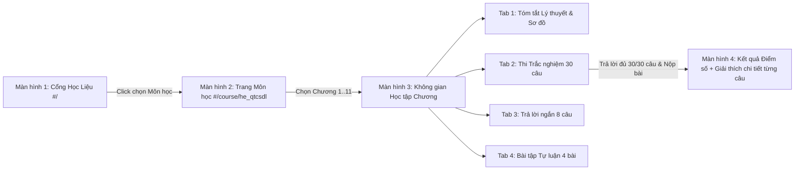

# AGENT EXECUTION SPEC: Tái Thiết Kế Giao Diện LMS Tương Tác, Luồng Người Dùng, Cập Nhật Skill & Ngân Hàng 30 Câu Hỏi/Chương

## 1. Mục tiêu tối thượng (Objective)
1. **Cập nhật & Chuẩn hóa Agent Skill (`skills_registry.json`):** Kiểm tra, cập nhật hoặc khởi tạo mới Skill sinh học liệu tương tác (`interactive_lms_chapter_generator`) trong hệ thống `.antigravity/` để chuẩn hóa quy trình biến đổi tài liệu Markdown thô thành gói dữ liệu học tập tách biệt (`.md` lý thuyết + `.json` bài tập) dùng chung cho mọi môn học.
2. **Thiết kế lại Luồng Người Dùng (User Flow) & Giao diện Tĩnh (Static SPA LMS):** Chuyển đổi thư mục `docs/` (GitHub Pages) thành một Ứng dụng Web Học tập Tương tác chạy hoàn toàn trên Client-side (HTML5 + TailwindCSS CDN + Vanilla JS + Marked.js + KaTeX + Mermaid).
3. **Nâng cấp Ngân hàng Câu hỏi Chuẩn hóa:** Sinh đủ **30 câu trắc nghiệm/chương** (tổng cộng $\ge 330$ câu cho 11 chương môn Hệ QTCSDL) kèm câu hỏi trả lời ngắn và bài tập tự luận. Hệ thống chỉ chấm điểm và hiển thị giải thích chi tiết sau khi người dùng hoàn thành cả 30 câu và bấm nộp bài (**Batch Submission**).

---

## 2. Nguồn dữ liệu đầu vào (Input Sources)
- **Cấu hình Agent & Skills hiện tại:**
  - `.antigravity/context.md`
  - `.antigravity/skills_registry.json`
  - Các file định nghĩa skill hiện có trong `.antigravity/skills/` (nếu có).
- **Danh sách 11 chương bài giảng (`data/parsed_markdown/he_qtcsdl/`):**
  - Quyển 1 (Nhập môn CSDL): `quyen_1_nhap_mon_chuong_1.md` đến `quyen_1_nhap_mon_chuong_6.md`.
  - Quyển 2 (Thiết kế CSDL): `quyen_2_thiet_ke_chuong_1.md` đến `quyen_2_thiet_ke_chuong_5.md`.
- **Tài liệu tóm tắt chuyên đề (`data/notebook_exports/he_qtcsdl/`):**
  - Toàn bộ 9 file `*_summary.md` hiện có.

---

## 3. Thiết kế Luồng Người Dùng & Giao Diện (User Flow & UI/UX Spec)



Agent phải xây dựng giao diện SPA tại `docs/` điều hướng bằng URL Hash (`#/...`) để hoạt động mượt mà trên GitHub Pages mà không cần cấu hình Server Rewrite:

1. **Màn hình 1 - Cổng Học Liệu (`#/` - Home Portal):**
   - Hiển thị danh sách các Môn học dưới dạng **Course Cards** trực quan (Tên môn, Mã môn, Số chương, Tổng số câu hỏi, Thanh tiến độ hoàn thành lưu trong `localStorage`).
   - Bao gồm: **Hệ Quản Trị Cơ Sở Dữ Liệu** (Active - 11 chương, 330+ câu trắc nghiệm) và **Giải Tích 1** (Sẵn sàng mở rộng).
2. **Màn hình 2 - Trang Tổng Quan Môn Học (`#/course/he_qtcsdl` - Course Dashboard):**
   - Thanh điều hướng Breadcrumb: `Trang chủ > Hệ Quản Trị CSDL`.
   - Thống kê nhanh tiến độ môn học của người dùng (Số chương đã hoàn thành, Điểm trung bình).
   - Chia rõ 2 phần theo giáo trình: **Quyển 1: Nhập môn CSDL (Chương 1 - 6)** và **Quyển 2: Thiết kế CSDL (Chương 1 - 5)**, kèm khu vực **Chuyên đề Tổng hợp** (kết xuất từ `notebook_exports`).
   - Mỗi chương là một Card hiển thị: Tên chương, Tóm tắt ngắn, Trạng thái (Chưa làm / Đã hoàn thành), Điểm trắc nghiệm cao nhất (`X/30`).
3. **Màn hình 3 - Không Gian Học Tập Chương (`#/course/he_qtcsdl/chapter/:chapter_id` - Chapter Workspace):**
   - Header có nút quay lại Trang Môn học, Dropdown chuyển nhanh giữa 11 chương, và **4 Tabs chức năng độc lập**:
     - **Tab 1: Lý thuyết & Tóm tắt (Summary):** Render nội dung từ `{chapter_id}_theory.md` với bảng biểu, cú pháp SQL tô màu, sơ đồ Mermaid và công thức toán/đại số quan hệ KaTeX ($\sigma, \pi, \bowtie, \div, X \rightarrow Y, X \twoheadrightarrow Y$).
     - **Tab 2: Luyện Trắc Nghiệm (30 Câu - Batch Quiz Engine):**
       - Hiển thị thanh tiến độ (`Đã trả lời: X/30 câu`) và bảng điều hướng câu hỏi nhanh (Question Palette 1..30, đổi màu những câu đã chọn đáp án).
       - **Quy tắc nghiêm ngặt:** Tuyệt đối KHÔNG hiển thị đáp án đúng/sai hay lời giải ngay khi người dùng vừa chọn phương án A/B/C/D.
       - Nút **"Nộp bài & Chấm điểm"**: Kiểm tra người dùng đã làm đủ 30/30 câu chưa (nếu chưa đủ, hiển thị danh sách các câu còn bỏ trống và hỏi xác nhận nộp sớm hay làm tiếp). Sau khi nộp, chuyển sang Màn hình 4.
     - **Tab 3: Trả lời ngắn (Short Answer - tối thiểu 8 câu/chương):** Mỗi câu có ô nhập liệu (`input`/`textarea`) để người học tự gõ biểu thức Đại số quan hệ, câu lệnh SQL, bao đóng $X^+$ hoặc dạng chuẩn, sau đó bấm "Kiểm tra & Đối chiếu" để xem đáp án chuẩn cùng lời giải.
     - **Tab 4: Bài tập Tự luận (Essay & Design - tối thiểu 4 bài/chương):** Các bài toán lớn (Thiết kế ER, chuyển đổi lược đồ, tìm mọi khóa tối tiểu, phân tách 3NF/BCNF, viết Trigger). Có nút mở gợi ý từng bước (Step-by-step Solution).
4. **Màn hình 4 - Kết Quả & Phân Tích Trắc Nghiệm (Quiz Result & Review Mode):**
   - Hiển thị Bảng tổng kết: Điểm số (`X/30`), Tỷ lệ chính xác (`%`), Đánh giá mức độ nắm vững, và lưu kỷ lục vào `localStorage`.
   - Hiển thị lại toàn bộ 30 câu hỏi để người học rà soát:
     - Tô màu **Xanh lá** cho đáp án đúng.
     - Tô màu **Đỏ** cho phương án người dùng chọn sai (nếu sai).
     - Hiển thị hộp **Giải thích chi tiết (Explanation)** ngay bên dưới mỗi câu.
   - Có nút **"Làm lại bài thi (Retake)"** (reset trạng thái lựa chọn và cho phép đảo thứ tự câu hỏi) và nút **"Bộ lọc: Chỉ xem các câu làm sai"**.

---

## 4. Kiến trúc Dữ liệu Tách biệt (Data Architecture)
Tất cả dữ liệu phục vụ giao diện tĩnh được đặt tại `docs/data/`:
1. `docs/data/courses_manifest.json`: Khai báo danh sách môn học, danh sách 11 chương của `he_qtcsdl` và đường dẫn tới các file lý thuyết/bài tập tương ứng.
2. `docs/data/he_qtcsdl/{chapter_id}_theory.md`: Nội dung tóm tắt lý thuyết, sơ đồ tư duy Mermaid, bảng tổng hợp kiến thức trọng tâm của chương.
3. `docs/data/he_qtcsdl/{chapter_id}_exercises.json`: Ngân hàng câu hỏi của chương theo đúng JSON Schema sau:
   ```json
   {
     "chapter_id": "q1_chuong_1",
     "chapter_title": "Quyển 1 - Chương 1: Tổng quan về Cơ sở dữ liệu",
     "multiple_choice": [
       {
         "id": 1,
         "difficulty": "medium",
         "question": "Nội dung câu hỏi (hỗ trợ LaTeX $...$ và inline code `...`)?",
         "options": {
           "A": "Nội dung phương án A",
           "B": "Nội dung phương án B",
           "C": "Nội dung phương án C",
           "D": "Nội dung phương án D"
         },
         "correct_answer": "B",
         "explanation": "Giải thích rõ lý do phương án B đúng và vì sao các phương án khác chưa chính xác dựa trên giáo trình."
       }
     ],
     "short_answers": [
       {
         "id": 1,
         "question": "Câu hỏi trả lời ngắn / Viết biểu thức Đại số quan hệ / SQL?",
         "expected_answer": "Đáp án chuẩn ngắn gọn",
         "explanation": "Phân tích cách làm chi tiết"
       }
     ],
     "essays": [
       {
         "id": 1,
         "title": "Tiêu đề bài toán tự luận",
         "problem": "Mô tả đầy đủ đề bài, lược đồ quan hệ, tập phụ thuộc hàm hoặc yêu cầu thiết kế...",
         "solution_steps": [
           "Bước 1: Phân tích dữ kiện...",
           "Bước 2: Áp dụng thuật toán...",
           "Bước 3: Kết luận..."
         ]
       }
     ]
   }
   ```

---

## 5. Quy trình thực thi tuần tự (Execution Steps)
> **CHỈ THỊ CHO AGENT:** Thực hiện tuần tự và nghiêm ngặt từ Bước 1 đến Bước 5.

### [ ] Bước 1: Kiểm tra & Cập nhật Skill cho Agent (Skill Update & Registration)
1. Đọc `.antigravity/skills_registry.json`, `.antigravity/context.md` và thư mục `.antigravity/skills/` để kiểm tra các skill hiện có.
2. Tạo mới hoặc cập nhật nâng cấp file đặc tả Skill tại `.antigravity/skills/lms_chapter_pack_generator.md` với các quy tắc chuẩn:
   - **Quy tắc Tách File:** Mọi chương học đều phải xuất ra 1 file `_theory.md` và 1 file `_exercises.json` đúng Schema ở Mục 4.
   - **Ma trận 30 câu trắc nghiệm/chương:**
     - *10 câu Nhận biết & Thông hiểu (Easy):* Khái niệm, định nghĩa, kiến trúc, ký hiệu.
     - *12 câu Vận dụng (Medium):* Đọc/viết truy vấn SQL, tính biểu thức Đại số quan hệ, tìm bao đóng $X^+$, tìm khóa, kiểm tra dạng chuẩn 1NF/2NF/3NF/BCNF.
     - *8 câu Vận dụng cao & Phân tích (Hard):* Bẫy tư duy, tối ưu hóa cây truy vấn, kiểm tra phân tách bảo toàn thông tin ($\bowtie$) và bảo toàn phụ thuộc hàm, phụ thuộc đa trị $X \twoheadrightarrow Y$ và 4NF.
   - **Quy tắc chống suy giảm chất lượng (Anti-Laziness Rule):** Tuyệt đối cấm sinh câu hỏi placeholder, câu hỏi trùng lặp, hoặc cắt ngắn dưới 30 câu.
3. Đăng ký/cập nhật thông tin skill `lms_chapter_pack_generator` vào `.antigravity/skills_registry.json` và ghi nhận trạng thái kiến trúc LMS mới vào `.antigravity/context.md`.

### [ ] Bước 2: Xây dựng Core Frontend SPA tại `docs/`
1. Tạo file `docs/.nojekyll` để GitHub Pages phục vụ toàn bộ tài nguyên tĩnh.
2. Tạo `docs/index.html`, `docs/assets/css/style.css`, và `docs/assets/js/app.js`:
   - Tích hợp CDN: TailwindCSS, Marked.js, KaTeX (kèm auto-render extension cho `$...$` và `$$...$$`), Highlight.js (SQL), Mermaid.js.
   - Thiết kế giao diện học thuật hiện đại, rõ ràng, responsive trên cả Desktop và Mobile, hỗ trợ chuyển đổi Sáng/Tối (Light/Dark Mode).
   - Lập trình Router điều hướng giữa 4 màn hình: `Home Portal` $\rightarrow$ `Course Dashboard` $\rightarrow$ `Chapter Workspace (4 Tabs)` $\rightarrow$ `Quiz Result & Review`.
   - Lập trình **Batch Quiz Engine** quản lý mảng 30 câu trả lời của người dùng, bảng Question Palette 1..30, chức năng nộp bài chấm điểm, lọc câu sai và lưu lịch sử điểm số vào `localStorage`.

### [ ] Bước 3: Thực thi Skill Sinh Học Liệu & Ngân Hàng 30 Câu/Chương cho 11 Chương
Áp dụng Skill vừa cập nhật ở Bước 1, đọc từng file trong `data/parsed_markdown/he_qtcsdl/` (kết hợp `data/notebook_exports/he_qtcsdl/`) để tạo đầy đủ 11 cặp file vào `docs/data/he_qtcsdl/`:
1. `q1_chuong_1` (Từ `quyen_1_nhap_mon_chuong_1.md` - Tổng quan về CSDL)
2. `q1_chuong_2` (Từ `quyen_1_nhap_mon_chuong_2.md` - Mô hình dữ liệu quan hệ)
3. `q1_chuong_3` (Từ `quyen_1_nhap_mon_chuong_3.md` - Đại số quan hệ)
4. `q1_chuong_4` (Từ `quyen_1_nhap_mon_chuong_4.md` - Ngôn ngữ SQL)
5. `q1_chuong_5` (Từ `quyen_1_nhap_mon_chuong_5.md` - Ràng buộc toàn vẹn)
6. `q1_chuong_6` (Từ `quyen_1_nhap_mon_chuong_6.md` - Tổ chức vật lý & Tối ưu hóa câu hỏi)
7. `q2_chuong_1` (Từ `quyen_2_thiet_ke_chuong_1.md` - Mô hình thực thể liên kết ER)
8. `q2_chuong_2` (Từ `quyen_2_thiet_ke_chuong_2.md` - Phụ thuộc hàm và Khóa)
9. `q2_chuong_3` (Từ `quyen_2_thiet_ke_chuong_3.md` - Chuẩn hóa lược đồ quan hệ 1NF-BCNF)
10. `q2_chuong_4` (Từ `quyen_2_thiet_ke_chuong_4.md` - Lý thuyết phân tách lược đồ quan hệ)
11. `q2_chuong_5` (Từ `quyen_2_thiet_ke_chuong_5.md` - Phụ thuộc đa trị và Dạng chuẩn 4NF)

*(Đồng thời kết nối 9 bài tóm tắt chuyên đề từ `data/notebook_exports/he_qtcsdl/` vào mục "Chuyên đề Ôn tập Tổng hợp" trên trang Dashboard môn học).*

### [ ] Bước 4: Kiểm soát File rác & Tối ưu Repository
- Đảm bảo `.gitignore` đã loại trừ các file PDF dung lượng lớn trong `data/raw_pdfs/` để quá trình deploy GitHub Pages diễn ra nhanh chóng, không bị lỗi giới hạn dung lượng.

---

## 6. Tự kiểm tra & Xác thực Tự động (Self-Verification & Auto-Healing)
Sau khi hoàn thành việc sinh dữ liệu và giao diện, Agent BẮT BUỘC tạo và chạy script `scripts/verify_lms_integrity.py` trên Terminal để kiểm định:
1. **Kiểm tra Cấu hình Skill:**
   - Xác thực `.antigravity/skills_registry.json` là JSON hợp lệ và có chứa skill `lms_chapter_pack_generator`.
2. **Kiểm tra Ngân hàng Câu hỏi (11 Chương):**
   - Duyệt qua cả 11 file `docs/data/he_qtcsdl/*_exercises.json`.
   - Kiểm tra mỗi file phải parse JSON thành công và thỏa mãn:
     - `len(multiple_choice) >= 30` (Đủ từ 30 câu trắc nghiệm trở lên).
     - `len(short_answers) >= 8` (Đủ từ 8 câu trả lời ngắn trở lên).
     - `len(essays) >= 4` (Đủ từ 4 bài tập tự luận trở lên).
     - Không có câu hỏi nào trùng nội dung (`question`) trong cùng một chương; mọi câu trắc nghiệm đều có đủ 4 lựa chọn `A, B, C, D`, `correct_answer` hợp lệ và `explanation` không rỗng.
3. **Kiểm tra Server Tĩnh:**
   - Khởi chạy kiểm tra nhanh HTTP Server tại thư mục `docs/` và xác nhận `index.html`, `assets/js/app.js`, `data/courses_manifest.json` đều tải thành công (HTTP 200).
4. **Cơ chế Tự chữa lỗi (Self-Healing):** Nếu script phát hiện bất kỳ chương nào thiếu câu hỏi (ví dụ mới có 20/30 câu) hoặc lỗi cú pháp JSON/LaTeX, Agent phải lập tức bổ sung và chạy lại script cho đến khi toàn bộ 11/11 chương báo **PASS 100%**.

---

## 7. Điều kiện hoàn tất (Definition of Done)
- Skill `lms_chapter_pack_generator` đã được cập nhật đầy đủ vào `.antigravity/skills/` và `.antigravity/skills_registry.json`.
- Giao diện Web tại `docs/` chạy mượt mà theo đúng luồng: `Cổng Môn học -> Trang Môn học Hệ QTCSDL -> Chọn Chương -> Học Lý thuyết / Làm đủ 30 câu Trắc nghiệm rồi Nộp bài xem điểm & giải thích / Làm câu hỏi Trả lời ngắn / Giải bài tập Tự luận`.
- Script kiểm định `scripts/verify_lms_integrity.py` thực thi thành công với kết quả **PASS 100%** (Tổng cộng $\ge 330$ câu trắc nghiệm, $\ge 88$ câu trả lời ngắn, $\ge 44$ bài tự luận trên toàn môn).