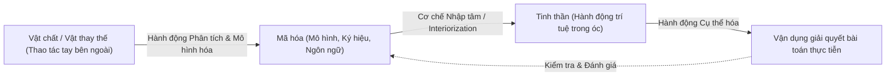

# Chuyên Đề: Bản Chất Hoạt Động Dạy Học và Cơ Chế Phát Triển Trí Tuệ Theo Quan Điểm Hoạt Động

## 1. Bản Đồ Chuyển Hóa Khái Niệm Trong Hoạt Động Học

## 2. Động Cơ Học Tập - Động Lực Bên Trong vs Căng Thẳng Bên Ngoài
- **Động cơ hoàn thiện tri thức (Nội tại):** Đưa học sinh vào trạng thái say mê (Flow state); người học nỗ lực vì niềm vui khám phá chân lý. Đây là động cơ bền vững nhất.
- **Động cơ quan hệ xã hội (Ngoại lai):** Khi học vì sợ phạt hoặc vì danh vọng, tâm lý học sinh luôn bị đè nặng bởi sự căng thẳng và mâu thuẫn nội tâm. Nếu áp lực bên ngoài biến mất, việc học sẽ đình trệ.
- **Sứ mệnh sư phạm:** Biến động cơ bên ngoài thành động cơ bên trong thông qua việc đổi mới nội dung và phương pháp dạy học hấp dẫn.

## 3. Sáu Chỉ Số Đo Lường Năng Lực Trí Tuệ Trong Dạy Học Hiện Đại
1. **Tốc độ định hướng:** Nhanh chóng nhận diện vấn đề trong hoàn cảnh bất định.
2. **Tốc độ khái quát hóa:** Khả năng trừu xuất quy luật từ số lượng mẫu tối thiểu.
3. **Tính tiết kiệm:** Loại bỏ lập luận rườm rà, đi đường thẳng ngắn nhất đến đáp số.
4. **Tính mềm dẻo:** Sẵn sàng đập vỡ lối mòn tư duy khi điều kiện bài toán thay đổi.
5. **Tính phê phán:** Luôn hoài nghi khoa học, đòi hỏi bằng chứng thực nghiệm và logic chặt chẽ.
6. **Sự thấm sâu:** Nhìn thấu bản chất ẩn giấu đằng sau lớp vỏ hiện tượng bên ngoài.

## 4. Cuộc Cách Mạng Dạy Học Khái Niệm Của Davydov
- Bác bỏ lối dạy học quy nạp hình thức (cho quan sát vài ví dụ cụ thể rồi rút ra định nghĩa máy móc).
- Thay bằng lối tiếp cận đi từ **trừu tượng đến cụ thể**: Cho học sinh tự tái tạo lại tình huống nảy sinh nhu cầu phát minh ra khái niệm $	o$ mô hình hóa logic $	o$ vận dụng giải quyết muôn vàn bài toán cụ thể.
