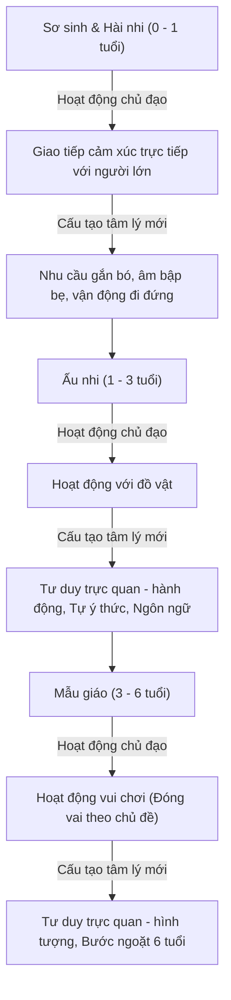

# Chuyên Đề: Tâm Lý Học Trẻ Em Trước Tuổi Học - Từ Khủng Hoảng Tuổi Lên 3 Đến Bước Ngoặt 6 Tuổi

## 1. Bản Đồ Phát Triển Hoạt Động Chủ Đạo Trước Tuổi Học

## 2. Giải Mã Cơ Chế Khủng Hoảng Tuổi Lên 3
- **Nguồn gốc mâu thuẫn:** Xuất phát từ sự ra đời của ý thức bản ngã (trẻ tự nhận thức mình là một cá nhân độc lập với thế giới người lớn).
- **Hành vi điển hình:** "Con tự làm", "Không", bướng bỉnh, ngang ngạnh, phủ định mệnh lệnh người lớn.
- **Ứng xử sư phạm:** Không trấn áp bằng đòn roi (dẫn đến tự ti, ức chế), không thỏa hiệp buông thả (dẫn đến ích kỷ), mà khéo léo chuyển hướng sang các trò chơi tự phục vụ, tôn trọng tính tự chủ có định hướng.

## 3. Trò Chơi Đóng Vai Theo Chủ Đề - Động Cơ Vượt Ngưỡng Tâm Lý
- Trò chơi đóng vai là phương tiện duy nhất ở lứa tuổi mẫu giáo giúp trẻ thâm nhập vào đời sống người lớn mà không bị rào cản bởi năng lực thể chất.
- Khi đóng vai (bác sĩ chữa bệnh, mẹ chăm con), đứa trẻ tự nguyện phục tùng các quy tắc của vai chơi $	o$ rèn luyện tính ý chí, tính kỷ luật và tính chủ định của các quá trình nhận thức.

## 4. Chiến Lược "Độ Chín Muồi Học Đường" (School Readiness)
- Chuẩn bị vào lớp 1 không phải là dạy trước chương trình lớp 1 (ép trẻ luyện chữ, làm toán nâng cao gây quá tải), mà là chuẩn bị **tâm thế tâm lý sẵn sàng**:
  - Hứng thú nhận thức và lòng khao khát được đến trường.
  - Khả năng tập trung chú ý có chủ định từ 15 - 20 phút.
  - Năng lực phối hợp vận động tay - mắt và kỹ năng xã hội trong tập thể.
