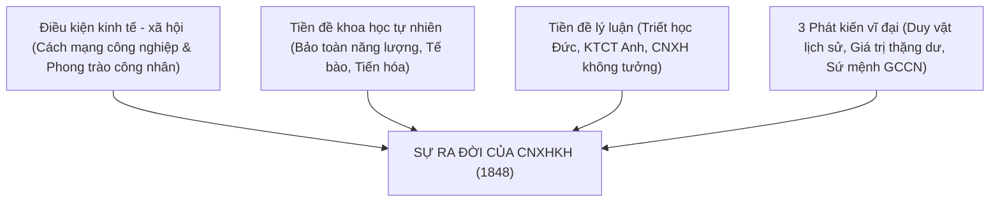

# Giáo trình Chủ nghĩa xã hội khoa học - Chương 1: Nhập môn Chủ nghĩa xã hội khoa học

<!-- PAGE 11 -->
## A. Mục tiêu
1. Về kiến thức: Nắm được hoàn cảnh lịch sử, tiền đề lý luận và khoa học tự nhiên dẫn đến sự ra đời của Chủ nghĩa xã hội khoa học (CNXHKH); các giai đoạn phát triển cơ bản của CNXHKH từ C.Mác - Ph.Ăngghen, V.I.Lênin đến giai đoạn hiện nay; đối tượng, phương pháp và ý nghĩa của việc nghiên cứu môn học.
2. Về kỹ năng: Vận dụng phương pháp luận duy vật biện chứng và duy vật lịch sử để phân tích các vấn đề chính trị - xã hội trong thời đại ngày nay.
3. Về tư tưởng: Khẳng định tính khoa học, tính cách mạng của chủ nghĩa Mác - Lênin; củng cố niềm tin vào lý tưởng xã hội chủ nghĩa và con đường đi lên CNXH ở Việt Nam.

<!-- PAGE 11 -->
## B. Nội dung

### I. Sự ra đời của Chủ nghĩa xã hội khoa học

#### 1. Điều kiện kinh tế - xã hội
- Vào những năm 40 của thế kỷ XIX, cuộc cách mạng công nghiệp đã hoàn thành ở Anh và đang phát triển mạnh mẽ ở Pháp, Đức, làm biến đổi sâu sắc phương thức sản xuất tư bản chủ nghĩa (TBCN).
- Lực lượng sản xuất (LLSX) phát triển mang tính chất xã hội hóa cao độ mâu thuẫn gay gắt với Quan hệ sản xuất (QHSX) TBCN dựa trên chế độ chiếm hữu tư nhân tư bản chủ nghĩa về tư liệu sản xuất (TLSX).
- Biểu hiện về mặt xã hội: Mâu thuẫn giai cấp giữa Giai cấp công nhân (vô sản) và Giai cấp tư sản ngày càng trở nên quyết liệt.
- Các cuộc khởi nghĩa tiêu biểu của giai cấp công nhân:
  1. Khởi nghĩa của thợ dệt ở Lyon (Pháp) năm 1831 và 1834.
  2. Phong trào Hiến chương ở Anh (1836 - 1848) - phong trào chính trị quần chúng đầu tiên mang tính chất vô sản.
  3. Khởi nghĩa của thợ dệt ở Xilêzi (Đức) năm 1844.
- Ý nghĩa: Giai cấp công nhân đã bước lên vũ đài lịch sử với tư cách là một lực lượng chính trị độc lập, đòi hỏi phải có một hệ thống lý luận khoa học và cách mạng soi đường.

<!-- PAGE 15 -->
#### 2. Tiền đề khoa học tự nhiên và tư tưởng lý luận
- **Tiền đề khoa học tự nhiên:** Ba phát minh vĩ đại của khoa học tự nhiên thế kỷ XIX:
  1. *Quy luật bảo toàn và chuyển hóa năng lượng:* Chứng minh tính thống nhất vật chất và sự vận động, chuyển hóa không ngừng của thế giới tự nhiên.
  2. *Thuyết tế bào:* Chứng minh sự thống nhất về cấu trúc và nguồn gốc sinh học của toàn bộ sinh giới.
  3. *Thuyết tiến hóa của Đác-uyn:* Chứng minh các loài sinh vật không phải do Thượng đế sáng tạo mà là kết quả của quá trình tiến hóa lâu dài qua chọn lọc tự nhiên.
  - *Ý nghĩa:* Cung cấp cơ sở khoa học tự nhiên vững chắc để khẳng định thế giới quan duy vật và phương pháp luận biện chứng.
- **Tiền đề tư tưởng lý luận:**
  1. *Triết học cổ điển Đức:* Kế thừa phép biện chứng của Hêghen (đã lọc bỏ yếu tố duy tâm) và chủ nghĩa duy vật của Phoiơbắc (đã lọc bỏ yếu tố siêu hình).
  2. *Kinh tế chính trị học cổ điển Anh:* Kế thừa học thuyết giá trị lao động của A.Smith và D.Ricardo.
  3. *Chủ nghĩa xã hội không tưởng - phê phán Pháp và Anh:* Tiêu biểu là Xanh Ximông, Sáclơ Phuriê và Rôbớt Ôoen. Kế thừa tinh thần phê phán sâu sắc chế độ TBCN và các phác thảo nhân đạo về xã hội tương lai; đồng thời khắc phục hạn chế lịch sử (không thấy được vai trò lịch sử của GCCN và không tìm ra con đường cách mạng bạo lực).

<!-- PAGE 18 -->
#### 3. Vai trò của C.Mác và Ph.Ăngghen
- C.Mác và Ph.Ăngghen đã có sự chuyển biến lập trường tư tưởng: từ chủ nghĩa duy tâm sang chủ nghĩa duy vật, từ lập trường dân chủ cách mạng sang lập trường cộng sản chủ nghĩa (1843 - 1844).
- **Ba phát kiến vĩ đại của C.Mác và Ph.Ăngghen:**
  1. *Chủ nghĩa duy vật lịch sử:* Vạch ra quy luật vận động và phát triển của xã hội loài người thông qua sự thay thế của các hình thái kinh tế - xã hội.
  2. *Học thuyết giá trị thặng dư:* Bóc trần bản chất bóc lột của phương thức sản xuất tư bản chủ nghĩa đối với lao động làm thuê.
  3. *Sứ mệnh lịch sử của giai cấp công nhân:* Khẳng định giai cấp công nhân là lực lượng xã hội lãnh đạo cách mạng xóa bỏ CNTB, xây dựng CNXH và CNCS.
- Tác phẩm **"Tuyên ngôn của Đảng Cộng sản"** (xuất bản tháng 2/1848): Đánh dấu sự ra đời chính thức của Chủ nghĩa xã hội khoa học.

<!-- PAGE 22 -->
### II. Các giai đoạn phát triển cơ bản của Chủ nghĩa xã hội khoa học

#### 1. Thời kỳ C.Mác và Ph.Ăngghen phát triển CNXHKH
- **Thời kỳ từ 1848 đến Công xã Pari (1871):**
  - Đúc kết bài học từ các cuộc cách mạng 1848 - 1851 ở châu Âu.
  - Luận chứng về đập tan bộ máy nhà nước tư sản, xác lập chuyên chính vô sản, liên minh công nông.
- **Thời kỳ sau Công xã Pari đến 1895:**
  - Tổng kết kinh nghiệm Công xã Pari (1871) - hình thái nhà nước chuyên chính vô sản đầu tiên trong lịch sử.
  - Phân kỳ hình thái kinh tế - xã hội cộng sản chủ nghĩa thành hai giai đoạn: giai đoạn thấp (CNXH) và giai đoạn cao (CNCS) trong tác phẩm *Phê phán Cương lĩnh Gôta* (1875).
  - Ph.Ăngghen phát triển toàn diện lý luận trong các tác phẩm: *Chống Đuy-rinh* (1878), *Nguồn gốc của gia đình, của chế độ tư hữu và của nhà nước* (1884).

<!-- PAGE 29 -->
#### 2. V.I.Lênin vận dụng và phát triển sáng tạo CNXHKH trong thời đại mới
- **Thời kỳ trước Cách mạng Tháng Mười Nga (1917):**
  - Phân tích đặc điểm của chủ nghĩa tư bản chuyển sang giai đoạn độc quyền (Đế quốc chủ nghĩa).
  - Phát hiện quy luật phát triển không đều của CNTB và đi đến kết luận lịch sử: *Cách mạng vô sản có thể nổ ra và thắng lợi trước hết ở một số nước, thậm chí ở một nước riêng lẻ - nơi là khâu yếu nhất trong sợi dây chuyền đế quốc chủ nghĩa.*
  - Chuẩn bị về mặt tổ chức và lý luận: Xây dựng Đảng kiểu mới của giai cấp công nhân (Đảng Bônsêvích).
- **Thời kỳ sau Cách mạng Tháng Mười Nga (1917 - 1924):**
  - Lãnh đạo thắng lợi Cách mạng Tháng Mười Nga (1917), mở ra kỷ nguyên mới - kỷ nguyên quá độ từ CNTB lên CNXH trên phạm vi toàn thế giới.
  - Phát triển lý luận về chuyên chính vô sản và nền dân chủ XHCN theo mô hình Xô viết.
  - Đề ra Chính sách kinh tế mới (NEP - 1921): Sử dụng quan hệ hàng hóa - tiền tệ, chủ nghĩa tư bản nhà nước để khôi phục kinh tế và từng bước xây dựng cơ sở vật chất - kỹ thuật cho CNXH.
  - Thành lập Quốc tế Cộng sản (Quốc tế III, 1919) và thông qua Sơ thảo lần thứ nhất Luận cương về vấn đề dân tộc và vấn đề thuộc địa.

<!-- PAGE 35 -->
#### 3. Sự vận dụng và phát triển sáng tạo của các Đảng Cộng sản từ sau năm 1924 đến nay
- Thời kỳ xây dựng CNXH ở Liên Xô và hệ thống XHCN thế giới (1924 - 1991): Những thành tựu vĩ đại và bài học đắt giá từ sự sụp đổ mô hình XHCN ở Liên Xô và Đông Âu do giáo điều, xơ cứng và sai lầm trong cải tổ.
- Thời kỳ cải cách, mở cửa và đổi mới:
  - Đảng Cộng sản Trung Quốc kiên trì đường lối xây dựng "Chủ nghĩa xã hội đặc sắc Trung Quốc trong thời đại mới".
  - Đảng Cộng sản Việt Nam khởi xướng công cuộc Đổi mới toàn diện (từ Đại hội VI năm 1986): Nhận thức đúng đắn thời kỳ quá độ lên CNXH bỏ qua chế độ TBCN, phát triển kinh tế thị trường định hướng XHCN, xây dựng Nhà nước pháp quyền XHCN của nhân dân, do nhân dân, vì nhân dân.

<!-- PAGE 39 -->
### III. Đối tượng, phương pháp và ý nghĩa của việc nghiên cứu CNXHKH

#### 1. Đối tượng nghiên cứu
- Là những quy luật và tính quy luật chính trị - xã hội của quá trình phát sinh, hình thành và phát triển của hình thái kinh tế - xã hội cộng sản chủ nghĩa; những nguyên tắc cơ bản, điều kiện, con đường và phương pháp của cuộc đấu tranh cách mạng của giai cấp công nhân nhằm thực hiện bước chuyển biến từ CNTB lên CNXH và CNCS.
- Mối quan hệ với Triết học Mác - Lênin và Kinh tế chính trị Mác - Lênin: Triết học là nền tảng thế giới quan và phương pháp luận; Kinh tế chính trị vạch ra bản chất kinh tế và quy luật kinh tế; CNXHKH là sự kết luận logic về mặt chính trị - xã hội của toàn bộ chủ nghĩa Mác - Lênin.

#### 2. Phương pháp nghiên cứu
- Phương pháp luận chung: Chủ nghĩa duy vật biện chứng và chủ nghĩa duy vật lịch sử.
- Các phương pháp nghiên cứu cụ thể:
  1. *Phương pháp kết hợp logic với lịch sử:* Xem xét các hiện tượng chính trị - xã hội trong sự phát triển thực tế theo thời gian gắn với bản chất quy luật bên trong.
  2. *Phương pháp phân tích, tổng hợp và so sánh chính trị - xã hội.*
  3. *Phương pháp khảo sát và tổng kết thực tiễn cách mạng.*

#### 3. Ý nghĩa của việc nghiên cứu môn học
- **Về lý luận:** Trang bị vũ khí lý luận sắc bén cho giai cấp công nhân và nhân dân lao động; bác bỏ các quan điểm sai trái, thù địch xuyên tạc chủ nghĩa xã hội.
- **Về thực tiễn:** Định hướng cho công cuộc đổi mới, xây dựng và bảo vệ Tổ quốc Việt Nam XHCN; củng cố lập trường giai cấp và niềm tin cách mạng của thế hệ trẻ.

<!-- PAGE 49 -->
## C. Câu hỏi ôn tập chương 1
1. Phân tích điều kiện kinh tế - xã hội và tiền đề khoa học, lý luận dẫn đến sự ra đời của Chủ nghĩa xã hội khoa học.
2. Trình bày ba phát kiến vĩ đại của C.Mác và Ph.Ăngghen. Vì sao nói Tuyên ngôn của Đảng Cộng sản đánh dấu sự ra đời của CNXHKH?
3. Phân tích những cống hiến lý luận của V.I.Lênin đối với sự phát triển của Chủ nghĩa xã hội khoa học.
4. Trình bày đối tượng nghiên cứu và ý nghĩa của môn học Chủ nghĩa xã hội khoa học đối với sinh viên đại học hiện nay.\n