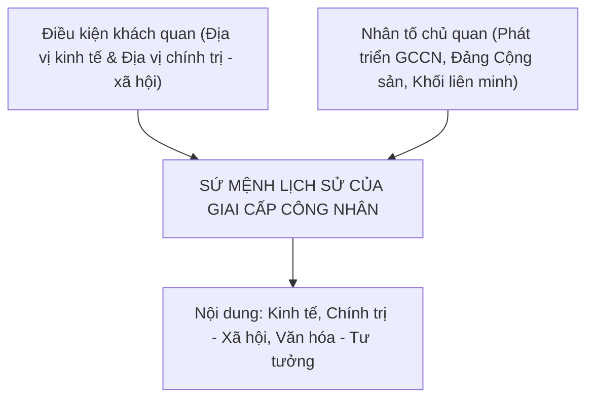

# Giáo trình Chủ nghĩa xã hội khoa học - Chương 2: Sứ mệnh lịch sử của giai cấp công nhân

<!-- PAGE 51 -->
## A. Mục tiêu
1. Về kiến thức: Nắm vững quan điểm của chủ nghĩa Mác - Lênin về giai cấp công nhân; nội dung và điều kiện khách quan, nhân tố chủ quan quy định sứ mệnh lịch sử của giai cấp công nhân; đặc điểm của giai cấp công nhân hiện nay và sứ mệnh lịch sử của giai cấp công nhân Việt Nam.
2. Về kỹ năng: Phân biệt được sự biến đổi của giai cấp công nhân hiện đại so với thế kỷ XIX mà vẫn giữ nguyên bản chất cách mạng; nhận diện vai trò lãnh đạo của Đảng Cộng sản.
3. Về tư tưởng: Xây dựng niềm tin vào vai trò của giai cấp công nhân và sự lãnh đạo của Đảng Cộng sản Việt Nam; nâng cao trách nhiệm của thanh niên, sinh viên trong việc tham gia xây dựng khối liên minh giai cấp vững mạnh.

<!-- PAGE 51 -->
## B. Nội dung

### I. Quan điểm cơ bản của chủ nghĩa Mác - Lênin về giai cấp công nhân và sứ mệnh lịch sử của giai cấp công nhân

#### 1. Khái niệm và đặc điểm của giai cấp công nhân
- **Khái niệm:** Giai cấp công nhân là một tập đoàn xã hội ổn định, hình thành và phát triển cùng với quá trình phát triển của nền đại công nghiệp; là giai cấp đại diện cho lực lượng sản xuất tiên tiến; là lực lượng chủ yếu của tiến trình lịch sử quá độ từ chủ nghĩa tư bản lên chủ nghĩa xã hội.
- **Hai phương diện xác định giai cấp công nhân:**
  1. *Về phương thức lao động (phương diện kinh tế - kỹ thuật):* Giai cấp công nhân là những người lao động trực tiếp hoặc gián tiếp vận hành các công cụ sản xuất có tính chất công nghiệp ngày càng hiện đại và xã hội hóa cao.
  2. *Về vị trí trong quan hệ sản xuất tư bản chủ nghĩa (phương diện kinh tế - xã hội):* Dưới chế độ TBCN, giai cấp công nhân không có hoặc về cơ bản không có tư liệu sản xuất, phải bán sức lao động cho nhà tư bản và bị bóc lột giá trị thặng dư.
- **Đặc điểm cơ bản của giai cấp công nhân:**
  - Lao động bằng phương thức công nghiệp với đặc thù: năng suất cao, kỷ luật nghiêm ngặt, có tổ chức và tinh thần hợp tác tập thể.
  - Là sản phẩm của bản thân nền đại công nghiệp, là chủ thể của quá trình sản xuất vật chất hiện đại.
  - Mang tính quốc tế sâu sắc do sự phát triển của LLSX vượt khỏi biên giới quốc gia.

<!-- PAGE 55 -->
#### 2. Nội dung sứ mệnh lịch sử của giai cấp công nhân
Sứ mệnh lịch sử tổng quát của giai cấp công nhân là thông qua chính đảng của mình lãnh đạo nhân dân lao động tiến hành cách mạng vô sản nhằm lật đổ ách thống trị của giai cấp tư sản, xóa bỏ chế độ bóc lột áp bức, giải phóng giai cấp, giải phóng nhân dân lao động và toàn thể nhân loại khỏi mọi xiềng xích nô dịch, xây dựng thành công xã hội chủ nghĩa và cộng sản chủ nghĩa văn minh.

- **Nội dung kinh tế:** Là lực lượng nòng cốt giải phóng LLSX, xóa bỏ QHSX chiếm hữu tư nhân TBCN về TLSX, thiết lập chế độ công hữu về các TLSX chủ yếu, tổ chức nền sản xuất xã hội hiện đại nhằm thỏa mãn nhu cầu ngày càng tăng của con người.
- **Nội dung chính trị - xã hội:** Lật đổ nhà nước tư sản, thiết lập nhà nước chuyên chính vô sản (nhà nước XHCN), xây dựng nền dân chủ XHCN, sử dụng quyền lực nhà nước để trấn áp các thế lực phản động và cải tạo xã hội cũ, tổ chức xây dựng xã hội mới.
- **Nội dung văn hóa - tư tưởng:** Thực hiện cuộc cách mạng tư tưởng và văn hóa, xây dựng hệ tư tưởng tiên tiến của giai cấp công nhân (chủ nghĩa Mác - Lênin), xóa bỏ các hủ tục tàn dư lạc hậu, xây dựng nền văn hóa mới XHCN và con người mới XHCN phát triển toàn diện.

<!-- PAGE 59 -->
#### 3. Những điều kiện quy định sứ mệnh lịch sử của giai cấp công nhân
- **Điều kiện khách quan:**
  1. *Do địa vị kinh tế của giai cấp công nhân:* Đại diện cho LLSX tiên tiến nhất; là sản phẩm và chủ thể của nền sản xuất vật chất hiện đại, quyết định sự tồn tại và phát triển của xã hội.
  2. *Do địa vị chính trị - xã hội của giai cấp công nhân:* Là giai cấp chịu áp bức nặng nề nhất dưới CNTB; có tinh thần cách mạng triệt để nhất (chỉ có thể giải phóng mình bằng cách giải phóng toàn thể nhân loại); có tính tổ chức, kỷ luật cao do môi trường đại công nghiệp rèn luyện.
- **Nhân tố chủ quan:**
  1. *Sự phát triển của bản thân giai cấp công nhân cả về số lượng và chất lượng:* Tăng nhanh về số lượng, nâng cao trình độ học vấn, kỹ năng nghề nghiệp và ý thức giác ngộ giai cấp.
  2. *Đảng Cộng sản - đội tiên phong của giai cấp công nhân:* Đảng là sự kết hợp giữa chủ nghĩa Mác - Lênin với phong trào công nhân. Đảng đề ra đường lối chiến lược, sách lược đúng đắn và tổ chức lãnh đạo toàn thể quần chúng nhân dân.
  3. *Khối liên minh giai cấp giữa công nhân với nông dân và các tầng lớp lao động khác:* Là điều kiện bắt buộc bảo đảm thắng lợi của cách mạng.

<!-- PAGE 65 -->
### II. Giai cấp công nhân và việc thực hiện sứ mệnh lịch sử hiện nay

#### 1. Điểm tương đồng và những biến đổi của giai cấp công nhân hiện nay
- **Điểm tương đồng so với công nhân thế kỷ XIX:**
  - Vẫn là lực lượng sản xuất hàng đầu của xã hội hiện đại.
  - Về cơ bản vẫn không nắm giữ tư liệu sản xuất chủ yếu, vẫn bị các tập đoàn tư bản bóc lột giá trị thặng dư (thậm chí mức độ bóc lột giá trị thặng dư tương đối qua công nghệ cao còn tinh vi và sâu sắc hơn).
  - Phong trào đấu tranh của công nhân vẫn tiếp tục diễn ra dưới nhiều hình thức để bảo vệ quyền lợi sinh kế và dân chủ.
- **Những biến đổi mới của công nhân hiện đại:**
  - *Xu hướng "trí tuệ hóa" (công nhân tri thức, công nhân áo trắng):* Trình độ học vấn và tay nghề tăng vọt, gắn liền với kinh tế tri thức và cuộc Cách mạng công nghiệp lần thứ tư (4.0).
  - *Xu hướng "trung lưu hóa" về thu nhập:* Một bộ phận có sở hữu cổ phiếu nhỏ lẻ trong các công ty cổ phần, đời sống vật chất được nâng lên, nhưng bản chất địa vị làm thuê vẫn không hề thay đổi.
  - *Tính đa dạng và phân hóa:* Cơ cấu ngành nghề thay đổi mạnh từ công nghiệp chế tạo truyền thống sang dịch vụ công nghệ cao, tự động hóa, logistics.

<!-- PAGE 72 -->
### III. Sứ mệnh lịch sử của giai cấp công nhân Việt Nam

#### 1. Đặc điểm của giai cấp công nhân Việt Nam
- Ra đời trước giai cấp tư sản dân tộc vào đầu thế kỷ XX trong cuộc khai thác thuộc địa của thực dân Pháp.
- Trực tiếp đối kháng với thực dân Pháp và phong kiến tay sai, mang sẵn lòng yêu nước nồng nàn và tinh thần dân tộc sâu sắc.
- Gắn bó tự nhiên, máu thịt với giai cấp nông dân (phần lớn xuất thân từ nông dân mất đất).
- Sớm có Đảng của mình lãnh đạo (Đảng Cộng sản Việt Nam thành lập đầu năm 1930), giác ngộ chủ nghĩa Mác - Lênin ngay từ buổi đầu, trở thành lực lượng duy nhất lãnh đạo cách mạng Việt Nam.

#### 2. Nội dung sứ mệnh lịch sử của giai cấp công nhân Việt Nam hiện nay
- **Về kinh tế:** Là lực lượng đi đầu trong sự nghiệp đẩy mạnh công nghiệp hóa, hiện đại hóa đất nước gắn với phát triển kinh tế tri thức; xây dựng nền kinh tế độc lập tự chủ và hội nhập quốc tế.
- **Về chính trị - xã hội:** Giữ vững và tăng cường vai trò lãnh đạo của Đảng; xây dựng Nhà nước pháp quyền XHCN; củng cố khối đại đoàn kết toàn dân tộc và liên minh công - nông - trí thức.
- **Về văn hóa - tư tưởng:** Xây dựng nền văn hóa Việt Nam tiên tiến, đậm đà bản sắc dân tộc; kiên định chủ nghĩa Mác - Lênin và tư tưởng Hồ Chí Minh; đấu tranh phản bác các quan điểm sai trái, bảo vệ nền tảng tư tưởng của Đảng.

#### 3. Phương hướng và giải pháp xây dựng giai cấp công nhân Việt Nam hiện nay
1. Nâng cao nhận thức bản lĩnh chính trị, giác ngộ giai cấp và tinh thần dân tộc cho công nhân.
2. Nâng cao trình độ học vấn, chuyên môn nghiệp vụ, kỹ năng nghề nghiệp và tác phong công nghiệp.
3. Chăm lo đời sống vật chất, tinh thần, cải thiện điều kiện làm việc, nhà ở và bảo đảm quyền lợi chính đáng cho người lao động.
4. Tăng cường xây dựng Đảng và tổ chức Công đoàn vững mạnh trong mọi loại hình doanh nghiệp.

<!-- PAGE 84 -->
## C. Câu hỏi ôn tập chương 2
1. Phân tích định nghĩa giai cấp công nhân và làm rõ hai phương diện xác định giai cấp công nhân.
2. Trình bày nội dung sứ mệnh lịch sử của giai cấp công nhân trên các lĩnh vực: kinh tế, chính trị - xã hội và văn hóa - tư tưởng.
3. Phân tích các điều kiện khách quan và nhân tố chủ quan quy định sứ mệnh lịch sử của giai cấp công nhân.
4. Trình bày đặc điểm và nội dung sứ mệnh lịch sử của giai cấp công nhân Việt Nam trong thời kỳ đẩy mạnh CNH, HĐH đất nước.\n