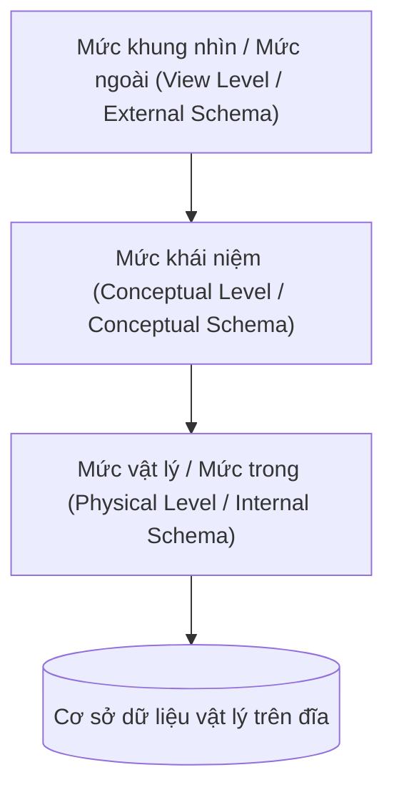

# Giáo trình Thực hành Cơ sở Dữ liệu (Phần I - Nhập môn) - Chương 1: Tổng quan về Cơ sở Dữ liệu

<!-- PAGE 17 -->
## 1. Khái niệm Cơ sở Dữ liệu và Hệ Quản trị Cơ sở Dữ liệu

### 1.1. Khái niệm cơ sở dữ liệu (Database - DB)
Cơ sở dữ liệu là một tập hợp các dữ liệu có liên quan logic với nhau, được tổ chức, lưu trữ một cách có cấu trúc trên các thiết bị nhớ thứ cấp (như đĩa cứng) nhằm phục vụ nhu cầu khai thác thông tin của nhiều người dùng và nhiều ứng dụng khác nhau.

<!-- PAGE 19 -->
### 1.2. Đặc điểm của cơ sở dữ liệu
1. **Tính độc lập dữ liệu (Data Independence):** Phân tách giữa dữ liệu lưu trữ vật lý và các chương trình ứng dụng khai thác dữ liệu.
2. **Tính giảm thiểu dư thừa dữ liệu (Data Redundancy Reduction):** Hạn chế tối đa việc lưu trữ trùng lặp cùng một thông tin ở nhiều nơi, giảm thiểu nguy cơ không nhất quán dữ liệu (Data Inconsistency).
3. **Tính toàn vẹn dữ liệu (Data Integrity):** Dữ liệu được kiểm soát bởi các ràng buộc toàn vẹn (Integrity Constraints) nhằm đảm bảo tính chính xác và hợp lệ của thông tin.
4. **Khả năng chia sẻ dữ liệu (Data Sharing):** Nhiều người dùng và chương trình ứng dụng có thể đồng thời truy cập, thao tác trên cùng một cơ sở dữ liệu.
5. **Tính an toàn và bảo mật (Data Security):** Cung cấp cơ chế phân quyền, xác thực và kiểm soát truy cập nhằm ngăn chặn các hành vi truy cập trái phép.

<!-- PAGE 21 -->
### 1.3. Hệ quản trị cơ sở dữ liệu (DBMS - Database Management System)
Hệ quản trị cơ sở dữ liệu là hệ thống phần mềm chuyên dụng cung cấp môi trường thuận lợi và hiệu quả cho người dùng trong việc:
- Định nghĩa cấu trúc cơ sở dữ liệu (Data Definition).
- Thao tác, cập nhật, truy vấn dữ liệu (Data Manipulation).
- Kiểm soát an toàn, phục hồi khi có sự cố và điều khiển tương tranh (Concurrency Control & Recovery).

Các hệ quản trị CSDL phổ biến: Microsoft SQL Server, Oracle Database, MySQL, PostgreSQL, SQLite.

<!-- PAGE 25 -->
## 2. Hệ Cơ sở Dữ liệu và Khả năng của DBMS

### 2.1. Thành phần của một Hệ cơ sở dữ liệu (Database System)
Một hệ cơ sở dữ liệu hoàn chỉnh bao gồm 4 thành phần cơ bản:
1. **Dữ liệu (Data):** Tài nguyên thông tin cốt lõi được lưu trữ.
2. **Phần cứng (Hardware):** Bộ xử lý, bộ nhớ trong, thiết bị lưu trữ ngoài, hạ tầng mạng.
3. **Phần mềm (Software):** Hệ điều hành, phần mềm DBMS và các chương trình ứng dụng.
4. **Con người (Users):** Người quản trị (DBA), người thiết kế CSDL, lập trình viên và người dùng cuối.

<!-- PAGE 27 -->
## 3. Kiến trúc Ba Mức Biểu diễn của Cơ sở Dữ liệu (ANSI/SPARC Architecture)

Kiến trúc ANSI/SPARC chia hệ thống cơ sở dữ liệu thành ba mức trừu tượng hóa:

| Mức biểu diễn | Khái niệm và Đặc điểm | Đối tượng sử dụng chính |
| :--- | :--- | :--- |
| **Mức ngoài (External Level / View Level)** | Là cách nhìn dữ liệu của từng người dùng cụ thể. Mỗi người dùng chỉ quan tâm đến một phần cơ sở dữ liệu phù hợp với quyền hạn và chức năng của họ. | Người dùng cuối, Lập trình viên ứng dụng |
| **Mức khái niệm (Conceptual Level)** | Mô tả toàn bộ cấu trúc logic của cơ sở dữ liệu: bao gồm tất cả thực thể, kiểu dữ liệu, mối liên kết logic và các ràng buộc toàn vẹn. Không phụ thuộc vào cấu trúc lưu trữ vật lý. | Chuyên viên thiết kế CSDL, Quản trị viên (DBA) |
| **Mức trong / Mức vật lý (Internal / Physical Level)** | Mô tả chi tiết cách thức dữ liệu được lưu trữ vật lý trên thiết bị nhớ: cấu trúc tệp, phương pháp đánh chỉ mục (B-Tree, Hashing), kỹ thuật nén và cấp phát không gian khối nhớ (block/page). | Quản trị viên hệ thống (DBA), Hệ điều hành |

<!-- PAGE 30 -->
## 4. Tính Độc Lập Dữ Liệu (Data Independence)

1. **Độc lập dữ liệu logic (Logical Data Independence):**
   - Khả năng thay đổi lược đồ mức khái niệm (ví dụ thêm thuộc tính mới, thêm bảng mới) mà không làm thay đổi các lược đồ mức ngoài và không phải viết lại các chương trình ứng dụng hiện có.
2. **Độc lập dữ liệu vật lý (Physical Data Independence):**
   - Khả năng thay đổi lược đồ mức trong (ví dụ thay đổi cấu trúc tệp lưu trữ, tạo thêm chỉ mục, chuyển ổ đĩa lưu trữ) mà không ảnh hưởng đến lược đồ mức khái niệm và mức ngoài.

<!-- PAGE 32 -->
## 5. Ngôn Ngữ Cơ Sở Dữ Liệu (Database Languages)

Hệ quản trị CSDL cung cấp các hệ thống ngôn ngữ chuyên biệt:
- **Ngôn ngữ định nghĩa dữ liệu (DDL - Data Definition Language):** Dùng để khai báo lược đồ CSDL, định nghĩa cấu trúc bảng, kiểu dữ liệu, các ràng buộc toàn vẹn (`CREATE`, `ALTER`, `DROP`).
- **Ngôn ngữ thao tác dữ liệu (DML - Data Manipulation Language):** Dùng để truy vấn, chèn, sửa đổi và xóa dữ liệu (`SELECT`, `INSERT`, `UPDATE`, `DELETE`).
- **Ngôn ngữ điều khiển dữ liệu (DCL - Data Control Language):** Quản lý quyền truy cập và bảo mật người dùng (`GRANT`, `REVOKE`).

<!-- PAGE 34 -->
## 6. Các Đối Tượng Sử Dụng Cơ Sở Dữ Liệu
1. **Người quản trị CSDL (DBA - Database Administrator):** Chịu trách nhiệm thiết lập cấu hình, cấp quyền truy cập, giám sát hiệu năng, sao lưu (backup) và phục hồi dữ liệu khi có sự cố.
2. **Người thiết kế CSDL (Database Designer):** Chịu trách nhiệm phân tích yêu cầu nghiệp vụ, xây dựng mô hình khái niệm (E-R) và lược đồ quan hệ logic.
3. **Lập trình viên ứng dụng (Application Programmer):** Viết các ứng dụng tương tác với CSDL thông qua các giao diện lập trình (ODBC, JDBC, ORM).
4. **Người dùng cuối (End User):** Khai thác dữ liệu thông qua các màn hình ứng dụng nghiệp vụ hoặc các câu truy vấn tương tác.

<!-- PAGE 36 -->
## 7. Tóm Tắt & Câu Hỏi Ôn Tập Chương 1

### 7.1. Bài tập có hướng dẫn
**Đề bài:** Trình bày sự khác nhau căn bản giữa hệ thống quản lý tệp truyền thống (File System) và Hệ quản trị cơ sở dữ liệu (DBMS).

**Lời giải:**
1. *Dư thừa dữ liệu:* File System lưu trữ dữ liệu phân tán theo từng ứng dụng nên gây dư thừa dữ liệu lớn; DBMS lưu trữ tập trung có kiểm soát giúp giảm thiểu tối đa dư thừa.
2. *Tính không nhất quán:* Khi cùng một dữ liệu nằm ở nhiều tệp trong File System, sửa đổi tại một nơi dễ dẫn đến lệch pha; DBMS duy trì một nguồn dữ liệu duy nhất và quản lý giao tác (transaction) đảm bảo nhất quán.
3. *Độc lập dữ liệu:* Trong File System, cấu trúc dữ liệu bị gắn chặt vào mã nguồn chương trình; DBMS phân tách rõ 3 mức biểu diễn (ngoài - khái niệm - vật lý), đạt tính độc lập dữ liệu cao.
4. *Chia sẻ và tương tranh:* File System khó kiểm soát nhiều người dùng đồng thời ghi tệp; DBMS có bộ điều khiển tương tranh (Concurrency Control) ngăn chặn xung đột (Lost Update, Dirty Read).
