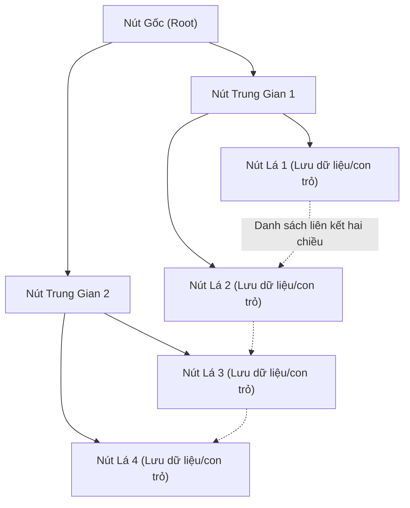

# Giáo trình Thực hành Cơ sở Dữ liệu (Phần I - Nhập môn) - Chương 5: Tổ chức Vật lý của Dữ liệu & Cấu trúc Chỉ mục

<!-- PAGE 163 -->
## 1. Các Khái Niệm Cơ Sở Về Tổ Chức Lưu Trữ Dữ Liệu

Trong hệ cơ sở dữ liệu, việc tổ chức lưu trữ vật lý ảnh hưởng trực tiếp đến hiệu năng đọc, ghi và tốc độ xử lý các câu truy vấn.

### 1.1. Bản ghi logic và Bản ghi vật lý (Block / Page)
- **Bản ghi logic (Logical Record):** Tương ứng với một bộ giá trị (tuple) trong mô hình quan hệ, gồm các trường thuộc tính chứa thông tin của một thực thể.
- **Bản ghi vật lý / Khối (Physical Block / Page):** Là đơn vị truyền dữ liệu nhỏ nhất giữa bộ nhớ ngoài (đĩa từ, SSD) và bộ nhớ trong (RAM). Kích thước khối $B$ thường là 4KB, 8KB hoặc 16KB.
- **Hệ số đóng gói (Blocking Factor - $bfr$):** Số lượng bản ghi logic tối đa có thể chứa vừa trong một khối vật lý:
  $$bfr = \left\lfloor \frac{B}{R} \right\rfloor$$
  trong đó $B$ là kích thước khối (bytes) và $R$ là kích thước của một bản ghi logic (bytes).
- **Số khối đĩa cần dùng để chứa tệp có $r$ bản ghi:**
  $$b = \left\lceil \frac{r}{bfr} \right\rceil$$

<!-- PAGE 166 -->
## 2. Các Kiểu Tổ Chức Tệp Cơ Bản

### 2.1. Tổ chức tệp tuần tự (Sequential File Organization)
- Các bản ghi được sắp xếp tuần tự theo giá trị của một trường khóa sắp xếp (Ordering Key).
- **Ưu điểm:** Rất hiệu quả cho các thao tác đọc quét toàn bộ bảng theo thứ tự khóa, đọc dải (Range Scan).
- **Nhược điểm:** Thao tác chèn (Insert) và xóa (Delete) tốn kém vì phải dịch chuyển dữ liệu hoặc duy trì vùng tràn (Overflow Area).

### 2.2. Tổ chức tệp ngẫu nhiên / Băm (Hash File Organization)
- Sử dụng hàm băm $h(K)$ để ánh xạ trực tiếp giá trị khóa $K$ của bản ghi tới địa chỉ của một khối bucket trên đĩa.
- **Ưu điểm:** Tốc độ tìm kiếm theo phép so sánh bằng ($K = \text{value}$) đạt độ phức tạp $O(1)$ về chi phí truy xuất đĩa.
- **Nhược điểm:** Không hỗ trợ truy vấn tìm kiếm theo khoảng ($K_1 \le K \le K_2$), dễ xảy ra hiện tượng đụng độ băm (Hash Collision) khi bảng dữ liệu phình to.

<!-- PAGE 172 -->
## 3. Cấu Trúc Chỉ Mục (Indexing Techniques)

Chỉ mục là cấu trúc dữ liệu bổ trợ cho phép tăng tốc độ truy tìm các bản ghi mà không cần quét toàn bộ tệp dữ liệu chính (Full Table Scan). Mỗi mục chỉ mục (Index Entry) gồm cặp: `<Khóa tìm kiếm, Con trỏ khối/bản ghi>`.

### 3.1. Phân loại chỉ mục
1. **Chỉ mục sơ cấp (Primary Index):** Được xây dựng trên trường khóa chính của tệp dữ liệu đã được sắp thứ tự. Thường là chỉ mục thưa (Sparse Index).
2. **Chỉ mục cụm (Clustering Index):** Được xây dựng trên một trường không phải khóa của một tệp đã được sắp thứ tự theo trường đó.
3. **Chỉ mục thứ cấp (Secondary Index):** Được xây dựng trên một trường bất kỳ của tệp dữ liệu không có thứ tự hoặc đã sắp xếp theo trường khác. Bắt buộc là chỉ mục đặc (Dense Index).
4. **Chỉ mục đặc (Dense Index) vs Chỉ mục thưa (Sparse Index):**
   - *Dense Index:* Mỗi bản ghi trong tệp dữ liệu đều có một mục tương ứng trong tệp chỉ mục.
   - *Sparse Index:* Chỉ lưu mục chỉ mục đại diện cho bản ghi đầu tiên của mỗi khối đĩa.

<!-- PAGE 173 -->
### 3.2. Cấu trúc Chỉ mục Đa cấp: Cây B và Cây B+ (B-Tree & B+ Tree)
Cây B+ là cấu trúc chỉ mục cây cân bằng động được sử dụng trong hầu hết các hệ quản trị CSDL hiện đại (như InnoDB của MySQL, SQL Server, PostgreSQL).

- **Đặc điểm cốt lõi của Cây B+:**
  1. Toàn bộ con trỏ trỏ đến bản ghi dữ liệu thực tế đều nằm tại các **nút lá (Leaf Nodes)**.
  2. Các nút lá được nối với nhau thành một **danh sách liên kết hai chiều**, cho phép thực thi cực nhanh các truy vấn tìm kiếm theo khoảng (Range Query) bằng cách duyệt tuần tự trên tầng lá.
  3. Chi phí tìm kiếm, chèn, xóa luôn giữ ở mức $\log_M(N)$ với bậc phân nhánh $M$ lớn (thường $M > 100$), giúp độ cao của cây chỉ từ 3 đến 4 tầng đối với hàng triệu bản ghi.

<!-- PAGE 174 -->
## 4. Tóm Tắt & Bài Tập Tính Toán Chi Phí I/O

**Đề bài:** Một tệp gồm $r = 100.000$ bản ghi, kích thước mỗi bản ghi $R = 200$ bytes. Kích thước khối đĩa $B = 4096$ bytes.
1. Tính hệ số đóng gói $bfr$ và số khối đĩa $b$ cần dùng.
2. Tính số phép đọc khối (Block I/O) khi tìm kiếm một bản ghi nếu tệp chưa có thứ tự (tìm kiếm tuyến tính) so với khi tệp đã sắp xếp theo khóa (tìm kiếm nhị phân).

**Lời giải chi tiết:**
1. Hệ số đóng gói:
   $$bfr = \left\lfloor \frac{4096}{200} \right\rfloor = 20 \text{ bản ghi/khối}$$
   Số khối đĩa lưu trữ tệp dữ liệu:
   $$b = \left\lceil \frac{100.000}{20} \right\rceil = 5.000 \text{ khối}$$

2. So sánh chi phí tìm kiếm (I/O Cost):
   - *Tìm kiếm tuyến tính (Linear Search):* Trung bình đọc $\frac{b}{2} = \frac{5.000}{2} = 2.500$ khối đĩa. Trường hợp xấu nhất đọc $5.000$ khối.
   - *Tìm kiếm nhị phân (Binary Search):* Số phép đọc khối tối đa là:
     $$\lceil \log_2(b) \rceil = \lceil \log_2(5000) \rceil = 13 \text{ khối đĩa}$$
   $\implies$ Việc sắp thứ tự và đánh chỉ mục giảm chi phí từ 2.500 lần đọc đĩa xuống chỉ còn 13 lần.
