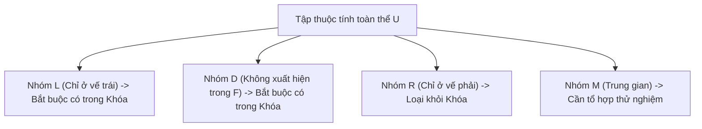

# CHƯƠNG 2. PHỤ THUỘC HÀM VÀ KHÓA

<!-- PAGE 41 -->

## 1. TỔNG QUAN VÀ CƠ SỞ LÝ THUYẾT

### 1.1. Mở đầu
Lý thuyết thiết kế cơ sở dữ liệu quan hệ được xây dựng dựa trên nền tảng toán học của **Phụ thuộc hàm (Functional Dependency)**. Phụ thuộc hàm phản ánh mối liên hệ ngữ nghĩa giữa các thuộc tính trong thế giới thực, đồng thời là công cụ cốt lõi để xác định khóa, phân tích bất thường dữ liệu và thực hiện chuẩn hóa lược đồ cơ sở dữ liệu.

<!-- PAGE 44 -->

### 1.2. Định nghĩa Phụ thuộc hàm (Functional Dependency)
Cho lược đồ quan hệ $R(U)$ với $U = \{A_1, A_2, \dots, A_n\}$ là tập các thuộc tính và $X, Y \subseteq U$.

> **Định nghĩa:** Ta nói rằng **$X$ xác định hàm $Y$** (hay **$Y$ phụ thuộc hàm vào $X$**), ký hiệu là:
> $$X \to Y$$
> nếu với mọi quan hệ $r$ xác định trên $R(U)$ và với mọi cặp bộ dữ liệu $t_1, t_2 \in r$:
> $$t_1[X] = t_2[X] \implies t_1[Y] = t_2[Y]$$

- $X$ được gọi là **vế trái (Determinant / Left-hand side)**.
- $Y$ được gọi là **vế phải (Dependent / Right-hand side)**.
- Nếu $Y \subseteq X$, phụ thuộc hàm $X \to Y$ được gọi là **phụ thuộc hàm tầm thường (Trivial Dependency)**.
- Nếu $Y \not\subseteq X$, $X \to Y$ là **phụ thuộc hàm không tầm thường (Non-trivial Dependency)**.

<!-- PAGE 45 -->

---

## 2. SUY DẪN LOGIC VÀ HỆ TIÊN ĐỀ ARMSTRONG

### 2.1. Phụ thuộc hàm được suy dẫn logic từ $F$
Cho $F$ là tập các phụ thuộc hàm trên lược đồ quan hệ $R(U)$.
Một phụ thuộc hàm $X \to Y$ được gọi là **được suy dẫn logic từ $F$**, ký hiệu là:
$$F \vDash X \to Y$$
nếu mọi quan hệ $r$ thỏa mãn tất cả các phụ thuộc hàm trong $F$ thì cũng đều thỏa mãn $X \to Y$.

Tập hợp tất cả các phụ thuộc hàm được suy dẫn logic từ $F$ được gọi là **bao đóng của tập phụ thuộc hàm $F$**, ký hiệu là $F^+$.

<!-- PAGE 46 -->

### 2.2. Hệ tiên đề Armstrong (Armstrong's Axioms)
Năm 1974, W. W. Armstrong đã đề xuất hệ gồm 3 tiên đề cơ bản cho phép suy diễn cú pháp mọi phụ thuộc hàm từ tập ban đầu $F$:

1. **Tiên đề Phản xạ (Reflexivity):**
   $$\text{Nếu } Y \subseteq X \subseteq U \implies X \to Y$$
2. **Tiên đề Tăng trưởng (Augmentation):**
   $$\text{Nếu } X \to Y \text{ và } Z \subseteq U \implies XZ \to YZ$$
   *(Ký hiệu $XZ$ biểu thị phép hợp $X \cup Z$)*
3. **Tiên đề Bắc cầu (Transitivity):**
   $$\text{Nếu } X \to Y \text{ và } Y \to Z \implies X \to Z$$

<!-- PAGE 48 -->

### 2.3. Các quy tắc mở rộng (Secondary Rules)
Từ 3 tiên đề cơ bản của Armstrong, ta có thể suy ra các quy tắc thuận tiện sau:

1. **Quy tắc Hợp (Union Rule):**
   $$\text{Nếu } X \to Y \text{ và } X \to Z \implies X \to YZ$$
2. **Quy tắc Phân rã (Decomposition Rule):**
   $$\text{Nếu } X \to YZ \implies X \to Y \text{ và } X \to Z$$
3. **Quy tắc Tựa bắc cầu (Pseudotransitivity Rule):**
   $$\text{Nếu } X \to Y \text{ và } WY \to Z \implies WX \to Z$$

<!-- PAGE 49 -->

### 2.4. Tính đúng đắn và tính đầy đủ của Hệ tiên đề Armstrong
- **Tính đúng (Soundness):** Mọi phụ thuộc hàm suy dẫn được từ hệ tiên đề Armstrong đều là hệ quả logic của $F$:
  $$F \vdash X \to Y \implies F \vDash X \to Y$$
- **Tính đủ (Completeness):** Mọi phụ thuộc hàm là hệ quả logic của $F$ đều có thể chứng minh được bằng hệ tiên đề Armstrong:
  $$F \vDash X \to Y \implies F \vdash X \to Y$$

<!-- PAGE 50 -->

---

## 3. BAO ĐÓNG CỦA TẬP THUỘC TÍNH (ATTRIBUTE CLOSURE)

### 3.1. Định nghĩa Bao đóng của tập thuộc tính
Cho lược đồ quan hệ $R(U, F)$ và $X \subseteq U$.
**Bao đóng của tập thuộc tính $X$ dưới tập phụ thuộc hàm $F$**, ký hiệu là $X^+$ (hoặc $X_F^+$), là tập hợp tất cả các thuộc tính $A \in U$ sao cho phụ thuộc hàm $X \to A$ được suy dẫn từ $F$:
$$X^+ = \{A \in U \mid F \vDash X \to A\}$$

### 3.2. Các tính chất quan trọng của tập bao đóng $X^+$
1. $X \subseteq X^+$ (Tính phản xạ).
2. Nếu $X \subseteq Y$ thì $X^+ \subseteq Y^+$ (Tính đơn điệu).
3. $(X^+)^+ = X^+$ (Tính lũy đẳng - Idempotence).
4. $X \to Y \in F^+ \iff Y \subseteq X^+$.

<!-- PAGE 52 -->

### 3.3. Thuật toán tìm Bao đóng $X^+$
- **Đầu vào:** Tập thuộc tính $U$, tập phụ thuộc hàm $F$, tập thuộc tính cần tìm bao đóng $X \subseteq U$.
- **Đầu ra:** Tập bao đóng $X^+$.

```text
Thuật toán Tim_Bao_Dong(U, F, X):
1.  X_plus := X;
2.  Lặp lại:
3.      Old_X := X_plus;
4.      Với mỗi phụ thuộc hàm (L -> R) trong F:
5.          Nếu L là tập con của X_plus:
6.              X_plus := X_plus hợp R;
7.  Cho đến khi (X_plus == Old_X);
8.  Trả về X_plus;
```

Độ phức tạp thời gian tồi nhất của thuật toán là $O(|F| \cdot |U|)$.

<!-- PAGE 55 -->

### 3.4. Bài toán thành viên (Membership Problem)
Bài toán: Kiểm tra xem một phụ thuộc hàm $X \to Y$ có thuộc về $F^+$ hay không ($X \to Y \in F^+$?).
- **Phương pháp giải quyết:**
  1. Tính bao đóng $X^+$ của vế trái đối với $F$.
  2. Kiểm tra điều kiện:
     $$\text{Nếu } Y \subseteq X^+ \implies X \to Y \in F^+ \quad (\text{Thành công})$$
     $$\text{Nếu } Y \not\subseteq X^+ \implies X \to Y \notin F^+ \quad (\text{Thất bại})$$

<!-- PAGE 56 -->

---

## 4. KHÓA CỦA LƯỢC ĐỒ QUAN HỆ (KEYS & SUPERKEYS)

### 4.1. Định nghĩa Khóa và Siêu khóa
Cho lược đồ quan hệ $R(U, F)$ và tập thuộc tính $K \subseteq U$:

1. **Siêu khóa (Superkey):**
   $K$ là một siêu khóa của $R$ nếu $K$ xác định hàm toàn bộ tập thuộc tính $U$:
   $$K^+ = U \quad (\text{tức } K \to U \in F^+)$$
2. **Khóa (Candidate Key / Khóa ứng viên):**
   $K$ là một khóa của $R$ nếu thỏa mãn đồng thời hai điều kiện:
   - **Tính xác định:** $K$ là một siêu khóa ($K^+ = U$).
   - **Tính tối thiểu:** Không tồn tại bất kỳ tập con thực sự $K' \subset K$ nào mà $K'$ cũng là một siêu khóa:
     $$\forall K' \subset K \implies K'^+ \ne U$$

<!-- PAGE 58 -->

### 4.2. Thuật toán xác định một khóa từ một siêu khóa
- **Ý tưởng:** Bắt đầu từ toàn thể tập thuộc tính $K = U$ (vốn là một siêu khóa hiển nhiên), lần lượt thử loại bỏ từng thuộc tính $A \in K$. Nếu tập còn lại $(K \setminus \{A\})$ vẫn có bao đóng bằng $U$, ta chính thức loại bỏ $A$. Lặp lại cho đến khi không còn thuộc tính nào có thể loại bỏ được.

<!-- PAGE 60 -->

### 4.3. Thuật toán tìm TẤT CẢ các khóa của lược đồ quan hệ
Để tìm toàn bộ các khóa của $R(U, F)$, ta áp dụng phương pháp phân loại thuộc tính của **Lucchenssi - Osborn**:

Chia tập thuộc tính $U$ thành 4 nhóm phân biệt:
- **Tập nguồn $L$ (Left only):** Các thuộc tính chỉ xuất hiện ở vế trái của các PTH trong $F$, không bao giờ xuất hiện ở vế phải.
  $$\implies L \text{ bắt buộc phải có mặt trong mọi khóa của } R.$$
- **Tập đích $R$ (Right only):** Các thuộc tính chỉ xuất hiện ở vế phải của các PTH trong $F$, không bao giờ xuất hiện ở vế trái.
  $$\implies R \text{ không bao giờ nằm trong bất kỳ khóa tối thiểu nào của } R.$$
- **Tập độc lập $D$ (Disconnected / Isolated):** Các thuộc tính không xuất hiện ở cả hai vế của bất kỳ PTH nào trong $F$.
  $$\implies D \text{ bắt buộc phải có mặt trong mọi khóa của } R.$$
- **Tập trung gian $M$ (Middle):** Các thuộc tính xuất hiện ở cả hai vế hoặc các thuộc tính còn lại ($M = U \setminus (L \cup R \cup D)$).



#### Quy trình tìm tất cả các khóa:
1. Đặt $X_0 = L \cup D$. Tính $X_0^+$.
   - Nếu $X_0^+ = U$, thì $X_0$ là **khóa duy nhất** của $R$. Dừng thuật toán.
2. Nếu $X_0^+ \ne U$, lần lượt tổ hợp $X_0$ với từng tập con của $M$ theo kích thước tăng dần từ $1, 2, \dots, |M|$:
   - Với mỗi tập $Y \subseteq M$:
     - Tính $(X_0 \cup Y)^+$.
     - Nếu $(X_0 \cup Y)^+ = U$ và không chứa bất kỳ khóa nào đã tìm thấy trước đó, thì $(X_0 \cup Y)$ là một khóa mới.

<!-- PAGE 64 -->

---

## 5. TẬP PHỤ THUỘC HÀM TỐI THIỂU (MINIMAL COVER)

Tập phụ thuộc hàm tối thiểu (hay phủ cực tiểu - Canonical / Minimal Cover) của tập $F$, ký hiệu là $F_{min}$, là tập phụ thuộc hàm tương đương với $F$ ($F_{min}^+ = F^+$) nhưng không chứa bất kỳ thông tin dư thừa nào.

### 5.1. Định nghĩa
Tập $F_{min}$ được gọi là tối thiểu nếu thỏa mãn 3 điều kiện:
1. Vế phải của mỗi phụ thuộc hàm chỉ chứa đúng **1 thuộc tính**:
   $$\forall (X \to Y) \in F_{min} \implies |Y| = 1$$
2. **Không có thuộc tính dư thừa ở vế trái:** Không tồn tại $(X \to A) \in F_{min}$ và thuộc tính $B \in X$ sao cho $(F_{min} \setminus \{X \to A\}) \cup \{(X \setminus \{B\}) \to A\}$ tương đương với $F_{min}$.
3. **Không có phụ thuộc hàm dư thừa:** Không tồn tại bất kỳ $(X \to A) \in F_{min}$ nào sao cho $F_{min} \setminus \{X \to A\} \equiv F_{min}$.

### 5.2. Thuật toán 3 bước tìm phủ tối thiểu $F_{min}$
1. **Bước 1 (Đơn thuộc tính hóa vế phải):**
   Áp dụng quy tắc phân rã, tách các PTH có nhiều thuộc tính ở vế phải thành các PTH có 1 thuộc tính.
   Ví dụ: $X \to AB \implies X \to A, X \to B$.
2. **Bước 2 (Loại bỏ thuộc tính dư thừa ở vế trái):**
   Với mỗi PTH $X \to A$ (trong đó $|X| \ge 2$), với mỗi $B \in X$:
   - Đặt $Z = X \setminus \{B\}$.
   - Tính bao đóng $Z^+$ đối với tập PTH hiện hành $F$.
   - Nếu $A \in Z^+$, thì $B$ là thuộc tính dư thừa. Ta thay thế $X \to A$ bằng $Z \to A$.
3. **Bước 3 (Loại bỏ phụ thuộc hàm dư thừa):**
   Với mỗi PTH $f: X \to A \in F$:
   - Đặt $G = F \setminus \{f\}$.
   - Tính bao đóng $X^+$ đối với tập $G$.
   - Nếu $A \in X_G^+$, thì $f$ là phụ thuộc hàm dư thừa. Ta loại bỏ hoàn toàn $f$ khỏi $F$.

<!-- PAGE 69 -->

---

## 6. BÀI TẬP CÓ HƯỚNG DẪN VÀ LỜI GIẢI

### Bài tập 1:
Cho lược đồ quan hệ $R(A, B, C, D, E, G)$ và tập phụ thuộc hàm:
$$F = \{AB \to C, C \to D, BC \to E, E \to G\}$$

1. Tính bao đóng $(AB)^+$ đối với $F$.
2. Kiểm tra xem phụ thuộc hàm $AB \to G$ có được suy dẫn từ $F$ hay không?
3. Tìm tất cả các khóa của lược đồ quan hệ $R$.

#### Lời giải chi tiết:
1. **Tính $(AB)^+$:**
   - Khởi tạo: $X^{(0)} = AB$.
   - Xét $AB \to C$: Vì $AB \subseteq X^{(0)} \implies X^{(1)} = ABC$.
   - Xét $C \to D$: Vì $C \subseteq X^{(1)} \implies X^{(2)} = ABCD$.
   - Xét $BC \to E$: Vì $BC \subseteq X^{(2)} \implies X^{(3)} = ABCDE$.
   - Xét $E \to G$: Vì $E \subseteq X^{(3)} \implies X^{(4)} = ABCDEG = U$.
   - Vậy: $(AB)^+ = ABCDEG$.

2. **Kiểm tra $AB \to G$:**
   - Vì $G \in (AB)^+ = ABCDEG$, theo nguyên lý bài toán thành viên:
     $$F \vDash AB \to G$$

3. **Tìm tất cả các khóa:**
   - Phân loại thuộc tính:
     - Vế trái xuất hiện: $\{A, B, C, E\}$
     - Vế phải xuất hiện: $\{C, D, E, G\}$
     - Nhóm $L$ (chỉ ở vế trái): $\{A, B\}$
     - Nhóm $R$ (chỉ ở vế phải): $\{D, G\}$
     - Nhóm $D$ (không xuất hiện): $\emptyset$
     - Nhóm $M$ (trung gian): $\{C, E\}$
   - Xét tập nguồn: $X_0 = L \cup D = AB$.
   - Tính bao đóng: $(AB)^+ = ABCDEG = U$.
   - Vì $AB$ là siêu khóa và không thể rút gọn được nữa ($A^+ = A \ne U, B^+ = B \ne U$), nên $AB$ là khóa.
   - Do $AB$ chứa tất cả thuộc tính của nhóm $L$, nên $R$ **chỉ có duy nhất 1 khóa là $AB$**.

<!-- PAGE 77 -->
