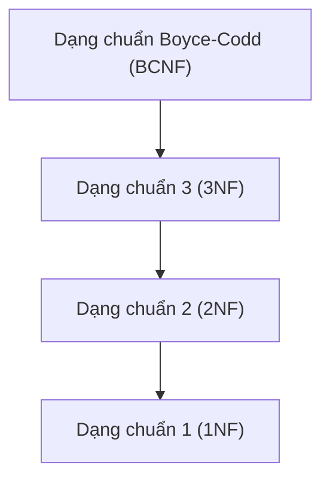

# CHƯƠNG 4. CHUẨN HÓA CƠ SỞ DỮ LIỆU

<!-- PAGE 91 -->

## 1. MỞ ĐẦU VÀ CÁC KHÁI NIỆM CƠ BẢN

### 1.1. Mục tiêu của Chuẩn hóa dữ liệu
Chuẩn hóa dữ liệu (Database Normalization) là quá trình phân tích và tổ chức lại các lược đồ quan hệ dựa trên các phụ thuộc hàm và các khóa nhằm đạt được hai mục tiêu cốt lõi:
1. **Giảm thiểu tối đa sự dư thừa dữ liệu (Data Redundancy).**
2. **Loại bỏ các dị thường cập nhật (Update Anomalies):**
   - **Dị thường thêm (Insertion Anomaly):** Không thể thêm một đối tượng này nếu chưa có thông tin của một đối tượng khác không liên quan trực tiếp.
   - **Dị thường xóa (Deletion Anomaly):** Khi xóa dữ liệu của một đối tượng, vô tình làm biến mất vĩnh viễn các thông tin của một đối tượng khác.
   - **Dị thường sửa (Modification/Update Anomaly):** Một sự kiện thay đổi thông tin đòi hỏi phải cập nhật đồng thời ở nhiều dòng dữ liệu, nếu bỏ sót sẽ dẫn đến sự mất nhất quán (Inconsistency).

<!-- PAGE 92 -->

### 1.2. Các khái niệm nền tảng
Cho lược đồ quan hệ $R(U, F)$ và tập thuộc tính $U$:

1. **Thuộc tính nguyên tố (Prime Attribute):**
   Một thuộc tính $A \in U$ được gọi là **thuộc tính nguyên tố** (thuộc tính khóa) nếu $A$ xuất hiện trong **ít nhất một khóa** nào đó của lược đồ quan hệ $R$. Ngược lại, $A$ được gọi là **thuộc tính không nguyên tố** (thuộc tính không khóa).

2. **Phụ thuộc hàm đầy đủ (Full Functional Dependency):**
   Phụ thuộc hàm $X \to Y$ được gọi là **đầy đủ** nếu không tồn tại bất kỳ tập con thực sự nào $X' \subset X$ sao cho $X' \to Y \in F^+$.
   $$\forall X' \subset X \implies X' \not\to Y$$
   Nếu tồn tại $X' \subset X$ mà $X' \to Y$, ta nói $Y$ **phụ thuộc hàm từng phần (Partial Dependency)** vào $X$.

3. **Phụ thuộc hàm bắc cầu (Transitive Dependency):**
   Cho khóa $K$ của $R$ và thuộc tính $A \notin K$. Ta nói $A$ **phụ thuộc bắc cầu** vào khóa $K$ nếu tồn tại tập thuộc tính $X \subset U$ sao cho:
   $$K \to X, \quad X \not\to K, \quad X \to A \quad (\text{với } A \notin X)$$

<!-- PAGE 93 -->

---

## 2. CÁC DẠNG CHUẨN CƠ BẢN (1NF, 2NF, 3NF, BCNF)

### 2.1. Dạng chuẩn 1 (1NF - First Normal Form)
> **Định nghĩa:** Lược đồ quan hệ $R$ được gọi là ở **Dạng chuẩn 1 (1NF)** nếu toàn bộ các miền giá trị của tất cả các thuộc tính trong $R$ chỉ chứa các giá trị **nguyên tử (Atomic values)**, không chứa các thuộc tính đa trị (Multivalued attributes) hay quan hệ lồng ghép (Nested relations).

<!-- PAGE 94 -->

### 2.2. Dạng chuẩn 2 (2NF - Second Normal Form)
> **Định nghĩa:** Lược đồ quan hệ $R(U, F)$ được gọi là ở **Dạng chuẩn 2 (2NF)** nếu:
> 1. $R$ đã đạt Dạng chuẩn 1 (1NF).
> 2. Mọi thuộc tính **không nguyên tố** đều **phụ thuộc hàm đầy đủ** vào bất kỳ khóa nào của $R$ (tức là không có thuộc tính không khóa nào phụ thuộc vào một phần của khóa chính ghép).

*Lưu ý:* Nếu mọi khóa của lược đồ quan hệ $R$ đều là **khóa đơn** (chỉ gồm 1 thuộc tính), thì khi đạt 1NF, lược đồ quan hệ $R$ hiển nhiên đạt luôn 2NF.

<!-- PAGE 95 -->

### 2.3. Dạng chuẩn 3 (3NF - Third Normal Form)
> **Định nghĩa:** Lược đồ quan hệ $R(U, F)$ được gọi là ở **Dạng chuẩn 3 (3NF)** nếu:
> 1. $R$ đã đạt Dạng chuẩn 2 (2NF).
> 2. Không có bất kỳ thuộc tính **không nguyên tố** nào **phụ thuộc bắc cầu** vào khóa của $R$.

#### Mệnh đề tương đương kiểm tra 3NF:
Lược đồ quan hệ $R(U, F)$ đạt Dạng chuẩn 3 (3NF) khi và chỉ khi với mọi phụ thuộc hàm không tầm thường $X \to A \in F^+$ ($A \notin X$), ít nhất một trong hai điều kiện sau được thỏa mãn:
1. $X$ là một **siêu khóa** của $R$ ($X^+ = U$).
2. $A$ là một **thuộc tính nguyên tố** (thuộc một khóa nào đó của $R$).

<!-- PAGE 97 -->

### 2.4. Dạng chuẩn Boyce-Codd (BCNF - Boyce-Codd Normal Form)
BCNF là dạng chuẩn chặt chẽ hơn 3NF, loại bỏ triệt để mọi dị thường phụ thuộc hàm:

> **Định nghĩa:** Lược đồ quan hệ $R(U, F)$ được gọi là ở **Dạng chuẩn Boyce-Codd (BCNF)** nếu với mọi phụ thuộc hàm không tầm thường $X \to A \in F^+$ ($A \notin X$):
> $$X \text{ bắt buộc phải là một siêu khóa của } R$$

#### Quan hệ bao hàm giữa các dạng chuẩn:
$$\text{BCNF} \subset \text{3NF} \subset \text{2NF} \subset \text{1NF}$$



<!-- PAGE 99 -->

### 2.5. Phương pháp xác định dạng chuẩn cao nhất của lược đồ $\langle R, F \rangle$
1. **Bước 1:** Tìm tất cả các khóa của $R$. Xác định danh sách thuộc tính nguyên tố và không nguyên tố.
2. **Bước 2 (Kiểm tra BCNF):** Duyệt qua các phụ thuộc hàm $X \to A \in F$. Nếu mọi vế trái $X$ đều là siêu khóa $\implies R$ đạt BCNF (dừng).
3. **Bước 3 (Kiểm tra 3NF):** Nếu có PTH vi phạm BCNF, kiểm tra xem với các PTH đó, vế phải $A$ có phải là thuộc tính nguyên tố hay không. Nếu mọi PTH vi phạm đều có $A$ nguyên tố $\implies R$ đạt 3NF (dừng).
4. **Bước 4 (Kiểm tra 2NF):** Nếu vi phạm 3NF, kiểm tra xem có thuộc tính không nguyên tố nào phụ thuộc vào tập con thực sự của một khóa hay không. Nếu không $\implies R$ đạt 2NF. Ngược lại, $R$ chỉ dừng ở 1NF.

<!-- PAGE 100 -->

---

## 3. CÁC THUẬT TOÁN CHUẨN HÓA

### 3.1. Thuật toán phân tách về Dạng chuẩn 3 (3NF) - Thuật toán Tổng hợp Bernstein
Thuật toán này đảm bảo đồng thời hai tính chất: **Bảo toàn tập phụ thuộc hàm** và **Bảo toàn thông tin (Lossless Join)**.

- **Đầu vào:** Lược đồ quan hệ $R(U, F)$.
- **Đầu ra:** Phép phân tách $\rho = \{R_1, R_2, \dots, R_k\}$ đạt 3NF.

```text
Thuật toán Chuan_Hoa_3NF(R, F):
1.  Tìm phủ tối thiểu F_min của F.
2.  Gom nhóm các phụ thuộc hàm trong F_min có cùng vế trái:
    (X -> A_1, X -> A_2, ..., X -> A_m) gộp thành X -> A_1 A_2 ... A_m.
3.  Với mỗi nhóm có cùng vế trái X -> Y:
    Tạo một lược đồ quan hệ con R_i = X hợp Y.
4.  Kiểm tra điều kiện bảo toàn thông tin:
    Tìm một khóa K bất kỳ của lược đồ quan hệ ban đầu R.
    Nếu trong danh sách các R_i ở bước 3 CHƯA CÓ lược đồ nào chứa trọn vẹn khóa K:
        Thêm một lược đồ con mới R_{k+1} = K vào rho.
5.  Loại bỏ các lược đồ con dư thừa:
    Nếu có R_i là tập con thực sự của R_j (R_i c R_j), ta loại bỏ R_i.
6.  Trả về rho;
```

<!-- PAGE 103 -->

### 3.2. Thuật toán phân tách về Dạng chuẩn Boyce-Codd (BCNF)
Thuật toán chuẩn hóa về BCNF bảo đảm **bảo toàn thông tin (Lossless Join)** nhưng **không bảo đảm bảo toàn phụ thuộc hàm**.

```text
Thuật toán Chuan_Hoa_BCNF(R, F):
1.  rho := { R };
2.  Khi vẫn tồn tại một lược đồ R_i trong rho CHƯA đạt BCNF:
3.      Tìm một phụ thuộc hàm X -> Y vi phạm BCNF trên R_i
        (tức X -> Y thuộc F+, Y không thuộc X, và X không phải là siêu khóa của R_i);
4.      Phân tách R_i thành hai lược đồ con:
            R_{i1} := X hợp Y;
            R_{i2} := R_i \ (Y \ X);
5.      Thay thế R_i trong rho bằng { R_{i1}, R_{i2} };
6.  Trả về rho;
```

<!-- PAGE 106 -->

---

## 4. BÀI TẬP CÓ HƯỚNG DẪN VÀ LỜI GIẢI

### Bài tập 1:
Cho lược đồ quan hệ $R(A, B, C, D, E, G)$ với tập phụ thuộc hàm:
$$F = \{AB \to C, C \to D, D \to E, E \to A\}$$

1. Tìm tất cả các khóa của $R$.
2. Xác định dạng chuẩn cao nhất của $R$.
3. Chuẩn hóa $R$ về Dạng chuẩn 3 (3NF) bảo toàn thông tin và bảo toàn phụ thuộc hàm.

#### Lời giải chi tiết:
1. **Tìm tất cả các khóa của $R$:**
   - Phân loại thuộc tính:
     - Vế trái: $\{A, B, C, D, E\}$
     - Vế phải: $\{C, D, E, A\}$
     - Nhóm $L$: $\{B\}$ (Chỉ ở vế trái $\implies B$ bắt buộc phải nằm trong mọi khóa).
     - Nhóm $D$: $\{G\}$ (Không xuất hiện trong $F \implies G$ bắt buộc phải nằm trong mọi khóa).
     - Nhóm $M$: $\{A, C, D, E\}$.
   - Xét tập nguồn cốt lõi: $BG$.
   - Tính các tổ hợp:
     - $(ABG)^+ = ABCDEG = U \implies ABG$ là một khóa.
     - $(CBG)^+ = CBDEAG = U \implies CBG$ là một khóa.
     - $(DBG)^+ = DBEACG = U \implies DBG$ là một khóa.
     - $(EBG)^+ = EABCDEG = U \implies EBG$ là một khóa.
   - **Tập các khóa của $R$:** $\{ABG, CBG, DBG, EBG\}$.
   - **Thuộc tính nguyên tố:** $\{A, B, C, D, E, G\}$ (Mọi thuộc tính của $R$ đều là thuộc tính nguyên tố!).

2. **Xác định dạng chuẩn cao nhất của $R$:**
   - Xét phụ thuộc hàm $C \to D$:
     - Vế trái $C$ không phải là siêu khóa (vì $C^+ = CDEA \ne U$). Do đó $R$ **không đạt BCNF**.
     - Vế phải $D$ là một thuộc tính nguyên tố (nằm trong khóa $DBG$).
   - Tương tự, với mọi phụ thuộc hàm trong $F$, vế phải đều là thuộc tính nguyên tố.
   - **Kết luận:** Lược đồ quan hệ $R$ đạt **Dạng chuẩn 3 (3NF)**.

3. **Chuẩn hóa về 3NF:**
   - Vì $R$ ban đầu đã đạt Dạng chuẩn 3 (3NF), nên không cần phân tách thêm, bản thân $R$ đã thỏa mãn tiêu chuẩn 3NF.

<!-- PAGE 124 -->
