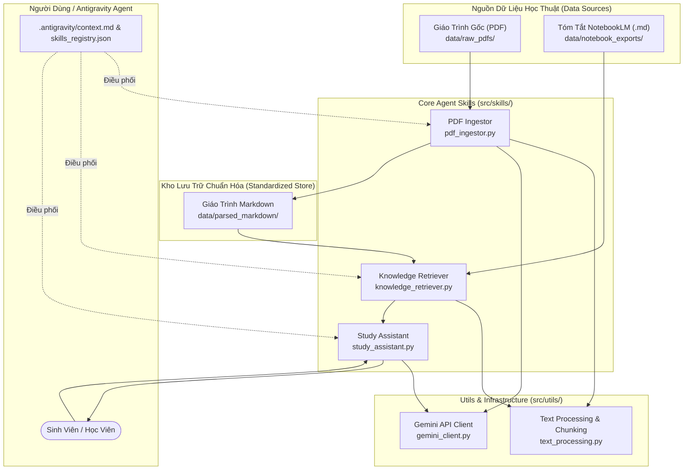
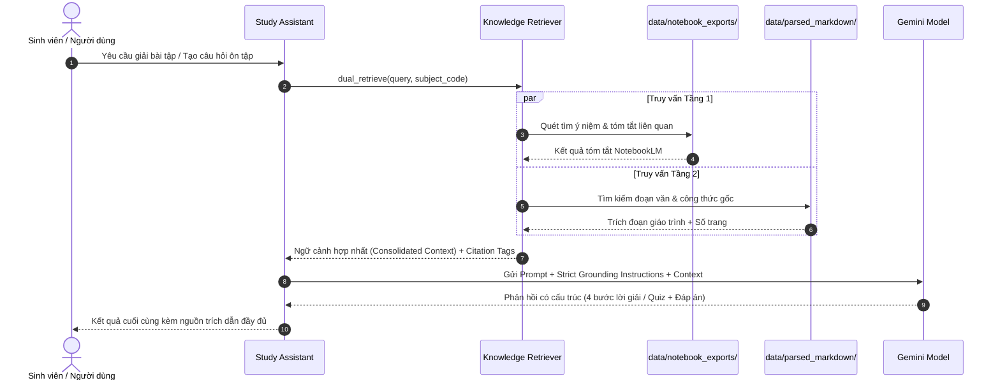

# KIẾN TRÚC HỆ THỐNG VÀ LUỒNG DỮ LIỆU
## Academic Knowledge & Study System Architecture Specs

---

## 1. TỔNG QUAN KIẾN TRÚC (SYSTEM OVERVIEW)

Hệ thống Quản lý Học tập & Trợ lý Học thuật Thông minh được thiết kế theo mô hình **Agentic Dual-Layer RAG** (Retrieval-Augmented Generation hai tầng) kết hợp khả năng tự động hóa chuỗi tác vụ của Antigravity Agent.

Hệ thống giải quyết bài toán cốt lõi:
1. Tiếp nhận giáo trình PDF đa dạng (toán học, kỹ thuật, khoa học xã hội).
2. Chuẩn hóa thành cấu trúc văn bản phân cấp Markdown bảo tồn công thức LaTeX và số trang.
3. Đồng bộ với các bản tóm tắt học thuật được kết xuất từ Google NotebookLM để tạo chỉ mục định hướng mức cao.
4. Trợ lý giải bài tập và ôn thi đảm bảo quy tắc **Strict Grounding** (Zero Hallucination).

---

## 2. SƠ ĐỒ THÀNH PHẦN HỆ THỐNG (COMPONENT DIAGRAM)

---

## 3. LUỒNG DỮ LIỆU TRUY XUẤT ĐỐI CHIẾU HAI TẦNG (DUAL-LAYER RAG DATA FLOW)

Mô hình truy xuất phân định rõ 2 tầng:
- **Tầng 1 (NotebookLM Exports):** Định hướng khái niệm, bản đồ tư duy, phạm vi đề cương ôn tập.
- **Tầng 2 (Parsed Markdown Giáo trình):** Cung cấp định nghĩa hình thức, định lý, công thức toán học LaTeX, ví dụ chi tiết và số trang trích dẫn.

---

## 4. CHI TIẾT CÁC MODULE VÀ QUY TẮC THIẾT KẾ

### 4.1. `src/skills/pdf_ingestor.py`
- **Mục tiêu:** Bóc tách giáo trình từ PDF thành Markdown chuẩn, bảo toàn cấu trúc đề mục `#`, `##`, `###`.
- **Cơ chế:**
  - *Chế độ AI Multimodal:* Sử dụng Gemini API gửi trực tiếp file PDF để trích xuất giữ nguyên bảng biểu, sơ đồ và công thức toán LaTeX.
  - *Chế độ Local Fallback:* Tận dụng thư viện Python `pypdf` trích xuất nội dung văn bản kèm thẻ đánh dấu vị trí trang `<!-- PAGE X -->`.
- **Đầu ra:** Lưu vào `data/parsed_markdown/<subject_code>/<filename>.md`.

### 4.2. `src/skills/knowledge_retriever.py`
- **Mục tiêu:** Truy xuất thông tin học thuật chuẩn xác cho các truy vấn của sinh viên.
- **Cơ chế:**
  - *Chunking thông minh:* Cắt đoạn theo tiêu đề mục hoặc đoạn văn bản (1500 ký tự, overlap 150 ký tự), gắn kèm metadata môn học và số trang.
  - *Scoring:* Chấm điểm từ khóa kết hợp ưu tiên tiêu đề đề mục.
  - *Dual-Layer Context Assembly:* Tập hợp đồng thời tóm tắt từ NotebookLM và giáo trình chính khóa.

### 4.3. `src/skills/study_assistant.py`
- **Mục tiêu:** Trợ lý học thuật chuyên sâu.
- **Nghiệp vụ:**
  - `solve`: Giải bài tập theo 4 bước chuẩn mực:
    1. Phân tích giả thiết & yêu cầu.
    2. Căn cứ lý thuyết / định lý giáo trình.
    3. Các bước biến đổi toán học/logic.
    4. Kết luận và nhắc nhở cạm bẫy thường gặp.
  - `quiz`: Tạo câu hỏi trắc nghiệm khách quan có giải thích và đối chiếu giáo trình.
  - `explain`: Giảng giải khái niệm học thuật dễ hiểu, liên hệ thực tiễn.

---

## 5. BẢO MẬT & MÔI TRƯỜNG THỰC THI
- Hệ thống hỗ trợ hoàn toàn việc chạy cục bộ (offline-first) cho việc lưu trữ dữ liệu và trích xuất.
- Khóa bí mật API: Đọc qua biến môi trường `GEMINI_API_KEY`, không commit vào git.
- Khả năng mở rộng: Sẵn sàng tích hợp Vector Database (ChromaDB / Qdrant) khi quy mô giáo trình vượt quá hàng nghìn trang.
