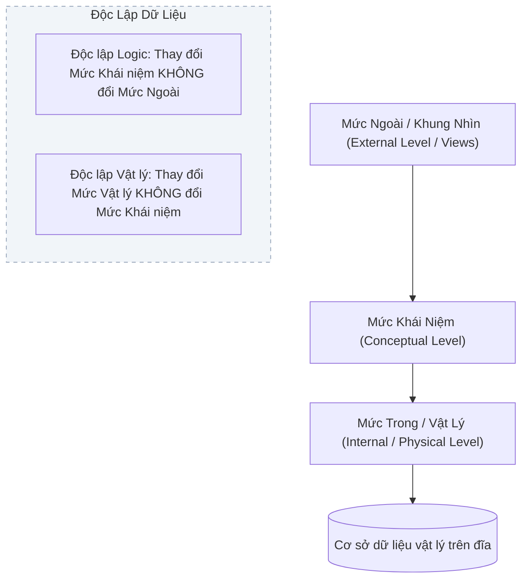

# CHƯƠNG 1: TỔNG QUAN VỀ CƠ SỞ DỮ LIỆU & KIẾN TRÚC ANSI/SPARC

---

## PHẦN 1: TÓM TẮT CỐT LÕI (EXECUTIVE SUMMARY)

### 1. Sơ đồ Kiến trúc Ba mức ANSI/SPARC

### 2. Các Khái Niệm Nền Tảng
- **Dữ liệu (Data):** Các sự kiện, số liệu thô chưa qua xử lý logic.
- **Thông tin (Information):** Dữ liệu đã qua xử lý, có ngữ nghĩa và đem lại giá trị ra quyết định.
- **Cơ sở dữ liệu (Database - CSDL):** Tập hợp dữ liệu có cấu trúc, có mối liên hệ logic và được lưu trữ trên bộ nhớ thứ cấp nhằm phục vụ nhiều người dùng đồng thời.
- **Hệ Quản trị CSDL (DBMS):** Hệ thống phần mềm cung cấp môi trường định nghĩa dữ liệu (DDL), thao tác dữ liệu (DML), điều khiển truy cập (DCL) và bảo đảm an toàn, toàn vẹn dữ liệu (ACID).
- **Kiến trúc ANSI/SPARC (3 mức trừu tượng hóa):**
  1. *Mức ngoài (External/View Level):* Giao diện và góc nhìn dữ liệu cá nhân hóa cho từng nhóm người dùng.
  2. *Mức khái niệm (Conceptual Level):* Toàn bộ cấu trúc logic tổng thể của CSDL (thực thể, thuộc tính, mối liên kết, ràng buộc), độc lập với thiết bị lưu trữ.
  3. *Mức trong (Internal/Physical Level):* Cách thức dữ liệu được tổ chức vật lý trên đĩa (cấu trúc tệp, khối đĩa, phương pháp băm, đánh chỉ mục B-Tree).
- **Tính độc lập dữ liệu (Data Independence):**
  - *Độc lập vật lý (Physical Data Independence):* Khả năng thay đổi cấu trúc lưu trữ hoặc thiết bị đĩa mà không phải sửa đổi lược đồ mức khái niệm.
  - *Độc lập logic (Logical Data Independence):* Khả năng mở rộng, sửa đổi lược đồ mức khái niệm (thêm thực thể, thuộc tính) mà không làm ảnh hưởng đến các ứng dụng hiện có ở mức ngoài.

---

## PHẦN 2: BÀI TẬP TRẮC NGHIỆM (10 CÂU CÓ ĐÁP ÁN ẨN)

### Câu 1
Trong hệ thống CSDL, khái niệm "Độc lập dữ liệu vật lý" (Physical Data Independence) được hiểu chính xác là:
- A. Thay đổi phần cứng máy chủ không làm thay đổi hệ điều hành.
- B. Thay đổi cấu trúc lưu trữ và phương pháp truy xuất vật lý trên đĩa không làm thay đổi lược đồ mức khái niệm.
- C. Thay đổi lược đồ quan hệ mức khái niệm không làm thay đổi các khung nhìn người dùng.
- D. Khả năng dữ liệu không bị phá hủy khi có sự cố mất điện đột ngột.

<b>Xem đáp án & Giải thích</b>

- **Đáp án đúng:** B
- **Giải thích:** Độc lập dữ liệu vật lý là khả năng điều chỉnh, tối ưu hóa cấu trúc lưu trữ nội bộ (internal schema) hoặc kỹ thuật lập chỉ mục trên đĩa mà không làm thay đổi lược đồ logic/khái niệm (conceptual schema).
- **Căn cứ giáo trình:** *Giáo trình Nhập môn CSDL (Quyển 1)*, Chương 1, Mục 3.2.

### Câu 2
Mức biểu diễn nào trong kiến trúc ANSI/SPARC chịu trách nhiệm mô tả toàn bộ cấu trúc logic của cơ sở dữ liệu mà không quan tâm đến phương thức lưu trữ cụ thể trên đĩa từ?
- A. Mức trong (Internal Level)
- B. Mức ngoài (External Level)
- C. Mức khái niệm (Conceptual Level)
- D. Mức vật lý (Physical Level)

<b>Xem đáp án & Giải thích</b>

- **Đáp án đúng:** C
- **Giải thích:** Mức khái niệm mô tả toàn bộ thực thể, thuộc tính và mối quan hệ logic của toàn bộ tổ chức mà không phụ thuộc vào chi tiết cài đặt vật lý.
- **Căn cứ giáo trình:** *Giáo trình Nhập môn CSDL (Quyển 1)*, Chương 1, Mục 3.1.

### Câu 3
Thành phần nào sau đây thuộc về Ngôn ngữ Định nghĩa Dữ liệu (DDL - Data Definition Language)?
- A. `SELECT`
- B. `INSERT`
- C. `CREATE TABLE`
- D. `UPDATE`

<b>Xem đáp án & Giải thích</b>

- **Đáp án đúng:** C
- **Giải thích:** `CREATE TABLE`, `ALTER TABLE`, `DROP TABLE` là các câu lệnh DDL dùng để xây dựng và sửa đổi cấu trúc lược đồ. Trong khi `SELECT` thuộc DQL, `INSERT`/`UPDATE` thuộc DML.
- **Căn cứ giáo trình:** *Giáo trình Nhập môn CSDL (Quyển 1)*, Chương 1, Mục 4.

### Câu 4
Ưu điểm lớn nhất của cách tiếp cận Cơ sở dữ liệu so với cách tiếp cận Hệ thống tệp truyền thống (File-based system) là:
- A. Không cần sử dụng bộ nhớ RAM khi truy xuất.
- B. Giảm thiểu dư thừa dữ liệu và loại trừ nguy cơ mất nhất quán dữ liệu.
- C. Tốc độ đọc file nhị phân nhanh hơn trong mọi trường hợp.
- D. Không cần thực hiện sao lưu dự phòng định kỳ.

<b>Xem đáp án & Giải thích</b>

- **Đáp án đúng:** B
- **Giải thích:** Hệ thống tệp truyền thống lưu trữ dữ liệu phân tán dẫn đến dư thừa lớn và dị thường cập nhật. CSDL quản trị tập trung giúp kiểm soát dư thừa và nhất quán dữ liệu.
- **Căn cứ giáo trình:** *Giáo trình Nhập môn CSDL (Quyển 1)*, Chương 1, Mục 1.2.

### Câu 5
Người chịu trách nhiệm cao nhất về việc cấp phát quyền truy cập, giám sát hiệu năng, cấu hình sao lưu và phục hồi CSDL được gọi là:
- A. End User (Người dùng cuối)
- B. Application Programmer (Lập trình viên ứng dụng)
- C. Database Administrator (DBA - Quản trị viên CSDL)
- D. System Analyst (Chuyên viên phân tích hệ thống)

<b>Xem đáp án & Giải thích</b>

- **Đáp án đúng:** C
- **Giải thích:** Quản trị viên CSDL (DBA) là người nắm toàn quyền quản lý kỹ thuật, cấp phát tài khoản, phân quyền bảo mật và bảo trì hệ thống CSDL.
- **Căn cứ giáo trình:** *Giáo trình Nhập môn CSDL (Quyển 1)*, Chương 1, Mục 2.3.

### Câu 6
Trong kiến trúc 3 mức của CSDL, một ứng dụng của phòng Kế toán chỉ được nhìn thấy trường `LuongCoBan` mà không được thấy trường `MatKhau` của nhân viên. Điều này thể hiện chức năng của:
- A. Lược đồ trong (Internal Schema)
- B. Lược đồ khái niệm (Conceptual Schema)
- C. Lược đồ ngoài / Khung nhìn (External Schema / View)
- D. Hệ điều hành máy chủ

<b>Xem đáp án & Giải thích</b>

- **Đáp án đúng:** C
- **Giải thích:** Mức ngoài cung cấp các khung nhìn (Views) được tinh chỉnh theo nhu cầu và thẩm quyền bảo mật của từng nhóm người dùng riêng biệt.
- **Căn cứ giáo trình:** *Giáo trình Nhập môn CSDL (Quyển 1)*, Chương 1, Mục 3.1.

### Câu 7
Từ điển dữ liệu (Data Dictionary / System Catalog) trong một DBMS chứa đựng:
- A. Toàn bộ mã nguồn của các phần mềm ứng dụng người dùng.
- B. Siêu dữ liệu (Metadata) mô tả cấu trúc các bảng, kiểu dữ liệu, ràng buộc và chỉ mục.
- C. Toàn bộ nội dung các bản ghi người dùng nhập vào.
- D. Danh bạ số điện thoại của các lập trình viên phát triển hệ thống.

<b>Xem đáp án & Giải thích</b>

- **Đáp án đúng:** B
- **Giải thích:** Data Dictionary lưu trữ Metadata - tức "dữ liệu về dữ liệu", bao gồm định nghĩa các bảng, thuộc tính, khóa, ràng buộc và thống kê phân phối phục vụ tối ưu hóa truy vấn.
- **Căn cứ giáo trình:** *Giáo trình Nhập môn CSDL (Quyển 1)*, Chương 1, Mục 4.2.

### Câu 8
Khi bổ sung một thuộc tính mới `SoDienThoai` vào bảng `SINHVIEN` ở mức khái niệm, các ứng dụng hiện tại chỉ đọc `HoTen` và `MaSV` vẫn hoạt động bình thường mà không cần viết lại mã nguồn. Đây là minh chứng của:
- A. Độc lập dữ liệu vật lý
- B. Độc lập dữ liệu logic
- C. Tính toàn vẹn thực thể
- D. Tính nguyên tử của giao dịch

<b>Xem đáp án & Giải thích</b>

- **Đáp án đúng:** B
- **Giải thích:** Độc lập dữ liệu logic cho phép mở rộng lược đồ mức khái niệm mà không phá vỡ các khung nhìn mức ngoài hiện hành.
- **Căn cứ giáo trình:** *Giáo trình Nhập môn CSDL (Quyển 1)*, Chương 1, Mục 3.2.

### Câu 9
Ngôn ngữ thao tác dữ liệu (DML - Data Manipulation Language) gồm các thao tác nào sau đây?
- A. `CREATE`, `DROP`, `ALTER`
- B. `INSERT`, `UPDATE`, `DELETE`
- C. `GRANT`, `REVOKE`
- D. `COMMIT`, `ROLLBACK`

<b>Xem đáp án & Giải thích</b>

- **Đáp án đúng:** B
- **Giải thích:** DML đảm nhiệm việc thêm, sửa, xóa dữ liệu trong các bảng: `INSERT`, `UPDATE`, `DELETE`.
- **Căn cứ giáo trình:** *Giáo trình Nhập môn CSDL (Quyển 1)*, Chương 1, Mục 4.1.

### Câu 10
Mục tiêu chính của việc ánh xạ (Mapping) giữa các mức trong kiến trúc ANSI/SPARC là:
- A. Giảm dung lượng ổ đĩa cứng khi lưu trữ.
- B. Đảm bảo tính độc lập dữ liệu giữa các mức biểu diễn.
- C. Tăng tốc độ quay của đĩa từ.
- D. Thay thế hoàn toàn giao thức mạng TCP/IP.

<b>Xem đáp án & Giải thích</b>

- **Đáp án đúng:** B
- **Giải thích:** Các cơ chế ánh xạ Ngoài - Khái niệm (External-to-Conceptual) và Khái niệm - Trong (Conceptual-to-Internal) chính là cầu nối chuyển đổi yêu cầu truy vấn nhằm đảm bảo tính độc lập dữ liệu.
- **Căn cứ giáo trình:** *Giáo trình Nhập môn CSDL (Quyển 1)*, Chương 1, Mục 3.3.

---

## PHẦN 3: CÂU HỎI TRẢ LỜI NGẮN (5 CÂU CÓ ĐÁP ÁN ẨN)

### Câu 1
Nêu sự khác biệt cốt lõi giữa hai khái niệm: "Lược đồ Cơ sở dữ liệu" (Database Schema) và "Thể hiện Cơ sở dữ liệu" (Database Instance / State).

<b>Xem đáp án & Hướng dẫn</b>

- **Đáp án:**
  - **Lược đồ (Schema):** Là cấu trúc logic, thiết kế tổng thể của CSDL (tên bảng, trường, kiểu dữ liệu, ràng buộc). Lược đồ có tính chất **tĩnh**, rất hiếm khi thay đổi.
  - **Thể hiện (Instance):** Là tập hợp dữ liệu thực tế đang được lưu trữ trong CSDL tại một thời điểm cụ thể. Thể hiện có tính chất **động**, biến thiên liên tục qua mỗi thao tác thêm, xóa, sửa.

### Câu 2
Liệt kê 2 loại ánh xạ (mapping) trong kiến trúc 3 mức ANSI/SPARC và nêu rõ vai trò của từng loại đối với tính độc lập dữ liệu.

<b>Xem đáp án & Hướng dẫn</b>

- **Đáp án:**
  1. **Ánh xạ Ngoài - Khái niệm (External/Conceptual Mapping):** Ánh xạ giữa khung nhìn của từng người dùng và cấu trúc logic chung. Đảm bảo tính **Độc lập dữ liệu logic**.
  2. **Ánh xạ Khái niệm - Trong (Conceptual/Internal Mapping):** Ánh xạ giữa cấu trúc logic chung và các tệp lưu trữ vật lý trên đĩa. Đảm bảo tính **Độc lập dữ liệu vật lý**.

### Câu 3
Phân loại các câu lệnh SQL sau vào đúng 3 nhóm: DDL, DML, DCL: `GRANT`, `DROP TABLE`, `UPDATE`, `CREATE INDEX`, `INSERT`, `REVOKE`.

<b>Xem đáp án & Hướng dẫn</b>

- **Đáp án:**
  - **DDL (Data Definition Language):** `DROP TABLE`, `CREATE INDEX`.
  - **DML (Data Manipulation Language):** `UPDATE`, `INSERT`.
  - **DCL (Data Control Language):** `GRANT`, `REVOKE`.

### Câu 4
Tại sao một hệ thống quản lý tệp tuần tự truyền thống (như ghi chép bằng file Excel hay CSV) lại dễ gây ra tình trạng bất nhất quán dữ liệu (Data Inconsistency)?

<b>Xem đáp án & Hướng dẫn</b>

- **Đáp án:**
  Do dữ liệu bị lưu trữ phân tán và trùng lặp ở nhiều tệp khác nhau (Redundancy). Khi có sự thay đổi thông tin (ví dụ: sinh viên đổi số điện thoại), người quản lý chỉ cập nhật ở một tệp mà quên cập nhật ở tệp khác, dẫn đến cùng một thực thể có các giá trị mâu thuẫn nhau trong cùng một hệ thống.

### Câu 5
Trình bày 4 tính chất quan trọng của một Giao dịch trong CSDL (chuẩn ACID).

<b>Xem đáp án & Hướng dẫn</b>

- **Đáp án:**
  1. **A (Atomicity - Tính nguyên tử):** Mọi thao tác trong giao dịch hoặc cùng thành công 100%, hoặc cùng bị hủy bỏ (All or Nothing).
  2. **C (Consistency - Tính nhất quán):** Giao dịch chuyển CSDL từ trạng thái hợp lệ này sang trạng thái hợp lệ khác, không vi phạm ràng buộc toàn vẹn.
  3. **I (Isolation - Tính cô lập):** Các giao dịch thực thi đồng thời không được can thiệp hay nhìn thấy dữ liệu trung gian chưa commit của nhau.
  4. **D (Durability - Tính bền vững):** Khi giao dịch đã hoàn tất (commit), dữ liệu sẽ tồn tại vĩnh viễn trên đĩa dù hệ thống gặp sự cố mất điện.

---

## PHẦN 4: BÀI TẬP TỰ LUẬN & THIẾT KẾ (3 BÀI CÓ LỜI GIẢI CHI TIẾT)

### Bài 1: Phân tích Kiến trúc ANSI/SPARC cho Hệ thống Ngân hàng
Một ngân hàng thương mại đang vận hành hệ thống phần mềm quản lý tài khoản khách hàng. Hãy phân tích cấu trúc hệ thống này theo 3 mức của kiến trúc ANSI/SPARC:
1. Xác định nội dung của Mức ngoài (External Level) cho 2 đối tượng: Khách hàng sử dụng Mobile Banking và Giao dịch viên tại quầy.
2. Mô tả các thành phần cần có ở Mức khái niệm (Conceptual Level).
3. Đề xuất cấu trúc ở Mức trong/vật lý (Internal Level).

<b>Xem lời giải chi tiết từng bước</b>

#### Bước 1: Mức ngoài (External Level / Views)
- **Khung nhìn của Khách hàng (Mobile Banking):** Chỉ được xem danh sách tài khoản của chính mình (`SoTK`, `SoDu`, `LichSuGiaoDich`), ẩn hoàn toàn thông tin kiểm toán nội bộ, lãi suất gốc vốn vay và tài khoản của khách hàng khác.
- **Khung nhìn của Giao dịch viên tại quầy:** Được xem thông tin định danh khách hàng (`SoCMND/CCCD`, `HoTen`, `DiaChi`), trạng thái tài khoản, thực hiện thao tác nạp/rút tiền nhưng bị che giấu mã PIN hoặc mật khẩu đăng nhập của khách hàng.

#### Bước 2: Mức khái niệm (Conceptual Level / Conceptual Schema)
Mô tả toàn bộ mô hình logic của ngân hàng gồm:
- Các thực thể: `KHACHHANG`, `TAIKHOAN`, `GIAODICH`, `CHINHANH`, `NHANVIEN`.
- Các mối quan hệ logic: Một khách hàng sở hữu một hoặc nhiều tài khoản (1-N); Một giao dịch gắn liền với một tài khoản nguồn và tài khoản đích.
- Các ràng buộc toàn vẹn: Số dư tài khoản không được âm (`SoDu >= 0`), mã tài khoản là duy nhất.

#### Bước 3: Mức trong / Vật lý (Internal Level)
- Lưu trữ các bảng `KHACHHANG`, `TAIKHOAN` dưới dạng tệp có thứ tự sắp xếp theo trường khóa chính `MaKH`, `SoTK`.
- Xây dựng chỉ mục Cây B+ trên trường `SoCMND` và `SoTK` để tìm kiếm siêu tốc trong $O(\log N)$.
- Phân vùng dữ liệu (Partitioning) bảng `GIAODICH` theo từng năm để tối ưu hóa hiệu năng I/O.
- Áp dụng kỹ thuật mã hóa đĩa AES-256 đối với trường dữ liệu số dư và mật khẩu hash bcrypt.

### Bài 2: Phân tích Kịch bản Vi phạm Tính Độc lập Dữ liệu
Hãy phân tích 2 kịch bản kỹ thuật sau và xác định kịch bản nào liên quan đến **Độc lập dữ liệu logic**, kịch bản nào liên quan đến **Độc lập dữ liệu vật lý**:
- **Kịch bản A:** Do dung lượng dữ liệu tăng vọt, DBA quyết định chuyển bảng `NHATKY_TRUYCAP` từ ổ đĩa HDD sang hệ thống mảng đĩa SSD chuẩn NVMe và tạo thêm chỉ mục Clustered Index trên cột `ThoiGian`.
- **Kịch bản B:** Để phục vụ chương trình tiếp thị mới, phòng IT bổ sung thêm cột `DiemTichLuy` vào bảng `KHACHHANG` và tạo thêm một bảng mới `PHIEU_GIAM_GIA(MaVoucher, PhanTramGiam, NgayHetHan)`.

<b>Xem lời giải chi tiết từng bước</b>

#### Bước 1: Phân tích Kịch bản A
- Kịch bản A thay đổi môi trường phần cứng lưu trữ vật lý (từ HDD sang SSD NVMe) và cấu trúc chỉ mục khối nhớ nội bộ (Clustered Index).
- Lược đồ logic tổng thể mức khái niệm không hề thay đổi (tên bảng, các cột, kiểu dữ liệu giữ nguyên).
- Do đó, kịch bản A thuộc về phạm trù **Độc lập dữ liệu vật lý (Physical Data Independence)**.

#### Bước 2: Phân tích Kịch bản B
- Kịch bản B thay đổi lược đồ mức khái niệm (Conceptual Schema) bằng cách thêm thuộc tính mới `DiemTichLuy` và thêm một thực thể mới `PHIEU_GIAM_GIA`.
- Các chương trình hiện tại (như module tính lương, module in hóa đơn bán hàng cũ) không sử dụng thuộc tính mới này vẫn hoạt động bình thường mà không cần sửa mã lệnh.
- Do đó, kịch bản B là minh chứng rõ ràng của **Độc lập dữ liệu logic (Logical Data Independence)**.

### Bài 3: Thiết kế Lược đồ Mô tả và Bảng Từ Điển Dữ Liệu
Hãy thiết kế lược đồ quan hệ mức khái niệm và lập Bảng Từ điển dữ liệu (Data Dictionary) cho hệ thống Quản lý Thư viện trường đại học gồm 2 thực thể: `SACH` và `DOCGIA`. Yêu cầu xác định rõ khóa chính, kiểu dữ liệu và ràng buộc toàn vẹn.

<b>Xem lời giải chi tiết từng bước</b>

#### Bước 1: Thiết kế Lược đồ Quan hệ
- `SACH(MaSach, TenSach, TacGia, NamXuatBan, SoLuongTon)`
  - Khóa chính: `MaSach`.
- `DOCGIA(MaDocGia, HoTen, Email, NgayDangKy, HanThe)`
  - Khóa chính: `MaDocGia`.

#### Bước 2: Xây dựng Từ điển dữ liệu (Data Dictionary)

**Bảng 1: `SACH`**
| Tên thuộc tính | Kiểu dữ liệu | Khóa (PK/FK) | Ràng buộc kiểm tra (Check Constraint) | Diễn giải |
| :--- | :--- | :---: | :--- | :--- |
| `MaSach` | `VARCHAR(10)` | PK | Không được chứa khoảng trắng | Mã định danh duy nhất cuốn sách |
| `TenSach` | `NVARCHAR(150)` | | `NOT NULL` | Nhan đề cuốn sách |
| `TacGia` | `NVARCHAR(100)` | | `NOT NULL` | Tên tác giả |
| `NamXuatBan` | `INT` | | `NamXuatBan > 1900 AND NamXuatBan <= YEAR(GETDATE())` | Năm xuất bản hợp lệ |
| `SoLuongTon` | `INT` | | `SoLuongTon >= 0` | Số lượng sách sẵn sàng cho mượn |

**Bảng 2: `DOCGIA`**
| Tên thuộc tính | Kiểu dữ liệu | Khóa (PK/FK) | Ràng buộc kiểm tra (Check Constraint) | Diễn giải |
| :--- | :--- | :---: | :--- | :--- |
| `MaDocGia` | `VARCHAR(10)` | PK | Bắt đầu bằng ký tự 'DG' | Mã định danh bạn đọc |
| `HoTen` | `NVARCHAR(100)` | | `NOT NULL` | Họ và tên độc giả |
| `Email` | `VARCHAR(100)` | | `UNIQUE, Email LIKE '%_@__%.__%'` | Email định dạng hợp lệ |
| `NgayDangKy` | `DATE` | | Mặc định là ngày hiện tại `GETDATE()` | Ngày cấp thẻ |
| `HanThe` | `DATE` | | `HanThe >= NgayDangKy` | Ngày hết hạn sử dụng thẻ |

