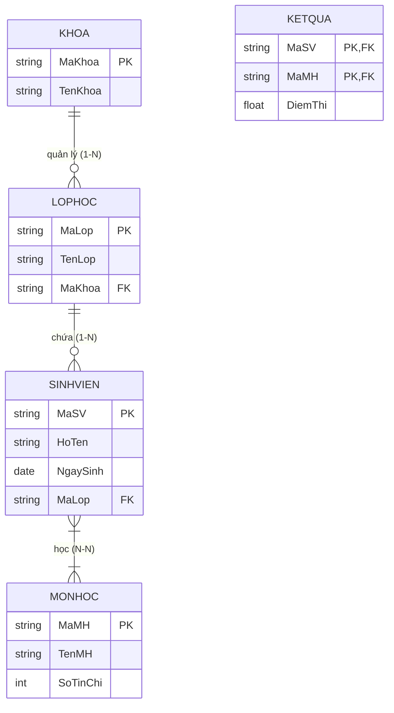
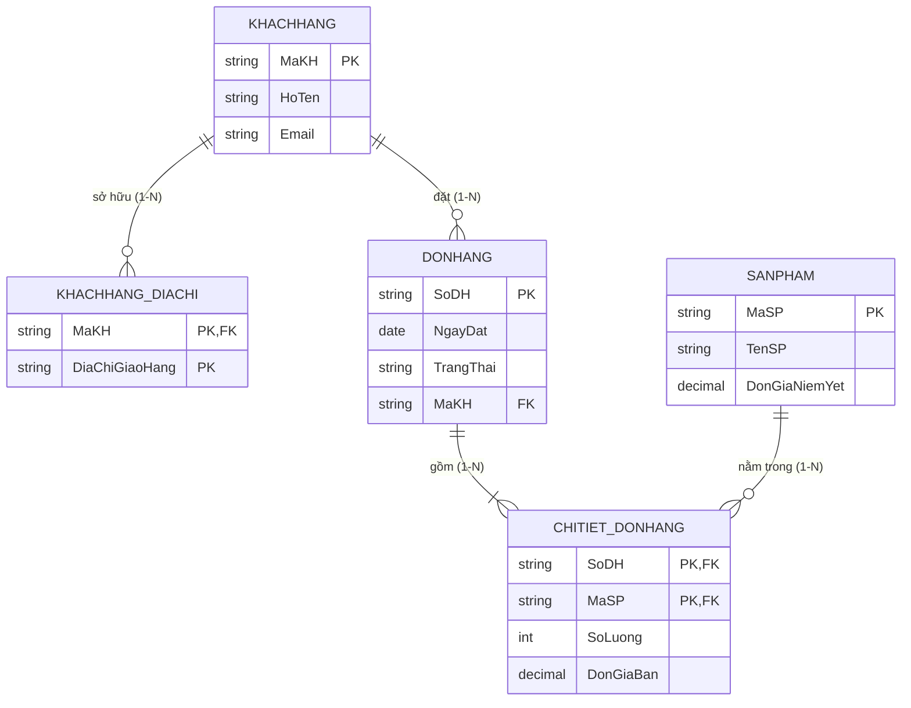

# CHƯƠNG 2: MÔ HÌNH THỰC THỂ - QUAN HỆ (E-R) & CHUYỂN ĐỔI SANG MÔ HÌNH QUAN HỆ

---

## PHẦN 1: TÓM TẮT CỐT LÕI (EXECUTIVE SUMMARY)

### 1. Sơ đồ Thực thể - Quan hệ Mẫu (ER Diagram)


### 2. Các Khái Niệm Cốt Lõi Của Mô Hình E-R
- **Thực thể (Entity) & Tập thực thể (Entity Set):** Đối tượng cụ thể trong thế giới thực có thể phân biệt được với các đối tượng khác.
  - *Thực thể mạnh (Strong Entity):* Tự thân xác định được sự tồn tại bằng khóa chính riêng.
  - *Thực thể yếu (Weak Entity):* Phải phụ thuộc vào sự tồn tại của một thực thể chủ (Owner Entity), sở hữu khóa bộ phận (Partial Key / Discriminator).
- **Phân loại Thuộc tính (Attributes):**
  - *Thuộc tính đơn (Simple):* Không thể phân chia nhỏ hơn (ví dụ: `DiemThi`).
  - *Thuộc tính kết hợp (Composite):* Gom từ nhiều thuộc tính thành phần (ví dụ: `DiaChi` gồm `SoNha`, `Duong`, `Quan`, `ThanhPho`).
  - *Thuộc tính đơn trị (Single-valued):* Chỉ nhận đúng 1 giá trị (ví dụ: `NgaySinh`).
  - *Thuộc tính đa trị (Multi-valued):* Có thể nhận nhiều giá trị cùng lúc (ví dụ: `SoDienThoai`, biểu diễn bằng hình elip nét đôi).
  - *Thuộc tính suy dẫn (Derived):* Giá trị tính toán được từ các thuộc tính khác (ví dụ: `Tuoi` suy ra từ `NgaySinh`, biểu diễn bằng hình elip nét đứt).
- **Bản số Mối quan hệ (Cardinality Ratio):**
  - **1 - 1 (Một - Một):** Mỗi cá thể của $A$ liên kết tối đa với 1 cá thể của $B$ và ngược lại.
  - **1 - N (Một - Nhiều):** Mỗi cá thể của $A$ liên kết với nhiều cá thể của $B$; mỗi cá thể của $B$ chỉ liên kết với duy nhất 1 cá thể của $A$.
  - **N - N (Nhiều - Nhiều):** Mỗi cá thể của $A$ liên kết với nhiều cá thể của $B$ và ngược lại.

### 3. Quy Tắc Ánh Xạ Từ Mô Hình E-R Sang Mô Hình Quan Hệ (7 Quy Tắc Chuẩn)
1. **Tập thực thể mạnh:** Chuyển thành một quan hệ độc lập. Khóa chính giữ nguyên.
2. **Tập thực thể yếu:** Chuyển thành một quan hệ có khóa chính gồm tổ hợp: `(Khóa thực thể chủ + Khóa bộ phận)`.
3. **Mối quan hệ 1 - N:** Lấy **khóa chính của bên Một** đưa sang bên **Nhiều** để làm **khóa ngoại**. Nếu mối quan hệ có thuộc tính riêng, chuyển các thuộc tính đó vào quan hệ bên Nhiều.
4. **Mối quan hệ N - N:** Bắt buộc tạo **một quan hệ mới riêng biệt**. Khóa chính của bảng mới là sự kết hợp khóa chính của cả hai thực thể tham gia:
   $$\text{PK} = (\text{PK}_A, \text{PK}_B)$$
5. **Mối quan hệ 1 - 1:** Có thể gộp thành một bảng duy nhất (nếu hai bên tham gia toàn bộ), hoặc đưa khóa chính của một bên sang làm khóa ngoại của bên kia (kèm ràng buộc `UNIQUE`).
6. **Thuộc tính đa trị:** Tạo một quan hệ mới gồm `(Khóa chính của thực thể gốc + Thuộc tính đa trị)`.
7. **Mối quan hệ bậc $\ge 3$ (N-ary Relationship):** Tạo một quan hệ riêng có khóa chính gồm khóa chính của tất cả các thực thể tham gia.

---

## PHẦN 2: BÀI TẬP TRẮC NGHIỆM (10 CÂU CÓ ĐÁP ÁN ẨN)

### Câu 1
Trong mô hình Thực thể - Quan hệ (E-R), một thuộc tính có thể nhận đồng thời nhiều giá trị khác nhau cho cùng một cá thể (ví dụ: một nhân viên có nhiều bằng cấp) được gọi là:
- A. Thuộc tính suy dẫn (Derived attribute)
- B. Thuộc tính kết hợp (Composite attribute)
- C. Thuộc tính đa trị (Multi-valued attribute)
- D. Thuộc tính phức hợp (Complex attribute)

<details>
<summary><b>Xem đáp án & Giải thích</b></summary>

- **Đáp án đúng:** C
- **Giải thích:** Thuộc tính đa trị cho phép một thực thể sở hữu một tập hợp các giá trị khác nhau (như số điện thoại, bằng cấp), được ký hiệu bằng hình elip viền đôi trong sơ đồ Chen ERD.
- **Căn cứ giáo trình:** *Giáo trình Nhập môn CSDL (Quyển 1)*, Chương 2, Mục 2.2.
</details>

### Câu 2
Khi chuyển đổi một mối quan hệ nhiều - nhiều ($N - N$) giữa hai thực thể `SINHVIEN` và `MONHOC` sang mô hình quan hệ, giải pháp chuẩn mực là:
- A. Đưa khóa chính của `SINHVIEN` sang làm khóa ngoại của `MONHOC`.
- B. Đưa khóa chính của `MONHOC` sang làm khóa ngoại của `SINHVIEN`.
- C. Tạo một bảng mới riêng biệt có khóa chính là tổ hợp khóa chính của cả `SINHVIEN` và `MONHOC`.
- D. Gộp chung tất cả các thuộc tính của `SINHVIEN` và `MONHOC` vào một bảng duy nhất.

<details>
<summary><b>Xem đáp án & Giải thích</b></summary>

- **Đáp án đúng:** C
- **Giải thích:** Mối quan hệ N-N không thể biểu diễn trực tiếp bằng khóa ngoại trong hai bảng gốc mà bắt buộc phải sinh ra bảng trung gian (Junction/Bridge table) chứa khóa ghép từ hai bảng.
- **Căn cứ giáo trình:** *Giáo trình Nhập môn CSDL (Quyển 1)*, Chương 2, Mục 4.3.
</details>

### Câu 3
Trong sơ đồ E-R chuẩn Chen, ký hiệu hình thoi (Diamond) được dùng để biểu diễn thành phần nào?
- A. Tập thực thể (Entity set)
- B. Thuộc tính (Attribute)
- C. Mối liên kết / Quan hệ (Relationship)
- D. Khóa chính (Primary key)

<details>
<summary><b>Xem đáp án & Giải thích</b></summary>

- **Đáp án đúng:** C
- **Giải thích:** Hình chữ nhật biểu diễn Tập thực thể; hình elip biểu diễn Thuộc tính; hình thoi biểu diễn Mối liên kết (Relationship).
- **Căn cứ giáo trình:** *Giáo trình Nhập môn CSDL (Quyển 1)*, Chương 2, Mục 2.1.
</details>

### Câu 4
Thuộc tính `Tuoi` được tính toán trực tiếp từ `NgaySinh` và ngày hiện tại được phân loại là:
- A. Thuộc tính đa trị
- B. Thuộc tính suy dẫn (Derived attribute)
- C. Thuộc tính kết hợp
- D. Thuộc tính khóa

<details>
<summary><b>Xem đáp án & Giải thích</b></summary>

- **Đáp án đúng:** B
- **Giải thích:** Thuộc tính suy dẫn là thuộc tính mà giá trị của nó không cần lưu trữ cứng trong CSDL mà được tính toán/suy diễn logic từ các thuộc tính khác (ký hiệu bằng elip nét đứt).
- **Căn cứ giáo trình:** *Giáo trình Nhập môn CSDL (Quyển 1)*, Chương 2, Mục 2.2.
</details>

### Câu 5
Tập thực thể yếu (Weak Entity Set) có đặc điểm nào sau đây?
- A. Không có mối liên kết với bất kỳ thực thể nào khác.
- B. Không có đủ các thuộc tính để tự hình thành một khóa chính độc lập mà phải mượn khóa của thực thể chủ.
- C. Không thể lưu trữ dữ liệu vào đĩa cứng.
- D. Chỉ được chứa tối đa 1 thuộc tính đơn.

<details>
<summary><b>Xem đáp án & Giải thích</b></summary>

- **Đáp án đúng:** B
- **Giải thích:** Thực thể yếu không có khóa chính riêng mà chỉ có khóa bộ phận (discriminator), sự tồn tại của nó phụ thuộc hoàn toàn vào một thực thể mạnh thông qua quan hệ xác định (identifying relationship).
- **Căn cứ giáo trình:** *Giáo trình Nhập môn CSDL (Quyển 1)*, Chương 2, Mục 2.4.
</details>

### Câu 6
Khi chuyển đổi mối quan hệ $1 - N$ giữa `KHOA` (bên 1) và `LOPHOC` (bên N) sang mô hình quan hệ, khóa ngoại được đặt ở đâu?
- A. Đặt tại bảng `KHOA` tham chiếu đến `LOPHOC`.
- B. Đặt tại bảng `LOPHOC` tham chiếu đến `KHOA`.
- C. Bắt buộc phải tạo bảng mới thứ ba.
- D. Tùy ý chọn đặt ở bảng nào cũng có kết quả như nhau.

<details>
<summary><b>Xem đáp án & Giải thích</b></summary>

- **Đáp án đúng:** B
- **Giải thích:** Quy tắc ánh xạ mối quan hệ 1-N quy định: Lấy khóa chính của bên "Một" (`MaKhoa`) đưa sang làm khóa ngoại tại bảng của bên "Nhiều" (`LOPHOC`).
- **Căn cứ giáo trình:** *Giáo trình Nhập môn CSDL (Quyển 1)*, Chương 2, Mục 4.2.
</details>

### Câu 7
Một thuộc tính kết hợp (Composite attribute) như `HoTen` gồm các thuộc tính thành phần `HoLot` và `Ten` sẽ được chuyển đổi sang mô hình quan hệ như thế nào?
- A. Chỉ lưu trữ thuộc tính `HoTen`, bỏ qua `HoLot` và `Ten`.
- B. Tạo một bảng mới riêng biệt chỉ để lưu `HoLot` và `Ten`.
- C. Thay thế `HoTen` bằng các cột độc lập `HoLot` và `Ten` trực tiếp trong bảng đó.
- D. Không thể chuyển đổi sang mô hình quan hệ.

<details>
<summary><b>Xem đáp án & Giải thích</b></summary>

- **Đáp án đúng:** C
- **Giải thích:** Mô hình quan hệ chỉ chấp nhận các thuộc tính nguyên tử (Atomic), do đó thuộc tính kết hợp được phân rã thành các cột nguyên tử cấu thành trong cùng một quan hệ.
- **Căn cứ giáo trình:** *Giáo trình Nhập môn CSDL (Quyển 1)*, Chương 2, Mục 4.1.
</details>

### Câu 8
Khi ánh xạ thuộc tính đa trị `SoDienThoai` của thực thể `NHANVIEN(MaNV, HoTen)` sang mô hình quan hệ, cấu trúc bảng mới sẽ là:
- A. `DIENTHOAI(MaNV, SoDienThoai)` với khóa chính là `(MaNV, SoDienThoai)`.
- B. `DIENTHOAI(SoDienThoai)` với khóa chính là `SoDienThoai`.
- C. `NHANVIEN(MaNV, HoTen, SoDienThoai1, SoDienThoai2)`.
- D. Không cần tạo bảng mới, nối các số điện thoại thành một chuỗi cách nhau bằng dấu phẩy.

<details>
<summary><b>Xem đáp án & Giải thích</b></summary>

- **Đáp án đúng:** A
- **Giải thích:** Để đảm bảo tính nguyên tử (1NF), thuộc tính đa trị được tách thành bảng riêng gồm khóa chính của thực thể cha và thuộc tính đa trị đó, khóa chính của bảng mới là tổ hợp cả hai trường.
- **Căn cứ giáo trình:** *Giáo trình Nhập môn CSDL (Quyển 1)*, Chương 2, Mục 4.4.
</details>

### Câu 9
Bản số (Cardinality) của một mối quan hệ trong mô hình E-R biểu thị:
- A. Dung lượng tính bằng Megabyte của mối quan hệ.
- B. Số lượng các cá thể tối thiểu và tối đa của một tập thực thể có thể tham gia vào mối liên kết với các cá thể của tập thực thể khác.
- C. Số lượng các khóa ngoại có trong bảng.
- D. Số lượng các câu lệnh SQL viết cho mối quan hệ đó.

<details>
<summary><b>Xem đáp án & Giải thích</b></summary>

- **Đáp án đúng:** B
- **Giải thích:** Bản số xác định giới hạn số lượng cá thể thực thể tham gia vào mối liên kết (ví dụ: $(0, 1), (1, 1), (0, N), (1, N)$).
- **Căn cứ giáo trình:** *Giáo trình Nhập môn CSDL (Quyển 1)*, Chương 2, Mục 3.1.
</details>

### Câu 10
Mối quan hệ tự thân (Recursive / Self-referencing Relationship) là:
- A. Mối quan hệ liên kết giữa 3 tập thực thể khác nhau.
- B. Mối quan hệ mà trong đó cùng một tập thực thể tham gia nhiều lần với các vai trò (roles) khác nhau.
- C. Mối quan hệ không có thuộc tính nào.
- D. Mối quan hệ bị lặp vô hạn trong bộ nhớ máy tính.

<details>
<summary><b>Xem đáp án & Giải thích</b></summary>

- **Đáp án đúng:** B
- **Giải thích:** Ví dụ điển hình là mối quan hệ "quản lý" giữa các nhân viên trong cùng một thực thể `NHANVIEN`, một nhân viên vừa là nhân viên cấp dưới, vừa là người quản lý của người khác.
- **Căn cứ giáo trình:** *Giáo trình Nhập môn CSDL (Quyển 1)*, Chương 2, Mục 3.3.
</details>

---

## PHẦN 3: CÂU HỎI TRẢ LỜI NGẮN (5 CÂU CÓ ĐÁP ÁN ẨN)

### Câu 1
Nêu cú pháp chuyển đổi mối quan hệ 1-1 giữa hai thực thể `CONNGUOI(MaDinhDanh, HoTen)` và `HOTIEU(SoHoChieu, NgayCap)` sang mô hình quan hệ sao cho tối ưu nhất.

<details>
<summary><b>Xem đáp án & Hướng dẫn</b></summary>

- **Đáp án:**
  Đưa `MaDinhDanh` sang làm khóa ngoại của bảng `HOTIEU` và đặt thêm ràng buộc duy nhất (`UNIQUE`):
  - `CONNGUOI(MaDinhDanh, HoTen)` với PK là `MaDinhDanh`.
  - `HOTIEU(SoHoChieu, NgayCap, MaDinhDanh)` với PK là `SoHoChieu`, FK là `MaDinhDanh` tham chiếu đến `CONNGUOI(MaDinhDanh)`, kèm `UNIQUE(MaDinhDanh)`.
</details>

### Câu 2
Nếu một mối quan hệ nhiều - nhiều ($N - N$) có mang các thuộc tính riêng (ví dụ: mối quan hệ `DANGKY` giữa `SINHVIEN` và `MONHOC` có thuộc tính `NgayDangKy`, `HocKy`), các thuộc tính riêng đó sẽ được chuyển vào đâu khi sang mô hình quan hệ?

<details>
<summary><b>Xem đáp án & Hướng dẫn</b></summary>

- **Đáp án:**
  Các thuộc tính riêng đó sẽ trở thành các cột bình thường nằm trong **chính bảng trung gian** được sinh ra từ mối quan hệ N-N đó:
  `DANGKY(MaSV, MaMH, NgayDangKy, HocKy)` với PK là `(MaSV, MaMH)`.
</details>

### Câu 3
Phân biệt hai khái niệm "Sự tham gia toàn bộ" (Total Participation / Mandatory) và "Sự tham gia bộ phận" (Partial Participation / Optional) trong mô hình E-R.

<details>
<summary><b>Xem đáp án & Hướng dẫn</b></summary>

- **Đáp án:**
  - **Tham gia toàn bộ (Đường đôi / Mandatory):** Mọi cá thể trong tập thực thể bắt buộc phải tham gia vào mối quan hệ (ví dụ: Mọi nhân viên bắt buộc phải thuộc về một phòng ban).
  - **Tham gia bộ phận (Đường đơn / Optional):** Có những cá thể không tham gia vào mối quan hệ (ví dụ: Không phải nhân viên nào cũng là trưởng phòng).
</details>

### Câu 4
Cho thực thể chủ `NHANVIEN(MaNV, HoTen)` và thực thể yếu `THANNHAN(TenThanNhan, NgaySinh, MoiQuanHe)`. Hãy viết cấu trúc lược đồ quan hệ chuẩn cho `THANNHAN`.

<details>
<summary><b>Xem đáp án & Hướng dẫn</b></summary>

- **Đáp án:**
  `THANNHAN(MaNV, TenThanNhan, NgaySinh, MoiQuanHe)`
  - Khóa chính (PK): `(MaNV, TenThanNhan)`
  - Khóa ngoại (FK): `MaNV` tham chiếu đến `NHANVIEN(MaNV)` với hành vi `ON DELETE CASCADE`.
</details>

### Câu 5
Tại sao trong mô hình quan hệ chuẩn mực, ta không được phép lưu trữ một danh sách các giá trị phân cách bằng dấu phẩy vào cùng một trường dữ liệu (ví dụ: lưu `'0912345678, 0987654321'` vào cột `DienThoai`)?

<details>
<summary><b>Xem đáp án & Hướng dẫn</b></summary>

- **Đáp án:**
  Vì vi phạm **Tính nguyên tử của dữ liệu (Dạng chuẩn 1 - 1NF)**. Việc gộp nhiều giá trị vào một trường làm cho việc tìm kiếm, lập chỉ mục, cập nhật và kiểm tra ràng buộc toàn vẹn trở nên cực kỳ phức tạp và kém hiệu quả.
</details>

---

## PHẦN 4: BÀI TẬP TỰ LUẬN & THIẾT KẾ (3 BÀI CÓ LỜI GIẢI CHI TIẾT)

### Bài 1: Thiết kế Sơ đồ E-R cho Hệ thống Bán Hàng Trực Tuyến (E-Commerce)
Một công ty thương mại điện tử cần thiết kế cơ sở dữ liệu với các yêu cầu nghiệp vụ sau:
1. Mỗi khách hàng có một mã khách hàng (`MaKH`), họ tên, email, và có thể có nhiều địa chỉ nhận hàng (`DiaChi`).
2. Khách hàng thực hiện các đơn đặt hàng (`DONHANG`). Mỗi đơn hàng có số đơn hàng (`SoDH`), ngày đặt, trạng thái đơn hàng.
3. Mỗi đơn hàng chứa một hoặc nhiều sản phẩm (`SANPHAM`). Mỗi sản phẩm có mã sản phẩm (`MaSP`), tên sản phẩm, đơn giá niêm yết. Với mỗi sản phẩm trong đơn hàng, cần ghi nhận số lượng mua và đơn giá thực tế tại thời điểm mua.
4. Một đơn hàng chỉ do đúng một khách hàng đặt; một khách hàng có thể đặt nhiều đơn hàng.

**Yêu cầu:** Vẽ sơ đồ ER (sử dụng Mermaid.js) và chuyển đổi hoàn chỉnh sang mô hình quan hệ, chỉ rõ khóa chính và khóa ngoại.

<details>
<summary><b>Xem lời giải chi tiết từng bước</b></summary>

#### Bước 1: Sơ đồ Thực thể - Quan hệ (Mermaid ERD)


#### Bước 2: Chuyển đổi sang Mô hình Quan hệ
1. `KHACHHANG(MaKH, HoTen, Email)`
   - PK: `MaKH`
2. `KHACHHANG_DIACHI(MaKH, DiaChiGiaoHang)`
   - PK: `(MaKH, DiaChiGiaoHang)`
   - FK: `MaKH` tham chiếu `KHACHHANG(MaKH)`
3. `DONHANG(SoDH, NgayDat, TrangThai, MaKH)`
   - PK: `SoDH`
   - FK: `MaKH` tham chiếu `KHACHHANG(MaKH)`
4. `SANPHAM(MaSP, TenSP, DonGiaNiemYet)`
   - PK: `MaSP`
5. `CHITIET_DONHANG(SoDH, MaSP, SoLuong, DonGiaBan)`
   - PK: `(SoDH, MaSP)`
   - FK1: `SoDH` tham chiếu `DONHANG(SoDH)`
   - FK2: `MaSP` tham chiếu `SANPHAM(MaSP)`
</details>

### Bài 2: Chuyển đổi Mối Quan Hệ Tự Thân (Recursive Relationship)
Trong một công ty, mỗi nhân viên có mã nhân viên (`MaNV`), họ tên, chức vụ và mức lương. Mỗi nhân viên trực thuộc quyền quản lý của đúng một người quản lý (cũng là một nhân viên trong công ty). Riêng Giám đốc công ty không có người quản lý.
Hãy:
1. Mô tả mối quan hệ tự thân này trên mô hình E-R.
2. Chuyển đổi sang lược đồ quan hệ và viết câu lệnh SQL `CREATE TABLE` tương ứng, bao gồm đầy đủ khóa chính và khóa ngoại tự tham chiếu.

<details>
<summary><b>Xem lời giải chi tiết từng bước</b></summary>

#### Bước 1: Mô hình hóa E-R
- Tập thực thể: `NHANVIEN`
- Mối liên kết tự thân: `QUANLY` giữa `NHANVIEN` (vai trò: Người quản lý - Bên 1) và `NHANVIEN` (vai trò: Nhân viên dưới quyền - Bên N).
- Bản số: Một người quản lý có thể quản lý $(0, N)$ nhân viên; một nhân viên có $(0, 1)$ người quản lý.

#### Bước 2: Chuyển đổi sang Lược đồ Quan hệ
Áp dụng quy tắc ánh xạ mối quan hệ 1-N: Đưa khóa chính của người quản lý vào chính bảng `NHANVIEN` làm khóa ngoại:
`NHANVIEN(MaNV, HoTen, ChucVu, Luong, MaNQL)`
- PK: `MaNV`
- FK: `MaNQL` tham chiếu đến `NHANVIEN(MaNV)`, cho phép giá trị `NULL` (dành cho Giám đốc).

#### Bước 3: Cài đặt DDL bằng SQL
```sql
CREATE TABLE NHANVIEN (
    MaNV VARCHAR(10) PRIMARY KEY,
    HoTen NVARCHAR(100) NOT NULL,
    ChucVu NVARCHAR(50),
    Luong DECIMAL(12, 2) CHECK (Luong > 0),
    MaNQL VARCHAR(10),
    CONSTRAINT FK_NhanVien_QuanLy FOREIGN KEY (MaNQL) 
        REFERENCES NHANVIEN(MaNV)
);
```
</details>

### Bài 3: Xử lý Thực thể Yếu và Chuyển Đổi sang Lược đồ Quan hệ
Cho bài toán quản lý Tòa nhà văn phòng:
- Tòa nhà (`TOANHA`) có mã tòa nhà (`MaTN`), tên tòa nhà và địa chỉ.
- Mỗi tòa nhà có nhiều tầng lầu (`TANGLAU`). Tầng lầu là một thực thể yếu phụ thuộc vào tòa nhà, có số thứ tự tầng (`SoTang`) và diện tích sử dụng (`DienTich`).
- Mỗi tầng lầu có nhiều phòng làm việc (`PHONG`). Phòng là một thực thể yếu phụ thuộc vào tầng lầu, có số phòng (`SoPhong`) và số lượng chỗ ngồi (`SoChoNgoi`).

Hãy phân tích và viết lược đồ quan hệ hoàn chỉnh (gồm tên quan hệ, danh sách thuộc tính, xác định rõ PK và FK của từng bảng).

<details>
<summary><b>Xem lời giải chi tiết từng bước</b></summary>

#### Bước 1: Phân tích Cấp bậc Thực thể Yếu
- `TOANHA`: Thực thể mạnh độc lập, khóa chính là `MaTN`.
- `TANGLAU`: Thực thể yếu cấp 1, khóa bộ phận là `SoTang`. Để trở thành khóa chính, nó phải kết hợp với khóa của thực thể chủ `TOANHA`.
- `PHONG`: Thực thể yếu cấp 2, khóa bộ phận là `SoPhong`. Để trở thành khóa chính, nó phải kết hợp với toàn bộ khóa chính của thực thể chủ trực tiếp là `TANGLAU`.

#### Bước 2: Xây dựng Lược đồ Quan hệ Hoàn chỉnh
1. **Quan hệ `TOANHA`:**
   `TOANHA(MaTN, TenTN, DiaChi)`
   - PK: `MaTN`

2. **Quan hệ `TANGLAU`:**
   `TANGLAU(MaTN, SoTang, DienTich)`
   - PK: `(MaTN, SoTang)`
   - FK: `MaTN` tham chiếu `TOANHA(MaTN)` trên thao tác xóa dây chuyền (`ON DELETE CASCADE`).

3. **Quan hệ `PHONG`:**
   `PHONG(MaTN, SoTang, SoPhong, SoChoNgoi)`
   - PK: `(MaTN, SoTang, SoPhong)`
   - FK: `(MaTN, SoTang)` tham chiếu `TANGLAU(MaTN, SoTang)` trên thao tác xóa dây chuyền (`ON DELETE CASCADE`).
</details>
