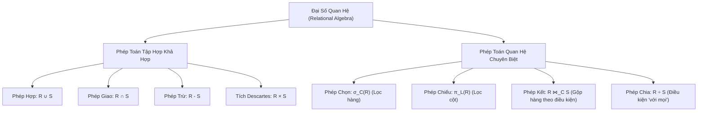
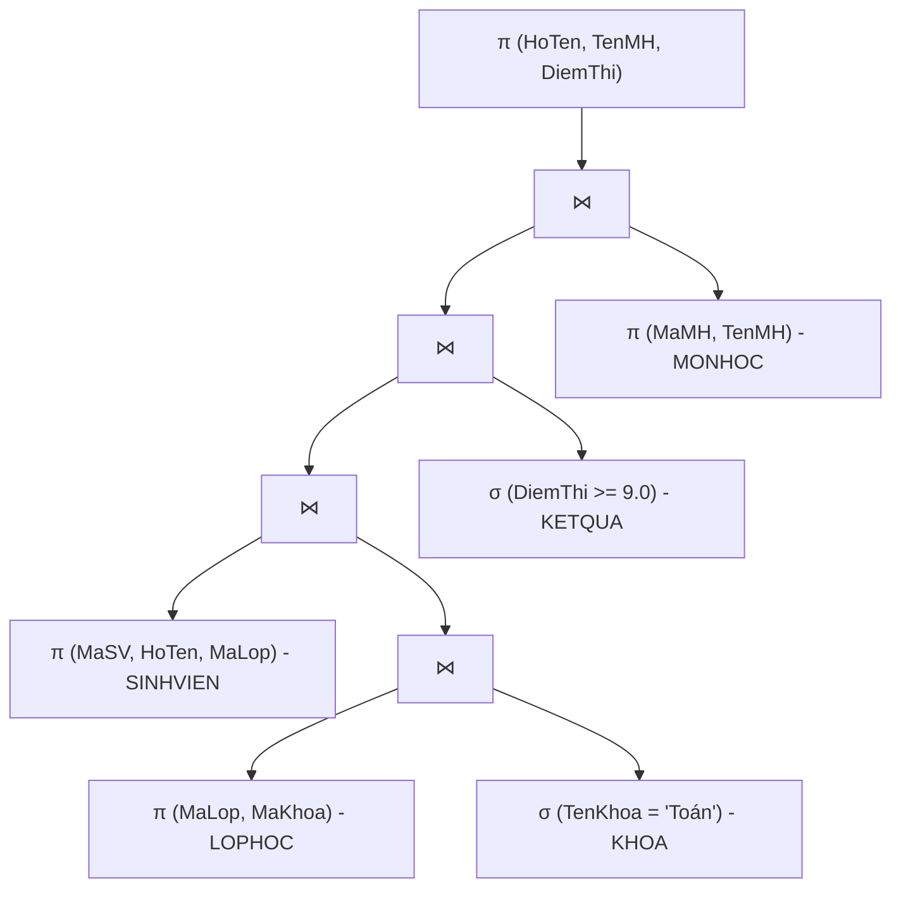

# CHƯƠNG 3: MÔ HÌNH DỮ LIỆU QUAN HỆ & ĐẠI SỐ QUAN HỆ

---

## PHẦN 1: TÓM TẮT CỐT LÕI (EXECUTIVE SUMMARY)

### 1. Bản Đồ Các Phép Toán Đại Số Quan Hệ (Relational Algebra)

### 2. Các Phép Toán Cốt Lõi & Ký Hiệu Hình Thức

| Phép toán | Ký hiệu | Ý nghĩa đại số | Điều kiện áp dụng |
| :--- | :---: | :--- | :--- |
| **Phép Chọn (Selection)** | $\sigma_C(R)$ | Lọc các bộ dữ liệu trong quan hệ $R$ thỏa mãn điều kiện logic $C$. | Điều kiện $C$ là biểu thức logic boolean trên các thuộc tính của $R$. |
| **Phép Chiếu (Projection)** | $\pi_L(R)$ | Trích xuất danh sách các thuộc tính $L$ từ $R$ và tự động loại bỏ các bộ trùng lặp. | $L$ là tập con các thuộc tính của $R$. |
| **Phép Hợp (Union)** | $R \cup S$ | Tập các bộ thuộc về $R$ hoặc thuộc về $S$ hoặc cả hai. | $R$ và $S$ phải **khả hợp** (cùng bậc và tương thích miền giá trị từng cặp thuộc tính). |
| **Phép Giao (Intersection)** | $R \cap S$ | Tập các bộ đồng thời xuất hiện ở cả $R$ và $S$. | $R$ và $S$ phải khả hợp. ($R \cap S = R - (R - S)$). |
| **Phép Trừ (Difference)** | $R - S$ | Tập các bộ thuộc về $R$ nhưng không thuộc về $S$. | $R$ và $S$ phải khả hợp. |
| **Tích Descartes (Cartesian)** | $R \times S$ | Ghép nối từng bộ của $R$ với mọi bộ của $S$. Bậc bằng $|R| + |S|$, số bộ bằng $|R| \times |S|$. | Không cần điều kiện khả hợp. |
| **Phép Kết Nối (Join)** | $R \bowtie_C S$ | Thực hiện tích Descartes $R \times S$ sau đó lọc theo điều kiện kết nối $C$: $\sigma_C(R \times S)$. | $C$ liên kết các thuộc tính tương thích giữa $R$ và $S$. |
| **Kết Tự Nhiên (Natural Join)** | $R \bowtie S$ | Kết bằng trên tất cả các thuộc tính trùng tên giữa $R$ và $S$, sau đó tự động khử một cột trùng. | Phải có ít nhất 1 thuộc tính trùng tên. |
| **Phép Chia (Division)** | $R \div S$ | Tìm các bộ trong $R$ liên kết được với **TẤT CẢ** các bộ trong $S$ (mệnh đề "với mọi"). | Thuộc tính của $S$ là tập con thực sự của $R$. |

---

## PHẦN 2: BÀI TẬP TRẮC NGHIỆM (10 CÂU CÓ ĐÁP ÁN ẨN)

### Câu 1
Phép toán đại số quan hệ nào sau đây làm giảm số lượng thuộc tính (cột) của một quan hệ?
- A. Phép chọn ($\sigma$)
- B. Phép chiếu ($\pi$)
- C. Phép hợp ($\cup$)
- D. Tích Descartes ($\times$)

<b>Xem đáp án & Giải thích</b>

- **Đáp án đúng:** B
- **Giải thích:** Phép chiếu $\pi_L(R)$ chỉ giữ lại danh sách các thuộc tính trong $L$ và loại bỏ các cột không được liệt kê, do đó làm giảm số cột của quan hệ.
- **Căn cứ giáo trình:** *Giáo trình Nhập môn CSDL (Quyển 1)*, Chương 3, Mục 2.2.

### Câu 2
Hai quan hệ $R$ và $S$ được gọi là "khả hợp" (Union-compatible) khi và chỉ khi:
- A. Chúng có cùng số lượng các bộ dữ liệu.
- B. Chúng có cùng khóa chính.
- C. Chúng có cùng bậc (số lượng thuộc tính) và các cặp thuộc tính tương ứng có miền giá trị tương thích.
- D. Chúng được lưu trữ trong cùng một tệp đĩa.

<b>Xem đáp án & Giải thích</b>

- **Đáp án đúng:** C
- **Giải thích:** Điều kiện khả hợp đòi hỏi hai quan hệ phải có cùng số lượng thuộc tính và miền giá trị của thuộc tính thứ $i$ trong $R$ phải tương thích với thuộc tính thứ $i$ trong $S$.
- **Căn cứ giáo trình:** *Giáo trình Nhập môn CSDL (Quyển 1)*, Chương 3, Mục 2.1.

### Câu 3
Cho quan hệ $R$ có 10 bộ và quan hệ $S$ có 20 bộ. Số lượng bộ tối đa có thể có trong kết quả của tích Descartes $R \times S$ là:
- A. 30 bộ
- B. 200 bộ
- C. 20 bộ
- D. 10 bộ

<b>Xem đáp án & Giải thích</b>

- **Đáp án đúng:** B
- **Giải thích:** Số lượng bộ của tích Descartes luôn bằng tích số lượng bộ của hai quan hệ: $|R \times S| = |R| \times |S| = 10 \times 20 = 200$ bộ.
- **Căn cứ giáo trình:** *Giáo trình Nhập môn CSDL (Quyển 1)*, Chương 3, Mục 2.1.

### Câu 4
Phép toán nào trong đại số quan hệ thường được sử dụng để giải quyết các câu hỏi truy vấn chứa mệnh đề "với mọi" (ví dụ: tìm sinh viên đã thi đậu TẤT CẢ các môn học)?
- A. Phép kết nối tự nhiên ($\bowtie$)
- B. Phép trừ ($-$)
- C. Phép chia ($\div$)
- D. Phép giao ($\cap$)

<b>Xem đáp án & Giải thích</b>

- **Đáp án đúng:** C
- **Giải thích:** Phép chia $R \div S$ là phép toán đại số chuyên biệt dùng để lọc ra những cá thể trong $R$ có mối quan hệ đồng thời với mọi cá thể trong $S$.
- **Căn cứ giáo trình:** *Giáo trình Nhập môn CSDL (Quyển 1)*, Chương 3, Mục 2.4.

### Câu 5
Kết quả của phép chọn $\sigma_{\text{Diem} > 8}(\text{KETQUA})$ sẽ là:
- A. Một quan hệ chứa các cột có điểm số lớn hơn 8.
- B. Một quan hệ chứa tất cả các bộ (dòng) của `KETQUA` có giá trị tại cột `Diem` lớn hơn 8.
- C. Một con số nguyên đếm số lượng sinh viên đạt điểm trên 8.
- D. Một giá trị boolean `TRUE` hoặc `FALSE`.

<b>Xem đáp án & Giải thích</b>

- **Đáp án đúng:** B
- **Giải thích:** Phép chọn $\sigma_C(R)$ là phép toán lọc theo dòng (ngang), trả về một quan hệ con gồm toàn bộ các bộ thỏa mãn biểu thức điều kiện $C$.
- **Căn cứ giáo trình:** *Giáo trình Nhập môn CSDL (Quyển 1)*, Chương 3, Mục 2.2.

### Câu 6
Biểu thức nào sau đây biểu diễn mối quan hệ giữa phép giao ($\cap$) và phép trừ ($-$) trong đại số quan hệ?
- A. $R \cap S = R - S$
- B. $R \cap S = S - R$
- C. $R \cap S = R - (R - S)$
- D. $R \cap S = (R \cup S) - R$

<b>Xem đáp án & Giải thích</b>

- **Đáp án đúng:** C
- **Giải thích:** Phần tử thuộc cả $R$ và $S$ chính là phần tử thuộc $R$ sau khi loại trừ đi các phần tử thuộc $R$ nhưng không thuộc $S$.
- **Căn cứ giáo trình:** *Giáo trình Nhập môn CSDL (Quyển 1)*, Chương 3, Mục 2.1.

### Câu 7
Sự khác biệt căn bản giữa Phép kết nối có điều kiện (Theta Join: $R \bowtie_C S$) và Phép kết tự nhiên (Natural Join: $R \bowtie S$) là:
- A. Kết tự nhiên không bao giờ sử dụng bộ nhớ RAM.
- B. Kết tự nhiên tự động thực hiện phép kết bằng trên các thuộc tính trùng tên và tự động loại bỏ một thuộc tính trùng lặp ở kết quả.
- C. Theta Join bắt buộc phải có điều kiện lớn hơn ($>$).
- D. Kết tự nhiên chỉ áp dụng được cho quan hệ có 1 cột duy nhất.

<b>Xem đáp án & Giải thích</b>

- **Đáp án đúng:** B
- **Giải thích:** Kết tự nhiên so sánh bằng trên các cột cùng tên giữa hai quan hệ và chỉ giữ lại một bản sao của các cột trùng đó, giúp lược đồ kết quả gọn gàng.
- **Căn cứ giáo trình:** *Giáo trình Nhập môn CSDL (Quyển 1)*, Chương 3, Mục 2.3.

### Câu 8
Khi thực hiện phép chiếu $\pi_A(R)$, nếu trong quan hệ $R$ ban đầu có 5 dòng có giá trị tại cột $A$ bằng `'CNTT'`, thì trong quan hệ kết quả sẽ có:
- A. Đúng 5 dòng có giá trị `'CNTT'`.
- B. Đúng 1 dòng có giá trị `'CNTT'`.
- C. Không có dòng nào.
- D. Tùy thuộc vào phiên bản của hệ điều hành.

<b>Xem đáp án & Giải thích</b>

- **Đáp án đúng:** B
- **Giải thích:** Trong lý thuyết tập hợp của Đại số quan hệ thuần túy, kết quả của một phép toán luôn là một quan hệ (tập hợp các bộ phân biệt), do đó mọi dòng trùng lặp đều được tự động loại bỏ (Duplicate Elimination).
- **Căn cứ giáo trình:** *Giáo trình Nhập môn CSDL (Quyển 1)*, Chương 3, Mục 2.2.

### Câu 9
Phép kết trái (Left Outer Join - $\mathbin{⟕}$) khác với phép kết nội (Inner Join - $\bowtie$) ở điểm nào?
- A. Giữ lại tất cả các bộ của quan hệ bên trái ngay cả khi chúng không tìm thấy bộ tương ứng khớp điều kiện ở quan hệ bên phải (các cột bên phải được điền giá trị `NULL`).
- B. Chỉ trả về các bộ không khớp nhau.
- C. Không bao giờ sử dụng điều kiện bằng.
- D. Đảo ngược vị trí các cột từ phải sang trái.

<b>Xem đáp án & Giải thích</b>

- **Đáp án đúng:** A
- **Giải thích:** Left Outer Join bảo toàn toàn bộ dữ liệu của quan hệ bên trái; nếu không có bản ghi khớp bên phải, các thuộc tính của bảng phải sẽ nhận giá trị rỗng (`NULL`).
- **Căn cứ giáo trình:** *Giáo trình Nhập môn CSDL (Quyển 1)*, Chương 3, Mục 2.3.

### Câu 10
Quy tắc biến đổi tương đương nào sau đây là ĐÚNG trong đại số quan hệ?
- A. $\sigma_{C_1 \land C_2}(R) \equiv \sigma_{C_1}(\sigma_{C_2}(R))$
- B. $\pi_L(\sigma_C(R)) \equiv \sigma_C(\pi_L(R))$ trong mọi trường hợp bất kể điều kiện $C$ chứa thuộc tính nào
- C. $R - S \equiv S - R$
- D. $R \bowtie S \equiv R \times S$

<b>Xem đáp án & Giải thích</b>

- **Đáp án đúng:** A
- **Giải thích:** Phép chọn với điều kiện hội $C_1 \land C_2$ có thể tách thành chuỗi các phép chọn liên tiếp $\sigma_{C_1}(\sigma_{C_2}(R))$. Phép trừ không có tính giao hoán; phép chiếu không thể đảo trước nếu $C$ chứa thuộc tính bị chiếu bỏ.
- **Căn cứ giáo trình:** *Giáo trình Nhập môn CSDL (Quyển 1)*, Chương 3, Mục 3.1.

---

## PHẦN 3: CÂU HỎI TRẢ LỜI NGẮN (5 CÂU CÓ ĐÁP ÁN ẨN)

### Câu 1
Cho lược đồ `SINHVIEN(MaSV, HoTen, Phai, MaKhoa)`. Viết biểu thức đại số quan hệ tìm mã và họ tên của các sinh viên nữ (`Phai = N'Nữ'`) thuộc khoa có mã `'CNTT'`.

<b>Xem đáp án & Hướng dẫn</b>

- **Đáp án:**
  $$\pi_{MaSV, HoTen} \left( \sigma_{Phai = \text{'Nữ'} \land MaKhoa = \text{'CNTT'}}(SINHVIEN) \right)$$

### Câu 2
Cho `KHACHHANG(MaKH, TenKH)` và `HOADON(SoHD, NgayLap, MaKH)`. Viết biểu thức đại số quan hệ tìm danh sách các khách hàng (gồm `MaKH`, `TenKH`) **chưa từng mua bất kỳ đơn hàng nào**.

<b>Xem đáp án & Hướng dẫn</b>

- **Đáp án:**
  $$\pi_{MaKH, TenKH}(KHACHHANG) - \pi_{MaKH, TenKH}(KHACHHANG \bowtie HOADON)$$
  *Hoặc:*
  $$\pi_{MaKH, TenKH} \left( KHACHHANG \bowtie (\pi_{MaKH}(KHACHHANG) - \pi_{MaKH}(HOADON)) \right)$$

### Câu 3
Nêu biểu thức đại số quan hệ của Phép kết tự nhiên $R \bowtie S$ thông qua các phép toán cơ bản (Tích Descartes, Chọn, Chiếu).

<b>Xem đáp án & Hướng dẫn</b>

- **Đáp án:**
  Nếu $R(A_1, \dots, A_n, B_1, \dots, B_k)$ và $S(B_1, \dots, B_k, C_1, \dots, C_m)$ có các thuộc tính chung là $\{B_1, \dots, B_k\}$:
  $$R \bowtie S = \pi_{A_1, \dots, A_n, R.B_1, \dots, R.B_k, C_1, \dots, C_m} \left( \sigma_{R.B_1 = S.B_1 \land \dots \land R.B_k = S.B_k}(R \times S) \right)$$

### Câu 4
Cho quan hệ `PHANCONG(MaNV, MaDA)` và quan hệ `DUAN(MaDA)`. Viết biểu thức đại số quan hệ tìm các nhân viên (`MaNV`) đã tham gia **tất cả** các dự án.

<b>Xem đáp án & Hướng dẫn</b>

- **Đáp án:**
  Áp dụng phép chia quan hệ:
  $$\pi_{MaNV, MaDA}(PHANCONG) \div \pi_{MaDA}(DUAN)$$

### Câu 5
Khi thực hiện phép trừ $R - S$, nếu quan hệ $R$ có 15 bộ và quan hệ $S$ có 8 bộ, số bộ tối thiểu và tối đa có thể có trong quan hệ kết quả là bao nhiêu?

<b>Xem đáp án & Hướng dẫn</b>

- **Đáp án:**
  - **Tối thiểu:** $15 - 8 = 7$ bộ (xảy ra khi toàn bộ 8 bộ của $S$ đều có mặt trong $R$).
  - **Tối đa:** $15$ bộ (xảy ra khi $R$ và $S$ không có bất kỳ bộ nào chung, tức $R \cap S = \emptyset$).

---

## PHẦN 4: BÀI TẬP TỰ LUẬN & THIẾT KẾ (3 BÀI CÓ LỜI GIẢI CHI TIẾT)

### Bài 1: Biểu Diễn Truy Vấn Bằng Đại Số Quan Hệ Đầy Đủ
Cho cơ sở dữ liệu Quản lý Đào tạo gồm các quan hệ:
- `SINHVIEN(MaSV, HoTen, NgaySinh, QueQuan, MaLop)`
- `LOPHOC(MaLop, TenLop, MaKhoa)`
- `KHOA(MaKhoa, TenKhoa)`
- `MONHOC(MaMH, TenMH, SoTinChi)`
- `KETQUA(MaSV, MaMH, DiemThi)`

Hãy viết các biểu thức đại số quan hệ thực hiện các yêu cầu sau:
1. Cho biết danh sách các sinh viên (`MaSV`, `HoTen`, `QueQuan`) có quê quán tại `'Huế'` và đang theo học tại khoa có tên `'Công nghệ Thông tin'`.
2. Tìm mã và tên các môn học mà sinh viên có mã `'SV001'` chưa từng thi.
3. Tìm những sinh viên (`MaSV`, `HoTen`) đã từng đạt điểm thi $\ge 8.0$ ở **tất cả** các môn học có số tín chỉ bằng 3.

<b>Xem lời giải chi tiết từng bước</b>

#### Câu 1: Sinh viên quê ở 'Huế' thuộc khoa 'Công nghệ Thông tin'
- **Bước 1: Lọc khoa CNTT:**
  $$E_1 = \sigma_{TenKhoa = \text{'Công nghệ Thông tin'}}(KHOA)$$
- **Bước 2: Kết nối tìm danh sách các lớp thuộc khoa CNTT:**
  $$E_2 = LOPHOC \bowtie E_1$$
- **Bước 3: Lọc sinh viên quê ở Huế:**
  $$E_3 = \sigma_{QueQuan = \text{'Huế'}}(SINHVIEN)$$
- **Bước 4: Kết nối và chiếu lấy thông tin cần thiết:**
  $$\text{Kết quả} = \pi_{MaSV, HoTen, QueQuan}(E_3 \bowtie E_2)$$

#### Câu 2: Các môn học mà sinh viên 'SV001' chưa từng thi
- **Bước 1: Danh sách toàn bộ các môn học:**
  $$M_{All} = \pi_{MaMH, TenMH}(MONHOC)$$
- **Bước 2: Danh sách các môn học mà sinh viên 'SV001' đã thi:**
  $$M_{DaThi} = \pi_{MaMH, TenMH} \left( MONHOC \bowtie \sigma_{MaSV = \text{'SV001'}}(KETQUA) \right)$$
- **Bước 3: Lấy hiệu hai tập hợp để tìm các môn chưa thi:**
  $$\text{Kết quả} = M_{All} - M_{DaThi}$$

#### Câu 3: Sinh viên đạt điểm >= 8.0 ở TẤT CẢ các môn học có 3 tín chỉ
- **Bước 1: Danh sách các môn học có 3 tín chỉ:**
  $$M_3 = \pi_{MaMH}(\sigma_{SoTinChi = 3}(MONHOC))$$
- **Bước 2: Danh sách các cặp (MaSV, MaMH) mà sinh viên đạt điểm >= 8.0:**
  $$KQ_{Gioi} = \pi_{MaSV, MaMH}(\sigma_{DiemThi \ge 8.0}(KETQUA))$$
- **Bước 3: Thực hiện phép chia để tìm sinh viên thỏa mãn với mọi môn trong $M_3$:**
  $$SV_{ThoaMan} = KQ_{Gioi} \div M_3$$
- **Bước 4: Chiếu lấy họ tên sinh viên:**
  $$\text{Kết quả} = \pi_{MaSV, HoTen}(SINHVIEN \bowtie SV_{ThoaMan})$$

### Bài 2: Tối Ưu Hóa Cây Truy Vấn Đại Số Quan Hệ
Cho biểu thức đại số quan hệ chưa tối ưu sau:
$$E = \pi_{HoTen, TenMH, DiemThi} \left( \sigma_{TenKhoa = \text{'Toán'} \land DiemThi \ge 9.0}(SINHVIEN \bowtie KETQUA \bowtie MONHOC \bowtie LOPHOC \bowtie KHOA) \right)$$
1. Hãy vẽ cây truy vấn ban đầu (chưa tối ưu).
2. Áp dụng các quy tắc Heuristic (đẩy phép chọn $\sigma$ xuống sớm nhất, đẩy phép chiếu $\pi$ xuống sớm nhất) để viết lại biểu thức tối ưu và vẽ cây truy vấn sau khi tối ưu.

<b>Xem lời giải chi tiết từng bước</b>

#### Bước 1: Phân tích biểu thức chưa tối ưu
Biểu thức ban đầu thực hiện kết nối toàn bộ 5 bảng lớn lại với nhau rồi mới áp dụng phép chọn lọc điều kiện. Điều này sinh ra các quan hệ trung gian khổng lồ, tiêu tốn bộ đệm và CPU.

#### Bước 2: Áp dụng các quy tắc Heuristic tối ưu
1. **Đẩy phép chọn $\sigma_{TenKhoa = \text{'Toán'}}$ xuống bảng `KHOA` trước khi thực hiện phép kết.**
2. **Đẩy phép chọn $\sigma_{DiemThi \ge 9.0}$ xuống bảng `KETQUA` trước khi thực hiện phép kết.**
3. **Đẩy phép chiếu $\pi$ loại bỏ sớm các cột không sử dụng (như `NgaySinh`, `QueQuan`, `SoTinChi`).**

#### Bước 3: Biểu thức tối ưu sau khi biến đổi
$$E_{opt} = \pi_{HoTen, TenMH, DiemThi} \left( (\pi_{MaSV, HoTen}(SINHVIEN \bowtie (LOPHOC \bowtie \sigma_{TenKhoa = \text{'Toán'}}(KHOA)))) \bowtie (\sigma_{DiemThi \ge 9.0}(KETQUA)) \bowtie (\pi_{MaMH, TenMH}(MONHOC)) \right)$$

### Bài 3: Phép Chia Quan Hệ Không Dùng Ký Hiệu Phép Chia
Chứng minh rằng phép chia $R(A, B) \div S(B)$ có thể được biểu diễn hoàn toàn thông qua các phép toán tập hợp cơ bản: Phép chiếu ($\pi$), Tích Descartes ($\times$) và Phép trừ ($-$).

<b>Xem lời giải chi tiết từng bước</b>

#### Bước 1: Ý nghĩa của phép chia $R(A, B) \div S(B)$
Tìm tập các giá trị $a \in \pi_A(R)$ sao cho với mọi $b \in S$, cặp $(a, b)$ đều xuất hiện trong $R$.
Nói cách khác: $a$ thuộc kết quả nếu $a$ **KHÔNG** tồn tại bất kỳ $b \in S$ nào mà $(a, b) \notin R$.

#### Bước 2: Xây dựng các tập hợp trung gian
1. **Tất cả các giá trị khả dĩ của thuộc tính $A$:**
   $$T_1 = \pi_A(R)$$
2. **Tất cả các cặp tổ hợp lý thuyết giữa $A$ và $S(B)$:**
   $$T_2 = T_1 \times S = \pi_A(R) \times S$$
3. **Các cặp tổ hợp $(a, b)$ lý thuyết nhưng THỰC TẾ KHÔNG CÓ trong $R$ (tức là những cặp bị thiếu):**
   $$T_3 = T_2 - R = (\pi_A(R) \times S) - R$$
4. **Chiếu lấy các giá trị $a$ bị thiếu ít nhất một giá trị $b$ của $S$:**
   $$T_4 = \pi_A(T_3) = \pi_A((\pi_A(R) \times S) - R)$$

#### Bước 3: Kết luận biểu thức tương đương
Lấy toàn bộ các giá trị $a$ trong $R$ trừ đi các giá trị $a$ bị thiếu:
$$R \div S = \pi_A(R) - \pi_A \left( (\pi_A(R) \times S) - R \right)$$
Đây là công thức chuẩn mực chứng minh Đại số quan hệ đầy đủ mà không cần phép chia làm phép toán nguyên thủy.

