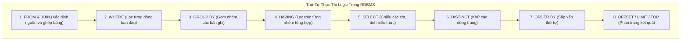

# CHƯƠNG 4: NGÔN NGỮ TRUY VẤN CƠ SỞ DỮ LIỆU SQL TOÀN DIỆN

---

## PHẦN 1: TÓM TẮT CỐT LÕI (EXECUTIVE SUMMARY)

### 1. Phân Nhóm và Thứ Tự Thực Thi Của Câu Lệnh SQL


### 2. Các Nhóm Lệnh SQL Cơ Bản
1. **DDL (Data Definition Language - Định nghĩa dữ liệu):**
   - `CREATE TABLE`, `ALTER TABLE`, `DROP TABLE`, `TRUNCATE TABLE`, `CREATE INDEX`.
   - Các ràng buộc toàn vẹn: `PRIMARY KEY`, `FOREIGN KEY ... REFERENCES`, `UNIQUE`, `NOT NULL`, `CHECK`, `DEFAULT`.
2. **DML (Data Manipulation Language - Thao tác dữ liệu):**
   - `INSERT INTO TenBang (Cot1, Cot2) VALUES (GiaTri1, GiaTri2)`
   - `UPDATE TenBang SET Cot1 = GiaTriMoi WHERE DieuKien`
   - `DELETE FROM TenBang WHERE DieuKien`
3. **DQL (Data Query Language - Truy vấn dữ liệu):**
   - Cú pháp chuẩn: `SELECT [DISTINCT] Cot FROM Bang [JOIN ...] WHERE ... GROUP BY ... HAVING ... ORDER BY ...`
4. **Các Phép Kết Nối Bảng (JOIN Types):**
   - `INNER JOIN`: Chỉ trả về các bản ghi khớp điều kiện ở cả hai bảng.
   - `LEFT OUTER JOIN`: Giữ toàn bộ bảng bên trái, bảng phải không khớp sẽ mang giá trị `NULL`.
   - `RIGHT OUTER JOIN`: Giữ toàn bộ bảng bên phải, bảng trái không khớp mang giá trị `NULL`.
   - `FULL OUTER JOIN`: Giữ toàn bộ bản ghi của cả hai bảng.
   - `CROSS JOIN`: Tích Descartes không điều kiện.
5. **Hàm Tổng Hợp (Aggregate Functions) & Mệnh đề `HAVING`:**
   - `COUNT()`, `SUM()`, `AVG()`, `MIN()`, `MAX()`.
   - **Quy tắc vàng:** Mệnh đề `WHERE` lọc các dòng *trước* khi gom nhóm; mệnh đề `HAVING` lọc các nhóm *sau* khi đã tính hàm tổng hợp.

---

## PHẦN 2: BÀI TẬP TRẮC NGHIỆM (10 CÂU CÓ ĐÁP ÁN ẨN)

### Câu 1
Trong câu lệnh SQL `SELECT`, mệnh đề nào sau đây được bộ máy xử lý truy vấn (Query Engine) thực thi ĐẦU TIÊN về mặt logic?
- A. `SELECT`
- B. `WHERE`
- C. `FROM`
- D. `ORDER BY`

<details>
<summary><b>Xem đáp án & Giải thích</b></summary>

- **Đáp án đúng:** C
- **Giải thích:** Mệnh đề `FROM` (kèm các phép `JOIN`) được thực thi đầu tiên để xác định nguồn tập dữ liệu cơ sở trước khi lọc dòng bằng `WHERE`.
- **Căn cứ giáo trình:** *Giáo trình Nhập môn CSDL (Quyển 1)*, Chương 4, Mục 3.1.
</details>

### Câu 2
Sự khác biệt căn bản giữa hai mệnh đề `WHERE` và `HAVING` trong SQL là:
- A. `WHERE` chỉ dùng cho số nguyên, `HAVING` dùng cho chuỗi ký tự.
- B. `WHERE` lọc dữ liệu trên từng bản ghi đơn lẻ trước khi gom nhóm, còn `HAVING` lọc trên các nhóm sau khi áp dụng hàm tổng hợp.
- C. `HAVING` luôn được thực thi trước `WHERE`.
- D. `WHERE` có thể chứa hàm `COUNT()`, còn `HAVING` thì không thể.

<details>
<summary><b>Xem đáp án & Giải thích</b></summary>

- **Đáp án đúng:** B
- **Giải thích:** `WHERE` không thể chứa hàm tổng hợp vì nó lọc trước khi nhóm được tạo thành. Để lọc trên kết quả tổng hợp (ví dụ: `COUNT(*) > 5`), bắt buộc phải dùng `HAVING`.
- **Căn cứ giáo trình:** *Giáo trình Nhập môn CSDL (Quyển 1)*, Chương 4, Mục 3.4.
</details>

### Câu 3
Để tìm kiếm các sinh viên có họ bắt đầu bằng chữ `'Nguyễn'` trong bảng `SINHVIEN`, mệnh đề `WHERE` nào sau đây là chuẩn xác?
- A. `WHERE HoTen = 'Nguyễn%'`
- B. `WHERE HoTen LIKE N'Nguyễn%'`
- C. `WHERE HoTen IN ('Nguyễn')`
- D. `WHERE HoTen LIKE N'%Nguyễn'`

<details>
<summary><b>Xem đáp án & Giải thích</b></summary>

- **Đáp án đúng:** B
- **Giải thích:** Toán tử `LIKE` kết hợp ký tự đại diện `%` (đại diện cho chuỗi ký tự bất kỳ) và tiền tố `N` (chuỗi Unicode) cho phép tìm kiếm chuỗi bắt đầu bằng cụm từ `'Nguyễn'`.
- **Căn cứ giáo trình:** *Giáo trình Nhập môn CSDL (Quyển 1)*, Chương 4, Mục 3.2.
</details>

### Câu 4
Câu lệnh nào sau đây xóa toàn bộ dữ liệu trong bảng `DONHANG` nhưng vẫn giữ nguyên cấu trúc bảng và giải phóng không gian khối đĩa nhanh hơn câu lệnh `DELETE`?
- A. `DROP TABLE DONHANG`
- B. `REMOVE TABLE DONHANG`
- C. `TRUNCATE TABLE DONHANG`
- D. `ALTER TABLE DONHANG CLEAR`

<details>
<summary><b>Xem đáp án & Giải thích</b></summary>

- **Đáp án đúng:** C
- **Giải thích:** `TRUNCATE TABLE` là lệnh DDL xóa toàn bộ các dòng bằng cách hủy cấp phát các trang dữ liệu (deallocating data pages), không ghi nhật ký từng dòng như `DELETE`, do đó chạy nhanh hơn rất nhiều và giữ nguyên lược đồ bảng.
- **Căn cứ giáo trình:** *Giáo trình Nhập môn CSDL (Quyển 1)*, Chương 4, Mục 2.3.
</details>

### Câu 5
Khi thực hiện phép `LEFT JOIN` giữa bảng `A` và bảng `B`, nếu một dòng của bảng `A` không tìm thấy bất kỳ dòng nào khớp điều kiện trong bảng `B`, các cột thuộc về bảng `B` ở dòng kết quả đó sẽ mang giá trị:
- A. Chuỗi rỗng `''`
- B. Số 0
- C. `NULL`
- D. Giá trị mặc định của bảng A

<details>
<summary><b>Xem đáp án & Giải thích</b></summary>

- **Đáp án đúng:** C
- **Giải thích:** Trong các phép Outer Join, khi không có dòng khớp điều kiện, hệ quản trị CSDL tự động điền giá trị `NULL` vào tất cả các cột của bảng thiếu dữ liệu.
- **Căn cứ giáo trình:** *Giáo trình Nhập môn CSDL (Quyển 1)*, Chương 4, Mục 3.3.
</details>

### Câu 6
Toán tử nào sau đây trong SQL kiểm tra xem một truy vấn con (Subquery) có trả về **ít nhất một dòng dữ liệu** hay không?
- A. `IN`
- B. `EXISTS`
- C. `ALL`
- D. `BETWEEN`

<details>
<summary><b>Xem đáp án & Giải thích</b></summary>

- **Đáp án đúng:** B
- **Giải thích:** `EXISTS (SELECT ...)` trả về giá trị `TRUE` ngay khi truy vấn con tìm thấy dòng đầu tiên thỏa mãn mà không cần nạp toàn bộ kết quả vào bộ nhớ, mang lại hiệu năng cao.
- **Căn cứ giáo trình:** *Giáo trình Nhập môn CSDL (Quyển 1)*, Chương 4, Mục 3.5.
</details>

### Câu 7
Cho câu lệnh:
```sql
SELECT MaKhoa, COUNT(MaSV) AS SoLuong
FROM SINHVIEN
WHERE DiemTB >= 5.0
GROUP BY MaKhoa
HAVING COUNT(MaSV) >= 30
ORDER BY SoLuong DESC;
```
Trật tự lọc dữ liệu của câu lệnh trên diễn ra như thế nào?
- A. Lọc sinh viên có `DiemTB >= 5.0`, gom nhóm theo `MaKhoa`, lọc nhóm có số lượng $\ge 30$, sắp xếp giảm dần.
- B. Gom nhóm theo `MaKhoa`, lọc sinh viên có `DiemTB >= 5.0`, đếm số lượng rồi sắp xếp.
- C. Sắp xếp trước rồi mới lọc `WHERE`.
- D. Lọc `HAVING` trước rồi mới lọc `WHERE`.

<details>
<summary><b>Xem đáp án & Giải thích</b></summary>

- **Đáp án đúng:** A
- **Giải thích:** `WHERE` lọc các cá thể có `DiemTB >= 5.0` trước, sau đó hệ thống mới thực hiện `GROUP BY MaKhoa`, tiếp theo dùng `HAVING` để loại các nhóm có dưới 30 sinh viên, cuối cùng là `ORDER BY`.
- **Căn cứ giáo trình:** *Giáo trình Nhập môn CSDL (Quyển 1)*, Chương 4, Mục 3.4.
</details>

### Câu 8
Hàm tổng hợp `COUNT(*)` khác với `COUNT(TenCot)` ở điểm nào?
- A. Không có điểm nào khác nhau.
- B. `COUNT(*)` đếm tất cả các dòng kể cả dòng chứa giá trị `NULL`, trong khi `COUNT(TenCot)` bỏ qua các dòng mà `TenCot` nhận giá trị `NULL`.
- C. `COUNT(*)` chỉ đếm được tối đa 100 dòng.
- D. `COUNT(TenCot)` luôn chạy nhanh hơn `COUNT(*)`.

<details>
<summary><b>Xem đáp án & Giải thích</b></summary>

- **Đáp án đúng:** B
- **Giải thích:** `COUNT(*)` đếm số lượng bộ dữ liệu trong bảng/nhóm. `COUNT(TenCot)` chỉ đếm các giá trị khác `NULL` tại thuộc tính đó.
- **Căn cứ giáo trình:** *Giáo trình Nhập môn CSDL (Quyển 1)*, Chương 4, Mục 3.4.
</details>

### Câu 9
Ràng buộc nào sau đây bảo đảm rằng hai bản ghi khác nhau trong cùng một bảng không thể có cùng giá trị trên một thuộc tính, nhưng vẫn cho phép tồn tại giá trị `NULL`?
- A. `PRIMARY KEY`
- B. `NOT NULL`
- C. `UNIQUE`
- D. `FOREIGN KEY`

<details>
<summary><b>Xem đáp án & Giải thích</b></summary>

- **Đáp án đúng:** C
- **Giải thích:** Ràng buộc `UNIQUE` đảm bảo tính duy nhất không trùng lặp nhưng theo chuẩn SQL vẫn chấp nhận chứa giá trị `NULL` (khác với `PRIMARY KEY` nghiêm cấm `NULL`).
- **Căn cứ giáo trình:** *Giáo trình Nhập môn CSDL (Quyển 1)*, Chương 4, Mục 2.2.
</details>

### Câu 10
Để kết hợp kết quả của hai câu lệnh `SELECT` và **loại bỏ các dòng trùng lặp**, ta sử dụng toán tử tập hợp nào?
- A. `UNION ALL`
- B. `UNION`
- C. `INTERSECT ALL`
- D. `MINUS ALL`

<details>
<summary><b>Xem đáp án & Giải thích</b></summary>

- **Đáp án đúng:** B
- **Giải thích:** `UNION` tự động thực hiện phép khử trùng (Duplicate Elimination). Nếu muốn giữ lại cả các dòng trùng lặp để tối ưu tốc độ, ta dùng `UNION ALL`.
- **Căn cứ giáo trình:** *Giáo trình Nhập môn CSDL (Quyển 1)*, Chương 4, Mục 3.6.
</details>

---

## PHẦN 3: CÂU HỎI TRẢ LỜI NGẮN (5 CÂU CÓ ĐÁP ÁN ẨN)

### Câu 1
Cho bảng `SANPHAM(MaSP, TenSP, DonGia)`. Viết câu lệnh SQL cập nhật tăng giá bán thêm 15% cho tất cả các sản phẩm có `DonGia < 100000`.

<details>
<summary><b>Xem đáp án & Hướng dẫn</b></summary>

```sql
UPDATE SANPHAM
SET DonGia = DonGia * 1.15
WHERE DonGia < 100000;
```
</details>

### Câu 2
Cho bảng `NHANVIEN(MaNV, HoTen, Luong, MaPhong)`. Viết câu lệnh SQL tìm mức lương cao thứ nhì trong toàn bộ công ty (không sử dụng hàm phân tích xếp hạng).

<details>
<summary><b>Xem đáp án & Hướng dẫn</b></summary>

```sql
SELECT MAX(Luong) AS LuongCaoThuNhi
FROM NHANVIEN
WHERE Luong < (SELECT MAX(Luong) FROM NHANVIEN);
```
</details>

### Câu 3
Viết câu lệnh SQL tìm các phòng ban (`MaPhong`) có tổng quỹ lương lớn hơn 100 triệu đồng.

<details>
<summary><b>Xem đáp án & Hướng dẫn</b></summary>

```sql
SELECT MaPhong, SUM(Luong) AS TongLuong
FROM NHANVIEN
GROUP BY MaPhong
HAVING SUM(Luong) > 100000000;
```
</details>

### Câu 4
Cho bảng `KHACHHANG(MaKH, TenKH)` và `HOADON(SoHD, MaKH)`. Viết câu lệnh SQL sử dụng `NOT EXISTS` để tìm danh sách các khách hàng chưa từng mua hàng.

<details>
<summary><b>Xem đáp án & Hướng dẫn</b></summary>

```sql
SELECT k.MaKH, k.TenKH
FROM KHACHHANG k
WHERE NOT EXISTS (
    SELECT 1 
    FROM HOADON h 
    WHERE h.MaKH = k.MaKH
);
```
</details>

### Câu 5
Viết câu lệnh SQL `ALTER TABLE` thêm ràng buộc kiểm tra trên bảng `HOCVIEN` bảo đảm rằng cột `Diem` phải nằm trong khoảng từ 0.0 đến 10.0.

<details>
<summary><b>Xem đáp án & Hướng dẫn</b></summary>

```sql
ALTER TABLE HOCVIEN
ADD CONSTRAINT CK_HocVien_Diem CHECK (Diem >= 0.0 AND Diem <= 10.0);
```
</details>

---

## PHẦN 4: BÀI TẬP TỰ LUẬN & THIẾT KẾ (3 BÀI CÓ LỜI GIẢI CHI TIẾT)

### Bài 1: Xây Dựng CSDL & Viết Truy Vấn Thống Kê Nâng Cao
Cho cơ sở dữ liệu Quản lý Đề án gồm các bảng:
- `PHONGBAN(MaPB, TenPB, TruongPhong)`
- `NHANVIEN(MaNV, HoTen, NgaySinh, Phai, Luong, MaPB)`
- `DEAN(MaDA, TenDA, DiaDiem, MaPB)`
- `PHANCONG(MaNV, MaDA, SoGio)`

**Yêu cầu:**
1. Viết câu lệnh SQL DDL tạo bảng `PHANCONG` có đầy đủ khóa chính, 2 khóa ngoại và ràng buộc kiểm tra `SoGio > 0`.
2. Cho biết họ tên nhân viên và tên đề án mà nhân viên đó tham gia với số giờ làm việc cao nhất trong từng đề án.
3. Thống kê theo từng phòng ban gồm: `MaPB`, `TenPB`, `SoLuongNhanVien`, `LuongTrungBinh`, chỉ hiển thị những phòng ban có từ 5 nhân viên trở lên và sắp xếp giảm dần theo lương trung bình.

<details>
<summary><b>Xem lời giải chi tiết từng bước</b></summary>

#### Câu 1: DDL Tạo Bảng PHANCONG
```sql
CREATE TABLE PHANCONG (
    MaNV VARCHAR(10) NOT NULL,
    MaDA VARCHAR(10) NOT NULL,
    SoGio DECIMAL(5, 2) NOT NULL,
    CONSTRAINT PK_PhanCong PRIMARY KEY (MaNV, MaDA),
    CONSTRAINT FK_PhanCong_NhanVien FOREIGN KEY (MaNV) REFERENCES NHANVIEN(MaNV),
    CONSTRAINT FK_PhanCong_DeAn FOREIGN KEY (MaDA) REFERENCES DEAN(MaDA),
    CONSTRAINT CK_PhanCong_SoGio CHECK (SoGio > 0)
);
```

#### Câu 2: Nhân viên có số giờ làm việc cao nhất trong từng đề án
Sử dụng truy vấn con tương quan (Correlated Subquery):
```sql
SELECT nv.HoTen, da.TenDA, pc.SoGio
FROM PHANCONG pc
JOIN NHANVIEN nv ON pc.MaNV = nv.MaNV
JOIN DEAN da ON pc.MaDA = da.MaDA
WHERE pc.SoGio = (
    SELECT MAX(pc_sub.SoGio)
    FROM PHANCONG pc_sub
    WHERE pc_sub.MaDA = pc.MaDA
);
```

#### Câu 3: Thống kê phòng ban có từ 5 nhân viên trở lên
```sql
SELECT 
    pb.MaPB,
    pb.TenPB,
    COUNT(nv.MaNV) AS SoLuongNhanVien,
    ROUND(AVG(nv.Luong), 2) AS LuongTrungBinh
FROM PHONGBAN pb
JOIN NHANVIEN nv ON pb.MaPB = nv.MaPB
GROUP BY pb.MaPB, pb.TenPB
HAVING COUNT(nv.MaNV) >= 5
ORDER BY LuongTrungBinh DESC;
```
</details>

### Bài 2: Chuyển Đổi Phép Chia Đại Số Sang SQL (Universal Quantification)
Trong quản lý đào tạo, ta có `SINHVIEN(MaSV, HoTen)`, `MONHOC(MaMH, TenMH)` và `KETQUA(MaSV, MaMH, DiemThi)`.
Hãy viết câu lệnh SQL tìm sinh viên (`MaSV`, `HoTen`) đã thi đạt (`DiemThi >= 5.0`) **tất cả** các môn học của nhà trường bằng 2 cách tiếp cận khác nhau:
1. Cách 1: Sử dụng kỹ thuật gom nhóm và so sánh số lượng (`GROUP BY ... HAVING COUNT(...)`).
2. Cách 2: Sử dụng hai lần phủ định với toán tử `NOT EXISTS` (tư duy logic: Không tồn tại môn học nào mà sinh viên đó chưa thi đạt).

<details>
<summary><b>Xem lời giải chi tiết từng bước</b></summary>

#### Cách 1: Sử dụng GROUP BY và HAVING COUNT(DISTINCT)
```sql
SELECT sv.MaSV, sv.HoTen
FROM SINHVIEN sv
JOIN KETQUA kq ON sv.MaSV = kq.MaSV
WHERE kq.DiemThi >= 5.0
GROUP BY sv.MaSV, sv.HoTen
HAVING COUNT(DISTINCT kq.MaMH) = (SELECT COUNT(*) FROM MONHOC);
```

#### Cách 2: Sử dụng 2 lần phủ định NOT EXISTS (Chuẩn đại số quan hệ)
```sql
SELECT sv.MaSV, sv.HoTen
FROM SINHVIEN sv
WHERE NOT EXISTS (
    -- Tìm môn học
    SELECT mh.MaMH
    FROM MONHOC mh
    WHERE NOT EXISTS (
        -- Mà sinh viên sv ĐÃ THI ĐẠT
        SELECT 1
        FROM KETQUA kq
        WHERE kq.MaSV = sv.MaSV 
          AND kq.MaMH = mh.MaMH 
          AND kq.DiemThi >= 5.0
    )
);
```
</details>

### Bài 3: Tối Ưu Hóa Truy Vấn Bằng Phân Tích Kế Hoạch Thực Thi (Execution Plan)
Xét câu lệnh truy vấn sau trên bảng có hàng triệu dòng dữ liệu:
```sql
SELECT HoTen, Luong
FROM NHANVIEN
WHERE YEAR(NgaySinh) = 1995;
```
1. Hãy chỉ ra tại sao việc sử dụng hàm `YEAR(NgaySinh)` trong mệnh đề `WHERE` sẽ làm vô hiệu hóa chỉ mục (Index Seek) trên cột `NgaySinh` và buộc DBMS phải quét toàn bộ bảng (Table Scan / Index Scan)?
2. Viết lại câu lệnh SQL trên theo cách tối ưu nhất (SARGable Query) để tận dụng chỉ mục B-Tree trên cột `NgaySinh`.

<details>
<summary><b>Xem lời giải chi tiết từng bước</b></summary>

#### Bước 1: Phân tích hiện tượng Non-SARGable
- Trong chỉ mục B-Tree, các khóa được sắp xếp dựa trên giá trị thô ban đầu của cột `NgaySinh` (dạng ngày tháng `YYYY-MM-DD`).
- Khi viết `WHERE YEAR(NgaySinh) = 1995`, hệ quản trị CSDL buộc phải duyệt qua từng dòng một trong bảng, áp dụng hàm `YEAR()` để tính toán rồi mới so sánh. Điều này gọi là **Non-SARGable (Search Argument Able)**, biến thao tác tìm kiếm theo nhánh cây nhị phân $O(\log N)$ thành duyệt tuyến tính $O(N)$ (Table Scan), gây suy giảm nghiêm trọng hiệu năng hệ thống.

#### Bước 2: Viết lại câu lệnh tối ưu (SARGable)
Thay vì bọc hàm lên cột dữ liệu, ta chuyển thành so sánh khoảng giá trị trực tiếp:
```sql
SELECT HoTen, Luong
FROM NHANVIEN
WHERE NgaySinh >= '1995-01-01' AND NgaySinh <= '1995-12-31';
```
Với cách viết này, DBMS sẽ sử dụng thao tác **Index Seek** để nhảy trực tiếp tới ngày đầu tiên của năm 1995 và duyệt tuần tự đến hết ngày cuối năm 1995 trên lá của cây B+ Tree, giảm số lượt I/O từ hàng triệu khối xuống chỉ còn vài khối đĩa.
</details>
