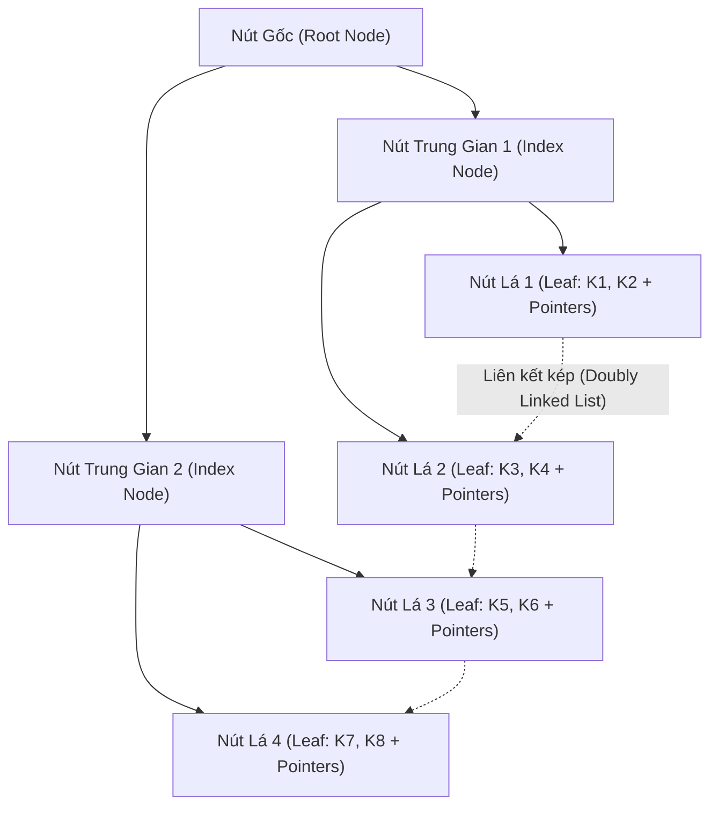

# CHƯƠNG 5: TỔ CHỨC VẬT LÝ DỮ LIỆU, HỆ SỐ KẾT KHỐI & CẤU TRÚC CHỈ MỤC CÂY B/B+

---

## PHẦN 1: TÓM TẮT CỐT LÕI (EXECUTIVE SUMMARY)

### 1. Sơ đồ Cấu trúc Cây Chỉ Mục B+ Tree (B+ Tree Index Architecture)

### 2. Các Công Thức Tính Toán Lưu Trữ Vật Lý
- **Đơn vị khối (Block):** Kích thước cố định $B$ byte (thường 4096 hoặc 8192 bytes).
- **Kích thước bản ghi (Record length):** $R$ byte.
- **Hệ số kết khối (Blocking Factor - $bfr$):** Số lượng bản ghi tối đa có thể xếp vào trong 1 khối đĩa:
  $$bfr = \left\lfloor \frac{B}{R} \right\rfloor$$
- **Số khối đĩa ($b$) cần thiết để lưu trữ tệp gồm $r$ bản ghi:**
  $$b = \left\lceil \frac{r}{bfr} \right\rceil$$

### 3. Phân Loại Cấu Trúc Tệp Cơ Bản

| Dạng tệp | Đặc điểm tổ chức | Chi phí Tìm kiếm | Chi phí Chèn |
| :--- | :--- | :---: | :---: |
| **Tệp Đống (Heap File)** | Bản ghi chèn tự do vào khối cuối còn trống. | $b/2$ khối (tuyến tính) | $O(1)$ I/O |
| **Tệp Tuần tự (Sequential)** | Bản ghi sắp thứ tự theo một khóa sắp xếp. | $\lceil \log_2 b \rceil$ khối (tìm nhị phân) | Cao (cần vùng tràn Overflow) |
| **Tệp Băm (Hash File)** | Dùng hàm băm $h(K)$ trỏ trực tiếp tới Bucket. | $\approx 1$ I/O (nếu không đụng độ) | $O(1)$ I/O |

### 4. Kỹ Thuật Chỉ Mục (Indexing)
- **Chỉ mục chính (Primary Index):** Xây dựng trên trường khóa chính của tệp dữ liệu đã sắp thứ tự. Thường là **chỉ mục thưa (Sparse Index)** - mỗi mục chỉ mục đại diện cho một khối đĩa (Anchor record).
- **Chỉ mục gom cụm (Clustering Index):** Xây dựng trên trường không phải khóa của tệp đã sắp xếp.
- **Chỉ mục phụ (Secondary Index):** Xây dựng trên trường bất kỳ của tệp chưa sắp xếp. Bắt buộc là **chỉ mục dày (Dense Index)** - mỗi bản ghi tương ứng một mục chỉ mục.
- **Cây B+ (B+ Tree) - Chuẩn công nghiệp RDBMS:**
  - Mọi con trỏ trỏ tới dữ liệu thực tế đều nằm tại các **nút lá**.
  - Các nút trong chỉ đóng vai trò dẫn đường (Routing keys).
  - Các nút lá liên kết với nhau thành **danh sách liên kết hai chiều**, hỗ trợ cực mạnh truy vấn tìm kiếm theo khoảng (Range Queries).
  - Độ cao cây $h \le \lceil \log_{\lceil m/2 \rceil} N \rceil$, duy trì thời gian tìm kiếm ổn định $O(\log N)$ với độ cao thường chỉ từ 2 đến 4 tầng.

---

## PHẦN 2: BÀI TẬP TRẮC NGHIỆM (10 CÂU CÓ ĐÁP ÁN ẨN)

### Câu 1
Hệ số kết khối (Blocking Factor - $bfr$) của một tệp dữ liệu được định nghĩa là:
- A. Số lượng trường (thuộc tính) có trong một bảng.
- B. Số lượng khối đĩa tối đa mà tệp có thể chiếm dụng.
- C. Số lượng bản ghi dữ liệu tối đa có thể được lưu trữ trong một khối đĩa.
- D. Dung lượng tính bằng Megabyte của toàn bộ cơ sở dữ liệu.

<b>Xem đáp án & Giải thích</b>

- **Đáp án đúng:** C
- **Giải thích:** $bfr = \lfloor B / R \rfloor$, biểu thị có bao nhiêu bản ghi kích thước $R$ có thể đóng vừa vặn vào một khối nhớ đĩa kích thước $B$.
- **Căn cứ giáo trình:** *Giáo trình Nhập môn CSDL (Quyển 1)*, Chương 5, Mục 1.2.

### Câu 2
Ưu điểm vượt trội của cấu trúc Cây B+ (B+ Tree) so với Cây B thông thường (Standard B-Tree) trong các hệ quản trị CSDL là gì?
- A. Cây B+ chiếm ít dung lượng bộ nhớ RAM hơn.
- B. Các nút lá trong Cây B+ được liên kết tuần tự với nhau bằng danh sách liên kết hai chiều, cho phép thực thi truy vấn theo khoảng (Range Query) cực nhanh.
- C. Cây B+ không bao giờ cần phải thực hiện thao tác cân bằng cây.
- D. Cây B+ chỉ lưu trữ được kiểu dữ liệu số nguyên.

<b>Xem đáp án & Giải thích</b>

- **Đáp án đúng:** B
- **Giải thích:** Khác với Cây B (con trỏ dữ liệu nằm rải rác ở mọi nút), Cây B+ gom toàn bộ con trỏ dữ liệu xuống tầng lá và xâu chuỗi chúng thành danh sách liên kết, giúp việc duyệt `BETWEEN val1 AND val2` chỉ cần tìm điểm đầu và quét tuần tự trên tầng lá.
- **Căn cứ giáo trình:** *Giáo trình Nhập môn CSDL (Quyển 1)*, Chương 5, Mục 3.2.

### Câu 3
Một tệp dữ liệu có 40,000 bản ghi, mỗi bản ghi có kích thước $R = 100$ bytes. Kích thước khối đĩa $B = 4096$ bytes. Hệ số kết khối $bfr$ và số khối đĩa $b$ cần thiết để lưu tệp lần lượt là:
- A. $bfr = 40$, $b = 1000$ khối
- B. $bfr = 40.96$, $b = 977$ khối
- C. $bfr = 40$, $b = 976$ khối
- D. $bfr = 41$, $b = 976$ khối

<b>Xem đáp án & Giải thích</b>

- **Đáp án đúng:** A
- **Giải thích:**
  - $bfr = \lfloor 4096 / 100 \rfloor = \lfloor 40.96 \rfloor = 40$ bản ghi/khối.
  - Số khối $b = \lceil 40000 / 40 \rceil = 1000$ khối đĩa.
- **Căn cứ giáo trình:** *Giáo trình Nhập môn CSDL (Quyển 1)*, Chương 5, Mục 1.2.

### Câu 4
Loại chỉ mục nào sau đây yêu cầu mỗi bản ghi trong tệp dữ liệu đều phải có một mục tương ứng trong tệp chỉ mục?
- A. Chỉ mục thưa (Sparse Index)
- B. Chỉ mục dày (Dense Index)
- C. Chỉ mục cụm (Clustering Index)
- D. Chỉ mục chính (Primary Index)

<b>Xem đáp án & Giải thích</b>

- **Đáp án đúng:** B
- **Giải thích:** Chỉ mục dày (Dense Index) lưu trữ cặp `(Khóa, Con trỏ)` cho từng bản ghi riêng biệt trong tệp. Trong khi chỉ mục thưa (Sparse Index) chỉ lưu đại diện khóa đầu tiên của mỗi khối.
- **Căn cứ giáo trình:** *Giáo trình Nhập môn CSDL (Quyển 1)*, Chương 5, Mục 2.2.

### Câu 5
Trong tệp đống (Heap File / Unordered File), thao tác nào sau đây có chi phí nhanh nhất?
- A. Tìm kiếm một bản ghi theo khóa chính
- B. Xóa một bản ghi bất kỳ
- C. Chèn một bản ghi mới vào cuối tệp
- D. Tìm giá trị lớn nhất của một thuộc tính

<b>Xem đáp án & Giải thích</b>

- **Đáp án đúng:** C
- **Giải thích:** Trong tệp đống, dữ liệu không cần sắp thứ tự nên việc chèn bản ghi mới chỉ đơn giản là ghi vào khối cuối cùng của tệp với chi phí tối thiểu $O(1)$ I/O.
- **Căn cứ giáo trình:** *Giáo trình Nhập môn CSDL (Quyển 1)*, Chương 5, Mục 1.3.

### Câu 6
Giả sử một tệp dữ liệu đã sắp thứ tự chiếm $b = 1024$ khối đĩa. Nếu không sử dụng chỉ mục, số khối đĩa trung bình cần đọc để tìm kiếm một bản ghi bằng thuật toán tìm kiếm nhị phân (Binary Search) là:
- A. 512 khối
- B. 10 khối
- C. 1024 khối
- D. 1 khối

<b>Xem đáp án & Giải thích</b>

- **Đáp án đúng:** B
- **Giải thích:** Chi phí tìm kiếm nhị phân trên tệp tuần tự là $\lceil \log_2 b \rceil = \lceil \log_2 1024 \rceil = 10$ lần đọc khối đĩa.
- **Căn cứ giáo trình:** *Giáo trình Nhập môn CSDL (Quyển 1)*, Chương 5, Mục 1.3.

### Câu 7
Tại sao trong hầu hết các DBMS, chỉ mục Cây B+ thường có chiều cao (Height) rất nhỏ (chỉ từ 2 đến 4 tầng) ngay cả với các bảng có hàng chục triệu bản ghi?
- A. Vì mỗi khối đĩa chỉ chứa được tối đa 2 con trỏ.
- B. Vì bậc phân nhánh (Fan-out / Order) của mỗi nút trong cây B+ rất lớn (thường từ vài chục đến hàng trăm khóa trong một khối 4KB-8KB).
- C. Vì Cây B+ không bao giờ lưu trữ các giá trị số.
- D. Vì Cây B+ tự động nén toàn bộ tệp về dung lượng 0 byte.

<b>Xem đáp án & Giải thích</b>

- **Đáp án đúng:** B
- **Giải thích:** Nút của Cây B+ có kích thước bằng một khối đĩa (4KB - 8KB), chứa được hàng trăm cặp khóa và con trỏ, dẫn đến hệ số phân nhánh khổng lồ, khiến cây nở theo chiều rộng và có độ cao cực thấp.
- **Căn cứ giáo trình:** *Giáo trình Nhập môn CSDL (Quyển 1)*, Chương 5, Mục 3.2.

### Câu 8
Khái niệm "Bản ghi neo" (Anchor Record) trong cấu trúc chỉ mục chính (Primary Index) được hiểu là:
- A. Bản ghi có kích thước lớn nhất trong cơ sở dữ liệu.
- B. Bản ghi đầu tiên của mỗi khối đĩa trong tệp dữ liệu có thứ tự.
- C. Bản ghi bị hỏng không thể phục hồi.
- D. Bản ghi chứa thông tin tài khoản của Quản trị viên DBA.

<b>Xem đáp án & Giải thích</b>

- **Đáp án đúng:** B
- **Giải thích:** Trong chỉ mục thưa (Sparse Primary Index), bản ghi neo là bản ghi đầu tiên trong một khối, khóa của bản ghi này được lưu trong tệp chỉ mục làm mốc tham chiếu cho khối đó.
- **Căn cứ giáo trình:** *Giáo trình Nhập môn CSDL (Quyển 1)*, Chương 5, Mục 2.1.

### Câu 9
Khi một nút trong Cây B+ bậc $M$ bị đầy (đã chứa đủ số lượng khóa tối đa) và có một thao tác chèn khóa mới vào nút đó, cơ chế xử lý của cây là:
- A. Hủy bỏ giao dịch và báo lỗi tràn bộ nhớ.
- B. Tách nút đó thành hai nút con (Node Split) và đưa khóa trung vị lên nút cha.
- C. Xóa bớt một khóa ngẫu nhiên trong nút.
- D. Chuyển cây thành danh sách liên kết đơn.

<b>Xem đáp án & Giải thích</b>

- **Đáp án đúng:** B
- **Giải thích:** Khi nút bị tràn khóa, Cây B+ thực hiện phép tách nút (Split), phân chia các khóa đều cho 2 nút mới và đẩy khóa dẫn đường lên nút cha để bảo toàn tính cân bằng.
- **Căn cứ giáo trình:** *Giáo trình Nhập môn CSDL (Quyển 1)*, Chương 5, Mục 3.2.

### Câu 10
Nhược điểm lớn nhất của việc tạo quá nhiều chỉ mục (Indexes) trên các cột của một bảng trong thực tế là gì?
- A. Không thể viết câu lệnh `SELECT` được nữa.
- B. Làm chậm đáng kể hiệu năng của các thao tác ghi dữ liệu (`INSERT`, `UPDATE`, `DELETE`) và tiêu tốn nhiều dung lượng lưu trữ đĩa.
- C. Làm cho hệ điều hành bị sập nguồn.
- D. Bảng dữ liệu tự động bị chuyển sang định dạng văn bản thô.

<b>Xem đáp án & Giải thích</b>

- **Đáp án đúng:** B
- **Giải thích:** Mỗi khi có thao tác thêm, xóa hoặc cập nhật cột có chỉ mục, hệ thống buộc phải cập nhật đồng thời cả bảng dữ liệu và cấu trúc cây của tất cả các chỉ mục liên quan, dẫn đến overhead ghi rất lớn.
- **Căn cứ giáo trình:** *Giáo trình Nhập môn CSDL (Quyển 1)*, Chương 5, Mục 2.3.

---

## PHẦN 3: CÂU HỎI TRẢ LỜI NGẮN (5 CÂU CÓ ĐÁP ÁN ẨN)

### Câu 1
Viết công thức xác định số lượng khối đĩa cần thiết để lưu trữ một tệp dữ liệu gồm $r$ bản ghi với kích thước khối là $B$ và kích thước bản ghi là $R$.

<b>Xem đáp án & Hướng dẫn</b>

- **Đáp án:**
  $$bfr = \left\lfloor \frac{B}{R} \right\rfloor$$
  $$b = \left\lceil \frac{r}{bfr} \right\rceil \text{ (khối)}$$

### Câu 2
Nêu sự khác nhau cốt lõi giữa Clustered Index (Chỉ mục gom cụm) và Non-Clustered Index (Chỉ mục không gom cụm) về mặt bố trí vật lý trên đĩa.

<b>Xem đáp án & Hướng dẫn</b>

- **Đáp án:**
  - **Clustered Index:** Các bản ghi dữ liệu vật lý trên đĩa được sắp xếp trực tiếp theo đúng thứ tự của khóa chỉ mục (một bảng chỉ có duy nhất 1 Clustered Index).
  - **Non-Clustered Index:** Dữ liệu vật lý nằm ở một nơi khác (không sắp xếp theo khóa này), tầng lá của chỉ mục chỉ chứa con trỏ dẫn tới vị trí bản ghi thực tế (một bảng có thể tạo nhiều Non-Clustered Index).

### Câu 3
Trong tệp băm (Hash File), hiện tượng gì xảy ra khi hai khóa khác nhau $K_1 \ne K_2$ nhưng cho cùng một giá trị băm $h(K_1) = h(K_2)$? Nêu 2 phương pháp xử lý phổ biến.

<b>Xem đáp án & Hướng dẫn</b>

- **Đáp án:**
  - Đó là hiện tượng **Đụng độ băm (Hash Collision)**.
  - Hai phương pháp giải quyết:
    1. *Phương pháp địa chỉ mở (Open Addressing / Linear Probing):* Tìm ô nhớ trống kế tiếp.
    2. *Phương pháp nối kết ngoài (Chaining / Overflow Chaining):* Tạo một danh sách liên kết các khối tràn (Overflow Blocks) móc vào Bucket đó.

### Câu 4
Cho kích thước khối $B = 1024$ bytes, kích thước khóa tìm kiếm $V = 16$ bytes, kích thước con trỏ khối $P = 8$ bytes. Hãy tính bậc $p$ tối đa của một nút trong Cây B+.

<b>Xem đáp án & Hướng dẫn</b>

- **Đáp án:**
  Một nút trung gian bậc $p$ chứa tối đa $(p - 1)$ khóa và $p$ con trỏ:
  $$p \cdot P + (p - 1) \cdot V \le B$$
  $$p \cdot 8 + (p - 1) \cdot 16 \le 1024 \implies 24p - 16 \le 1024 \implies 24p \le 1040 \implies p \le 43.33$$
  Vậy bậc tối đa $p = 43$.

### Câu 5
Tại sao thao tác tìm kiếm bằng chỉ mục phụ (Secondary Index) trên thuộc tính không phải khóa lại có thể phải tốn nhiều lượt I/O hơn so với chỉ mục chính?

<b>Xem đáp án & Hướng dẫn</b>

- **Đáp án:**
  Vì trong chỉ mục phụ, tệp dữ liệu không được sắp xếp theo thuộc tính này. Các bản ghi có cùng giá trị chỉ mục có thể nằm rải rác ở nhiều khối đĩa khác nhau, do đó mỗi con trỏ trỏ tới dữ liệu có thể đòi hỏi một lượt đọc khối đĩa độc lập (Random I/O).

---

## PHẦN 4: BÀI TẬP TỰ LUẬN & THIẾT KẾ (3 BÀI CÓ LỜI GIẢI CHI TIẾT)

### Bài 1: Tính Toán Dung Lượng & Hiệu Năng Truy Xuất Tệp Chỉ Mục Đa Mức
Một cơ sở dữ liệu lưu trữ bảng `HOCVIEN` gồm $r = 300,000$ bản ghi:
- Kích thước khối đĩa: $B = 4096$ bytes.
- Kích thước bản ghi: $R = 128$ bytes.
- Bảng được sắp xếp theo khóa chính `MaHV` (kích thước khóa $V = 12$ bytes, con trỏ khối $P = 6$ bytes).
- Ta xây dựng một **Chỉ mục chính sơ cấp (Primary Sparse Index)** 1 mức trên trường `MaHV`.

**Yêu cầu:**
1. Tính hệ số kết khối $bfr$ và số khối đĩa $b$ của tệp dữ liệu gốc.
2. Tính số lượng khối đĩa cần thiết để lưu trữ tệp chỉ mục chính.
3. So sánh số lượt truy xuất khối đĩa trung bình để tìm kiếm một bản ghi giữa:
   - Cách 1: Tìm kiếm nhị phân trực tiếp trên tệp dữ liệu gốc.
   - Cách 2: Tìm kiếm nhị phân trên tệp chỉ mục chính, sau đó truy xuất khối dữ liệu thực tế.

<b>Xem lời giải chi tiết từng bước</b>

#### Bước 1: Tính toán cho tệp dữ liệu gốc
- Hệ số kết khối của tệp dữ liệu:
  $$bfr = \left\lfloor \frac{B}{R} \right\rfloor = \left\lfloor \frac{4096}{128} \right\rfloor = 32 \text{ (bản ghi/khối)}$$
- Số khối đĩa của tệp dữ liệu gốc:
  $$b = \left\lceil \frac{r}{bfr} \right\rceil = \left\lceil \frac{300000}{32} \right\rceil = 9375 \text{ (khối đĩa)}$$

#### Bước 2: Tính toán cho tệp chỉ mục chính sơ cấp
- Vì là chỉ mục chính thưa (Sparse Index), mỗi khối của tệp dữ liệu gốc tương ứng với đúng **1 mục chỉ mục** trong tệp chỉ mục:
  $$r_i = b = 9375 \text{ (mục chỉ mục)}$$
- Kích thước của một mục chỉ mục:
  $$R_i = V + P = 12 + 6 = 18 \text{ (bytes)}$$
- Hệ số kết khối của tệp chỉ mục:
  $$bfr_i = \left\lfloor \frac{B}{R_i} \right\rfloor = \left\lfloor \frac{4096}{18} \right\rfloor = 227 \text{ (mục/khối)}$$
- Số khối đĩa cần thiết để lưu trữ tệp chỉ mục:
  $$b_i = \left\lceil \frac{r_i}{bfr_i} \right\rceil = \left\lceil \frac{9375}{227} \right\rceil = 42 \text{ (khối đĩa)}$$

#### Bước 3: So sánh chi phí truy xuất
- **Cách 1 (Không dùng chỉ mục, tìm nhị phân trên tệp gốc):**
  $$\text{Chi phí} = \lceil \log_2 b \rceil = \lceil \log_2 9375 \rceil = 14 \text{ lượt I/O}$$
- **Cách 2 (Tìm nhị phân trên tệp chỉ mục + 1 I/O lấy dữ liệu):**
  $$\text{Chi phí} = \lceil \log_2 b_i \rceil + 1 = \lceil \log_2 42 \rceil + 1 = 6 + 1 = 7 \text{ lượt I/O}$$
- **Kết luận:** Sử dụng chỉ mục chính giảm số lượt đọc khối từ 14 xuống 7 (giảm 50% thời gian I/O).

### Bài 2: Thiết Kế & Ước Lượng Độ Cao Của Cây B+ Tree
Cho một hệ thống quản lý giao dịch chứng khoán cần đánh chỉ mục B+ Tree trên trường khóa `MaGiaoDich`:
- Số lượng bản ghi cần đánh chỉ mục: $N = 20,000,000$ (20 triệu giao dịch).
- Kích thước khối đĩa: $B = 4096$ bytes.
- Kích thước trường khóa: $V = 16$ bytes.
- Kích thước con trỏ đĩa/khối: $P = 8$ bytes.
- Kích thước con trỏ bản ghi: $P_{rec} = 8$ bytes.
- Giả định hệ số chiếm dụng trung bình của các nút là 70% (khoảng $0.7 \times M$).

**Yêu cầu:**
1. Tính bậc phân nhánh tối đa $M$ của nút trong (nút dẫn đường).
2. Tính số lượng cặp khóa tối đa chứa trong một nút lá.
3. Ước lượng độ cao của cây B+ Tree và số lần đọc khối đĩa tối đa để tìm một giao dịch bất kỳ.

<b>Xem lời giải chi tiết từng bước</b>

#### Bước 1: Tính bậc phân nhánh $M$ của nút trong
Nút trong chứa tối đa $M$ con trỏ khối và $(M - 1)$ giá trị khóa:
$$M \cdot P + (M - 1) \cdot V \le B$$
$$8M + 16(M - 1) \le 4096 \implies 24M - 16 \le 4096 \implies 24M \le 4112 \implies M \le 171.33$$
Vậy bậc cực đại của nút trong là $M = 171$.
- Hệ số phân nhánh trung bình (70%): $M_{avg} \approx 0.7 \times 171 \approx 120$ con trỏ/nút.

#### Bước 2: Tính sức chứa của nút lá
Nút lá chứa các cặp `(Khóa, Con trỏ bản ghi)` và 1 con trỏ khối liên kết kế tiếp ($P$):
$$L \cdot (V + P_{rec}) + P \le B$$
$$L \cdot (16 + 8) + 8 \le 4096 \implies 24L \le 4088 \implies L \le 170.33$$
Vậy một nút lá chứa tối đa $L = 170$ bản ghi chỉ mục.
- Sức chứa trung bình của nút lá (70%): $L_{avg} \approx 0.7 \times 170 \approx 119$ mục/khối.

#### Bước 3: Ước lượng độ cao của Cây B+ Tree
- Số nút lá cần thiết để chứa 20 triệu bản ghi:
  $$N_{leaf} = \left\lceil \frac{20,000,000}{119} \right\rceil \approx 168,068 \text{ nút lá}$$
- Tầng trên nút lá (tầng 1 trên lá):
  $$168,068 / 120 \approx 1,401 \text{ nút}$$
- Tầng tiếp theo (tầng 2 trên lá):
  $$1,401 / 120 \approx 12 \text{ nút}$$
- Nút gốc (Root):
  $$12 / 120 \le 1 \implies 1 \text{ nút gốc}$$
- **Kết luận:**
  - Độ cao của cây B+ Tree: **4 tầng** (1 nút gốc $\to$ 12 nút tầng 1 $\to$ 1,401 nút tầng 2 $\to$ 168,068 nút lá).
  - Vì nút gốc thường được lưu thường trực trong RAM, DBMS chỉ cần đúng **3 lượt đọc đĩa** là định vị chính xác vị trí của bất kỳ bản ghi nào trong số 20 triệu giao dịch!

### Bài 3: Chiến Lược Lựa Chọn Chỉ Mục (Index Design Strategy)
Một trang thương mại điện tử có bảng `SANPHAM(MaSP, TenSP, MaDanhMuc, GiaBan, SoLuongTon, NgayDang)` với 5,000,000 dòng. Hệ thống thường xuyên phải phục vụ các câu truy vấn thuộc 3 nhóm nghiệp vụ sau:
- **Truy vấn 1:** `SELECT * FROM SANPHAM WHERE MaSP = ?` (Tần suất: 50,000 lần/phút).
- **Truy vấn 2:** `SELECT TenSP, GiaBan FROM SANPHAM WHERE MaDanhMuc = ? AND GiaBan BETWEEN ? AND ? ORDER BY GiaBan` (Tần suất: 20,000 lần/phút).
- **Truy vấn 3:** `SELECT COUNT(*) FROM SANPHAM WHERE SoLuongTon = 0` (Tần suất: 10 lần/ngày).

Hãy đề xuất giải pháp thiết kế chỉ mục (chỉ định rõ loại chỉ mục, các cột tham gia, thứ tự cột) để tối ưu hóa hiệu năng tổng thể của hệ thống.

<b>Xem lời giải chi tiết từng bước</b>

#### Giải pháp thiết kế:

1. **Cho Truy vấn 1 (Tìm kiếm theo mã sản phẩm):**
   - **Đề xuất:** Tạo **Clustered Index** trên cột khóa chính `MaSP`.
   - **Lý do:** Tần suất truy vấn cực cao (50k/phút). Clustered Index đưa con trỏ trực tiếp đến dòng dữ liệu vật lý chỉ qua $O(\log N)$ tầng cây, không cần thêm bước Look-up.

2. **Cho Truy vấn 2 (Tìm theo danh mục, lọc theo khoảng giá, sắp xếp theo giá):**
   - **Đề xuất:** Tạo **Composite Non-Clustered Covering Index** trên các cột theo đúng thứ tự:
     `CREATE INDEX IX_SanPham_DanhMuc_Gia ON SANPHAM(MaDanhMuc, GiaBan) INCLUDE (TenSP);`
   - **Lý do:**
     - Đặt `MaDanhMuc` lên đầu vì điều kiện lọc đẳng thức (`=`).
     - Đặt `GiaBan` thứ hai để hỗ trợ tìm kiếm theo khoảng (`BETWEEN`) và phục vụ luôn thao tác `ORDER BY GiaBan` mà không cần tốn chi phí Sort trong RAM.
     - Sử dụng mệnh đề `INCLUDE (TenSP)` để biến đây thành một **Covering Index** (chỉ mục bao phủ), giúp truy vấn lấy được toàn bộ dữ liệu cần thiết ngay trên cây chỉ mục mà không cần thực hiện Book-mark/Key Look-up vào bảng dữ liệu chính.

3. **Cho Truy vấn 3 (Đếm số sản phẩm hết hàng):**
   - **Đề xuất:** **KHÔNG tạo chỉ mục riêng** cho cột `SoLuongTon` (hoặc nếu cần chỉ tạo Filtered Index `WHERE SoLuongTon = 0` nếu dung lượng bảng cho phép).
   - **Lý do:** Tần suất truy vấn cực thấp (chỉ 10 lần/ngày). Việc tạo chỉ mục trên cột số lượng tồn sẽ làm chậm tất cả các giao dịch bán hàng (`UPDATE SoLuongTon`) diễn ra liên tục hàng giây trong ngày.

