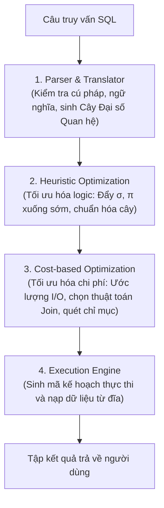
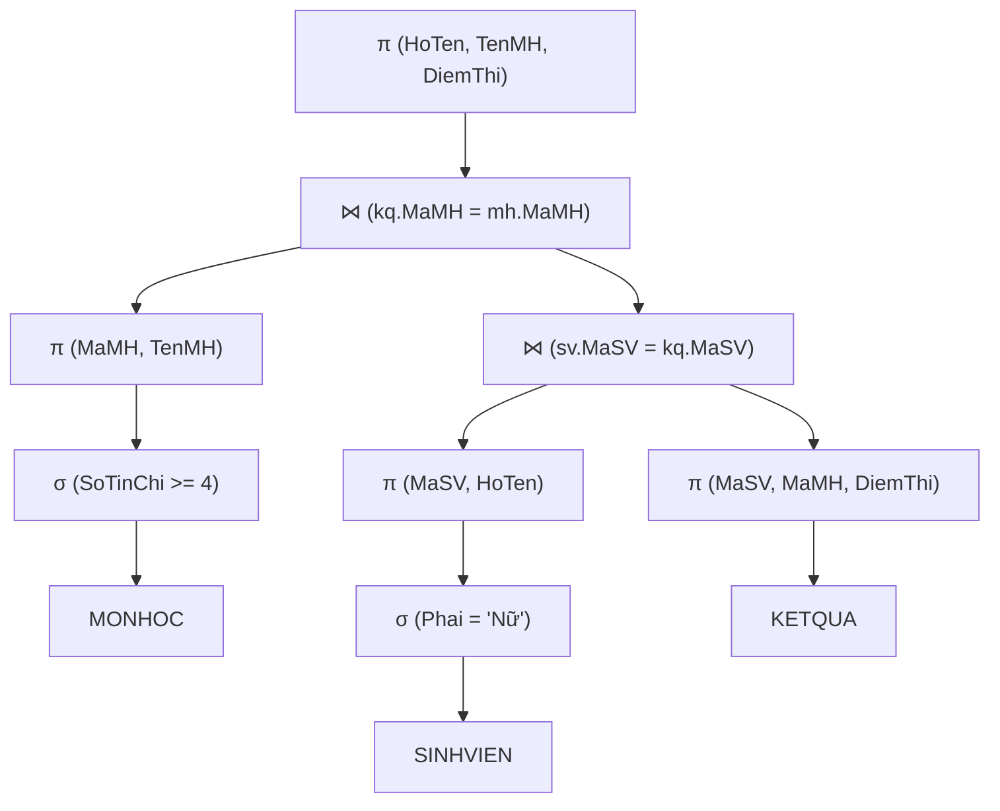

# CHƯƠNG 6: XỬ LÝ VÀ TỐI ƯU HÓA CÂU HỎI TRUY VẤN (QUERY OPTIMIZATION)

---

## PHẦN 1: TÓM TẮT CỐT LÕI (EXECUTIVE SUMMARY)

### 1. Quy Trình 4 Giai Đoạn Xử Lý Câu Truy Vấn Trong DBMS


### 2. Các Quy Tắc Biến Đổi Đại Số Tương Đương Cốt Lõi
1. **Tách phép chọn hội:**
   $$\sigma_{C_1 \land C_2 \dots \land C_n}(R) \equiv \sigma_{C_1}(\sigma_{C_2}(\dots (\sigma_{C_n}(R))))$$
2. **Giao hoán phép chọn:**
   $$\sigma_{C_1}(\sigma_{C_2}(R)) \equiv \sigma_{C_2}(\sigma_{C_1}(R))$$
3. **Đẩy phép chọn qua phép kết nối (Pushing Selection down Join):**
   Nếu điều kiện chọn $C$ chỉ liên quan đến các thuộc tính của quan hệ $R$:
   $$\sigma_C(R \bowtie S) \equiv (\sigma_C(R)) \bowtie S$$
4. **Đẩy phép chiếu qua phép kết nối (Pushing Projection down Join):**
   Nếu $L = L_1 \cup L_2$ với $L_1 \subseteq R$ và $L_2 \subseteq S$:
   $$\pi_L(R \bowtie S) \equiv \pi_L(\pi_{L_1 \cup JoinAttrs}(R) \bowtie \pi_{L_2 \cup JoinAttrs}(S))$$
5. **Giao hoán và kết hợp của phép kết nối:**
   $$R \bowtie S \equiv S \bowtie R$$
   $$(R \bowtie S) \bowtie T \equiv R \bowtie (S \bowtie T)$$
6. **Thay thế Tích Descartes kèm phép chọn bằng Phép kết bằng:**
   $$\sigma_{R.A = S.A}(R \times S) \equiv R \bowtie_{R.A = S.A} S$$

### 3. So Sánh Các Thuật Toán Thực Thi Phép Kết Vật Lý (Physical Join Algorithms)

| Thuật toán Join | Điều kiện hoạt động tối ưu | Chi phí I/O xấp xỉ |
| :--- | :--- | :---: |
| **Nested-Loop Join (Vòng lặp lồng)** | Một trong hai bảng rất nhỏ (vài dòng). | $b_R + |r_R| \cdot b_S$ |
| **Block Nested-Loop Join** | Đọc theo từng khối khối nhớ đệm Buffer. | $b_R + \lceil b_R / (M-2) \rceil \cdot b_S$ |
| **Index Nested-Loop Join** | Bảng trong có chỉ mục (Index) trên cột kết nối. | $b_R + |r_R| \cdot (\text{Độ cao Index} + 1)$ |
| **Sort-Merge Join** | Hai bảng đã sắp thứ tự sẵn theo cột kết nối. | $b_R + b_S$ (tuyến tính) |
| **Hash Join** | Bảng không có chỉ mục, bộ nhớ đệm đủ lớn. | $3(b_R + b_S)$ |

---

## PHẦN 2: BÀI TẬP TRẮC NGHIỆM (10 CÂU CÓ ĐÁP ÁN ẨN)

### Câu 1
Trong các giai đoạn xử lý câu truy vấn của một hệ quản trị CSDL quan hệ, giai đoạn nào chịu trách nhiệm kiểm tra xem các tên bảng và tên thuộc tính có thực sự tồn tại trong Cơ sở dữ liệu hay không?
- A. Code Generator (Sinh mã thực thi)
- B. Parser & Semantic Checker (Phân tích cú pháp và ngữ nghĩa)
- C. Cost-based Optimizer (Bộ tối ưu hóa chi phí)
- D. Storage Manager (Bộ quản lý lưu trữ)

<details>
<summary><b>Xem đáp án & Giải thích</b></summary>

- **Đáp án đúng:** B
- **Giải thích:** Semantic Checker đối chiếu câu truy vấn với Từ điển dữ liệu (Data Dictionary/System Catalog) để kiểm tra tính hợp lệ về mặt ngữ nghĩa (tên bảng, cột, kiểu dữ liệu, quyền truy cập).
- **Căn cứ giáo trình:** *Giáo trình Nhập môn CSDL (Quyển 1)*, Chương 6, Mục 1.1.
</details>

### Câu 2
Chiến lược tối ưu hóa logic Heuristic nào sau đây đem lại hiệu quả giảm chi phí trung gian lớn nhất cho câu truy vấn?
- A. Thực hiện các phép chiếu ở bước cuối cùng sau khi đã gom hết dữ liệu.
- B. Thực hiện phép chọn ($\sigma$) càng sớm càng tốt để loại bỏ các bản ghi không thỏa mãn trước khi thực hiện các phép kết nối tốn kém.
- C. Luôn thực hiện tích Descartes trước rồi mới kiểm tra điều kiện sau.
- D. Tránh sử dụng bất kỳ chỉ mục nào trong cơ sở dữ liệu.

<details>
<summary><b>Xem đáp án & Giải thích</b></summary>

- **Đáp án đúng:** B
- **Giải thích:** Đẩy phép chọn xuống sớm (Pushing Selection down) giúp giảm mạnh lực lượng (cardinality) của các quan hệ đầu vào, từ đó giảm thiểu kích thước kết quả trung gian của các phép kết nối phía sau.
- **Căn cứ giáo trình:** *Giáo trình Nhập môn CSDL (Quyển 1)*, Chương 6, Mục 2.2.
</details>

### Câu 3
Quy tắc biến đổi nào sau đây cho phép chuyển đổi một tích Descartes kèm phép chọn điều kiện bằng thành một phép kết nối tự nhiên?
- A. $\sigma_{A > B}(R \times S) \equiv R \cup S$
- B. $\sigma_{R.A = S.A}(R \times S) \equiv R \bowtie S$
- C. $\pi_A(R \times S) \equiv \sigma_A(R)$
- D. $R \times S \equiv R - S$

<details>
<summary><b>Xem đáp án & Giải thích</b></summary>

- **Đáp án đúng:** B
- **Giải thích:** Phép kết tự nhiên $R \bowtie S$ về bản chất là tích Descartes kèm điều kiện bằng trên thuộc tính chung và khử một cột trùng.
- **Căn cứ giáo trình:** *Giáo trình Nhập môn CSDL (Quyển 1)*, Chương 6, Mục 2.1.
</details>

### Câu 4
Trong thuật toán kết nối lồng vòng lặp (Nested-Loop Join), để giảm thiểu tối đa số lượt đọc khối đĩa, bảng nào nên được chọn làm vòng lặp ngoài (Outer loop)?
- A. Bảng có kích thước khối đĩa $b$ nhỏ hơn.
- B. Bảng có kích thước khối đĩa lớn hơn.
- C. Bảng nào cũng có chi phí như nhau.
- D. Bảng chứa nhiều giá trị `NULL` hơn.

<details>
<summary><b>Xem đáp án & Giải thích</b></summary>

- **Đáp án đúng:** A
- **Giải thích:** Chi phí đọc đĩa là $b_{\text{outer}} + |r_{\text{outer}}| \cdot b_{\text{inner}}$. Đặt bảng có số khối $b$ nhỏ hơn làm vòng ngoài sẽ tối ưu hóa lượng I/O tổng thể.
- **Căn cứ giáo trình:** *Giáo trình Nhập môn CSDL (Quyển 1)*, Chương 6, Mục 3.1.
</details>

### Câu 5
Thuật toán kết nối Sort-Merge Join tỏ ra vượt trội và hiệu quả nhất trong trường hợp nào?
- A. Cả hai quan hệ đầu vào đã được sắp xếp thứ tự sẵn theo các thuộc tính kết nối (hoặc có Clustered Index trên cột kết nối).
- B. Không có bất kỳ bảng nào được sắp thứ tự.
- C. Điều kiện kết nối là phép so sánh khác nhau ($\ne$).
- D. Hai bảng có kích thước hoàn toàn bằng nhau.

<details>
<summary><b>Xem đáp án & Giải thích</b></summary>

- **Đáp án đúng:** A
- **Giải thích:** Khi cả hai bảng đã sắp xếp sẵn theo khóa kết nối, thuật toán Sort-Merge Join chỉ cần quét tuyến tính đồng thời qua hai bảng đúng 1 lần với chi phí $O(b_R + b_S)$ I/O.
- **Căn cứ giáo trình:** *Giáo trình Nhập môn CSDL (Quyển 1)*, Chương 6, Mục 3.2.
</details>

### Câu 6
Bộ tối ưu hóa dựa trên chi phí (Cost-based Optimizer - CBO) sử dụng thông tin nào sau đây từ Từ điển dữ liệu để ước lượng chi phí của các kế hoạch thực thi?
- A. Số lượng dòng, số lượng khối đĩa, số lượng giá trị phân biệt ($V(A, R)$) và biểu đồ tần suất (Histograms).
- B. Họ tên và địa chỉ của lập trình viên viết câu lệnh SQL.
- C. Địa chỉ IP của máy khách kết nối tới server.
- D. Dung lượng nguồn điện cung cấp cho CPU.

<details>
<summary><b>Xem đáp án & Giải thích</b></summary>

- **Đáp án đúng:** A
- **Giải thích:** CBO dựa vào Catalog Statistics (thống kê phân phối dữ liệu, số khối, mật độ bản ghi, chiều cao chỉ mục) để tính toán số lượt I/O và chu kỳ CPU cho từng phương án thực thi khả dĩ.
- **Căn cứ giáo trình:** *Giáo trình Nhập môn CSDL (Quyển 1)*, Chương 6, Mục 1.3.
</details>

### Câu 7
Tại sao phép chiếu ($\pi$) nên được đẩy xuống càng sớm càng tốt trong cây truy vấn?
- A. Để đổi tên các cột sang tiếng Anh.
- B. Để loại bỏ sớm các cột không cần thiết, làm giảm độ rộng của bản ghi ($R$), tăng hệ số kết khối ($bfr$) và tiết kiệm không gian bộ đệm (Buffer Pool).
- C. Để xóa vĩnh viễn các cột đó khỏi ổ đĩa cứng.
- D. Để biến các giá trị `NULL` thành số 0.

<details>
<summary><b>Xem đáp án & Giải thích</b></summary>

- **Đáp án đúng:** B
- **Giải thích:** Giảm độ rộng bản ghi giúp nhồi được nhiều bản ghi hơn vào mỗi khối đĩa trong RAM, từ đó giảm số lần hoán đổi trang (paging) và tăng tốc độ xử lý các phép kết phía sau.
- **Căn cứ giáo trình:** *Giáo trình Nhập môn CSDL (Quyển 1)*, Chương 6, Mục 2.3.
</details>

### Câu 8
Khi nào bộ tối ưu hóa truy vấn sẽ quyết định chọn phương thức quét toàn bộ bảng (Table Scan) thay vì sử dụng chỉ mục Non-Clustered Index có sẵn trên cột tìm kiếm?
- A. Khi câu truy vấn có chứa mệnh đề `ORDER BY`.
- B. Khi điều kiện tìm kiếm lọc ra phần lớn các dòng trong bảng (độ chọn lọc thấp - ví dụ: lọc ra trên 30% - 50% số dòng của bảng).
- C. Khi bảng có ít hơn 2 cột.
- D. Khi server sắp hết dung lượng ổ cứng.

<details>
<summary><b>Xem đáp án & Giải thích</b></summary>

- **Đáp án đúng:** B
- **Giải thích:** Điểm giới hạn (Tipping Point): Khi số dòng cần lấy quá lớn, việc duyệt chỉ mục rồi tra cứu ngẫu nhiên (Bookmark Lookup) từng dòng vào bảng chính sẽ tốn nhiều I/O hơn nhiều so với việc quét tuần tự toàn bộ bảng một lượt liên tục.
- **Căn cứ giáo trình:** *Giáo trình Nhập môn CSDL (Quyển 1)*, Chương 6, Mục 3.3.
</details>

### Câu 9
Cây truy vấn (Query Tree) là gì?
- A. Cấu trúc dữ liệu cây nhị phân mô tả câu lệnh SQL, trong đó các nút lá là các quan hệ cơ sở và các nút trong là các phép toán đại số quan hệ.
- B. Cây thư mục chứa file cài đặt hệ quản trị CSDL.
- C. Sơ đồ cây phân cấp thư mục người dùng trên hệ điều hành Windows.
- D. Một loại cây xanh trồng trong phòng máy chủ.

<details>
<summary><b>Xem đáp án & Giải thích</b></summary>

- **Đáp án đúng:** A
- **Giải thích:** Cây truy vấn biểu diễn luồng dữ liệu của câu lệnh truy vấn từ dưới lên trên (lá là bảng gốc, các nút trung gian là phép lọc/kết, gốc là kết quả cuối cùng).
- **Căn cứ giáo trình:** *Giáo trình Nhập môn CSDL (Quyển 1)*, Chương 6, Mục 1.2.
</details>

### Câu 10
Kế hoạch thực thi truy vấn (Execution Plan) được lưu trữ vào bộ nhớ tạm (Plan Cache) nhằm mục đích:
- A. Giúp người dùng đọc hiểu được mã máy.
- B. Tái sử dụng kế hoạch đã tối ưu hóa cho các lần thực thi tiếp theo của cùng một mẫu câu truy vấn mà không cần biên dịch lại từ đầu.
- C. Tự động xóa dữ liệu sau 30 ngày.
- D. Đồng bộ dữ liệu sang điện thoại thông minh.

<details>
<summary><b>Xem đáp án & Giải thích</b></summary>

- **Đáp án đúng:** B
- **Giải thích:** Quá trình tối ưu hóa truy vấn tiêu tốn nhiều CPU. Việc lưu trữ Execution Plan trong Plan Cache giúp các câu truy vấn tương tự thực thi tức thì mà không cần qua các bước biên dịch và tính toán chi phí lại.
- **Căn cứ giáo trình:** *Giáo trình Nhập môn CSDL (Quyển 1)*, Chương 6, Mục 1.4.
</details>

---

## PHẦN 3: CÂU HỎI TRẢ LỜI NGẮN (5 CÂU CÓ ĐÁP ÁN ẨN)

### Câu 1
Nêu 3 quy tắc Heuristic cơ bản nhất được áp dụng khi tối ưu hóa cây truy vấn logic.

<details>
<summary><b>Xem đáp án & Hướng dẫn</b></summary>

- **Đáp án:**
  1. Thực hiện các phép chọn ($\sigma$) càng sớm càng tốt (đẩy $\sigma$ xuống lá).
  2. Thực hiện các phép chiếu ($\pi$) càng sớm càng tốt để loại bớt cột không dùng.
  3. Thay thế tích Descartes kèm phép chọn bằng phép kết tự nhiên hoặc kết bằng ($R \bowtie S$).
</details>

### Câu 2
Cho biết chi phí đọc khối đĩa tối thiểu của thuật toán Hash Join khi thực hiện kết nối hai bảng $R$ ($b_R$ khối) và $S$ ($b_S$ khối) trong trường hợp bộ đệm đủ chứa bảng nhỏ hơn.

<details>
<summary><b>Xem đáp án & Hướng dẫn</b></summary>

- **Đáp án:**
  $$\text{Chi phí I/O} = b_R + b_S \text{ (lượt đọc khối đĩa)}$$
  (Nạp toàn bộ bảng nhỏ hơn vào bảng băm trong RAM, sau đó quét bảng lớn hơn đúng 1 lần).
</details>

### Câu 3
Giải thích ý nghĩa của chỉ số "Độ chọn lọc" (Selectivity - $s$) của một điều kiện chọn $\sigma_C(R)$ và nêu công thức ước lượng khi điều kiện là phép so sánh bằng trên thuộc tính $A$ có $V(A, R)$ giá trị phân biệt.

<details>
<summary><b>Xem đáp án & Hướng dẫn</b></summary>

- **Đáp án:**
  - **Ý nghĩa:** Độ chọn lọc $s$ là tỷ lệ phần trăm số bản ghi thỏa mãn điều kiện $C$ trên tổng số bản ghi của $R$ ($0 \le s \le 1$).
  - **Công thức ước lượng:** Giả định dữ liệu phân bố đều:
    $$s = \frac{1}{V(A, R)}$$
</details>

### Câu 4
Trong cây truy vấn đại số, phép toán nào luôn là nút gốc (Root) của cây?

<details>
<summary><b>Xem đáp án & Hướng dẫn</b></summary>

- **Đáp án:**
  Nút gốc thường là **Phép chiếu cuối cùng ($\pi$)** để chọn đúng danh sách các cột mà mệnh đề `SELECT` yêu cầu, hoặc thao tác sắp xếp (`ORDER BY`) / khử trùng (`DISTINCT`).
</details>

### Câu 5
Tại sao việc cập nhật thống kê (Update Statistics) định kỳ trong DBMS lại có ý nghĩa quyết định đối với hiệu năng của bộ tối ưu hóa chi phí CBO?

<details>
<summary><b>Xem đáp án & Hướng dẫn</b></summary>

- **Đáp án:**
  Nếu dữ liệu trong bảng thay đổi lớn (thêm/xóa hàng triệu dòng) mà thống kê không được cập nhật, CBO sẽ tính toán sai lệch lực lượng dữ liệu, dẫn đến việc lựa chọn các thuật toán tồi (ví dụ: dùng nhầm Nested-Loop Join thay vì Hash Join, hoặc chọn sai chỉ mục), khiến thời gian thực thi chậm đi hàng trăm lần.
</details>

---

## PHẦN 4: BÀI TẬP TỰ LUẬN & THIẾT KẾ (3 BÀI CÓ LỜI GIẢI CHI TIẾT)

### Bài 1: Quá Trình Tối Ưu Hóa Heuristic Từng Bước
Cho câu truy vấn SQL:
```sql
SELECT sv.HoTen, mh.TenMH, kq.DiemThi
FROM SINHVIEN sv, KETQUA kq, MONHOC mh
WHERE sv.MaSV = kq.MaSV 
  AND kq.MaMH = mh.MaMH 
  AND sv.Phai = N'Nữ' 
  AND mh.SoTinChi >= 4;
```
1. Hãy chuyển đổi câu truy vấn SQL trên sang Cây Đại số Quan hệ ban đầu (chưa tối ưu).
2. Trình bày chi tiết 4 bước biến đổi Heuristic để tối ưu hóa cây truy vấn.
3. Vẽ Cây Đại số Quan hệ sau khi đã tối ưu hóa.

<details>
<summary><b>Xem lời giải chi tiết từng bước</b></summary>

#### Bước 1: Cây truy vấn ban đầu (Chưa tối ưu)
- Nút lá: 3 bảng `SINHVIEN`, `KETQUA`, `MONHOC`.
- Thực hiện tích Descartes: `(SINHVIEN x KETQUA) x MONHOC`.
- Phép chọn điều kiện toàn thể: $\sigma_{sv.MaSV = kq.MaSV \land kq.MaMH = mh.MaMH \land sv.Phai = \text{'Nữ'} \land mh.SoTinChi \ge 4}$.
- Nút gốc: $\pi_{sv.HoTen, mh.TenMH, kq.DiemThi}$.

#### Bước 2: Bốn bước biến đổi Heuristic
1. **Tách phép chọn:** Tách điều kiện phức hợp thành 4 điều kiện riêng lẻ:
   $$\sigma_{sv.Phai = \text{'Nữ'}}, \quad \sigma_{mh.SoTinChi \ge 4}, \quad \sigma_{sv.MaSV = kq.MaSV}, \quad \sigma_{kq.MaMH = mh.MaMH}$$
2. **Đẩy phép chọn xuống gần lá nhất:**
   - Đẩy $\sigma_{Phai = \text{'Nữ'}}$ áp dụng trực tiếp lên bảng `SINHVIEN`.
   - Đẩy $\sigma_{SoTinChi \ge 4}$ áp dụng trực tiếp lên bảng `MONHOC`.
3. **Thay thế tích Descartes bằng phép kết nối:**
   - Ghép $\sigma_{sv.MaSV = kq.MaSV}$ với tích Descartes thành phép kết nối: $(\sigma_{Phai = \text{'Nữ'}}(SINHVIEN)) \bowtie_{MaSV} KETQUA$.
   - Ghép kết quả trên với bảng môn học đã lọc thông qua phép kết nối: $\dots \bowtie_{MaMH} (\sigma_{SoTinChi \ge 4}(MONHOC))$.
4. **Đẩy phép chiếu xuống sớm:**
   - Chiếu `SINHVIEN` chỉ lấy `{MaSV, HoTen}`.
   - Chiếu `MONHOC` chỉ lấy `{MaMH, TenMH}`.
   - Chiếu `KETQUA` chỉ lấy `{MaSV, MaMH, DiemThi}`.

#### Bước 3: Cây truy vấn tối ưu hóa hoàn chỉnh

</details>

### Bài 2: Ước Lượng Chi Phí I/O Của Các Thuật Toán Join
Cho hai quan hệ `KHACHHANG` ($R$) và `HOADON` ($S$):
- Bảng $R$: $r_R = 10,000$ bản ghi, $b_R = 500$ khối đĩa.
- Bảng $S$: $r_S = 100,000$ bản ghi, $b_S = 5,000$ khối đĩa.
- Bộ nhớ đệm dành cho phép kết: $M = 52$ khối đĩa trong RAM.
Hãy tính số lượt đọc khối đĩa (I/O) cho các thuật toán sau để thực hiện phép kết $R \bowtie_{R.MaKH = S.MaKH} S$:
1. Thuật toán Block Nested-Loop Join (sử dụng $R$ làm bảng ngoài).
2. Thuật toán Index Nested-Loop Join (giả sử bảng $S$ có chỉ mục B+ Tree trên `MaKH` với độ cao 3 tầng, mỗi giá trị `MaKH` trong $S$ xuất hiện trung bình ở 1 khối).
3. Thuật toán Hash Join (giả thiết dữ liệu băm đều và không cần phân vùng nhiều mức).

<details>
<summary><b>Xem lời giải chi tiết từng bước</b></summary>

#### 1. Block Nested-Loop Join (với R làm bảng ngoài)
- Dành $M - 2 = 52 - 2 = 50$ khối bộ đệm để nạp các khối của bảng $R$.
- Số lượt duyệt qua bảng $S$:
  $$\text{Số đợt} = \left\lceil \frac{b_R}{M - 2} \right\rceil = \left\lceil \frac{500}{50} \right\rceil = 10 \text{ đợt}$$
- Tổng số lượt I/O:
  $$\text{Chi phí} = b_R + \text{Số đợt} \times b_S = 500 + 10 \times 5,000 = 500 + 50,000 = 50,500 \text{ I/O}$$

#### 2. Index Nested-Loop Join (với R làm bảng ngoài, dùng chỉ mục của S)
- Với mỗi bản ghi trong $R$ (có $10,000$ bản ghi), ta tra cứu trên cây B+ của $S$:
  - Chi phí tra cứu chỉ mục: 3 tầng (đọc 3 khối chỉ mục).
  - Chi phí đọc khối dữ liệu thực tế của $S$: 1 khối.
  - Mỗi bản ghi tốn $3 + 1 = 4$ I/O.
- Đọc bảng $R$: $b_R = 500$ khối.
- Tổng số lượt I/O:
  $$\text{Chi phí} = b_R + r_R \times (3 + 1) = 500 + 10,000 \times 4 = 500 + 40,000 = 40,500 \text{ I/O}$$

#### 3. Hash Join
- Giai đoạn phân hoạch (Partitioning) và giai đoạn khớp (Probing):
  $$\text{Chi phí} = 3 \times (b_R + b_S) = 3 \times (500 + 5,000) = 3 \times 5,500 = 16,500 \text{ I/O}$$
- **Kết luận:** Thuật toán Hash Join mang lại hiệu năng cao nhất (chỉ tốn 16,500 I/O), tiếp theo là Index Nested-Loop Join (40,500 I/O).
</details>

### Bài 3: Phân Tích Độ Chọn Lọc & Thứ Tự Thực Thi Tối Ưu
Xét truy vấn kết nối 3 bảng: $R(A, B)$, $S(B, C)$ và $T(C, D)$ với các thông số thống kê sau:
- $|R| = 1,000$ dòng; $|S| = 10,000$ dòng; $|T| = 100,000$ dòng.
- Số lượng giá trị phân biệt: $V(B, S) = 1,000$; $V(C, T) = 10,000$.
- Phép kết $R \bowtie S$ có kích thước ước lượng: $\frac{|R| \times |S|}{V(B, S)} = \frac{1,000 \times 10,000}{1,000} = 10,000$ dòng.
- Phép kết $S \bowtie T$ có kích thước ước lượng: $\frac{|S| \times |T|}{V(C, T)} = \frac{10,000 \times 100,000}{10,000} = 100,000$ dòng.

Hãy so sánh hai thứ tự kết nối:
- Phương án 1: $(R \bowtie S) \bowtie T$
- Phương án 2: $R \bowtie (S \bowtie T)$
Xác định phương án nào tối ưu hơn và giải thích nguyên lý tổng quát.

<details>
<summary><b>Xem lời giải chi tiết từng bước</b></summary>

#### Bước 1: Tính toán kích thước trung gian của Phương án 1
- Bước 1: Thực hiện $R \bowtie S \implies$ Kích thước kết quả trung gian là $10,000$ dòng.
- Bước 2: Kết nối kết quả trên với $T$: $(R \bowtie S) \bowtie T$.
- **Tổng dung lượng trung gian phải xử lý và lưu giữ trong bộ đệm:** $10,000$ dòng.

#### Bước 2: Tính toán kích thước trung gian của Phương án 2
- Bước 1: Thực hiện $S \bowtie T \implies$ Kích thước kết quả trung gian là $100,000$ dòng.
- Bước 2: Kết nối $R$ với kết quả trên: $R \bowtie (S \bowtie T)$.
- **Tổng dung lượng trung gian phải xử lý và lưu giữ trong bộ đệm:** $100,000$ dòng.

#### Bước 3: Đánh giá và Kết luận
- Phương án 1 tối ưu hơn vượt bậc vì quan hệ trung gian $(R \bowtie S)$ chỉ có $10,000$ dòng, nhỏ hơn 10 lần so với quan hệ trung gian $(S \bowtie T)$ ($100,000$ dòng).
- **Nguyên lý tổng quát của CBO:** Luôn ưu tiên thực hiện phép kết giữa các bảng có **kích thước kết quả trung gian nhỏ nhất trước** để hạn chế tối đa việc tràn bộ đệm RAM và chi phí I/O ở các bước kết nối tiếp theo.
</details>
