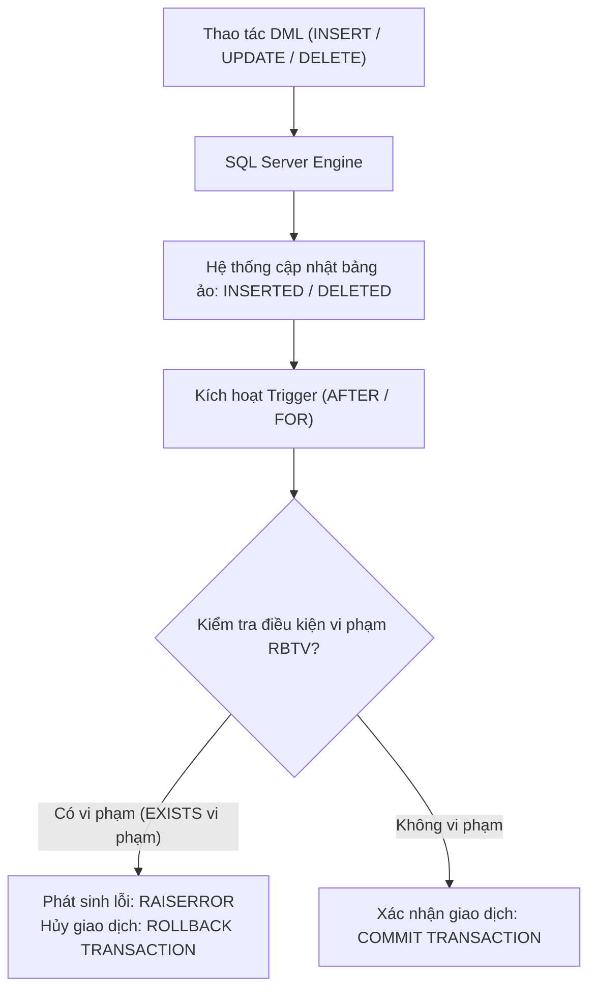

# CHƯƠNG 1 (QUYỂN 2): RÀNG BUỘC TOÀN VẸN & KỸ THUẬT CÀI ĐẶT TRIGGER

---

## PHẦN 1: TÓM TẮT CỐT LÕI (EXECUTIVE SUMMARY)

### 1. Sơ Đồ Quy Trình Hoạt Động Của Trigger Trong RDBMS


### 2. Bốn Yếu Tố Cấu Thành Một Ràng Buộc Toàn Vẹn (RBTV)
1. **Điều kiện (Condition):** Quy tắc nghiệp vụ bắt buộc phải thỏa mãn (phát biểu bằng logic vị từ hoặc ngôn ngữ tự nhiên).
2. **Bối cảnh (Context):** Tập các quan hệ mà quy tắc nghiệp vụ đó tác động trực tiếp tới.
3. **Tầm ảnh hưởng (Scope of Impact):** Bảng ma trận xác định thao tác Thêm ($+$), Xóa ($-$), Sửa ($*$) nào trên từng quan hệ có nguy cơ gây vi phạm.
4. **Hành động khi vi phạm (Action on Violation):** Phản ứng của hệ quản trị CSDL khi phát hiện vi phạm (thường là từ chối giao dịch `ROLLBACK TRANSACTION` hoặc lan truyền `ON DELETE CASCADE`).

### 3. Thiết Kế Bảng Tầm Ảnh Hưởng (Impact Matrix)

| Quan hệ trong bối cảnh | Thêm (Insert) | Xóa (Delete) | Sửa (Update) |
| :--- | :---: | :---: | :---: |
| **Bảng con (Tham chiếu $FK$)** | $+$ | $-$ | $* (FK)$ |
| **Bảng cha (Được tham chiếu $PK$)** | $-$ | $+$ | $* (PK)$ |

- Ký hiệu:
  - `+` : Cần kiểm tra ràng buộc khi thao tác diễn ra.
  - `-` : Không cần kiểm tra ràng buộc (không bao giờ làm vi phạm).
  - `*` : Chỉ cần kiểm tra khi thuộc tính được sửa nằm trong danh sách thuộc tính tham gia ràng buộc.

### 4. Cơ Chế Bảng Ảo Tạm Thời Trong Trigger (T-SQL)
- **`INSERTED`:** Chứa bản sao các dòng mới được thêm vào (với `INSERT`) hoặc các dòng mang giá trị mới sau khi cập nhật (với `UPDATE`).
- **`DELETED`:** Chứa bản sao các dòng vừa bị xóa đi (với `DELETE`) hoặc các dòng mang giá trị cũ trước khi bị cập nhật (với `UPDATE`).

---

## PHẦN 2: BÀI TẬP TRẮC NGHIỆM (10 CÂU CÓ ĐÁP ÁN ẨN)

### Câu 1
Trong hệ quản trị CSDL SQL Server, bảng ảo `DELETED` được sử dụng trong Trigger chứa dữ liệu của trường hợp nào sau đây?
- A. Các dòng mới được thêm vào qua câu lệnh `INSERT`.
- B. Các dòng bị xóa bởi câu lệnh `DELETE` và các giá trị cũ trước khi cập nhật của câu lệnh `UPDATE`.
- C. Toàn bộ các bản ghi trong thùng rác của hệ điều hành.
- D. Danh sách các tài khoản người dùng đã bị khóa.

<details>
<summary><b>Xem đáp án & Giải thích</b></summary>

- **Đáp án đúng:** B
- **Giải thích:** Bảng ảo `DELETED` lưu trữ ảnh chụp (snapshot) của các bản ghi bị xóa hoặc trạng thái ban đầu của các bản ghi trước khi bị câu lệnh `UPDATE` sửa đổi.
- **Căn cứ giáo trình:** *Giáo trình Thiết kế CSDL (Quyển 2)*, Chương 1, Mục 1.5.
</details>

### Câu 2
Xét ràng buộc toàn vẹn khóa ngoại giữa bảng con `KETQUA(MaSV, MaMH, DiemThi)` và bảng cha `SINHVIEN(MaSV, HoTen)`. Thao tác nào sau đây trên bảng `SINHVIEN` có nguy cơ làm vi phạm ràng buộc toàn vẹn tham chiếu?
- A. Thêm một sinh viên mới vào bảng `SINHVIEN`.
- B. Xóa một sinh viên khỏi bảng `SINHVIEN`.
- C. Sửa tên của một sinh viên trong bảng `SINHVIEN`.
- D. Đọc dữ liệu sinh viên bằng câu lệnh `SELECT`.

<details>
<summary><b>Xem đáp án & Giải thích</b></summary>

- **Đáp án đúng:** B
- **Giải thích:** Nếu xóa một sinh viên trong bảng cha `SINHVIEN` mà sinh viên đó đã có điểm trong bảng con `KETQUA`, thì các bản ghi điểm sẽ trở thành bản ghi mồ côi (Orphan records), vi phạm toàn vẹn tham chiếu.
- **Căn cứ giáo trình:** *Giáo trình Thiết kế CSDL (Quyển 2)*, Chương 1, Mục 1.3.
</details>

### Câu 3
Khi một ràng buộc toàn vẹn bị vi phạm trong quá trình thực thi Trigger, câu lệnh nào sau đây được gọi để hủy bỏ toàn bộ các thao tác cập nhật trước đó và khôi phục CSDL về trạng thái ban đầu?
- A. `COMMIT TRANSACTION`
- B. `DROP TRIGGER`
- C. `ROLLBACK TRANSACTION`
- D. `ALTER DATABASE RECOVER`

<details>
<summary><b>Xem đáp án & Giải thích</b></summary>

- **Đáp án đúng:** C
- **Giải thích:** `ROLLBACK TRANSACTION` hủy bỏ toàn bộ giao dịch hiện hành, trả lại trạng thái nhất quán nguyên vẹn của CSDL trước khi câu lệnh DML được gửi tới.
- **Căn cứ giáo trình:** *Giáo trình Thiết kế CSDL (Quyển 2)*, Chương 1, Mục 1.5.
</details>

### Câu 4
Trong bảng tầm ảnh hưởng, ký hiệu dấu trừ (`-`) tại một thao tác mang ý nghĩa gì?
- A. Thao tác đó bị cấm hoàn toàn, không được phép thực hiện.
- B. Thao tác đó không bao giờ có thể dẫn đến việc làm vi phạm ràng buộc toàn vẹn đang xét, do đó DBMS không cần kiểm tra.
- C. Thao tác đó làm giảm kích thước của bảng.
- D. Thao tác đó sẽ xóa đi một cột.

<details>
<summary><b>Xem đáp án & Giải thích</b></summary>

- **Đáp án đúng:** B
- **Giải thích:** Dấu `-` khẳng định về mặt toán học và logic rằng thao tác đó là an toàn tuyệt đối với ràng buộc, giúp hệ thống không tốn chi phí kiểm tra thừa.
- **Căn cứ giáo trình:** *Giáo trình Thiết kế CSDL (Quyển 2)*, Chương 1, Mục 1.2.
</details>

### Câu 5
Ràng buộc: *"Số lượng tồn của một mặt hàng không được nhỏ hơn 0 (`SoLuongTon >= 0`)"* thuộc loại ràng buộc toàn vẹn nào?
- A. Ràng buộc toàn vẹn liên bộ liên quan hệ.
- B. Ràng buộc miền giá trị trên một thuộc tính.
- C. Ràng buộc toàn vẹn khóa ngoại.
- D. Ràng buộc phụ thuộc tồn tại.

<details>
<summary><b>Xem đáp án & Giải thích</b></summary>

- **Đáp án đúng:** B
- **Giải thích:** Ràng buộc miền giá trị (Domain Constraint) áp đặt điều kiện hợp lệ lên từng giá trị của một thuộc tính đơn lẻ trong cùng một bảng.
- **Căn cứ giáo trình:** *Giáo trình Thiết kế CSDL (Quyển 2)*, Chương 1, Mục 1.3.
</details>

### Câu 6
Trong SQL Server, Trigger loại `INSTEAD OF` khác với Trigger loại `AFTER` (hoặc `FOR`) ở điểm nào?
- A. `INSTEAD OF` chạy sau khi dữ liệu đã được ghi vào bảng.
- B. `INSTEAD OF` thay thế hoàn toàn hành động của câu lệnh DML kích hoạt nó, cho phép can thiệp xử lý trước khi dữ liệu được ghi vào bảng.
- C. `INSTEAD OF` chỉ dùng được cho câu lệnh `SELECT`.
- D. `INSTEAD OF` chỉ chạy trên máy chủ sao lưu.

<details>
<summary><b>Xem đáp án & Giải thích</b></summary>

- **Đáp án đúng:** B
- **Giải thích:** `INSTEAD OF` Trigger đón đầu và ghi đè thao tác DML, rất thường dùng để cho phép cập nhật dữ liệu thông qua các Khung nhìn phức tạp (Complex Views) hoặc tiền kiểm tra dữ liệu.
- **Căn cứ giáo trình:** *Giáo trình Thiết kế CSDL (Quyển 2)*, Chương 1, Mục 1.5.
</details>

### Câu 7
Xét ràng buộc toàn vẹn: *"Mỗi lớp học phải có sĩ số bằng đúng số lượng sinh viên hiện có trong lớp đó"*. Ràng buộc này thuộc loại:
- A. Ràng buộc liên bộ trong một quan hệ.
- B. Ràng buộc liên thuộc tính liên quan hệ (giữa `LOPHOC.SiSo` và `COUNT(SINHVIEN.MaSV)`).
- C. Ràng buộc miền giá trị đơn giản.
- D. Ràng buộc khóa chính.

<details>
<summary><b>Xem đáp án & Giải thích</b></summary>

- **Đáp án đúng:** B
- **Giải thích:** Đây là ràng buộc liên thuộc tính liên quan hệ vì nó so sánh giá trị của cột `SiSo` trong quan hệ `LOPHOC` với hàm tổng hợp số lượng bản ghi trong quan hệ `SINHVIEN`.
- **Căn cứ giáo trình:** *Giáo trình Thiết kế CSDL (Quyển 2)*, Chương 1, Mục 1.3.
</details>

### Câu 8
Khi cập nhật dữ liệu bằng câu lệnh `UPDATE`, hai bảng ảo trong Trigger sẽ chứa dữ liệu như thế nào?
- A. Cả hai bảng `INSERTED` và `DELETED` đều rỗng.
- B. `INSERTED` chứa các bản ghi mới sau khi cập nhật; `DELETED` chứa các bản ghi cũ trước khi cập nhật.
- C. `DELETED` chứa các bản ghi mới; `INSERTED` chứa các bản ghi cũ.
- D. Chỉ có bảng `INSERTED` có dữ liệu, bảng `DELETED` bị xóa khỏi hệ thống.

<details>
<summary><b>Xem đáp án & Giải thích</b></summary>

- **Đáp án đúng:** B
- **Giải thích:** Phép `UPDATE` trong SQL Server được mô hình hóa bằng hai bước: Xóa dòng cũ (đưa vào `DELETED`) và chèn dòng mới (đưa vào `INSERTED`).
- **Căn cứ giáo trình:** *Giáo trình Thiết kế CSDL (Quyển 2)*, Chương 1, Mục 1.5.
</details>

### Câu 9
Tại sao không nên cài đặt quá nhiều Trigger phức tạp cho các bảng có tần suất giao dịch cực cao (hàng nghìn transaction/giây)?
- A. Vì Trigger làm tăng chi phí khóa (Locking overhead), kéo dài thời gian giữ Transaction và dễ dẫn đến nghẽn cổ chai (Deadlock / Performance bottleneck).
- B. Vì Trigger sẽ tự động xóa các bảng khác trong CSDL.
- C. Vì SQL Server chỉ cho phép tối đa 1 Trigger trên toàn hệ thống.
- D. Vì Trigger chỉ có thể viết bằng ngôn ngữ Java.

<details>
<summary><b>Xem đáp án & Giải thích</b></summary>

- **Đáp án đúng:** A
- **Giải thích:** Trigger chạy ngầm bên trong phạm vi giao dịch (Transaction context). Nếu Trigger xử lý logic quá nặng, giao dịch sẽ kéo dài, chiếm dụng khóa tài nguyên và làm giảm thông lượng (Throughput) của hệ thống.
- **Căn cứ giáo trình:** *Giáo trình Thiết kế CSDL (Quyển 2)*, Chương 1, Mục 1.5.
</details>

### Câu 10
Để kiểm tra tính hợp lệ của ràng buộc toàn vẹn khóa chính (Entity Integrity) bằng câu lệnh SQL cơ bản khi thiết kế bảng, ta dùng mệnh đề nào?
- A. `FOREIGN KEY`
- B. `PRIMARY KEY`
- C. `DEFAULT`
- D. `COLLATE`

<details>
<summary><b>Xem đáp án & Giải thích</b></summary>

- **Đáp án đúng:** B
- **Giải thích:** Khóa chính (`PRIMARY KEY`) tự động kích hoạt hai cơ chế: Đảm bảo tính duy nhất (`UNIQUE`) và cấm giá trị rỗng (`NOT NULL`).
- **Căn cứ giáo trình:** *Giáo trình Thiết kế CSDL (Quyển 2)*, Chương 1, Mục 1.3.
</details>

---

## PHẦN 3: CÂU HỎI TRẢ LỜI NGẮN (5 CÂU CÓ ĐÁP ÁN ẨN)

### Câu 1
Phát biểu biểu thức logic vị từ hình thức cho ràng buộc toàn vẹn: *"Ngày giao hàng (`NgayGiao`) trong bảng `DONHANG` phải lớn hơn hoặc bằng Ngày đặt hàng (`NgayDat`)"*.

<details>
<summary><b>Xem đáp án & Hướng dẫn</b></summary>

- **Đáp án:**
  $$\forall d \in DONHANG (d.NgayGiao \ge d.NgayDat)$$
</details>

### Câu 2
Lập bảng tầm ảnh hưởng đối với ràng buộc toàn vẹn: `PHIEUNHAP(SoPN, NgayNhap)` và `CHITIET_PHIEUNHAP(SoPN, MaSP, SoLuongNhap)`. Ràng buộc: *Một phiếu nhập chỉ được có tối đa 50 mặt hàng*.

<details>
<summary><b>Xem đáp án & Hướng dẫn</b></summary>

- **Đáp án:**
| Quan hệ | Thêm (Insert) | Xóa (Delete) | Sửa (Update) |
| :--- | :---: | :---: | :---: |
| `PHIEUNHAP` | $-$ | $-$ | $-$ |
| `CHITIET_PHIEUNHAP` | $+$ | $-$ | $* (SoPN)$ |

- *Giải thích:* Thêm dòng mới hoặc sửa mã phiếu nhập có thể làm số lượng mặt hàng trong phiếu vượt quá 50. Xóa dòng chỉ làm giảm số lượng nên luôn an toàn ($-$).
</details>

### Câu 3
Khi nào ta nên sử dụng ràng buộc mức khai báo (`CHECK CONSTRAINT`) thay vì viết mã `TRIGGER`?

<details>
<summary><b>Xem đáp án & Hướng dẫn</b></summary>

- **Đáp án:**
  Khi điều kiện kiểm tra chỉ liên quan đến các thuộc tính **trong cùng một dòng của cùng một bảng** (ví dụ: `Luong > 0`, `NgayGiao >= NgayDat`). Ràng buộc khai báo `CHECK` có hiệu năng cao hơn rất nhiều và được bộ máy tối ưu hóa nhận biết trực tiếp. Chỉ nên dùng `TRIGGER` khi điều kiện liên quan đến **nhiều bảng khác nhau** hoặc cần gọi các hàm tổng hợp (`COUNT`, `SUM`).
</details>

### Câu 4
Nêu cú pháp hàm `RAISERROR` trong SQL Server để thông báo lỗi vi phạm ràng buộc toàn vẹn ở mức độ nghiêm trọng thông thường (Severity Level 16).

<details>
<summary><b>Xem đáp án & Hướng dẫn</b></summary>

```sql
RAISERROR (N'Thông báo lỗi vi phạm ràng buộc toàn vẹn!', 16, 1);
```
</details>

### Câu 5
Viết câu lệnh SQL định nghĩa ràng buộc khóa ngoại với hành vi tự động xóa các dòng con khi dòng cha tương ứng bị xóa (`ON DELETE CASCADE`).

<details>
<summary><b>Xem đáp án & Hướng dẫn</b></summary>

```sql
ALTER TABLE CHITIET_DONHANG
ADD CONSTRAINT FK_CTDH_DonHang FOREIGN KEY (SoDH) 
    REFERENCES DONHANG(SoDH)
    ON DELETE CASCADE;
```
</details>

---

## PHẦN 4: BÀI TẬP TỰ LUẬN & THIẾT KẾ (3 BÀI CÓ LỜI GIẢI CHI TIẾT)

### Bài 1: Thiết Kế Bảng Tầm Ảnh Hưởng & Cài Đặt Trigger Nghiệp Vụ
Cho cơ sở dữ liệu Quản lý Đề án nghiên cứu khoa học gồm:
- `GIANGVIEN(MaGV, HoTen, HocVi, SoDeAnToiDa)`
- `DEAN(MaDA, TenDA, KinhPhi, ChuNhiemDeAn)` (Trong đó `ChuNhiemDeAn` là khóa ngoại tham chiếu đến `GIANGVIEN(MaGV)`).

**Ràng buộc toàn vẹn R1:** *Số lượng đề án mà một giảng viên làm chủ nhiệm không được vượt quá số đề án tối đa (`SoDeAnToiDa`) được quy định cho giảng viên đó.*

**Yêu cầu:**
1. Xác định bối cảnh của ràng buộc R1.
2. Thiết kế Bảng tầm ảnh hưởng chi tiết đối với các thao tác Thêm, Xóa, Sửa trên từng quan hệ.
3. Viết Trigger hoàn chỉnh trên bảng `DEAN` bằng T-SQL để bảo đảm ràng buộc R1 luôn được thỏa mãn.

<details>
<summary><b>Xem lời giải chi tiết từng bước</b></summary>

#### Bước 1: Xác định bối cảnh
- Bối cảnh: Hai quan hệ `GIANGVIEN` và `DEAN`.
- Biểu thức logic:
  $$\forall g \in GIANGVIEN \left( \text{COUNT}(\{d \in DEAN \mid d.ChuNhiemDeAn = g.MaGV\}) \le g.SoDeAnToiDa \right)$$

#### Bước 2: Bảng tầm ảnh hưởng (Impact Matrix)

| Quan hệ | Thêm (Insert) | Xóa (Delete) | Sửa (Update) |
| :--- | :---: | :---: | :---: |
| `DEAN` | $+$ | $-$ | $* (ChuNhiemDeAn)$ |
| `GIANGVIEN` | $-$ | $-$ | $* (SoDeAnToiDa)$ |

- *Phân tích:*
  - Bảng `DEAN`: Thao tác thêm đề án mới hoặc đổi chủ nhiệm đề án có thể làm tăng số lượng đề án của giảng viên đó vượt quá trần cho phép $\implies (+, *)$. Xóa đề án chỉ làm giảm số lượng $\implies (-)$.
  - Bảng `GIANGVIEN`: Thêm hoặc xóa giảng viên không làm tăng số lượng đề án trên giảng viên hiện có $\implies (-)$. Sửa giảm `SoDeAnToiDa` có thể khiến số đề án hiện hành vượt mức mới $\implies (*)$.

#### Bước 3: Cài đặt Trigger trên bảng DEAN
```sql
CREATE TRIGGER trg_KiemTra_SoDeAnChuNhiem
ON DEAN
FOR INSERT, UPDATE
AS
BEGIN
    SET NOCOUNT ON;

    -- Kiểm tra xem có giảng viên nào có số đề án vượt quá SoDeAnToiDa
    IF EXISTS (
        SELECT g.MaGV
        FROM GIANGVIEN g
        JOIN (
            -- Tính số lượng đề án thực tế của các giảng viên bị ảnh hưởng bởi thao tác DML
            SELECT d.ChuNhiemDeAn, COUNT(d.MaDA) AS SoLuongHienTai
            FROM DEAN d
            WHERE d.ChuNhiemDeAn IN (SELECT DISTINCT ChuNhiemDeAn FROM INSERTED WHERE ChuNhiemDeAn IS NOT NULL)
            GROUP BY d.ChuNhiemDeAn
        ) sub ON g.MaGV = sub.ChuNhiemDeAn
        WHERE sub.SoLuongHienTai > g.SoDeAnToiDa
    )
    BEGIN
        RAISERROR (N'Lỗi: Số lượng đề án làm chủ nhiệm vượt quá giới hạn tối đa cho phép của giảng viên!', 16, 1);
        ROLLBACK TRANSACTION;
        RETURN;
    END
END;
```
</details>

### Bài 2: Trigger Quản Lý Kho & Cập Nhật Tồn Kho Tự Động
Trong hệ thống Bán hàng, ta có:
- `KHO(MaSP, SoLuongTon)`
- `CHITIET_HOADON(SoHD, MaSP, SoLuongBan)`

**Yêu cầu:** Viết Trigger trên bảng `CHITIET_HOADON` khi có thao tác `INSERT`:
1. Kiểm tra xem số lượng hàng tồn trong kho có đủ để xuất bán hay không (`SoLuongTon >= SoLuongBan`). Nếu không đủ, hủy giao dịch và báo lỗi.
2. Nếu đủ, tự động trừ số lượng hàng xuất bán vào cột `SoLuongTon` của bảng `KHO`.

<details>
<summary><b>Xem lời giải chi tiết từng bước</b></summary>

```sql
CREATE TRIGGER trg_XuatKho_BanHang
ON CHITIET_HOADON
FOR INSERT
AS
BEGIN
    SET NOCOUNT ON;

    -- 1. Kiểm tra tồn kho
    IF EXISTS (
        SELECT 1
        FROM INSERTED i
        JOIN KHO k ON i.MaSP = k.MaSP
        WHERE k.SoLuongTon < i.SoLuongBan
    )
    BEGIN
        RAISERROR (N'Lỗi: Số lượng tồn kho không đủ để đáp ứng đơn hàng!', 16, 1);
        ROLLBACK TRANSACTION;
        RETURN;
    END

    -- 2. Tự động cập nhật giảm số lượng tồn kho
    UPDATE k
    SET k.SoLuongTon = k.SoLuongTon - i.TongSoLuongXuat
    FROM KHO k
    JOIN (
        SELECT MaSP, SUM(SoLuongBan) AS TongSoLuongXuat
        FROM INSERTED
        GROUP BY MaSP
    ) i ON k.MaSP = i.MaSP;
END;
```
</details>

### Bài 3: Trigger Đồng Bộ Dữ Liệu Sĩ Số Giữa Hai Bảng
Cho `LOPHOC(MaLop, TenLop, SiSo)` và `SINHVIEN(MaSV, HoTen, MaLop)`.
Thuộc tính `SiSo` trong bảng `LOPHOC` phải luôn luôn phản ánh chính xác số lượng sinh viên hiện có trong lớp đó.
Hãy viết **một Trigger duy nhất** trên bảng `SINHVIEN` để xử lý đồng bộ cột `SiSo` cho cả 3 thao tác: `INSERT`, `UPDATE` (chuyển lớp), và `DELETE` (sinh viên thôi học).

<details>
<summary><b>Xem lời giải chi tiết từng bước</b></summary>

```sql
CREATE TRIGGER trg_DongBo_SiSo_SinhVien
ON SINHVIEN
FOR INSERT, UPDATE, DELETE
AS
BEGIN
    SET NOCOUNT ON;

    -- Bảng tạm lưu các mã lớp có sự thay đổi sĩ số
    DECLARE @DanhSachLop TABLE (MaLop VARCHAR(10));

    -- Lấy mã lớp từ bảng INSERTED (đối với INSERT và UPDATE sang lớp mới)
    INSERT INTO @DanhSachLop (MaLop)
    SELECT DISTINCT MaLop FROM INSERTED WHERE MaLop IS NOT NULL;

    -- Lấy mã lớp từ bảng DELETED (đối với DELETE và UPDATE khỏi lớp cũ)
    INSERT INTO @DanhSachLop (MaLop)
    SELECT DISTINCT MaLop FROM DELETED WHERE MaLop IS NOT NULL;

    -- Cập nhật lại sĩ số chuẩn xác cho tất cả các lớp bị tác động
    UPDATE l
    SET l.SiSo = (
        SELECT COUNT(sv.MaSV)
        FROM SINHVIEN sv
        WHERE sv.MaLop = l.MaLop
    )
    FROM LOPHOC l
    WHERE l.MaLop IN (SELECT DISTINCT MaLop FROM @DanhSachLop);
END;
```
</details>
