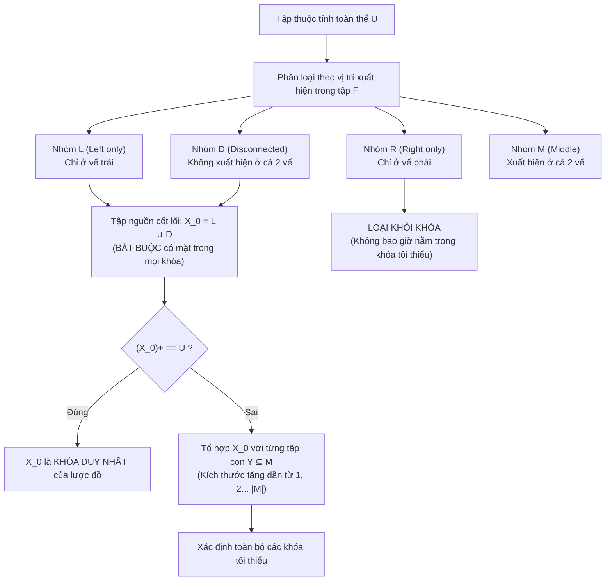

# CHƯƠNG 2 (QUYỂN 2): PHỤ THUỘC HÀM, BAO ĐÓNG & THUẬT TOÁN TÌM KHÓA

---

## PHẦN 1: TÓM TẮT CỐT LÕI (EXECUTIVE SUMMARY)

### 1. Sơ Đồ Thuật Toán Phân Loại Thuộc Tính Tìm Tất Cả Các Khóa (Lucchenssi - Osborn)

### 2. Các Khái Niệm & Định Nghĩa Toán Học Nền Tảng
- **Phụ thuộc hàm (Functional Dependency):**
  Cho lược đồ quan hệ $R(U)$ và $X, Y \subseteq U$. Ta nói $X \to Y$ nếu với mọi cặp bộ $t_1, t_2 \in r$:
  $$t_1[X] = t_2[X] \implies t_1[Y] = t_2[Y]$$
- **Hệ tiên đề Armstrong:**
  1. *Tiên đề Phản xạ:* Nếu $Y \subseteq X \subseteq U \implies X \to Y$.
  2. *Tiên đề Tăng trưởng:* Nếu $X \to Y$ và $Z \subseteq U \implies XZ \to YZ$.
  3. *Tiên đề Bắc cầu:* Nếu $X \to Y$ và $Y \to Z \implies X \to Z$.
- **Các quy tắc suy dẫn thứ cấp:**
  - Quy tắc Hợp: $X \to Y \land X \to Z \implies X \to YZ$.
  - Quy tắc Phân rã: $X \to YZ \implies X \to Y \land X \to Z$.
  - Quy tắc Tựa bắc cầu: $X \to Y \land WY \to Z \implies WX \to Z$.
- **Bao đóng của tập thuộc tính ($X^+$):** Tập tất cả các thuộc tính $A \in U$ sao cho $X \to A \in F^+$.
- **Bài toán thành viên:** Kiểm tra $X \to Y \in F^+ \iff Y \subseteq X^+$.
- **Định nghĩa Khóa (Candidate Key):** $K \subseteq U$ là khóa của $R(U, F)$ nếu:
  1. $K^+ = U$ ($K$ là siêu khóa).
  2. $\forall K' \subset K \implies K'^+ \ne U$ (Tính tối thiểu, không rút gọn được nữa).

### 3. Thuật Toán 3 Bước Tìm Phủ Tối Thiểu (Minimal Cover - $F_{min}$)
1. **Bước 1 (Đơn thuộc tính hóa vế phải):** Tách các phụ thuộc hàm có vế phải nhiều thuộc tính thành các phụ thuộc hàm đơn ($X \to A_1 A_2 \implies X \to A_1, X \to A_2$).
2. **Bước 2 (Loại bỏ thuộc tính dư thừa vế trái):** Với mỗi $X \to A \in F$ và mỗi $B \in X$, đặt $Z = X \setminus \{B\}$. Nếu $A \in Z_F^+ \implies$ loại bỏ $B$ khỏi vế trái ($Z \to A$).
3. **Bước 3 (Loại bỏ phụ thuộc hàm dư thừa):** Với mỗi $f: X \to A \in F$, đặt $G = F \setminus \{f\}$. Nếu $A \in X_G^+ \implies$ loại bỏ hoàn toàn $f$ khỏi $F$.

---

## PHẦN 2: BÀI TẬP TRẮC NGHIỆM (10 CÂU CÓ ĐÁP ÁN ẨN)

### Câu 1
Cho lược đồ $R(A, B, C, D)$ và tập phụ thuộc hàm $F = \{A \to B, B \to C, C \to D\}$. Bao đóng của tập thuộc tính $A$, ký hiệu là $A^+$, bằng:
- A. $\{A, B\}$
- B. $\{A, B, C\}$
- C. $\{A, B, C, D\}$
- D. $\{A, D\}$

<b>Xem đáp án & Giải thích</b>

- **Đáp án đúng:** C
- **Giải thích:**
  - $X^{(0)} = \{A\}$
  - Áp dụng $A \to B \implies X^{(1)} = \{A, B\}$
  - Áp dụng $B \to C \implies X^{(2)} = \{A, B, C\}$
  - Áp dụng $C \to D \implies X^{(3)} = \{A, B, C, D\} = U$.
- **Căn cứ giáo trình:** *Giáo trình Thiết kế CSDL (Quyển 2)*, Chương 2, Mục 2.8.

### Câu 2
Theo hệ tiên đề Armstrong, từ hai phụ thuộc hàm $X \to Y$ và $X \to Z$, ta có thể suy ra được phụ thuộc hàm nào sau đây?
- A. $Y \to Z$
- B. $X \to YZ$ (Quy tắc Hợp)
- C. $YZ \to X$
- D. $XY \to Z$

<b>Xem đáp án & Giải thích</b>

- **Đáp án đúng:** B
- **Giải thích:** Đây chính là Quy tắc Hợp (Union Rule): Nếu cùng một vế trái $X$ xác định được cả $Y$ và $Z$, thì $X$ sẽ xác định được hợp của hai tập $YZ$.
- **Căn cứ giáo trình:** *Giáo trình Thiết kế CSDL (Quyển 2)*, Chương 2, Mục 2.6.

### Câu 3
Trong thuật toán phân loại thuộc tính tìm khóa Lucchenssi - Osborn, tập thuộc tính nhóm $L$ (Left only) là tập các thuộc tính:
- A. Chỉ xuất hiện ở vế phải của các phụ thuộc hàm trong $F$.
- B. Không bao giờ xuất hiện ở bất kỳ vế nào trong $F$.
- C. Chỉ xuất hiện ở vế trái của các phụ thuộc hàm trong $F$ mà không bao giờ xuất hiện ở vế phải.
- D. Xuất hiện đồng thời ở cả hai vế.

<b>Xem đáp án & Giải thích</b>

- **Đáp án đúng:** C
- **Giải thích:** Nhóm $L$ chỉ nằm ở vế trái, không có bất kỳ thuộc tính nào khác xác định được nó, do đó các thuộc tính thuộc $L$ bắt buộc phải có mặt trong **mọi khóa tối thiểu** của quan hệ.
- **Căn cứ giáo trình:** *Giáo trình Thiết kế CSDL (Quyển 2)*, Chương 2, Mục 2.12.

### Câu 4
Khẳng định nào sau đây là ĐÚNG khi nói về mối quan hệ giữa Khóa (Candidate Key) và Siêu khóa (Superkey)?
- A. Mọi siêu khóa đều là khóa.
- B. Mọi khóa đều là siêu khóa, nhưng siêu khóa có thể chứa các thuộc tính dư thừa.
- C. Một lược đồ quan hệ chỉ có tối đa một siêu khóa.
- D. Khóa luôn có kích thước lớn hơn siêu khóa.

<b>Xem đáp án & Giải thích</b>

- **Đáp án đúng:** B
- **Giải thích:** Siêu khóa là bất kỳ tập thuộc tính nào có bao đóng bằng toàn thể $U$. Khóa là siêu khóa tối thiểu (không thể bỏ bớt bất kỳ thuộc tính nào mà vẫn là siêu khóa).
- **Căn cứ giáo trình:** *Giáo trình Thiết kế CSDL (Quyển 2)*, Chương 2, Mục 2.10.

### Câu 5
Cho lược đồ $R(A, B, C, D)$ và tập $F = \{AB \to C, C \to D, D \to A\}$. Thuộc tính nào sau đây thuộc nhóm $R$ (Right only - chỉ xuất hiện ở vế phải)?
- A. $A$
- B. $B$
- C. $C$
- D. Không có thuộc tính nào thuộc nhóm $R$.

<b>Xem đáp án & Giải thích</b>

- **Đáp án đúng:** D
- **Giải thích:**
  - Vế trái xuất hiện: $\{A, B, C, D\}$
  - Vế phải xuất hiện: $\{C, D, A\}$
  - $B$ chỉ ở vế trái (thuộc $L$). Các thuộc tính $A, C, D$ đều xuất hiện ở cả hai vế (thuộc $M$). Không có thuộc tính nào chỉ xuất hiện ở vế phải.
- **Căn cứ giáo trình:** *Giáo trình Thiết kế CSDL (Quyển 2)*, Chương 2, Mục 2.12.

### Câu 6
Bài toán thành viên (Membership Problem) kiểm tra xem một phụ thuộc hàm $X \to Y$ có thuộc về bao đóng $F^+$ hay không được giải quyết bằng điều kiện:
- A. $X^+ \subseteq Y$
- B. $Y \subseteq X^+$
- C. $X \cap Y = \emptyset$
- D. $|X| = |Y|$

<b>Xem đáp án & Giải thích</b>

- **Đáp án đúng:** B
- **Giải thích:** $X \to Y \in F^+ \iff Y \subseteq X^+$. Ta chỉ cần tính bao đóng của vế trái $X^+$ và kiểm tra xem tập vế phải $Y$ có nằm trọn trong $X^+$ hay không.
- **Căn cứ giáo trình:** *Giáo trình Thiết kế CSDL (Quyển 2)*, Chương 2, Mục 2.9.

### Câu 7
Tập phụ thuộc hàm nào sau đây vi phạm định nghĩa của Phủ tối thiểu (Minimal Cover)?
- A. $F = \{A \to B, B \to C\}$
- B. $F = \{A \to BC, C \to D\}$
- C. $F = \{A \to B, A \to C, C \to D\}$
- D. $F = \{AB \to C, C \to D\}$

<b>Xem đáp án & Giải thích</b>

- **Đáp án đúng:** B
- **Giải thích:** Phủ tối thiểu bắt buộc vế phải của mọi phụ thuộc hàm phải là đơn thuộc tính. Tập $\{A \to BC, C \to D\}$ có vế phải chứa 2 thuộc tính $BC$ nên vi phạm điều kiện 1.
- **Căn cứ giáo trình:** *Giáo trình Thiết kế CSDL (Quyển 2)*, Chương 2, Mục 2.13.

### Câu 8
Phụ thuộc hàm nào sau đây là một phụ thuộc hàm tầm thường (Trivial Functional Dependency)?
- A. $AB \to C$
- B. $AB \to A$
- C. $A \to B$
- D. $AB \to CD$

<b>Xem đáp án & Giải thích</b>

- **Đáp án đúng:** B
- **Giải thích:** Phụ thuộc hàm $X \to Y$ là tầm thường khi và chỉ khi $Y \subseteq X$. Vì $\{A\} \subseteq \{A, B\}$, nên $AB \to A$ luôn luôn đúng theo tiên đề phản xạ.
- **Căn cứ giáo trình:** *Giáo trình Thiết kế CSDL (Quyển 2)*, Chương 2, Mục 2.3.

### Câu 9
Nếu trong lược đồ quan hệ $R(U, F)$, tập thuộc tính nhóm $L \cup D$ có bao đóng bằng toàn thể $U$ ($(L \cup D)^+ = U$), ta có thể kết luận ngay rằng:
- A. Lược đồ $R$ có vô số khóa.
- B. $L \cup D$ là khóa DUY NHẤT của lược đồ quan hệ $R$.
- C. Lược đồ $R$ không có khóa nào.
- D. Lược đồ $R$ ở dạng chuẩn 4NF.

<b>Xem đáp án & Giải thích</b>

- **Đáp án đúng:** B
- **Giải thích:** Vì mọi khóa bắt buộc phải chứa $L \cup D$, mà bản thân $L \cup D$ đã là một siêu khóa, nên không thể tồn tại bất kỳ khóa tối thiểu nào khác. $L \cup D$ chính là khóa duy nhất.
- **Căn cứ giáo trình:** *Giáo trình Thiết kế CSDL (Quyển 2)*, Chương 2, Mục 2.12.

### Câu 10
Độ phức tạp thời gian tồi nhất của thuật toán tìm bao đóng của một tập thuộc tính $X^+$ với tập phụ thuộc hàm $F$ và tập thuộc tính $U$ là:
- A. $O(2^{|U|})$
- B. $O(|F| \cdot |U|)$
- C. $O(1)$
- D. $O(|U|^3)$

<b>Xem đáp án & Giải thích</b>

- **Đáp án đúng:** B
- **Giải thích:** Thuật toán duyệt qua $|F|$ phụ thuộc hàm trong tối đa $|U|$ vòng lặp thêm thuộc tính mới, mang lại độ phức tạp đa thức $O(|F| \cdot |U|)$ (thậm chí có thể tối ưu về $O(|F|)$ thời gian tuyến tính).
- **Căn cứ giáo trình:** *Giáo trình Thiết kế CSDL (Quyển 2)*, Chương 2, Mục 2.8.

---

## PHẦN 3: CÂU HỎI TRẢ LỜI NGẮN (5 CÂU CÓ ĐÁP ÁN ẨN)

### Câu 1
Cho $R(A, B, C, D, E)$ và $F = \{A \to B, BC \to D, E \to C\}$. Hãy tính bao đóng $(AE)^+$.

<b>Xem đáp án & Hướng dẫn</b>

- **Đáp án:**
  - $X^{(0)} = AE$
  - Xét $A \to B \implies X^{(1)} = ABE$
  - Xét $E \to C \implies X^{(2)} = ABCE$
  - Xét $BC \to D \implies X^{(3)} = ABCDE = U$.
  - **Kết quả:** $(AE)^+ = ABCDE$.

### Câu 2
Cho lược đồ $R(A, B, C, D, E)$ với $F = \{A \to BC, CD \to E, B \to D, E \to A\}$. Phụ thuộc hàm $A \to E$ có được suy dẫn từ $F$ hay không?

<b>Xem đáp án & Hướng dẫn</b>

- **Đáp án:** **CÓ**.
  - Tính $A^+$:
    - $X^{(0)} = A$
    - $A \to BC \implies X^{(1)} = ABC$
    - $B \to D \implies X^{(2)} = ABCD$
    - $CD \to E \implies X^{(3)} = ABCDE$.
  - Vì $E \in A^+ = ABCDE$, nên theo nguyên lý bài toán thành viên, $F \vDash A \to E$.

### Câu 3
Liệt kê các thuộc tính nguyên tố và không nguyên tố của lược đồ $R(A, B, C, D)$ biết $R$ có 2 khóa là $AB$ và $AC$.

<b>Xem đáp án & Hướng dẫn</b>

- **Đáp án:**
  - Tập các khóa: $\{AB, AC\}$.
  - **Thuộc tính nguyên tố** (nằm trong ít nhất 1 khóa): $\{A, B, C\}$.
  - **Thuộc tính không nguyên tố** (không nằm trong bất kỳ khóa nào): $\{D\}$.

### Câu 4
Nêu bước kiểm tra loại bỏ thuộc tính dư thừa ở vế trái của phụ thuộc hàm $AB \to C$ trong thuật toán tìm phủ tối thiểu.

<b>Xem đáp án & Hướng dẫn</b>

- **Đáp án:**
  - Để kiểm tra xem $B$ có dư thừa hay không: Tính bao đóng của phần còn lại $A^+$ đối với $F$. Nếu $C \in A^+$, thì $B$ là dư thừa và thay $AB \to C$ bằng $A \to C$.
  - Để kiểm tra xem $A$ có dư thừa hay không: Tính bao đóng của phần còn lại $B^+$ đối với $F$. Nếu $C \in B^+$, thì $A$ là dư thừa và thay $AB \to C$ bằng $B \to C$.

### Câu 5
Một thuộc tính thuộc nhóm $D$ (không xuất hiện ở bất kỳ vế nào trong tập phụ thuộc hàm $F$) có vai trò gì trong việc xác định các khóa của lược đồ?

<b>Xem đáp án & Hướng dẫn</b>

- **Đáp án:**
  Vì thuộc tính thuộc nhóm $D$ không thể được xác định bởi bất kỳ thuộc tính nào khác, nó **bắt buộc phải xuất hiện trong mọi khóa tối thiểu** của lược đồ quan hệ.

---

## PHẦN 4: BÀI TẬP TỰ LUẬN & THIẾT KẾ (3 BÀI CÓ LỜI GIẢI CHI TIẾT)

### Bài 1: Thuật Toán Tìm Tất Cả Các Khóa Của Lược Đồ Quan Hệ
Cho lược đồ quan hệ $R(A, B, C, D, E, G)$ với tập phụ thuộc hàm:
$$F = \{AB \to C, C \to D, D \to BE, E \to G\}$$
Hãy:
1. Phân loại các thuộc tính thành các nhóm $L, R, D, M$.
2. Áp dụng thuật toán Lucchenssi - Osborn tìm toàn bộ các khóa của $R$.
3. Xác định danh sách các thuộc tính nguyên tố và không nguyên tố.

<b>Xem lời giải chi tiết từng bước</b>

#### Bước 1: Phân loại thuộc tính
- Vế trái xuất hiện: $\{A, B, C, D, E\}$
- Vế phải xuất hiện: $\{C, D, B, E, G\}$
- **Nhóm $L$ (Chỉ xuất hiện vế trái):** $\{A\}$
- **Nhóm $R$ (Chỉ xuất hiện vế phải):** $\{G\}$
- **Nhóm $D$ (Không xuất hiện trong $F$):** $\emptyset$
- **Nhóm $M$ (Xuất hiện ở cả hai vế):** $\{B, C, D, E\}$

#### Bước 2: Tìm tất cả các khóa
1. **Xét tập nguồn cốt lõi:** $X_0 = L \cup D = \{A\}$.
   - Tính $A^+$: Không có PTH nào có vế trái là $A \implies A^+ = A \ne U$.
   - Do đó, $A$ không phải là khóa. Khóa phải là tổ hợp của $A$ với các thuộc tính trong $M = \{B, C, D, E\}$.

2. **Thử kết hợp $A$ với 1 thuộc tính trong $M$:**
   - **Xét $AB$:**
     - $(AB)^{(0)} = AB$
     - $AB \to C \implies ABC$
     - $C \to D \implies ABCD$
     - $D \to BE \implies ABCDE$
     - $E \to G \implies ABCDEG = U$.
     - $\implies (AB)^+ = U$. Vì không có tập con nào của $AB$ là siêu khóa, nên **$AB$ là một khóa**.
   - **Xét $AC$:**
     - $C \to D \implies ACD$
     - $D \to BE \implies ACDBE$
     - $E \to G \implies ACDBEG = U$.
     - $\implies (AC)^+ = U$. Do đó, **$AC$ là một khóa**.
   - **Xét $AD$:**
     - $D \to BE \implies ADBE$
     - $AB \to C \implies ADBEC$
     - $E \to G \implies ADBECG = U$.
     - $\implies (AD)^+ = U$. Do đó, **$AD$ là một khóa**.
   - **Xét $AE$:**
     - $E \to G \implies AEG \ne U$.
     - $\implies (AE)^+ = AEG \ne U$. Không phải là khóa.

3. **Thử kết hợp $A$ với 2 thuộc tính trong $M$ (chỉ xét tập không chứa $B, C, D$):**
   - Tập duy nhất có thể xét mà không chứa các khóa đã tìm thấy là $AE$: Ta thử kết hợp thêm nhưng mọi thuộc tính khác ghép vào đều đã chứa $B, C$ hoặc $D$.
   - Do đó không còn khóa nào có kích thước $\ge 3$.

#### Bước 3: Kết luận
- **Tập các khóa của $R$:** $\{AB, AC, AD\}$.
- **Thuộc tính nguyên tố:** $\{A, B, C, D\}$.
- **Thuộc tính không nguyên tố:** $\{E, G\}$.

### Bài 2: Tìm Phủ Tối Thiểu (Minimal Cover) Từng Bước
Cho lược đồ quan hệ $R(A, B, C, D)$ và tập phụ thuộc hàm:
$$F = \{A \to B, B \to C, A \to C, AB \to D\}$$
Hãy tìm phủ tối thiểu $F_{min}$ của $F$ theo đúng quy trình 3 bước chuẩn mực.

<b>Xem lời giải chi tiết từng bước</b>

#### Bước 1: Đơn thuộc tính hóa vế phải
Tất cả các phụ thuộc hàm trong $F$ đều đã có vế phải gồm đúng 1 thuộc tính ($B, C, C, D$).
$$F_1 = \{A \to B, B \to C, A \to C, AB \to D\}$$

#### Bước 2: Loại bỏ thuộc tính dư thừa ở vế trái
Chỉ có phụ thuộc hàm $AB \to D$ có vế trái gồm nhiều hơn 1 thuộc tính ($|AB| = 2$).
- **Kiểm tra xem $B$ có dư thừa không:**
  - Tính bao đóng của phần còn lại $A^+$ đối với $F_1$:
    - $A^{(0)} = A$
    - $A \to B \implies AB$
    - $AB \to D \implies ABD$
    - $A \to C \implies ABCD$.
    - Ta thấy $D \in A_{F_1}^+$.
  - Vì $A$ tự thân đã xác định được $D$, nên thuộc tính $B$ ở vế trái là **hoàn toàn dư thừa**!
  - Ta thay thế $AB \to D$ bằng $A \to D$.
- Tập phụ thuộc hàm sau Bước 2:
  $$F_2 = \{A \to B, B \to C, A \to C, A \to D\}$$

#### Bước 3: Loại bỏ phụ thuộc hàm dư thừa
Lần lượt thử loại bỏ từng phụ thuộc hàm trong $F_2$:
1. **Thử loại bỏ $f_1: A \to B$:**
   - Đặt $G = F_2 \setminus \{A \to B\} = \{B \to C, A \to C, A \to D\}$.
   - Tính $A_G^+$: $A_G^+ = ACD$ (không chứa $B$).
   - $\implies A \to B$ không dư thừa, giữ lại.
2. **Thử loại bỏ $f_2: B \to C$:**
   - Đặt $G = F_2 \setminus \{B \to C\} = \{A \to B, A \to C, A \to D\}$.
   - Tính $B_G^+$: $B_G^+ = B$ (không chứa $C$).
   - $\implies B \to C$ không dư thừa, giữ lại.
3. **Thử loại bỏ $f_3: A \to C$:**
   - Đặt $G = F_2 \setminus \{A \to C\} = \{A \to B, B \to C, A \to D\}$.
   - Tính $A_G^+$:
     - $A^{(0)} = A$
     - $A \to B \implies AB$
     - $B \to C \implies ABC$
     - $A \to D \implies ABCD$.
   - Ta thấy $C \in A_G^+$.
   - $\implies A \to C$ là **phụ thuộc hàm dư thừa** (được suy dẫn gián tiếp qua $A \to B$ và $B \to C$).
   - **Loại bỏ $A \to C$ khỏi tập $F$.**
4. **Thử loại bỏ $f_4: A \to D$:**
   - Đặt $G = \{A \to B, B \to C\}$.
   - Tính $A_G^+ = ABC$ (không chứa $D$).
   - $\implies A \to D$ không dư thừa, giữ lại.

#### Kết luận Phủ tối thiểu:
$$F_{min} = \{A \to B, B \to C, A \to D\}$$

### Bài 3: Kiểm Tra Tính Tương Đương Của Hai Tập Phụ Thuộc Hàm
Cho hai tập phụ thuộc hàm $F$ và $G$ trên cùng lược đồ $R(A, B, C)$:
$$F = \{A \to B, B \to C\}$$
$$G = \{A \to C, AB \to C, A \to B\}$$
Hãy chứng minh rằng $F$ và $G$ có tương đương với nhau hay không ($F \equiv G$?).

<b>Xem lời giải chi tiết từng bước</b>

#### Định lý:
Hai tập phụ thuộc hàm $F$ và $G$ tương đương nhau ($F \equiv G$) khi và chỉ khi:
$$F^+ = G^+ \iff (F \vDash G \quad \text{VÀ} \quad G \vDash F)$$

#### Bước 1: Kiểm tra $F \vDash G$ (Mọi PTH trong $G$ đều suy dẫn được từ $F$)
1. Xét $A \to C \in G$:
   - Tính $A_F^+$: $A \to B \implies AB$, $B \to C \implies ABC$.
   - Vì $C \in A_F^+ \implies F \vDash A \to C$ (Thỏa mãn).
2. Xét $AB \to C \in G$:
   - Tính $(AB)_F^+ = ABC$. Chứa $C \implies F \vDash AB \to C$ (Thỏa mãn).
3. Xét $A \to B \in G$:
   - Rõ ràng $A \to B \in F \implies F \vDash A \to B$ (Thỏa mãn).
- $\implies$ **Khẳng định 1:** $F \vDash G$ (tức $G \subseteq F^+$).

#### Bước 2: Kiểm tra $G \vDash F$ (Mọi PTH trong $F$ đều suy dẫn được từ $G$)
1. Xét $A \to B \in F$:
   - Rõ ràng $A \to B \in G \implies G \vDash A \to B$ (Thỏa mãn).
2. Xét $B \to C \in F$:
   - Tính bao đóng của $B$ đối với $G$:
     - Khởi tạo: $X^{(0)} = B$.
     - Duyệt các PTH trong $G = \{A \to C, AB \to C, A \to B\}$: Vế trái của các PTH trong $G$ đều cần có thuộc tính $A$. Tập $X^{(0)} = B$ không chứa $A$, do đó không có PTH nào kích hoạt được.
     - $\implies B_G^+ = B$.
   - Vì $C \notin B_G^+$, nên **$B \to C$ KHÔNG THỂ suy dẫn được từ $G$** ($G \not\vDash B \to C$).

#### Kết luận:
Do $G \not\vDash F$, hai tập phụ thuộc hàm **KHÔNG TƯƠNG ĐƯƠNG NHAU** ($F \not\equiv G$).

