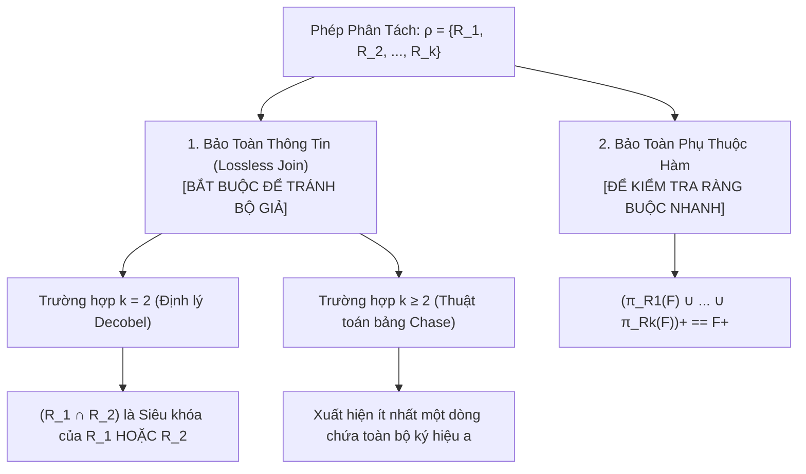

# CHƯƠNG 3 (QUYỂN 2): LÝ THUYẾT PHÂN TÁCH LƯỢC ĐỒ & BẢO TOÀN THÔNG TIN

---

## PHẦN 1: TÓM TẮT CỐT LÕI (EXECUTIVE SUMMARY)

### 1. Sơ Đồ Tiêu Chuẩn Đánh Giá Phép Phân Tách Lược Đồ Quan Hệ

### 2. Hai Tính Chất Sống Còn Của Phép Phân Tách
1. **Bảo toàn thông tin (Lossless-Join Decomposition):**
   - Đảm bảo rằng khi thực hiện phép kết tự nhiên các quan hệ con lại với nhau, ta thu được chính xác quan hệ ban đầu, không làm mất dữ liệu và không sinh ra các bộ dữ liệu giả mạo (Spurious Tuples):
     $$r = \pi_{R_1}(r) \bowtie \pi_{R_2}(r) \bowtie \dots \bowtie \pi_{R_k}(r)$$
2. **Bảo toàn tập phụ thuộc hàm (Dependency Preservation):**
   - Đảm bảo rằng việc kiểm tra các ràng buộc phụ thuộc hàm có thể thực hiện độc lập trên từng quan hệ con mà không cần tốn chi phí thực hiện phép kết nối các bảng lại với nhau:
     $$\left( \bigcup_{i=1}^k \pi_{R_i}(F) \right)^+ = F^+$$

### 3. Công Cụ Kiểm Tra Hình Thức
- **Định lý Decobel (cho 2 quan hệ con $\rho = \{R_1, R_2\}$):**
  $$\text{Lossless Join} \iff (R_1 \cap R_2) \to (R_1 \setminus R_2) \in F^+ \quad \text{HOẶC} \quad (R_1 \cap R_2) \to (R_2 \setminus R_1) \in F^+$$
- **Thuật toán bảng Chase (cho $k \ge 2$ quan hệ con):**
  - Khởi tạo bảng $k$ hàng $\times$ $n$ cột ($a_j$ nếu thuộc tính thuộc $R_i$, ngược lại $b_{ij}$).
  - Biến đổi đồng nhất các hàng theo từng phụ thuộc hàm trong $F$.
  - Nếu xuất hiện **ít nhất một dòng toàn ký hiệu $a$** $\implies$ Phép tách **bảo toàn thông tin**.

---

## PHẦN 2: BÀI TẬP TRẮC NGHIỆM (10 CÂU CÓ ĐÁP ÁN ẨN)

### Câu 1
Trong thiết kế CSDL quan hệ, hiện tượng "Bộ giả" (Spurious Tuples) phát sinh khi nào?
- A. Khi câu lệnh SQL bị lỗi cú pháp.
- B. Khi một phép phân tách không bảo toàn thông tin (Lossy Decomposition) được kết nối lại với nhau bằng phép kết tự nhiên.
- C. Khi người dùng nhập sai mật khẩu đăng nhập.
- D. Khi ổ đĩa cứng bị đầy.

<b>Xem đáp án & Giải thích</b>

- **Đáp án đúng:** B
- **Giải thích:** Phân tách mất thông tin làm mất đi mối liên kết khóa, dẫn đến khi kết nối tự nhiên ($\bowtie$) sẽ sinh ra các dòng kết hợp sai lệch giữa các thực thể không liên quan trong thế giới thực.
- **Căn cứ giáo trình:** *Giáo trình Thiết kế CSDL (Quyển 2)*, Chương 3, Mục 3.1.

### Câu 2
Theo Định lý Decobel, phép phân tách lược đồ $R$ thành hai lược đồ con $\rho = \{R_1, R_2\}$ là bảo toàn thông tin (Lossless Join) khi và chỉ khi:
- A. $R_1 \cap R_2 = \emptyset$
- B. Phần giao $R_1 \cap R_2$ là một siêu khóa của ít nhất một trong hai lược đồ con $R_1$ hoặc $R_2$.
- C. Hai lược đồ con có số lượng thuộc tính hoàn toàn bằng nhau.
- D. $R_1$ và $R_2$ phải có cùng khóa chính.

<b>Xem đáp án & Giải thích</b>

- **Đáp án đúng:** B
- **Giải thích:** $(R_1 \cap R_2) \to (R_1 \setminus R_2) \in F^+$ hoặc $(R_1 \cap R_2) \to (R_2 \setminus R_1) \in F^+$. Nghĩa là phần giao của hai quan hệ phải xác định hàm phần còn lại của ít nhất một quan hệ.
- **Căn cứ giáo trình:** *Giáo trình Thiết kế CSDL (Quyển 2)*, Chương 3, Mục 3.3.

### Câu 3
Trong thuật toán bảng Chase dùng để kiểm tra tính bảo toàn thông tin của phép phân tách, điều kiện nào sau đây xác nhận rằng phép phân tách là BẢO TOÀN THÔNG TIN?
- A. Tất cả các ô trong bảng đều biến thành số 0.
- B. Trong bảng xuất hiện ít nhất một dòng chứa toàn bộ các ký hiệu $a$ ($a_1, a_2, \dots, a_n$).
- C. Các dòng trong bảng hoàn toàn khác nhau.
- D. Bảng không thể biến đổi được nữa nhưng vẫn còn chứa ký hiệu $b$.

<b>Xem đáp án & Giải thích</b>

- **Đáp án đúng:** B
- **Giải thích:** Một dòng chứa toàn ký hiệu $a$ đại diện cho một bộ dữ liệu hoàn chỉnh của quan hệ gốc $R$ được khôi phục chính xác thông qua phép kết nối tự nhiên mà không bị mất mát hay giả mạo.
- **Căn cứ giáo trình:** *Giáo trình Thiết kế CSDL (Quyển 2)*, Chương 3, Mục 3.4.

### Câu 4
Cho lược đồ $R(A, B, C)$ với $F = \{A \to B\}$. Xét phép phân tách $\rho = \{R_1(A, B), R_2(B, C)\}$. Phép phân tách này có bảo toàn thông tin hay không?
- A. Bảo toàn thông tin vì $R_1 \cap R_2 = B$.
- B. Không bảo toàn thông tin (Lossy) vì phần giao $B$ không phải là siêu khóa của $R_1$ cũng không phải là siêu khóa của $R_2$.
- C. Bảo toàn thông tin vì $R_1 \cup R_2 = U$.
- D. Luôn bảo toàn thông tin trong mọi trường hợp.

<b>Xem đáp án & Giải thích</b>

- **Đáp án đúng:** B
- **Giải thích:** Giao hai lược đồ là $B$. Ta có $B^+ = B \ne AB$ và $B^+ = B \ne BC$. Do đó $B$ không phải là siêu khóa của bất kỳ bảng con nào, phép tách sinh ra bộ giả.
- **Căn cứ giáo trình:** *Giáo trình Thiết kế CSDL (Quyển 2)*, Chương 3, Mục 3.3.

### Câu 5
Một phép phân tách $\rho = \{R_1, R_2, \dots, R_k\}$ được gọi là "Bảo toàn phụ thuộc hàm" khi:
- A. Số lượng phụ thuộc hàm trong mỗi bảng con bằng nhau.
- B. Hợp của các hình chiếu phụ thuộc hàm trên các bảng con tương đương logic với tập phụ thuộc hàm ban đầu: $(\bigcup \pi_{R_i}(F))^+ = F^+$.
- C. Mọi phụ thuộc hàm đều biến mất sau khi phân tách.
- D. Không có bất kỳ khóa ngoại nào được tạo ra.

<b>Xem đáp án & Giải thích</b>

- **Đáp án đúng:** B
- **Giải thích:** Bảo toàn phụ thuộc hàm đòi hỏi không một ràng buộc ngữ nghĩa nào của $F$ bị thất thoát, mọi phụ thuộc hàm của $F$ đều có thể suy dẫn được từ các phụ thuộc hàm cục bộ trên các quan hệ con.
- **Căn cứ giáo trình:** *Giáo trình Thiết kế CSDL (Quyển 2)*, Chương 3, Mục 3.5.

### Câu 6
Giả sử ta phân tách $R(A, B, C, D)$ thành $R_1(A, B)$ và $R_2(C, D)$. Nếu tập phụ thuộc hàm là $F = \{A \to B, C \to D\}$, phép phân tách này:
- A. Bảo toàn thông tin nhưng không bảo toàn phụ thuộc hàm.
- B. Bảo toàn phụ thuộc hàm nhưng KHÔNG bảo toàn thông tin.
- C. Bảo toàn cả hai tính chất.
- D. Không bảo toàn cả hai tính chất.

<b>Xem đáp án & Giải thích</b>

- **Đáp án đúng:** B
- **Giải thích:**
  - Bảo toàn phụ thuộc hàm: $A \to B$ nằm trong $R_1$, $C \to D$ nằm trong $R_2 \implies$ Bảo toàn.
  - Bảo toàn thông tin: $R_1 \cap R_2 = \emptyset \implies$ Phép kết tự nhiên trở thành tích Descartes $R_1 \times R_2$, làm sinh ra vô số bộ giả mạo!
- **Căn cứ giáo trình:** *Giáo trình Thiết kế CSDL (Quyển 2)*, Chương 3, Mục 3.3.

### Câu 7
Khi áp dụng thuật toán Chase, nếu hai dòng có cùng giá trị trên tập thuộc tính $X$ của phụ thuộc hàm $X \to Y$, quy tắc cập nhật cột $Y$ là:
- A. Nếu trong các dòng có ô mang ký hiệu $a$, ưu tiên đổi các ô mang ký hiệu $b$ thành ký hiệu $a$ đó.
- B. Xóa bỏ một trong hai dòng đó khỏi bảng.
- C. Luôn chuyển tất cả các ô thành ký hiệu $b$.
- D. Đảo ngược giá trị của hai hàng.

<b>Xem đáp án & Giải thích</b>

- **Đáp án đúng:** A
- **Giải thích:** Ký hiệu $a$ biểu thị thuộc tính hiện diện ban đầu trong quan hệ con. Quy tắc đồng nhất ưu tiên truyền ký hiệu $a$ sang các dòng khác để tìm kiếm dòng hoàn chỉnh $a_1, \dots, a_n$.
- **Căn cứ giáo trình:** *Giáo trình Thiết kế CSDL (Quyển 2)*, Chương 3, Mục 3.4.

### Câu 8
Tại sao tính chất "Bảo toàn thông tin" là điều kiện TIÊN QUYẾT BẮT BUỘC trong thiết kế cơ sở dữ liệu, quan trọng hơn cả tính chất bảo toàn phụ thuộc hàm?
- A. Vì mất phụ thuộc hàm chỉ gây khó khăn cho việc kiểm tra ràng buộc, nhưng mất thông tin sẽ làm sai lệch bản chất dữ liệu thực tế và sinh ra thông tin giả mạo.
- B. Vì máy tính không thể lưu trữ được các tệp mất thông tin.
- C. Vì SQL không hỗ trợ câu lệnh `JOIN`.
- D. Vì quy định của các chuẩn mã hóa quốc tế.

<b>Xem đáp án & Giải thích</b>

- **Đáp án đúng:** A
- **Giải thích:** Nếu mất thông tin, CSDL sẽ trả về dữ liệu sai sự thật khi truy vấn ghép bảng. Trong khi nếu mất bảo toàn phụ thuộc hàm, ta vẫn có thể dùng Trigger hoặc tầng ứng dụng để kiểm soát ràng buộc.
- **Căn cứ giáo trình:** *Giáo trình Thiết kế CSDL (Quyển 2)*, Chương 3, Mục 3.1.

### Câu 9
Cho $R(A, B, C)$ và $F = \{A \to B\}$. Phép phân tách nào sau đây CHẮC CHẮN bảo toàn thông tin?
- A. $\rho = \{R_1(A, B), R_2(B, C)\}$
- B. $\rho = \{R_1(A, B), R_2(A, C)\}$
- C. $\rho = \{R_1(B, C), R_2(A, C)\}$
- D. $\rho = \{R_1(A), R_2(B, C)\}$

<b>Xem đáp án & Giải thích</b>

- **Đáp án đúng:** B
- **Giải thích:** Xét $\rho = \{R_1(A, B), R_2(A, C)\}$:
  - Giao hai lược đồ: $R_1 \cap R_2 = A$.
  - Vì $A \to B \in F \implies A \to (R_1 \setminus R_2)$.
  - Theo Định lý Decobel, phép phân tách này bảo toàn thông tin.
- **Căn cứ giáo trình:** *Giáo trình Thiết kế CSDL (Quyển 2)*, Chương 3, Mục 3.3.

### Câu 10
Hình chiếu của tập phụ thuộc hàm $F$ lên quan hệ con $R_i$, ký hiệu là $\pi_{R_i}(F)$, được định nghĩa là:
- A. Tập các phụ thuộc hàm trong $F$ có vế trái nằm trong $R_i$.
- B. Tập hợp tất cả các phụ thuộc hàm $X \to Y \in F^+$ sao cho cả $X$ và $Y$ đều là tập con của $R_i$ ($XY \subseteq R_i$).
- C. Tập các phụ thuộc hàm bị xóa bỏ.
- D. Tập các khóa chính của $R_i$.

<b>Xem đáp án & Giải thích</b>

- **Đáp án đúng:** B
- **Giải thích:** Hình chiếu phụ thuộc hàm bao gồm mọi phụ thuộc hàm suy dẫn được từ $F^+$ mà toàn bộ các thuộc tính tham gia đều nằm trọn vẹn trong quan hệ con $R_i$.
- **Căn cứ giáo trình:** *Giáo trình Thiết kế CSDL (Quyển 2)*, Chương 3, Mục 3.5.

---

## PHẦN 3: CÂU HỎI TRẢ LỜI NGẮN (5 CÂU CÓ ĐÁP ÁN ẨN)

### Câu 1
Phát biểu điều kiện Decobel kiểm tra tính bảo toàn thông tin của phép phân tách $R$ thành hai quan hệ con $\rho = \{R_1, R_2\}$.

<b>Xem đáp án & Hướng dẫn</b>

- **Đáp án:**
  $$(R_1 \cap R_2) \to (R_1 \setminus R_2) \in F^+ \quad \text{HOẶC} \quad (R_1 \cap R_2) \to (R_2 \setminus R_1) \in F^+$$
  (Giao của 2 lược đồ con phải là siêu khóa của ít nhất một trong hai lược đồ con đó).

### Câu 2
Cho lược đồ $R(A, B, C, D)$ và $F = \{AB \to C, C \to D, D \to A\}$. Hỏi phép phân tách $\rho = \{R_1(A, B, C), R_2(C, D)\}$ có bảo toàn thông tin không?

<b>Xem đáp án & Hướng dẫn</b>

- **Đáp án:** **CÓ**.
  - $R_1 \cap R_2 = C$.
  - $R_2 \setminus R_1 = D$.
  - Vì $C \to D \in F$, nên $(R_1 \cap R_2) \to (R_2 \setminus R_1) \in F^+$.
  - Theo Định lý Decobel, phép phân tách bảo toàn thông tin.

### Câu 3
Khi kiểm tra bảo toàn phụ thuộc hàm của phép phân tách $\rho = \{R_1(A, B), R_2(B, C)\}$ với $F = \{A \to B, B \to C, A \to C\}$, phụ thuộc hàm $A \to C$ có bị mất không?

<b>Xem đáp án & Hướng dẫn</b>

- **Đáp án:** **KHÔNG BỊ MẤT**.
  - $A \to B$ được bảo toàn trên $R_1$.
  - $B \to C$ được bảo toàn trên $R_2$.
  - Hợp các phụ thuộc hàm trên các bảng con: $F' = \{A \to B, B \to C\}$.
  - Vì từ $\{A \to B, B \to C\}$ ta suy dẫn được $A \to C$ (tiên đề bắc cầu), nên $F'^+ = F^+$. Phụ thuộc hàm được bảo toàn trọn vẹn.

### Câu 4
Trong thuật toán bảng Chase, bảng kiểm định có kích thước bao nhiêu dòng và bao nhiêu cột nếu phân tách lược đồ $R(A, B, C, D, E, G)$ thành 3 lược đồ con $\rho = \{R_1, R_2, R_3\}$?

<b>Xem đáp án & Hướng dẫn</b>

- **Đáp án:**
  Bảng gồm **3 dòng** (tương ứng với 3 lược đồ con $R_1, R_2, R_3$) và **6 cột** (tương ứng với 6 thuộc tính $A, B, C, D, E, G$).

### Câu 5
Nêu một ví dụ thực tế chứng minh phép phân tách không bảo toàn thông tin sẽ làm sinh ra dữ liệu sai lệch.

<b>Xem đáp án & Hướng dẫn</b>

- **Đáp án:**
  Xét bảng `NHANVIEN_CHUCVU_PHONG(MaNV, ChucVu, Phong)`. Tách thành `R1(ChucVu, Phong)` và `R2(MaNV, ChucVu)`.
  Nếu có 2 nhân viên cùng giữ chức vụ 'Kế toán' ở hai phòng ban khác nhau, khi kết nối tự nhiên $R1 \bowtie R2$ theo `ChucVu`, hệ thống sẽ ghép chéo mỗi nhân viên với cả hai phòng ban, tạo ra các bộ dữ liệu giả báo cáo sai phòng làm việc của nhân viên.

---

## PHẦN 4: BÀI TẬP TỰ LUẬN & THIẾT KẾ (3 BÀI CÓ LỜI GIẢI CHI TIẾT)

### Bài 1: Áp Dụng Thuật Toán Bảng Chase Cho Phép Phân Tách Tổng Quát
Cho lược đồ quan hệ $R(A, B, C, D, E)$ và tập phụ thuộc hàm:
$$F = \{A \to C, B \to D, CD \to E\}$$
Xét phép phân tách $\rho = \{R_1(A, B), R_2(A, C, D), R_3(B, C, D), R_4(C, D, E)\}$.
Hãy sử dụng **Thuật toán bảng Chase** để kiểm tra xem phép phân tách $\rho$ có bảo toàn thông tin (Lossless Join) hay không.

<b>Xem lời giải chi tiết từng bước</b>

#### Bước 1: Khởi tạo bảng Chase
Bảng gồm 4 dòng ($R_1, R_2, R_3, R_4$) và 5 cột ($A, B, C, D, E$):

| Lược đồ con | $A$ | $B$ | $C$ | $D$ | $E$ |
| :---: | :---: | :---: | :---: | :---: | :---: |
| $R_1(A, B)$ | $a_1$ | $a_2$ | $b_{13}$ | $b_{14}$ | $b_{15}$ |
| $R_2(A, C, D)$ | $a_1$ | $b_{22}$ | $a_3$ | $a_4$ | $b_{25}$ |
| $R_3(B, C, D)$ | $b_{31}$ | $a_2$ | $a_3$ | $a_4$ | $b_{35}$ |
| $R_4(C, D, E)$ | $b_{41}$ | $b_{42}$ | $a_3$ | $a_4$ | $a_5$ |

#### Bước 2: Biến đổi bảng theo từng phụ thuộc hàm trong $F$

1. **Xét phụ thuộc hàm $A \to C$:**
   - Các dòng có cùng giá trị trên cột $A$: Dòng 1 và Dòng 2 đều có giá trị $a_1$.
   - Đồng nhất trên cột $C$: Dòng 2 đang có $a_3$, do đó ta cập nhật ô $(1, 3)$ từ $b_{13}$ thành $a_3$.
   - Bảng sau bước 1:
     - Dòng 1: $a_1, a_2, \mathbf{a_3}, b_{14}, b_{15}$

2. **Xét phụ thuộc hàm $B \to D$:**
   - Các dòng có cùng giá trị trên cột $B$: Dòng 1 và Dòng 3 đều có giá trị $a_2$.
   - Đồng nhất trên cột $D$: Dòng 3 đang có $a_4$, do đó ta cập nhật ô $(1, 4)$ từ $b_{14}$ thành $a_4$.
   - Bảng sau bước 2:
     - Dòng 1: $a_1, a_2, a_3, \mathbf{a_4}, b_{15}$

3. **Xét phụ thuộc hàm $CD \to E$:**
   - Các dòng có cùng giá trị trên cả hai cột $C$ và $D$:
     - Dòng 1 có $(a_3, a_4)$
     - Dòng 2 có $(a_3, a_4)$
     - Dòng 3 có $(a_3, a_4)$
     - Dòng 4 có $(a_3, a_4)$
   - Trong 4 dòng này, Dòng 4 đang mang giá trị $a_5$ tại cột $E$.
   - Do đó, ta đồng nhất tất cả các ô tại cột $E$ của Dòng 1, Dòng 2, Dòng 3 thành $a_5$!
   - Bảng sau bước 3:
     - Dòng 1: $a_1, a_2, a_3, a_4, \mathbf{a_5}$
     - Dòng 2: $a_1, b_{22}, a_3, a_4, \mathbf{a_5}$
     - Dòng 3: $b_{31}, a_2, a_3, a_4, \mathbf{a_5}$
     - Dòng 4: $b_{41}, b_{42}, a_3, a_4, a_5$

#### Bước 3: Đánh giá và Kết luận
- Quan sát bảng sau bước 3, ta thấy **Dòng 1 chứa toàn bộ các ký hiệu $a$**:
  $$(a_1, a_2, a_3, a_4, a_5)$$
- **Kết luận:** Theo thuật toán bảng Chase, phép phân tách $\rho = \{R_1, R_2, R_3, R_4\}$ **HOÀN TOÀN BẢO TOÀN THÔNG TIN (Lossless Join)**.

### Bài 2: Kiểm Tra Bảo Toàn Thông Tin & Bảo Toàn Phụ Thuộc Hàm
Cho lược đồ quan hệ $R(A, B, C, D)$ và tập phụ thuộc hàm:
$$F = \{A \to B, B \to C, C \to D, D \to A\}$$
Xét phép phân tách $\rho = \{R_1(A, B), R_2(B, C), R_3(C, D)\}$.
1. Phép phân tách $\rho$ có bảo toàn thông tin không? Chứng minh.
2. Phép phân tách $\rho$ có bảo toàn tập phụ thuộc hàm không? Chứng minh.

<b>Xem lời giải chi tiết từng bước</b>

#### Câu 1: Kiểm tra tính bảo toàn thông tin
Ta có thể kiểm tra từng bước kết nối:
- **Bước 1: Ghép $R_1(A, B)$ và $R_2(B, C)$ thành $R_{12}(A, B, C)$:**
  - $R_1 \cap R_2 = B$.
  - Vì $B \to C \in F \implies B \to (R_2 \setminus R_1) \in F^+$.
  - Theo Định lý Decobel, phép ghép $\{R_1, R_2\}$ là không mất thông tin, tạo thành $R_{12}(A, B, C)$.
- **Bước 2: Ghép $R_{12}(A, B, C)$ và $R_3(C, D)$ thành $R(A, B, C, D)$:**
  - $R_{12} \cap R_3 = C$.
  - Vì $C \to D \in F \implies C \to (R_3 \setminus R_{12}) \in F^+$.
  - Theo Định lý Decobel, phép ghép $\{R_{12}, R_3\}$ là không mất thông tin.
- **Kết luận:** Phép phân tách $\rho$ **hoàn toàn bảo toàn thông tin**.

#### Câu 2: Kiểm tra bảo toàn phụ thuộc hàm
- Chiếu $F$ lên các lược đồ con:
  - $\pi_{R_1}(F)$ chứa $A \to B$.
  - $\pi_{R_2}(F)$ chứa $B \to C$.
  - $\pi_{R_3}(F)$ chứa $C \to D$.
- Đặt $F' = \pi_{R_1}(F) \cup \pi_{R_2}(F) \cup \pi_{R_3}(F) = \{A \to B, B \to C, C \to D\}$.
- Ta cần kiểm tra xem phụ thuộc hàm $D \to A \in F$ có được suy dẫn từ $F'$ hay không:
  - Tính $D_{F'}^+$: Trong $F'$, không có bất kỳ phụ thuộc hàm nào có vế trái chứa $D$.
  - Do đó: $D_{F'}^+ = D \not\ni A$.
  - Nghĩa là $F' \not\vDash D \to A$.
- **Kết luận:** Phép phân tách $\rho$ **KHÔNG BẢO TOÀN PHỤ THUỘC HÀM** (bị thất thoát ràng buộc $D \to A$).

### Bài 3: Thiết Kế Phép Phân Tách Thỏa Mãn Đồng Thời Cả Hai Tính Chất
Cho lược đồ quan hệ $R(A, B, C, D, E)$ và tập phụ thuộc hàm:
$$F = \{AB \to C, C \to D, D \to E, E \to A\}$$
1. Chỉ ra một phép phân tách thành 2 lược đồ con $\rho = \{R_1, R_2\}$ bảo toàn thông tin nhưng không bảo toàn phụ thuộc hàm.
2. Đề xuất một phép phân tách $\rho_{opt}$ thỏa mãn **đồng thời cả hai tính chất**: Bảo toàn thông tin VÀ Bảo toàn phụ thuộc hàm.

<b>Xem lời giải chi tiết từng bước</b>

#### Câu 1: Phép tách bảo toàn thông tin nhưng mất phụ thuộc hàm
- Chọn $\rho = \{R_1(A, B, C), R_2(C, D, E)\}$.
  - Giao: $R_1 \cap R_2 = C$.
  - Ta có $C \to D$ và $D \to E \implies C \to DE = (R_2 \setminus R_1) \in F^+$.
  - Do đó theo Decobel, phép tách bảo toàn thông tin.
  - Tuy nhiên, xét phụ thuộc hàm $E \to A \in F$: Thuộc tính $E$ nằm trong $R_2$, thuộc tính $A$ nằm trong $R_1$. Trên $R_1$ chỉ có $AB \to C$, trên $R_2$ chỉ có $C \to D, D \to E$. Tập này không suy dẫn được $E \to A$.
  - Do đó phép tách này **làm mất phụ thuộc hàm $E \to A$**.

#### Câu 2: Đề xuất phép tách thỏa mãn cả hai tính chất
Áp dụng Thuật toán tổng hợp Bernstein:
- Tìm phủ tối thiểu: $F_{min} = \{AB \to C, C \to D, D \to E, E \to A\}$.
- Tạo các lược đồ con tương ứng với từng phụ thuộc hàm:
  - $R_1(A, B, C)$ ứng với $AB \to C$.
  - $R_2(C, D)$ ứng với $C \to D$.
  - $R_3(D, E)$ ứng với $D \to E$.
  - $R_4(E, A)$ ứng với $E \to A$.
- Kiểm tra khóa: Khóa của $R$ gồm $\{B, E\}$. Vì chưa có bảng nào chứa trọn vẹn khóa, ta bổ sung thêm:
  - $R_5(B, E)$.
- **Kết quả:** Phép phân tách $\rho_{opt} = \{R_1(A, B, C), R_2(C, D), R_3(D, E), R_4(E, A), R_5(B, E)\}$ bảo đảm **100% bảo toàn thông tin** và **100% bảo toàn phụ thuộc hàm**.

