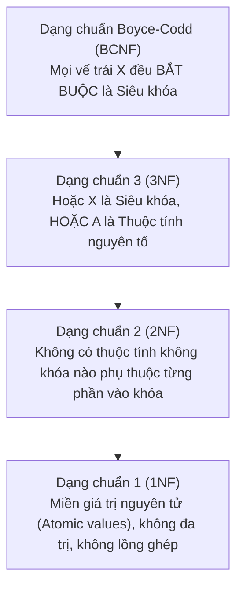

# CHƯƠNG 4 (QUYỂN 2): CHUẨN HÓA CƠ SỞ DỮ LIỆU (1NF, 2NF, 3NF, BCNF) & THUẬT TOÁN BERNSTEIN

---

## PHẦN 1: TÓM TẮT CỐT LÕI (EXECUTIVE SUMMARY)

### 1. Phân Cấp Các Dạng Chuẩn Trong Cơ Sở Dữ Liệu

### 2. Định Nghĩa & Tiêu Chuẩn Phân Loại Dạng Chuẩn

| Dạng chuẩn | Điều kiện thỏa mãn hình thức | Khuyết điểm loại bỏ |
| :--- | :--- | :--- |
| **1NF** | Toàn bộ miền giá trị của các thuộc tính đều nguyên tử (Atomic). | Loại bỏ thuộc tính đa trị và quan hệ lồng ghép. |
| **2NF** | Đạt 1NF VÀ mọi thuộc tính không nguyên tố đều **phụ thuộc hàm đầy đủ** vào khóa. | Loại bỏ sự phụ thuộc vào một phần của khóa ghép. |
| **3NF** | Đạt 2NF VÀ không có thuộc tính không nguyên tố nào **phụ thuộc bắc cầu** vào khóa. *Quy tắc kiểm tra:* Với mọi $X \to A \in F^+$ ($A \notin X$): 1. $X$ là siêu khóa, HOẶC 2. $A$ là thuộc tính nguyên tố. | Loại bỏ sự phụ thuộc bắc cầu giữa các thuộc tính không khóa. |
| **BCNF** | Với mọi $X \to A \in F^+$ ($A \notin X$): **$X$ bắt buộc phải là một siêu khóa**. | Loại trừ triệt để mọi dị thường xuất phát từ phụ thuộc hàm. |

### 3. Thuật Toán Chuẩn Hóa CSDL
1. **Thuật toán Chuẩn hóa về 3NF (Thuật toán tổng hợp Bernstein):**
   - Bước 1: Tìm phủ tối thiểu $F_{min}$ của $F$.
   - Bước 2: Gom các PTH có cùng vế trái: $X \to A_1, \dots, X \to A_m \implies X \to A_1 \dots A_m$.
   - Bước 3: Tạo lược đồ con $R_i = X \cup A_1 \dots A_m$ cho mỗi nhóm.
   - Bước 4: Nếu chưa có $R_i$ nào chứa trọn vẹn một khóa $K$ của $R$, thêm $R_{new} = K$.
   - Bước 5: Loại bỏ các lược đồ con là tập con của lược đồ khác.
   - *Tính chất:* **Bảo đảm 100% Bảo toàn thông tin VÀ Bảo toàn phụ thuộc hàm.**
2. **Thuật toán Chuẩn hóa về BCNF:**
   - Phân tách đệ quy theo các phụ thuộc hàm vi phạm BCNF ($X \to Y$ với $X$ không phải siêu khóa):
     $$R_1 = X \cup Y, \quad R_2 = R \setminus (Y \setminus X)$$
   - *Tính chất:* **Bảo toàn thông tin nhưng có thể làm MẤT phụ thuộc hàm.**

---

## PHẦN 2: BÀI TẬP TRẮC NGHIỆM (10 CÂU CÓ ĐÁP ÁN ẨN)

### Câu 1
Một lược đồ quan hệ đạt Dạng chuẩn 1 (1NF) nhưng có khóa chính là khóa ghép gồm 2 thuộc tính $(A, B)$. Nếu tồn tại một phụ thuộc hàm $A \to C$ (với $C$ là thuộc tính không khóa), lược đồ này:
- A. Chắc chắn đạt 2NF.
- B. Vi phạm 2NF vì có thuộc tính không khóa phụ thuộc từng phần vào khóa.
- C. Đạt BCNF.
- D. Không thể lưu trữ dữ liệu.

<b>Xem đáp án & Giải thích</b>

- **Đáp án đúng:** B
- **Giải thích:** Khóa chính là $AB$. Phụ thuộc hàm $A \to C$ cho thấy $C$ phụ thuộc vào một tập con thực sự của khóa ($A \subset AB$), do đó vi phạm định nghĩa Dạng chuẩn 2 (2NF).
- **Căn cứ giáo trình:** *Giáo trình Thiết kế CSDL (Quyển 2)*, Chương 4, Mục 4.3.2.

### Câu 2
Nếu tất cả các khóa của một lược đồ quan hệ $R$ đều là **khóa đơn** (chỉ gồm duy nhất 1 thuộc tính) và $R$ đã đạt 1NF, thì ta có thể kết luận ngay rằng:
- A. $R$ chắc chắn đạt Dạng chuẩn 2 (2NF).
- B. $R$ chắc chắn đạt Dạng chuẩn 3 (3NF).
- C. $R$ chắc chắn đạt BCNF.
- D. $R$ không có khóa ngoại.

<b>Xem đáp án & Giải thích</b>

- **Đáp án đúng:** A
- **Giải thích:** Khi mọi khóa đều là khóa đơn, không thể tồn tại bất kỳ tập con thực sự nào của khóa. Do đó không thể xảy ra hiện tượng phụ thuộc từng phần, $R$ mặc nhiên đạt 2NF.
- **Căn cứ giáo trình:** *Giáo trình Thiết kế CSDL (Quyển 2)*, Chương 4, Mục 4.3.2.

### Câu 3
Điều kiện tương đương để một lược đồ quan hệ $R(U, F)$ đạt Dạng chuẩn 3 (3NF) là với mọi phụ thuộc hàm không tầm thường $X \to A \in F^+$ ($A \notin X$):
- A. $X$ phải là thuộc tính đơn.
- B. Hoặc $X$ là siêu khóa, hoặc $A$ là thuộc tính nguyên tố.
- C. $A$ phải là khóa ngoại.
- D. $X$ và $A$ phải có cùng kiểu dữ liệu.

<b>Xem đáp án & Giải thích</b>

- **Đáp án đúng:** B
- **Giải thích:** Đây là mệnh đề định nghĩa tương đương kinh điển của 3NF: Mọi phụ thuộc hàm đều phải có vế trái là siêu khóa HOẶC vế phải là một thuộc tính nguyên tố (thuộc một khóa nào đó).
- **Căn cứ giáo trình:** *Giáo trình Thiết kế CSDL (Quyển 2)*, Chương 4, Mục 4.3.3.

### Câu 4
Dạng chuẩn Boyce-Codd (BCNF) nghiêm ngặt hơn Dạng chuẩn 3 (3NF) ở điểm nào?
- A. BCNF cấm hoàn toàn giá trị số nguyên.
- B. BCNF không cho phép ngoại lệ "vế phải $A$ là thuộc tính nguyên tố", mà bắt buộc mọi vế trái $X$ của phụ thuộc hàm không tầm thường đều phải là Siêu khóa.
- C. BCNF bắt buộc bảng chỉ có tối đa 3 cột.
- D. BCNF luôn bảo toàn phụ thuộc hàm trong mọi thuật toán phân tách.

<b>Xem đáp án & Giải thích</b>

- **Đáp án đúng:** B
- **Giải thích:** Trong BCNF, điều kiện duy nhất được chấp nhận là $X$ phải là siêu khóa ($X \to U$). Không chấp nhận ngoại lệ $A$ nguyên tố như 3NF.
- **Căn cứ giáo trình:** *Giáo trình Thiết kế CSDL (Quyển 2)*, Chương 4, Mục 4.3.4.

### Câu 5
Xét lược đồ $R(A, B, C)$ với $F = \{AB \to C, C \to B\}$. Khóa của $R$ là $AB$ và $AC$. Dạng chuẩn cao nhất của $R$ là:
- A. 1NF
- B. 2NF
- C. 3NF
- D. BCNF

<b>Xem đáp án & Giải thích</b>

- **Đáp án đúng:** C
- **Giải thích:**
  - Khóa: $AB, AC \implies$ Thuộc tính nguyên tố: $\{A, B, C\}$ (Tất cả thuộc tính đều nguyên tố!).
  - Xét $C \to B$: $C$ không phải là siêu khóa (vì $C^+ = BC \ne U$) $\implies$ Vi phạm BCNF!
  - Nhưng $B$ là thuộc tính nguyên tố (thuộc khóa $AB$) $\implies$ Thỏa mãn điều kiện của 3NF.
  - Do đó dạng chuẩn cao nhất là 3NF.
- **Căn cứ giáo trình:** *Giáo trình Thiết kế CSDL (Quyển 2)*, Chương 4, Mục 4.3.5.

### Câu 6
Ưu điểm lớn nhất của Thuật toán tổng hợp Bernstein khi chuẩn hóa về 3NF so với thuật toán phân tách về BCNF là gì?
- A. Luôn đảm bảo đồng thời cả tính Bảo toàn thông tin (Lossless Join) và tính Bảo toàn phụ thuộc hàm.
- B. Cho ra số lượng bảng con ít hơn BCNF.
- C. Không cần tìm khóa của quan hệ.
- D. Không cần tìm phủ tối thiểu.

<b>Xem đáp án & Giải thích</b>

- **Đáp án đúng:** A
- **Giải thích:** Thuật toán Bernstein xây dựng bảng con từ phủ tối thiểu $F_{min}$ nên bảo toàn 100% phụ thuộc hàm, và bước bổ sung khóa đảm bảo bảo toàn thông tin. Trong khi BCNF có thể phải hy sinh tính bảo toàn phụ thuộc hàm.
- **Căn cứ giáo trình:** *Giáo trình Thiết kế CSDL (Quyển 2)*, Chương 4, Mục 4.4.

### Câu 7
Một quan hệ chứa thông tin `SINHVIEN_LOP(MaSV, HoTen, MaLop, TenLop, GVCN)` với các phụ thuộc hàm: $MaSV \to HoTen, MaLop$ và $MaLop \to TenLop, GVCN$. Dị thường nào sẽ xảy ra nếu một lớp học hiện tại chưa có sinh viên nào đăng ký nhập học?
- A. Dị thường sửa (Update Anomaly)
- B. Dị thường thêm (Insertion Anomaly)
- C. Dị thường xóa (Deletion Anomaly)
- D. Không có dị thường nào.

<b>Xem đáp án & Giải thích</b>

- **Đáp án đúng:** B
- **Giải thích:** Khóa chính là `MaSV`. Nếu một lớp mới mở chưa có sinh viên, ta không thể nhập `MaLop`, `TenLop`, `GVCN` vào bảng vì khóa chính `MaSV` không được phép mang giá trị `NULL`.
- **Căn cứ giáo trình:** *Giáo trình Thiết kế CSDL (Quyển 2)*, Chương 4, Mục 4.1.

### Câu 8
Trong thuật toán chuẩn hóa Bernstein về 3NF, mục đích của bước: *"Nếu chưa có lược đồ con nào chứa trọn vẹn một khóa của quan hệ ban đầu thì bổ sung thêm một lược đồ con chứa khóa đó"* là để:
- A. Giúp bảng có thêm nhiều cột.
- B. Bảo đảm tính Bảo toàn thông tin (Lossless Join).
- C. Bảo đảm tính Bảo toàn phụ thuộc hàm.
- D. Chuyển bảng về dạng chuẩn 1NF.

<b>Xem đáp án & Giải thích</b>

- **Đáp án đúng:** B
- **Giải thích:** Việc đảm bảo có ít nhất một lược đồ con chứa khóa của quan hệ gốc là điều kiện đủ bảo đảm khi kết nối tự nhiên tất cả các quan hệ con lại, ta thu hồi chính xác quan hệ ban đầu (Lossless Join).
- **Căn cứ giáo trình:** *Giáo trình Thiết kế CSDL (Quyển 2)*, Chương 4, Mục 4.4.

### Câu 9
Nếu một lược đồ quan hệ đạt Dạng chuẩn Boyce-Codd (BCNF), nó có chắc chắn đạt Dạng chuẩn 3 (3NF) hay không?
- A. Không chắc chắn.
- B. Chắc chắn đạt 3NF (vì $\text{BCNF} \subset \text{3NF}$).
- C. Chỉ đạt nếu quan hệ có ít hơn 5 thuộc tính.
- D. Tùy thuộc vào phần mềm DBMS đang sử dụng.

<b>Xem đáp án & Giải thích</b>

- **Đáp án đúng:** B
- **Giải thích:** BCNF là trường hợp con khắt khe hơn của 3NF. Mọi lược đồ đạt BCNF đều mặc nhiên thỏa mãn 3NF, 2NF và 1NF.
- **Căn cứ giáo trình:** *Giáo trình Thiết kế CSDL (Quyển 2)*, Chương 4, Mục 4.3.4.

### Câu 10
Hiện tượng một thuộc tính không khóa $C$ phụ thuộc vào một thuộc tính không khóa $B$, và $B$ lại phụ thuộc vào khóa chính $A$ ($A \to B \to C$) được gọi là:
- A. Phụ thuộc từng phần (Partial Dependency)
- B. Phụ thuộc bắc cầu (Transitive Dependency)
- C. Phụ thuộc hàm đầy đủ (Full Dependency)
- D. Phụ thuộc tầm thường (Trivial Dependency)

<b>Xem đáp án & Giải thích</b>

- **Đáp án đúng:** B
- **Giải thích:** Phụ thuộc bắc cầu là nguyên nhân cốt lõi khiến lược đồ dừng ở 2NF mà không đạt được 3NF.
- **Căn cứ giáo trình:** *Giáo trình Thiết kế CSDL (Quyển 2)*, Chương 4, Mục 4.2.

---

## PHẦN 3: CÂU HỎI TRẢ LỜI NGẮN (5 CÂU CÓ ĐÁP ÁN ẨN)

### Câu 1
Nêu 3 bước chính để xác định dạng chuẩn cao nhất của một lược đồ quan hệ $\langle R, F \rangle$.

<b>Xem đáp án & Hướng dẫn</b>

- **Đáp án:**
  1. **Bước 1:** Tìm tất cả các khóa của $R$. Xác định thuộc tính nguyên tố và không nguyên tố.
  2. **Bước 2 (Kiểm tra BCNF):** Kiểm tra xem mọi $X \to A \in F$ ($A \notin X$) thì $X$ có phải là siêu khóa không. Nếu đúng $\implies$ Đạt BCNF.
  3. **Bước 3 (Kiểm tra 3NF):** Với các PTH vi phạm BCNF, kiểm tra xem $A$ có phải là thuộc tính nguyên tố không. Nếu đúng $\implies$ Đạt 3NF. Nếu sai, kiểm tra xem có phụ thuộc từng phần không để kết luận 2NF hoặc 1NF.

### Câu 2
Cho lược đồ $R(A, B, C, D)$ và $F = \{AB \to CD, C \to D\}$. Xác định khóa và dạng chuẩn cao nhất của $R$.

<b>Xem đáp án & Hướng dẫn</b>

- **Đáp án:**
  - Khóa duy nhất: $AB$.
  - Thuộc tính không khóa: $\{C, D\}$.
  - Xét $C \to D$: Vế trái $C$ không phải là siêu khóa, vế phải $D$ không phải là thuộc tính nguyên tố $\implies$ Vi phạm 3NF và BCNF.
  - Cả hai thuộc tính không khóa $C, D$ đều phụ thuộc đầy đủ vào khóa chính $AB$ (không phụ thuộc vào $A$ hay $B$ riêng lẻ) $\implies$ Đạt 2NF.
  - **Dạng chuẩn cao nhất:** **2NF**.

### Câu 3
Khi nào một người thiết kế CSDL chấp nhận giữ lược đồ ở Dạng chuẩn 3 (3NF) mà không tiếp tục chuẩn hóa lên BCNF?

<b>Xem đáp án & Hướng dẫn</b>

- **Đáp án:**
  Khi việc phân tách lên BCNF làm **mất đi tính bảo toàn phụ thuộc hàm**. Trong thực tế, các kỹ sư thường ưu tiên giữ lại ở 3NF để bảo toàn toàn bộ các ràng buộc nghiệp vụ mà không cần viết thêm Trigger kiểm tra kết nối tốn kém.

### Câu 4
Cho $R(M, N, P)$ với $F = \{M \to N, N \to P\}$. Trình bày kết quả phân tách $R$ về 3NF bằng thuật toán tổng hợp Bernstein.

<b>Xem đáp án & Hướng dẫn</b>

- **Đáp án:**
  - Phủ tối thiểu: $F_{min} = \{M \to N, N \to P\}$.
  - Tạo các quan hệ con theo từng vế trái:
    - $R_1(M, N)$ ứng với $M \to N$.
    - $R_2(N, P)$ ứng với $N \to P$.
  - Khóa của $R$ là $M$. Ta thấy $R_1$ đã chứa trọn vẹn khóa $M$.
  - **Kết quả:** $\rho = \{R_1(M, N), R_2(N, P)\}$.

### Câu 5
Khái niệm "Khử chuẩn hóa" (Denormalization) trong hệ cơ sở dữ liệu lớn (Big Data / Data Warehouse) có ý nghĩa gì?

<b>Xem đáp án & Hướng dẫn</b>

- **Đáp án:**
  Khử chuẩn hóa là kỹ thuật chủ động gộp các bảng lại với nhau (chấp nhận một lượng dư thừa dữ liệu có kiểm soát) nhằm giảm bớt số lượng phép `JOIN` khi truy vấn đọc dữ liệu, giúp tăng tối đa tốc độ đọc báo cáo trong các hệ thống OLAP/Kho dữ liệu.

---

## PHẦN 4: BÀI TẬP TỰ LUẬN & THIẾT KẾ (3 BÀI CÓ LỜI GIẢI CHI TIẾT)

### Bài 1: Phân Tích Dạng Chuẩn & Chuẩn Hóa Lên BCNF
Cho lược đồ quan hệ $R(A, B, C, D, J)$ và tập phụ thuộc hàm:
$$F = \{AB \to C, C \to D, D \to J, J \to A\}$$
1. Tìm tất cả các khóa của $R$.
2. Xác định dạng chuẩn cao nhất của $R$.
3. Nếu $R$ chưa đạt BCNF, hãy áp dụng thuật toán phân tách đệ quy để đưa $R$ về BCNF bảo toàn thông tin.

<b>Xem lời giải chi tiết từng bước</b>

#### Bước 1: Tìm tất cả các khóa
- Phân loại thuộc tính:
  - Vế trái: $\{A, B, C, D, J\}$
  - Vế phải: $\{C, D, J, A\}$
  - Nhóm $L$: $\{B\}$ (Chỉ ở vế trái $\implies B$ bắt buộc phải có trong mọi khóa).
  - Nhóm $M$: $\{A, C, D, J\}$.
- Xét kết hợp $B$ với từng thuộc tính của $M$:
  - $(AB)^+ = ABCDJ = U \implies AB$ là khóa.
  - $(CB)^+ = CBJDA = U \implies BC$ là khóa.
  - $(DB)^+ = DBJAC = U \implies BD$ là khóa.
  - $(JB)^+ = JBACD = U \implies BJ$ là khóa.
- **Tập các khóa của $R$:** $\{AB, BC, BD, BJ\}$.
- **Thuộc tính nguyên tố:** $\{A, B, C, D, J\}$ (Tất cả thuộc tính đều nguyên tố!).

#### Bước 2: Xác định dạng chuẩn cao nhất
- Xét phụ thuộc hàm $C \to D$:
  - Vế trái $C$ không phải là siêu khóa (vì $C^+ = CDJA \ne U$, thiếu $B$).
  - Vế phải $D$ là thuộc tính nguyên tố (thuộc khóa $BD$).
- Tương tự, với các PTH $D \to J$ và $J \to A$, vế trái đều không phải siêu khóa nhưng vế phải đều là thuộc tính nguyên tố.
- **Kết luận:** Lược đồ $R$ đạt **Dạng chuẩn 3 (3NF)** nhưng **KHÔNG đạt BCNF**.

#### Bước 3: Phân tách về BCNF
- Chọn phụ thuộc hàm vi phạm BCNF: $C \to D$.
  - Tính $C^+ = CDJA$.
  - Tách $R$ thành hai lược đồ con:
    - $R_1 = C \cup D \cup J \cup A = \{A, C, D, J\}$
    - $R_2 = R \setminus (\{A, C, D, J\} \setminus \{C\}) = \{B, C\}$.
- **Kiểm tra các lược đồ con:**
  - $R_2(B, C)$: Chỉ có khóa $BC$, không có PTH không tầm thường nào khác $\implies$ Đạt BCNF.
  - $R_1(A, C, D, J)$: Có các PTH $\{C \to D, D \to J, J \to A, A \to C\}$. Các thuộc tính tạo thành chu trình xác định lẫn nhau $\implies$ Khóa của $R_1$ gồm $\{C\}, \{D\}, \{J\}, \{A\}$. Mọi vế trái đều là siêu khóa của $R_1 \implies R_1$ đạt BCNF!
- **Kết quả phân tách:** $\rho = \{R_1(A, C, D, J), R_2(B, C)\}$ đạt chuẩn BCNF và bảo toàn thông tin.

### Bài 2: Chuẩn Hóa Về 3NF Bằng Thuật Toán Tổng Hợp Bernstein
Cho lược đồ quan hệ $R(A, B, C, D, E, G)$ và tập phụ thuộc hàm:
$$F = \{AB \to C, C \to D, D \to E, E \to G, G \to B\}$$
Hãy thực hiện chuẩn hóa $R$ về Dạng chuẩn 3 (3NF) bằng thuật toán Bernstein để đảm bảo đồng thời cả hai tính chất: Bảo toàn thông tin và Bảo toàn phụ thuộc hàm.

<b>Xem lời giải chi tiết từng bước</b>

#### Bước 1: Tìm phủ tối thiểu $F_{min}$
1. Vế phải của mọi PTH đều đã có 1 thuộc tính: $C, D, E, G, B$.
2. Kiểm tra vế trái $AB \to C$:
   - $A^+ = A \not\ni C$; $B^+ = B \not\ni C \implies$ Không dư thừa vế trái.
3. Kiểm tra phụ thuộc hàm dư thừa: Không có PTH nào suy dẫn gián tiếp được từ các PTH còn lại.
- $\implies F_{min} = \{AB \to C, C \to D, D \to E, E \to G, G \to B\}$.

#### Bước 2: Gom nhóm các PTH có cùng vế trái
Mỗi PTH đều có vế trái phân biệt:
- Nhóm 1: $AB \to C$
- Nhóm 2: $C \to D$
- Nhóm 3: $D \to E$
- Nhóm 4: $E \to G$
- Nhóm 5: $G \to B$

#### Bước 3: Tạo các lược đồ quan hệ con
- $R_1(A, B, C)$
- $R_2(C, D)$
- $R_3(D, E)$
- $R_4(E, G)$
- $R_5(G, B)$

#### Bước 4: Kiểm tra điều kiện bảo toàn thông tin
- Tìm một khóa của quan hệ gốc $R$:
  - $A$ chỉ ở vế trái $\implies A$ thuộc nhóm $L$.
  - Tính $(AB)^+ = ABCDEGB = U \implies AB$ là một khóa của $R$.
- Quan sát danh sách các lược đồ con ở Bước 3, ta thấy **lược đồ $R_1(A, B, C)$ đã chứa trọn vẹn khóa $AB$**!
- Do đó, không cần bổ sung thêm lược đồ con mới.

#### Bước 5: Kiểm tra lược đồ con dư thừa
Không có lược đồ nào là tập con của lược đồ khác.

#### Kết luận:
Phép phân tách đạt 3NF là:
$$\rho = \{R_1(A, B, C), R_2(C, D), R_3(D, E), R_4(E, G), R_5(G, B)\}$$

### Bài 3: Phân Tích Thực Tiễn - Chuẩn Hóa Hệ Thống Quản Lý Phòng Khám
Một phòng khám tư nhân quản lý dữ liệu khám bệnh bằng một bảng duy nhất:
`KHAMBENH(MaBN, TenBN, NgayKham, MaBacSi, TenBacSi, PhongKham, MaThuoc, TenThuoc, CachDung)`
Với các quy tắc nghiệp vụ:
- Mỗi bệnh nhân có một mã bệnh nhân `MaBN` và tên `TenBN`.
- Mỗi bác sĩ có `MaBacSi`, `TenBacSi` và phụ trách một `PhongKham` cố định.
- Trong một ngày, một bệnh nhân có thể khám với một bác sĩ và được kê một hoặc nhiều loại thuốc.
- Mỗi loại thuốc có `MaThuoc`, `TenThuoc` và `CachDung`.

**Yêu cầu:**
1. Xác định các phụ thuộc hàm và tìm khóa chính của quan hệ trên.
2. Chỉ ra các dị thường dữ liệu (Thêm, Xóa, Sửa) của thiết kế ban đầu.
3. Chuẩn hóa thiết kế trên về Dạng chuẩn 3 (3NF).

<b>Xem lời giải chi tiết từng bước</b>

#### Bước 1: Xác định tập phụ thuộc hàm và Khóa chính
- Tập phụ thuộc hàm:
  - $MaBN \to TenBN$
  - $MaBacSi \to TenBacSi, PhongKham$
  - $MaThuoc \to TenThuoc$
  - $(MaBN, NgayKham, MaThuoc) \to MaBacSi, CachDung$
- Khóa chính duy nhất của bảng gốc là:
  $$\text{PK} = (MaBN, NgayKham, MaThuoc)$$

#### Bước 2: Phân tích các dị thường dữ liệu
1. **Dư thừa dữ liệu:** Tên bệnh nhân, tên bác sĩ, tên thuốc bị lặp lại ở mọi đơn thuốc của từng ngày khám.
2. **Dị thường thêm:** Không thể thêm thông tin của một bác sĩ mới về phòng khám nếu bác sĩ đó chưa khám cho bệnh nhân nào (vì `MaBN`, `NgayKham`, `MaThuoc` là khóa chính, cấm `NULL`).
3. **Dị thường xóa:** Nếu xóa đơn thuốc của một bệnh nhân duy nhất từng khám với một bác sĩ nào đó, thông tin về bác sĩ và phòng khám của người đó cũng bị xóa mất khỏi CSDL.
4. **Dị thường sửa:** Khi bác sĩ đổi phòng khám, phải cập nhật đồng loạt hàng nghìn dòng khám bệnh cũ.

#### Bước 3: Chuẩn hóa về 3NF
Phân tách thành 4 bảng độc lập, chuẩn hóa:
1. `BENHNHAN(MaBN, TenBN)`
   - PK: `MaBN`
2. `BACSI(MaBacSi, TenBacSi, PhongKham)`
   - PK: `MaBacSi`
3. `THUOC(MaThuoc, TenThuoc)`
   - PK: `MaThuoc`
4. `PHIEUKHAM(MaBN, NgayKham, MaBacSi)`
   - PK: `(MaBN, NgayKham)`
   - FK1: `MaBN` tham chiếu `BENHNHAN(MaBN)`
   - FK2: `MaBacSi` tham chiếu `BACSI(MaBacSi)`
5. `DONTHUOC_CHITIET(MaBN, NgayKham, MaThuoc, CachDung)`
   - PK: `(MaBN, NgayKham, MaThuoc)`
   - FK1: `(MaBN, NgayKham)` tham chiếu `PHIEUKHAM(MaBN, NgayKham)`
   - FK2: `MaThuoc` tham chiếu `THUOC(MaThuoc)`

