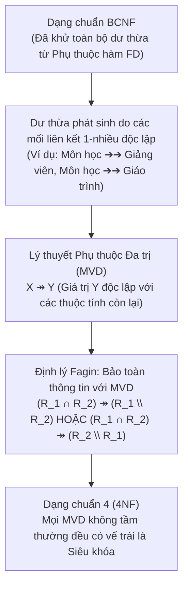

# CHƯƠNG 5 (QUYỂN 2): PHỤ THUỘC ĐA TRỊ (MVD) & DẠNG CHUẨN 4 (4NF)

---

## PHẦN 1: TÓM TẮT CỐT LÕI (EXECUTIVE SUMMARY)

### 1. Sơ Đồ Tiến Hóa Chuẩn Hóa: Từ BCNF Đến Dạng Chuẩn 4 (4NF)

### 2. Định Nghĩa Phụ Thuộc Đa Trị (Multivalued Dependency - MVD)
Cho lược đồ quan hệ $R(U)$ và $X, Y \subseteq U$, đặt $Z = U \setminus (X \cup Y)$.
Ta nói rằng **$X$ xác định đa trị $Y$** (hay **$Y$ phụ thuộc đa trị vào $X$**), ký hiệu là:
$$X \twoheadrightarrow Y$$
nếu với mọi thể hiện quan hệ $r$ trên $R$ và với bất kỳ hai bộ dữ liệu $t_1, t_2 \in r$ thỏa mãn $t_1[X] = t_2[X]$, luôn luôn tồn tại hai bộ $t_3, t_4 \in r$ sao cho:
1. $t_3[X] = t_1[X], \quad t_3[Y] = t_1[Y], \quad t_3[Z] = t_2[Z]$
2. $t_4[X] = t_1[X], \quad t_4[Y] = t_2[Y], \quad t_4[Z] = t_1[Z]$

- **MVD tầm thường (Trivial MVD):** $X \twoheadrightarrow Y$ là tầm thường nếu $Y \subseteq X$ hoặc $X \cup Y = U$.
- **Mối quan hệ giữa FD và MVD (Luật sao chép):**
  $$X \to Y \implies X \twoheadrightarrow Y$$
  *(Mọi phụ thuộc hàm đều là một trường hợp đặc biệt của phụ thuộc đa trị).*

### 3. Định Lý Fagin (Lossless Join Với MVD)
> **Định lý Fagin:** Phép phân tách lược đồ quan hệ $R$ thành hai lược đồ con $\rho = \{R_1, R_2\}$ (với $R_1 \cup R_2 = U$) là **bảo toàn thông tin (Lossless Join)** khi và chỉ khi:
> $$(R_1 \cap R_2) \twoheadrightarrow (R_1 \setminus R_2) \quad \text{HOẶC} \quad (R_1 \cap R_2) \twoheadrightarrow (R_2 \setminus R_1)$$

### 4. Dạng Chuẩn 4 (4NF - Fourth Normal Form)
- **Định nghĩa:** Lược đồ quan hệ $R(U, D)$ đạt Dạng chuẩn 4 (4NF) nếu với mọi phụ thuộc đa trị không tầm thường $X \twoheadrightarrow Y \in D^+$ (nghĩa là $Y \not\subseteq X$ và $XY \subset U$):
  $$X \text{ bắt buộc phải là một siêu khóa của } R$$
- **Quan hệ thứ bậc hoàn chỉnh:**
  $$\text{4NF} \subset \text{BCNF} \subset \text{3NF} \subset \text{2NF} \subset \text{1NF}$$

---

## PHẦN 2: BÀI TẬP TRẮC NGHIỆM (10 CÂU CÓ ĐÁP ÁN ẨN)

### Câu 1
Khái niệm Phụ thuộc đa trị (MVD) được nhà khoa học Ronald Fagin đề xuất nhằm giải quyết loại dư thừa dữ liệu phát sinh trong trường hợp nào?
- A. Một bảng chứa quá nhiều số thực dấu phẩy động.
- B. Trong cùng một bảng tồn tại hai hay nhiều mối liên kết một - nhiều độc lập với nhau (dẫn đến phép nhân tích Descartes các dòng dữ liệu).
- C. Bảng không có khóa ngoại.
- D. Bảng có chỉ mục B-Tree bị hỏng.

<b>Xem đáp án & Giải thích</b>

- **Đáp án đúng:** B
- **Giải thích:** Khi hai mối quan hệ 1-N độc lập được gộp chung vào một bảng (như một môn học có nhiều giảng viên độc lập và nhiều giáo trình độc lập), dữ liệu bị nhân tích chéo, sinh ra dư thừa lớn dù bảng đã đạt BCNF.
- **Căn cứ giáo trình:** *Giáo trình Thiết kế CSDL (Quyển 2)*, Chương 5, Mục 5.1.

### Câu 2
Cho lược đồ $R(A, B, C)$. Theo Luật bù (Complementation Rule) của phụ thuộc đa trị, nếu ta có $A \twoheadrightarrow B$, thì ta cũng CHẮC CHẮN có:
- A. $B \twoheadrightarrow A$
- B. $A \twoheadrightarrow C$
- C. $C \twoheadrightarrow B$
- D. $B \twoheadrightarrow C$

<b>Xem đáp án & Giải thích</b>

- **Đáp án đúng:** B
- **Giải thích:** Luật bù phát biểu: Nếu $X \twoheadrightarrow Y$ thì $X \twoheadrightarrow U \setminus (X \cup Y)$. Vì $U \setminus (A \cup B) = C$, nên $A \twoheadrightarrow C$ luôn đúng. MVD luôn đi theo cặp đối xứng.
- **Căn cứ giáo trình:** *Giáo trình Thiết kế CSDL (Quyển 2)*, Chương 5, Mục 5.2.

### Câu 3
Phụ thuộc đa trị nào sau đây là một Phụ thuộc đa trị tầm thường (Trivial MVD) trên lược đồ $R(A, B, C, D)$?
- A. $A \twoheadrightarrow B$
- B. $AB \twoheadrightarrow C$
- C. $A \twoheadrightarrow BCD$
- D. $B \twoheadrightarrow C$

<b>Xem đáp án & Giải thích</b>

- **Đáp án đúng:** C
- **Giải thích:** Phụ thuộc đa trị $X \twoheadrightarrow Y$ là tầm thường nếu $Y \subseteq X$ hoặc $X \cup Y = U$. Ở đây $A \cup BCD = ABCD = U$, nên $A \twoheadrightarrow BCD$ là tầm thường.
- **Căn cứ giáo trình:** *Giáo trình Thiết kế CSDL (Quyển 2)*, Chương 5, Mục 5.1.

### Câu 4
Mối quan hệ nào sau đây giữa Phụ thuộc hàm (FD) và Phụ thuộc đa trị (MVD) là ĐÚNG?
- A. Nếu $X \twoheadrightarrow Y$ thì $X \to Y$.
- B. Nếu $X \to Y$ thì $X \twoheadrightarrow Y$.
- C. FD và MVD hoàn toàn không có mối liên hệ nào.
- D. MVD luôn làm mất khóa chính.

<b>Xem đáp án & Giải thích</b>

- **Đáp án đúng:** B
- **Giải thích:** Đây là Luật sao chép (Replication Rule): Mọi phụ thuộc hàm $X \to Y$ đều là một phụ thuộc đa trị đặc biệt (khi tập giá trị liên kết của $Y$ chỉ có duy nhất 1 phần tử). Chiều ngược lại không đúng.
- **Căn cứ giáo trình:** *Giáo trình Thiết kế CSDL (Quyển 2)*, Chương 5, Mục 5.2.

### Câu 5
Định lý Fagin đưa ra điều kiện cần và đủ để phân tách một lược đồ quan hệ $R$ thành hai lược đồ con $\{R_1, R_2\}$ bảo toàn thông tin dựa trên:
- A. $(R_1 \cap R_2) \twoheadrightarrow (R_1 \setminus R_2)$ hoặc $(R_1 \cap R_2) \twoheadrightarrow (R_2 \setminus R_1)$
- B. $R_1 \cap R_2 = \emptyset$
- C. $R_1 \cup R_2 = \emptyset$
- D. $|R_1| = |R_2|$

<b>Xem đáp án & Giải thích</b>

- **Đáp án đúng:** A
- **Giải thích:** Định lý Fagin mở rộng Định lý Decobel cho MVD: Phép tách 2 quan hệ là Lossless Join khi và chỉ khi phần giao của chúng xác định đa trị phần bù của ít nhất một trong hai quan hệ.
- **Căn cứ giáo trình:** *Giáo trình Thiết kế CSDL (Quyển 2)*, Chương 5, Mục 5.5.

### Câu 6
Một lược đồ quan hệ đạt Dạng chuẩn 4 (4NF) khi:
- A. Mọi phụ thuộc hàm đều là tầm thường.
- B. Đạt BCNF và mọi phụ thuộc đa trị không tầm thường $X \twoheadrightarrow Y$ đều có vế trái $X$ là một siêu khóa.
- C. Bảng không chứa bất kỳ khóa ngoại nào.
- D. Bảng chỉ chứa đúng 4 cột.

<b>Xem đáp án & Giải thích</b>

- **Đáp án đúng:** B
- **Giải thích:** Định nghĩa 4NF: Bắt buộc mọi vế trái của phụ thuộc đa trị không tầm thường phải là siêu khóa của quan hệ.
- **Căn cứ giáo trình:** *Giáo trình Thiết kế CSDL (Quyển 2)*, Chương 5, Mục 5.6.

### Câu 7
Xét quan hệ $R(MonHoc, GiangVien, GiaoTrinh)$ trong đó một môn học có thể có nhiều giảng viên dạy và nhiều giáo trình tham khảo, giảng viên và giáo trình hoàn toàn độc lập với nhau. Khóa chính của $R$ là:
- A. `MonHoc`
- B. `(MonHoc, GiangVien)`
- C. `(MonHoc, GiangVien, GiaoTrinh)`
- D. `(GiangVien, GiaoTrinh)`

<b>Xem đáp án & Giải thích</b>

- **Đáp án đúng:** C
- **Giải thích:** Do các thuộc tính hoàn toàn độc lập và là quan hệ nhiều - nhiều, không có bất kỳ tập con thực sự nào xác định được toàn thể dòng. Khóa duy nhất là tổ hợp toàn bộ 3 thuộc tính.
- **Căn cứ giáo trình:** *Giáo trình Thiết kế CSDL (Quyển 2)*, Chương 5, Mục 5.1.

### Câu 8
Trong quan hệ $R(MonHoc, GiangVien, GiaoTrinh)$ ở câu 7, mặc dù đạt chuẩn BCNF nhưng lại vi phạm 4NF. Để đưa $R$ về Dạng chuẩn 4 (4NF), ta phân tách thành:
- A. $R_1(MonHoc, GiangVien)$ và $R_2(MonHoc, GiaoTrinh)$
- B. $R_1(GiangVien, GiaoTrinh)$ và $R_2(MonHoc)$
- C. $R_1(MonHoc)$ và $R_2(GiangVien)$ và $R_3(GiaoTrinh)$
- D. Không thể phân tách được.

<b>Xem đáp án & Giải thích</b>

- **Đáp án đúng:** A
- **Giải thích:** Theo thuật toán phân tách 4NF trên MVD $MonHoc \twoheadrightarrow GiangVien$, ta thu được hai bảng con: $R_1(MonHoc, GiangVien)$ và $R_2(MonHoc, GiaoTrinh)$. Phép tách này theo Định lý Fagin là bảo toàn thông tin 100%.
- **Căn cứ giáo trình:** *Giáo trình Thiết kế CSDL (Quyển 2)*, Chương 5, Mục 5.6.

### Câu 9
Nếu một lược đồ quan hệ đạt Dạng chuẩn 4 (4NF), phát biểu nào sau đây là ĐÚNG?
- A. Nó có thể vi phạm BCNF.
- B. Nó chắc chắn đạt Dạng chuẩn Boyce-Codd (BCNF).
- C. Nó không thể chuyển sang dạng chuẩn 3NF.
- D. Nó chứa nhiều thuộc tính đa trị dư thừa.

<b>Xem đáp án & Giải thích</b>

- **Đáp án đúng:** B
- **Giải thích:** Vì $\text{4NF} \subset \text{BCNF}$, một khi lược đồ đã đạt 4NF thì nó đương nhiên đã đạt BCNF, 3NF, 2NF và 1NF.
- **Căn cứ giáo trình:** *Giáo trình Thiết kế CSDL (Quyển 2)*, Chương 5, Mục 5.6.

### Câu 10
Thuật toán chuẩn hóa một lược đồ quan hệ về Dạng chuẩn 4 (4NF) bảo đảm tính chất nào?
- A. Luôn luôn Bảo toàn thông tin (Lossless Join).
- B. Luôn luôn Bảo toàn phụ thuộc đa trị.
- C. Không bao giờ tạo thêm bảng con nào.
- D. Giảm số lượng khóa ngoại về 0.

<b>Xem đáp án & Giải thích</b>

- **Đáp án đúng:** A
- **Giải thích:** Thuật toán phân tách đệ quy dựa trên MVD vi phạm kết hợp Định lý Fagin luôn luôn đảm bảo tính kết nối không mất mát thông tin (Lossless Join).
- **Căn cứ giáo trình:** *Giáo trình Thiết kế CSDL (Quyển 2)*, Chương 5, Mục 5.6.

---

## PHẦN 3: CÂU HỎI TRẢ LỜI NGẮN (5 CÂU CÓ ĐÁP ÁN ẨN)

### Câu 1
Phát biểu điều kiện để một phụ thuộc đa trị $X \twoheadrightarrow Y$ trên lược đồ $R(U)$ trở thành một Phụ thuộc đa trị tầm thường.

<b>Xem đáp án & Hướng dẫn</b>

- **Đáp án:**
  $X \twoheadrightarrow Y$ là tầm thường khi và chỉ khi:
  $$Y \subseteq X \quad \text{HOẶC} \quad X \cup Y = U$$

### Câu 2
Nếu có phụ thuộc hàm $A \to B$ trên $R(A, B, C, D)$, hãy suy ra 2 phụ thuộc đa trị tương ứng theo các tiên đề MVD.

<b>Xem đáp án & Hướng dẫn</b>

- **Đáp án:**
  1. Theo Luật sao chép (FD $\to$ MVD): $A \twoheadrightarrow B$.
  2. Theo Luật bù: $A \twoheadrightarrow U \setminus (A \cup B) \implies A \twoheadrightarrow CD$.

### Câu 3
Giải thích tại sao một quan hệ chỉ gồm đúng 2 thuộc tính $R(A, B)$ luôn luôn đạt Dạng chuẩn 4 (4NF).

<b>Xem đáp án & Hướng dẫn</b>

- **Đáp án:**
  Vì trên quan hệ có 2 thuộc tính, mọi phụ thuộc đa trị khả dĩ (như $A \twoheadrightarrow B$ có $A \cup B = U$, hoặc $A \twoheadrightarrow A$ có $A \subseteq A$) đều là **phụ thuộc đa trị tầm thường**. Không tồn tại bất kỳ phụ thuộc đa trị không tầm thường nào có thể vi phạm 4NF.

### Câu 4
Nêu bước phân tách đệ quy một lược đồ $R$ khi phát hiện một phụ thuộc đa trị $X \twoheadrightarrow Y$ vi phạm Dạng chuẩn 4 (4NF).

<b>Xem đáp án & Hướng dẫn</b>

- **Đáp án:**
  Phân tách $R$ thành hai lược đồ con:
  $$R_1 = X \cup Y$$
  $$R_2 = R \setminus (Y \setminus X) = (U \setminus Y) \cup X$$

### Câu 5
Khái niệm "Cơ sở phụ thuộc" (Dependency Basis) của một tập thuộc tính $X$, ký hiệu $DepB(X)$, được hiểu như thế nào?

<b>Xem đáp án & Hướng dẫn</b>

- **Đáp án:**
  $DepB(X)$ là một phân hoạch gồm các tập con rời nhau $\{Y_1, Y_2, \dots, Y_m\}$ của $U \setminus X$ sao cho $X \twoheadrightarrow Y_i \in D^+$, và bất kỳ tập $W$ nào thỏa mãn $X \twoheadrightarrow W$ đều được tạo thành từ hợp của một số tập $Y_i$ trong phân hoạch này.

---

## PHẦN 4: BÀI TẬP TỰ LUẬN & THIẾT KẾ (3 BÀI CÓ LỜI GIẢI CHI TIẾT)

### Bài 1: Phân Tích Thực Tiễn Dị Thường MVD & Chuẩn Hóa Về 4NF
Một công ty phần mềm theo dõi kỹ năng của nhân viên bằng bảng dữ liệu:
`NHANVIEN_DUAN_NGOAINGU(MaNV, MaDA, NgoaiNgu)`
- Mỗi nhân viên (`MaNV`) có thể tham gia vào nhiều dự án (`MaDA`).
- Mỗi nhân viên có thể sử dụng nhiều ngoại ngữ (`NgoaiNgu`).
- Việc một nhân viên tham gia dự án nào hoàn toàn độc lập với việc họ biết ngoại ngữ nào.

**Yêu cầu:**
1. Hãy cho một ví dụ dữ liệu mẫu (khoảng 4 dòng) minh họa sự dư thừa dữ liệu bắt buộc của thiết kế trên.
2. Xác định các phụ thuộc đa trị tồn tại trong lược đồ.
3. Kiểm tra xem lược đồ có đạt BCNF không? Có đạt 4NF không?
4. Tiến hành chuẩn hóa lược đồ về Dạng chuẩn 4 (4NF) bảo đảm bảo toàn thông tin.

<b>Xem lời giải chi tiết từng bước</b>

#### Bước 1: Ví dụ dữ liệu mẫu minh họa dư thừa
Xét nhân viên `NV01` tham gia 2 dự án (`DA1`, `DA2`) và biết 2 ngoại ngữ (`TiengAnh`, `TiengNhat`):

| `MaNV` | `MaDA` | `NgoaiNgu` |
| :---: | :---: | :---: |
| NV01 | DA1 | TiengAnh |
| NV01 | DA1 | TiengNhat |
| NV01 | DA2 | TiengAnh |
| NV01 | DA2 | TiengNhat |

- Ta thấy thông tin `NV01` tham gia `DA1` bị lặp lại 2 lần (cho mỗi ngoại ngữ), và việc `NV01` biết `TiengAnh` cũng bị lặp lại 2 lần (cho mỗi dự án). Nếu nhân viên tham gia 5 dự án và biết 4 ngoại ngữ, bảng phải lưu trữ $5 \times 4 = 20$ dòng!

#### Bước 2: Xác định các Phụ thuộc đa trị
Do sự độc lập giữa dự án và ngoại ngữ đối với từng nhân viên:
- $MaNV \twoheadrightarrow MaDA$
- $MaNV \twoheadrightarrow NgoaiNgu$

#### Bước 3: Kiểm tra dạng chuẩn
- **Khóa chính:** Do không có phụ thuộc hàm đơn trị nào, khóa chính duy nhất của bảng là toàn bộ bộ ba: `(MaNV, MaDA, NgoaiNgu)`.
- **BCNF:** Vì không có phụ thuộc hàm không tầm thường nào $\implies$ Bảng thỏa mãn BCNF.
- **4NF:** Xét MVD $MaNV \twoheadrightarrow MaDA$:
  - Đây là MVD không tầm thường (vì $MaDA \not\subseteq MaNV$ và $\{MaNV, MaDA\} \subset U$).
  - Vế trái $MaNV$ **không phải là siêu khóa** của bảng.
  - $\implies$ Quan hệ **vi phạm Dạng chuẩn 4 (4NF)**!

#### Bước 4: Chuẩn hóa về 4NF
Áp dụng thuật toán phân tách theo MVD $MaNV \twoheadrightarrow MaDA$:
- $R_1 = \{MaNV, MaDA\}$
- $R_2 = \{MaNV, NgoaiNgu\}$
- **Kiểm tra tính bảo toàn thông tin:**
  - $R_1 \cap R_2 = \{MaNV\}$.
  - Theo Định lý Fagin, vì $MaNV \twoheadrightarrow MaDA = R_1 \setminus R_2$, nên phép tách này **hoàn toàn bảo toàn thông tin**.
- **Kết quả:** $\rho = \{R_1(MaNV, MaDA), R_2(MaNV, NgoaiNgu)\}$ đạt chuẩn 4NF. Dữ liệu của nhân viên `NV01` từ 4 dòng giảm xuống chỉ còn $2 + 2 = 4$ dòng trong 2 bảng nhỏ gọn, triệt tiêu hoàn toàn dư thừa tích Descartes.

### Bài 2: Chứng Minh Bằng Hệ Tiên Đề Phụ Thuộc Đa Trị
Cho lược đồ quan hệ $R(A, B, C, D, E)$ thỏa mãn hai phụ thuộc đa trị:
$$A \twoheadrightarrow B \quad \text{và} \quad B \twoheadrightarrow C$$
Hãy áp dụng hệ tiên đề cho phụ thuộc đa trị để chứng minh rằng:
$$A \twoheadrightarrow C \setminus B$$

<b>Xem lời giải chi tiết từng bước</b>

#### Chứng minh:
1. Theo giả thiết, ta có:
   $$A \twoheadrightarrow B \quad (1)$$
   $$B \twoheadrightarrow C \quad (2)$$
2. Áp dụng **Tiên đề Bắc cầu (Transitivity Rule)** của phụ thuộc đa trị:
   > Nếu $X \twoheadrightarrow Y$ và $Y \twoheadrightarrow Z$, thì $X \twoheadrightarrow Z \setminus Y$.
3. Đặt $X = A$, $Y = B$, $Z = C$.
   Áp dụng trực tiếp vào (1) và (2), ta suy ra:
   $$A \twoheadrightarrow C \setminus B$$
4. Đây chính là điều phải chứng minh.

### Bài 3: Chuẩn Hóa Lược Đồ Tổng Hợp Chứa Cả FD và MVD
Cho lược đồ quan hệ $R(A, B, C, D, E)$ với tập ràng buộc $D$ gồm cả phụ thuộc hàm và phụ thuộc đa trị:
$$D = \{A \to B, \ B \twoheadrightarrow C, \ C \to D\}$$
1. Tìm khóa của $R$.
2. Áp dụng thuật toán phân tách để đưa $R$ về Dạng chuẩn 4 (4NF) bảo toàn thông tin.

<b>Xem lời giải chi tiết từng bước</b>

#### Bước 1: Tìm khóa của $R$
- Từ $A \to B$ và $B \twoheadrightarrow C$:
  - Thuộc tính $E$ không xuất hiện ở vế phải của bất kỳ FD hay MVD nào $\implies E$ bắt buộc phải nằm trong khóa.
  - Từ $A$ xác định được $B$. Từ $C$ xác định được $D$.
  - Khóa của $R$ cần kết hợp $\{A, C, E\}$.
  - Khóa chính tối thiểu của $R$: $K = ACE$.

#### Bước 2: Chuẩn hóa đệ quy về 4NF
1. **Xét phụ thuộc hàm $A \to B$:**
   - Theo luật sao chép: $A \to B \implies A \twoheadrightarrow B$.
   - $A$ không phải là siêu khóa của $R$ (vì $A^+ = AB \ne U$).
   - Phân tách $R$ theo $A \to B$:
     - $R_1 = AB$ (đạt 4NF vì chỉ có 2 thuộc tính).
     - $R_2 = R \setminus \{B\} = ACDE$.
2. **Xét lược đồ $R_2(A, C, D, E)$:**
   - Trong $R_2$, ta có phụ thuộc hàm $C \to D$.
   - $C$ không phải là siêu khóa của $R_2$ (vì $C^+ = CD \ne ACDE$).
   - Phân tách $R_2$ theo $C \to D$:
     - $R_{21} = CD$ (đạt 4NF vì chỉ có 2 thuộc tính).
     - $R_{22} = R_2 \setminus \{D\} = ACE$.
3. **Xét lược đồ $R_{22}(A, C, E)$:**
   - Khóa của $R_{22}$ là $ACE$. Không có phụ thuộc hàm hay MVD không tầm thường nào trên $R_{22}$.
   - Do đó $R_{22}$ đạt 4NF.

#### Kết luận:
Phép phân tách đạt Dạng chuẩn 4 (4NF) bảo toàn thông tin là:
$$\rho = \{R_1(A, B), R_{21}(C, D), R_{22}(A, C, E)\}$$

