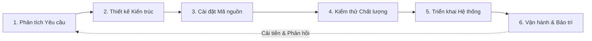

# CHƯƠNG 1: TỔNG QUAN VỀ CÔNG NGHỆ PHẦN MỀM

## 1. Khái niệm và Bản chất của Phần mềm
- **Phần mềm (Software):** Tập hợp các chỉ dẫn lập trình (chương trình máy tính), cấu trúc dữ liệu và tài liệu hướng dẫn nhằm thực hiện các nhiệm vụ cụ thể trên máy tính hoặc thiết bị điện tử.
- **Đặc tính cơ bản của phần mềm:**
  - Là sản phẩm **vô hình, phi vật lý**: Được phát triển hoặc kỹ nghệ hóa (engineered), không phải được chế tạo theo nghĩa công nghiệp truyền thống.
  - **Không bị hao mòn vật lý (Wear out):** Phần mềm không bị mòn cơ học theo thời gian như phần cứng; tuy nhiên nó bị **thoái hóa (Deterioration)** do các thay đổi môi trường hệ điều hành, thư viện phụ thuộc và lỗi tích tụ qua các lần vá chắp vá.
  - Phần lớn phần mềm vẫn được tùy biến theo yêu cầu riêng, mặc dù xu hướng tái sử dụng thành phần (Component-based reuse) ngày càng phát triển.

## 2. Khủng hoảng Phần mềm (Software Crisis) & Sự ra đời của CNPM
- **Khủng hoảng phần mềm (thập niên 1960 - 1970):** Xuất hiện khi phần cứng máy tính phát triển vượt bậc về năng lực tính toán, trong khi phương pháp phát triển phần mềm mang tính cá nhân, tự phát (ad-hoc), dẫn đến:
  - Chi phí dự án vượt xa dự toán ban đầu (Cost overrun).
  - Trễ hạn bàn giao nghiêm trọng (Schedule delay).
  - Chất lượng kém, chứa nhiều lỗi nghiêm trọng khi vận hành thực tế.
  - Chi phí bảo trì khổng lồ, khó nâng cấp và mở rộng.
- **Định nghĩa Công nghệ Phần mềm (IEEE Standard 610.12):**
  > *"Công nghệ phần mềm là việc áp dụng một cách tiếp cận có hệ thống, có kỷ luật và định lượng được vào việc phát triển, vận hành và bảo trì phần mềm; nghĩa là áp dụng kỹ nghệ (engineering) vào phần mềm."*

## 3. Vòng đời Phát triển Phần mềm (SDLC - Software Development Life Cycle)
Vòng đời phát triển phần mềm bao gồm các giai đoạn cốt lõi:
1. **Phân tích yêu cầu (Requirements Analysis):** Thu thập, làm rõ và tài liệu hóa những gì hệ thống cần thực hiện.
2. **Thiết kế hệ thống & kiến trúc (Architecture & System Design):** Xác định cấu trúc tổng thể, mô hình dữ liệu, giao diện API và công nghệ sử dụng.
3. **Cài đặt & Lập trình (Implementation / Coding):** Chuyển hóa thiết kế thành mã nguồn chạy được bằng ngôn ngữ lập trình.
4. **Kiểm thử phần mềm (Testing):** Xác minh (Verification) và thẩm định (Validation) để phát hiện và khắc phục lỗi trước khi bàn giao.
5. **Triển khai (Deployment):** Đưa phần mềm vào môi trường vận hành thực tế (Production).
6. **Vận hành & Bảo trì (Maintenance):** Khắc phục lỗi phát sinh, thích ứng môi trường mới và mở rộng tính năng.

## 4. Các Thuộc tính Chất lượng Phần mềm (Software Quality Attributes)
Theo chuẩn ISO/IEC 25010, chất lượng phần mềm được đánh giá qua các trục cốt lõi:
- **Tính tin cậy (Reliability):** Khả năng duy trì mức độ hoạt động ổn định trong các điều kiện xác định qua một khoảng thời gian (MTBF - Mean Time Between Failures).
- **Tính hiệu năng (Performance Efficiency):** Thời gian đáp ứng nhanh, thông lượng cao và sử dụng tối ưu tài nguyên (CPU, RAM, Network).
- **Tính bảo mật (Security):** Bảo vệ dữ liệu và thông tin người dùng trước sự truy cập trái phép, tính toàn vẹn và chống chối bỏ.
- **Tính khả dụng (Usability):** Giao diện trực quan, dễ học, dễ sử dụng và hạn chế thao tác nhầm lẫn của người dùng.
- **Tính dễ bảo trì (Maintainability):** Mã nguồn rõ ràng, kiến trúc module hóa giúp dễ phân tích lỗi, dễ sửa đổi và kiểm thử hồi quy.
- **Tính tương thích & Di động (Portability):** Khả năng chuyển dịch và hoạt động mượt mà trên nhiều nền tảng, hệ điều hành khác nhau.

## 5. Vai trò Dự án & Mô hình Kỹ năng Chữ T (T-Shaped Skills)
- **Các vai trò chủ chốt:**
  - **Project Manager (PM):** Quản lý tiến độ, ngân sách, nhân sự và quản trị rủi ro.
  - **Product Owner (PO):** Đại diện cho khách hàng/người dùng, chịu trách nhiệm về tầm nhìn sản phẩm và giá trị của Product Backlog.
  - **Business Analyst (BA):** Cầu nối giữa khách hàng và đội ngũ kỹ thuật, làm rõ yêu cầu nghiệp vụ.
  - **Software Architect:** Quyết định kiến trúc hệ thống, khung công nghệ và chuẩn mực thiết kế.
  - **Software Developer (Dev):** Xây dựng tính năng, viết clean code và unit tests.
  - **QA/QC Engineer (Tester):** Thiết kế kịch bản kiểm thử, kiểm tra chất lượng và đảm bảo sản phẩm đáp ứng tiêu chí nghiệm thu.
  - **DevOps Engineer:** Tự động hóa quy trình CI/CD, giám sát hạ tầng và môi trường triển khai.
- **Mô hình Kỹ năng Chữ T (T-shaped Skills):**
  - **Thanh ngang:** Bề rộng kiến thức liên ngành (hiểu về quy trình Agile, Git, UI/UX, kiểm thử cơ bản, kỹ năng giao tiếp).
  - **Thanh dọc:** Chuyên môn kỹ thuật sâu sắc ở một lĩnh vực mũi nhọn (ví dụ: Chuyên sâu về Backend Node.js/Java, hoặc Database Optimization).

## 6. Quản lý Mã nguồn Cơ bản với Git
- **Ba trạng thái (Three States) của tập tin trong Git:**
  1. **Working Directory:** Thư mục làm việc thực tế chứa mã nguồn đang được chỉnh sửa.
  2. **Staging Area (Index):** Khu vực tạm lưu giữ các thay đổi được chọn lọc để đưa vào bản commit kế tiếp.
  3. **Repository (.git directory):** Cơ sở dữ liệu lịch sử lưu trữ vĩnh viễn các commit snapshots.
- **Các lệnh Git cơ bản:**
  - `git init`: Khởi tạo kho lưu trữ Git cục bộ mới.
  - `git status`: Kiểm tra trạng thái các tập tin (untracked, modified, staged).
  - `git add <file>` / `git add .`: Đưa thay đổi vào Staging Area.
  - `git commit -m "Thông điệp"`: Tạo bản lưu snapshot vĩnh viễn với thông điệp rõ nghĩa.
  - `git log --oneline`: Xem lịch sử các commit đã thực hiện.
  - `git diff`: So sánh sự khác biệt giữa Working Directory và Staging Area.
