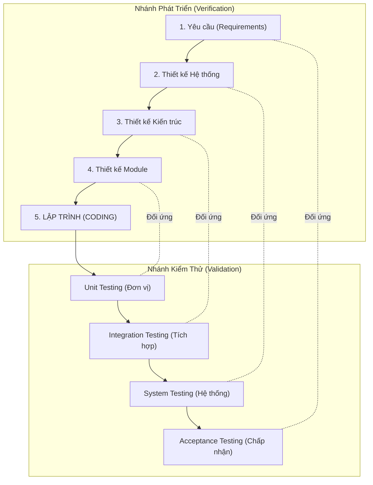
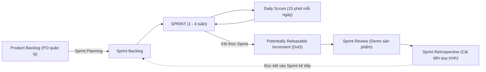

# CHƯƠNG 2: QUY TRÌNH PHÁT TRIỂN PHẦN MỀM

## 1. Khái niệm Mô hình Quy trình Phần mềm (Software Process Model)
- Một biểu diễn trừu tượng của một quy trình phát triển phần mềm, quy định các giai đoạn, hoạt động, sản phẩm bàn giao (Deliverables) và vai trò của các thành viên.

## 2. Các Mô hình Truyền thống (Traditional Heavyweight Models)
### A. Mô hình Thác nước (Waterfall Model)
- **Đặc trưng:** Tuần tự, tuyến tính. Giai đoạn sau chỉ được phép bắt đầu khi giai đoạn trước đã hoàn thành 100% và được phê duyệt (Sign-off).
- **Ưu điểm:** Cấu trúc chặt chẽ, dễ quản lý tiến độ và chi phí theo các mốc cột mốc (Milestones).
- **Nhược điểm cốt tử:** Rất khó thay đổi yêu cầu; khách hàng chỉ nhìn thấy sản phẩm chạy được ở giai đoạn cuối cùng; rủi ro thất bại tích tụ dồn về cuối dự án.
- **Trường hợp áp dụng:** Các dự án có yêu cầu rõ ràng từ đầu, ít biến động (ví dụ: phần mềm nhúng hàng không, y tế theo tiêu chuẩn pháp lý cứng).

### B. Mô hình Chữ V (V-Model)
- **Đặc trưng:** Mở rộng từ Thác nước, nhấn mạnh mối quan hệ đối ứng 1-1 giữa mỗi giai đoạn phát triển bên nhánh trái và một cấp độ kiểm thử tương ứng bên nhánh phải.
- **Các cặp tương ứng:**
  - *Đặc tả Yêu cầu (Requirements)* $\longleftrightarrow$ *Kiểm thử Chấp nhận (Acceptance Testing)*
  - *Thiết kế Hệ thống (System Design)* $\longleftrightarrow$ *Kiểm thử Hệ thống (System Testing)*
  - *Thiết kế Kiến trúc (Architecture)* $\longleftrightarrow$ *Kiểm thử Tích hợp (Integration Testing)*
  - *Thiết kế Module/Chi tiết* $\longleftrightarrow$ *Kiểm thử Đơn vị (Unit Testing)*

## 3. Triết lý Linh hoạt Agile (Agile Philosophy)
Ra đời năm 2001 với **Tuyên ngôn Agile (Agile Manifesto)**, tập trung vào tính thích ứng và phản hồi nhanh trước sự thay đổi.

### 4 Giá trị Cốt lõi của Agile:
1. **Cá nhân và sự tương tác** hơn là quy trình và công cụ.
2. **Phần mềm chạy tốt** hơn là tài liệu đầy đủ, đồ sộ.
3. **Cộng tác với khách hàng** hơn là đàm phán hợp đồng.
4. **Phản hồi với sự thay đổi** hơn là bám sát một kế hoạch định sẵn.

## 4. Khung Quy trình Scrum (Scrum Framework)
Scrum là khung làm việc linh hoạt phổ biến nhất hiện nay, hoạt động theo các chu kỳ lặp gọi là **Sprint** (thường kéo dài từ 1 đến 4 tuần).

### A. Ba Vai trò trong Scrum (Scrum Roles):
1. **Product Owner (PO):** Đại diện cho tiếng nói khách hàng/thị trường, chịu trách nhiệm quản lý Product Backlog, tối đa hóa giá trị sản phẩm.
2. **Scrum Master (SM):** Người phục vụ - lãnh đạo (Servant Leader), loại bỏ các trở ngại (Blockers/Impediments) cho đội ngũ, hướng dẫn áp dụng Scrum chuẩn mực.
3. **Developers (Nhóm phát triển):** Đội ngũ liên chức năng (Cross-functional), tự tổ chức (Self-organizing), trực tiếp chuyển hóa các mục tiêu thành sản phẩm tăng tiến (Increment).

### B. Bốn Sự kiện Chính trong Scrum (Scrum Events):
1. **Sprint Planning (Lập kế hoạch Sprint):** Xác định Mục tiêu Sprint (Sprint Goal) và chọn các hạng mục từ Product Backlog đưa vào Sprint Backlog.
2. **Daily Scrum (Họp Scrum hàng ngày):** Cuộc họp 15 phút của Developers để đồng bộ tiến độ: *Hôm qua tôi đã làm gì? Hôm nay tôi sẽ làm gì? Tôi đang gặp trở ngại gì?*
3. **Sprint Review (Đánh giá Sprint):** Buổi demo sản phẩm tăng tiến thực tế cho các bên liên quan (Stakeholders) để lấy phản hồi nghiệm thu.
4. **Sprint Retrospective (Cải tiến Sprint):** Đội ngũ tự nhìn nhận lại quy trình làm việc, tìm ra điểm tốt, điểm chưa tốt và hành động cải tiến cho Sprint sau.

### C. Ba Tạo tác trong Scrum (Scrum Artifacts):
1. **Product Backlog:** Danh sách các yêu cầu/tính năng mong muốn của sản phẩm, được sắp xếp theo thứ tự ưu tiên giảm dần.
2. **Sprint Backlog:** Tập hợp các User Stories được chọn cho Sprint hiện tại kèm kế hoạch phân rã công việc kỹ thuật chi tiết.
3. **Increment (Sản phẩm Tăng tiến):** Phần mềm chạy được, thỏa mãn **Định nghĩa Hoàn thành (Definition of Done - DoD)**, sẵn sàng đưa vào vận hành nếu PO muốn phát hành.

## 5. Quy trình Làm việc Cộng tác với Git/GitHub (Feature Branch Workflow)
1. **Tạo nhánh tính năng:** `git checkout -b feature/user-profile` từ nhánh `develop`.
2. **Phát triển & commit mã nguồn:** Viết code, unit tests, commit đều đặn với thông điệp rõ nghĩa.
3. **Đẩy nhánh lên GitHub:** `git push origin feature/user-profile`.
4. **Mở Pull Request (PR):** Đề xuất gộp mã vào nhánh `develop`, gắn link tới User Story/Issue, gán người thẩm duyệt (Reviewers).
5. **Code Review & Thảo luận:** Reviewers đọc code, phản hồi các điểm chưa sạch hoặc tiềm ẩn lỗi.
6. **Merge PR & Xóa nhánh:** Khi đủ phê duyệt (Approve) và vượt qua kiểm tra CI tự động, thực hiện merge vào `develop`.
