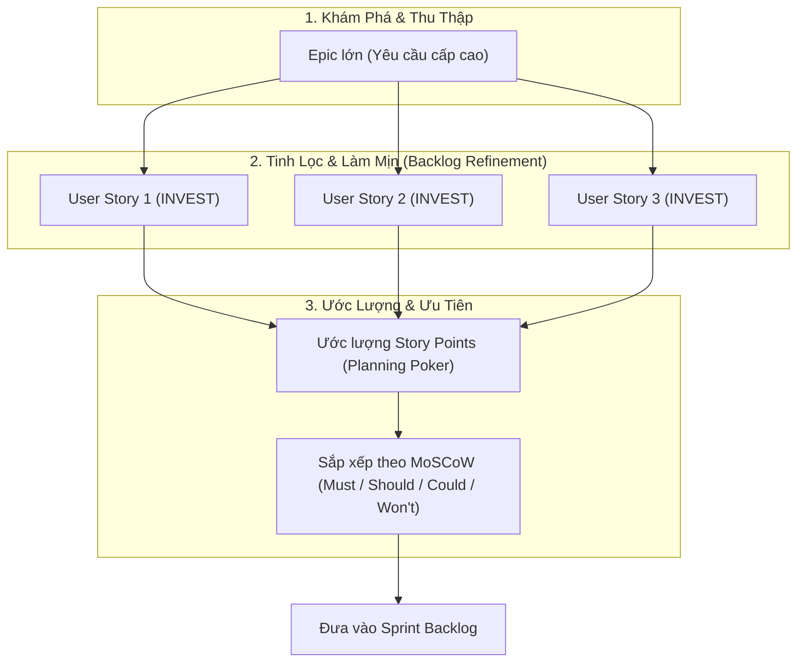

# CHƯƠNG 3: QUẢN LÝ YÊU CẦU VÀ LẬP KẾ HOẠCH SẢN PHẨM

## 1. Kỹ thuật Yêu cầu (Requirements Engineering)
Kỹ thuật yêu cầu là quá trình xác định, tài liệu hóa và duy trì các yêu cầu trong suốt vòng đời dự án:
1. **Thu thập yêu cầu (Elicitation):** Gặp gỡ các bên liên quan, phỏng vấn, khảo sát, quan sát thực tế và tổ chức workshop.
2. **Phân tích yêu cầu (Analysis):** Phân loại, giải quyết mâu thuẫn giữa các bên và lập mô hình nghiệp vụ.
3. **Đặc tả yêu cầu (Specification):** Viết tài liệu đặc tả (SRS - Software Requirements Specification) hoặc viết User Stories.
4. **Thẩm định yêu cầu (Validation):** Kiểm tra tính đầy đủ, nhất quán, khả thi và có thể kiểm thử được của yêu cầu.

## 2. Phân loại Yêu cầu Phần mềm
- **Yêu cầu Chức năng (Functional Requirements - FR):**
  - Mô tả những gì hệ thống **phải làm**, các dịch vụ cung cấp, cách hệ thống phản ứng với các đầu vào cụ thể.
  - Ví dụ: *Người dùng có thể đăng ký tài khoản qua Google OAuth; Hệ thống gửi email xác nhận đơn hàng trong vòng 3 giây.*
- **Yêu cầu Phi chức năng (Non-Functional Requirements - NFR):**
  - Mô tả các **ràng buộc và phẩm chất** chất lượng mà hệ thống phải tuân thủ (hiệu năng, bảo mật, tính khả dụng, độ tin cậy).
  - Ví dụ: *Hệ thống phải chịu tải 10,000 người dùng đồng thời với thời gian phản hồi API $\le 200$ ms; Dữ liệu thẻ thanh toán phải mã hóa AES-256.*

## 3. User Story trong Phát triển Linh hoạt (Agile)
User Story là một mô tả ngắn gọn, đơn giản về một tính năng từ góc nhìn của người dùng:

### A. Cấu trúc Chuẩn:
> **"Là một [Vai trò người dùng], tôi muốn [Hành động / Tính năng], để [Lợi ích / Giá trị mang lại]."**
> *(As a [Role], I want [Action], So that [Benefit].)*

### B. Mô hình 3C của Ron Jeffries:
- **Card (Thẻ ghi):** Bản tóm tắt ngắn gọn viết trên thẻ/issue.
- **Conversation (Đối thoại):** Cuộc trao đổi trực tiếp giữa PO và nhóm phát triển để hiểu sâu nghiệp vụ.
- **Confirmation (Xác nhận):** Các tiêu chí nghiệm thu (Acceptance Criteria) để xác định tính năng đã hoàn thành.

### C. Tiêu chuẩn INVEST cho User Story chất lượng:
- **I - Independent (Độc lập):** Tránh phụ thuộc chặt chẽ vào các story khác để dễ dàng sắp xếp ưu tiên.
- **N - Negotiable (Có thể thương lượng):** Không phải là bản hợp đồng cứng nhắc; chi tiết được thảo luận linh hoạt.
- **V - Valuable (Có giá trị):** Phải mang lại giá trị thiết thực cho người dùng hoặc doanh nghiệp.
- **E - Estimable (Có thể ước lượng):** Đủ rõ ràng để nhóm kỹ thuật ước lượng được độ phức tạp.
- **S - Small (Đủ nhỏ gọn):** Có thể hoàn thành trọn vẹn trong một Sprint (thường từ 1 đến vài ngày làm việc).
- **T - Testable (Có thể kiểm thử):** Có tiêu chí rõ ràng để kiểm tra tính đúng đắn.

### D. Tiêu chí Chấp nhận (Acceptance Criteria - AC) theo cú pháp Given-When-Then:
```gherkin
Given [Bối cảnh / Điều kiện ban đầu]
When  [Hành động / Sự kiện kích hoạt của người dùng]
Then  [Kết quả kỳ vọng / Trạng thái mới của hệ thống]
```

## 4. Quản lý Product Backlog & Ước lượng Sản phẩm


- **Story Points:** Đơn vị đo lường tương đối phản ánh: Độ phức tạp của thuật toán, khối lượng công việc và mức độ rủi ro/bất định (không đo lường theo giờ làm việc đơn thuần). Dãy số Fibonacci sửa đổi: `1, 2, 3, 5, 8, 13, 21, ...`
- **Kỹ thuật Planning Poker:** Toàn bộ Developers độc lập chọn lá bài điểm số bí mật, sau đó mở đồng loạt; nếu có sự chênh lệch lớn giữa điểm cao nhất và thấp nhất, hai thành viên sẽ giải thích lý do trước khi nhóm bỏ phiếu lại để đạt đồng thuận.
- **Kỹ thuật Ưu tiên MoSCoW:**
  - **M - Must have:** Bắt buộc phải có để hệ thống hoạt động được (sống còn).
  - **S - Should have:** Quan trọng, cần có nhưng có thể tìm cách giải quyết thay thế tạm thời.
  - **C - Could have:** Tiện ích mong muốn, chỉ làm nếu còn thời gian và nguồn lực.
  - **W - Won't have:** Thống nhất chưa làm trong phiên bản hiện tại, dời lại tương lai.
