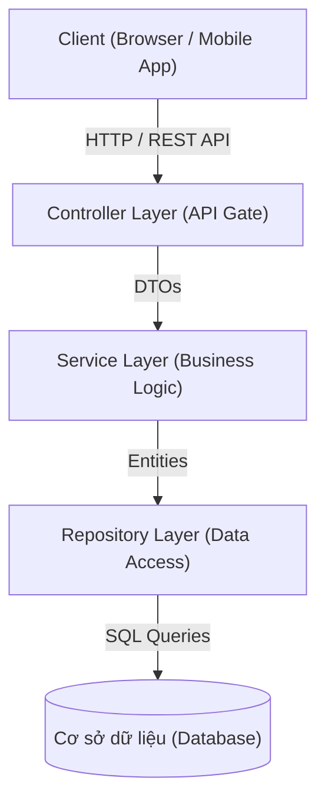
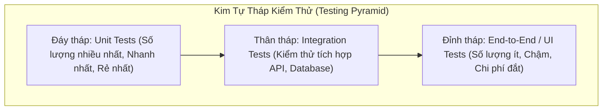
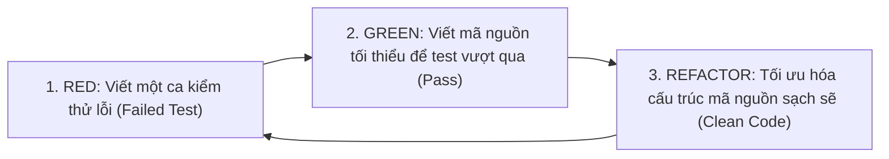

# CHƯƠNG 4: PHÁT TRIỂN, TÍCH HỢP VÀ ĐẢM BẢO CHẤT LƯỢNG

## 1. Thiết Kế Kiến Trúc Đúng Lúc (Just-in-Time Design)
Trong phát triển phần mềm hiện đại, đội ngũ tránh bẫy **Big Design Up Front (BDUF)** (thiết kế quá chi tiết từ đầu khi chưa hiểu hết yêu cầu), thay vào đó áp dụng tư duy thiết kế kiến trúc tiến hóa (Evolutionary Architecture) có khả năng thích nghi:
- **Kiến trúc phân tầng chuẩn mực (Layered / N-Tier Architecture):**
  - **Controller / Presentation Layer:** Tiếp nhận HTTP Requests, xác thực tham số đầu vào và trả về JSON/View.
  - **Service / Business Logic Layer:** Xử lý toàn bộ logic nghiệp vụ cốt lõi, giao dịch (Transactions) và tính toán.
  - **Repository / Data Access Layer:** Tương tác trực tiếp với cơ sở dữ liệu (ORM, SQL queries, Redis cache).
  - **Database:** Lưu trữ dữ liệu bền vững (PostgreSQL, MySQL, MongoDB).

## 2. Chuẩn Mực Clean Code & Nguyên Lý Thiết Kế
- **Nguyên lý đặt tên rõ nghĩa:** Tên biến/hàm phải bộc lộ rõ ý đồ (Intention-revealing). Ví dụ: Dùng `daysSinceLastLogin` thay vì `d` hoặc `val`.
- **Hàm ngắn và chỉ làm một việc duy nhất:** Hàm chỉ nên dài dưới 20-30 dòng và tuân thủ nguyên lý Single Responsibility Principle (SRP).
- **Tránh trùng lặp (DRY - Don't Repeat Yourself):** Mỗi tri thức hay logic nghiệp vụ chỉ nên có một biểu diễn duy nhất trong hệ thống.
- **Giữ cho code đơn giản (KISS - Keep It Simple, Stupid):** Không lạm dụng Design Patterns phức tạp khi bài toán chưa thực sự đòi hỏi.
- **Quy tắc hướng đạo sinh (Boy Scout Rule):** *"Luôn để lại khu cắm trại sạch sẽ hơn lúc bạn đến"* — luôn tối ưu lại một đoạn code nhỏ mỗi khi bạn chỉnh sửa file.

## 3. Chiến Lược Kiểm Thử & Kim Tự Tháp Kiểm Thử (Testing Pyramid)
Kim tự tháp kiểm thử do Mike Cohn đề xuất mô tả tỷ lệ lý tưởng giữa các cấp độ kiểm thử trong dự án phần mềm:

1. **Unit Testing (Kiểm thử đơn vị - Chiếm 70%):**
   - Kiểm tra các hàm, class nhỏ nhất một cách độc lập.
   - Sử dụng các kỹ thuật giả lập (Mocking / Stubbing) để cô lập các phụ thuộc bên ngoài (DB, Network).
   - Mô hình viết test chuẩn **AAA (Arrange - Act - Assert)**:
     - *Arrange:* Chuẩn bị dữ liệu và môi trường giả lập.
     - *Act:* Kích hoạt hàm cần kiểm thử.
     - *Assert:* Xác minh kết quả trả về có đúng kỳ vọng hay không.
2. **Integration Testing (Kiểm thử tích hợp - Chiếm 20%):**
   - Kiểm tra sự phối hợp kết nối giữa nhiều module, ví dụ: Service gọi Repository truy vấn DB thực tế, hoặc kiểm tra kết nối API bên thứ ba.
3. **End-to-End Testing (Kiểm thử đầu-cuối - Chiếm 10%):**
   - Mô phỏng toàn bộ hành trình người dùng từ giao diện (Cypress, Playwright, Selenium) xuyên suốt tới cơ sở dữ liệu.

## 4. Phát Triển Hướng Kiểm Thử (TDD - Test-Driven Development)
TDD là phương pháp kỹ nghệ đảo ngược: **Viết kiểm thử tự động trước khi viết mã nguồn thực tế**, tuân thủ nghiêm ngặt chu trình 3 bước **Red - Green - Refactor**:

- **Lợi ích của TDD:** Mã nguồn luôn có 100% test coverage tự nhiên; kiến trúc module hóa lỏng (vì code phải dễ test); lập trình viên tự tin tái cấu trúc mà không sợ sinh lỗi mới (No regression bugs).

## 5. Quy Trình Thẩm Duyệt Mã Nguồn (Code Review)
- Mỗi tính năng khi hoàn thành phải tạo Pull Request (PR).
- Tiêu chí đánh giá của Reviewer:
  - *Tính đúng đắn (Correctness):* Thuật toán có đúng nghiệp vụ không? Có lỗi ngoại lệ (NullPointerException, Division by zero) không?
  - *Bảo mật (Security):* Có nguy cơ SQL Injection, XSS, lộ thông tin mật không?
  - *Khả năng bảo trì (Maintainability):* Code có dễ hiểu không? Có bị lặp code không?
  - *Kiểm thử (Tests):* Có viết đủ unit tests cho các trường hợp biên không?
