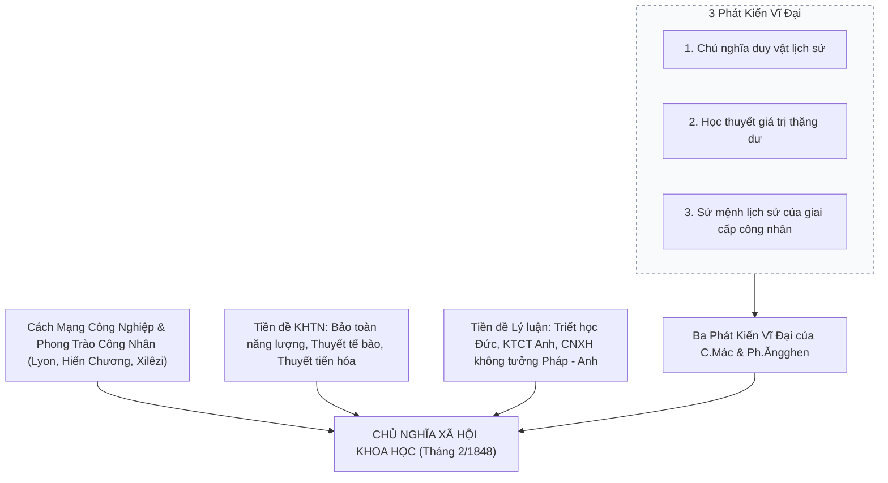

# CHƯƠNG 1: NHẬP MÔN CHỦ NGHĨA XÃ HỘI KHOA HỌC

### 1. Sơ đồ Cấu trúc Logic & Nguồn gốc Lý luận

### 2. Các Khái Niệm Nền Tảng & Luận Điểm Cốt Lõi
- **Chủ nghĩa xã hội khoa học (CNXHKH):** Là một trong ba bộ phận cấu thành chủ nghĩa Mác - Lênin; nghiên cứu các quy luật chính trị - xã hội của quá trình phát sinh, hình thành và phát triển của hình thái kinh tế - xã hội cộng sản chủ nghĩa; con đường, phương pháp để giai cấp công nhân hoàn thành sứ mệnh lịch sử.
- **Quan hệ giữa ba bộ phận của chủ nghĩa Mác - Lênin:**
  - *Triết học Mác - Lênin:* Thế giới quan duy vật và phương pháp luận biện chứng.
  - *Kinh tế chính trị Mác - Lênin:* Cơ sở kinh tế, vạch trần bản chất bóc lột giá trị thặng dư của chủ nghĩa tư bản.
  - *Chủ nghĩa xã hội khoa học:* Kết luận chính trị - xã hội tất yếu và trực tiếp của triết học và kinh tế chính trị Mác - Lênin.
- **Tác phẩm khai sinh:** *"Tuyên ngôn của Đảng Cộng sản"* (tháng 2/1848) do C.Mác và Ph.Ăngghen soạn thảo - văn kiện có tính chất cương lĩnh cách mạng đầu tiên của phong trào cộng sản và công nhân quốc tế.
- **Những cống hiến lịch sử của V.I.Lênin:**
  - Phát hiện quy luật phát triển không đều của CNTB thời kỳ đế quốc chủ nghĩa -> Cách mạng vô sản có thể thắng lợi trước hết ở một số nước hoặc một nước riêng lẻ.
  - Lãnh đạo thắng lợi Cách mạng Tháng Mười Nga (1917) khai sinh nhà nước Xô viết.
  - Đề xướng Chính sách kinh tế mới (NEP - 1921), đặt nền móng cho thời kỳ quá độ với nền kinh tế nhiều thành phần.
- **Ý nghĩa nghiên cứu:** Là kim chỉ nam cho công cuộc Đổi mới toàn diện, xây dựng CNXH và bảo vệ nền tảng tư tưởng của Đảng Cộng sản Việt Nam.\n