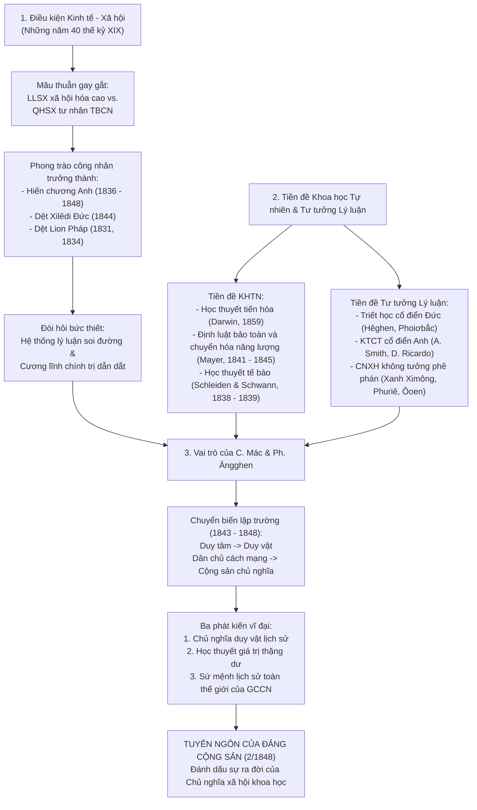
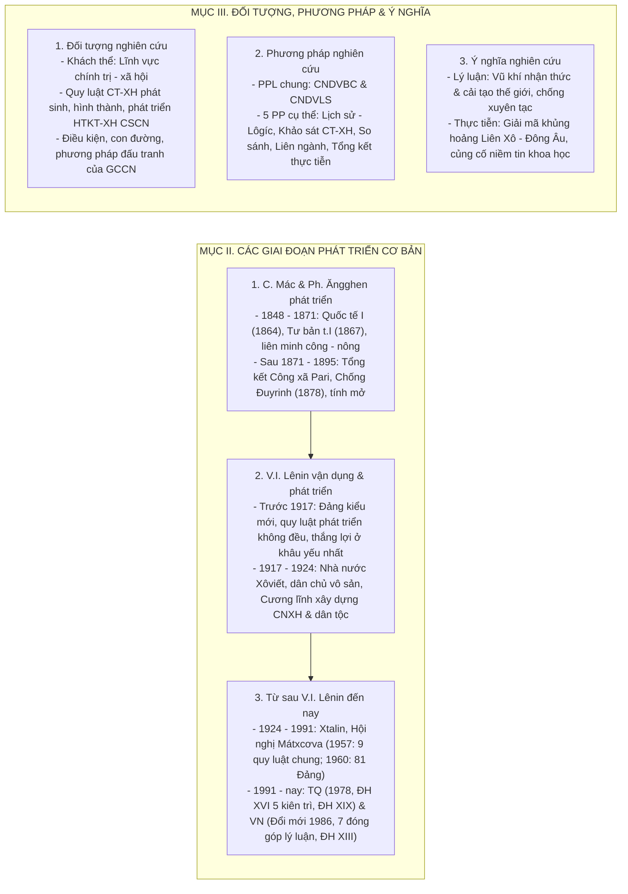

# CHƯƠNG 1: NHẬP MÔN CHỦ NGHĨA XÃ HỘI KHOA HỌC

> **Hướng dẫn học tập theo Phương pháp ghi chép Cornell (Cornell Note-taking System):**
> Tài liệu lý thuyết Chương 1 được thiết kế chuẩn hóa theo cấu trúc **Cornell Note-taking System** dựa trên *Giáo trình Chủ nghĩa xã hội khoa học (Dành cho bậc đại học hệ không chuyên lý luận chính trị, Nxb. Chính trị quốc gia Sự thật, Hà Nội, 2021)*, gồm 3 vùng nhận thức gắn kết chặt chẽ:
> 1. **Cột Từ khóa & Câu hỏi gợi nhớ (Cue Column - Cột trái):** Chứa các khái niệm trung tâm, tác phẩm kinh điển, mốc lịch sử, tên nhà tư tưởng và câu hỏi định hướng tư duy giúp người học chủ động truy xuất kiến thức (Active Recall).
> 2. **Cột Ghi chú chi tiết (Note-taking Column - Cột phải):** Hệ thống hóa đầy đủ, mạch lạc và chuẩn xác toàn bộ nội dung cốt lõi về sự ra đời, các giai đoạn phát triển, đối tượng, phương pháp và ý nghĩa nghiên cứu Chủ nghĩa xã hội khoa học.
> 3. **Phần Tóm tắt cốt lõi (Cornell Summary - Cuối mỗi mục & cuối chương):** Cô đọng bản chất khoa học, cách mạng và lôgíc lịch sử của từng mục lớn để ôn tập nhanh trước khi làm bài tập trắc nghiệm, trả lời ngắn và tự luận.

---

## Sơ đồ 1: Sự ra đời của Chủ nghĩa xã hội khoa học

---

## I. SỰ RA ĐỜI CỦA CHỦ NGHĨA XÃ HỘI KHOA HỌC

| Từ khóa / Câu hỏi gợi nhớ | Ghi chú chi tiết (Nội dung cốt lõi) |
| :--- | :--- |
| **Hai nghĩa của khái niệm Chủ nghĩa xã hội khoa học** *Chủ nghĩa xã hội khoa học được hiểu theo nghĩa rộng và nghĩa hẹp như thế nào?* | • **Theo nghĩa rộng:** Chủ nghĩa xã hội khoa học là **chủ nghĩa Mác - Lênin**, luận giải từ các giác độ **triết học, kinh tế học chính trị và chính trị - xã hội** về sự chuyển biến tất yếu của xã hội loài người từ chủ nghĩa tư bản lên chủ nghĩa xã hội và chủ nghĩa cộng sản.   ◦ V.I. Lênin đã đánh giá khái quát bộ *Tư bản*: *"tác phẩm chủ yếu và cơ bản ấy trình bày chủ nghĩa xã hội khoa học... những yếu tố từ đó nảy sinh ra chế độ tương lai"* (V.I. Lênin: Toàn tập, t.1, tr.226). • **Theo nghĩa hẹp:** Chủ nghĩa xã hội khoa học là **một trong ba bộ phận hợp thành chủ nghĩa Mác - Lênin**.   ◦ Trong tác phẩm *Chống Đuyrinh*, Ph. Ăngghen viết ba phần: *"Triết học"*, *"Kinh tế chính trị"* và *"Chủ nghĩa xã hội khoa học"*.   ◦ Trong tác phẩm *Ba nguồn gốc và ba bộ phận cấu thành của chủ nghĩa Mác*, V.I. Lênin khẳng định: *"Nó là người thừa kế chính đáng của tất cả những cái tốt đẹp nhất mà loài người đã tạo ra hồi thế kỷ XIX, đó là triết học Đức, kinh tế học Anh và chủ nghĩa xã hội Pháp"* (V.I. Lênin: Toàn tập, t.23, tr.50). • **Phạm vi môn học:** Trong khuôn khổ môn học này, chủ nghĩa xã hội khoa học được nghiên cứu **theo nghĩa hẹp**. |
| **1. Hoàn cảnh lịch sử ra đời: (a) Điều kiện kinh tế - xã hội** *Cuộc cách mạng công nghiệp những năm 40 thế kỷ XIX tạo ra mâu thuẫn kinh tế - xã hội gì?* | • **Sự phát triển của nền đại công nghiệp:** Vào những năm 40 của thế kỷ XIX, cuộc **cách mạng công nghiệp** đã hoàn thành ở nước Anh, bắt đầu chuyển sang nước Pháp và nước Đức, làm xuất hiện một lực lượng sản xuất mới là **nền đại công nghiệp**, khiến phương thức sản xuất tư bản chủ nghĩa phát triển vượt bậc. • **Đánh giá của C. Mác và Ph. Ăngghen** trong *Tuyên ngôn của Đảng Cộng sản*: *"Giai cấp tư sản, trong quá trình thống trị giai cấp chưa đầy một thế kỷ, đã tạo ra những lực lượng sản xuất nhiều hơn và đồ sộ hơn lực lượng sản xuất của tất cả các thế hệ trước kia gộp lại"*. • **Mâu thuẫn cơ bản trong phương thức sản xuất TBCN:** Sự phát triển đó làm xuất hiện mâu thuẫn ngày càng quyết liệt giữa **lực lượng sản xuất mang tính chất xã hội** với **quan hệ sản xuất dựa trên chế độ chiếm hữu tư nhân tư bản chủ nghĩa về tư liệu sản xuất**. • **Đối kháng giai cấp:** Cùng với nền đại công nghiệp là sự ra đời của hai giai cấp có lợi ích cơ bản đối lập nhau: **giai cấp tư sản** và **giai cấp vô sản (giai cấp công nhân)**, làm cho cuộc đấu tranh của giai cấp vô sản chống lại sự thống trị, áp bức của giai cấp tư sản ngày càng phát triển mạnh mẽ. |
| **Ba phong trào công nhân tiêu biểu & Yêu cầu lý luận** *Ba phong trào công nhân lớn đầu thế kỷ XIX đã chứng minh điều gì và đặt ra đòi hỏi bức thiết nào?* | • **Ba cuộc khởi nghĩa, phong trào đấu tranh có tổ chức trên quy mô rộng khắp:**   1. **Phong trào Hiến chương** của những người lao động ở nước **Anh** diễn ra trên 10 năm (**1836 - 1848**).   2. **Phong trào công nhân dệt** ở thành phố **Xilêdi**, nước **Đức** diễn ra năm **1844**.   3. **Phong trào công nhân dệt** ở thành phố **Lion**, nước **Pháp** diễn ra vào năm **1831** và năm **1834**, mang tính chất chính trị rõ nét: nếu năm 1831 phong trào giương cao khẩu hiệu thuần túy có tính chất kinh tế ***"sống có việc làm hay là chết trong đấu tranh"***, thì đến năm 1834 khẩu hiệu đã chuyển sang mục đích chính trị: ***"Cộng hòa hay là chết"***. • **Ý nghĩa lịch sử:** Chứng minh lần đầu tiên **giai cấp công nhân đã xuất hiện như một lực lượng chính trị độc lập** với những yêu sách kinh tế, chính trị riêng và hướng thẳng mũi nhọn đấu tranh vào kẻ thù chính là giai cấp tư sản. • **Đòi hỏi khách quan:** Sự lớn mạnh của phong trào công nhân đòi hỏi một cách bức thiết phải có một **hệ thống lý luận soi đường** và một **cương lĩnh chính trị làm kim chỉ nam cho hành động**. Điều kiện kinh tế - xã hội ấy vừa đặt ra yêu cầu vừa là mảnh đất hiện thực cho sự ra đời của chủ nghĩa xã hội khoa học. |
| **1. (b) Tiền đề khoa học tự nhiên** *Ba phát minh vạch thời đại của KHTN cuối thế kỷ XVIII - đầu thế kỷ XIX là gì và có vai trò ra sao?* | • Cuối thế kỷ XVIII, đầu thế kỷ XIX, khoa học tự nhiên đạt nhiều thành tựu to lớn; nổi bật là **3 phát minh vạch thời đại** trong vật lý học và sinh học tạo ra bước phát triển đột phá có tính cách mạng:   1. **Học thuyết tiến hóa (1859)** của nhà tự nhiên học người Anh **Charles Robert Darwin** (1809 - 1882).   2. **Định luật bảo toàn và chuyển hóa năng lượng (1841 - 1845)** của bác sĩ y khoa người Đức **Julius Robert Mayer** (1814 - 1878).   3. **Học thuyết tế bào (1838 - 1839)** của nhà thực vật học người Đức **Matthias Jakob Schleiden** (1804 - 1881) và nhà tế bào học người Đức **Theodor Schwann** (1810 - 1882). • **Vai trò phương pháp luận:** Những phát minh này là tiền đề khoa học cho sự ra đời của **chủ nghĩa duy vật biện chứng** và **chủ nghĩa duy vật lịch sử** - cơ sở phương pháp luận để các nhà sáng lập chủ nghĩa xã hội khoa học nghiên cứu những vấn đề lý luận chính trị - xã hội đương thời. |
| **1. (b) Tiền đề tư tưởng lý luận: 3 nguồn gốc** *Ba nguồn gốc tư tưởng lý luận trực tiếp của chủ nghĩa Mác và CNXHKH gồm những thành tựu và đại biểu nào?* | • Khoa học xã hội đương thời đạt 3 thành tựu lớn làm tiền đề tư tưởng lý luận trực tiếp:   1. **Triết học cổ điển Đức:** Tên tuổi của các nhà triết học vĩ đại **Ph. Hêghen** (1770 - 1831) và **L. Phoiơbắc** (1804 - 1872).   2. **Kinh tế chính trị học cổ điển Anh:** Với các đại biểu **A. Smith** (1723 - 1790) và **D. Ricardo** (1772 - 1823).   3. **Chủ nghĩa xã hội không tưởng phê phán (Pháp - Anh):** Đại biểu là **Xanh Ximông** (1760 - 1825), **S. Phuriê** (1772 - 1837) và **R. Ôoen** (1771 - 1858). |
| **Giá trị lịch sử và Hạn chế của CNXH không tưởng phê phán** *CNXH không tưởng phê phán có 3 giá trị lịch sử và 3 hạn chế cơ bản nào?* | • **3 giá trị lịch sử tích cực:**   1. Thể hiện tinh thần phê phán, lên án chế độ quân chủ chuyên chế và chế độ tư bản chủ nghĩa đầy bất công, xung đột, của cải khánh kiệt, đạo đức đảo lộn, tội ác gia tăng.   2. Đưa ra nhiều luận điểm có giá trị về xã hội tương lai: về tổ chức sản xuất và phân phối sản phẩm xã hội; vai trò của công nghiệp và khoa học - kỹ thuật; yêu cầu xóa bỏ sự đối lập giữa lao động chân tay và lao động trí óc; về sự nghiệp giải phóng phụ nữ; về vai trò lịch sử của nhà nước...   3. Chính tư tưởng phê phán và sự dấn thân trong thực tiễn của các nhà xã hội chủ nghĩa không tưởng, trong chừng mực nhất định, đã thức tỉnh giai cấp công nhân và người lao động trong cuộc đấu tranh chống chế độ quân chủ chuyên chế và chế độ tư bản chủ nghĩa. • **3 hạn chế cơ bản** (do điều kiện lịch sử và hạn chế về tầm nhìn, thế giới quan):   1. **Không phát hiện ra được quy luật vận động và phát triển** của xã hội loài người nói chung, cũng như bản chất và quy luật vận động, phát triển của chủ nghĩa tư bản nói riêng.   2. **Không phát hiện ra lực lượng xã hội tiên phong** có thể thực hiện cuộc chuyển biến cách mạng từ chủ nghĩa tư bản lên chủ nghĩa cộng sản là **giai cấp công nhân**.   3. **Không chỉ ra được những biện pháp hiện thực** để cải tạo xã hội áp bức, bất công đương thời và xây dựng xã hội mới tốt đẹp. • **Nhận xét của V.I. Lênin** (*Ba nguồn gốc và ba bộ phận cấu thành của chủ nghĩa Mác*): Chủ nghĩa xã hội không tưởng không thể vạch ra lối thoát thực sự; không giải thích được bản chất của chế độ làm thuê trong chế độ tư bản, không phát hiện được quy luật phát triển của chủ nghĩa tư bản và không tìm được lực lượng xã hội có khả năng trở thành người sáng tạo ra xã hội mới. Tuy vậy, những giá trị và cống hiến của họ tạo ra tiền đề tư tưởng - lý luận để C. Mác và Ph. Ăngghen kế thừa hạt nhân hợp lý, lọc bỏ cái bất hợp lý để xây dựng CNXHKH. |
| **2. Vai trò của C. Mác và Ph. Ăngghen: (a) Chuyển biến lập trường (1843 - 1848)** *C. Mác và Ph. Ăngghen đã thực hiện bước chuyển biến lập trường triết học và chính trị như thế nào?* | • **Điều kiện cần và điều kiện đủ:** Điều kiện KT-XH và tiền đề KHTN, tư tưởng lý luận là *điều kiện cần*; **điều kiện đủ** để học thuyết khoa học, cách mạng và sáng tạo ra đời chính là **vai trò của C. Mác (1818 - 1883) và Ph. Ăngghen (1820 - 1895)**. • **Tiếp thu có phê phán triết học Đức:** Khi còn trẻ, hai ông là thành viên tích cực của câu lạc bộ *"Hêghen trẻ"*, chịu ảnh hưởng của Hêghen và Phoiơbắc nhưng sớm nhận ra mặt tích cực và hạn chế: kế thừa **"cái hạt nhân hợp lý"** của phép biện chứng Hêghen (loại bỏ cái vỏ thần bí duy tâm) và kế thừa **quan niệm duy vật** của Phoiơbắc (loại bỏ quan điểm siêu hình) để xây dựng **chủ nghĩa duy vật biện chứng**. • **Chuyển biến ở C. Mác (cuối 1843 - tháng 1/1844):** Thông qua tác phẩm *Góp phần phê phán triết học pháp quyền của Hêghen - Lời nói đầu (1844)*, Mác chuyển từ **thế giới quan duy tâm sang thế giới quan duy vật**, từ **lập trường dân chủ cách mạng sang lập trường cộng sản chủ nghĩa**. • **Chuyển biến ở Ph. Ăngghen (từ 1843):** Qua các tác phẩm *Tình cảnh nước Anh* và *Lược khảo khoa kinh tế - chính trị*, Ăngghen cũng chuyển từ **thế giới quan duy tâm sang thế giới quan duy vật**, từ **lập trường dân chủ cách mạng sang lập trường cộng sản chủ nghĩa**. • Trong thời gian ngắn (**1843 - 1848**), vừa hoạt động thực tiễn vừa nghiên cứu khoa học, hai ông đã củng cố dứt khoát, kiên định, nhất quán lập trường mới - tiền đề tất yếu nếu không có nó thì chắc chắn không có chủ nghĩa xã hội khoa học. |
| **2. (b) Ba phát kiến vĩ đại của C. Mác và Ph. Ăngghen** *Nội dung và ý nghĩa luận chứng của ba phát kiến vĩ đại là gì?* | • **Phát kiến thứ nhất - Chủ nghĩa duy vật lịch sử:** Trên cơ sở sáng lập chủ nghĩa duy vật biện chứng và dùng phép biện chứng duy vật nghiên cứu chủ nghĩa tư bản, hai ông sáng lập chủ nghĩa duy vật lịch sử. Đây là **sự khẳng định về mặt triết học** sự sụp đổ của chủ nghĩa tư bản và sự thắng lợi của chủ nghĩa xã hội đều tất yếu như nhau. • **Phát kiến thứ hai - Học thuyết về giá trị thặng dư:** Đi sâu nghiên cứu nền sản xuất công nghiệp và nền kinh tế tư bản chủ nghĩa, hai ông viết bộ *Tư bản* với giá trị cốt lõi là Học thuyết về giá trị thặng dư. Đây là **sự khẳng định về phương diện kinh tế** sự diệt vong không tránh khỏi của chủ nghĩa tư bản và sự ra đời tất yếu của chủ nghĩa xã hội. • **Phát kiến thứ ba - Học thuyết về sứ mệnh lịch sử toàn thế giới của giai cấp công nhân:** Trên cơ sở hai phát kiến trên, hai ông phát hiện ra giai cấp công nhân là giai cấp có sứ mệnh thủ tiêu chủ nghĩa tư bản, xây dựng thành công chủ nghĩa xã hội và chủ nghĩa cộng sản. Phát kiến này **khắc phục triệt để hạn chế lịch sử của CNXH không tưởng - phê phán**, đồng thời luận chứng và **khẳng định về phương diện chính trị - xã hội** sự diệt vong không tránh khỏi của chủ nghĩa tư bản và sự thắng lợi tất yếu của chủ nghĩa xã hội. |
| **2. (c) *Tuyên ngôn của Đảng Cộng sản* (2/1848) & 4 luận điểm nổi bật** *Tuyên ngôn của Đảng Cộng sản có vị trí như thế nào và nêu 4 luận điểm nổi bật nào?* | • **Hoàn cảnh & Vị trí lịch sử:** Được sự ủy nhiệm của những người cộng sản và công nhân quốc tế, **tháng 2 năm 1848**, tác phẩm *Tuyên ngôn của Đảng Cộng sản* do C. Mác và Ph. Ăngghen soạn thảo được công bố trước toàn thế giới.   ◦ Là tác phẩm kinh điển chủ yếu, **đánh dấu sự ra đời của chủ nghĩa xã hội khoa học** và sự hình thành về cơ bản lý luận chủ nghĩa Mác gồm 3 bộ phận hợp thành (triết học, kinh tế chính trị học, chủ nghĩa xã hội khoa học).   ◦ Được coi là **Cương lĩnh chính trị**, **kim chỉ nam hành động** của phong trào cộng sản và công nhân quốc tế; ngọn cờ dẫn dắt GCCN và nhân dân lao động toàn thế giới đấu tranh chống CNTB. • **4 luận điểm tiêu biểu, nổi bật:**   1. Cuộc đấu tranh giai cấp phát triển đến giai đoạn mà **giai cấp công nhân không thể tự giải phóng mình nếu không đồng thời giải phóng vĩnh viễn xã hội** ra khỏi phân chia giai cấp, áp bức, bóc lột và đấu tranh giai cấp; song giai cấp vô sản không thể hoàn thành sứ mệnh lịch sử nếu **không tổ chức ra chính đảng của giai cấp**.   2. Lôgíc phát triển tất yếu của xã hội tư sản và thời đại TBCN là **sự sụp đổ của chủ nghĩa tư bản và sự thắng lợi của chủ nghĩa xã hội là tất yếu như nhau**.   3. **Giai cấp công nhân**, do có địa vị kinh tế - xã hội đại diện cho lực lượng sản xuất tiên tiến, có sứ mệnh lịch sử thủ tiêu chủ nghĩa tư bản và là lực lượng tiên phong xây dựng CNXH, CNCS.   4. Những người cộng sản cần **liên minh với các lực lượng dân chủ** để đánh đổ chế độ phong kiến chuyên chế, nhưng không quên đấu tranh cho mục tiêu cuối cùng là CNCS; phải tiến hành **cách mạng không ngừng** với chiến lược, sách lược khôn khéo và kiên quyết. |

> **Tóm tắt Mục I (Cornell Summary):**
> Chủ nghĩa xã hội khoa học ra đời vào thập niên 40 thế kỷ XIX từ sự chín muồi của **điều kiện kinh tế - xã hội** (nền đại công nghiệp làm gay gắt mâu thuẫn LLSX xã hội hóa - QHSX tư nhân TBCN; phong trào Hiến chương Anh, dệt Xilêdi Đức, dệt Lion Pháp khẳng định GCCN là lực lượng chính trị độc lập), kết hợp với **3 phát minh KHTN** (Tiến hóa, Bảo toàn năng lượng, Tế bào) và **3 nguồn gốc tư tưởng lý luận** (Triết học Đức, KTCT Anh, CNXH không tưởng Pháp - Anh). Thông qua bước **chuyển biến lập trường (1843–1848)** và **ba phát kiến vĩ đại** (*CNDVLS, Giá trị thặng dư, Sứ mệnh lịch sử của GCCN*), C. Mác và Ph. Ăngghen đã công bố ***Tuyên ngôn của Đảng Cộng sản* (2/1848)**, chính thức khai sinh Chủ nghĩa xã hội khoa học.

---

## Sơ đồ 2: Các giai đoạn phát triển, Đối tượng, Phương pháp & Ý nghĩa nghiên cứu

---

## II. CÁC GIAI ĐOẠN PHÁT TRIỂN CƠ BẢN CỦA CHỦ NGHĨA XÃ HỘI KHOA HỌC

| Từ khóa / Câu hỏi gợi nhớ | Ghi chú chi tiết (Nội dung cốt lõi) |
| :--- | :--- |
| **1. C. Mác & Ph. Ăngghen phát triển CNXHKH: (a) Thời kỳ 1848 - Công xã Pari (1871)** *Những sự kiện và bổ sung lý luận nào nổi bật trong giai đoạn 1848 - 1871?* | • **Các mốc lịch sử & tác phẩm lớn:** Cách mạng dân chủ tư sản ở các nước Tây Âu (1848 - 1852); thành lập **Quốc tế I (1864)**; xuất bản **tập I bộ *Tư bản* (1867)** của C. Mác. • **Đánh giá của V.I. Lênin về bộ *Tư bản*:** *"Từ khi bộ Tư bản ra đời - quan niệm duy vật lịch sử không còn là một giả thuyết nữa, mà là một nguyên lý đã được chứng minh một cách khoa học... quan niệm duy vật lịch sử vẫn cứ là đồng nghĩa với khoa học xã hội"* và *"Bộ Tư bản - tác phẩm chủ yếu và cơ bản ấy trình bày chủ nghĩa xã hội khoa học"* (V.I. Lênin: Toàn tập, t.1, tr.166, 226). • **Phát triển nội dung CNXHKH từ tổng kết cách mạng (1848 - 1852):**   ◦ Tư tưởng về **đập tan bộ máy nhà nước tư sản, thiết lập chuyên chính vô sản**.   ◦ Bổ sung tư tưởng về **cách mạng không ngừng** bằng sự kết hợp giữa đấu tranh của giai cấp vô sản với phong trào đấu tranh của giai cấp nông dân.   ◦ Tư tưởng xây dựng **khối liên minh giữa giai cấp công nhân và giai cấp nông dân**, xem đó là điều kiện tiên quyết bảo đảm cho cuộc cách mạng phát triển không ngừng tới mục tiêu cuối cùng. |
| **1. (b) Thời kỳ sau Công xã Pari đến năm 1895** *Sau Công xã Pari 1871, C. Mác và Ph. Ăngghen bổ sung những tư tưởng gì và thái độ khoa học của hai ông ra sao?* | • **Tổng kết kinh nghiệm Công xã Pari:** Bổ sung và phát triển tư tưởng **đập tan bộ máy nhà nước quan liêu**, không đập tan toàn bộ bộ máy nhà nước tư sản nói chung; đồng thời thừa nhận **Công xã Pari là một hình thái nhà nước của giai cấp công nhân**. • **Luận chứng sự phát triển của CNXHKH:** Trong tác phẩm ***Chống Đuyrinh* (1878)**, Ph. Ăngghen luận chứng sự phát triển của chủ nghĩa xã hội từ không tưởng đến khoa học và đánh giá công lao của các nhà CNXH không tưởng Anh, Pháp. • **Nhận xét của V.I. Lênin trong *Làm gì?* (1902):** *"Chủ nghĩa xã hội lý luận Đức sẽ không bao giờ quên rằng nó dựa vào Xanh Ximông, Phuriê và Ôoen là ba nhà tư tưởng dù học thuyết của ba ông có tính chất ảo tưởng và không tưởng, đã được liệt vào hàng những nhà tư tưởng vĩ đại nhất của tất cả các thời đại và đã dự kiến một cách tài tình được rất nhiều chân lý mà ngày nay chúng ta đem khoa học ra chứng minh đều thấy là đúng"* (t.6, tr.33). • **Nhiệm vụ nghiên cứu của CNXHKH** được C. Mác và Ph. Ăngghen chỉ rõ (t.20, tr.393): nghiên cứu những điều kiện lịch sử và bản chất sự biến đổi xã hội để làm cho giai cấp bị áp bức có sứ mệnh hoàn thành sự nghiệp ấy hiểu rõ điều kiện và bản chất sự nghiệp của chính họ. • **Tính mở, chống giáo điều:** C. Mác và Ph. Ăngghen không coi học thuyết của mình là hệ thống giáo điều *"nhất thành bất biến"* mà chỉ là những *"gợi ý"* cho mọi suy nghĩ và hành động. Trong *Lời nói đầu* viết cho tác phẩm *Đấu tranh giai cấp ở Pháp (1848 - 1850)*, Ph. Ăngghen thẳng thắn thừa nhận sai lầm về dự báo khả năng nổ ra cách mạng vô sản ở châu Âu lúc bấy giờ do trạng thái kinh tế lục địa chưa chín muồi để xóa bỏ phương thức sản xuất TBCN (t.22, tr.761). • **Đánh giá của V.I. Lênin:** *"Học thuyết của Mác là học thuyết vạn năng vì nó là một học thuyết chính xác"* (t.23, tr.50). |
| **2. V.I. Lênin vận dụng & phát triển: (a) Trước Cách mạng Tháng Mười Nga (1917)** *Công lao lịch sử của V.I. Lênin và 6 đóng góp lý luận trước năm 1917 là gì?* | • **Bước chuyển vĩ đại của V.I. Lênin (1870 - 1924):** Nếu công lao của C. Mác và Ph. Ăngghen là phát triển CNXH từ không tưởng thành khoa học, thì công lao của V.I. Lênin là **xây dựng chủ nghĩa xã hội hiện thực**, đánh dấu bằng sự ra đời của Nhà nước XHCN đầu tiên trên thế giới - **Nhà nước Xôviết (năm 1917)**. • **6 khía cạnh phát triển sáng tạo trước Cách mạng Tháng Mười:**   1. **Đấu tranh chống các trào lưu phi mácxít** (chủ nghĩa dân túy tự do, phái kinh tế, phái mácxít hợp pháp) nhằm bảo vệ chủ nghĩa Mác, mở đường cho chủ nghĩa Mác thâm nhập mạnh mẽ vào Nga.   2. Xây dựng lý luận về **đảng cách mạng kiểu mới** của giai cấp công nhân (nguyên tắc tổ chức, cương lĩnh, sách lược hoạt động).   3. Hoàn chỉnh lý luận về **cách mạng XHCN và chuyên chính vô sản**, cách mạng dân chủ tư sản kiểu mới và điều kiện chuyển biến sang cách mạng XHCN; vấn đề dân tộc và cương lĩnh dân tộc; liên minh công - nông và các tầng lớp lao động; quan hệ quốc tế, chủ nghĩa quốc tế vô sản và phong trào giải phóng dân tộc.   4. Phát hiện **quy luật phát triển không đều về kinh tế và chính trị của chủ nghĩa tư bản trong thời kỳ chủ nghĩa đế quốc**, đi đến kết luận đột phá: **Cách mạng vô sản có thể nổ ra và thắng lợi ở một số nước, thậm chí ở một nước riêng lẻ**, nơi CNTB chưa phải phát triển nhất nhưng là **khâu yếu nhất** trong sợi dây chuyền TBCN.   5. Luận giải sâu sắc về **chuyên chính vô sản** (bản chất dân chủ, quan hệ giữa chức năng thống trị và chức năng xã hội); lần đầu tiên nêu phạm trù **hệ thống chuyên chính vô sản**, gồm: **Đảng Bônsêvích lãnh đạo**, **Nhà nước Xôviết quản lý** và **tổ chức công đoàn**.   6. Gắn lý luận với thực tiễn, trực tiếp lãnh đạo Đảng của GCCN Nga đánh đổ chế độ chuyên chế Nga hoàng, giành chính quyền về tay GCCN và nhân dân lao động. |
| **2. (b) Từ sau Cách mạng Tháng Mười Nga (1917) đến năm 1924** *Sau năm 1917, V.I. Lênin phát triển những luận điểm lớn nào về chuyên chính vô sản, dân chủ và Cương lĩnh xây dựng CNXH?* | • **Về chuyên chính vô sản:** Là một hình thức nhà nước mới - nhà nước dân chủ đối với những người vô sản và không có của, chuyên chính đối với giai cấp tư sản. **Cơ sở và nguyên tắc cao nhất** là sự liên minh công - nông và toàn thể nhân dân lao động dưới sự lãnh đạo của GCCN để thủ tiêu chế độ người bóc lột người và xây dựng CNXH. • **Về thời kỳ quá độ chính trị từ CNTB lên CNCS:** Phê phán sự xuyên tạc cho rằng chuyên chính vô sản chỉ là bạo lực; V.I. Lênin chỉ rõ chuyên chính vô sản *không phải chỉ là bạo lực và không phải chủ yếu là bạo lực*, mà cốt lõi là việc GCCN đưa ra và thực hiện được **kiểu tổ chức lao động xã hội cao hơn CNTB** (t.39, tr.16). Đó là cuộc đấu tranh kiên trì *"đổ máu và không đổ máu, bạo lực và hòa bình, bằng quân sự và bằng kinh tế, bằng giáo dục và bằng hành chính"* chống thế lực và tập tục xã hội cũ (t.41, tr.34). • **Về chế độ dân chủ:** Chỉ có dân chủ tư sản hoặc dân chủ vô sản (dân chủ XHCN), không có dân chủ thuần túy nói chung; ***"chế độ dân chủ vô sản so với bất cứ chế độ dân chủ tư sản nào, cũng dân chủ hơn gấp triệu lần"*** (t.37, tr.312-313). • **Về cải cách hành chính bộ máy nhà nước:** Cần đội ngũ cộng sản cách mạng được tôi luyện và **bộ máy nhà nước tinh, gọn, không hành chính, quan liêu**. • **Về Cương lĩnh xây dựng CNXH ở nước Nga:** Cần những bước quá độ nhỏ trong thời kỳ quá độ nói chung; giữ vững chính quyền Xôviết để thực hiện **điện khí hóa toàn quốc**, xây dựng nền công nghiệp hiện đại làm cơ sở vật chất - kỹ thuật của CNXH; xã hội hóa tư liệu sản xuất cơ bản; cải tạo kinh tế tiểu nông theo con đường hợp tác xã XHCN; thực hiện cách mạng văn hóa; học tập kỹ thuật, kinh nghiệm quản lý, giáo dục của CNTB và sử dụng chuyên gia tư sản; sử dụng rộng rãi **chủ nghĩa tư bản nhà nước** để cải tiến sở hữu tư bản hạng trung, hạng nhỏ thành sở hữu công cộng; phát triển thương nghiệp XHCN. Đặc biệt nhấn mạnh: trong thời kỳ quá độ lên CNXH, cần thiết phải **phát triển kinh tế hàng hóa nhiều thành phần**. • **3 nguyên tắc cơ bản trong Cương lĩnh dân tộc:** (1) **Quyền bình đẳng dân tộc**; (2) **Quyền dân tộc tự quyết**; (3) **Tình đoàn kết của giai cấp vô sản thuộc tất cả các dân tộc** với lời kêu gọi: *"Vô sản tất cả các nước và các dân tộc bị áp bức, đoàn kết lại!"*. |
| **3. Từ sau khi V.I. Lênin qua đời đến nay: (a) Thời kỳ 1924 đến trước 1991** *Giai đoạn 1924 - 1991 có những dấu mốc quốc tế quan trọng nào đối với sự phát triển CNXHKH?* | • **Bối cảnh & vai trò Liên Xô:** Chiến tranh thế giới thứ hai (**1939 - 1945**) do các thế lực đế quốc phản động cực đoan gây ra; trong phe Đồng minh chống phát xít, Liên Xô góp phần quyết định đánh tan phát xít, tạo điều kiện hình thành **hệ thống xã hội chủ nghĩa thế giới**. • **Khái niệm "Chủ nghĩa Mác - Lênin":** J. Xtalin là người lãnh đạo cao nhất của ĐCS (b) Nga / ĐCS Liên Xô và có ảnh hưởng lớn nhất đối với Quốc tế III (Quốc tế Cộng sản) cho đến năm 1943 (khi G. Đimitrốp là Chủ tịch Quốc tế III). Chính Xtalin và ĐCS Liên Xô đã gắn lý luận và tên tuổi của C. Mác với V.I. Lênin thành ***"Chủ nghĩa Mác - Lênin"***. • **Hội nghị Mátxcơva tháng 11/1957:** Hội nghị đại biểu các Đảng Cộng sản và công nhân quốc tế tổng kết và thông qua **9 quy luật chung** của công cuộc cải tạo xã hội chủ nghĩa và xây dựng chủ nghĩa xã hội. • **Hội nghị 81 Đảng Cộng sản và công nhân quốc tế (tháng 1/1960 ở Mátxcơva):** Đưa ra khái niệm về ***"thời đại hiện nay"***; xác định nhiệm vụ hàng đầu là bảo vệ, củng cố hòa bình, ngăn chặn đế quốc hiếu chiến phát động chiến tranh thế giới mới; thông qua văn kiện *"Những nhiệm vụ đấu tranh chống chủ nghĩa đế quốc trong giai đoạn hiện tại và sự thống nhất hành động của các Đảng Cộng sản, công nhân và tất cả các lực lượng chống đế quốc"*, khẳng định hệ thống XHCN thế giới và các lực lượng chống đế quốc đang quyết định nội dung, phương hướng chủ yếu của lịch sử loài người ngày nay. • **Đấu tranh tư tưởng nội bộ:** Sau 1960 vẫn tồn tại bất đồng trong phong trào cộng sản quốc tế và diễn ra cuộc đấu tranh gay gắt giữa những người theo chủ nghĩa Mác - Lênin với **chủ nghĩa xét lại** và **chủ nghĩa giáo điều biệt phái**. |
| **3. (b) Từ năm 1991 đến nay: Trung Quốc** *Sau sự sụp đổ ở Liên Xô - Đông Âu, Đảng Cộng sản Trung Quốc đã bổ sung lý luận gì qua các kỳ Đại hội?* | • **Thử thách lịch sử:** Cuối thập niên 80, đầu thập niên 90 thế kỷ XX, mô hình chế độ XHCN ở Liên Xô và Đông Âu sụp đổ, hệ thống XHCN tan rã; các thế lực thù địch tấn công cho rằng CNXH đã "cáo chung", song CNXH vẫn tiếp tục phát triển tại các nước còn Đảng Cộng sản lãnh đạo. • **Đảng Cộng sản Trung Quốc** (thành lập **1/7/1921**): Trải qua 3 thời kỳ lớn: Cách mạng, Xây dựng và Cải cách, mở cửa (bắt đầu từ **Hội nghị Trung ương 3 khóa XI cuối năm 1978**, phát triển kinh tế thị trường XHCN). • **Đại hội XVI (năm 2002):** Xây dựng *"chủ nghĩa xã hội mang đặc sắc Trung Quốc"*, kiên trì phương châm: *"cầm quyền khoa học, cầm quyền dân chủ, cầm quyền theo pháp luật"*; *"tất cả vì nhân dân"*; *"tất cả dựa vào nhân dân"*; thực hiện 5 nguyên tắc và **5 kiên trì**:   1. Kiên trì coi phát triển là nhiệm vụ quan trọng số một chấn hưng đất nước của đảng cầm quyền.   2. Kiên trì sự thống nhất hữu cơ giữa sự lãnh đạo của Đảng, nhân dân làm chủ dựa vào pháp luật quản lý đất nước.   3. Kiên trì địa vị chỉ đạo của chủ nghĩa Mác trong lĩnh vực hình thái ý thức.   4. Kiên trì phát huy rộng rãi, đầy đủ mọi nhân tố tích cực, nâng cao năng lực điều hòa xã hội.   5. Kiên trì chính sách ngoại giao hòa bình, độc lập, tự chủ. • **Đại hội XIX (năm 2017):** Chủ đề *"Quyết thắng xây dựng toàn diện xã hội khá giả, giành thắng lợi vĩ đại chủ nghĩa xã hội đặc sắc Trung Quốc thời đại mới"*, xác định mục tiêu xây dựng Trung Quốc trở thành **cường quốc hiện đại hóa xã hội chủ nghĩa giàu mạnh, dân chủ, văn minh, hài hòa, tươi đẹp vào năm 2050**. |
| **3. (b) Từ năm 1991 đến nay: Việt Nam & 7 đóng góp lý luận to lớn** *Qua 35 năm đổi mới từ 1986, Đảng Cộng sản Việt Nam có 7 đóng góp lý luận to lớn nào và Đại hội XIII (2021) đánh giá ra sao?* | • Công cuộc đổi mới do Đảng Cộng sản Việt Nam khởi xướng từ **Đại hội VI (1986)** sau **35 năm** không chỉ đạt thành tựu thực tiễn to lớn mà còn đóng góp **7 luận điểm lý luận to lớn** vào kho tàng chủ nghĩa Mác - Lênin và CNXHKH:   1. **Độc lập dân tộc gắn liền với chủ nghĩa xã hội** là quy luật của cách mạng Việt Nam trong điều kiện thời đại ngày nay.   2. **Kết hợp chặt chẽ đổi mới kinh tế với đổi mới chính trị**, lấy đổi mới kinh tế làm trung tâm, đổi mới từng bước về chính trị, giữ vững ổn định chính trị; gắn **phát triển kinh tế là nhiệm vụ trung tâm**, **xây dựng Đảng là khâu then chốt** với **phát triển văn hóa là nền tảng tinh thần** (3 trụ cột phát triển nhanh và bền vững).   3. **Xây dựng và phát triển nền kinh tế thị trường định hướng xã hội chủ nghĩa**, tăng cường vai trò kiến tạo, quản lý của Nhà nước; gắn tăng trưởng kinh tế với tiến bộ, công bằng xã hội, giữ gìn bản sắc văn hóa và bảo vệ môi trường sinh thái.   4. **Phát huy dân chủ, xây dựng Nhà nước pháp quyền Việt Nam xã hội chủ nghĩa**, đổi mới và hoàn thiện hệ thống chính trị, bảo đảm toàn bộ quyền lực thuộc về nhân dân.   5. **Mở rộng và phát huy khối đại đoàn kết toàn dân tộc**, tạo sự thống nhất và đồng thuận xã hội làm động lực đổi mới, xây dựng và bảo vệ Tổ quốc.   6. **Mở rộng quan hệ đối ngoại, thực hiện hội nhập quốc tế**, kết hợp **sức mạnh dân tộc với sức mạnh thời đại**.   7. **Giữ vững và tăng cường vai trò lãnh đạo của Đảng Cộng sản Việt Nam** - nhân tố quan trọng hàng đầu bảo đảm thắng lợi của sự nghiệp đổi mới, hội nhập và phát triển đất nước. • **Đánh giá của Đại hội XIII (năm 2021)** (Văn kiện Đại hội XIII, t.I, tr.103–105): Sau 35 năm đổi mới, 30 năm thực hiện Cương lĩnh 1991 và 10 năm thực hiện Cương lĩnh (bổ sung, phát triển năm 2011), lý luận về đường lối đổi mới và con đường đi lên CNXH của Việt Nam ngày càng hoàn thiện; ***"Đất nước ta chưa bao giờ có được cơ đồ, tiềm lực, vị thế và uy tín quốc tế như ngày nay"***; khẳng định Cương lĩnh tiếp tục là ngọn cờ phấn đấu vì một nước Việt Nam ***"dân giàu, nước mạnh, dân chủ, công bằng, văn minh"*** (cùng với đóng góp của ĐCS Cuba, Đảng Nhân dân cách mạng Lào và phong trào cộng sản quốc tế). |

> **Tóm tắt Mục II (Cornell Summary):**
> Sau khi ra đời, CNXHKH phát triển qua ba giai đoạn lớn: **(1) C. Mác và Ph. Ăngghen (1848–1895)** tổng kết cách mạng 1848–1852 và Công xã Pari 1871 để hoàn thiện lý luận về chuyên chính vô sản, liên minh công - nông, đập tan bộ máy nhà nước quan liêu và giữ vững tính mở chống giáo điều; **(2) V.I. Lênin (trước và sau 1917–1924)** giải quyết thành công vấn đề thắng lợi của cách mạng vô sản ở một nước riêng lẻ là khâu yếu nhất, xây dựng Nhà nước Xôviết hiện thực, phát triển tư duy dân chủ vô sản, kinh tế hàng hóa nhiều thành phần, chủ nghĩa tư bản nhà nước và Cương lĩnh dân tộc; **(3) Từ 1924 đến nay**, trải qua thời kỳ hình thành hệ thống XHCN (Hội nghị Mátxcơva 1957 với 9 quy luật chung, 1960 với 81 Đảng) và biến cố sụp đổ ở Liên Xô - Đông Âu (1991), lý luận CNXHKH tiếp tục được bổ sung sinh động qua cải cách mở cửa ở Trung Quốc (5 kiên trì, Đại hội XIX) và **7 đóng góp lý luận to lớn** trong 35 năm đổi mới của Việt Nam được Đại hội XIII (2021) khẳng định.

---

## III. ĐỐI TƯỢNG, PHƯƠNG PHÁP VÀ Ý NGHĨA CỦA VIỆC NGHIÊN CỨU CHỦ NGHĨA XÃ HỘI KHOA HỌC

| Từ khóa / Câu hỏi gợi nhớ | Ghi chú chi tiết (Nội dung cốt lõi) |
| :--- | :--- |
| **1. Đối tượng nghiên cứu: Khách thể & Phân biệt với Triết học, KTCT** *Khách thể của CNXHKH là gì và CNXHKH khác gì với Triết học và Kinh tế chính trị học Mác - Lênin?* | • **Khách thể nghiên cứu:** Là **lĩnh vực chính trị - xã hội** của đời sống xã hội (cùng một khách thể có thể có nhiều khoa học nghiên cứu, nhưng phân biệt nhau trước hết ở đối tượng nghiên cứu). • **Phân biệt trong hệ thống 3 bộ phận của chủ nghĩa Mác - Lênin:**   ◦ Nếu **Triết học** và **Kinh tế chính trị học mácxít** luận giải về phương diện triết học, kinh tế học tính tất yếu, nguyên nhân khách quan và điều kiện để thay thế CNTB bằng CNXH.   ◦ Thì **chỉ có Chủ nghĩa xã hội khoa học** đưa ra câu trả lời cho câu hỏi: ***bằng con đường nào*** để thực hiện bước chuyển biến đó (bằng cuộc đấu tranh cách mạng của giai cấp công nhân dưới sự lãnh đạo của đội tiền phong là Đảng Cộng sản).   ◦ Như vậy, CNXHKH là sự tiếp tục một cách lôgíc của triết học và kinh tế chính trị học mácxít, biểu hiện trực tiếp mục đích và hiệu lực chính trị của chủ nghĩa Mác - Lênin trong thực tiễn. |
| **Chức năng, Nhiệm vụ & Định nghĩa khái quát đối tượng nghiên cứu** *CNXHKH có chức năng giác ngộ trong 3 thời kỳ nào và đối tượng nghiên cứu khái quát được phát biểu ra sao?* | • **Chức năng giác ngộ và hướng dẫn GCCN trong 3 thời kỳ:**   1. Đấu tranh lật đổ sự thống trị của giai cấp tư sản, giành chính quyền.   2. Thiết lập sự thống trị của giai cấp công nhân, thực hiện sự nghiệp cải tạo và xây dựng chủ nghĩa xã hội.   3. Phát triển chủ nghĩa xã hội tiến lên chủ nghĩa cộng sản. • **Nhiệm vụ cơ bản:** Luận chứng tính tất yếu lịch sử sự thay thế CNTB bằng CNXH gắn với sứ mệnh lịch sử GCCN; luận giải chiến lược, sách lược, hình thức đấu tranh, hệ thống chính trị, điều kiện cải tạo - xây dựng CNXH, quan hệ với phong trào giải phóng dân tộc và phong trào dân chủ; đồng thời có nhiệm vụ vô cùng quan trọng là **phê phán, đấu tranh bác bỏ những trào lưu tư tưởng chống cộng, chống CNXH, bảo vệ sự trong sáng của chủ nghĩa Mác - Lênin** (trích *Chủ nghĩa xã hội từ không tưởng đến khoa học* của Ph. Ăngghen, t.20, tr.393). • **Định nghĩa khái quát đối tượng nghiên cứu của CNXHKH:** Là **những quy luật, tính quy luật chính trị - xã hội** của quá trình phát sinh, hình thành và phát triển của **hình thái kinh tế - xã hội cộng sản chủ nghĩa mà giai đoạn thấp là chủ nghĩa xã hội**; những nguyên tắc cơ bản, những điều kiện, những con đường và hình thức, phương pháp đấu tranh cách mạng của giai cấp công nhân và nhân dân lao động nhằm hiện thực hóa sự chuyển biến từ chủ nghĩa tư bản lên chủ nghĩa xã hội và chủ nghĩa cộng sản. |
| **2. Phương pháp nghiên cứu: Phương pháp luận & 5 phương pháp cụ thể** *CNXHKH sử dụng phương pháp luận chung nào và 5 phương pháp cụ thể đặc trưng nào?* | • **Phương pháp luận chung nhất:** **Chủ nghĩa duy vật biện chứng** và **Chủ nghĩa duy vật lịch sử** của triết học Mác - Lênin. • **5 phương pháp nghiên cứu cụ thể và liên ngành:**   1. **Phương pháp kết hợp lịch sử và lôgíc:** Là phương pháp **đặc trưng và đặc biệt quan trọng**. Phải dựa trên tư liệu thực tiễn lịch sử để rút ra **lôgíc của lịch sử** (không dừng ở liệt kê sự kiện) như quy luật mâu thuẫn LLSX - QHSX, đấu tranh giai cấp dẫn đến chuyên chính vô sản và CNXH. Từ góc độ này, sự sụp đổ của Liên Xô và Đông Âu **không phải do cái tất yếu lôgíc của CNXH**, mà do các Đảng Cộng sản ở các nước đó **xa rời, phản bội** cái tất yếu đã được luận giải khoa học.   2. **Phương pháp khảo sát và phân tích về mặt chính trị - xã hội** dựa trên các điều kiện kinh tế - xã hội cụ thể: Là phương pháp **có tính đặc thù** của CNXHKH. Đòi hỏi người nghiên cứu phải có **sự nhạy bén và lập trường - bản lĩnh chính trị vững vàng, khoa học**, vì trong xã hội còn giai cấp thì mọi hoạt động, quan hệ xã hội đều chịu sự chi phối mạnh nhất của nhân tố chính trị.   3. **Phương pháp so sánh:** So sánh làm sáng tỏ điểm tương đồng và khác biệt về chính trị - xã hội giữa PTSX TBCN và XHCN; giữa các thể chế chính trị, các chế độ dân chủ (dân chủ tư sản và dân chủ XHCN); giữa các lý thuyết, mô hình XHCN.   4. **Các phương pháp có tính liên ngành:** Sử dụng phương pháp của các khoa học xã hội khác như phân tích, tổng hợp, thống kê, điều tra xã hội học, sơ đồ hóa, mô hình hóa...   5. **Phương pháp tổng kết thực tiễn:** Nhất là thực tiễn chính trị - xã hội để rút ra những vấn đề lý luận có tính quy luật của công cuộc xây dựng CNXH ở mỗi quốc gia và hệ thống XHCN. |
| **3. Ý nghĩa nghiên cứu: (a) Về mặt lý luận** *Nghiên cứu, học tập CNXHKH có ý nghĩa lý luận như thế nào?* | • Trang bị **nhận thức chính trị - xã hội** và **phương pháp luận khoa học** về quá trình tất yếu lịch sử hình thành, phát triển hình thái KT-XH CSCN, giải phóng xã hội, giải phóng con người. • Là **vũ khí lý luận** của giai cấp công nhân hiện đại và chính đảng của nó; thiếu nhận thức đúng và đủ thì không thể có niềm tin, lý tưởng, bản lĩnh cách mạng vững vàng trước mọi khúc quanh lịch sử. • Không chỉ giải thích thế giới mà căn bản là **cải tạo thế giới** theo quy luật khách quan; góp phần **định hướng chính trị - xã hội** cho hoạt động thực tiễn của Đảng, Nhà nước và nhân dân trong xây dựng CNXH và bảo vệ Tổ quốc. • Tạo căn cứ nhận thức khoa học để luôn cảnh giác, phân tích đúng và **đấu tranh chống lại những nhận thức sai lệch**, các luận điệu tuyên truyền chống phá của chủ nghĩa đế quốc và thế lực phản động. |
| **3. (b) Về mặt thực tiễn** *Học tập CNXHKH giúp giải thích khủng hoảng ở Liên Xô - Đông Âu và củng cố niềm tin khoa học ra sao?* | • **Nhận diện khoảng cách giữa lý thuyết và thực tiễn:** Khoa học xã hội luôn có khoảng cách nhất định với thực tiễn vì trên thực tế **chưa có nước nào xây dựng hoàn chỉnh CNXH**. Sau sự sụp đổ ở Liên Xô và Đông Âu, lòng tin ở một bộ phận không nhỏ cán bộ, đảng viên bị giảm sút -> việc nghiên cứu CNXHKH mang **ý nghĩa chính trị cấp bách**. • **Phân tích chuẩn xác nguyên nhân sụp đổ ở Liên Xô và Đông Âu:** Không phải do bản chất CNXH hay chủ nghĩa Mác - Lênin, CNXHKH làm các nước khủng hoảng, mà chính vì các nước đó đã **nhận thức và hành động trái với CNXH, trái với chủ nghĩa Mác - Lênin**: mắc bệnh **giáo điều, chủ quan duy ý chí, bảo thủ**, kể cả **đố kỵ, xem nhẹ thành quả chung của nhân loại (trong đó có CNTB)**; đồng thời do xuất hiện **chủ nghĩa cơ hội - phản bội** trong một số Đảng Cộng sản và sự phá hoại của chủ nghĩa đế quốc qua chiến lược **"diễn biến hòa bình"**. • **Củng cố bản lĩnh và niềm tin khoa học:** Minh chứng bởi thành tựu đổi mới, cải cách của các nước XHCN (trong đó có Việt Nam), giúp xây dựng, chỉnh đốn Đảng, chống dao động, thoái hóa, biến chất; trang bị bản lĩnh cho thế hệ trẻ trong công nghiệp hóa, hiện đại hóa, hội nhập quốc tế, xây dựng kinh tế tri thức và kinh tế thị trường định hướng XHCN. • **Bản chất niềm tin khoa học:** Niềm tin khoa học được hình thành trên cơ sở nhận thức khoa học và hoạt động thực tiễn, là **sự thống nhất giữa nhận thức, tình cảm, ý chí và quyết tâm**, trở thành động lực tinh thần hướng con người hoạt động thực tiễn chủ động, tự giác, sáng tạo và cách mạng. |

> **Tóm tắt Mục III (Cornell Summary):**
> Chủ nghĩa xã hội khoa học lấy lĩnh vực **chính trị - xã hội** làm khách thể nghiên cứu để trả lời câu hỏi *"bằng con đường nào"* giai cấp công nhân và nhân dân lao động thực hiện bước chuyển từ CNTB lên CNXH và CNCS, thực hiện chức năng giác ngộ qua **3 thời kỳ** cách mạng. Dựa trên phương pháp luận **CNDVBC và CNDVLS** cùng **5 phương pháp cụ thể** (nổi bật là kết hợp lịch sử - lôgíc và khảo sát chính trị - xã hội), môn học trang bị vũ khí lý luận cải tạo thế giới, lý giải khoa học nguyên nhân sụp đổ của mô hình XHCN ở Liên Xô - Đông Âu, đấu tranh phản bác sai trái và **củng cố niềm tin khoa học** vào con đường đi lên CNXH ở Việt Nam.

---

## Tóm tắt toàn chương (Cornell Summary)

1. **Khái niệm & Sự ra đời (Mục I):** Nghiên cứu theo **nghĩa hẹp**, CNXHKH là một trong ba bộ phận hợp thành chủ nghĩa Mác - Lênin. Nó ra đời vào những năm 40 thế kỷ XIX trên mảnh đất hiện thực của nền đại công nghiệp TBCN và sự trưởng thành chính trị của giai cấp công nhân (Hiến chương Anh 1836–1848, Xilêdi Đức 1844, Lion Pháp 1831–1834), kế thừa **3 phát minh KHTN** (Darwin, Mayer, Schleiden & Schwann) và **3 tiền đề tư tưởng lý luận** (Hêghen - Phoiơbắc, Smith - Ricardo, Xanh Ximông - Phuriê - Ôoen). Bằng bước chuyển lập trường (1843–1848) và **3 phát kiến vĩ đại** (*Chủ nghĩa duy vật lịch sử*, *Học thuyết giá trị thặng dư*, *Học thuyết về sứ mệnh lịch sử toàn thế giới của GCCN*), C. Mác và Ph. Ăngghen đã công bố ***Tuyên ngôn của Đảng Cộng sản* (2/1848)**, khai sinh CNXHKH.
2. **Các giai đoạn phát triển (Mục II):** Trải qua giai đoạn bảo vệ và phát triển của **C. Mác - Ph. Ăngghen (1848–1895)** qua tổng kết 1848–1852, Công xã Pari 1871, *Chống Đuyrinh* 1878 với tinh thần không giáo điều; giai đoạn hiện thực hóa của **V.I. Lênin (trước và sau 1917–1924)** với lý luận đảng kiểu mới, quy luật phát triển không đều và thắng lợi ở một nước riêng lẻ là khâu yếu nhất, Nhà nước Xôviết, dân chủ vô sản, kinh tế hàng hóa nhiều thành phần, CNTB nhà nước và Cương lĩnh dân tộc; và giai đoạn **từ sau 1924 đến nay** với các Hội nghị Mátxcơva (1957, 1960), cải cách mở cửa ở Trung Quốc (từ 1978, 5 kiên trì, Đại hội XIX) và công cuộc đổi mới ở Việt Nam (từ 1986 với **7 đóng góp lý luận to lớn**, khẳng định tại Đại hội XIII năm 2021).
3. **Đối tượng, Phương pháp & Ý nghĩa (Mục III):** CNXHKH nghiên cứu các **quy luật, tính quy luật chính trị - xã hội** của sự phát sinh, hình thành, phát triển HTKT-XH CSCN và con đường, phương pháp đấu tranh cách mạng của GCCN. Môn học vận dụng phương pháp luận CNDVBC - CNDVLS cùng **5 phương pháp cụ thể** (lịch sử - lôgíc, khảo sát chính trị - xã hội, so sánh, liên ngành, tổng kết thực tiễn), mang lại ý nghĩa lý luận (vũ khí cải tạo thế giới, đấu tranh tư tưởng) và ý nghĩa thực tiễn sâu sắc (phân tích đúng nguyên nhân khủng hoảng Liên Xô - Đông Âu, củng cố **niềm tin khoa học**).

---

## Câu hỏi tự kiểm tra nhanh (Self-Testing Cues)

1. Phân biệt khái niệm Chủ nghĩa xã hội khoa học theo **nghĩa rộng** và **nghĩa hẹp**. Vì sao phong trào công nhân Lion (1831, 1834), Xilêdi (1844) và Hiến chương Anh (1836–1848) được coi là dấu mốc chứng minh GCCN đã trở thành lực lượng chính trị độc lập?
2. Kể tên 3 phát minh khoa học tự nhiên (tác giả, niên đại) và phân tích 3 giá trị lịch sử cùng 3 hạn chế cơ bản của Chủ nghĩa xã hội không tưởng phê phán Pháp - Anh.
3. Trình bày quá trình chuyển biến lập trường triết học và lập trường chính trị (1843–1848), nội dung 3 phát kiến vĩ đại và 4 luận điểm nổi bật của *Tuyên ngôn của Đảng Cộng sản* (2/1848).
4. Phân tích những bổ sung lý luận của C. Mác - Ph. Ăngghen qua hai thời kỳ (1848–1871 và sau 1871–1895) và các đóng góp sáng tạo của V.I. Lênin trước và sau Cách mạng Tháng Mười Nga (1917).
5. Nêu 7 đóng góp lý luận to lớn của Đảng Cộng sản Việt Nam qua 35 năm đổi mới (từ 1986) và nhận định khái quát của Đại hội XIII (2021).
6. Phân tích đối tượng nghiên cứu của CNXHKH (so sánh với Triết học và Kinh tế chính trị học Mác - Lênin), 5 phương pháp nghiên cứu cụ thể và ý nghĩa thực tiễn trong việc lý giải nguyên nhân sụp đổ ở Liên Xô - Đông Âu, củng cố niềm tin khoa học.
