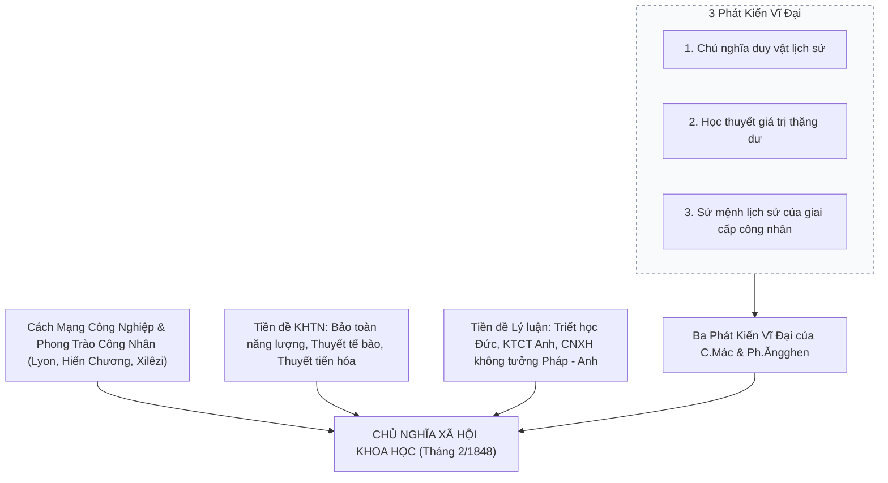

# CHƯƠNG 1: NHẬP MÔN CHỦ NGHĨA XÃ HỘI KHOA HỌC

### 1. Sơ đồ Cấu trúc Logic & Nguồn gốc Lý luận

### 2. Các Khái Niệm Nền Tảng & Luận Điểm Cốt Lõi
- **Chủ nghĩa xã hội khoa học (CNXHKH):** Là một trong ba bộ phận cấu thành chủ nghĩa Mác - Lênin; nghiên cứu các quy luật chính trị - xã hội của quá trình phát sinh, hình thành và phát triển của hình thái kinh tế - xã hội cộng sản chủ nghĩa; con đường, phương pháp để giai cấp công nhân hoàn thành sứ mệnh lịch sử.
- **Quan hệ giữa ba bộ phận của chủ nghĩa Mác - Lênin:**
  - *Triết học Mác - Lênin:* Thế giới quan duy vật và phương pháp luận biện chứng.
  - *Kinh tế chính trị Mác - Lênin:* Cơ sở kinh tế, vạch trần bản chất bóc lột giá trị thặng dư của chủ nghĩa tư bản.
  - *Chủ nghĩa xã hội khoa học:* Kết luận chính trị - xã hội tất yếu và trực tiếp của triết học và kinh tế chính trị Mác - Lênin.
- **Tác phẩm khai sinh:** *"Tuyên ngôn của Đảng Cộng sản"* (tháng 2/1848) do C.Mác và Ph.Ăngghen soạn thảo - văn kiện có tính chất cương lĩnh cách mạng đầu tiên của phong trào cộng sản và công nhân quốc tế.
- **Những cống hiến lịch sử của V.I.Lênin:**
  - Phát hiện quy luật phát triển không đều của CNTB thời kỳ đế quốc chủ nghĩa -> Cách mạng vô sản có thể thắng lợi trước hết ở một số nước hoặc một nước riêng lẻ.
  - Lãnh đạo thắng lợi Cách mạng Tháng Mười Nga (1917) khai sinh nhà nước Xô viết.
  - Đề xướng Chính sách kinh tế mới (NEP - 1921), đặt nền móng cho thời kỳ quá độ với nền kinh tế nhiều thành phần.
- **Ý nghĩa nghiên cứu:** Là kim chỉ nam cho công cuộc Đổi mới toàn diện, xây dựng CNXH và bảo vệ nền tảng tư tưởng của Đảng Cộng sản Việt Nam.\n

---

## Tinh Hoa Kiến Thức & Tóm Tắt Chuyên Sâu (Key Takeaways)
> **Chuyên đề mở rộng:** Sự Ra Đời và Các Giai Đoạn Phát Triển của Chủ Nghĩa Xã Hội Khoa Học

> **Nguồn trích xuất:** Giáo trình Chủ nghĩa xã hội khoa học (Bộ GD&ĐT), Chương 1 (Trang 11 - 50).

### 1. Hoàn Cảnh Lịch Sử Ra Đời
- **Kinh tế - xã hội (thập niên 40 của thế kỷ XIX):** Cách mạng công nghiệp thúc đẩy lực lượng sản xuất xã hội hóa cao độ mâu thuẫn với quan hệ sản xuất tư nhân TBCN. Giai cấp công nhân trưởng thành, phát động các phong trào đấu tranh chính trị độc lập (Lyon - Pháp, Hiến chương - Anh, Xilêzi - Đức).
- **Khoa học tự nhiên:** 3 phát minh trụ cột khẳng định phép biện chứng duy vật: Định luật bảo toàn & chuyển hóa năng lượng, Thuyết tế bào, Thuyết tiến hóa của Đác-uyn.
- **Tiền đề lý luận:** Triết học cổ điển Đức (Hêghen, Phoiơbắc), Kinh tế chính trị cổ điển Anh (Smith, Ricardo), Chủ nghĩa xã hội không tưởng - phê phán Pháp & Anh (Xanh Ximông, Phuriê, Ôoen).

### 2. Ba Phát Kiến Vĩ Đại của C.Mác và Ph.Ăngghen
1. **Chủ nghĩa duy vật lịch sử:** Phát hiện quy luật phát triển tự nhiên của xã hội thông qua sự thay thế của các hình thái kinh tế - xã hội.
2. **Học thuyết giá trị thặng dư:** Chỉ rõ bản chất của phương thức sản xuất TBCN và nguồn gốc bóc lột công nhân làm thuê.
3. **Sứ mệnh lịch sử của giai cấp công nhân:** Luận chứng vai trò tiên phong của GCCN trong việc lật đổ CNTB và xây dựng xã hội mới.

*Tác phẩm mốc:* **Tuyên ngôn của Đảng Cộng sản (tháng 2/1848)** đánh dấu sự ra đời của CNXHKH.

### 3. Các Giai Đoạn Phát Triển
- **C.Mác và Ph.Ăngghen:** Tổng kết bài học cách mạng 1848-1851, đúc kết kinh nghiệm Công xã Pari (1871), phân kỳ hai giai đoạn của hình thái kinh tế - xã hội CSCN.
- **V.I.Lênin:** Phát triển lý luận cách mạng vô sản trong thời kỳ đế quốc chủ nghĩa, lãnh đạo Cách mạng Tháng Mười Nga (1917), đề xuất Chính sách kinh tế mới (NEP - 1921), thành lập Quốc tế III.
- **Thời kỳ đổi mới:** Đảng Cộng sản Việt Nam khởi xướng Đổi mới (1986), xây dựng CNXH bỏ qua chế độ TBCN, phát triển kinh tế thị trường định hướng XHCN.\n
