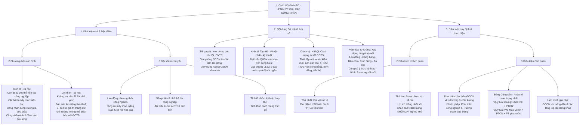

# CHƯƠNG 2: SỨ MỆNH LỊCH SỬ CỦA GIAI CẤP CÔNG NHÂN

> **Hướng dẫn học tập theo Phương pháp ghi chép Cornell (Cornell Note-taking System):**
> Tài liệu lý thuyết Chương 2 được chuẩn hóa theo cấu trúc **Cornell Note-taking System** gồm 3 vùng nhận thức gắn kết chặt chẽ, bám sát 100% *Giáo trình Chủ nghĩa xã hội khoa học (Dành cho bậc đại học hệ không chuyên lý luận chính trị - NXB Chính trị quốc gia Sự thật, 2021)*:
> 1. **Cột Từ khóa & Câu hỏi gợi nhớ (Cue Column - Cột trái):** Chứa các khái niệm trung tâm, trích dẫn kinh điển, mốc văn kiện và các câu hỏi truy xuất chủ động (Active Recall) giúp người học tự kiểm tra kiến thức ngay khi đọc.
> 2. **Cột Ghi chú chi tiết (Note-taking Column - Cột phải):** Hệ thống hóa đầy đủ luận điểm, phân tích hai phương diện, đặc điểm, nội dung sứ mệnh lịch sử, điều kiện khách quan – nhân tố chủ quan, sự biến đổi của giai cấp công nhân hiện đại và đặc trưng, giải pháp xây dựng giai cấp công nhân Việt Nam.
> 3. **Phần Tóm tắt cốt lõi (Cornell Summary - Cuối mỗi mục lớn & cuối chương):** Cô đọng bản chất lý luận và ý nghĩa thực tiễn của từng phần để ghi nhớ dài hạn.

---

## Sơ đồ 1: Quan điểm cơ bản của chủ nghĩa Mác - Lênin về Giai cấp công nhân

---

## I. Quan điểm cơ bản của chủ nghĩa Mác - Lênin về giai cấp công nhân và sứ mệnh lịch sử của giai cấp công nhân

> **Vị trí lý luận của phạm trù:** Sứ mệnh lịch sử thế giới của giai cấp công nhân là **nội dung chủ yếu, điểm căn bản của chủ nghĩa Mác - Lênin**, là **phạm trù trung tâm, nguyên lý xuất phát của chủ nghĩa xã hội khoa học** và là trọng điểm của cuộc đấu tranh tư tưởng lý luận trong thời đại ngày nay.

### 1. Khái niệm và đặc điểm của giai cấp công nhân

| Từ khóa / Câu hỏi gợi nhớ | Ghi chú chi tiết (Nội dung cốt lõi) |
| :--- | :--- |
| **Hệ thống thuật ngữ của C. Mác và Ph. Ăngghen** *Các nhà kinh điển sử dụng những thuật ngữ đồng nghĩa và thuật ngữ hẹp nào để chỉ giai cấp công nhân?* | • **Các thuật ngữ đồng nghĩa:** C. Mác và Ph. Ăngghen sử dụng nhiều cụm từ khác nhau để chỉ giai cấp công nhân như: **giai cấp vô sản**, **giai cấp vô sản hiện đại**, **giai cấp công nhân hiện đại**, **giai cấp công nhân đại công nghiệp**... • **Bản chất chung:** Chỉ giai cấp công nhân – con đẻ của nền đại công nghiệp tư bản chủ nghĩa, giai cấp đại biểu cho lực lượng sản xuất tiên tiến, cho phương thức sản xuất hiện đại. • **Các thuật ngữ có nội dung hẹp hơn:** Chỉ các bộ phận công nhân trong từng ngành sản xuất và giai đoạn phát triển công nghiệp khác nhau: *công nhân khoáng sản, công nhân công trường thủ công, công nhân công xưởng, công nhân nông nghiệp...* |
| **Phương diện kinh tế - xã hội** *Trên phương diện kinh tế - xã hội, giai cấp công nhân được xác định như thế nào? Bộ phận nào là tiêu biểu nhất?* | • **Vị trí trong nền sản xuất:** Là **sản phẩm** và là **chủ thể** của nền sản xuất đại công nghiệp; là những người lao động **trực tiếp hay gián tiếp** vận hành các công cụ sản xuất có tính chất công nghiệp ngày càng hiện đại và xã hội hóa cao. • **Đặc điểm nổi bật của phương thức lao động:** Sản xuất bằng **máy móc**, lao động có tính chất **xã hội hóa**, **năng suất lao động cao** và tạo ra những tiền đề của cải vật chất cho xã hội mới. • **Bước chuyển từ thủ công sang công xưởng:** C. Mác và Ph. Ăngghen chỉ rõ: *“Trong công trường thủ công và trong nghề thủ công, người công nhân sử dụng công cụ của mình, còn trong công xưởng thì người công nhân phải phục vụ máy móc”* (*Toàn tập*, t.23, tr.605). Do đó, **công nhân công nghiệp công xưởng là bộ phận tiêu biểu cho giai cấp công nhân hiện đại**. • **Trích dẫn kinh điển trong *Tuyên ngôn của Đảng Cộng sản*:**   ◦ *“Các giai cấp khác đều suy tàn và tiêu vong cùng với sự phát triển của đại công nghiệp, còn giai cấp vô sản lại là sản phẩm của bản thân nền đại công nghiệp”* (*Toàn tập*, t.4, tr.610).   ◦ *“Công nhân cũng là một phát minh của thời đại mới, giống như máy móc vậy... **Công nhân Anh là đứa con đầu lòng của nền công nghiệp hiện đại**”* (*Toàn tập*, t.12, tr.11). |
| **Phương diện chính trị - xã hội** *Tại sao trong chủ nghĩa tư bản, giữa giai cấp công nhân và giai cấp tư sản tồn tại mâu thuẫn đối kháng không thể điều hòa?* | • **Điều kiện tồn tại của xã hội tư bản:** Giai cấp công nhân là sản phẩm xã hội của quá trình phát triển tư bản chủ nghĩa, một xã hội có *“điều kiện tồn tại dựa trên cơ sở chế độ làm thuê”*. • **Địa vị không sở hữu TLSX & bị bóc lột:** Trong quan hệ sản xuất TBCN, *“giai cấp vô sản là giai cấp những công nhân làm thuê hiện đại, vì mất các tư liệu sản xuất của bản thân, nên buộc phải bán sức lao động của mình để sống”* (*Toàn tập*, t.4, tr.596). Họ **không có sở hữu tư liệu sản xuất chủ yếu của xã hội**, phải bán sức lao động cho nhà tư bản và **bị chủ tư bản bóc lột giá trị thặng dư**. • **Người lao động tự do & thân phận hàng hóa:** Công nhân là những người lao động tự do với nghĩa **tự do bán sức lao động** của mình để kiếm sống; *“buộc phải tự bán mình để kiếm ăn từng bữa một, là một hàng hóa... phải chịu hết mọi sự may rủi của cạnh tranh, mọi sự lên xuống của thị trường với mức độ như nhau”* (*Toàn tập*, t.4, tr.605). • **Nguồn gốc mâu thuẫn đối kháng:** Mâu thuẫn cơ bản của phương thức sản xuất TBCN là mâu thuẫn giữa **lực lượng sản xuất xã hội hóa ngày càng rộng lớn** với **quan hệ sản xuất TBCN dựa trên chế độ tư hữu TBCN về tư liệu sản xuất**. Mâu thuẫn cơ bản đó biểu hiện về mặt xã hội thành mâu thuẫn về lợi ích giữa GCCN và giai cấp tư sản (GCTS): lao động sống của công nhân là nguồn gốc của giá trị thặng dư và sự giàu có của GCTS chủ yếu nhờ bóc lột ngày càng nhiều giá trị thặng dư $\rightarrow$ **tính chất đối kháng không thể điều hòa** giữa GCCN và GCTS trong PTSX và chế độ TBCN. |
| **Định nghĩa tổng quát về giai cấp công nhân** *Hãy phát biểu định nghĩa hoàn chỉnh về giai cấp công nhân theo chủ nghĩa Mác - Lênin.* | • **Theo chủ nghĩa Mác - Lênin:** *Giai cấp công nhân là một tập đoàn xã hội, hình thành và phát triển cùng với quá trình phát triển của nền công nghiệp hiện đại; họ lao động bằng phương thức công nghiệp ngày càng hiện đại và gắn liền với quá trình sản xuất vật chất hiện đại, là đại biểu cho phương thức sản xuất mang tính xã hội hóa ngày càng cao. Họ là người làm thuê do không có tư liệu sản xuất, buộc phải bán sức lao động để sống và bị giai cấp tư sản bóc lột giá trị thặng dư; vì vậy lợi ích cơ bản của họ đối lập với lợi ích cơ bản của giai cấp tư sản. Đó là giai cấp có sứ mệnh phủ định chế độ tư bản chủ nghĩa, xây dựng thành công chủ nghĩa xã hội và chủ nghĩa cộng sản trên toàn thế giới.* |
| **3 đặc điểm chủ yếu của giai cấp công nhân** *Những đặc điểm cốt lõi nào tạo nên phẩm chất lãnh đạo cách mạng của giai cấp công nhân?* | 1. **Phương thức lao động công nghiệp:** Đặc điểm nổi bật là lao động bằng phương thức công nghiệp với đặc trưng công cụ lao động là **máy móc**, tạo ra **năng suất lao động cao**, quá trình lao động mang tính chất **xã hội hóa**. 2. **Sản phẩm và chủ thể của nền đại công nghiệp:** Là sản phẩm của bản thân nền đại công nghiệp, là chủ thể của quá trình sản xuất vật chất hiện đại $\rightarrow$ đại biểu cho **lực lượng sản xuất tiên tiến**, cho **phương thức sản xuất tiên tiến**, quyết định sự tồn tại và phát triển của xã hội hiện đại. 3. **Phẩm chất tổ chức và tinh thần cách mạng triệt để:** Nền sản xuất đại công nghiệp và PTSX tiên tiến đã rèn luyện cho GCCN những phẩm chất đặc biệt về **tính tổ chức, kỷ luật lao động, tinh thần hợp tác và tâm lý lao động công nghiệp**. Đó là một giai cấp cách mạng và **có tinh thần cách mạng triệt để**. • **Kết luận:** Chính 3 đặc điểm ấy là những phẩm chất cần thiết để GCCN giữ vai trò lãnh đạo cách mạng. |

### 2. Nội dung sứ mệnh lịch sử của giai cấp công nhân

| Từ khóa / Câu hỏi gợi nhớ | Ghi chú chi tiết (Nội dung cốt lõi) |
| :--- | :--- |
| **Khái niệm & Sứ mệnh lịch sử tổng quát** *Sứ mệnh lịch sử tổng quát của giai cấp công nhân là gì?* | • **Bản chất khái niệm:** Nội dung sứ mệnh lịch sử của GCCN chính là những nhiệm vụ mà GCCN cần phải thực hiện với tư cách là **giai cấp tiên phong**, là **lực lượng đi đầu** trong cuộc cách mạng xác lập hình thái kinh tế - xã hội cộng sản chủ nghĩa. • **Sứ mệnh lịch sử tổng quát:** Thông qua **chính đảng tiền phong**, giai cấp công nhân tổ chức, lãnh đạo nhân dân lao động đấu tranh **xóa bỏ các chế độ người bóc lột người, xóa bỏ chủ nghĩa tư bản**, giải phóng giai cấp công nhân, nhân dân lao động khỏi mọi sự áp bức, bóc lột, nghèo nàn, lạc hậu, **xây dựng xã hội cộng sản chủ nghĩa văn minh**. • **Khẳng định của C. Mác:** *“Thực hiện sự nghiệp giải phóng thế giới ấy, - đó là sứ mệnh lịch sử của giai cấp vô sản hiện đại”*. |
| **Nội dung kinh tế** *GCCN thực hiện sứ mệnh lịch sử trên lĩnh vực kinh tế như thế nào ở các nước XHCN và các nước quá độ rút ngắn?* | • **Tạo tiền đề vật chất - kỹ thuật cho xã hội mới:** Là nhân tố hàng đầu của LLSX xã hội hóa cao, GCCN là đại biểu cho quan hệ sản xuất mới, sản xuất ra của cải vật chất ngày càng nhiều đáp ứng nhu cầu ngày càng tăng của con người và xã hội. • **Đại biểu cho chế độ công hữu và lợi ích chung:** Tính xã hội hóa cao của LLSX đòi hỏi QHSX mới phù hợp với **chế độ công hữu các tư liệu sản xuất chủ yếu của xã hội** làm nền tảng. GCCN là **giai cấp duy nhất không có lợi ích riêng với nghĩa là tư hữu**; họ phấn đấu cho lợi ích chung của toàn xã hội và chỉ tìm thấy lợi ích chân chính của mình khi thực hiện được lợi ích chung đó. • **Tại các nước xã hội chủ nghĩa:** GCCN thông qua quá trình **công nghiệp hóa** và thực hiện ***“một kiểu tổ chức xã hội mới về lao động”*** để tăng năng suất lao động xã hội, thực hiện nguyên tắc sở hữu, quản lý và phân phối phù hợp với nhu cầu phát triển sản xuất, thực hiện tiến bộ và công bằng xã hội. • **Tại các nước quá độ rút ngắn (bỏ qua CNTB):** Hầu hết các nước XHCN ra đời từ phương thức phát triển rút ngắn, bỏ qua chế độ TBCN $\rightarrow$ GCCN phải đóng vai trò **nòng cốt trong quá trình giải phóng lực lượng sản xuất** (vốn bị kìm hãm, lạc hậu, chậm phát triển trong quá khứ), thúc đẩy LLSX phát triển để tạo cơ sở cho QHSX mới XHCN ra đời. |
| **Nội dung chính trị - xã hội** *Nhiệm vụ chính trị - xã hội cốt lõi trước và sau khi giành chính quyền của giai cấp công nhân là gì?* | • **Tiến hành cách mạng chính trị giành chính quyền:** GCCN cùng nhân dân lao động, dưới sự lãnh đạo của **Đảng Cộng sản**, tiến hành cách mạng chính trị để lật đổ quyền thống trị của giai cấp thống trị, xóa bỏ chế độ bóc lột, áp bức, giành quyền lực về tay GCCN và nhân dân lao động. • **Thiết lập nhà nước kiểu mới & nền dân chủ XHCN:** Thiết lập **nhà nước kiểu mới mang bản chất giai cấp công nhân**, xây dựng nền dân chủ XHCN, thực hiện quyền lực của nhân dân, quyền dân chủ và làm chủ xã hội của tuyệt đại đa số nhân dân lao động. • **Sử dụng nhà nước để cải tạo và xây dựng xã hội mới:** GCCN và nhân dân lao động dùng nhà nước của mình, do mình làm chủ như một công cụ có hiệu lực để cải tạo xã hội cũ và tổ chức xây dựng xã hội mới: phát triển kinh tế - văn hóa, xây dựng nền chính trị dân chủ - pháp quyền, quản lý kinh tế - xã hội phục vụ quyền và lợi ích của nhân dân lao động, thực hiện **dân chủ, công bằng, bình đẳng và tiến bộ xã hội**. |
| **Nội dung văn hóa, tư tưởng** *Hệ giá trị mới và nội dung cách mạng trên lĩnh vực văn hóa, tư tưởng gồm những gì?* | • **Tập trung xây dựng hệ giá trị mới:** Trong tiến trình cải tạo xã hội cũ và xây dựng xã hội mới về văn hóa, tư tưởng, GCCN cần tập trung xây dựng hệ giá trị mới gồm 5 giá trị cốt lõi: **lao động; công bằng; dân chủ; bình đẳng và tự do**. • **Cải tạo cái cũ, xây dựng cái mới trong đời sống tinh thần:** Thực hiện cuộc cách mạng về văn hóa, tư tưởng nhằm cải tạo cái cũ lỗi thời, lạc hậu; xây dựng cái mới tiến bộ trong ý thức tư tưởng, tâm lý, lối sống và đời sống tinh thần xã hội. • **Củng cố ý thức hệ tiên tiến & xây dựng con người mới:** Xây dựng và củng cố ý thức hệ tiên tiến của GCCN là **chủ nghĩa Mác - Lênin**, đấu tranh khắc phục ý thức hệ tư sản và tàn dư hệ tư tưởng cũ; phát triển văn hóa, xây dựng **con người mới XHCN**, đạo đức và lối sống mới XHCN. |

### 3. Những điều kiện quy định và thực hiện sứ mệnh lịch sử của giai cấp công nhân

| Từ khóa / Câu hỏi gợi nhớ | Ghi chú chi tiết (Nội dung cốt lõi) |
| :--- | :--- |
| **Tính tất yếu khách quan của sứ mệnh lịch sử** *C. Mác và Ph. Ăngghen đã luận giải tính tất yếu lịch sử của GCCN như thế nào?* | • Trong *Tuyên ngôn của Đảng Cộng sản*, C. Mác và Ph. Ăngghen khẳng định: *“Cùng với sự phát triển của đại công nghiệp, chính cái nền tảng trên đó giai cấp tư sản đã sản xuất và chiếm hữu sản phẩm của nó, đã bị phá sập dưới chân giai cấp tư sản. Trước hết, **giai cấp tư sản sản sinh ra những người đào huyệt chôn chính nó**. Sự sụp đổ của giai cấp tư sản và thắng lợi của giai cấp vô sản đều là tất yếu như nhau”* (*Toàn tập*, t.4, tr.613). |
| **Điều kiện khách quan thứ nhất: Địa vị kinh tế của GCCN** *Địa vị kinh tế quy định sứ mệnh lịch sử của GCCN như thế nào?* | • Là con đẻ, sản phẩm của nền đại công nghiệp có tính xã hội hóa ngày càng cao và là chủ thể của quá trình sản xuất vật chất hiện đại $\rightarrow$ **đại diện cho phương thức sản xuất tiên tiến và lực lượng sản xuất hiện đại**. • Là người sản xuất ra của cải vật chất chủ yếu cho xã hội, làm giàu cho xã hội, có **vai trò quyết định sự phát triển của xã hội hiện đại**. • **Hệ quả tất yếu:** Nhân tố kinh tế này quy định GCCN là lực lượng phá vỡ QHSX TBCN, giành chính quyền về tay mình, chuyển từ giai cấp **“tự nó”** thành giai cấp **“vì nó”**. GCCN là lực lượng **duy nhất** có đủ điều kiện tổ chức và lãnh đạo xã hội, xây dựng và phát triển LLSX và QHSX XHCN để xây dựng chế độ mới không còn áp bức, bóc lột. |
| **Điều kiện khách quan thứ hai: Địa vị chính trị - xã hội** *Có phải GCCN là giai cấp cách mạng vì họ nghèo khổ không? Vì sao?* | • **Mối quan hệ lợi ích:** Trong CNTB, GCCN không sở hữu TLSX chủ yếu, phải bán sức lao động kiếm sống và bị bóc lột nặng nề $\rightarrow$ lợi ích cơ bản của họ **đối lập trực tiếp với lợi ích cơ bản của GCTS** và **thống nhất với lợi ích cơ bản của đa số nhân dân lao động**. • **Phẩm chất khách quan:** Điều kiện của nền đại công nghiệp rèn luyện cho GCCN tính tổ chức, kỷ luật, tự giác và đoàn kết trong đấu tranh tự giải phóng mình và giải phóng xã hội; lại được trang bị lý luận tiên tiến (chủ nghĩa Mác - Lênin) và có đội tiền phong (Đảng Cộng sản) dẫn dắt. • **LƯU Ý PHƯƠNG PHÁP LUẬN ĐẶC BIỆT:** **Hoàn toàn không phải vì nghèo khổ mà giai cấp công nhân là một giai cấp cách mạng.** GCCN là giai cấp cách mạng vì nó là giai cấp đại biểu cho LLSX hiện đại, cho PTSX tiên tiến, **đại biểu cho tương lai, cho xu thế đi lên của tiến trình phát triển lịch sử** (đây là đặc tính quyết định bản chất cách mạng của GCCN). Tình trạng nghèo khổ dưới CNTB chỉ là hậu quả của sự bóc lột, áp bức mà cách mạng sẽ xóa bỏ. |
| **Điều kiện chủ quan 1: Sự phát triển của bản thân GCCN** *Chất lượng GCCN thể hiện ở những mặt nào và có 2 biện pháp cơ bản nào để phát triển?* | • **Phát triển cả về số lượng và chất lượng:** Phản ánh sự lớn mạnh của GCCN cùng quy mô nền sản xuất vật chất hiện đại. Trong đó, chất lượng là yếu tố quyết định và thể hiện trên 2 phương diện:   1. **Trình độ trưởng thành về ý thức chính trị:** Tự giác nhận thức vai trò và trọng trách lịch sử của giai cấp mình; được giác ngộ lý luận khoa học và cách mạng của chủ nghĩa Mác - Lênin.   2. **Năng lực và trình độ làm chủ khoa học kỹ thuật và công nghệ hiện đại**, nhất là trong bối cảnh hiện nay. • **Hai biện pháp cơ bản để phát triển GCCN về số lượng và chất lượng:**   1. **Phát triển công nghiệp** – *“tiền đề thực tiễn tuyệt đối cần thiết”*.   2. **Sự trưởng thành của Đảng Cộng sản** – hạt nhân chính trị quan trọng của giai cấp công nhân. |
| **Điều kiện chủ quan 2: Đảng Cộng sản — Nhân tố chủ quan quan trọng nhất** *So sánh quy luật chung ra đời của Đảng Cộng sản với quy luật đặc thù ở Việt Nam theo Hồ Chí Minh.* | • **Vai trò quyết định:** Đảng Cộng sản – đội tiên phong của GCCN ra đời và đảm nhận vai trò lãnh đạo cách mạng là dấu hiệu về **sự trưởng thành vượt bậc** của GCCN với tư cách là giai cấp cách mạng. Đây là **nhân tố chủ quan quan trọng nhất** để GCCN thực hiện thắng lợi sứ mệnh lịch sử. • **Quy luật chung, phổ biến:** Sự ra đời của Đảng Cộng sản là kết quả của sự kết hợp giữa **chủ nghĩa xã hội khoa học (chủ nghĩa Mác - Lênin)** với **phong trào công nhân**. • **Quy luật đặc thù ở Việt Nam (phát triển sáng tạo của Hồ Chí Minh):** Xuất phát từ hoàn cảnh lịch sử - cụ thể của nước thuộc địa nửa phong kiến, Đảng Cộng sản Việt Nam ra đời là kết quả của sự kết hợp giữa **chủ nghĩa Mác - Lênin + phong trào công nhân + phong trào yêu nước của dân tộc**. • **Bản chất & sức mạnh của Đảng:** GCCN là cơ sở xã hội và nguồn bổ sung lực lượng quan trọng nhất của Đảng, làm cho Đảng mang bản chất GCCN, trở thành bộ tham mưu chiến đấu của giai cấp, đại biểu trung thành cho lợi ích của GCCN, dân tộc và xã hội. Sức mạnh của Đảng còn bắt nguồn từ **mối liên hệ mật thiết giữa Đảng với nhân dân**, với đông đảo quần chúng lao động. |
| **Điều kiện chủ quan 3: Liên minh giai cấp** *Ngoài 2 điều kiện trên, chủ nghĩa Mác - Lênin nhấn mạnh điều kiện không thể thiếu nào khác?* | • Để cuộc cách mạng thực hiện sứ mệnh lịch sử của GCCN đi tới thắng lợi, phải có **sự liên minh giai cấp giữa giai cấp công nhân với giai cấp nông dân và các tầng lớp lao động khác** do GCCN thông qua đội tiên phong của nó là Đảng Cộng sản lãnh đạo. Đây là điều kiện quan trọng không thể thiếu. |

> **Tóm tắt Mục I (Cornell Summary):**
> Chủ nghĩa Mác - Lênin xác định GCCN trên 2 phương diện (**kinh tế - xã hội**: chủ thể nền đại công nghiệp, vận hành máy móc hiện đại; **chính trị - xã hội**: không có TLSX, làm thuê, bị bóc lột giá trị thặng dư và đối kháng không thể điều hòa với GCTS), mang 3 đặc điểm tiên tiến để thực hiện sứ mệnh tổng quát xóa bỏ áp bức bóc lột, xây dựng CNXH và CNCS trên 3 lĩnh vực (Kinh tế, Chính trị - xã hội, Văn hóa - tư tưởng với hệ giá trị lao động, công bằng, dân chủ, bình đẳng, tự do). Sứ mệnh này được quy định tất yếu bởi **2 điều kiện khách quan** (địa vị kinh tế và địa vị chính trị - xã hội, *không phải vì nghèo khổ*) và được hiện thực hóa nhờ **3 nhân tố chủ quan** (GCCN trưởng thành về số lượng - chất lượng, **Đảng Cộng sản** là nhân tố quan trọng nhất, và khối liên minh công - nông - lao động).

---

## Sơ đồ 2: Giai cấp công nhân hiện đại và Sứ mệnh lịch sử của GCCN Việt Nam

```mermaid
flowchart LR
    subgraph HD["II. GIAI CẤP CÔNG NHÂN HIỆN ĐẠI"]
        direction TB
        OD["Điểm tương đối ổn định so với TK XIX"] --> OD1["Vẫn là LLSX hàng đầu;<br>Vẫn bị bóc lột giá trị thặng dư ở nước TBCN;<br>Vẫn đi đầu đấu tranh vì hòa bình, dân sinh, dân chủ"]
        BD["Biến đổi & Khác biệt mới"] --> BD1["Trí tuệ hóa tăng nhanh:<br>'Công nhân tri thức', 'Công nhân áo trắng'<br>Hao phí trí lực là chủ yếu"]
        BD --> BD2["Trung lưu hóa gia tăng:<br>Tham gia cổ phần hóa nhưng KHÔNG<br>chi phối TLSX & phân phối lợi nhuận"]
        BD --> BD3["Giữ vai trò lãnh đạo, cầm quyền ở nước XHCN;<br>Cơ cấu thay đổi mạnh trong CMCN 4.0"]
    end

    subgraph VN["III. GIAI CẤP CÔNG NHÂN VIỆT NAM"]
        direction TB
        LS["3 Đặc điểm lịch sử & Biến đổi 35 năm Đổi mới"] --> LS1["Lịch sử: Ra đời đầu TK XX trước GCTS VN;<br>Lực lượng chính trị tiên phong gắn với dân tộc;<br>Gắn bó tự nhiên với nông dân"]
        LS --> LS2["Biến đổi qua 35 năm Đổi mới:<br>Tăng nhanh số lượng & chất lượng;<br>Đa dạng ngành nghề, khu vực Nhà nước nòng cốt;<br>Công nhân tri thức & công nhân trẻ chủ đạo;<br>Coi trọng xây dựng, chỉnh đốn Đảng"]
        SMVN["Sứ mệnh lịch sử hiện nay"] --> SM1["Kinh tế: Đi đầu CNH, HĐH gắn kinh tế tri thức,<br>phát huy liên minh Công - Nông - Trí thức"]
        SMVN --> SM2["Chính trị - xã hội: Giữ bản chất GCCN của Đảng;<br>Ngăn chặn suy thoái, 'tự diễn biến', 'tự chuyển hóa'"]
        SMVN --> SM3["Văn hóa - tư tưởng: Văn hóa tiên tiến, bản sắc;<br>Bảo vệ nền tảng Mác - Lênin, tư tưởng HCM"]
        PHGP["Phương hướng 'ĐH X, TW6 X, ĐH XIII'<br>& 5 Giải pháp xây dựng"] --> GP5["1. Kiên định vai trò lãnh đạo của GCCN & Đảng<br>2. Gắn kết liên minh & đại đoàn kết, quốc tế<br>3. Gắn chiến lược KT-XH, hài hòa lợi ích, đời sống<br>4. Đào tạo, trí thức hóa & xây dựng công nhân trẻ<br>5. Trách nhiệm cả hệ thống chính trị, Đảng, Nhà nước, Công đoàn"]
    end

    HD --> VN
```

---

## II. Giai cấp công nhân và việc thực hiện sứ mệnh lịch sử của giai cấp công nhân hiện nay

### 1. Giai cấp công nhân hiện nay

| Từ khóa / Câu hỏi gợi nhớ | Ghi chú chi tiết (Nội dung cốt lõi) |
| :--- | :--- |
| **Những điểm tương đối ổn định so với thế kỷ XIX** *Vì sao lý luận của chủ nghĩa Mác - Lênin về sứ mệnh lịch sử GCCN vẫn nguyên giá trị trong thời đại ngày nay?* | 1. **Vẫn là lực lượng sản xuất hàng đầu của xã hội hiện đại:** Họ vẫn là chủ thể của quá trình sản xuất công nghiệp hiện đại mang tính xã hội hóa ngày càng cao. Ở các nước công nghiệp phát triển (như nhóm **G7**), sự phát triển của GCCN tỷ lệ thuận với phát triển kinh tế và lực lượng lao động công nghiệp chiếm tỷ lệ cao ở mức tuyệt đối. Đa số các nước đang phát triển đều thực hiện **chiến lược công nghiệp hóa** (cơ sở khách quan làm GCCN hiện đại phát triển mạnh cả về số lượng và chất lượng). 2. **Vẫn bị bóc lột giá trị thặng dư tại các nước TBCN:** Quan hệ sản xuất TBCN dựa trên sở hữu tư nhân TBCN vẫn tồn tại $\rightarrow$ xung đột lợi ích cơ bản giữa GCTS và GCCN (giữa tư bản và lao động) vẫn là nguyên nhân cơ bản, sâu xa của đấu tranh giai cấp ngày nay. 3. **Vẫn là lực lượng đi đầu đấu tranh:** Phong trào cộng sản và công nhân ở nhiều nước vẫn luôn là lực lượng đi đầu trong các cuộc đấu tranh vì hòa bình, hợp tác và phát triển, vì dân sinh, dân chủ, tiến bộ xã hội và chủ nghĩa xã hội. • **Khẳng định khoa học:** Lý luận về sứ mệnh lịch sử của GCCN trong chủ nghĩa Mác - Lênin vẫn mang giá trị khoa học và cách mạng, ý nghĩa thực tiễn to lớn chỉ đạo cuộc đấu tranh chống CNTB và lựa chọn con đường XHCN. |
| **Biến đổi 1: Xu hướng "trí tuệ hóa" tăng nhanh** *Các khái niệm mới về công nhân hiện đại là gì và hao phí lao động đã thay đổi như thế nào?* | • **Bối cảnh:** Gắn liền với cách mạng khoa học - công nghệ hiện đại và sự phát triển kinh tế tri thức. • **Hai mặt của quá trình:** **Tri thức hóa** và **trí thức hóa** công nhân. • **Thuật ngữ mới:** Xuất hiện các khái niệm **“công nhân tri thức”**, **“công nhân trí thức”**, **“công nhân áo trắng”**, lao động trình độ cao. • **Đặc trưng lao động và nhu cầu:** Nền sản xuất và dịch vụ hiện đại đòi hỏi hiểu biết sâu rộng tri thức và kỹ năng nghề nghiệp; công nhân được đào tạo chuẩn mực và **thường xuyên được đào tạo lại** để đáp ứng công nghệ thay đổi nhanh. **Hao phí lao động hiện đại chủ yếu là hao phí về trí lực** chứ không còn thuần túy là sức lực cơ bắp; nhu cầu tinh thần, văn hóa ngày càng tăng, phong phú và đòi hỏi chất lượng cao hơn. |
| **Biến đổi 2: Xu hướng "trung lưu hóa" gia tăng** *Việc công nhân mua cổ phần trong các nước TBCN có làm thay đổi bản chất làm thuê và bị bóc lột của họ không?* | • **Bề ngoài (Hình thức):** Trong toàn cầu hóa, CNTB điều chỉnh phương thức quản lý, áp dụng các biện pháp điều hòa mâu thuẫn xã hội. Một bộ phận công nhân tham gia sở hữu một lượng TLSX qua **chế độ cổ phần hóa**; về hình thức họ không còn là "vô sản" thuần túy và có thể được **“trung lưu hóa”** về mức sống. • **Bản chất (Thực chất):** Ở các nước tư bản, công nhân **không chiếm được tỷ lệ sở hữu cao** nên quá trình sản xuất và phân chia lợi nhuận vẫn phụ thuộc vào những cổ đông lớn. **Việc làm và lao động** vẫn là nhân tố quyết định mức thu nhập, đời sống của công nhân; **quyền định đoạt quá trình sản xuất và quyết định cơ chế phân phối lợi nhuận vẫn thuộc về giai cấp tư sản**. • **Chủ thể bóc lột mới:** Khi sở hữu tư nhân TBCN về TLSX còn tồn tại, thành quả KH-CN và điều chỉnh thể chế trước tiên vẫn là công cụ bóc lột giá trị thặng dư; GCCN vẫn bị bóc lột nặng nề bởi **các tập đoàn xuyên quốc gia, nhà nước của các nước tư bản phát triển...** |
| **Biến đổi 3: Vai trò lãnh đạo, cầm quyền & Biến đổi cơ cấu trong CMCN 4.0** *Vị thế chính trị và cơ cấu của GCCN hiện đại biến đổi ra sao?* | • **Giữ vai trò lãnh đạo, cầm quyền ở các nước XHCN:** Từ **Nhà nước Xôviết** đầu tiên (Liên Xô và Đông Âu trước đây) đến các nước XHCN hiện nay (**Việt Nam, Trung Quốc...**), GCCN và đội tiền phong là Đảng Cộng sản đã trở thành giai cấp lãnh đạo giành chính quyền và giữ vai trò cầm quyền trong quá trình xây dựng CNXH. • **Biến đổi cơ cấu trong CMCN lần thứ tư:** Trong bối cảnh toàn cầu hóa, hội nhập quốc tế và Cách mạng công nghiệp 4.0, công nhân hiện đại tăng nhanh về số lượng, thay đổi lớn về **cơ cấu xã hội, cơ cấu nghề nghiệp, cơ cấu thu nhập** giữa các bộ phận công nhân trên phạm vi toàn cầu cũng như trong mỗi quốc gia. |

### 2. Thực hiện sứ mệnh lịch sử của giai cấp công nhân trên thế giới hiện nay

| Từ khóa / Câu hỏi gợi nhớ | Ghi chú chi tiết (Nội dung cốt lõi) |
| :--- | :--- |
| **a) Nội dung kinh tế** *Sự phát triển sản xuất hiện đại dưới CNTB có mâu thuẫn với sứ mệnh lịch sử của GCCN không?* | • **Thúc đẩy tiền đề vật chất của CNXH:** Thông qua vai trò của GCCN trong sản xuất với công nghệ hiện đại, năng suất, chất lượng cao, đảm bảo phát triển bền vững, chính sự phát triển sản xuất của CNTB ngày nay (với sự tham gia trực tiếp của GCCN và lao động - dịch vụ trình độ cao) lại là **nhân tố kinh tế - xã hội thúc đẩy sự chín muồi các tiền đề của CNXH ngay trong lòng CNTB**, tạo điều kiện phát huy vai trò chủ thể của GCCN. • **Đấu tranh chống bất công toàn cầu:** Mâu thuẫn lợi ích cơ bản giữa GCCN và GCTS ngày càng sâu sắc ở từng quốc gia và trên toàn cầu. Toàn cầu hóa mang đậm tính chất TBCN với bất công, bất bình đẳng xã hội thúc đẩy cuộc đấu tranh chống chế độ bóc lột giá trị thặng dư, hướng tới xác lập một trật tự xã hội mới công bằng và bình đẳng. |
| **b) Nội dung chính trị - xã hội** *Mục tiêu chính trị - xã hội của GCCN tại các nước TBCN và các nước XHCN hiện nay khác nhau như thế nào?* | • **Ở các nước tư bản chủ nghĩa:**   ◦ *Mục tiêu đấu tranh trực tiếp:* Chống bất công và bất bình đẳng xã hội.   ◦ *Mục tiêu lâu dài:* Giành chính quyền về tay GCCN và nhân dân lao động (được nêu rõ trong Cương lĩnh chính trị của các Đảng Cộng sản tại các nước TBCN). • **Ở các nước xã hội chủ nghĩa (nơi Đảng Cộng sản cầm quyền):**   ◦ Lãnh đạo thành công sự nghiệp **đổi mới**, giải quyết thành công các nhiệm vụ trong **thời kỳ quá độ lên CNXH**.   ◦ Đặc biệt là **xây dựng Đảng cầm quyền trong sạch, vững mạnh**, thực hiện thành công sự nghiệp **công nghiệp hóa, hiện đại hóa**, đưa đất nước phát triển nhanh và bền vững. |
| **c) Nội dung văn hóa, tư tưởng** *Cuộc đấu tranh ý thức hệ hiện nay tập trung vào những giá trị và nhiệm vụ nào?* | • **Cuộc đấu tranh ý thức hệ CNXH >< CNTB:** Đang diễn ra phức tạp, quyết liệt trong bối cảnh kinh tế thị trường với nhiều mặt trái và sau khi hệ thống XHCN thế giới tan rã làm phong trào cách mạng gặp thoái trào tạm thời, niềm tin vào lý tưởng XHCN đứng trước nhiều thử thách. • **Sự tương đồng về giá trị nhân loại:** Các giá trị như **lao động, sáng tạo, công bằng, dân chủ, bình đẳng, tự do** vẫn được nhân loại thừa nhận và phấn đấu; thực tế các giá trị nhân loại hướng tới đều tương đồng với giá trị lý tưởng, mục tiêu của GCCN. • **Nhiệm vụ cốt lõi:** Đấu tranh **bảo vệ nền tảng tư tưởng của Đảng Cộng sản**, giáo dục nhận thức và củng cố **niềm tin khoa học** đối với lý tưởng, mục tiêu của CNXH cho GCCN và nhân dân lao động; giáo dục và thực hiện **chủ nghĩa quốc tế chân chính** của GCCN trên cơ sở phát huy **chủ nghĩa yêu nước và tinh thần dân tộc**. |

> **Tóm tắt Mục II (Cornell Summary):**
> Ngày nay, dù xuất hiện các biến đổi mới như **xu hướng "trí tuệ hóa"** (công nhân tri thức, công nhân áo trắng), **xu hướng "trung lưu hóa"** qua cổ phần hóa (song không nắm quyền chi phối TLSX và phân phối lợi nhuận) và vai trò **cầm quyền ở các nước XHCN**, GCCN vẫn giữ nguyên 3 điểm ổn định căn bản so với thế kỷ XIX (LLSX hàng đầu, vẫn bị bóc lột giá trị thặng dư trong CNTB, vẫn là lực lượng đi đầu đấu tranh). Do đó, GCCN thế giới tiếp tục thực hiện sứ mệnh lịch sử trên cả 3 mặt: thúc đẩy tiền đề CNXH và chống bất công toàn cầu (Kinh tế); đấu tranh dân sinh, giành chính quyền ở nước TBCN hoặc xây dựng Đảng, thực hiện CNH, HĐH ở nước XHCN (Chính trị - xã hội); và bảo vệ nền tảng tư tưởng, hệ giá trị tiến bộ cùng chủ nghĩa quốc tế chân chính (Văn hóa, tư tưởng).

---

## III. Sứ mệnh lịch sử của giai cấp công nhân Việt Nam

### 1. Đặc điểm của giai cấp công nhân Việt Nam

| Từ khóa / Câu hỏi gợi nhớ | Ghi chú chi tiết (Nội dung cốt lõi) |
| :--- | :--- |
| **Định nghĩa GCCN Việt Nam (Hội nghị TW 6 khóa X)** *Đảng Cộng sản Việt Nam định nghĩa giai cấp công nhân Việt Nam như thế nào?* | • Tại **Hội nghị lần thứ sáu Ban Chấp hành Trung ương khóa X**, Đảng đã xác định (*Văn kiện Đảng toàn tập*, t.67, tr.72):   *“Giai cấp công nhân Việt Nam là một lực lượng xã hội to lớn, đang phát triển, bao gồm những người lao động chân tay và trí óc, làm công hưởng lương trong các loại hình sản xuất kinh doanh và dịch vụ công nghiệp, hoặc sản xuất kinh doanh và dịch vụ có tính chất công nghiệp.”* |
| **3 đặc điểm lịch sử của GCCN Việt Nam** *Bối cảnh thuộc địa nửa phong kiến đầu thế kỷ XX đã tạo cho GCCN Việt Nam 3 đặc điểm đặc thù nào?* | • **Nguồn gốc hình thành:** Gắn liền với chính sách **khai thác thuộc địa của thực dân Pháp** ở Việt Nam. Mang **3 đặc điểm chủ yếu**:   1. **Ra đời trước giai cấp tư sản Việt Nam (vào đầu thế kỷ XX):** Là giai cấp trực tiếp đối kháng với tư bản thực dân Pháp và bè lũ tay sai; phát triển chậm vì sinh ra và lớn lên ở một nước thuộc địa, nửa phong kiến dưới ách thống trị của thực dân Pháp.   2. **Sớm thể hiện là lực lượng chính trị tiên phong lãnh đạo đấu tranh giải phóng dân tộc:** Giải quyết mâu thuẫn cơ bản giữa dân tộc Việt Nam với đế quốc thực dân và phong kiến thống trị; không chỉ mang ý thức giai cấp, lập trường chính trị mà còn giàu **tinh thần dân tộc, truyền thống yêu nước, đoàn kết, bất khuất**; dù số lượng ban đầu ít và còn tàn dư tâm lý tiểu nông nhưng sớm tôi luyện trong đấu tranh, trưởng thành nhanh về ý thức chính trị (nhất là từ khi Đảng ra đời), trung thành với chủ nghĩa Mác - Lênin, Đảng Cộng sản và lý tưởng **độc lập dân tộc và chủ nghĩa xã hội**.   3. **Gắn bó mật thiết với các tầng lớp nhân dân, đặc biệt có mối liên hệ tự nhiên với nông dân:** Đại bộ phận công nhân Việt Nam **xuất thân từ nông dân** và các tầng lớp lao động khác, cùng chung lợi ích và khát vọng độc lập tự do. Lợi ích giai cấp và lợi ích dân tộc gắn chặt với nhau, tạo thuận lợi xây dựng **khối liên minh công - nông - trí thức** làm nòng cốt trong khối đại đoàn kết toàn dân tộc. |
| **Những biến đổi của GCCN Việt Nam qua 35 năm đổi mới** *Trong 35 năm đổi mới và trước tác động của CMCN 4.0, GCCN Việt Nam đã biến đổi trên 4 nét chính nào?* | • Dưới tác động của đổi mới trong nước và bối cảnh quốc tế, GCCN Việt Nam biến đổi từ cơ cấu xã hội - nghề nghiệp, trình độ học vấn, tay nghề bậc thợ đến đời sống, lối sống, tâm lý, ý thức; Đảng Cộng sản trở thành **Đảng cầm quyền duy nhất** đang nỗ lực tự đổi mới, tự chỉnh đốn. **4 nét biến đổi chính:**   1. **Tăng nhanh về số lượng và chất lượng:** Là giai cấp đi đầu trong sự nghiệp đẩy mạnh **công nghiệp hóa, hiện đại hóa** gắn với phát triển **kinh tế tri thức**, bảo vệ tài nguyên và môi trường.   2. **Đa dạng về cơ cấu nghề nghiệp, có mặt trong mọi thành phần kinh tế:** Trong đó, **đội ngũ công nhân trong khu vực kinh tế nhà nước là tiêu biểu, đóng vai trò nòng cốt, chủ đạo**.   3. **Công nhân tri thức và công nhân trẻ là lực lượng chủ đạo:** Công nhân tri thức nắm vững KH-CN tiên tiến và công nhân trẻ được đào tạo theo chuẩn nghề nghiệp, có học vấn, văn hóa, rèn luyện trong thực tiễn giữ vai trò chủ đạo trong cơ cấu GCCN, trong lao động và phong trào công đoàn (đứng trước cả thời cơ lẫn thách thức của CMCN 4.0).   4. **Đặc biệt coi trọng công tác xây dựng, chỉnh đốn Đảng:** Cùng với xây dựng GCCN lớn mạnh, hiện đại, phải làm cho Đảng lãnh đạo, cầm quyền thực sự **trong sạch, vững mạnh** – đây là **điểm then chốt** để thực hiện thành công sứ mệnh lịch sử của GCCN Việt Nam. |

### 2. Nội dung sứ mệnh lịch sử của giai cấp công nhân Việt Nam hiện nay

| Từ khóa / Câu hỏi gợi nhớ | Ghi chú chi tiết (Nội dung cốt lõi) |
| :--- | :--- |
| **Khẳng định tổng quát của Đảng về sứ mệnh lịch sử GCCN Việt Nam** *Đảng ta xác định vai trò tổng quát của GCCN Việt Nam thời kỳ đổi mới như thế nào?* | • *“Giai cấp công nhân nước ta có sứ mệnh lịch sử to lớn: Là giai cấp lãnh đạo cách mạng thông qua đội tiền phong là Đảng Cộng sản Việt Nam; giai cấp đại diện cho phương thức sản xuất tiên tiến; giai cấp tiên phong trong sự nghiệp xây dựng chủ nghĩa xã hội, lực lượng đi đầu trong sự nghiệp công nghiệp hóa, hiện đại hóa đất nước vì mục tiêu dân giàu, nước mạnh, xã hội công bằng, dân chủ, văn minh; lực lượng nòng cốt trong liên minh giai cấp công nhân với giai cấp nông dân và đội ngũ trí thức dưới sự lãnh đạo của Đảng”* (*Văn kiện Đảng toàn tập*, t.67, tr.72-73). |
| **a) Nội dung kinh tế** *Vấn đề nổi bật nhất về kinh tế trong sứ mệnh lịch sử của GCCN Việt Nam hiện nay là gì?* | • **Nguồn nhân lực chủ yếu phát triển kinh tế thị trường định hướng XHCN:** Số lượng đông đảo, ngành nghề đa dạng ở mọi thành phần kinh tế, lấy KH-CN làm động lực tăng năng suất, chất lượng, hiệu quả; gắn tăng trưởng kinh tế với tiến bộ và công bằng xã hội, hài hòa lợi ích cá nhân – tập thể – xã hội. • **Đi đầu trong sự nghiệp đẩy mạnh CNH, HĐH đất nước (vấn đề nổi bật nhất):** Phấn đấu đưa Việt Nam thành nước công nghiệp theo hướng hiện đại, tầm nhìn đến **giữa thế kỷ XXI (2050)**; **CNH, HĐH phải gắn liền với phát triển kinh tế tri thức, bảo vệ tài nguyên và môi trường**. Qua đó khắc phục các nhược điểm lịch sử như *tâm lý tiểu nông, lối sống nông dân, thói quen, tập quán lạc hậu*. • **Phát huy vai trò khối liên minh công - nông - trí thức:** Thúc đẩy phát triển nông nghiệp - nông thôn - nông dân theo hướng bền vững, hiện đại hóa, chủ động hội nhập kinh tế quốc tế, bảo vệ môi trường sinh thái. |
| **b) Nội dung chính trị - xã hội** *Nhiệm vụ chính yếu, nổi bật về chính trị - xã hội của GCCN Việt Nam hiện nay là gì?* | • **Giữ vững và tăng cường sự lãnh đạo của Đảng**, đồng thời thực hiện hai nhiệm vụ chính yếu, nổi bật:   1. ***“Giữ vững bản chất giai cấp công nhân của Đảng, vai trò tiên phong, gương mẫu của cán bộ, đảng viên”***.   2. ***“Tăng cường xây dựng, chỉnh đốn Đảng, ngăn chặn, đẩy lùi sự suy thoái về tư tưởng chính trị, đạo đức, lối sống, 'tự diễn biến', 'tự chuyển hóa' trong nội bộ”***. • **Hành động cụ thể:** Cán bộ, đảng viên trong GCCN nêu cao trách nhiệm tiên phong, đi đầu; bản thân GCCN (thông qua hệ thống **tổ chức công đoàn**) chủ động, tích cực tham gia xây dựng, chỉnh đốn Đảng, bảo vệ Đảng, bảo vệ chế độ XHCN để **bảo vệ nhân dân**. |
| **c) Nội dung văn hóa, tư tưởng** *Nội dung cốt lõi và trách nhiệm đấu tranh tư tưởng của GCCN Việt Nam hiện nay là gì?* | • **Xây dựng nền văn hóa Việt Nam tiên tiến, đậm đà bản sắc dân tộc:** Nội dung cốt lõi là **xây dựng con người mới XHCN**, giáo dục đạo đức cách mạng, rèn luyện lối sống, tác phong công nghiệp, văn minh, hiện đại, xây dựng hệ giá trị văn hóa và con người Việt Nam, hoàn thiện nhân cách. • **Bảo vệ nền tảng tư tưởng của Đảng:** Tham gia đấu tranh trên lĩnh vực tư tưởng lý luận để bảo vệ sự trong sáng của **chủ nghĩa Mác - Lênin và tư tưởng Hồ Chí Minh**, chống lại các quan điểm sai trái, xuyên tạc của thế lực thù địch, kiên định mục tiêu độc lập dân tộc và CNXH. • **Giáo dục thế hệ trẻ & kết hợp sức mạnh thời đại:** Thường xuyên giáo dục cho thế hệ công nhân và lao động trẻ về ý thức giai cấp, bản lĩnh chính trị, chủ nghĩa yêu nước và chủ nghĩa quốc tế; củng cố đoàn kết giai cấp gắn với đoàn kết dân tộc và đoàn kết quốc tế (kết hợp sức mạnh dân tộc với sức mạnh thời đại trong thời đại Hồ Chí Minh). |

### 3. Phương hướng và một số giải pháp chủ yếu để xây dựng giai cấp công nhân Việt Nam hiện nay

| Từ khóa / Câu hỏi gợi nhớ | Ghi chú chi tiết (Nội dung cốt lõi) |
| :--- | :--- |
| **a) Phương hướng qua Đại hội X & Hội nghị TW 6 khóa X** *Đại hội X và Nghị quyết TW 6 khóa X xác định phương hướng xây dựng GCCN Việt Nam như thế nào?* | • **Đại hội X** (*Văn kiện Đảng toàn tập*, t.65, tr.214): Phát triển về số lượng, chất lượng và tổ chức; nâng cao giác ngộ, bản lĩnh chính trị, học vấn và nghề nghiệp; giải quyết việc làm, giảm tối đa thiếu việc làm và thất nghiệp; thực hiện tốt pháp luật lao động, tiền lương, BHXH, BHYT, BHTN, bảo hộ lao động, chăm sóc sức khỏe và **chính sách ưu đãi nhà ở đối với công nhân bậc cao**; phát triển đoàn viên công đoàn, nghiệp đoàn đều khắp ở các cơ sở thuộc mọi thành phần kinh tế; đào tạo cán bộ và kết nạp đảng viên từ công nhân ưu tú. • **Hội nghị TW 6 khóa X** (Nghị quyết về *“Tiếp tục xây dựng giai cấp công nhân Việt Nam thời kỳ đẩy mạnh công nghiệp hóa, hiện đại hóa đất nước”*, t.67, tr.77-78): Xây dựng GCCN lớn mạnh, giác ngộ giai cấp, bản lĩnh chính trị vững vàng, ý thức công dân, yêu nước, yêu CNXH, nhạy bén trước biến động thế giới và trong nước; phát triển nhanh số lượng, nâng cao chất lượng, cơ cấu hợp lý; **ngày càng được trí thức hóa** (trình độ học vấn, chuyên môn, kỹ năng cao, làm chủ KH-CN trong kinh tế tri thức, thích ứng kinh tế thị trường và hội nhập, có tác phong công nghiệp và kỷ luật cao). |
| **Phương hướng mới tại Đại hội XIII (2021)** *Đại hội XIII bổ sung những điểm nhấn quan trọng nào phù hợp với bối cảnh CMCN 4.0 và hội nhập?* | • **Khẳng định nguyên tắc:** *“Giữ vững bản chất giai cấp công nhân của Đảng, kiên định các nguyên tắc xây dựng của Đảng”* (*Văn kiện ĐH XIII*, t.I, tr.180). • **Xây dựng GCCN hiện đại thích ứng CMCN 4.0** (*Văn kiện ĐH XIII*, t.I, tr.166): Nâng cao bản lĩnh chính trị, học vấn, chuyên môn, kỹ năng nghề nghiệp, tác phong công nghiệp, kỷ luật lao động thích ứng với **Cách mạng công nghiệp lần thứ tư**. Tăng cường tuyên truyền, giáo dục chính trị tư tưởng; chăm lo đời sống vật chất, tinh thần, nhà ở, phúc lợi xã hội; bảo vệ quyền và lợi ích hợp pháp, chính đáng của công nhân. • **Đổi mới công đoàn & quản lý tổ chức ngoài công đoàn:** Đổi mới tổ chức, hoạt động công đoàn phù hợp cơ cấu lao động, nhu cầu công nhân và hội nhập quốc tế; **định hướng, quản lý tốt sự ra đời, hoạt động của các tổ chức của công nhân tại doanh nghiệp ngoài tổ chức công đoàn hiện nay**. |
| **b) 5 giải pháp chủ yếu xây dựng GCCN Việt Nam hiện nay** *Hãy ghi nhớ trọn vẹn 5 giải pháp đồng bộ nhằm xây dựng GCCN Việt Nam trong thời kỳ mới.* | 1. **Một là (Nhận thức & Lập trường):** Nâng cao nhận thức, kiên định quan điểm GCCN là giai cấp lãnh đạo cách mạng thông qua đội tiền phong là Đảng Cộng sản Việt Nam; sự lớn mạnh của GCCN là **điều kiện tiên quyết** bảo đảm thành công của đổi mới, CNH, HĐH. 2. **Hai là (Liên minh & Đoàn kết):** Gắn xây dựng GCCN lớn mạnh với phát huy sức mạnh **liên minh GCCN với giai cấp nông dân, đội ngũ trí thức, doanh nhân** dưới sự lãnh đạo của Đảng; phát huy vai trò trong khối đại đoàn kết toàn dân tộc và tăng cường đoàn kết, hợp tác quốc tế với GCCN thế giới. 3. **Ba là (Chiến lược KT-XH & An sinh):** Gắn kết chặt chẽ chiến lược xây dựng GCCN với chiến lược phát triển KT-XH, CNH, HĐH, hội nhập quốc tế; xử lý đúng quan hệ giữa tăng trưởng kinh tế với tiến bộ, công bằng xã hội; bảo đảm **hài hòa lợi ích giữa công nhân, người sử dụng lao động, Nhà nước và toàn xã hội**; nâng cao đời sống vật chất, tinh thần và giải quyết kịp thời các vấn đề bức xúc, cấp bách của công nhân. 4. **Bốn là (Đào tạo & Trí thức hóa):** Đào tạo, bồi dưỡng, nâng cao trình độ mọi mặt, **không ngừng trí thức hóa GCCN**; đặc biệt quan tâm xây dựng **thế hệ công nhân trẻ** có học vấn, chuyên môn và kỹ năng nghề nghiệp cao ngang tầm khu vực và quốc tế, có lập trường giai cấp và bản lĩnh chính trị vững vàng làm bộ phận nòng cốt. 5. **Năm là (Trách nhiệm hệ thống chính trị & Tổ chức):** Là trách nhiệm của cả hệ thống chính trị, toàn xã hội, sự nỗ lực của bản thân mỗi công nhân và đóng góp tích cực của người sử dụng lao động; trong đó **sự lãnh đạo của Đảng và quản lý của Nhà nước giữ vai trò quyết định**, **công đoàn giữ vai trò quan trọng trực tiếp**; gắn xây dựng GCCN lớn mạnh với xây dựng Đảng trong sạch, vững mạnh (chính trị, tư tưởng, tổ chức, đạo đức) và xây dựng **Công đoàn, Đoàn TNCS Hồ Chí Minh** cùng các tổ chức chính trị - xã hội khác trong GCCN. |

> **Tóm tắt Mục III (Cornell Summary):**
> GCCN Việt Nam (định nghĩa tại Hội nghị TW 6 khóa X) mang **3 đặc điểm lịch sử** đặc thù (ra đời đầu TK XX trước GCTS Việt Nam; sớm trở thành lực lượng chính trị tiên phong gắn với dân tộc; gắn bó tự nhiên với nông dân) và qua **35 năm đổi mới** đã tăng nhanh về số lượng, chất lượng, đa dạng cơ cấu với **công nhân khu vực kinh tế nhà nước làm nòng cốt**, **công nhân tri thức và công nhân trẻ làm chủ đạo**, đồng thời lấy xây dựng, chỉnh đốn Đảng làm điểm then chốt. Sứ mệnh hiện nay tập trung vào đi đầu CNH, HĐH gắn với kinh tế tri thức và liên minh công - nông - trí thức (Kinh tế); giữ bản chất GCCN của Đảng, chống suy thoái, *"tự diễn biến"*, *"tự chuyển hóa"* (Chính trị - xã hội); bảo vệ nền tảng tư tưởng Mác - Lênin, tư tưởng Hồ Chí Minh và xây dựng con người mới (Văn hóa, tư tưởng), được hiện thực hóa bằng đường lối Đại hội X, TW 6 khóa X, Đại hội XIII cùng **5 giải pháp đồng bộ**.

---

## Tóm tắt toàn chương (Cornell Summary)

1. **Bản chất & Hai phương diện xác định GCCN (Mục I.1):** GCCN được chủ nghĩa Mác - Lênin xác định trên **phương diện kinh tế - xã hội** (sản phẩm và chủ thể nền sản xuất đại công nghiệp, vận hành máy móc xã hội hóa cao; công nhân công xưởng là tiêu biểu; công nhân Anh là đứa con đầu lòng) và **phương diện chính trị - xã hội** (không có TLSX chủ yếu, làm thuê, bị bóc lột giá trị thặng dư, đối kháng không thể điều hòa với GCTS), mang 3 đặc điểm nổi bật về lao động công nghiệp, vị trí đại biểu LLSX/PTSX tiên tiến và tính tổ chức, kỷ luật, cách mạng triệt để.
2. **Nội dung & Điều kiện thực hiện sứ mệnh lịch sử (Mục I.2 & I.3):** Sứ mệnh lịch sử thể hiện trên 3 nội dung (**Kinh tế** – công hữu và giải phóng LLSX; **Chính trị - xã hội** – giành chính quyền, xây dựng nhà nước kiểu mới và dân chủ XHCN; **Văn hóa, tư tưởng** – hệ giá trị *lao động, công bằng, dân chủ, bình đẳng, tự do* và ý thức hệ Mác - Lênin). Sứ mệnh ấy do **2 điều kiện khách quan** quy định (địa vị kinh tế và địa vị chính trị - xã hội, *không phải vì nghèo khổ*) và được thực hiện thông qua **3 điều kiện chủ quan** (phát triển GCCN về số lượng & chất lượng; **Đảng Cộng sản** là nhân tố quan trọng nhất theo quy luật chung *CNXHKH + PTCN* và quy luật đặc thù Việt Nam *Mác-Lênin + PTCN + PT yêu nước*; và khối liên minh giai cấp).
3. **GCCN và sứ mệnh lịch sử hiện nay (Mục II):** Dù có những biến đổi mới như **"trí tuệ hóa"** (công nhân tri thức, áo trắng), **"trung lưu hóa"** về hình thức qua cổ phần hóa (nhưng không nắm quyền chi phối TLSX và lợi nhuận) và vai trò **cầm quyền ở các nước XHCN**, GCCN hiện đại vẫn ổn định về bản chất LLSX hàng đầu, vẫn bị bóc lột giá trị thặng dư dưới CNTB và vẫn đi đầu đấu tranh trên 3 lĩnh vực kinh tế, chính trị - xã hội, văn hóa - tư tưởng.
4. **GCCN Việt Nam & 5 giải pháp xây dựng (Mục III):** Ra đời trước GCTS dân tộc, gắn bó mật thiết với dân tộc và nông dân, qua 35 năm đổi mới GCCN Việt Nam lớn mạnh với khu vực nhà nước là nòng cốt, công nhân tri thức và công nhân trẻ là chủ đạo. Thực hiện sứ mệnh trên 3 lĩnh vực đòi hỏi quán triệt phương hướng từ Đại hội X, Hội nghị TW 6 khóa X đến Đại hội XIII (2021) và triển khai đồng bộ **5 giải pháp** (nhận thức – liên minh – gắn chiến lược KT-XH hài hòa lợi ích – đào tạo trí thức hóa – trách nhiệm cả hệ thống chính trị dưới sự lãnh đạo của Đảng và vai trò trực tiếp của công đoàn).

---

## Câu hỏi tự kiểm tra nhanh (Self-Testing Cues)

1. Phân tích **2 phương diện cơ bản** (kinh tế - xã hội và chính trị - xã hội) mà chủ nghĩa Mác - Lênin dùng để xác định giai cấp công nhân. Vì sao nói công nhân công nghiệp công xưởng là bộ phận tiêu biểu?
2. Trình bày **3 nội dung cơ bản** trong sứ mệnh lịch sử của giai cấp công nhân. Nêu 5 giá trị thuộc hệ giá trị mới trên lĩnh vực văn hóa, tư tưởng và đặc thù nội dung kinh tế ở các nước quá độ rút ngắn bỏ qua CNTB.
3. Tại sao khẳng định giai cấp công nhân có tinh thần cách mạng triệt để **không phải vì nghèo khổ**? Phân biệt **2 điều kiện khách quan** với **3 nhân tố chủ quan** quy định và thực hiện sứ mệnh lịch sử của giai cấp công nhân.
4. So sánh quy luật chung ra đời của Đảng Cộng sản với **quy luật đặc thù ra đời của Đảng Cộng sản Việt Nam** theo sáng tạo của Hồ Chí Minh.
5. Phân tích hai xu hướng biến đổi mới của công nhân hiện đại (**"trí tuệ hóa"** và **"trung lưu hóa"**). Vì sao chế độ cổ phần hóa ở các nước tư bản không làm mất đi bản chất làm thuê và bị bóc lột giá trị thặng dư của công nhân?
6. Trình bày **3 đặc điểm lịch sử**, **4 nét biến đổi qua 35 năm đổi mới** và **5 giải pháp chủ yếu** xây dựng giai cấp công nhân Việt Nam hiện nay theo tinh thần Đại hội X, Hội nghị TW 6 khóa X và Đại hội XIII (2021).
