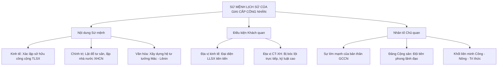

# CHƯƠNG 2: SỨ MỆNH LỊCH SỬ CỦA GIAI CẤP CÔNG NHÂN

### 1. Sơ đồ Điều kiện Quy định Sứ mệnh Lịch sử

### 2. Các Khái Niệm Nền Tảng & Luận Điểm Cốt Lõi
- **Giai cấp công nhân (GCCN):** Tập đoàn xã hội ổn định, đại biểu cho LLSX tiên tiến, phương thức sản xuất hiện đại; dưới CNTB là người làm thuê không có TLSX, bị bóc lột giá trị thặng dư.
- **Hai phương diện xác định GCCN:**
  1. *Kinh tế - kỹ thuật:* Trực tiếp hoặc gián tiếp vận hành công cụ sản xuất công nghiệp, tính xã hội hóa cao.
  2. *Kinh tế - xã hội:* Bị bóc lột giá trị thặng dư, đối kháng lợi ích trực tiếp với giai cấp tư sản.
- **Sứ mệnh lịch sử tổng quát:** Lãnh đạo quần chúng nhân dân lao động lật đổ ách thống trị TBCN, xóa bỏ áp bức bóc lột, giải phóng giai cấp và nhân loại, xây dựng thành công CNXH và CNCS.
- **Đảng Cộng sản:** Sự kết hợp giữa chủ nghĩa Mác - Lênin với phong trào công nhân. Là nhân tố chủ quan quyết định nhất để GCCN hoàn thành sứ mệnh.
- **Giai cấp công nhân Việt Nam:**
  - Ra đời trước tư sản dân tộc, chịu 3 tầng áp bức (đế quốc, phong kiến, tư sản ngoại bang).
  - Có mối liên minh tự nhiên máu thịt với giai cấp nông dân.
  - Sớm được Đảng Cộng sản Việt Nam (1930) lãnh đạo, là lực lượng tiên phong trong sự nghiệp công nghiệp hóa, hiện đại hóa đất nước.\n