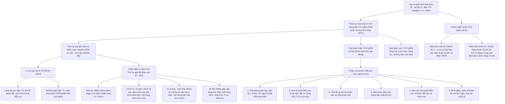
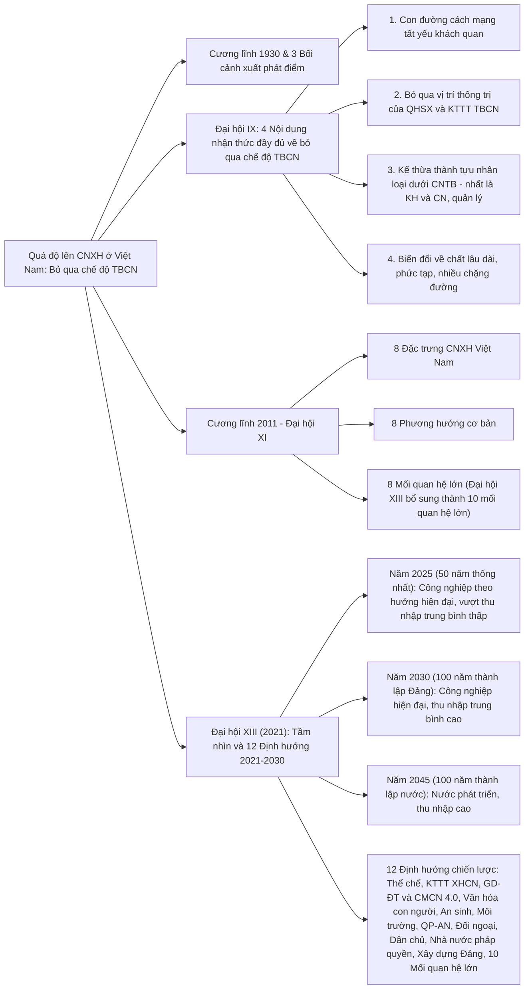

# CHƯƠNG 3: CHỦ NGHĨA XÃ HỘI VÀ THỜI KỲ QUÁ ĐỘ LÊN CHỦ NGHĨA XÃ HỘI

> **Hướng dẫn học tập theo Phương pháp ghi chép Cornell (Cornell Note-taking System):**
> Tài liệu lý thuyết Chương 3 được thiết kế chuẩn hóa theo cấu trúc **Cornell Note-taking System** dựa trên *Giáo trình Chủ nghĩa xã hội khoa học (2021)* gồm 3 vùng nhận thức gắn kết chặt chẽ:
> 1. **Cột Từ khóa & Câu hỏi gợi nhớ (Cue Column - Cột trái):** Chứa các khái niệm trung tâm, tác phẩm kinh điển, mốc lịch sử, văn kiện Đại hội và các câu hỏi định hướng tư duy giúp người học chủ động truy xuất thông tin (Active Recall).
> 2. **Cột Ghi chú chi tiết (Note-taking Column - Cột phải):** Hệ thống hóa đầy đủ luận điểm lý luận của chủ nghĩa Mác - Lênin về chủ nghĩa xã hội, thời kỳ quá độ lên chủ nghĩa xã hội và sự vận dụng sáng tạo của Đảng Cộng sản Việt Nam.
> 3. **Phần Tóm tắt cốt lõi (Cornell Summary - Cuối mỗi mục & cuối chương):** Cô đọng bản chất khoa học, tính quy luật lịch sử - tự nhiên và giá trị thực tiễn của từng nội dung trọng tâm.

---

## Sơ đồ 1: Học thuyết Hình thái KT-XH, Chủ nghĩa xã hội và Thời kỳ quá độ

---

## I. CHỦ NGHĨA XÃ HỘI

| Từ khóa / Câu hỏi gợi nhớ | Ghi chú chi tiết (Nội dung cốt lõi) |
| :--- | :--- |
| **4 góc độ tiếp cận Chủ nghĩa xã hội** *Chủ nghĩa xã hội được hiểu và tiếp cận từ bốn phương diện nào?* | • Theo giáo trình, **Chủ nghĩa xã hội (CNXH)** được tiếp cận từ **4 góc độ** cơ bản:   1. **Là phong trào thực tiễn:** Phong trào đấu tranh của nhân dân lao động chống lại áp bức, bất công, chống các giai cấp thống trị.   2. **Là trào lưu tư tưởng, lý luận:** Phản ánh lý tưởng giải phóng nhân dân lao động khỏi áp bức, bóc lột, bất công.   3. **Là một khoa học:** Chủ nghĩa xã hội khoa học là khoa học về **sứ mệnh lịch sử của giai cấp công nhân**.   4. **Là một chế độ xã hội tốt đẹp:** Giai đoạn đầu của hình thái kinh tế - xã hội cộng sản chủ nghĩa. |
| **1. Học thuyết Hình thái KT-XH & Tính tất yếu lịch sử - tự nhiên** *Hai tiền đề vật chất quan trọng nhất dẫn đến sự thay thế CNTB bằng CNCS là gì?* | • **Chủ thể sáng lập & phát triển:** Học thuyết về hình thái kinh tế - xã hội do **C. Mác và Ph. Ăngghen** khởi xướng khi nghiên cứu lịch sử loài người (nhất là lịch sử xã hội tư bản), được **V.I. Lênin** bổ sung, phát triển và hiện thực hóa trong công cuộc xây dựng CNXH ở nước Nga Xôviết. • **Giá trị phương pháp luận:** Không chỉ làm rõ các yếu tố cấu thành hình thái kinh tế - xã hội mà còn xem xét xã hội trong quá trình biến đổi và phát triển không ngừng; cung cấp những tiêu chuẩn thực sự duy vật, khoa học cho sự phân kỳ lịch sử. • **Tính tất yếu thay thế CNTB bằng CSCN:** Đây là một **quá trình lịch sử - tự nhiên**, được thực hiện thông qua **cách mạng xã hội chủ nghĩa** xuất phát từ **2 tiền đề vật chất quan trọng nhất**:   1. Sự phát triển của **lực lượng sản xuất**.   2. Sự trưởng thành của **giai cấp công nhân**. |
| **Phân kỳ Hình thái KT-XH CSCN trong *Phê phán Cương lĩnh Gôta* (1875)** *C. Mác phân chia hình thái KT-XH cộng sản chủ nghĩa thành những giai đoạn nào? Đặc điểm của xã hội thời kỳ quá độ là gì?* | • C. Mác và Ph. Ăngghen xác định hình thái kinh tế - xã hội cộng sản chủ nghĩa phát triển từ thấp lên cao qua **2 giai đoạn**: **giai đoạn thấp** (Chủ nghĩa xã hội) và **giai đoạn cao** (Chủ nghĩa cộng sản); giữa xã hội tư bản chủ nghĩa và xã hội cộng sản chủ nghĩa là **thời kỳ quá độ** lên chủ nghĩa cộng sản. • **Luận điểm kinh điển trong tác phẩm *Phê phán Cương lĩnh Gôta* (1875):** C. Mác khẳng định: *"Giữa xã hội tư bản chủ nghĩa và xã hội cộng sản chủ nghĩa là một thời kỳ cải biến cách mạng từ xã hội nọ sang xã hội kia. Thích ứng với thời kỳ ấy là một thời kỳ quá độ chính trị, và nhà nước của thời kỳ ấy không thể là cái gì khác hơn là nền chuyên chính cách mạng của giai cấp vô sản."* • **Bản chất xã hội mới thoát thai:** C. Mác chỉ rõ xã hội ấy *"không phải là một xã hội cộng sản chủ nghĩa đã phát triển trên những cơ sở của chính nó, mà trái lại là một xã hội cộng sản chủ nghĩa vừa thoát thai từ xã hội tư bản chủ nghĩa, do đó là một xã hội, về mọi phương diện - kinh tế, đạo đức, tinh thần - còn mang những dấu vết của xã hội cũ mà nó đã lọt lòng ra."* |
| **Quan điểm của V.I. Lênin & 2 nghĩa của Thời kỳ quá độ** *V.I. Lênin phân biệt hai nghĩa của thời kỳ quá độ từ CNTB lên CNCS như thế nào? Vì sao gọi là "những cơn đau đẻ kéo dài"?* | • Khẳng định quan điểm của C. Mác, V.I. Lênin nêu rõ: *"Về lý luận, không thể nghi ngờ gì được rằng giữa chủ nghĩa tư bản và chủ nghĩa cộng sản, có một thời kỳ quá độ nhất định."* • Từ thực tiễn nước Nga, đối với những nước chưa có chủ nghĩa tư bản phát triển cao, V.I. Lênin nhấn mạnh *"cần phải có một thời kỳ quá độ khá lâu dài từ chủ nghĩa tư bản lên chủ nghĩa xã hội."* • **Hai nghĩa của thời kỳ quá độ từ CNTB lên CNCS:**   1. **Nghĩa thứ nhất:** Đối với các nước **chưa trải qua chủ nghĩa tư bản phát triển**, cần thiết phải có thời kỳ quá độ khá lâu dài từ chủ nghĩa tư bản lên chủ nghĩa xã hội – được V.I. Lênin ví là ***"những cơn đau đẻ kéo dài"***.   2. **Nghĩa thứ hai:** Đối với những nước **đã trải qua chủ nghĩa tư bản phát triển**, giữa chủ nghĩa tư bản và chủ nghĩa cộng sản có một thời kỳ quá độ nhất định, thời kỳ cải biến cách mạng từ xã hội này sang xã hội kia, thời kỳ quá độ từ chủ nghĩa tư bản lên chủ nghĩa cộng sản. |
| **2. Điều kiện ra đời CNXH: (a) Điều kiện kinh tế** *Vai trò lịch sử của CNTB là gì và mâu thuẫn kinh tế cơ bản của CNTB nảy sinh như thế nào?* | • **Thừa nhận vai trò lịch sử của CNTB:** Sự ra đời của CNTB là một giai đoạn mới trong lịch sử nhân loại. Nhờ bước tiến to lớn của lực lượng sản xuất, biểu hiện tập trung nhất là sự ra đời của công nghiệp cơ khí (**Cách mạng công nghiệp lần thứ hai**), trong vòng chưa đầy một thế kỷ, CNTB đã tạo ra lực lượng sản xuất nhiều hơn và đồ sộ hơn lực lượng sản xuất mà nhân loại tạo ra đến lúc đó. • **Mâu thuẫn kinh tế cơ bản:** Lực lượng sản xuất càng được cơ khí hóa, hiện đại hóa càng mang **tính xã hội hóa cao**, thì càng mâu thuẫn gay gắt với **quan hệ sản xuất tư bản chủ nghĩa** dựa trên **chế độ chiếm hữu tư nhân tư bản chủ nghĩa** đối với tư liệu sản xuất. • **Hệ quả tất yếu:** Quan hệ sản xuất tư bản chủ nghĩa từ chỗ đóng vai trò mở đường cho lực lượng sản xuất phát triển ngày càng trở nên lỗi thời, biến thành **xiềng xích** kìm hãm lực lượng sản xuất. |
| **2. Điều kiện ra đời CNXH: (b) Điều kiện chính trị - xã hội** *Mâu thuẫn xã hội của CNTB biểu hiện ra sao? Cách mạng vô sản được thực hiện bằng con đường nào?* | • **Mâu thuẫn giai cấp đối kháng:** Mâu thuẫn giữa tính chất xã hội hóa của LLSX với chế độ chiếm hữu tư nhân TBCN biểu hiện về mặt xã hội là mâu thuẫn ngày càng gay gắt giữa **giai cấp công nhân hiện đại** với **giai cấp tư sản lỗi thời**. • **Sự trưởng thành của giai cấp công nhân:** Cùng với sự phát triển của nền đại công nghiệp cơ khí, giai cấp công nhân ("con đẻ của nền đại công nghiệp" – thứ vũ khí do chính giai cấp tư sản tạo ra sẽ lật đổ mình) trưởng thành vượt bậc cả về **số lượng và chất lượng**. Sự trưởng thành vượt bậc này được đánh dấu bằng sự ra đời của **Đảng Cộng sản** – đội tiền phong trực tiếp lãnh đạo cuộc đấu tranh chính trị chống giai cấp tư sản. • **Cách mạng vô sản – Con đường hình thành tất yếu:** Do khác về bản chất với mọi hình thái KT-XH trước đó, hình thái KT-XH cộng sản chủ nghĩa **không tự nhiên ra đời**, mà chỉ hình thành thông qua **cách mạng vô sản** dưới sự lãnh đạo của Đảng Cộng sản. • **Hình thức tiến hành cách mạng:** Trên thực tế được thực hiện chủ yếu bằng **con đường bạo lực cách mạng** (nhằm lật đổ chế độ TBCN, thiết lập nhà nước chuyên chính vô sản). Về mặt lý thuyết, cách mạng vô sản cũng có thể tiến hành bằng **con đường hòa bình**, nhưng vô cùng hiếm, quý và trên thực tế **chưa xảy ra**. Cách mạng vô sản chỉ thành công khi tính tích cực chính trị của giai cấp công nhân được khơi dậy và phát huy trong **liên minh với các giai cấp và tầng lớp lao động** dưới sự lãnh đạo của Đảng Cộng sản. |
| **3. Đặc trưng 1 của CNXH: Giải phóng & Phát triển toàn diện con người** *Mục tiêu nhân văn cao nhất của CNXH được C. Mác, Ph. Ăngghen và V.I. Lênin diễn đạt như thế nào?* | • **Nội dung đặc trưng 1:** *Chủ nghĩa xã hội giải phóng giai cấp, giải phóng dân tộc, giải phóng xã hội, giải phóng con người, tạo điều kiện để con người phát triển toàn diện.* • **Dự báo trong *Tuyên ngôn của Đảng Cộng sản*:** Thay thế xã hội tư sản cũ sẽ là một khối liên hiệp, trong đó *"sự phát triển tự do của mỗi người là điều kiện của sự phát triển tự do của tất cả mọi người"*; khi làm chủ tồn tại xã hội của chính mình thì con người làm chủ tự nhiên, làm chủ bản thân, trở thành người tự do. • **Tính triệt để của giải phóng:** Đây là sự khác biệt về chất so với các hình thái KT-XH trước đó (bản chất nhân văn, nhân đạo). Trước hết phải **giải phóng giai cấp**, xóa bỏ người áp bức, bóc lột người thì *"tình trạng dân tộc này bóc lột dân tộc khác cũng sẽ bị xóa bỏ"*. • **Quan điểm của V.I. Lênin:** Mục đích cao nhất, cuối cùng của những cải tạo xã hội chủ nghĩa là thiết lập xã hội cộng sản chủ nghĩa thực hiện nguyên tắc: ***"làm theo năng lực, hưởng theo nhu cầu"*** (vì thế tên gọi *"đảng cộng sản"* là duy nhất chính xác về mặt khoa học). Nhiệm vụ cụ thể của thời kỳ xây dựng CNXH là tạo điều kiện về **cơ sở vật chất - kỹ thuật** và **đời sống tinh thần** để tiến tới xã hội cộng sản. |
| **3. Đặc trưng 2 của CNXH: Nền kinh tế phát triển cao & Công hữu TLSX** *Tại sao không thể thủ tiêu ngay chế độ tư hữu? Lênin đề xuất giải pháp gì cho nước tiểu nông?* | • **Nội dung đặc trưng 2:** *Chủ nghĩa xã hội có nền kinh tế phát triển cao dựa trên lực lượng sản xuất hiện đại và chế độ công hữu về tư liệu sản xuất chủ yếu.* • **Bản chất kinh tế:** Đây là đặc trưng về phương diện kinh tế. Nền kinh tế phát triển cao có LLSX hiện đại, QHSX dựa trên chế độ công hữu về tư liệu sản xuất, tổ chức quản lý hiệu quả, năng suất lao động cao và **phân phối chủ yếu theo lao động**. • **Không thể thủ tiêu ngay lập tức chế độ tư hữu (Ph. Ăngghen):** Không thể thủ tiêu ngay chế độ tư hữu cũng y như không thể làm LLSX tăng lên ngay lập tức đến mức cần thiết cho nền kinh tế công hữu; phải cải tạo **một cách dần dần**, chỉ khi tạo đủ khối lượng TLSX cần thiết mới thủ tiêu được chế độ tư hữu. • **Tổ chức lao động & "Bắc những chiếc cầu nhỏ vững chắc" (V.I. Lênin):**   ◦ Cần tổ chức lao động theo trình độ cao hơn, chặt chẽ và kỷ luật lao động nghiêm để nâng cao năng suất lao động.   ◦ Đối với nước tiểu nông chưa qua CNTB tiến lên CNXH: phải ***"bắc những chiếc cầu nhỏ vững chắc"*** đi xuyên qua **chủ nghĩa tư bản nhà nước** (*"dưới Chính quyền Xôviết thì chủ nghĩa tư bản nhà nước sẽ có thể là 3/4 chủ nghĩa xã hội"*).   ◦ Phải học hỏi kinh nghiệm các nước phát triển theo công thức tổng số của V.I. Lênin: ***"Chính quyền Xôviết + trật tự ở đường sắt Phổ + kỹ thuật và cách tổ chức các tơ-rớt ở Mỹ + ngành giáo dục quốc dân Mỹ etc. etc. = tổng số = chủ nghĩa xã hội"***. |
| **3. Đặc trưng 3 của CNXH: Nhân dân lao động làm chủ** *Vì sao chế độ dân chủ vô sản ưu việt hơn hẳn dân chủ tư sản?* | • **Nội dung đặc trưng 3:** *Chủ nghĩa xã hội là chế độ xã hội do nhân dân lao động làm chủ.* • **Thuộc tính bản chất:** CNXH là xã hội vì con người và do con người; nhân dân (nòng cốt là nhân dân lao động) là chủ thể thực hiện quyền làm chủ ngày càng rộng rãi và đầy đủ trong cải tạo xã hội cũ, xây dựng xã hội mới. • **Chế độ chính trị dân chủ:** C. Mác và Ph. Ăngghen khẳng định bước thứ nhất trong cách mạng công nhân là giai cấp vô sản biến thành giai cấp thống trị, **giành lấy dân chủ**. V.I. Lênin khẳng định: *"Chế độ dân chủ vô sản so với bất cứ chế độ dân chủ tư sản nào, cũng dân chủ hơn gấp triệu lần: Chính quyền Xôviết so với nước cộng hòa tư sản dân chủ nhất thì cũng dân chủ hơn gấp triệu lần."* |
| **3. Đặc trưng 4 của CNXH: Nhà nước kiểu mới mang bản chất GCCN** *Hai mặt chức năng cơ bản của Nhà nước chuyên chính vô sản là gì?* | • **Nội dung đặc trưng 4:** *Chủ nghĩa xã hội có nhà nước kiểu mới mang bản chất giai cấp công nhân, đại biểu cho lợi ích, quyền lực và ý chí của nhân dân lao động.* • **Bản chất của Nhà nước chuyên chính vô sản (V.I. Lênin):** Là chính quyền do giai cấp vô sản giành được và duy trì bằng bạo lực đối với giai cấp tư sản; thực hiện đồng thời hai chức năng:   1. **Mở rộng dân chủ** cho tuyệt đại đa số nhân dân (lần đầu tiên biến thành chế độ dân chủ cho người nghèo, cho nhân dân – không phải cho bọn nhà giàu), tập hợp và lôi cuốn đông đảo quần chúng tham gia quản lý nhà nước, quản lý xã hội, tổ chức đời sống xã hội vì con người.   2. **Trấn áp bằng vũ lực** và hạn chế quyền tự do đối với bọn áp bức, bóc lột, bọn tư bản chống phá nhân dân. |
| **3. Đặc trưng 5 của CNXH: Nền văn hóa phát triển cao** *V.I. Lênin quan niệm như thế nào về việc xây dựng "văn hóa vô sản"?* | • **Nội dung đặc trưng 5:** *Chủ nghĩa xã hội có nền văn hóa phát triển cao, kế thừa và phát huy những giá trị của văn hóa dân tộc và tinh hoa văn hóa nhân loại.* • **Vai trò của văn hóa:** Văn hóa là **nền tảng tinh thần của xã hội**, vừa là **mục tiêu**, vừa là **động lực** phát triển xã hội (trọng tâm là phát triển kinh tế); hun đúc tâm hồn, khí phách, bản lĩnh, biến con người thành con người **chân, thiện, mỹ**. • **Quan điểm của V.I. Lênin:** Xây dựng *"văn hóa vô sản"* không thể tách rời di sản nhân loại: *"Người ta chỉ có thể trở thành người cộng sản khi biết làm giàu trí óc của mình bằng sự hiểu biết tất cả những kho tàng trí thức mà nhân loại đã tạo ra."* Cần kế thừa giá trị văn hóa dân tộc, tinh hoa văn hóa nhân loại, đồng thời **chống tư tưởng, văn hóa phi vô sản** trái với truyền thống tốt đẹp và phương hướng XHCN. |
| **3. Đặc trưng 6 của CNXH: Bình đẳng dân tộc & Hợp tác quốc tế** *Ba nguyên tắc trong Cương lĩnh dân tộc của V.I. Lênin là gì?* | • **Nội dung đặc trưng 6:** *Chủ nghĩa xã hội bảo đảm bình đẳng, đoàn kết giữa các dân tộc và có quan hệ hữu nghị, hợp tác với nhân dân các nước trên thế giới.* • **Mối quan hệ biện chứng giai cấp - dân tộc:** Tuân thủ nguyên tắc của C. Mác và Ph. Ăngghen: *"xóa bỏ tình trạng người bóc lột người thì tình trạng dân tộc này bóc lột dân tộc khác cũng sẽ bị xóa bỏ"*. Khác biệt căn bản với chủ nghĩa dân tộc cực đoan, hẹp hòi hay phân biệt chủng tộc. • **Cương lĩnh về vấn đề dân tộc của V.I. Lênin (3 nguyên tắc):** (1) Các dân tộc hoàn toàn bình đẳng; (2) Các dân tộc được quyền tự quyết; (3) Liên hiệp công nhân tất cả các dân tộc lại. • **Đoàn kết quốc tế:** Trong *Luận cương về vấn đề dân tộc và vấn đề thuộc địa*, V.I. Lênin nhấn mạnh cần đưa giai cấp vô sản và quần chúng lao động tất cả các nước lại gần nhau chống địa chủ, tư sản, từ đó đề ra khẩu hiệu: ***"Vô sản tất cả các nước và các dân tộc bị áp bức, đoàn kết lại!"***. Nhờ vậy, CNXH góp phần tích cực vào cuộc đấu tranh chung vì hòa bình, độc lập dân tộc, dân chủ và tiến bộ xã hội. |

> **Tóm tắt Mục I (Cornell Summary):**
> Chủ nghĩa xã hội – giai đoạn đầu của hình thái kinh tế - xã hội cộng sản chủ nghĩa – ra đời tất yếu từ hai tiền đề vật chất là sự phát triển mang tính xã hội hóa cao của lực lượng sản xuất (CMCN lần 2) mâu thuẫn với QHSX tư hữu TBCN và sự trưởng thành của giai cấp công nhân có Đảng Cộng sản lãnh đạo tiến hành cách mạng vô sản. Với 6 đặc trưng bản chất về giải phóng con người, kinh tế công hữu hiện đại, nhân dân làm chủ, nhà nước kiểu mới, văn hóa tiên tiến và bình đẳng đoàn kết dân tộc - quốc tế, CNXH thể hiện tính ưu việt vượt trội so với mọi chế độ trước đó.

---

## II. THỜI KỲ QUÁ ĐỘ LÊN CHỦ NGHĨA XÃ HỘI

| Từ khóa / Câu hỏi gợi nhớ | Ghi chú chi tiết (Nội dung cốt lõi) |
| :--- | :--- |
| **1. Tính tất yếu khách quan của Thời kỳ quá độ** *Vì sao không thể tiến ngay lập tức tới một chế độ XHCN hoàn chỉnh mà phải trải qua thời kỳ quá độ?* | • **Sự khác biệt về chất của hình thái KT-XH CSCN:** Trong 5 hình thái kinh tế - xã hội của lịch sử (cộng sản nguyên thủy, chiếm hữu nô lệ, phong kiến, tư bản chủ nghĩa, cộng sản chủ nghĩa), hình thái cộng sản chủ nghĩa khác biệt căn bản về chất (không có giai cấp đối kháng, con người từng bước trở thành người tự do). • **Không thể có phép màu "cầu được ước thấy":** Khát vọng có ngay một chế độ XHCN tốt đẹp thay thế CNTB bất công là chính đáng, nhưng giai cấp vô sản tất yếu phải có thời gian để **cải tạo xã hội cũ** do giai cấp bóc lột dựng lên và **xây dựng trên nền móng ấy lâu dài** của chủ nghĩa xã hội. • **Khẳng định kinh điển:** C. Mác (*Phê phán Cương lĩnh Gôta*, 1875) và V.I. Lênin đều khẳng định giữa CNTB và CNCS tất yếu có một thời kỳ cải biến cách mạng, một thời kỳ quá độ chính trị với nhà nước chuyên chính cách mạng của giai cấp vô sản. |
| **2 loại quá độ: Trực tiếp & Gián tiếp (Rút ngắn)** *Phân biệt hai loại quá độ từ CNTB lên CNCS. Cơ sở lý luận nào cho phép các nước lạc hậu đi lên CNXH theo con đường rút ngắn?* | • **1) Quá độ trực tiếp:** Từ chủ nghĩa tư bản lên chủ nghĩa cộng sản đối với những nước **đã trải qua chủ nghĩa tư bản phát triển**. *Lưu ý thực tiễn:* Cho đến nay, thời kỳ quá độ trực tiếp chưa từng diễn ra trên thế giới. • **2) Quá độ gián tiếp (con đường rút ngắn):** Từ chủ nghĩa tư bản lên chủ nghĩa cộng sản đối với những nước **chưa trải qua chủ nghĩa tư bản phát triển** (như Liên Xô và các nước XHCN Đông Âu trước đây, Trung Quốc, Việt Nam và một số nước XHCN khác ngày nay). • **Cơ sở lý luận của con đường rút ngắn:**   ◦ **C. Mác & Ph. Ăngghen:** Với sự giúp đỡ của giai cấp vô sản đã chiến thắng, các dân tộc lạc hậu có thể **rút ngắn khá nhiều** quá trình phát triển lên xã hội XHCN, tránh được phần lớn đau khổ và đấu tranh như ở Tây Âu (khi bàn về nước Nga, C. Mác nêu khả năng không cần trải qua đau khổ của CNTB mà vẫn chiếm đoạt được mọi thành quả của chế độ ấy).   ◦ **V.I. Lênin (sau Cách mạng Tháng Mười):** Với sự giúp đỡ của GCVS các nước tiên tiến, các nước lạc hậu có thể tiến tới chế độ Xôviết và qua những giai đoạn phát triển nhất định tiến tới CNCS mà không phải trải qua giai đoạn phát triển TBCN (*con đường rút ngắn*).   ◦ **Trong thời đại ngày nay:** Với lợi thế thời đại, trong bối cảnh **toàn cầu hóa và Cách mạng công nghiệp lần thứ tư**, các nước lạc hậu sau khi giành chính quyền dưới sự lãnh đạo của Đảng Cộng sản có thể tiến thẳng lên CNXH bỏ qua chế độ TBCN. |
| **2. Thực chất & Đặc điểm chung của Thời kỳ quá độ** *Thực chất của thời kỳ quá độ lên CNXH là gì? Thời điểm bắt đầu và kết thúc được xác định như thế nào?* | • **Thực chất:** Là thời kỳ **cải biến cách mạng** từ xã hội tiền tư bản chủ nghĩa và tư bản chủ nghĩa sang xã hội xã hội chủ nghĩa. • **Tính chất đan xen:** Xã hội của thời kỳ quá độ là xã hội có **sự đan xen của nhiều tàn dư** về mọi phương diện (kinh tế, đạo đức, tinh thần) của chủ nghĩa tư bản và **những yếu tố mới mang tính chất xã hội chủ nghĩa** của CNXH mới phát sinh, chưa phải là CNXH đã phát triển trên cơ sở của chính nó. • **Đặc điểm bao trùm:** Là thời kỳ cải tạo cách mạng sâu sắc, triệt để trên tất cả các lĩnh vực (kinh tế, chính trị, văn hóa, xã hội), xây dựng từng bước cơ sở vật chất - kỹ thuật và đời sống tinh thần của CNXH. Là thời kỳ **lâu dài, gian khổ**, bắt đầu từ khi **giai cấp công nhân và nhân dân lao động giành được chính quyền** đến khi **xây dựng thành công chủ nghĩa xã hội**. |
| **Đặc điểm trên lĩnh vực Kinh tế** *Vì sao tồn tại nền kinh tế nhiều thành phần? V.I. Lênin chỉ ra 5 thành phần kinh tế nào ở nước Nga?* | • **Đặc điểm cốt lõi:** Tất yếu tồn tại **nền kinh tế nhiều thành phần**, trong đó có những thành phần **đối lập** (vừa có những bộ phận, mảnh của chủ nghĩa tư bản lẫn của chủ nghĩa xã hội). • **5 thành phần kinh tế ở nước Nga theo V.I. Lênin:**   1. Kinh tế gia trưởng.   2. Kinh tế hàng hóa nhỏ.   3. Kinh tế tư bản.   4. Kinh tế tư bản nhà nước.   5. Kinh tế xã hội chủ nghĩa. • V.I. Lênin nhấn mạnh then chốt của vấn đề không chỉ là thừa nhận có nhiều mảnh ghép cũ - mới mà phải nghiên cứu xem các thành phần của kết cấu kinh tế - xã hội ấy hiện tồn tại và vận động như thế nào. |
| **Đặc điểm trên lĩnh vực Chính trị** *Cuộc đấu tranh giai cấp trong thời kỳ quá độ diễn ra với điều kiện mới, nội dung mới và hình thức mới nào?* | • **Thiết lập & tăng cường chuyên chính vô sản:** Giai cấp công nhân nắm và sử dụng quyền lực nhà nước trấn áp giai cấp tư sản, tiến hành xây dựng xã hội không giai cấp. Thực hiện **dân chủ đối với nhân dân** (tổ chức xây dựng, bảo vệ chế độ mới) và **chuyên chính với phần tử thù địch**. • **Tiếp tục cuộc đấu tranh giai cấp trong bối cảnh mới:** Là cuộc đấu tranh giữa giai cấp vô sản *đã chiến thắng nhưng chưa phải đã toàn thắng* với giai cấp tư sản *đã thất bại nhưng chưa phải thất bại hoàn toàn*, với 3 điểm mới:   1. **Điều kiện mới:** Giai cấp công nhân đã trở thành **giai cấp cầm quyền**.   2. **Nội dung mới:** Xây dựng toàn diện xã hội mới, **trọng tâm là xây dựng nhà nước có tính kinh tế**.   3. **Hình thức mới:** Cơ bản là **hòa bình tổ chức xây dựng**. |
| **Đặc điểm trên lĩnh vực Tư tưởng - Văn hóa** *Đời sống tư tưởng và văn hóa thời kỳ quá độ có nét nổi bật nào?* | • **Đa dạng hệ tư tưởng:** Còn tồn tại nhiều tư tưởng khác nhau, chủ yếu là **tư tưởng vô sản** và **tư tưởng tư sản**. • **Nhiệm vụ kiến thiết văn hóa mới:** Giai cấp công nhân thông qua đội tiền phong là **Đảng Cộng sản** từng bước xây dựng văn hóa vô sản, nền văn hóa mới xã hội chủ nghĩa; tiếp thu giá trị văn hóa dân tộc và tinh hoa văn hóa nhân loại, bảo đảm đáp ứng nhu cầu văn hóa - tinh thần ngày càng tăng của nhân dân. |
| **Đặc điểm trên lĩnh vực Xã hội** *Kết cấu giai cấp - xã hội thời kỳ quá độ biểu hiện ra sao và nguyên tắc phân phối chủ đạo là gì?* | • **Cấu trúc giai cấp - xã hội đa dạng:** Do kết cấu của nền kinh tế nhiều thành phần quy định nên còn tồn tại nhiều giai cấp, tầng lớp và sự khác biệt giữa các giai cấp, tầng lớp; các giai cấp, tầng lớp **vừa hợp tác, vừa đấu tranh với nhau**. • **Sự khác biệt xã hội còn tồn tại:** Giữa **nông thôn và thành thị**, giữa **lao động trí óc và lao động chân tay**. • **Mục tiêu & Nguyên tắc phân phối:** Là thời kỳ đấu tranh giai cấp chống áp bức, bất công, xóa bỏ tệ nạn xã hội và tàn dư xã hội cũ; thiết lập công bằng xã hội trên cơ sở thực hiện **nguyên tắc phân phối theo lao động là chủ đạo**. |

> **Tóm tắt Mục II (Cornell Summary):**
> Thời kỳ quá độ lên chủ nghĩa xã hội là tất yếu khách quan để cải tạo xã hội cũ và xây dựng cơ sở vật chất - tinh thần cho xã hội mới, diễn ra theo hai loại hình (quá độ trực tiếp chưa từng xảy ra và quá độ gián tiếp/rút ngắn ở các nước chưa qua CNTB phát triển). Thực chất của thời kỳ này là sự đan xen, đấu tranh giữa tàn dư cũ và yếu tố XHCN mới trên cả 4 lĩnh vực: kinh tế nhiều thành phần (5 thành phần ở Nga), chính trị chuyên chính vô sản với cuộc đấu tranh giai cấp trong điều kiện - nội dung - hình thức mới, tư tưởng - văn hóa song hành vô sản - tư sản, và xã hội đa tầng lớp thực hiện phân phối theo lao động là chủ đạo.

---

## Sơ đồ 2: Quá độ lên CNXH bỏ qua chế độ TBCN ở Việt Nam (Đại hội IX – Đại hội XI – Đại hội XIII)

---

## III. QUÁ ĐỘ LÊN CHỦ NGHĨA XÃ HỘI Ở VIỆT NAM

| Từ khóa / Câu hỏi gợi nhớ | Ghi chú chi tiết (Nội dung cốt lõi) |
| :--- | :--- |
| **1. 3 đặc trưng bối cảnh xuất phát điểm của Việt Nam** *Việt Nam bước vào thời kỳ quá độ lên CNXH trong điều kiện thuận lợi và khó khăn đan xen nào?* | • **Đặc trưng 1 (Xuất phát điểm thấp & hậu quả chiến tranh):** Xuất phát từ xã hội vốn là **thuộc địa, nửa phong kiến**, lực lượng sản xuất **rất thấp**; trải qua chiến tranh ác liệt kéo dài nhiều thập kỷ với hậu quả nặng nề; tàn dư thực dân, phong kiến còn nhiều; các thế lực thù địch thường xuyên tìm cách phá hoại chế độ XHCN và độc lập dân tộc. • **Đặc trưng 2 (Tác động của KH&CN và quốc tế hóa):** Cuộc cách mạng khoa học và công nghệ hiện đại diễn ra mạnh mẽ; nền sản xuất vật chất và đời sống xã hội đang **quốc tế hóa sâu sắc**, vừa tạo **thời cơ phát triển nhanh**, vừa đặt ra **thách thức gay gắt**. • **Đặc trưng 3 (Bối cảnh thời đại sau sự sụp đổ ở Liên Xô - Đông Âu):** Thời đại ngày nay vẫn là thời đại quá độ từ CNTB lên CNXH (dù chế độ XHCN ở Liên Xô và Đông Âu sụp đổ). Các nước với chế độ xã hội và trình độ phát triển khác nhau cùng tồn tại, **vừa hợp tác vừa đấu tranh, cạnh tranh gay gắt** vì lợi ích quốc gia, dân tộc; theo quy luật tiến hóa của lịch sử, loài người nhất định sẽ tiến tới CNXH. |
| **Cương lĩnh 1930 & Luận điểm Đại hội IX về "bỏ qua chế độ TBCN"** *4 nội dung nhận thức đầy đủ về con đường quá độ bỏ qua chế độ TBCN ở Việt Nam là gì?* | • **Khẳng định từ Cương lĩnh 1930:** Sau khi hoàn thành cách mạng dân tộc, dân chủ nhân dân, sẽ tiến lên chủ nghĩa xã hội – sự lựa chọn duy nhất đúng, khoa học, phù hợp quy luật khách quan và chủ nghĩa Mác - Lênin. • **Tư duy mới tại Đại hội IX:** Quá độ lên CNXH bỏ qua chế độ TBCN là bỏ qua việc xác lập vị trí thống trị của QHSX và kiến trúc thượng tầng TBCN, nhưng tiếp thu, kế thừa thành tựu nhân loại đạt được dưới CNTB (đặc biệt về KH&CN) để phát triển nhanh LLSX, xây dựng nền kinh tế hiện đại. • **4 nội dung cần hiểu đầy đủ:**   1. **Thứ nhất (Tính tất yếu):** Là con đường cách mạng **tất yếu khách quan**, con đường xây dựng đất nước trong thời kỳ quá độ lên CNXH ở nước ta.   2. **Thứ hai (Cái "bỏ qua" - vị trí thống trị):** Bỏ qua việc **xác lập vị trí thống trị của QHSX và kiến trúc thượng tầng TBCN**. Nghĩa là trong thời kỳ quá độ còn nhiều hình thức sở hữu, nhiều thành phần kinh tế, song sở hữu tư nhân TBCN và thành phần kinh tế tư nhân TBCN **không chiếm vai trò chủ đạo**; còn nhiều hình thức phân phối (ngoài **phân phối theo lao động là chủ đạo**, còn phân phối theo mức độ đóng góp và quỹ phúc lợi xã hội); còn quan hệ bóc lột và bị bóc lột, song quan hệ bóc lột TBCN **không giữ vai trò thống trị**.   3. **Thứ ba (Cái "kế thừa"):** Đòi hỏi phải **tiếp thu, kế thừa thành tựu** nhân loại đạt được dưới CNTB, đặc biệt là thành tựu về **khoa học và công nghệ**, thành tựu về **quản lý phát triển xã hội**, xây dựng nền kinh tế hiện đại, phát triển nhanh LLSX.   4. **Thứ tư (Tính chất lâu dài, phức tạp):** Là tạo ra **sự biến đổi về chất** của xã hội trên tất cả các lĩnh vực – sự nghiệp rất khó khăn, phức tạp, lâu dài với nhiều chặng đường, nhiều hình thức tổ chức kinh tế, xã hội có tính chất quá độ, đòi hỏi **quyết tâm chính trị cao và khát vọng lớn** của toàn Đảng, toàn dân. |
| **2a. Quá trình nhận thức & So sánh 6 đặc trưng (Cương lĩnh 1991) với 8 đặc trưng (Cương lĩnh 2011)** *Mô hình CNXH ở Việt Nam phát triển qua các Đại hội IV, VII, XI như thế nào và 8 đặc trưng của Cương lĩnh 2011 gồm những gì?* | • **Tiến trình nhận thức của Đảng:** Đại hội IV (1976) mới dừng ở mức **định hướng**; đến Đại hội VII (1991) đạt tới trình độ **định hình, định lượng** với 6 đặc trưng; đến Đại hội XI (2011), tổng kết 25 năm đổi mới, Cương lĩnh (bổ sung, phát triển năm 2011) xác định **8 đặc trưng cơ bản**. • **6 đặc trưng trong Cương lĩnh 1991 (Đại hội VII):** (1) Do nhân dân lao động làm chủ; (2) Nền kinh tế phát triển cao dựa trên LLSX hiện đại và chế độ công hữu về các TLSX chủ yếu; (3) Nền văn hóa tiên tiến, đậm đà bản sắc dân tộc; (4) Con người được giải phóng khỏi áp bức, bóc lột, bất công, làm theo năng lực, hưởng theo lao động, ấm no, tự do, hạnh phúc, phát triển toàn diện cá nhân; (5) Các dân tộc trong nước bình đẳng, đoàn kết và giúp đỡ lẫn nhau cùng tiến bộ; (6) Có quan hệ hữu nghị và hợp tác với nhân dân tất cả các nước trên thế giới. • **8 đặc trưng bản chất trong Cương lĩnh 2011 (Đại hội XI) – những bổ sung & phát triển trọng yếu:**   1. **Mới bổ sung làm mục tiêu tổng quát:** ***"Dân giàu, nước mạnh, dân chủ, công bằng, văn minh"*** *(được đưa lên làm đặc trưng thứ nhất)*.   2. **Do nhân dân làm chủ** *(mở rộng từ "nhân dân lao động làm chủ" năm 1991)*.   3. Có nền kinh tế phát triển cao dựa trên LLSX hiện đại và **quan hệ sản xuất tiến bộ phù hợp** *(phát triển từ "chế độ công hữu về các TLSX chủ yếu" năm 1991)*.   4. Có nền văn hóa tiên tiến, đậm đà bản sắc dân tộc.   5. Con người có cuộc sống ấm no, tự do, hạnh phúc, có điều kiện phát triển toàn diện.   6. Các dân tộc trong cộng đồng Việt Nam bình đẳng, đoàn kết, **tôn trọng** và giúp nhau cùng phát triển.   7. **Mới bổ sung:** ***"Có Nhà nước pháp quyền xã hội chủ nghĩa của nhân dân, do nhân dân, vì nhân dân do Đảng Cộng sản lãnh đạo."***   8. Có quan hệ hữu nghị và hợp tác với **các nước trên thế giới**. |
| **2b. 7 phương hướng (Cương lĩnh 1991) & 8 phương hướng cơ bản (Đại hội XI)** *Tám phương hướng xây dựng CNXH ở Việt Nam tại Đại hội XI là gì?* | • **7 phương hướng cơ bản trong Cương lĩnh 1991:** (1) Xây dựng Nhà nước XHCN của nhân dân, do nhân dân, vì nhân dân (lấy liên minh công - nông - trí làm nền tảng, Đảng lãnh đạo); (2) Phát triển LLSX, CNH đất nước theo hướng hiện đại gắn với nông nghiệp toàn diện là nhiệm vụ trung tâm; (3) Thiết lập từng bước QHSX XHCN từ thấp đến cao đa dạng sở hữu, phát triển kinh tế hàng hóa nhiều thành phần theo định hướng XHCN (kinh tế quốc doanh và tập thể ngày càng trở thành nền tảng), phân phối theo kết quả lao động và hiệu quả kinh tế là chủ yếu; (4) Cách mạng XHCN trên lĩnh vực tư tưởng và văn hóa (thế giới quan Mác - Lênin và tư tưởng, đạo đức Hồ Chí Minh giữ vị trí chỉ đạo); (5) Đại đoàn kết dân tộc, mở rộng Mặt trận dân tộc thống nhất và đối ngoại hòa bình, hợp tác, trung thành chủ nghĩa quốc tế GCCN; (6) Hai nhiệm vụ chiến lược: Xây dựng CNXH và bảo vệ Tổ quốc; (7) Xây dựng Đảng trong sạch, vững mạnh. • **8 phương hướng cơ bản tại Đại hội XI:**   1. **Một là:** Đẩy mạnh công nghiệp hóa, hiện đại hóa đất nước gắn với phát triển kinh tế tri thức, bảo vệ tài nguyên, môi trường.   2. **Hai là:** Phát triển nền kinh tế thị trường định hướng xã hội chủ nghĩa.   3. **Ba là:** Xây dựng nền văn hóa tiên tiến, đậm đà bản sắc dân tộc; xây dựng con người, nâng cao đời sống nhân dân, thực hiện tiến bộ và công bằng xã hội.   4. **Bốn là:** Bảo đảm vững chắc quốc phòng và an ninh quốc gia, trật tự, an toàn xã hội.   5. **Năm là:** Thực hiện đường lối đối ngoại độc lập, tự chủ, hòa bình, hữu nghị, hợp tác và phát triển; chủ động và tích cực hội nhập quốc tế.   6. **Sáu là:** Xây dựng nền dân chủ xã hội chủ nghĩa, thực hiện đại đoàn kết toàn dân tộc, tăng cường và mở rộng mặt trận dân tộc thống nhất.   7. **Bảy là:** Xây dựng Nhà nước pháp quyền xã hội chủ nghĩa của nhân dân, do nhân dân, vì nhân dân.   8. **Tám là:** Xây dựng Đảng trong sạch, vững mạnh. |
| **8 mối quan hệ lớn (Cương lĩnh 2011) & 10 mối quan hệ lớn (Đại hội XIII)** *Cương lĩnh 2011 nêu 8 mối quan hệ lớn nào và Đại hội XIII bổ sung, hoàn thiện thành những mối quan hệ nào?* | • **8 mối quan hệ lớn trong Cương lĩnh 2011:** (1) Đổi mới, ổn định và phát triển; (2) Đổi mới kinh tế và đổi mới chính trị; (3) Kinh tế thị trường và định hướng XHCN; (4) Phát triển LLSX và xây dựng, hoàn thiện từng bước QHSX XHCN; (5) Tăng trưởng kinh tế và phát triển văn hóa, thực hiện tiến bộ và công bằng xã hội; (6) Xây dựng CNXH và bảo vệ Tổ quốc XHCN; (7) Độc lập, tự chủ và hội nhập quốc tế; (8) Đảng lãnh đạo, Nhà nước quản lý, nhân dân làm chủ. *(Nguyên tắc xử lý: không phiến diện, cực đoan, duy ý chí).* • **Bổ sung thành 10 mối quan hệ lớn tại Đại hội XIII (2021) – Định hướng (12):**   ◦ Bổ sung 2 mối quan hệ mới: **giữa Nhà nước, thị trường và xã hội**; và **giữa thực hành dân chủ và tăng cường pháp chế, bảo đảm kỷ cương xã hội**.   ◦ Đồng thời cập nhật sắc nét các cặp cũ: *"tuân theo các quy luật thị trường và bảo đảm định hướng XHCN"* và bổ sung *"bảo vệ môi trường"* vào cặp tăng trưởng kinh tế - văn hóa - tiến bộ, công bằng xã hội.   ◦ Chú trọng hơn đến 5 trọng tâm: bảo đảm định hướng XHCN; xây dựng, hoàn thiện QHSX tiến bộ phù hợp; phát triển văn hóa, thực hiện tiến bộ, công bằng xã hội, bảo vệ môi trường; bảo vệ Tổ quốc XHCN; giữ vững độc lập, tự chủ và phát huy quyền làm chủ của nhân dân. |
| **Mục tiêu phát triển cụ thể của Đại hội XIII (2025 – 2030 – 2045)** *Ba cột mốc chiến lược đến giữa thế kỷ XXI mà Đại hội XIII xác định gồm những chỉ tiêu nào?* | • Sau 35 năm đổi mới với những thành tựu to lớn có ý nghĩa lịch sử, Đại hội XIII xác định mục tiêu đến giữa thế kỷ XXI nước ta trở thành nước phát triển theo định hướng XHCN với **3 mốc cụ thể**:   1. **Đến năm 2025** *(kỷ niệm 50 năm giải phóng hoàn toàn miền Nam, thống nhất đất nước)*: Là **nước đang phát triển, có công nghiệp theo hướng hiện đại, vượt qua mức thu nhập trung bình thấp**.   2. **Đến năm 2030** *(kỷ niệm 100 năm thành lập Đảng)*: Là **nước đang phát triển, có công nghiệp hiện đại, thu nhập trung bình cao**.   3. **Đến năm 2045** *(kỷ niệm 100 năm thành lập nước Việt Nam Dân chủ Cộng hòa, nay là nước Cộng hòa xã hội chủ nghĩa Việt Nam)*: **Trở thành nước phát triển, thu nhập cao**. |
| **12 định hướng phát triển đất nước giai đoạn 2021–2030 (Đại hội XIII)** *Toàn Đảng, toàn dân cần quán triệt và thực hiện tốt 12 định hướng chiến lược nào trong giai đoạn 2021–2030?* | • **(1) Thể chế phát triển bền vững:** Tiếp tục đổi mới mạnh mẽ tư duy, xây dựng, hoàn thiện đồng bộ thể chế phát triển bền vững về kinh tế, chính trị, văn hóa, xã hội, môi trường; tháo gỡ kịp thời khó khăn, khơi dậy mọi tiềm năng và nguồn lực. • **(2) Thể chế KTTT định hướng XHCN & Chuyển đổi số:** Hoàn thiện toàn diện, đồng bộ thể chế KTTT định hướng XHCN; bảo đảm ổn định vĩ mô, đổi mới mô hình tăng trưởng, cơ cấu lại nền kinh tế, đẩy mạnh CNH-HĐH; xây dựng kết cấu hạ tầng, đô thị, nông thôn mới (ưu tiên miền núi, vùng đồng bào dân tộc thiểu số); đẩy mạnh chuyển đổi số quốc gia, phát triển kinh tế số trên nền tảng KH&CN, đổi mới sáng tạo; nâng cao năng suất, chất lượng, hiệu quả, sức cạnh tranh. • **(3) Giáo dục - Đào tạo, Nhân lực & CMCN 4.0:** Tạo đột phá đổi mới căn bản, toàn diện GD&ĐT; phát triển nguồn nhân lực chất lượng cao, trọng dụng nhân tài; thúc đẩy nghiên cứu, chuyển giao, ứng dụng mạnh mẽ thành tựu CMCN lần thứ tư theo tinh thần *bắt kịp, tiến cùng và vượt lên* ở một số lĩnh vực. • **(4) Văn hóa & Con người Việt Nam:** Phát triển con người toàn diện và xây dựng nền văn hóa Việt Nam tiên tiến, đậm đà bản sắc dân tộc để văn hóa, con người thực sự trở thành **sức mạnh nội sinh**, động lực phát triển và bảo vệ Tổ quốc; tài năng, trí tuệ, phẩm chất con người Việt Nam là trung tâm, mục tiêu và động lực phát triển quan trọng nhất. • **(5) Quản lý phát triển xã hội & An sinh:** Quản lý phát triển xã hội hiệu quả, nghiêm minh; bảo đảm an ninh xã hội, an ninh con người; thực hiện tiến bộ và công bằng xã hội; nâng cao dịch vụ y tế, chất lượng dân số, bảo đảm việc làm, thu nhập, phúc lợi và an sinh xã hội. • **(6) Khí hậu, Tài nguyên & Kinh tế xanh:** Chủ động thích ứng hiệu quả với biến đổi khí hậu, phòng chống thiên tai, dịch bệnh; quản lý sử dụng bền vững tài nguyên; lấy bảo vệ môi trường sống và sức khỏe nhân dân làm mục tiêu hàng đầu; kiên quyết loại bỏ dự án gây ô nhiễm; xây dựng **kinh tế xanh, kinh tế tuần hoàn**. • **(7) Quốc phòng, An ninh & Bảo vệ Tổ quốc:** Kiên quyết, kiên trì bảo vệ vững chắc độc lập, chủ quyền, thống nhất, toàn vẹn lãnh thổ; bảo vệ Đảng, Nhà nước, nhân dân và chế độ XHCN; giữ vững an ninh chính trị, trật tự an toàn xã hội, an ninh con người, an ninh kinh tế, an ninh mạng; chủ động ngăn ngừa nguy cơ chiến tranh, xung đột *từ sớm, từ xa*; làm thất bại âm mưu chống phá của thế lực thù địch. • **(8) Đối ngoại & Hội nhập quốc tế:** Tiếp tục đường lối đối ngoại độc lập, tự chủ, đa phương hóa, đa dạng hóa; chủ động, tích cực hội nhập quốc tế toàn diện, sâu rộng, có hiệu quả; giữ vững môi trường hòa bình, ổn định, nâng cao vị thế, uy tín quốc tế. • **(9) Dân chủ XHCN & Đại đoàn kết:** Thực hành, phát huy rộng rãi dân chủ XHCN, quyền làm chủ và vai trò chủ thể của nhân dân; phát huy sức mạnh đại đoàn kết toàn dân tộc, tăng cường đồng thuận xã hội; đổi mới Mặt trận Tổ quốc và các tổ chức chính trị - xã hội. • **(10) Nhà nước pháp quyền XHCN:** Xây dựng, hoàn thiện Nhà nước pháp quyền XHCN trong sạch, vững mạnh, tinh gọn, hiệu lực, hiệu quả, vì nhân dân phục vụ; tăng cường công khai, minh bạch, trách nhiệm giải trình, kiểm soát quyền lực, siết chặt kỷ luật kỷ cương; đẩy mạnh phòng, chống tham nhũng, lãng phí, quan liêu, tội phạm. • **(11) Xây dựng, chỉnh đốn Đảng & Hệ thống chính trị:** Xây dựng, chỉnh đốn Đảng toàn diện; tăng cường bản chất GCCN của Đảng; nâng cao năng lực lãnh đạo, cầm quyền; xây dựng đội ngũ cán bộ, đảng viên (nhất là cán bộ cấp chiến lược, người đứng đầu) đủ phẩm chất, năng lực, uy tín; tăng cường công tác tư tưởng, bảo vệ Đảng, kiểm tra, giám sát, phòng chống tham nhũng và dân vận. • **(12) Nắm vững & xử lý tốt 10 mối quan hệ lớn:** Xử lý biện chứng các mối quan hệ lớn trong đường lối đổi mới để bảo đảm định hướng XHCN, phát triển bền vững và phát huy quyền làm chủ của nhân dân. |

> **Tóm tắt Mục III (Cornell Summary):**
> Xuất phát từ nước thuộc địa nửa phong kiến với LLSX rất thấp, Việt Nam lựa chọn con đường quá độ lên CNXH **bỏ qua chế độ tư bản chủ nghĩa** – tức là bỏ qua việc xác lập vị trí thống trị của QHSX và kiến trúc thượng tầng TBCN, đồng thời kế thừa thành tựu KH&CN và quản lý của nhân loại để biến đổi xã hội về chất một cách lâu dài, phức tạp. Trên cơ sở 8 đặc trưng và 8 phương hướng của Cương lĩnh 2011, Đại hội XIII (2021) đã xác lập lộ trình 3 cột mốc lịch sử (2025 – 2030 – 2045) cùng 12 định hướng phát triển đất nước và 10 mối quan hệ lớn cần xử lý biện chứng.

---

## Tóm tắt toàn chương (Cornell Summary)

1. **Chủ nghĩa xã hội (Mục I):** Là giai đoạn đầu (giai đoạn thấp) của hình thái kinh tế - xã hội cộng sản chủ nghĩa, ra đời tất yếu từ mâu thuẫn giữa LLSX xã hội hóa cao (CMCN lần 2) với QHSX tư hữu TBCN và cuộc cách mạng vô sản do Đảng Cộng sản lãnh đạo. CNXH mang 6 đặc trưng bản chất, nổi bật là giải phóng toàn diện con người, kinh tế phát triển cao dựa trên LLSX hiện đại và công hữu TLSX chủ yếu (phân phối theo lao động), nhân dân lao động làm chủ, nhà nước chuyên chính vô sản kiểu mới, nền văn hóa phát triển cao và bình đẳng, đoàn kết dân tộc - quốc tế.
2. **Thời kỳ quá độ lên CNXH (Mục II):** Là bước chuyển tiếp tất yếu (theo 2 hình thức: quá độ trực tiếp chưa từng xảy ra và quá độ gián tiếp/rút ngắn – *"những cơn đau đẻ kéo dài"*). Thực chất đây là xã hội đan xen tàn dư cũ và yếu tố XHCN mới trên 4 phương diện: kinh tế nhiều thành phần (5 thành phần ở Nga theo Lênin), chính trị chuyên chính vô sản với đấu tranh giai cấp trong điều kiện - nội dung - hình thức mới, tư tưởng - văn hóa song hành vô sản và tư sản, và xã hội đa tầng lớp còn khác biệt giữa nông thôn - thành thị, trí óc - chân tay.
3. **Quá độ lên CNXH ở Việt Nam (Mục III):** Là con đường bỏ qua việc xác lập vị trí thống trị của QHSX và KTTT TBCN (nhưng kế thừa thành tựu KH&CN, quản lý nhân loại), nhằm hướng tới 8 đặc trưng XHCN trong Cương lĩnh 2011 thông qua 8 phương hướng cơ bản, giải quyết hài hòa 8/10 mối quan hệ lớn, 12 định hướng chiến lược giai đoạn 2021–2030 và 3 mốc mục tiêu của Đại hội XIII (2025 vượt thu nhập trung bình thấp, 2030 thu nhập trung bình cao, 2045 trở thành nước phát triển thu nhập cao).

---

## Câu hỏi tự kiểm tra nhanh (Self-Testing Cues)

1. Nêu 4 góc độ tiếp cận chủ nghĩa xã hội và giải thích cách phân kỳ hình thái kinh tế - xã hội cộng sản chủ nghĩa của C. Mác trong *Phê phán Cương lĩnh Gôta* (1875).
2. Phân tích hai điều kiện (kinh tế và chính trị - xã hội) dẫn tới sự ra đời tất yếu của chủ nghĩa xã hội. Vì sao cách mạng vô sản về lý thuyết có thể diễn ra bằng con đường hòa bình nhưng trên thực tế chủ yếu bằng bạo lực cách mạng?
3. Trình bày 6 đặc trưng bản chất của chủ nghĩa xã hội theo quan điểm của chủ nghĩa Mác - Lênin và giải thích luận điểm *"bắc những chiếc cầu nhỏ vững chắc"* xuyên qua chủ nghĩa tư bản nhà nước của V.I. Lênin.
4. Phân biệt hai loại hình quá độ lên chủ nghĩa xã hội (trực tiếp và gián tiếp). Nêu thực chất và 4 đặc điểm cơ bản của thời kỳ quá độ trên các lĩnh vực kinh tế, chính trị, tư tưởng - văn hóa và xã hội.
5. Phân tích 4 nội dung nhận thức đầy đủ của Đảng ta (Đại hội IX) về con đường quá độ lên chủ nghĩa xã hội *"bỏ qua chế độ tư bản chủ nghĩa"* ở Việt Nam.
6. So sánh những điểm bổ sung, phát triển quan trọng giữa 6 đặc trưng của Cương lĩnh 1991 và 8 đặc trưng của Cương lĩnh 2011; trình bày 3 mốc mục tiêu (2025, 2030, 2045) cùng 10 mối quan hệ lớn được Đại hội XIII xác định.
