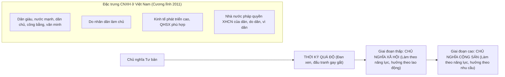

# CHƯƠNG 3: CHỦ NGHĨA XÃ HỘI VÀ THỜI KỲ QUÁ ĐỘ LÊN CHỦ NGHĨA XÃ HỘI

### 1. Sơ đồ Tiến trình Hình thái Kinh tế - Xã hội CSCN

### 2. Các Khái Niệm Nền Tảng & Luận Điểm Cốt Lõi
- **Thời kỳ quá độ lên CNXH:** Thời kỳ cải biến cách mạng sâu sắc, toàn diện từ xã hội cũ sang xã hội mới; bắt đầu từ khi giai cấp công nhân giành chính quyền cho đến khi xây dựng xong cơ sở vật chất - kỹ thuật của CNXH.
- **Hai con đường quá độ:**
  - *Quá độ trực tiếp:* Từ các nước tư bản phát triển cao tiến thẳng lên CNXH.
  - *Quá độ gián tiếp:* Từ các nước tiền tư bản hoặc nông nghiệp lạc hậu tiến lên CNXH bỏ qua chế độ TBCN.
- **Nội hàm "Quá độ bỏ qua chế độ tư bản chủ nghĩa" ở Việt Nam:**
  - Bỏ qua việc xác lập vị trí thống trị của quan hệ sản xuất và kiến trúc thượng tầng tư bản chủ nghĩa.
  - Kế thừa và phát huy những thành tựu của nhân loại dưới CNTB, nhất là khoa học công nghệ và lực lượng sản xuất.
- **8 Đặc trưng của xã hội XHCN mà Việt Nam xây dựng:** Cương lĩnh xây dựng đất nước thời kỳ quá độ lên CNXH (bổ sung, phát triển năm 2011).\n