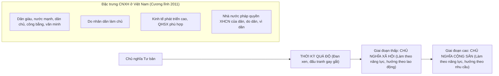

# CHƯƠNG 3: CHỦ NGHĨA XÃ HỘI VÀ THỜI KỲ QUÁ ĐỘ LÊN CHỦ NGHĨA XÃ HỘI

### 1. Sơ đồ Tiến trình Hình thái Kinh tế - Xã hội CSCN

### 2. Các Khái Niệm Nền Tảng & Luận Điểm Cốt Lõi
- **Thời kỳ quá độ lên CNXH:** Thời kỳ cải biến cách mạng sâu sắc, toàn diện từ xã hội cũ sang xã hội mới; bắt đầu từ khi giai cấp công nhân giành chính quyền cho đến khi xây dựng xong cơ sở vật chất - kỹ thuật của CNXH.
- **Hai con đường quá độ:**
  - *Quá độ trực tiếp:* Từ các nước tư bản phát triển cao tiến thẳng lên CNXH.
  - *Quá độ gián tiếp:* Từ các nước tiền tư bản hoặc nông nghiệp lạc hậu tiến lên CNXH bỏ qua chế độ TBCN.
- **Nội hàm "Quá độ bỏ qua chế độ tư bản chủ nghĩa" ở Việt Nam:**
  - Bỏ qua việc xác lập vị trí thống trị của quan hệ sản xuất và kiến trúc thượng tầng tư bản chủ nghĩa.
  - Kế thừa và phát huy những thành tựu của nhân loại dưới CNTB, nhất là khoa học công nghệ và lực lượng sản xuất.
- **8 Đặc trưng của xã hội XHCN mà Việt Nam xây dựng:** Cương lĩnh xây dựng đất nước thời kỳ quá độ lên CNXH (bổ sung, phát triển năm 2011).\n

---

## Tinh Hoa Kiến Thức & Tóm Tắt Chuyên Sâu (Key Takeaways)
> **Chuyên đề mở rộng:** Chủ Nghĩa Xã Hội và Thời Kỳ Quá Độ Lên CNXH ở Việt Nam

> **Nguồn trích xuất:** Giáo trình Chủ nghĩa xã hội khoa học (Bộ GD&ĐT), Chương 3 (Trang 86 - 124).

### 1. Các Giai Đoạn của Hình Thái Kinh Tế - Xã Hội CSCN
- **Thời kỳ quá độ:** Giai đoạn cải biến cách mạng sâu sắc trên mọi lĩnh vực từ xã hội cũ sang xã hội mới.
- **Giai đoạn thấp (Chủ nghĩa xã hội):** Vừa thoát thai từ CNTB, còn nhiều tàn dư cũ. Nguyên tắc phân phối: "Làm theo năng lực, hưởng theo lao động".
- **Giai đoạn cao (Chủ nghĩa cộng sản):** LLSX cực kỳ phát triển, không còn giai cấp, nhà nước tự tiêu vong. Nguyên tắc phân phối: "Làm theo năng lực, hưởng theo nhu cầu".

### 2. Đặc Trưng Cốt Lõi của Thời Kỳ Quá Độ
- Tồn tại đan xen và đấu tranh gay gắt giữa những nhân tố của CNXH và những tàn dư của CNTB/phong kiến.
- Kinh tế: Nhiều thành phần kinh tế, nhiều hình thức sở hữu.
- Chính trị: Nhà nước chuyên chính vô sản củng cố quyền làm chủ của nhân dân.

### 3. Con Đường Quá Độ Bỏ Qua Chế Độ TBCN ở Việt Nam
- **Thực chất:** Bỏ qua việc xác lập vị trí thống trị của QHSX và kiến trúc thượng tầng TBCN.
- **Kế thừa:** Tiếp thu có chọn lọc các thành tựu khoa học, công nghệ, quản lý kinh tế của nhân loại dưới CNTB.
- **8 Đặc trưng của CNXH ở Việt Nam (Cương lĩnh 2011):** Dân giàu, nước mạnh, dân chủ, công bằng, văn minh; Do nhân dân làm chủ; Kinh tế phát triển cao dựa trên LLSX hiện đại và QHSX tiến bộ phù hợp; Nền văn hóa tiên tiến, đậm đà bản sắc dân tộc; Con người có cuộc sống ấm no, hạnh phúc; Các dân tộc bình đẳng, đoàn kết; Nhà nước pháp quyền XHCN do Đảng lãnh đạo; Quan hệ hữu nghị, hợp tác quốc tế.\n
