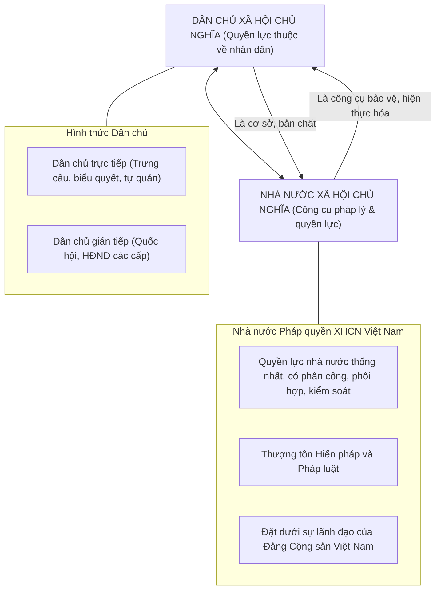

# CHƯƠNG 4: DÂN CHỦ XÃ HỘI CHỦ NGHĨA VÀ NHÀ NƯỚC XÃ HỘI CHỦ NGHĨA

### 1. Sơ đồ Mối Quan hệ Biện chứng giữa Dân chủ & Nhà nước XHCN

### 2. Các Khái Niệm Nền Tảng & Luận Điểm Cốt Lõi
- **Dân chủ:** Là giá trị nhân loại; là quyền lực thuộc về nhân dân; là một hình thái nhà nước; là nguyên tắc tổ chức quản lý (tập trung dân chủ).
- **Bản chất nền dân chủ XHCN:**
  - *Chính trị:* Do Đảng Cộng sản lãnh đạo; nhân dân lao động làm chủ bộ máy nhà nước.
  - *Kinh tế:* Xác lập chế độ sở hữu công cộng về TLSX chủ yếu; phân phối theo kết quả lao động.
  - *Tư tưởng - văn hóa:* Nền tảng tư tưởng là chủ nghĩa Mác - Lênin; giải phóng con người.
- **Nhà nước XHCN:** Là nhà nước "nửa nhà nước", mang bản chất giai cấp công nhân; có chức năng trấn áp và chức năng tổ chức, xây dựng xã hội mới (chức năng căn bản nhất).
- **Đặc trưng Nhà nước pháp quyền XHCN Việt Nam:** Của dân, do dân, vì dân; thượng tôn pháp luật; tôn trọng và bảo đảm quyền con người; quyền lực thống nhất, phân công phối hợp giữa lập pháp, hành pháp và tư pháp.\n

---

## Tinh Hoa Kiến Thức & Tóm Tắt Chuyên Sâu (Key Takeaways)
> **Chuyên đề mở rộng:** Nền Dân Chủ XHCN và Nhà Nước Pháp Quyền XHCN Việt Nam

> **Nguồn trích xuất:** Giáo trình Chủ nghĩa xã hội khoa học (Bộ GD&ĐT), Chương 4 (Trang 125 - 164).

### 1. Bản Chất Nền Dân Chủ Xã Hội Chủ Nghĩa
- Dân chủ là quyền lực thuộc về nhân dân ("Dân là gốc").
- **Chính trị:** Nền dân chủ rộng rãi nhất cho nhân dân lao động dưới sự lãnh đạo của Đảng Cộng sản.
- **Kinh tế:** Dựa trên chế độ công hữu về các TLSX chủ yếu, bảo đảm quyền làm chủ của người lao động.
- **Tư tưởng:** Lấy chủ nghĩa Mác - Lênin làm nền tảng, giải phóng tiềm năng sáng tạo của con người.
- **Thực hiện:** Kết hợp dân chủ trực tiếp (trưng cầu, tự quản) và dân chủ gián tiếp (Quốc hội, HĐND).

### 2. Bản Chất và Chức Năng Nhà Nước XHCN
- Là nhà nước "nửa nhà nước", mang bản chất giai cấp công nhân.
- Hai chức năng căn bản: Chức năng trấn áp kẻ thù và chức năng tổ chức, xây dựng xã hội mới (chức năng chủ yếu, quyết định).

### 3. Đặc Trưng Nhà Nước Pháp Quyền XHCN Việt Nam
1. Nhà nước của nhân dân, do nhân dân, vì nhân dân; nền tảng là liên minh công - nông - trí thức.
2. Quyền lực nhà nước là thống nhất, có sự phân công, phối hợp và kiểm soát giữa các cơ quan lập pháp, hành pháp, tư pháp.
3. Thượng tôn Hiến pháp và pháp luật.
4. Tôn trọng, bảo đảm và bảo vệ quyền con người, quyền công dân.
5. Đặt dưới sự lãnh đạo duy nhất của Đảng Cộng sản Việt Nam.\n
