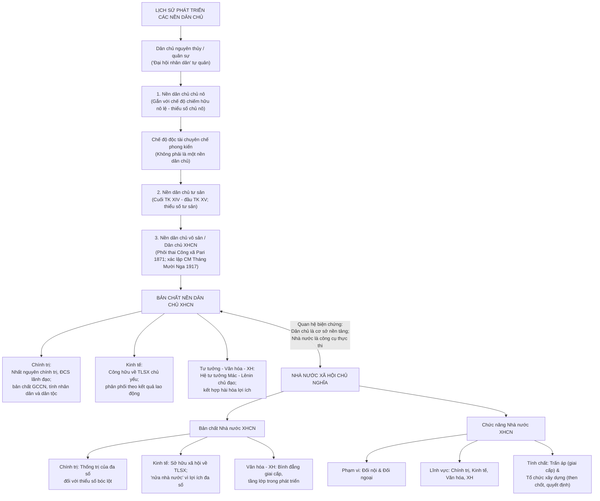
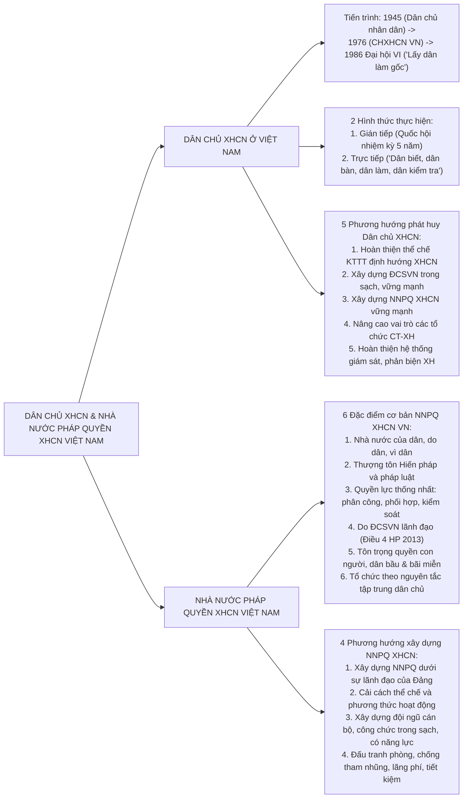

# CHƯƠNG 4: DÂN CHỦ XÃ HỘI CHỦ NGHĨA VÀ NHÀ NƯỚC XÃ HỘI CHỦ NGHĨA

> **Hướng dẫn học tập theo Phương pháp ghi chép Cornell (Cornell Note-taking System):**
> Tài liệu lý thuyết Chương 4 được thiết kế chuẩn hóa theo cấu trúc **Cornell Note-taking System** gồm 3 vùng nhận thức gắn kết chặt chẽ:
> 1. **Cột Từ khóa & Câu hỏi gợi nhớ (Cue Column - Cột trái):** Hệ thống hóa các thuật ngữ cốt lõi, mốc lịch sử, trích dẫn kinh điển và câu hỏi định hướng tư duy giúp người học chủ động truy xuất kiến thức (Active Recall).
> 2. **Cột Ghi chú chi tiết (Note-taking Column - Cột phải):** Trình bày đầy đủ, chính xác toàn bộ nội dung lý luận và thực tiễn bám sát *Giáo trình Chủ nghĩa xã hội khoa học (2021)* về dân chủ, dân chủ xã hội chủ nghĩa, nhà nước xã hội chủ nghĩa và thực tiễn Việt Nam.
> 3. **Phần Tóm tắt cốt lõi (Cornell Summary - Cuối mỗi mục & cuối chương):** Cô đọng bản chất, quy luật vận động và giá trị phương pháp luận của từng mục lớn trong những nhận định súc tích.

---

## Sơ đồ 1: Tiến trình phát triển các nền dân chủ, Bản chất Dân chủ XHCN và Nhà nước XHCN

---

## I. DÂN CHỦ VÀ DÂN CHỦ XÃ HỘI CHỦ NGHĨA

### 1. Dân chủ và sự ra đời, phát triển của dân chủ

| Từ khóa / Câu hỏi gợi nhớ | Ghi chú chi tiết (Nội dung cốt lõi) |
| :--- | :--- |
| **Nguồn gốc thuật ngữ *"demoskratos"*** *Thuật ngữ dân chủ ra đời từ bao giờ, có nghĩa gốc là gì và cách hiểu cổ đại khác hiện nay ở điểm nào?* | • **Thời điểm & Xuất xứ:** Thuật ngữ dân chủ ra đời vào khoảng **thế kỷ VII - VI trước Công nguyên**. Các nhà tư tưởng Hy Lạp cổ đại dùng cụm từ ***"demoskratos"*** để nói đến dân chủ, trong đó ***"demos"*** là **nhân dân** (danh từ) và ***"kratos"*** là **cai trị** (động từ). • **Nghĩa gốc:** Dân chủ được hiểu là ***"nhân dân cai trị"***, sau này được các nhà chính trị gọi giản lược là **quyền lực của nhân dân** hay **quyền lực thuộc về nhân dân**. • **Điểm khác biệt giữa cổ đại và hiện nay:** Nội dung cốt lõi về quyền lực thuộc về nhân dân cơ bản giữ nguyên, nhưng khác nhau ở: (1) **tính chất trực tiếp** của mối quan hệ sở hữu quyền lực công cộng; và (2) **cách hiểu về nội hàm của khái niệm "nhân dân"** trong từng thời đại. |
| **3 phương diện cơ bản của dân chủ theo Chủ nghĩa Mác - Lênin** *Chủ nghĩa Mác - Lênin tiếp cận khái niệm dân chủ trên 3 phương diện nào? Khi nào dân chủ là phạm trù lịch sử, khi nào là phạm trù vĩnh viễn?* | Từ việc nghiên cứu các chế độ dân chủ trong lịch sử và thực tiễn lãnh đạo cách mạng xã hội chủ nghĩa, các nhà sáng lập chủ nghĩa Mác - Lênin xác định dân chủ là sản phẩm và thành quả của cuộc đấu tranh giai cấp cho những giá trị tiến bộ của nhân loại, bao gồm **3 nội dung cơ bản**: 1. **Về phương diện quyền lực:** Dân chủ là **quyền lực thuộc về nhân dân**, nhân dân là chủ nhân của nhà nước. Dân chủ là quyền lợi của nhân dân (quyền lực nhà nước thuộc sở hữu của nhân dân, của xã hội; bộ máy nhà nước phải vì nhân dân, vì xã hội mà phục vụ). 2. **Trên phương diện chế độ xã hội và trong lĩnh vực chính trị:** Dân chủ là một **hình thức hay hình thái nhà nước**, là **chính thể dân chủ** hay **chế độ dân chủ**. 3. **Trên phương diện tổ chức và quản lý xã hội:** Dân chủ là một **nguyên tắc — nguyên tắc dân chủ**, kết hợp với nguyên tắc tập trung để hình thành **nguyên tắc tập trung dân chủ** trong tổ chức và quản lý xã hội. • **Tính lịch sử và tính vĩnh viễn của dân chủ:** Chủ nghĩa Mác - Lênin nhấn mạnh dân chủ vừa là **mục tiêu**, vừa là **tiền đề**, vừa là **phương tiện** để vươn tới tự do, giải phóng con người, giải phóng giai cấp và giải phóng xã hội.   ◦ *Phạm trù lịch sử:* Với tư cách là một hình thức tổ chức thiết chế chính trị, một hình thức hay hình thái nhà nước, dân chủ ra đời và phát triển **gắn liền với nhà nước và mất đi khi nhà nước tiêu vong**.   ◦ *Phạm trù vĩnh viễn:* Với tư cách là một **giá trị xã hội**, dân chủ tồn tại và phát triển cùng với sự tồn tại và phát triển của con người, của xã hội loài người; chừng nào nền văn minh nhân loại chưa bị diệt vong thì dân chủ vẫn tồn tại như một **giá trị nhân loại chung**. |
| **Tư tưởng Hồ Chí Minh về dân chủ** *Chủ tịch Hồ Chí Minh phát triển khái niệm dân chủ theo hai hướng cơ bản nào và nhấn mạnh những lĩnh vực nào?* | Trên cơ sở chủ nghĩa Mác - Lênin và điều kiện cụ thể của Việt Nam, Chủ tịch Hồ Chí Minh đã phát triển dân chủ theo **hai hướng**: 1. **Dân chủ là một giá trị nhân loại chung:** Người khẳng định ***"dân là chủ và dân làm chủ"***: *"Nước ta là nước dân chủ, địa vị cao nhất là dân, vì dân là chủ"*. 2. **Dân chủ là một thể chế chính trị, một chế độ xã hội:** Người khẳng định: *"Chế độ ta là chế độ dân chủ, tức là nhân dân là người chủ, mà Chính phủ là người đầy tớ trung thành của nhân dân"*; *"Dân làm chủ thì Chủ tịch, bộ trưởng, thứ trưởng, ủy viên này khác là làm gì? Làm đầy tớ. Làm đầy tớ cho nhân dân, chứ không phải là làm quan cách mạng"*. • **Tính toàn diện của quyền làm chủ:** Dân phải làm chủ nhà nước, làm chủ xã hội và làm chủ chính bản thân mình; dân chủ bao quát mọi lĩnh vực (kinh tế, chính trị, xã hội, văn hóa - tinh thần, tư tưởng), trong đó **hai lĩnh vực quan trọng hàng đầu và nổi bật nhất** là **dân chủ trong kinh tế** và **dân chủ trong chính trị** (chúng quy định dân chủ trong các lĩnh vực còn lại và thể hiện trực tiếp quyền con người — nhân quyền và quyền công dân — dân quyền). |
| **Quan điểm của Đảng Cộng sản Việt Nam & Định nghĩa tổng quát** *ĐCSVN xác định tư tưởng cốt lõi gì về dân chủ trong thời kỳ đổi mới?* | • **Quan điểm cốt lõi:** Trong công cuộc đổi mới đất nước theo định hướng xã hội chủ nghĩa, Đảng ta khẳng định: *"trong toàn bộ hoạt động của mình, Đảng phải quán triệt tư tưởng **'lấy dân làm gốc'**, xây dựng và phát huy quyền làm chủ của nhân dân lao động"*. • **Bước phát triển nhận thức thời kỳ đổi mới:** Toàn bộ tổ chức và hoạt động của hệ thống chính trị nhằm xây dựng và từng bước hoàn thiện nền dân chủ XHCN, bảo đảm quyền lực thuộc về nhân dân; dân chủ gắn liền với **công bằng xã hội** trên mọi lĩnh vực thông qua Nhà nước do nhân dân cử ra và các hình thức dân chủ trực tiếp; **dân chủ đi đôi với kỷ luật, kỷ cương**, phải được **thể chế hóa bằng pháp luật** và được pháp luật bảo đảm. • **Định nghĩa tổng quát về dân chủ:** *Dân chủ là một giá trị xã hội phản ánh những quyền cơ bản của con người; là một hình thức tổ chức nhà nước của giai cấp cầm quyền; có quá trình ra đời, phát triển cùng với lịch sử xã hội nhân loại.* |
| **Sự ra đời, phát triển các nền dân chủ trong lịch sử** *Lịch sử nhân loại trải qua mấy nền dân chủ? Vì sao chế độ phong kiến không phải là một nền dân chủ?* | 1. **Dân chủ nguyên thủy (dân chủ quân sự):** Xuất hiện trong xã hội tự quản cộng đồng thị tộc, bộ lạc (Ph. Ăngghen gọi là *"dân chủ nguyên thủy"* hay *"dân chủ quân sự"*). Nhân dân bầu thủ lĩnh quân sự qua *"Đại hội nhân dân"* bằng cách giơ tay hoặc hoan hô; nhân dân có quyền lực thật sự dù trình độ sản xuất còn kém phát triển. 2. **Nền dân chủ chủ nô (Nền dân chủ thứ nhất):** Khi LLSX phát triển làm xuất hiện chế độ tư hữu và giai cấp, dân chủ nguyên thủy tan rã. Nền dân chủ chủ nô tổ chức thành nhà nước với đặc trưng dân tham gia bầu ra nhà nước; nhưng **"dân"** chỉ gồm **giai cấp chủ nô và một phần công dân tự do** (tăng lữ, thương gia, một số trí thức), còn đa số **nô lệ** không được coi là dân. Thực chất là dân chủ cho thiểu số. 3. **Chế độ độc tài chuyên chế phong kiến:** Chế độ chiếm hữu nô lệ tan rã nhường chỗ cho nhà nước chuyên chế phong kiến — **không phải là một nền dân chủ**. Sự thống trị giai cấp được khoác áo thần bí của thế lực siêu nhiên, coi việc phục tùng giai cấp thống trị là bổn phận trước đấng tối cao nên ý thức dân chủ không có bước tiến đáng kể. 4. **Nền dân chủ tư sản (Nền dân chủ thứ hai):** Ra đời vào **cuối thế kỷ XIV - đầu thế kỷ XV** với các tư tưởng tiến bộ về tự do, bình đẳng, dân chủ. Đây là bước tiến lớn của nhân loại nhưng xây dựng trên chế độ **tư hữu về tư liệu sản xuất**, nên thực chất vẫn là **nền dân chủ của thiểu số** những người nắm giữ TLSX đối với đại đa số nhân dân lao động. 5. **Nền dân chủ vô sản / Dân chủ XHCN (Nền dân chủ thứ ba):** Xác lập từ thắng lợi của **Cách mạng xã hội chủ nghĩa Tháng Mười Nga (1917)**, mở ra thời đại quá độ từ CNTB lên CNXH. Nhân dân lao động giành quyền làm chủ nhà nước và xã hội, thiết lập Nhà nước công - nông để thực hiện quyền lực của **đại đa số nhân dân**. • **Tổng kết lịch sử:** Với tư cách một hình thái nhà nước, một chế độ chính trị, đến nay nhân loại có **3 nền (chế độ) dân chủ**: **dân chủ chủ nô**, **dân chủ tư sản** và **dân chủ xã hội chủ nghĩa**. Tiêu chuẩn nhận diện thực chất là xem trong nhà nước ấy ***"dân là ai"*** và ***"bản chất của chế độ xã hội ấy như thế nào"***. |

---

### 2. Dân chủ xã hội chủ nghĩa

| Từ khóa / Câu hỏi gợi nhớ | Ghi chú chi tiết (Nội dung cốt lõi) |
| :--- | :--- |
| **Quá trình ra đời & Quy luật phát triển của Dân chủ XHCN** *Dân chủ XHCN phôi thai và chính thức xác lập khi nào? Vì sao càng hoàn thiện càng tự tiêu vong?* | • **Mốc lịch sử:** Được **phôi thai** từ thực tiễn đấu tranh giai cấp ở Pháp và **Công xã Pari năm 1871**; chỉ đến khi **Cách mạng Tháng Mười Nga (1917)** thành công với sự ra đời của nhà nước XHCN đầu tiên trên thế giới, nền dân chủ XHCN mới **chính thức được xác lập**. • **Tính tất yếu với giai cấp vô sản:** Giai cấp vô sản không thể hoàn thành cách mạng XHCN nếu không chuẩn bị thông qua đấu tranh cho dân chủ; và CNXH không thể duy trì, thắng lợi nếu không thực hiện đầy đủ dân chủ. • **Quy luật phát triển:** Phát triển từ **thấp tới cao**, từ chưa hoàn thiện đến hoàn thiện, kế thừa có chọn lọc giá trị của các nền dân chủ trước (trước hết là dân chủ tư sản). **Nguyên tắc cơ bản** là **không ngừng mở rộng dân chủ**, nâng cao mức độ giải phóng người lao động, thu hút họ tham gia tự giác vào quản lý nhà nước, quản lý xã hội. • **Sự tự tiêu vong tính chính trị:** *Càng hoàn thiện bao nhiêu, nền dân chủ XHCN càng tự tiêu vong bấy nhiêu.* Theo V.I. Lênin, thực chất là **tính chính trị** của dân chủ mất đi khi quyền làm chủ mở rộng đến mức dân chủ trở thành thói quen, tập quán trong sinh hoạt của **xã hội tự quản**; khi xã hội cộng sản chủ nghĩa hoàn thiện, không còn phân chia giai cấp thì dân chủ với tư cách một chế độ nhà nước cũng tiêu vong. |
| **Khái niệm Dân chủ XHCN & Điều kiện thực thi** *Định nghĩa nền dân chủ XHCN là gì? Cần những điều kiện gì để quyền lực thực sự thuộc về nhân dân?* | • **Khái niệm:** *Dân chủ xã hội chủ nghĩa là nền dân chủ cao hơn về chất so với nền dân chủ có trong lịch sử nhân loại, là nền dân chủ mà ở đó, mọi quyền lực thuộc về nhân dân, dân là chủ và dân làm chủ; dân chủ và pháp luật nằm trong sự thống nhất biện chứng; được thực hiện bằng nhà nước pháp quyền xã hội chủ nghĩa, đặt dưới sự lãnh đạo của Đảng Cộng sản.* • **Lưu ý thực tiễn lịch sử:** Dân chủ XHCN mới ra đời trong thời gian ngắn ở các nước có xuất phát điểm kinh tế - xã hội thấp và thường bị chống phá, nên mức độ dân chủ đạt được còn những hạn chế nhất định so với thời gian hàng trăm năm điều chỉnh của nền dân chủ tư sản (dù dân chủ tư sản vẫn bị giới hạn bởi bản chất TBCN). • **Các điều kiện bảo đảm quyền lực thực sự thuộc về nhân dân:** Ngoài sự lãnh đạo của GCCN thông qua Đảng Cộng sản, còn đòi hỏi: **trình độ dân trí**, **cơ chế pháp luật** bảo đảm quyền tự do cá nhân, quyền làm chủ nhà nước, quyền tham gia quyết sách và **điều kiện vật chất** để thực thi dân chủ. |
| **Bản chất chính trị của nền Dân chủ XHCN** *Thế nào là "dân chủ hơn gấp triệu lần" và sự khác biệt về chất giữa dân chủ XHCN với dân chủ tư sản?* | • **Sự lãnh đạo chính trị nhất nguyên:** Dưới sự lãnh đạo duy nhất của một đảng của giai cấp công nhân (Đảng Cộng sản), trên mọi lĩnh vực xã hội đều thực hiện quyền lực của nhân dân. Đảng đại biểu cho trí tuệ, lợi ích của GCCN, nhân dân lao động và toàn dân tộc — V.I. Lênin gọi sự lãnh đạo toàn diện này là **sự thống trị chính trị**; do đó nền dân chủ XHCN mang **tính nhất nguyên về chính trị**. • **Nội dung dân chủ trên lĩnh vực chính trị:** Nhân dân lao động làm chủ quan hệ chính trị, giới thiệu đại biểu vào chính quyền từ trung ương đến địa phương, góp ý xây dựng chính sách, pháp luật, bộ máy và cán bộ; gắn với lời khẳng định của V.I. Lênin: ***"Chế độ dân chủ vô sản so với bất cứ chế độ dân chủ tư sản nào, cũng dân chủ hơn gấp triệu lần"***. • **Tư tưởng Hồ Chí Minh:** *"Bao nhiêu quyền lực đều là của dân, bao nhiêu sức mạnh đều ở nơi dân, bao nhiêu lợi ích đều là vì dân"*; Tổng tuyển cử năm 1946: *"hễ là những người muốn lo việc nước thì đều có quyền ra ứng cử; hễ là công dân thì đều có quyền đi bầu cử"*. • **Tính chất kép và 4 điểm khác biệt về chất so với dân chủ tư sản:** Dân chủ XHCN vừa có **bản chất giai cấp công nhân**, vừa có **tính nhân dân rộng rãi** và **tính dân tộc sâu sắc**. Khác về chất với dân chủ tư sản ở 4 điểm: (1) bản chất giai cấp (GCCN vs. GCTS); (2) cơ chế (nhất nguyên vs. đa nguyên); (3) hệ thống đảng (một đảng vs. nhiều đảng); (4) bản chất nhà nước (NNPQ XHCN vs. NNPQ tư sản). |
| **Bản chất kinh tế của nền Dân chủ XHCN** *Cơ sở sở hữu, nguyên tắc phân phối và động lực kinh tế của dân chủ XHCN là gì?* | • **Cơ sở kinh tế:** Dựa trên **chế độ sở hữu xã hội (công hữu) về những tư liệu sản xuất chủ yếu** của toàn xã hội, đáp ứng sự phát triển của LLSX dựa trên khoa học - công nghệ hiện đại nhằm thỏa mãn ngày càng cao nhu cầu vật chất và tinh thần của toàn thể nhân dân lao động. • **Nguyên tắc phân phối & Động lực:** Thực hiện chế độ **phân phối lợi ích theo kết quả lao động là chủ yếu**; bảo đảm quyền làm chủ của nhân dân về TLSX chủ yếu, trong sản xuất kinh doanh, quản lý và phân phối; coi **lợi ích kinh tế của người lao động là động lực cơ bản nhất** thúc đẩy kinh tế - xã hội phát triển. • **Tính kế thừa có chọn lọc:** Không hình thành từ "hư vô", kinh tế XHCN kế thừa các thành tựu nhân loại đã tạo ra, đồng thời lọc bỏ những nhân tố lạc hậu, tiêu cực, tư hữu, áp bức, bóc lột, bất công. |
| **Bản chất tư tưởng - văn hóa - xã hội & Vai trò của Đảng Cộng sản** *Hệ tư tưởng nào giữ vai trò chủ đạo? Vì sao nhất nguyên chính trị không loại trừ dân chủ XHCN?* | • **Hệ tư tưởng chủ đạo:** Lấy **hệ tư tưởng Mác - Lênin** — hệ tư tưởng của giai cấp công nhân — làm chủ đạo đối với mọi hình thái ý thức xã hội khác trong xã hội mới. • **Kế thừa & Sáng tạo văn hóa:** Kế thừa, phát huy tinh hoa văn hóa truyền thống dân tộc; tiếp thu giá trị tư tưởng - văn hóa, văn minh tiến bộ của nhân loại. Nhân dân làm chủ các giá trị văn hóa tinh thần, được nâng cao trình độ văn hóa và có điều kiện phát triển cá nhân. • **Quan hệ lợi ích:** Có sự **kết hợp hài hòa về lợi ích** giữa **cá nhân**, **tập thể** và **toàn xã hội**, động viên mọi tiềm năng sáng tạo và tính tích cực xã hội của nhân dân. • **Điều kiện tiên quyết:** Dân chủ XHCN và **nhất nguyên về chính trị** (vai trò lãnh đạo duy nhất của Đảng Cộng sản) **không loại trừ nhau**; ngược lại, chính sự lãnh đạo của Đảng (trang bị lý luận Mác - Lênin, nâng cao giác ngộ chính trị, văn hóa dân chủ và đấu tranh chống mưu đồ lợi dụng dân chủ) là **điều kiện cho dân chủ XHCN ra đời, tồn tại và phát triển**. |

> **Tóm tắt Mục I (Cornell Summary):**
> Dân chủ vừa là giá trị nhân loại vĩnh viễn (quyền lực thuộc về nhân dân — *"demoskratos"*), vừa là phạm trù lịch sử gắn với nhà nước, đã trải qua 3 nền dân chủ (chủ nô, tư sản, XHCN; riêng chế độ chuyên chế phong kiến không phải là một nền dân chủ). Phôi thai từ Công xã Pari (1871) và xác lập chính thức sau Cách mạng Tháng Mười Nga (1917), nền dân chủ XHCN mang bản chất ưu việt trên cả ba phương diện: **chính trị** (nhất nguyên do Đảng Cộng sản lãnh đạo, bản chất GCCN gắn với tính nhân dân rộng rãi và dân tộc sâu sắc), **kinh tế** (công hữu TLSX chủ yếu và phân phối theo kết quả lao động) và **tư tưởng - văn hóa - xã hội** (hệ tư tưởng Mác - Lênin chủ đạo, kết hợp hài hòa lợi ích), vận động theo quy luật không ngừng mở rộng dân chủ để tiến tới tự tiêu vong tính chính trị trong xã hội cộng sản chủ nghĩa.

---

## II. NHÀ NƯỚC XÃ HỘI CHỦ NGHĨA

### 1. Sự ra đời, bản chất, chức năng của nhà nước xã hội chủ nghĩa

| Từ khóa / Câu hỏi gợi nhớ | Ghi chú chi tiết (Nội dung cốt lõi) |
| :--- | :--- |
| **Sự ra đời & Khái niệm Nhà nước XHCN** *Nhà nước XHCN ra đời từ mâu thuẫn nào trong CNTB và được định nghĩa ra sao?* | • **Nguồn gốc & Điều kiện ra đời:** Xuất phát từ khát vọng công bằng, dân chủ của nhân dân lao động muốn thoát khỏi áp bức, bất công. Khi xã hội TBCN phát triển, **mâu thuẫn giữa quan hệ sản xuất tư bản tư nhân về TLSX với tính chất xã hội hóa ngày càng cao của lực lượng sản xuất** trở nên gay gắt, dẫn tới khủng hoảng kinh tế và mâu thuẫn sâu sắc giữa giai cấp tư sản và giai cấp vô sản. • **Nhân tố quyết định:** Trong cuộc đấu tranh của giai cấp vô sản, các **Đảng Cộng sản** ra đời lãnh đạo phong trào cách mạng, trang bị vũ khí lý luận **chủ nghĩa Mác - Lênin**. Cách mạng vô sản có thể nổ ra ở các nước TBCN phát triển cao hoặc các nước dân tộc thuộc địa. • **Đặc điểm chung sau cách mạng:** Dù hình thức, phương pháp tổ chức chính quyền tùy thuộc đặc điểm mỗi quốc gia, điểm chung của các nhà nước XHCN là tổ chức thực hiện quyền lực của nhân dân, đại diện ý chí nhân dân, quản lý kinh tế, văn hóa, xã hội dưới sự lãnh đạo của Đảng Cộng sản. • **Khái niệm:** *Nhà nước xã hội chủ nghĩa là một kiểu nhà nước mà ở đó, sự thống trị chính trị thuộc về giai cấp công nhân, do cách mạng xã hội chủ nghĩa sản sinh ra và có sứ mệnh xây dựng thành công chủ nghĩa xã hội, đưa nhân dân lao động lên địa vị làm chủ trên tất cả các mặt của đời sống xã hội trong một xã hội phát triển cao — xã hội xã hội chủ nghĩa.* |
| **Bản chất Nhà nước XHCN trên 3 phương diện** *Tại sao nói Nhà nước XHCN về kinh tế không còn là nhà nước theo đúng nghĩa mà chỉ là "nửa nhà nước"?* | So với các kiểu nhà nước bóc lột trong lịch sử, tính ưu việt về bản chất của nhà nước XHCN thể hiện trên **3 phương diện**: 1. **Về chính trị:** Mang **bản chất của giai cấp công nhân** — giai cấp có lợi ích phù hợp với lợi ích chung của quần chúng nhân dân lao động. Nếu các nhà nước bóc lột là sự thống trị của **thiểu số đối với đa số**, thì sự thống trị chính trị của giai cấp vô sản là **sự thống trị của đa số đối với thiểu số giai cấp bóc lột** nhằm giải phóng giai cấp mình và giải phóng tất cả các tầng lớp nhân dân lao động khác. 2. **Về kinh tế:** Chịu sự quy định của **chế độ sở hữu xã hội về tư liệu sản xuất chủ yếu**, do đó không còn tồn tại quan hệ sản xuất bóc lột. Nhà nước XHCN vừa là một **bộ máy chính trị - hành chính, cơ quan cưỡng chế**, vừa là một **tổ chức quản lý kinh tế - xã hội của nhân dân lao động** — nó **không còn là nhà nước theo đúng nghĩa, mà chỉ là *"nửa nhà nước"***. Chăm lo lợi ích đại đa số nhân dân lao động là mục tiêu hàng đầu. 3. **Về văn hóa, xã hội:** Xây dựng trên nền tảng tinh thần là **lý luận của chủ nghĩa Mác - Lênin**, các giá trị văn hóa tiên tiến, tiến bộ của nhân loại và bản sắc riêng của dân tộc. Sự phân hóa giai cấp, tầng lớp từng bước thu hẹp; các giai cấp, tầng lớp **bình đẳng trong tiếp cận nguồn lực và cơ hội phát triển**. |
| **3 cách phân loại Chức năng của Nhà nước XHCN** *Chức năng của nhà nước XHCN được phân chia theo những căn cứ nào?* | Tùy góc độ tiếp cận, chức năng của nhà nước XHCN được chia theo **3 căn cứ**: 1. **Căn cứ vào phạm vi tác động của quyền lực nhà nước:** Chia thành **chức năng đối nội** và **chức năng đối ngoại**. 2. **Căn cứ vào lĩnh vực tác động của quyền lực nhà nước:** Chia thành **chức năng chính trị, kinh tế, văn hóa, xã hội**... 3. **Căn cứ vào tính chất của quyền lực nhà nước:** Chia thành **chức năng giai cấp (trấn áp)** và **chức năng xã hội (tổ chức và xây dựng)**. |
| **So sánh Chức năng Trấn áp và Chức năng Tổ chức - Xây dựng** *Chức năng nào là then chốt, quyết định của Nhà nước XHCN? V.I. Lênin nhấn mạnh điều gì?* | • **Chức năng giai cấp (trấn áp):** Khác với nhà nước bóc lột (lấy trấn áp đa số làm quyết định để duy trì sở hữu tư nhân), trong nhà nước XHCN, chức năng trấn áp vẫn tất yếu tồn tại trong thời kỳ quá độ, nhưng đó là **sự trấn áp của đa số nhân dân lao động đối với thiểu số giai cấp bóc lột đã bị lật đổ và các phần tử chống đối** để bảo vệ thành quả cách mạng và an ninh chính trị. • **Nhận định của V.I. Lênin về bạo lực và "nhà nước quá độ":** *"Bất cứ một nhà nước nào cũng đều có nghĩa là dùng bạo lực; nhưng toàn bộ sự khác nhau là ở chỗ dùng bạo lực đối với những người bị bóc lột hay đối với kẻ đi bóc lột..."*; trong giai đoạn đầu của CNCS, bộ máy trấn áp vẫn cần thiết nhưng đã là **"nhà nước quá độ"**, không còn là nhà nước theo đúng nghĩa. • **Chức năng xã hội (tổ chức và xây dựng) giữ vai trò then chốt, quyết định:** V.I. Lênin khẳng định sau khi giành chính quyền, điều quan trọng hơn cả là tạo ra **năng suất sản xuất cao hơn chế độ cũ**, thực hiện **kiểu tổ chức lao động xã hội cao hơn so với chủ nghĩa tư bản**. Nhà nước XHCN không chỉ là bạo lực và cũng **không phải chủ yếu là bạo lực**. • **Mục đích cuối cùng:** **Cải tạo xã hội cũ, xây dựng thành công xã hội mới** là nội dung chủ yếu và mục đích cuối cùng; trong đó việc **tổ chức quản lý và xây dựng kinh tế** là nhiệm vụ **then chốt, quyết định, quan trọng, khó khăn và phức tạp nhất**. |

---

### 2. Mối quan hệ biện chứng giữa dân chủ xã hội chủ nghĩa và nhà nước xã hội chủ nghĩa

| Từ khóa / Câu hỏi gợi nhớ | Ghi chú chi tiết (Nội dung cốt lõi) |
| :--- | :--- |
| **Chiều 1: Dân chủ XHCN là cơ sở, nền tảng của Nhà nước XHCN** *Dân chủ XHCN quyết định việc xây dựng, hoạt động và kiểm soát Nhà nước XHCN như thế nào?* | • Chỉ trong xã hội dân chủ XHCN, nhân dân mới có đầy đủ điều kiện thực hiện ý chí của mình thông qua việc **lựa chọn công bằng, bình đẳng** những người đại diện cho quyền lợi chính đáng vào bộ máy nhà nước, tham gia **trực tiếp hoặc gián tiếp** vào quản lý nhà nước và phát huy trí tuệ nhân dân. • Dân chủ XHCN giúp **kiểm soát hiệu quả quyền lực nhà nước**, ngăn chặn **sự tha hóa quyền lực**, dễ dàng đưa ra khỏi cơ quan nhà nước những người thực thi công vụ không đáp ứng phẩm chất, năng lực, bảo đảm mục tiêu phục vụ nhân dân. • **Hệ quả nếu vi phạm:** Nếu các nguyên tắc của dân chủ XHCN bị vi phạm thì việc xây dựng nhà nước XHCN không thể thực hiện được; quyền lực nhân dân bị biến thành **quyền lực của một nhóm người**, phục vụ lợi ích nhóm. |
| **Chiều 2: Nhà nước XHCN là công cụ thực thi quyền làm chủ của người dân** *Nhà nước XHCN bảo vệ và hiện thực hóa dân chủ XHCN bằng cách nào? Đảng ta xác định vị trí của Nhà nước ra sao?* | • **Thể chế hóa và bảo vệ dân chủ:** Nhà nước XHCN thể chế hóa ý chí nhân dân thành **hành lang pháp lý**, phân định rõ quyền và trách nhiệm công dân; đồng thời là **công cụ bạo lực** ngăn chặn hiệu quả mọi hành vi xâm phạm quyền, lợi ích chính đáng của nhân dân và bảo vệ nền dân chủ XHCN. • **Con đường phát triển (theo V.I. Lênin):** Ngày càng hoàn thiện các hình thức đại diện nhân dân, mở rộng dân chủ để lôi cuốn ngày càng đông đảo nhân dân tham gia quản lý nhà nước, quản lý xã hội; tập hợp nguồn lực hướng đến lợi ích nhân dân. • **Hệ quả nếu nhà nước đánh mất bản chất:** Sẽ tác động tiêu cực đến dân chủ XHCN, dễ dẫn tới xâm phạm quyền làm chủ của dân, **chuyên chế, độc tài, thủ tiêu nền dân chủ** hoặc biến dân chủ thành **hình thức**. • **Vị trí trong hệ thống chính trị XHCN:** Nhà nước là thiết chế trực tiếp nhất thể chế hóa dân chủ, là công cụ sắc bén chống mưu đồ ngược lợi ích nhân dân và thực hiện vai trò lãnh đạo của Đảng. Đảng ta xem Nhà nước là ***"trụ cột"***, ***"một công cụ chủ yếu, vững mạnh"*** của nhân dân trong sự nghiệp xây dựng và bảo vệ Tổ quốc XHCN. |

> **Tóm tắt Mục II (Cornell Summary):**
> Nhà nước XHCN ra đời từ cuộc cách mạng của giai cấp vô sản dưới sự lãnh đạo của Đảng Cộng sản, mang bản chất GCCN trên cả 3 phương diện chính trị (đa số thống trị thiểu số bóc lột), kinh tế (công hữu TLSX, *"nửa nhà nước"*) và văn hóa - xã hội. Trong các chức năng của Nhà nước XHCN (đối nội/đối ngoại; chính trị/kinh tế/văn hóa/xã hội; trấn áp/tổ chức xây dựng), chức năng **tổ chức, quản lý và xây dựng kinh tế** là **then chốt, quyết định**. Giữa dân chủ XHCN và nhà nước XHCN tồn tại mối quan hệ biện chứng không thể tách rời: **Dân chủ XHCN là cơ sở, nền tảng** hình thành và kiểm soát nhà nước; **Nhà nước XHCN là *"trụ cột"*, công cụ pháp lý chủ yếu** để thể chế hóa, thực thi và bảo vệ quyền làm chủ của nhân dân.

---

## Sơ đồ 2: Dân chủ XHCN và Nhà nước pháp quyền XHCN ở Việt Nam

---

## III. DÂN CHỦ XÃ HỘI CHỦ NGHĨA VÀ NHÀ NƯỚC PHÁP QUYỀN XÃ HỘI CHỦ NGHĨA VIỆT NAM

### 1. Dân chủ xã hội chủ nghĩa ở Việt Nam

| Từ khóa / Câu hỏi gợi nhớ | Ghi chú chi tiết (Nội dung cốt lõi) |
| :--- | :--- |
| **Sự ra đời & Phát triển của Dân chủ XHCN ở Việt Nam** *Nhận thức về dân chủ ở nước ta phát triển qua các mốc 1945, 1976 và Đại hội VI (1986) như thế nào?* | • **Năm 1945:** Chế độ **dân chủ nhân dân** ở nước ta được xác lập sau thắng lợi của Cách mạng Tháng Tám. • **Năm 1976:** Tên nước đổi thành **Cộng hòa xã hội chủ nghĩa Việt Nam**, nhưng trong văn kiện Đảng giai đoạn này hầu như chưa dùng cụm từ *"dân chủ xã hội chủ nghĩa"* mà thường nêu *"xây dựng chế độ làm chủ tập thể xã hội chủ nghĩa"* gắn với *"nắm vững chuyên chính vô sản"*; mối quan hệ với nhà nước pháp quyền XHCN và các vấn đề dân sinh, dân trí, dân quyền chưa được đặt ra cụ thể. • **Đại hội VI của Đảng (1986):** Đề ra đường lối đổi mới toàn diện đất nước, nhấn mạnh phát huy dân chủ làm động lực phát triển, quán triệt tư tưởng ***"lấy dân làm gốc"*** và bài học ***"cách mạng là sự nghiệp của quần chúng"***. • **Thành tựu nhận thức qua 35 năm đổi mới:** Dân chủ được đưa vào mục tiêu tổng quát: ***"Dân giàu, nước mạnh, dân chủ, công bằng, văn minh"***; đồng thời khẳng định: ***"Dân chủ xã hội chủ nghĩa là bản chất của chế độ ta, vừa là mục tiêu, vừa là động lực của sự phát triển đất nước"***, gắn liền với kỷ luật, kỷ cương và phải được thể chế hóa, bảo đảm bằng pháp luật. |
| **Bản chất nền Dân chủ XHCN ở Việt Nam & Tư tưởng Hồ Chí Minh** *5 nội dung thể hiện bản chất nền dân chủ XHCN ở Việt Nam là gì?* | • **Nền tảng:** Dựa vào Nhà nước XHCN và sự ủng hộ, giúp đỡ của nhân dân; mọi quyền lực thuộc về nhân dân, dân là gốc, là chủ, dân làm chủ. Hồ Chí Minh khẳng định: ***"NƯỚC TA LÀ NƯỚC DÂN CHỦ. Bao nhiêu lợi ích đều vì dân. Bao nhiêu quyền hạn đều của dân... Nói tóm lại, quyền hành và lực lượng đều ở nơi dân"***. • **5 nội dung cốt lõi của bản chất dân chủ XHCN ở Việt Nam:**   1. Dân chủ là **mục tiêu** của chế độ XHCN (dân giàu, nước mạnh, dân chủ, công bằng, văn minh).   2. Dân chủ là **bản chất** của chế độ XHCN (do nhân dân làm chủ, quyền lực thuộc về nhân dân).   3. Dân chủ là **động lực** để xây dựng CNXH (phát huy sức mạnh của nhân dân, toàn dân tộc).   4. Dân chủ **gắn với pháp luật** (phải đi đôi với kỷ luật, kỷ cương).   5. Dân chủ phải được thực hiện trong **đời sống thực tiễn** ở tất cả các cấp, mọi lĩnh vực (kinh tế, chính trị, văn hóa, xã hội). |
| **2 hình thức thực hiện dân chủ & Thách thức hiện nay** *Nhân dân Việt Nam thực hiện dân chủ qua hai hình thức nào? Những trở ngại hiện nay là gì?* | Bản chất dân chủ XHCN ở Việt Nam được thực hiện thông qua **2 hình thức**: 1. **Dân chủ gián tiếp (dân chủ đại diện):** Nhân dân *"ủy quyền"*, giao quyền lực cho tổ chức do nhân dân trực tiếp bầu ra để đại diện thực hiện quyền làm chủ. Nhân dân bầu ra **Quốc hội** — cơ quan quyền lực nhà nước cao nhất hoạt động theo **nhiệm kỳ 5 năm**. Quyền lực nhà nước thống nhất, có sự phân công, phối hợp và kiểm soát giữa các quyền lập pháp, hành pháp, tư pháp. 2. **Dân chủ trực tiếp:** Nhân dân bằng hành động trực tiếp thực hiện quyền làm chủ nhà nước và xã hội: được thông tin về hoạt động nhà nước, bàn bạc công việc nhà nước và cộng đồng dân cư, quyết định dân chủ cơ sở, kiểm tra, giám sát cơ quan nhà nước từ Trung ương đến cơ sở theo phương châm ***"dân biết, dân bàn, dân làm, dân kiểm tra"***. • **Thách thức trong quá trình thực hiện:** Xuất phát điểm từ nền kinh tế kém phát triển, hậu quả chiến tranh nặng nề, những tiêu cực xã hội chưa khắc phục triệt để; đặc biệt là âm mưu ***"diễn biến hòa bình"***, bạo loạn, lật đổ lợi dụng chiêu bài *"dân chủ"*, *"nhân quyền"* của các thế lực thù địch cùng tình trạng ***"tự diễn biến"***, ***"tự chuyển hóa"***. |

---

### 2. Nhà nước pháp quyền xã hội chủ nghĩa ở Việt Nam

| Từ khóa / Câu hỏi gợi nhớ | Ghi chú chi tiết (Nội dung cốt lõi) |
| :--- | :--- |
| **Quan niệm về Nhà nước pháp quyền XHCN Việt Nam** *Nhà nước pháp quyền là gì? Đại hội XII và XIII khẳng định nguyên tắc tổ chức quyền lực nhà nước như thế nào?* | • **Quan niệm chung:** Nhà nước pháp quyền là nhà nước **thượng tôn pháp luật**, hướng tới phúc lợi cho mọi người, tạo điều kiện cho cá nhân tự do, bình đẳng, phát huy năng lực; mọi công dân được giáo dục, hiểu biết và tuân thủ pháp luật nghiêm minh; các cơ quan nhà nước có sự **phân công, phối hợp, kiểm soát lẫn nhau** vì mục tiêu phục vụ nhân dân. • **Nội dung trong Cương lĩnh xây dựng đất nước:** Đề cao vai trò tối thượng của Hiến pháp và pháp luật; bảo đảm quyền lợi, nghĩa vụ công dân và quyền con người; bộ máy vừa tập trung thống nhất vừa phân công, phân cấp để tránh lạm quyền; gắn bó chặt chẽ và chịu sự giám sát của nhân dân; ngăn ngừa quan liêu, tham nhũng, lộng quyền; tổ chức theo nguyên tắc tập trung dân chủ. • **Quan điểm Đại hội XII:** *"Quyền lực nhà nước là thống nhất, có sự phân công, phối hợp, kiểm soát giữa các cơ quan nhà nước trong việc thực hiện các quyền lập pháp, hành pháp, tư pháp"*. • **Quan điểm Đại hội XIII:** Nhấn mạnh *"Quyền lực nhà nước là thống nhất, có sự **phân công rành mạch, phối hợp chặt chẽ và tăng cường kiểm soát** quyền lực nhà nước"*. |
| **6 đặc điểm cơ bản của Nhà nước pháp quyền XHCN Việt Nam** *Hãy liệt kê chính xác 6 đặc điểm của Nhà nước pháp quyền XHCN Việt Nam trong giáo trình 2021.* | 1. **Thứ nhất:** Xây dựng nhà nước do nhân dân lao động làm chủ, đó là **Nhà nước của dân, do dân, vì dân**. 2. **Thứ hai:** Nhà nước được tổ chức và hoạt động dựa trên cơ sở của **Hiến pháp và pháp luật**. Trong tất cả các hoạt động xã hội, pháp luật được đặt ở **vị trí tối thượng** để điều chỉnh các quan hệ xã hội. 3. **Thứ ba:** **Quyền lực nhà nước là thống nhất**, có sự phân công rõ ràng, có cơ chế phối hợp nhịp nhàng và kiểm soát giữa các cơ quan: **lập pháp, hành pháp và tư pháp**. 4. **Thứ tư:** Nhà nước pháp quyền XHCN Việt Nam phải **do Đảng Cộng sản Việt Nam lãnh đạo**, phù hợp với **Điều 4 Hiến pháp năm 2013**. Hoạt động của Nhà nước được giám sát bởi nhân dân với phương châm: ***"Dân biết, dân bàn, dân làm, dân kiểm tra"*** thông qua các tổ chức, cá nhân được nhân dân ủy nhiệm. 5. **Thứ năm:** Tôn trọng **quyền con người**, coi con người là chủ thể, là trung tâm của sự phát triển. Quyền dân chủ được thực hành rộng rãi; *"nhân dân có quyền bầu và bãi miễn những đại biểu không xứng đáng"*; đồng thời tăng cường sự nghiêm minh của pháp luật. 6. **Thứ sáu:** Tổ chức và hoạt động của bộ máy nhà nước theo **nguyên tắc tập trung dân chủ**, có sự phân công, phân cấp, phối hợp và kiểm soát lẫn nhau, nhưng bảo đảm quyền lực thống nhất và sự chỉ đạo thống nhất của Trung ương. • **Ý nghĩa:** Vừa mang tinh thần chung của nhà nước pháp quyền, vừa khác biệt về chất vì mang bản chất GCCN, phục vụ nhân dân và là công cụ chủ yếu để ĐCSVN định hướng đi lên CNXH. |

---

### 3. Phát huy dân chủ XHCN và Tiếp tục xây dựng, hoàn thiện Nhà nước pháp quyền XHCN ở Việt Nam hiện nay

| Từ khóa / Câu hỏi gợi nhớ | Ghi chú chi tiết (Nội dung cốt lõi) |
| :--- | :--- |
| **5 phương hướng phát huy Dân chủ XHCN ở Việt Nam hiện nay** *5 giải pháp trọng tâm nhằm phát huy dân chủ XHCN tại Việt Nam hiện nay gồm những gì?* | 1. **Một là, xây dựng, hoàn thiện thể chế kinh tế thị trường định hướng XHCN** tạo cơ sở kinh tế vững chắc cho xây dựng dân chủ XHCN: Thể chế hóa phát triển đa dạng các hình thức sở hữu, thành phần kinh tế, loại hình doanh nghiệp; hoàn thiện luật pháp về các tài sản mới (sở hữu trí tuệ, cổ phiếu, trái phiếu...); tiến hành đồng bộ **3 khâu thể chế** (ban hành văn bản/quy định; xây dựng cơ chế vận hành/thực thi; hoàn thiện bộ máy theo dõi, giám sát, xử lý vi phạm và tranh chấp); đẩy mạnh cải cách hành chính và phát triển đồng bộ các yếu tố, các loại thị trường. 2. **Hai là, xây dựng Đảng Cộng sản Việt Nam trong sạch, vững mạnh** với tư cách **điều kiện tiên quyết** để xây dựng nền dân chủ XHCN Việt Nam: Vững mạnh về chính trị, tư tưởng, tổ chức; tự đổi mới, tự chỉnh đốn; nâng cao trí tuệ, bản lĩnh, đạo đức, năng lực lãnh đạo; dân chủ hóa sinh hoạt Đảng, thực hiện tập trung dân chủ, tự phê bình và phê bình. 3. **Ba là, xây dựng Nhà nước pháp quyền XHCN vững mạnh** với tư cách **điều kiện để thực thi dân chủ XHCN**: Thực thi quyền dân chủ trên mọi lĩnh vực bằng Hiến pháp, pháp luật; bảo đảm quyền con người là giá trị cao nhất; chính sách, pháp luật dựa trên ý chí, nguyện vọng của nhân dân; bảo vệ quyền tự do, danh dự, nhân phẩm, lợi ích hợp pháp của công dân. 4. **Bốn là, nâng cao vai trò của các tổ chức chính trị - xã hội** trong xây dựng nền dân chủ XHCN: Đổi mới mạnh mẽ phương thức hoạt động để giám sát, phản biện đường lối, chính sách, pháp luật; tạo khối đoàn kết toàn dân, chăm lo đời sống nhân dân, bảo vệ chính quyền, xây dựng Đảng và bảo vệ quyền lợi chính đáng của nhân dân. 5. **Năm là, xây dựng và từng bước hoàn thiện các hệ thống giám sát, phản biện xã hội** để phát huy quyền làm chủ của nhân dân: Công khai hóa, minh bạch hóa, dân chủ hóa thông tin, chủ trương, chính sách liên quan đến lợi ích nhân dân; cụ thể hóa quy chế tôn trọng, lắng nghe ý kiến nhân dân; nâng cao **dân trí và văn hóa pháp luật** cho toàn xã hội (cán bộ, đảng viên, công chức, viên chức, nhân dân). |
| **4 phương hướng tiếp tục xây dựng, hoàn thiện Nhà nước pháp quyền XHCN** *4 giải pháp trọng tâm để tiếp tục xây dựng và hoàn thiện NNPQ XHCN Việt Nam là gì?* | 1. **Một là, xây dựng Nhà nước pháp quyền XHCN dưới sự lãnh đạo của Đảng:** Giữ vững bản chất giai cấp công nhân, gắn bó chặt chẽ với dân tộc và nhân dân; tổ chức quyền lực nhà nước bảo đảm thống nhất, có sự phân công và phối hợp giữa các cơ quan thực hiện các quyền lập pháp, hành pháp, tư pháp. 2. **Hai là, cải cách thể chế và phương thức hoạt động của Nhà nước:** Kiện toàn tổ chức, đổi mới phương thức và nâng cao hiệu quả hoạt động của **Quốc hội** (cơ quan quyền lực nhà nước cao nhất, có quyền lập hiến, lập pháp, thực hiện một số nhiệm vụ hành pháp, tư pháp và quyền giám sát tối cao). Xây dựng nền hành chính nhà nước dân chủ, trong sạch, vững mạnh, từng bước hiện đại hóa; giảm mạnh và bãi bỏ thủ tục hành chính phiền hà; đẩy mạnh **xã hội hóa các ngành dịch vụ công** phù hợp kinh tế thị trường định hướng XHCN. 3. **Ba là, xây dựng đội ngũ cán bộ, công chức trong sạch, có năng lực:** Nâng cao bản lĩnh chính trị, phẩm chất đạo đức, năng lực lãnh đạo, điều hành quản lý đất nước; có chính sách đãi ngộ, động viên người hoàn thành tốt nhiệm vụ, đồng thời xây dựng **cơ chế loại bỏ, miễn nhiệm** người không hoàn thành nhiệm vụ, vi phạm kỷ luật, đạo đức công vụ. 4. **Bốn là, đấu tranh phòng, chống tham nhũng, lãng phí, thực hành tiết kiệm:** Xác định là nhiệm vụ **cấp bách, lâu dài**; hoàn thiện thể chế và cải cách hành chính phục vụ phòng, chống tham nhũng, lãng phí; xây dựng cơ chế **khuyến khích và bảo vệ người đấu tranh chống tham nhũng**; xây dựng chế tài xử lý cá nhân, tổ chức vi phạm; động viên toàn Đảng, toàn dân thực hành tiết kiệm. |

> **Tóm tắt Mục III (Cornell Summary):**
> Nền dân chủ XHCN ở Việt Nam được xác lập từ Cách mạng Tháng Tám 1945 và phát triển sâu sắc từ công cuộc đổi mới Đại hội VI (1986) với tư tưởng *"lấy dân làm gốc"*, là mục tiêu, bản chất, động lực phát triển đất nước, thực thi qua **2 hình thức** (dân chủ gián tiếp qua Quốc hội nhiệm kỳ 5 năm và dân chủ trực tiếp với phương châm *"dân biết, dân bàn, dân làm, dân kiểm tra"*). Gắn liền với đó là **Nhà nước pháp quyền XHCN Việt Nam** mang **6 đặc điểm cơ bản** (của dân - do dân - vì dân, thượng tôn pháp luật, quyền lực thống nhất có phân công - phối hợp - kiểm soát, do ĐCSVN lãnh đạo theo Điều 4 Hiến pháp 2013, tôn trọng quyền con người, tổ chức theo tập trung dân chủ), được củng cố đồng bộ bằng **5 phương hướng phát huy dân chủ** và **4 phương hướng xây dựng, hoàn thiện Nhà nước pháp quyền XHCN**.

---

## Tóm tắt toàn chương (Cornell Summary)

1. **Quan niệm & Lịch sử các nền dân chủ:** Xuất phát từ thuật ngữ Hy Lạp cổ đại *"demoskratos"* (*"nhân dân cai trị"*), Chủ nghĩa Mác - Lênin nhìn nhận dân chủ trên 3 phương diện (quyền lực — phạm trù vĩnh viễn; chế độ chính trị — phạm trù lịch sử gắn với nhà nước; nguyên tắc tổ chức quản lý — tập trung dân chủ). Lịch sử nhân loại ghi nhận **3 nền dân chủ** (chủ nô, tư sản, XHCN); chế độ chuyên chế phong kiến không phải là một nền dân chủ.
2. **Dân chủ XHCN:** Phôi thai từ Công xã Pari (1871) và xác lập chính thức từ Cách mạng Tháng Mười Nga (1917), nền dân chủ XHCN là đỉnh cao về chất trên 3 phương diện: **chính trị** (nhất nguyên, do ĐCS lãnh đạo, vừa mang bản chất GCCN vừa có tính nhân dân rộng rãi và dân tộc sâu sắc), **kinh tế** (công hữu TLSX chủ yếu, phân phối theo lao động) và **tư tưởng - văn hóa - xã hội** (hệ tư tưởng Mác - Lênin chủ đạo, kết hợp hài hòa lợi ích), vận động hướng tới tự tiêu vong tính chính trị trong xã hội tự quản cộng sản chủ nghĩa.
3. **Nhà nước XHCN & Mối quan hệ với Dân chủ XHCN:** Ra đời từ cách mạng vô sản do ĐCS lãnh đạo, Nhà nước XHCN mang bản chất GCCN (đa số thống trị thiểu số bóc lột, *"nửa nhà nước"* vì lợi ích đại đa số), thực hiện đồng thời chức năng giai cấp (trấn áp) và chức năng xã hội (tổ chức, xây dựng — trong đó quản lý, xây dựng kinh tế là then chốt, quyết định). Dân chủ XHCN là cơ sở nền tảng của Nhà nước XHCN; Nhà nước XHCN là *"trụ cột"*, công cụ sắc bén bảo vệ và thực thi dân chủ.
4. **Dân chủ XHCN & Nhà nước pháp quyền XHCN ở Việt Nam:** Phát triển từ 1945 và đổi mới từ Đại hội VI (1986) (*"lấy dân làm gốc"*), dân chủ XHCN Việt Nam thực hiện qua hình thức gián tiếp (Quốc hội nhiệm kỳ 5 năm) và trực tiếp (*"dân biết, dân bàn, dân làm, dân kiểm tra"*), gắn chặt với xây dựng **Nhà nước pháp quyền XHCN Việt Nam** (6 đặc điểm theo Điều 4 Hiến pháp 2013 và tinh thần Đại hội XII, XIII về kiểm soát quyền lực nhà nước) thông qua **5 phương hướng phát huy dân chủ** và **4 phương hướng hoàn thiện Nhà nước pháp quyền**.

---

## Câu hỏi tự kiểm tra nhanh (Self-Testing Cues)

1. Phân biệt ba phương diện của dân chủ theo quan điểm Chủ nghĩa Mác - Lênin; giải thích vì sao dân chủ vừa là phạm trù lịch sử, vừa là phạm trù vĩnh viễn?
2. Kể tên 3 nền dân chủ trong lịch sử nhân loại. Tại sao chế độ chuyên chế phong kiến không được xếp vào một nền dân chủ, và muốn biết một nhà nước có thực sự dân chủ hay không phải căn cứ vào điều gì?
3. Phân tích bản chất chính trị, kinh tế và tư tưởng - văn hóa - xã hội của nền dân chủ XHCN; vì sao tính nhất nguyên về chính trị (sự lãnh đạo duy nhất của Đảng Cộng sản) không loại trừ mà còn là điều kiện cho dân chủ XHCN phát triển?
4. Giải thích luận điểm của V.I. Lênin: Nhà nước XHCN không còn là nhà nước theo đúng nghĩa mà chỉ là *"nửa nhà nước"* và vì sao chức năng tổ chức, xây dựng kinh tế giữ vai trò then chốt, quyết định?
5. Trình bày mối quan hệ biện chứng giữa dân chủ XHCN và nhà nước XHCN; phân tích hệ quả xảy ra khi một trong hai yếu tố bị vi phạm hoặc đánh mất bản chất.
6. Nêu 2 hình thức thực hiện dân chủ XHCN ở Việt Nam, 6 đặc điểm cơ bản của Nhà nước pháp quyền XHCN Việt Nam và trình bày 5 phương hướng phát huy dân chủ cùng 4 phương hướng xây dựng Nhà nước pháp quyền XHCN ở Việt Nam hiện nay.
