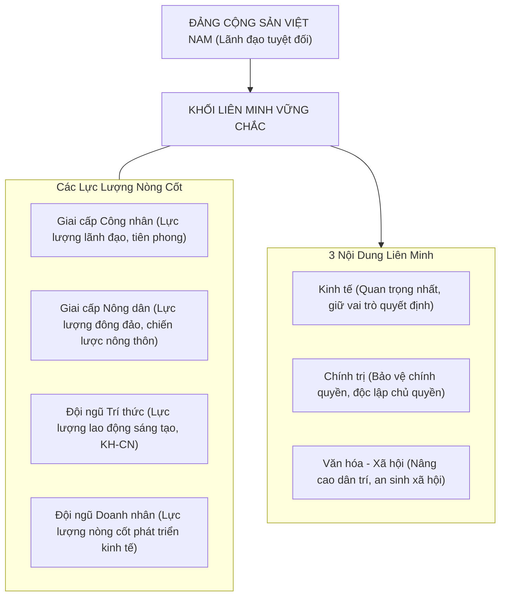

# CHƯƠNG 5: CƠ CẤU XÃ HỘI - GIAI CẤP VÀ LIÊN MINH GIAI CẤP, TẦNG LỚP TRONG THỜI KỲ QUÁ ĐỘ

### 1. Sơ đồ Khối Liên Minh Giai Cấp, Tầng Lớp ở Việt Nam

### 2. Các Khái Niệm Nền Tảng & Luận Điểm Cốt Lõi
- **Cơ cấu xã hội - giai cấp:** Hệ thống các giai cấp, tầng lớp xã hội tồn tại khách quan và mối quan hệ giữa chúng về sở hữu TLSX, tổ chức quản lý và phân phối của cải.
- **Vị trí trung tâm:** Cơ cấu xã hội - giai cấp giữ vị trí trung tâm, chi phối cơ cấu dân tộc, tôn giáo, dân số, nghề nghiệp.
- **Tính quy luật của sự biến đổi:** Do cơ cấu kinh tế nhiều thành phần quy định; cơ cấu giai cấp biến đổi đa dạng, phức tạp, vừa hợp tác vừa đấu tranh, từng bước xích lại gần nhau dưới định hướng XHCN.
- **Tính tất yếu của liên minh:** Xuất phát từ quy luật kinh tế của nền đại công nghiệp hiện đại và yêu cầu chính trị củng cố nền tảng chế độ XHCN.
- **Nội dung kinh tế của liên minh:** Là nội dung quan trọng nhất, giữ vai trò quyết định; kết hợp hài hòa lợi ích kinh tế, phát triển chuỗi giá trị nông - công nghiệp - dịch vụ.\n