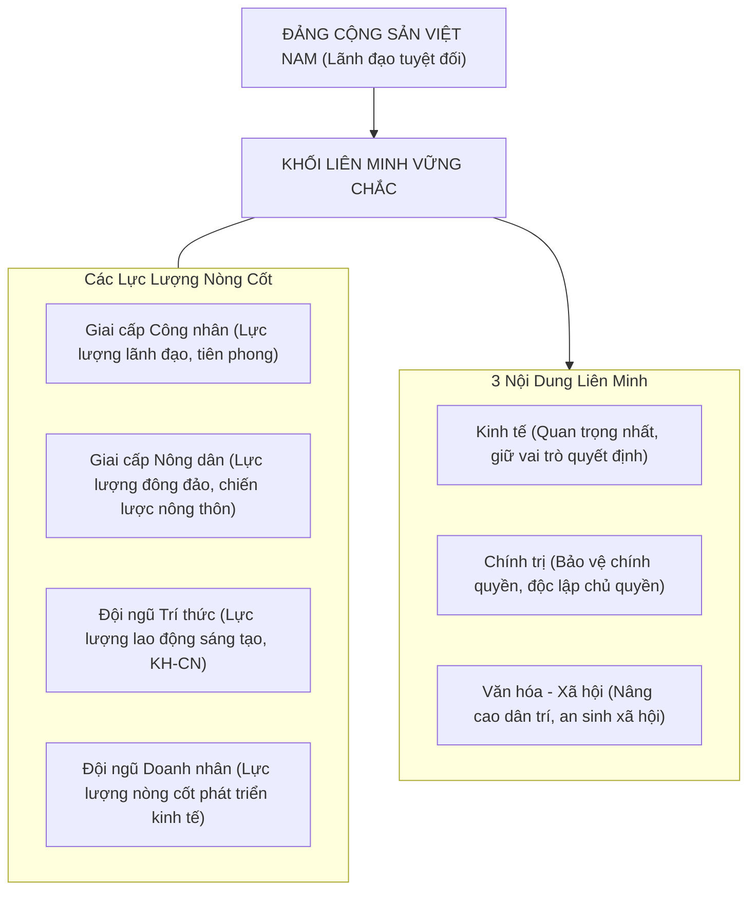

# CHƯƠNG 5: CƠ CẤU XÃ HỘI - GIAI CẤP VÀ LIÊN MINH GIAI CẤP, TẦNG LỚP TRONG THỜI KỲ QUÁ ĐỘ

### 1. Sơ đồ Khối Liên Minh Giai Cấp, Tầng Lớp ở Việt Nam

### 2. Các Khái Niệm Nền Tảng & Luận Điểm Cốt Lõi
- **Cơ cấu xã hội - giai cấp:** Hệ thống các giai cấp, tầng lớp xã hội tồn tại khách quan và mối quan hệ giữa chúng về sở hữu TLSX, tổ chức quản lý và phân phối của cải.
- **Vị trí trung tâm:** Cơ cấu xã hội - giai cấp giữ vị trí trung tâm, chi phối cơ cấu dân tộc, tôn giáo, dân số, nghề nghiệp.
- **Tính quy luật của sự biến đổi:** Do cơ cấu kinh tế nhiều thành phần quy định; cơ cấu giai cấp biến đổi đa dạng, phức tạp, vừa hợp tác vừa đấu tranh, từng bước xích lại gần nhau dưới định hướng XHCN.
- **Tính tất yếu của liên minh:** Xuất phát từ quy luật kinh tế của nền đại công nghiệp hiện đại và yêu cầu chính trị củng cố nền tảng chế độ XHCN.
- **Nội dung kinh tế của liên minh:** Là nội dung quan trọng nhất, giữ vai trò quyết định; kết hợp hài hòa lợi ích kinh tế, phát triển chuỗi giá trị nông - công nghiệp - dịch vụ.\n

---

## Tinh Hoa Kiến Thức & Tóm Tắt Chuyên Sâu (Key Takeaways)
> **Chuyên đề mở rộng:** Cơ Cấu Xã Hội - Giai Cấp và Liên Minh Công - Nông - Trí Thức

> **Nguồn trích xuất:** Giáo trình Chủ nghĩa xã hội khoa học (Bộ GD&ĐT), Chương 5 (Trang 165 - 194).

### 1. Vị Trí Trung Tâm của Cơ Cấu Xã Hội - Giai Cấp
- Cơ cấu xã hội - giai cấp phản ánh trực tiếp quan hệ sở hữu và phương thức sản xuất, chi phối các cơ cấu xã hội khác (dân tộc, tôn giáo, dân số, nghề nghiệp).
- Biến đổi cùng với sự biến đổi của cơ cấu kinh tế nhiều thành phần trong thời kỳ quá độ.

### 2. Khối Liên Minh Giai Cấp, Tầng Lớp
- **Tính tất yếu:** Yêu cầu khách quan của nền sản xuất lớn hiện đại gắn kết công nghiệp - nông nghiệp - dịch vụ - khoa học công nghệ; nền tảng chính trị vững chắc của Nhà nước XHCN.
- **Nội dung kinh tế (then chốt nhất):** Kết hợp hài hòa lợi ích kinh tế, hợp tác sản xuất kinh doanh, chuyển giao kỹ thuật cho nông thôn.
- **Nội dung chính trị:** Giữ vững vai trò lãnh đạo của Đảng, bảo vệ an ninh trật tự và độc lập dân tộc.
- **Nội dung văn hóa - xã hội:** Nâng cao dân trí, phát triển nguồn nhân lực, bảo đảm an sinh xã hội.

### 3. Các Lực Lượng Xã Hội Cơ Bản ở Việt Nam
- **Giai cấp công nhân:** Lãnh đạo, nòng cốt trong CNH, HĐH.
- **Giai cấp nông dân:** Lực lượng đông đảo, chiến lược trong xây dựng nông thôn mới.
- **Đội ngũ trí thức:** Lao động sáng tạo đặc biệt quan trọng trong thời đại số và kinh tế tri thức.
- **Đội ngũ doanh nhân:** Động lực phát triển kinh tế, tạo việc làm và năng lực cạnh tranh.\n
