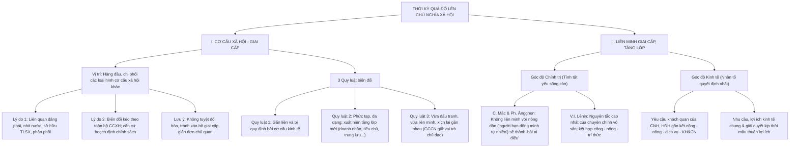
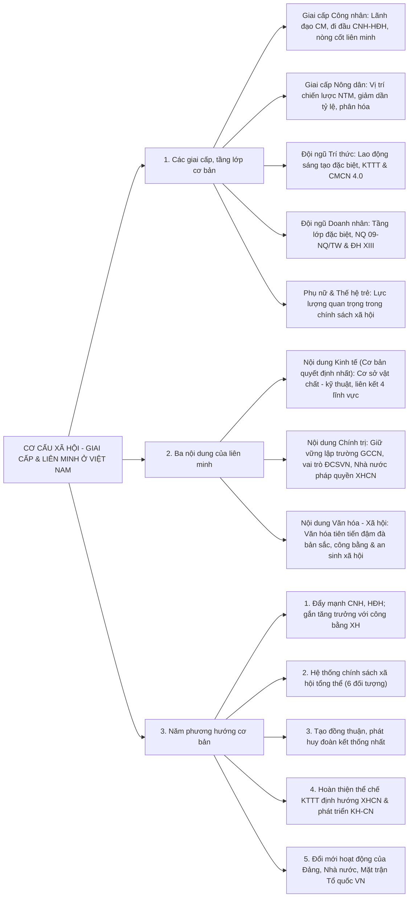

# CHƯƠNG 5: CƠ CẤU XÃ HỘI - GIAI CẤP VÀ LIÊN MINH GIAI CẤP, TẦNG LỚP TRONG THỜI KỲ QUÁ ĐỘ LÊN CHỦ NGHĨA XÃ HỘI

> **Hướng dẫn học tập theo Phương pháp ghi chép Cornell (Cornell Note-taking System):**
> Tài liệu lý thuyết Chương 5 được thiết kế chuẩn hóa theo cấu trúc **Cornell Note-taking System** gồm 3 vùng nhận thức gắn kết chặt chẽ theo Giáo trình Chủ nghĩa xã hội khoa học (2021):
> 1. **Cột Từ khóa & Câu hỏi gợi nhớ (Cue Column - Cột trái):** Chứa các khái niệm nền tảng, luận điểm kinh điển của C. Mác, Ph. Ăngghen, V.I. Lênin, văn kiện Đảng và các câu hỏi định hướng giúp người học chủ động truy xuất kiến thức (Active Recall).
> 2. **Cột Ghi chú chi tiết (Note-taking Column - Cột phải):** Hệ thống hóa đầy đủ định nghĩa, vị trí, 3 quy luật biến đổi của cơ cấu xã hội - giai cấp, tính tất yếu (chính trị và kinh tế) của liên minh, đặc điểm cơ cấu xã hội - giai cấp, 3 nội dung và 5 phương hướng liên minh ở Việt Nam.
> 3. **Phần Tóm tắt cốt lõi (Cornell Summary - Cuối mỗi mục & cuối chương):** Cô đọng mạch logic lý luận và ý nghĩa thực tiễn của từng phần để ôn tập nhanh và ghi nhớ dài hạn.

---

## Sơ đồ 1: Vị trí, Quy luật biến đổi của Cơ cấu xã hội - giai cấp và Tính tất yếu của Liên minh giai cấp, tầng lớp

---

## I. CƠ CẤU XÃ HỘI - GIAI CẤP TRONG THỜI KỲ QUÁ ĐỘ LÊN CHỦ NGHĨA XÃ HỘI

| Từ khóa / Câu hỏi gợi nhớ | Ghi chú chi tiết (Nội dung cốt lõi) |
| :--- | :--- |
| **1.a) Khái niệm *cơ cấu xã hội* & phân loại** *Cơ cấu xã hội là gì? Vì sao môn CNXHKH tập trung nghiên cứu cơ cấu xã hội - giai cấp?* | • **Khái niệm cơ cấu xã hội:** Là những **cộng đồng người** cùng toàn bộ những **mối quan hệ xã hội** do sự tác động lẫn nhau của các cộng đồng ấy tạo nên. • **Các loại hình cơ cấu xã hội chủ yếu:**   1. Cơ cấu xã hội - dân cư.   2. Cơ cấu xã hội - nghề nghiệp.   3. Cơ cấu xã hội - giai cấp.   4. Cơ cấu xã hội - dân tộc.   5. Cơ cấu xã hội - tôn giáo, v.v.. • **Đối tượng trọng tâm của Chủ nghĩa xã hội khoa học:** Dưới góc độ chính trị - xã hội, môn CNXHKH tập trung nghiên cứu **cơ cấu xã hội - giai cấp** vì đó là một trong những cơ sở trực tiếp để nghiên cứu vấn đề **liên minh giai cấp, tầng lớp** trong một chế độ xã hội nhất định. |
| **Khái niệm *cơ cấu xã hội - giai cấp* (Chung & Trong thời kỳ quá độ lên CNXH)** *Cơ cấu xã hội - giai cấp được hiểu như thế nào trong chế độ xã hội nói chung và trong thời kỳ quá độ lên CNXH nói riêng?* | • **Khái niệm chung:** Cơ cấu xã hội - giai cấp là **hệ thống các giai cấp, tầng lớp xã hội tồn tại khách quan** trong một chế độ xã hội nhất định, thông qua những **mối quan hệ về sở hữu tư liệu sản xuất**, về **tổ chức quản lý quá trình sản xuất**, về **địa vị chính trị - xã hội**... giữa các giai cấp và tầng lớp đó. • **Trong thời kỳ quá độ lên chủ nghĩa xã hội:**   ◦ Là tổng thể các giai cấp, tầng lớp, các nhóm xã hội có **mối quan hệ hợp tác và gắn bó chặt chẽ với nhau**.   ◦ **Yếu tố quyết định mối quan hệ đó:** Họ cùng chung sức **cải tạo xã hội cũ và xây dựng xã hội mới** trên mọi lĩnh vực của đời sống xã hội.   ◦ **Các lực lượng cơ bản:** Giai cấp công nhân, giai cấp nông dân, tầng lớp trí thức, tầng lớp doanh nhân, tầng lớp tiểu chủ, tầng lớp thanh niên, phụ nữ, v.v..   ◦ **Phương thức vận động chung:** Mỗi giai cấp, tầng lớp và nhóm xã hội có vị trí, vai trò xác định; dưới sự lãnh đạo của **Đảng Cộng sản** (đội tiền phong của giai cấp công nhân), tất cả cùng hợp lực tạo sức mạnh tổng hợp thực hiện mục tiêu, nội dung, nhiệm vụ của thời kỳ quá độ, tiến tới xây dựng thành công CNXH và chủ nghĩa cộng sản. |
| **1.b) Vị trí của cơ cấu xã hội - giai cấp** *Vì sao cơ cấu xã hội - giai cấp giữ vị trí quan trọng hàng đầu, chi phối các loại hình cơ cấu xã hội khác? Cần tránh sai lầm nào?* | • Trong hệ thống xã hội, các loại hình cơ cấu xã hội đều có vị trí, vai trò xác định và phụ thuộc lẫn nhau nhưng **không ngang nhau**. Trong đó, **cơ cấu xã hội - giai cấp có vị trí quan trọng hàng đầu, chi phối các loại hình cơ cấu xã hội khác** vì **2 lý do cơ bản**:   1. **Gắn trực tiếp với quyền lực chính trị và quan hệ sản xuất:** Cơ cấu xã hội - giai cấp liên quan đến **các đảng phái chính trị và nhà nước**; đến **quyền sở hữu tư liệu sản xuất**, **quản lý tổ chức lao động**, vấn đề **phân phối thu nhập**... trong một hệ thống sản xuất nhất định. Các loại hình cơ cấu xã hội khác không có được những mối quan hệ quan trọng và quyết định này.   2. **Tác động lan tỏa toàn diện và là căn cứ hoạch định chính sách:** Sự biến đổi của cơ cấu xã hội - giai cấp tất yếu ảnh hưởng đến sự biến đổi của các cơ cấu xã hội khác và tác động đến toàn bộ cơ cấu xã hội. Những đặc trưng và xu hướng biến đổi của nó tác động đến mọi lĩnh vực đời sống và mọi thành viên xã hội, cho thấy thực trạng, quy mô, vai trò, sứ mệnh và tương lai của các giai cấp, tầng lớp. Vì vậy, đây là **căn cứ cơ bản để xây dựng chính sách phát triển kinh tế, văn hóa, xã hội** trong từng giai đoạn lịch sử cụ thể. • **Lưu ý phương pháp luận:** Tuy giữ vị trí quan trọng hàng đầu nhưng **không được tuyệt đối hóa** cơ cấu xã hội - giai cấp mà xem nhẹ các loại hình cơ cấu xã hội khác, tránh dẫn đến tùy tiện, muốn **xóa bỏ nhanh chóng các giai cấp, tầng lớp xã hội một cách giản đơn theo ý muốn chủ quan**. |
| **2. Quy luật biến đổi thứ nhất** *Mối quan hệ giữa biến đổi cơ cấu xã hội - giai cấp và cơ cấu kinh tế trong thời kỳ quá độ diễn ra như thế nào?* | • **Nội dung quy luật 1:** *Cơ cấu xã hội - giai cấp biến đổi gắn liền và bị quy định bởi cơ cấu kinh tế của thời kỳ quá độ lên chủ nghĩa xã hội.* • **Cơ sở lý luận (Ph. Ăngghen):** *"Trong mọi thời đại lịch sử, sản xuất kinh tế và cơ cấu xã hội - cơ cấu này tất yếu phải do sản xuất kinh tế mà ra, - cả hai cái đó cấu thành cơ sở của lịch sử chính trị và lịch sử tư tưởng của thời đại ấy..."*. • **Cơ chế vận động trong thời kỳ quá độ:**   ◦ Cơ cấu kinh tế vận động theo cơ chế thị trường nhưng có **sự quản lý của Nhà nước pháp quyền XHCN** nhằm phục vụ thiết thực lợi ích của giai cấp công nhân và nhân dân lao động.   ◦ Ở những nước bước vào thời kỳ quá độ với **xuất phát điểm thấp**, cơ cấu kinh tế chuyển dịch mạnh: từ chủ yếu là nông nghiệp và công nghiệp sơ khai sang **tăng tỷ trọng công nghiệp và dịch vụ, giảm tỷ trọng nông nghiệp**; chuyển từ vùng lãnh thổ chưa định hình sang hình thành các **vùng, trung tâm kinh tế lớn**; chuyển từ trình độ công nghệ lạc hậu/trung bình sang **công nghệ cao, tiên tiến**, ứng dụng cách mạng khoa học - công nghệ hiện đại, **kinh tế tri thức, kinh tế số, Cách mạng công nghiệp lần thứ tư**. • **Hệ quả xã hội & tính đặc thù quốc gia:** Biến đổi kinh tế làm biến đổi cả cơ cấu tổng thể lẫn nội bộ từng giai cấp, tầng lớp; kinh tế thị trường cạnh tranh cao và hội nhập sâu rộng khiến các giai cấp, tầng lớp trở nên năng động, thích ứng nhanh, sáng tạo hơn. Tuy nhiên, xu hướng này diễn ra **rất khác nhau ở mỗi quốc gia** tùy trình độ phát triển kinh tế và điều kiện lịch sử cụ thể. |
| **Quy luật biến đổi thứ hai** *Vì sao cơ cấu xã hội - giai cấp trong thời kỳ quá độ lại biến đổi phức tạp, đa dạng và xuất hiện các tầng lớp xã hội mới?* | • **Nội dung quy luật 2:** *Cơ cấu xã hội - giai cấp biến đổi phức tạp, đa dạng, làm xuất hiện các tầng lớp xã hội mới.* • **Nguyên nhân sâu xa:** Hình thái kinh tế - xã hội cộng sản chủ nghĩa được *"thai nghén"* từ trong lòng xã hội tư bản chủ nghĩa, nên ở giai đoạn đầu vẫn còn những **"dấu vết của xã hội cũ"** về mọi phương diện (kinh tế, đạo đức, tinh thần), tồn tại **"đan xen"** với những yếu tố của xã hội mới đang hình thành. • **Biểu hiện trực tiếp về kinh tế - xã hội:**   ◦ Về mặt kinh tế là sự tồn tại của **kết cấu kinh tế nhiều thành phần** đa dạng, phức tạp.   ◦ Kết cấu kinh tế nhiều thành phần quy định sự tồn tại đa dạng của các giai cấp, tầng lớp: bên cạnh **giai cấp công nhân, giai cấp nông dân, tầng lớp trí thức, giai cấp tư sản** (tuy đã bị đánh bại nhưng vẫn còn sức mạnh - V.I. Lênin), tất yếu xuất hiện và phát triển các **tầng lớp xã hội mới** như: **tầng lớp doanh nhân, tiểu chủ, tầng lớp những người giàu có và trung lưu** trong xã hội... |
| **Quy luật biến đổi thứ ba** *Xu hướng vận động biện chứng giữa đấu tranh và liên minh trong cơ cấu xã hội - giai cấp là gì? Ai giữ vai trò chủ đạo?* | • **Nội dung quy luật 3:** *Cơ cấu xã hội - giai cấp biến đổi trong mối quan hệ vừa đấu tranh, vừa liên minh, từng bước xóa bỏ bất bình đẳng xã hội dẫn đến sự xích lại gần nhau.* • **Tính biện chứng của xu hướng phát triển:**   ◦ Trong thời kỳ quá độ, giữa các giai cấp, tầng lớp cơ bản (đặc biệt là công nhân, nông dân và trí thức) **vừa có mâu thuẫn, đấu tranh, vừa có mối quan hệ liên minh**, xích lại gần nhau.   ◦ Mức độ liên minh, xích lại gần nhau tùy thuộc vào điều kiện kinh tế - xã hội từng giai đoạn. Trên cơ sở tính đa dạng và độc lập tương đối, diễn ra sự **hòa nhập, chuyển đổi bộ phận** giữa các nhóm xã hội, tiến tới **từng bước xóa bỏ dần tình trạng bóc lột giai cấp**, vươn tới giá trị công bằng, bình đẳng qua quá trình cải biến cách mạng lâu dài, toàn diện. • **Vai trò chủ đạo của giai cấp công nhân:** Lực lượng tiêu biểu cho phương thức sản xuất mới **giữ vai trò chủ đạo**, tiên phong trong công nghiệp hóa, hiện đại hóa, cải tạo xã hội cũ, xây dựng xã hội mới; thể hiện qua việc phát triển liên minh **công nhân - nông dân - trí thức** ngày càng giữ vị trí **nền tảng chính trị - xã hội**, tạo nên sự thống nhất của cơ cấu xã hội - giai cấp. |

> **Tóm tắt Mục I (Cornell Summary):**
> Cơ cấu xã hội - giai cấp là hệ thống các giai cấp, tầng lớp và mối quan hệ về sở hữu, quản lý, địa vị chính trị - xã hội giữa chúng; nó giữ **vị trí hàng đầu, chi phối các cơ cấu xã hội khác** (nhưng không được tuyệt đối hóa dẫn tới xóa bỏ giai cấp giản đơn chủ quan). Trong thời kỳ quá độ lên CNXH, cơ cấu này vận động theo **3 quy luật**: (1) gắn liền và bị quy định bởi cơ cấu kinh tế; (2) biến đổi phức tạp, đa dạng, làm xuất hiện các tầng lớp mới (doanh nhân, tiểu chủ, người giàu có và trung lưu); (3) vừa đấu tranh vừa liên minh, từng bước xóa bỏ bất bình đẳng để xích lại gần nhau dưới vai trò chủ đạo của giai cấp công nhân.

---

## II. LIÊN MINH GIAI CẤP, TẦNG LỚP TRONG THỜI KỲ QUÁ ĐỘ LÊN CHỦ NGHĨA XÃ HỘI

| Từ khóa / Câu hỏi gợi nhớ | Ghi chú chi tiết (Nội dung cốt lõi) |
| :--- | :--- |
| **1. Tính tất yếu xét dưới góc độ chính trị (C. Mác & Ph. Ăngghen)** *C. Mác và Ph. Ăngghen đã rút ra bài học nguyên tắc gì từ các cuộc đấu tranh của GCCN châu Âu giữa thế kỷ XIX?* | • **Bài học lịch sử từ Anh và Pháp giữa thế kỷ XIX:** Khi tổng kết thực tiễn các phong trào đấu tranh của giai cấp công nhân chống giai cấp tư sản ở châu Âu, C. Mác và Ph. Ăngghen đã khái quát lý luận liên minh công, nông và các tầng lớp lao động khác thành **vấn đề mang tính nguyên tắc**. • **Cảnh báo về sự "đơn độc" của GCCN:** Hai ông chỉ ra nhiều cuộc đấu tranh của giai cấp công nhân thất bại chủ yếu do giai cấp công nhân **"đơn độc"** vì đã không tổ chức liên minh với **"người bạn đồng minh tự nhiên"** của mình là **giai cấp nông dân**; do đó các cuộc đấu tranh đó đã trở thành một **"bài ai điếu"**. • **Quy luật phổ biến của xã hội có giai cấp:** Xét dưới góc độ chính trị, cuộc đấu tranh giai cấp đặt ra nhu cầu tất yếu khách quan: mỗi giai cấp đứng ở vị trí trung tâm đều phải liên minh với các giai cấp, tầng lớp có lợi ích phù hợp để **tập hợp lực lượng** thực hiện nhu cầu, lợi ích chung. • **Nhiệm vụ trong cách mạng XHCN:** Dưới sự lãnh đạo của Đảng Cộng sản, GCCN phải liên minh với nông dân và các tầng lớp nhân dân lao động để tạo **sức mạnh tổng hợp** bảo đảm thắng lợi **cả trong giai đoạn giành chính quyền và giai đoạn xây dựng chế độ xã hội mới**. |
| **Phát triển sáng tạo của V.I. Lênin về liên minh chính trị** *V.I. Lênin khẳng định vai trò của liên minh công - nông và trí thức như thế nào đối với chuyên chính vô sản?* | • **Nguyên tắc bảo đảm thắng lợi Cách mạng Tháng Mười Nga (1917) và giữ chính quyền:** V.I. Lênin chỉ rõ: *"... nếu không liên minh với nông dân thì không thể có được chính quyền của giai cấp vô sản, không thể nghĩ được đến việc duy trì chính quyền đó... **Nguyên tắc cao nhất của chuyên chính** là duy trì khối liên minh giữa giai cấp vô sản và nông dân để giai cấp vô sản có thể giữ được vai trò lãnh đạo và chính quyền nhà nước"*. • **Mở rộng khối liên minh trong thời kỳ quá độ & Bản chất chuyên chính vô sản:** V.I. Lênin khẳng định đây là hình thức liên minh đặc biệt xuyên suốt quá trình xây dựng CNXH: *"Chuyên chính vô sản là một **hình thức đặc biệt của liên minh giai cấp** giữa giai cấp vô sản, đội tiền phong của những người lao động, với đông đảo những tầng lớp lao động không phải vô sản (tiểu tư sản, tiểu chủ, nông dân, trí thức, v.v..)... nhằm lật đổ hoàn toàn tư bản, tiêu diệt hoàn toàn sự chống cự của giai cấp tư sản... nhằm thiết lập và củng cố vĩnh viễn chủ nghĩa xã hội"*. • **Vai trò đặc biệt của trí thức trong khối liên minh:** Thực hiện tốt khối liên minh công nhân - nông dân - trí thức vừa xây dựng cơ sở kinh tế vững mạnh, vừa củng cố chế độ chính trị XHCN. V.I. Lênin nhấn mạnh: *"Trước sự liên minh của các đại biểu khoa học, giai cấp vô sản và giới kỹ thuật, không một thế lực đen tối nào đứng vững được"*. |
| **2. Tính tất yếu xét từ góc độ kinh tế** *Vì sao trong thời kỳ quá độ lên CNXH, tính tất yếu kinh tế của liên minh lại nổi lên là nhân tố quyết định nhất?* | • **Vị trí của tính tất yếu kinh tế:** Khi cách mạng chuyển sang giai đoạn mới (thời kỳ quá độ lên CNXH), cùng với tất yếu chính trị - xã hội, **tính tất yếu kinh tế của liên minh nổi lên với tư cách là nhân tố quyết định nhất** cho sự thắng lợi hoàn toàn của CNXH. • **Hai cơ sở khách quan của tính tất yếu kinh tế:**   1. **Từ yêu cầu của CNH, HĐH và chuyển dịch cơ cấu kinh tế:** Chuyển từ sản xuất nhỏ, nông nghiệp là chủ yếu sang sản xuất hàng hóa lớn, phát triển **công nghiệp, dịch vụ và khoa học - công nghệ**, xây dựng nền tảng vật chất - kỹ thuật cho CNXH. Mỗi lĩnh vực kinh tế chỉ phát triển được khi gắn bó chặt chẽ, hỗ trợ lẫn nhau tạo thành **cơ cấu kinh tế quốc dân thống nhất**.   2. **Từ nhu cầu và lợi ích kinh tế của các chủ thể:** Các chủ thể trong công nghiệp, nông nghiệp, dịch vụ, khoa học - công nghệ tất yếu phải liên minh chặt chẽ để thực hiện nhu cầu và lợi ích kinh tế chung. • **Xử lý mâu thuẫn lợi ích trong liên minh:** Bên cạnh sự thống nhất lợi ích kinh tế, giữa công nhân, nông dân và trí thức vẫn xuất hiện những **mâu thuẫn lợi ích ở các mức độ khác nhau**. Do đó, thực hiện liên minh đồng thời là quá trình **liên tục phát hiện và giải quyết kịp thời, phù hợp các mâu thuẫn lợi ích** để tạo đồng thuận, thúc đẩy CNH, HĐH và củng cố khối liên minh bền chặt dưới sự lãnh đạo của Đảng Cộng sản. |
| **Khái niệm tổng quát về liên minh giai cấp, tầng lớp** *Liên minh giai cấp, tầng lớp trong thời kỳ quá độ lên CNXH được định nghĩa như thế nào?* | • **Định nghĩa:** Liên minh giai cấp, tầng lớp trong thời kỳ quá độ lên chủ nghĩa xã hội là **sự liên kết, hợp tác, hỗ trợ nhau...** giữa các giai cấp, tầng lớp xã hội nhằm **thực hiện nhu cầu và lợi ích của các chủ thể trong khối liên minh**, đồng thời **tạo động lực thực hiện thắng lợi mục tiêu của chủ nghĩa xã hội**. |

> **Tóm tắt Mục II (Cornell Summary):**
> Liên minh giai cấp, tầng lớp trong thời kỳ quá độ lên CNXH là **tất yếu khách quan** xét từ hai góc độ: **(1) Chính trị:** Kế thừa bài học của C. Mác, Ph. Ăngghen (tránh sự "đơn độc", không biến đấu tranh thành "bài ai điếu") và phát triển của V.I. Lênin (liên minh công - nông là nguyên tắc cao nhất của chuyên chính vô sản, mở rộng kết hợp khoa học - kỹ thuật); **(2) Kinh tế (nhân tố quyết định nhất):** Xuất phát từ yêu cầu gắn kết công nghiệp - nông nghiệp - dịch vụ - KH&CN trong CNH, HĐH và từ nhu cầu, lợi ích kinh tế chung của các chủ thể, đòi hỏi liên tục phát hiện và giải quyết hài hòa các mâu thuẫn lợi ích.

---

## Sơ đồ 2: Cơ cấu xã hội - giai cấp, 3 Nội dung và 5 Phương hướng liên minh ở Việt Nam

---

## III. CƠ CẤU XÃ HỘI - GIAI CẤP VÀ LIÊN MINH GIAI CẤP, TẦNG LỚP TRONG THỜI KỲ QUÁ ĐỘ LÊN CHỦ NGHĨA XÃ HỘI Ở VIỆT NAM

| Từ khóa / Câu hỏi gợi nhớ | Ghi chú chi tiết (Nội dung cốt lõi) |
| :--- | :--- |
| **1. Đặc điểm biến đổi cơ cấu xã hội - giai cấp ở Việt Nam** *Cơ cấu xã hội - giai cấp Việt Nam từ sau Đại hội VI (1986) biến đổi theo tính chất nào?* | • **Vừa đảm bảo tính quy luật phổ biến, vừa mang tính đặc thù của xã hội Việt Nam:**   ◦ Tuân theo quy luật chung: sự biến đổi cơ cấu xã hội - giai cấp bị chi phối bởi biến đổi trong **cơ cấu kinh tế**.   ◦ **Bước ngoặt từ Đại hội VI (1986):** Việt Nam chuyển mạnh sang **cơ chế thị trường** với nền **kinh tế nhiều thành phần định hướng xã hội chủ nghĩa**.   ◦ **Hệ quả:** Hình thành cơ cấu xã hội - giai cấp **đa dạng** thay thế cho cơ cấu đơn giản (công nhân - nông dân - trí thức) thời kỳ trước đổi mới; diễn ra biến đổi phức tạp trong nội bộ từng giai cấp, tầng lớp, có sự **chuyển hóa lẫn nhau** và **xuất hiện các tầng lớp xã hội mới**.   ◦ **Tác động ngược trở lại:** Làm nền kinh tế phát triển năng động, đa dạng hơn, trở thành động lực quan trọng thúc đẩy công cuộc đổi mới và xây dựng CNXH. • **Khẳng định vị trí, vai trò các giai cấp, tầng lớp:** Trong sự biến đổi đó, vị trí và vai trò của từng giai cấp, tầng lớp cơ bản ngày càng được khẳng định rõ nét. |
| **Vị trí, vai trò & biến đổi của *Giai cấp công nhân Việt Nam*** *Giai cấp công nhân Việt Nam giữ vai trò gì và đang biến đổi ra sao?* | • **Vị trí, vai trò đặc biệt:** Là giai cấp **lãnh đạo cách mạng** thông qua đội tiền phong là **Đảng Cộng sản Việt Nam**; đại diện cho phương thức sản xuất tiên tiến; giữ vị trí **tiên phong** xây dựng CNXH; **đi đầu** trong CNH, HĐH vì mục tiêu *"dân giàu, nước mạnh, dân chủ, công bằng, văn minh"*; là **lực lượng nòng cốt** trong liên minh công nhân - nông dân - trí thức. • **Xu hướng biến đổi hiện nay:**   ◦ Biến đổi nhanh cả về **số lượng, chất lượng** và đa dạng hóa **cơ cấu** (theo thành phần kinh tế và theo ngành nghề).   ◦ Bộ phận **"công nhân hiện đại"**, **"công nhân tri thức"** ngày càng lớn mạnh; trình độ chuyên môn kỹ thuật, kỹ năng nghề nghiệp, ý thức tổ chức kỷ luật lao động và tác phong công nghiệp được nâng lên đáp ứng KTTT và CMCN 4.0.   ◦ **Mặt trái cần lưu ý:** Sự **phân hóa giàu - nghèo** trong nội bộ công nhân ngày càng rõ; vẫn còn một bộ phận công nhân thu nhập thấp, giác ngộ ý thức chính trị giai cấp chưa cao và còn nhiều khó khăn. |
| **Vị trí, vai trò & biến đổi của *Giai cấp nông dân Việt Nam*** *Giai cấp nông dân có vị trí chiến lược nào và biến đổi theo xu hướng nào?* | • **Vị trí chiến lược:** Cùng với nông nghiệp, nông thôn giữ **vị trí chiến lược** trong sự nghiệp CNH, HĐH nông nghiệp, nông thôn gắn với xây dựng nông thôn mới; góp phần xây dựng và bảo vệ Tổ quốc; là cơ sở phát triển kinh tế - xã hội bền vững, giữ ổn định chính trị, an ninh quốc phòng, giữ gìn bản sắc văn hóa và bảo vệ môi trường sinh thái; là **chủ thể của quá trình phát triển, xây dựng nông thôn mới**. • **Xu hướng biến đổi hiện nay:**   ◦ Đa dạng về cơ cấu giai cấp và có **xu hướng giảm dần về số lượng và tỷ lệ** trong cơ cấu xã hội - giai cấp.   ◦ Một bộ phận nông dân chuyển sang lao động trong các khu công nghiệp hoặc dịch vụ có tính chất công nghiệp và **trở thành công nhân**.   ◦ Xuất hiện những **chủ trang trại lớn**, đồng thời vẫn còn nông dân mất ruộng đất, nông dân đi làm thuê; **sự phân hóa giàu - nghèo** trong nội bộ nông dân ngày càng rõ. |
| **Vị trí, vai trò của *Đội ngũ trí thức* & *Đội ngũ doanh nhân*** *Trí thức và doanh nhân được Đảng ta đánh giá và định hướng phát triển như thế nào?* | • **Đội ngũ trí thức:**   ◦ Là **lực lượng lao động sáng tạo đặc biệt quan trọng** trong tiến trình đẩy mạnh CNH, HĐH, hội nhập quốc tế, xây dựng kinh tế tri thức, phát triển nền văn hóa Việt Nam tiên tiến, đậm đà bản sắc dân tộc; là **một lực lượng trong khối liên minh**.   ◦ Xây dựng đội ngũ trí thức vững mạnh là trực tiếp nâng tầm trí tuệ của dân tộc, sức mạnh đất nước, nâng cao năng lực lãnh đạo của Đảng và chất lượng hệ thống chính trị (đặc biệt trong bối cảnh KH&CN và CMCN 4.0 phát triển mạnh mẽ). • **Đội ngũ doanh nhân:**   ◦ Phát triển nhanh cả về **số lượng và quy mô** với vai trò không ngừng tăng lên; là **tầng lớp xã hội đặc biệt** được Đảng chủ trương xây dựng thành đội ngũ vững mạnh.   ◦ Bao gồm doanh nhân tiềm lực lớn và doanh nhân vừa và nhỏ thuộc các thành phần kinh tế khác nhau, đóng góp tích cực vào chiến lược phát triển KT-XH, giải quyết việc làm, an sinh xã hội, xóa đói giảm nghèo, bảo đảm **độc lập, tự chủ của nền kinh tế** (**Nghị quyết số 09-NQ/TW ngày 21/01/2013** của Bộ Chính trị).   ◦ **Yêu cầu của Đại hội XIII (2021):** *"Phát triển đội ngũ doanh nhân lớn mạnh về số lượng, chất lượng, có tinh thần cống hiến cho dân tộc, có chuẩn mực văn hóa, đạo đức tiến bộ và trình độ quản trị, kinh doanh giỏi"*. |
| **2.a) Đường lối liên minh & *Nội dung kinh tế của liên minh*** *Tại sao nội dung kinh tế là cơ bản quyết định nhất? Những nhiệm vụ cụ thể nào được đặt ra?* | • **Khẳng định đường lối xuyên suốt (Đại hội XII):** *"Đại đoàn kết toàn dân tộc là đường lối chiến lược của cách mạng Việt Nam... Tăng cường khối đại đoàn kết toàn dân tộc trên nền tảng liên minh giai cấp công nhân với giai cấp nông dân và đội ngũ trí thức do Đảng lãnh đạo"*. • **Nội dung kinh tế (Nội dung cơ bản quyết định nhất, cơ sở vật chất - kỹ thuật của liên minh):**   ◦ V.I. Lênin chỉ rõ trong thời kỳ quá độ: *chính trị đã chuyển trọng tâm sang chính trị trong lĩnh vực kinh tế*. Nội dung này nhằm thỏa mãn nhu cầu, lợi ích kinh tế thiết thân của công nhân, nông dân, trí thức và các tầng lớp khác, tạo cơ sở vật chất - kỹ thuật cho CNXH.   ◦ Thực chất là sự **hợp tác giữa công nhân - nông dân - trí thức, mở rộng liên kết với các lực lượng khác (đặc biệt là đội ngũ doanh nhân)** để xây dựng nền kinh tế XHCN hiện đại.   ◦ **Các nhiệm vụ cụ thể:** (1) Thực hiện nhiệm vụ phát triển kinh tế nhanh, bền vững, giữ ổn định vĩ mô, CNH-HĐH (chú trọng nông nghiệp, nông thôn gắn với nông thôn mới), phát triển KTTT, xây dựng nền kinh tế độc lập tự chủ, hoàn thiện thể chế KTTT định hướng XHCN; (2) Xác định đúng tiềm lực, nhu cầu kinh tế và **cơ cấu kinh tế** hợp lý ở từng cấp, tránh đầu tư lãng phí; (3) Tổ chức **giao lưu, hợp tác, liên kết kinh tế** giữa công nghiệp - nông nghiệp - KH&CN - dịch vụ, giữa các ngành/vùng/thành phần kinh tế và quốc tế; (4) **Chuyển giao và ứng dụng KH-KT, công nghệ hiện đại** (công nghệ cao) vào nông nghiệp, công nghiệp, dịch vụ. |
| **2.a) *Nội dung chính trị* & *Nội dung văn hóa - xã hội* của liên minh** *Nội dung chính trị và văn hóa - xã hội của liên minh ở Việt Nam gồm những điểm cốt lõi nào?* | • **Nội dung chính trị của liên minh:**   ◦ Tạo cơ sở chính trị - xã hội vững chắc cho khối đại đoàn kết toàn dân, tạo sức mạnh tổng hợp bảo vệ vững chắc Tổ quốc XHCN.   ◦ **Nguyên tắc cốt lõi:** Giữ vững **lập trường chính trị - tư tưởng của GCCN** và **vai trò lãnh đạo của Đảng Cộng sản Việt Nam** đối với khối liên minh và toàn xã hội để giữ vững độc lập dân tộc và định hướng XHCN.   ◦ **Nhiệm vụ trọng tâm:** Hoàn thiện, phát huy dân chủ XHCN và quyền làm chủ của nhân dân; xây dựng Đảng trong sạch, vững mạnh; xây dựng **Nhà nước pháp quyền XHCN** của nhân dân, do nhân dân, vì nhân dân, bảo đảm quyền dân chủ, quyền công dân, quyền con người; động viên các lực lượng chấp hành đường lối của Đảng, pháp luật Nhà nước và kiên quyết đấu tranh chống tiêu cực, âm mưu **"diễn biến hòa bình"**. (Phù hợp với văn kiện Đại hội XII của Đảng). • **Nội dung văn hóa - xã hội của liên minh:**   ◦ Xây dựng nền **văn hóa Việt Nam tiên tiến, đậm đà bản sắc dân tộc**, đồng thời tiếp thu tinh hoa văn hóa nhân loại và thời đại.   ◦ Đảm bảo **"gắn tăng trưởng kinh tế với phát triển văn hóa, phát triển, xây dựng con người và thực hiện tiến bộ, công bằng xã hội"**; hướng đến **chân - thiện - mỹ**, thấm nhuần tinh thần dân tộc, nhân văn, dân chủ và khoa học.   ◦ Nâng cao chất lượng nguồn nhân lực; xóa đói giảm nghèo; thực hiện tốt chính sách xã hội, chăm sóc sức khỏe, nâng cao dân trí và an sinh xã hội (nội dung cơ bản, lâu dài tạo điều kiện cho liên minh phát triển bền vững). |
| **2.b) Phương hướng 1 & Phương hướng 2 (6 đối tượng chính sách)** *Hai phương hướng đầu tiên tăng cường liên minh ở Việt Nam là gì? Chính sách cụ thể cho 6 đối tượng gồm những gì?* | • **Phương hướng 1:** *Đẩy mạnh công nghiệp hóa, hiện đại hóa; giải quyết tốt mối quan hệ giữa tăng trưởng kinh tế với đảm bảo tiến bộ, công bằng xã hội, tạo môi trường và điều kiện thúc đẩy biến đổi cơ cấu xã hội - giai cấp theo hướng tích cực.*   ◦ Chuyển dịch cơ cấu kinh tế từ nông nghiệp sang công nghiệp, dịch vụ; gắn CNH, HĐH với kinh tế tri thức; tạo cơ hội công bằng tiếp cận sở hữu TLSX, giáo dục, y tế, an sinh xã hội, nhất là cho tầng lớp yếu thế. • **Phương hướng 2:** *Xây dựng và thực hiện hệ thống chính sách xã hội tổng thể nhằm tạo sự biến đổi tích cực cơ cấu xã hội, nhất là các chính sách liên quan đến cơ cấu xã hội - giai cấp (đặt lên vị trí hàng đầu).* Chính sách cụ thể cho **6 đối tượng**:   1. **Giai cấp công nhân:** Giáo dục, đào tạo phát triển số lượng và chất lượng; nâng cao bản lĩnh chính trị, học vấn, chuyên môn, tác phong công nghiệp, kỷ luật lao động; bảo đảm việc làm, thu nhập, nhà ở, phúc lợi; sửa đổi bổ sung luật tiền lương, BHXH, BHYT, BHTN.   2. **Giai cấp nông dân:** Phát huy vai trò chủ thể phát triển nông nghiệp, nông thôn mới; hỗ trợ học nghề, chuyển dịch lao động sang công nghiệp/dịch vụ, ứng dụng KH&CN; nâng cao năng suất và dịch vụ cơ bản (điện, nước sạch, y tế, giáo dục, thông tin); xóa đói giảm nghèo bền vững, khuyến khích làm giàu hợp pháp.   3. **Đội ngũ trí thức:** Xây dựng đội ngũ lớn mạnh, chất lượng cao; tôn trọng tự do tư tưởng trong nghiên cứu sáng tạo; trọng dụng đúng phẩm chất, năng lực, kết quả cống hiến; bảo vệ **quyền sở hữu trí tuệ**; có cơ chế đặc biệt thu hút nhân tài.   4. **Đội ngũ doanh nhân:** Tạo cơ chế, môi trường thuận lợi phát triển số lượng và chất lượng; nâng cao trình độ quản lý, đạo đức nghề nghiệp, trách nhiệm xã hội; bảo đảm quyền lợi và tôn vinh doanh nhân có nhiều đóng góp.   5. **Phụ nữ:** Nâng cao trình độ mọi mặt và đời sống vật chất, tinh thần; thực hiện tốt **bình đẳng giới**, tạo cơ hội phát triển toàn diện; hoàn thiện pháp luật lao động nữ; tăng tỷ lệ phụ nữ tham gia **cấp ủy và bộ máy quản lý các cấp**; kiên quyết xử lý bạo lực, buôn bán, xâm hại nhân phẩm phụ nữ.   6. **Thế hệ trẻ:** Đổi mới giáo dục chính trị, tư tưởng, lý tưởng cách mạng, lòng yêu nước, đạo đức, lối sống, ý thức Hiến pháp và pháp luật; tạo điều kiện học tập, nghiên cứu, lao động, giải trí; khuyến khích nuôi dưỡng ước mơ, xung kích sáng tạo, làm chủ KH-CN hiện đại; phát huy vai trò xây dựng và bảo vệ Tổ quốc. |
| **Phương hướng 3, 4 & 5** *Ba phương hướng còn lại nhằm củng cố liên minh và đại đoàn kết ở Việt Nam tập trung vào các giải pháp nào?* | • **Phương hướng 3:** *Tạo sự đồng thuận và phát huy tinh thần đoàn kết thống nhất giữa các lực lượng trong khối liên minh và toàn xã hội.*   ◦ Nâng cao nhận thức về tầm quan trọng của liên minh; xây dựng chủ trương, chính sách phù hợp từng đối tượng; giải quyết tốt mâu thuẫn, khác biệt để phát huy thống nhất, tạo sức mạnh tổng hợp vì mục tiêu *"dân giàu, nước mạnh, dân chủ, công bằng, văn minh"*. • **Phương hướng 4:** *Hoàn thiện thể chế kinh tế thị trường định hướng xã hội chủ nghĩa, đẩy mạnh phát triển khoa học và công nghệ, tạo môi trường và điều kiện thuận lợi để phát huy vai trò của các chủ thể trong khối liên minh.*   ◦ Bảo đảm hài hòa lợi ích giữa các giai cấp, tầng lớp; đẩy mạnh CNH-HĐH, xây dựng nông thôn mới, phát triển KTTT; đẩy mạnh nghiên cứu sáng tạo và ứng dụng thành tựu của **Cách mạng công nghiệp lần thứ tư** trong nông nghiệp, công nghiệp, dịch vụ (nhấn mạnh vai trò then chốt của **trí thức và doanh nhân**). • **Phương hướng 5:** *Đổi mới hoạt động của Đảng, Nhà nước, Mặt trận Tổ quốc Việt Nam nhằm tăng cường khối liên minh giai cấp, tầng lớp và xây dựng khối đại đoàn kết toàn dân.*   ◦ **Đảng Cộng sản Việt Nam:** Nâng cao vai trò lãnh đạo.   ◦ **Nhà nước:** Tinh giản, hiệu quả, xây dựng **Nhà nước phục vụ, kiến tạo phát triển**, bảo đảm công bằng trước pháp luật và bảo vệ lợi ích chính đáng của mọi giai cấp, tầng lớp.   ◦ **Mặt trận Tổ quốc Việt Nam:** Phối hợp chặt chẽ với **Công đoàn, Hội Nông dân, Liên hiệp các Hội Khoa học và Kỹ thuật Việt Nam**, hoạt động của đội ngũ doanh nhân; đặc biệt chú trọng hình thức liên minh của **thế hệ trẻ** qua **Đoàn TNCS Hồ Chí Minh** và **Hội Liên hiệp Thanh niên Việt Nam** nhằm phát huy tài năng sáng tạo của tuổi trẻ. |

> **Tóm tắt Mục III (Cornell Summary):**
> Ở Việt Nam từ sau Đổi mới (Đại hội VI - 1986), cơ cấu xã hội - giai cấp biến đổi vừa theo quy luật phổ biến (do chuyển sang kinh tế thị trường nhiều thành phần) vừa mang tính đặc thù, khẳng định vai trò của **Giai cấp công nhân** (lãnh đạo, nòng cốt), **Giai cấp nông dân** (vị trí chiến lược nông thôn mới, xu hướng giảm tỷ lệ), **Đội ngũ trí thức** (lao động sáng tạo đặc biệt trong KTTT/CMCN 4.0) và **Đội ngũ doanh nhân** (tầng lớp xã hội đặc biệt, NQ 09-NQ/TW & ĐH XIII). Khối liên minh công - nông - trí thức được triển khai đồng bộ qua **3 nội dung** (Kinh tế là quyết định nhất, Chính trị, Văn hóa - xã hội) và **5 phương hướng** (đẩy mạnh CNH-HĐH; hệ thống chính sách xã hội tổng thể cho 6 đối tượng: công nhân, nông dân, trí thức, doanh nhân, phụ nữ, thế hệ trẻ; tạo đồng thuận; hoàn thiện thể chế KTTT định hướng XHCN & phát triển KH-CN; đổi mới hoạt động của Đảng, Nhà nước, MTTQVN).

---

## Tóm tắt toàn chương (Cornell Summary)

1. **Vị trí hàng đầu của cơ cấu xã hội - giai cấp:** Chi phối các loại hình cơ cấu xã hội khác vì liên quan trực tiếp đến đảng phái, nhà nước, sở hữu TLSX, quản lý lao động và phân phối thu nhập; là căn cứ cơ bản hoạch định chính sách nhưng không được tuyệt đối hóa để tránh xóa bỏ giai cấp giản đơn chủ quan.
2. **3 quy luật biến đổi trong thời kỳ quá độ lên CNXH:** (1) Biến đổi gắn liền và bị quy định bởi cơ cấu kinh tế; (2) Biến đổi phức tạp, đa dạng do tồn tại đan xen cái cũ - cái mới và kinh tế nhiều thành phần, làm xuất hiện tầng lớp mới (doanh nhân, tiểu chủ, người giàu có, trung lưu); (3) Biến đổi trong quan hệ vừa đấu tranh vừa liên minh, từng bước xóa bỏ bất bình đẳng và xích lại gần nhau với GCCN giữ vai trò chủ đạo.
3. **Tính tất yếu của liên minh giai cấp, tầng lớp:** Xét về **chính trị** (bài học chống "đơn độc" của C. Mác - Ph. Ăngghen; nguyên tắc cao nhất của chuyên chính vô sản của V.I. Lênin) và xét về **kinh tế** (nhân tố quyết định nhất trong thời kỳ quá độ nhằm gắn kết công - nông - dịch vụ - KH&CN và giải quyết hài hòa lợi ích, mâu thuẫn lợi ích).
4. **Cơ cấu xã hội - giai cấp ở Việt Nam:** Biến đổi từ cơ cấu đơn giản sang đa dạng từ Đại hội VI (1986), phát huy đồng bộ vai trò của **giai cấp công nhân** (lãnh đạo, nòng cốt), **giai cấp nông dân** (chiến lược nông nghiệp - nông thôn mới), **đội ngũ trí thức** (lao động sáng tạo đặc biệt) và **đội ngũ doanh nhân** (tầng lớp xã hội đặc biệt).
5. **3 Nội dung & 5 Phương hướng liên minh ở Việt Nam:** Triển khai toàn diện trên 3 mặt (**kinh tế** - quyết định nhất, **chính trị**, **văn hóa - xã hội**) và thực hiện đồng bộ 5 phương hướng chiến lược (CNH-HĐH gắn công bằng xã hội; chính sách xã hội tổng thể cho 6 đối tượng; đồng thuận đoàn kết; hoàn thiện thể chế KTTT định hướng XHCN & KH-CN; đổi mới Đảng, Nhà nước kiến tạo và MTTQVN).

---

## Câu hỏi tự kiểm tra nhanh (Self-Testing Cues)

1. Tại sao trong các loại hình cơ cấu xã hội, cơ cấu xã hội - giai cấp lại giữ vị trí quan trọng hàng đầu và chi phối các loại hình cơ cấu khác? Nếu tuyệt đối hóa nó sẽ dẫn đến sai lầm gì?
2. Trình bày 3 quy luật biến đổi của cơ cấu xã hội - giai cấp trong thời kỳ quá độ lên chủ nghĩa xã hội. Quy luật nào giải thích sự xuất hiện của tầng lớp doanh nhân, tiểu chủ và trung lưu?
3. Phân tích tính tất yếu khách quan của liên minh giai cấp, tầng lớp dưới góc độ chính trị (qua luận điểm của C. Mác, Ph. Ăngghen, V.I. Lênin) và dưới góc độ kinh tế. Tại sao trong thời kỳ quá độ, tính tất yếu kinh tế lại nổi lên là nhân tố quyết định nhất?
4. Chỉ ra những nét biến đổi đặc thù của giai cấp công nhân, giai cấp nông dân, đội ngũ trí thức và đội ngũ doanh nhân ở Việt Nam từ sau Đại hội VI (1986) đến nay.
5. Phân tích 3 nội dung của liên minh giai cấp, tầng lớp ở Việt Nam. Vì sao nội dung kinh tế được xác định là nội dung cơ bản quyết định nhất?
6. Trình bày 5 phương hướng cơ bản xây dựng cơ cấu xã hội - giai cấp và tăng cường liên minh ở Việt Nam, đặc biệt nêu rõ định hướng chính sách đối với 6 đối tượng trong phương hướng thứ hai.
