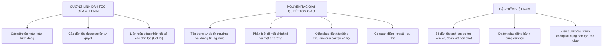

# CHƯƠNG 6: VẤN ĐỀ DÂN TỘC VÀ TÔN GIÁO TRONG THỜI KỲ QUÁ ĐỘ LÊN CHỦ NGHĨA XÃ HỘI

### 1. Sơ đồ Cương Lĩnh Dân Tộc & Nguyên Tắc Tôn Giáo

### 2. Các Khái Niệm Nền Tảng & Luận Điểm Cốt Lõi
- **Dân tộc:**
  - *Nghĩa rộng (Quốc gia):* Cộng đồng có chung lãnh thổ, kinh tế, ngôn ngữ, văn hóa và thể chế nhà nước.
  - *Nghĩa hẹp (Tộc người):* Cộng đồng có chung ngôn ngữ, phong tục tập quán và ý thức tự giác tộc người.
- **Hai xu hướng phát triển dân tộc:** Xu hướng tách ra thành quốc gia độc lập và xu hướng liên hiệp lại giữa các dân tộc.
- **Bản chất tôn giáo:** Hình thái ý thức xã hội phản ánh hư ảo hiện thực khách quan; có nguồn gốc tự nhiên - kinh tế - xã hội, nguồn gốc nhận thức và nguồn gốc tâm lý.
- **Ba tính chất của tôn giáo:** Tính lịch sử, tính quần chúng, tính chính trị.
- **Chính sách của Đảng và Nhà nước Việt Nam:**
  - *Dân tộc:* "Bình đẳng, đoàn kết, tôn trọng và giúp nhau cùng phát triển".
  - *Tôn giáo:* Tôn trọng và bảo hộ quyền tự do tín ngưỡng, tôn giáo; đồng bào các tôn giáo là bộ phận không thể tách rời của khối đại đoàn kết toàn dân tộc.\n