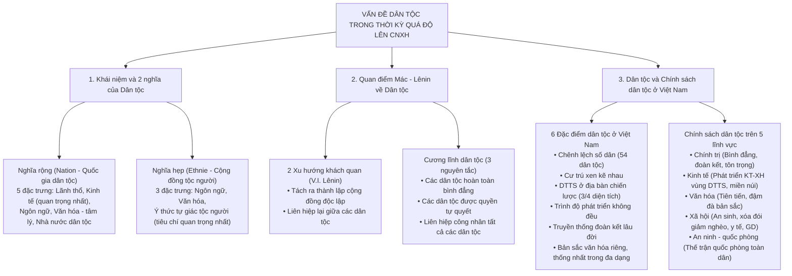
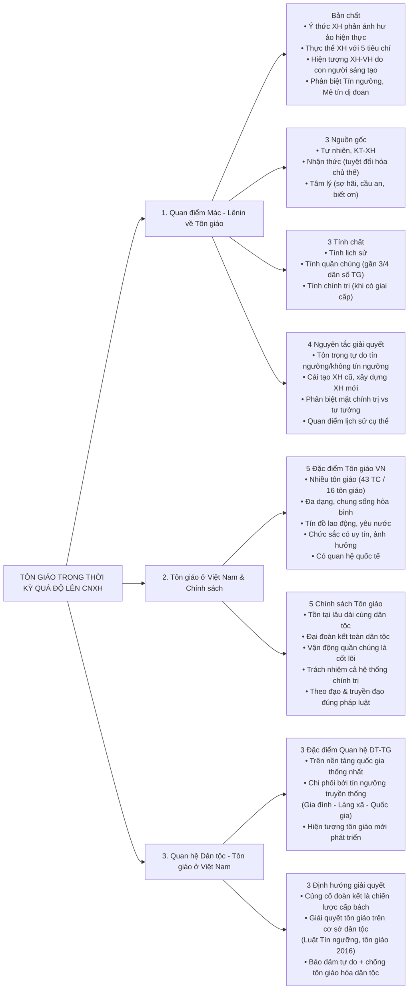

# CHƯƠNG 6: VẤN ĐỀ DÂN TỘC VÀ TÔN GIÁO TRONG THỜI KỲ QUÁ ĐỘ LÊN CHỦ NGHĨA XÃ HỘI

> **Hướng dẫn học tập theo Phương pháp ghi chép Cornell (Cornell Note-taking System):**
> Tài liệu lý thuyết Chương 6 được thiết kế chuẩn hóa theo cấu trúc **Cornell Note-taking System** gồm 3 vùng nhận thức gắn kết chặt chẽ:
> 1. **Cột Từ khóa & Câu hỏi gợi nhớ (Cue Column - Cột trái):** Chứa các khái niệm cốt lõi, thuật ngữ lý luận, số liệu thực tiễn và các câu hỏi định hướng tư duy giúp người học chủ động truy xuất thông tin (Active Recall).
> 2. **Cột Ghi chú chi tiết (Note-taking Column - Cột phải):** Hệ thống hóa đầy đủ luận điểm của chủ nghĩa Mác - Lênin về dân tộc, tôn giáo, đặc điểm thực tiễn và quan điểm, chính sách của Đảng, Nhà nước Việt Nam dựa trên *Giáo trình Chủ nghĩa xã hội khoa học (2021)*.
> 3. **Phần Tóm tắt cốt lõi (Cornell Summary - Cuối mỗi mục & cuối chương):** Cô đọng mạch logic bản chất của từng mục lớn và toàn chương trong những nhận định súc tích, hỗ trợ ôn tập tổng hợp nhanh.

---

## Sơ đồ 1: Lý luận Mác - Lênin và Chính sách của Đảng, Nhà nước Việt Nam về vấn đề Dân tộc

---

## I. DÂN TỘC TRONG THỜI KỲ QUÁ ĐỘ LÊN CHỦ NGHĨA XÃ HỘI

| Từ khóa / Câu hỏi gợi nhớ | Ghi chú chi tiết (Nội dung cốt lõi) |
| :--- | :--- |
| **1. Quá trình phát triển cộng đồng dân tộc & Sự khác biệt Đông - Tây** *Các hình thức cộng đồng người phát triển qua những nấc thang nào? Vì sao dân tộc ở phương Tây và phương Đông hình thành khác nhau?* | • **Tiến trình lịch sử:** Theo quan điểm của chủ nghĩa Mác - Lênin, dân tộc là kết quả của quá trình phát triển lâu dài của xã hội loài người, trải qua các hình thức cộng đồng từ thấp đến cao: **Thị tộc $\rightarrow$ Bộ lạc $\rightarrow$ Bộ tộc $\rightarrow$ Dân tộc**. • **Nguyên nhân quyết định:** Sự biến đổi của **phương thức sản xuất** chính là nguyên nhân quyết định sự biến đổi của cộng đồng dân tộc. • **Sự khác biệt lịch sử giữa phương Tây và phương Đông:**   ◦ **Ở phương Tây:** Dân tộc xuất hiện khi **phương thức sản xuất tư bản chủ nghĩa** được xác lập thay thế phương thức sản xuất phong kiến (gắn với thị trường dân tộc thống nhất và nhà nước tư sản).   ◦ **Ở phương Đông:** Dân tộc được hình thành từ rất sớm trên cơ sở **một nền văn hóa, một tâm lý dân tộc đã phát triển tương đối chín muồi** và một **cộng đồng kinh tế** tuy đã đạt tới một mức độ nhất định, song nhìn chung còn kém phát triển và ở trạng thái phân tán (thường gắn với yêu cầu trị thủy, cải biến tự nhiên và chống giặc ngoại xâm). |
| **Hai nghĩa của khái niệm "Dân tộc"** *Phân biệt dân tộc theo nghĩa rộng (Nation) và theo nghĩa hẹp (Ethnie)?* | • **Theo nghĩa rộng (Nation - Quốc gia dân tộc):** Là khái niệm dùng để chỉ một cộng đồng người ổn định làm thành nhân dân một nước, có lãnh thổ riêng, nền kinh tế thống nhất, có ngôn ngữ chung và có ý thức về sự thống nhất của mình, gắn bó với nhau bởi quyền lợi chính trị, kinh tế, truyền thống văn hóa và truyền thống đấu tranh chung trong suốt quá trình lịch sử lâu dài dựng nước và giữ nước. Với nghĩa này, dân tộc dùng để chỉ **một quốc gia** (ví dụ: dân tộc Việt Nam, dân tộc Trung Hoa, dân tộc Ấn Độ...). • **Theo nghĩa hẹp (Ethnie - Cộng đồng tộc người):** Là khái niệm dùng để chỉ một cộng đồng tộc người được hình thành trong lịch sử, có mối liên hệ chặt chẽ và bền vững, có chung ý thức tự giác tộc người, ngôn ngữ và văn hóa. Cộng đồng này xuất hiện sau bộ lạc, bộ tộc, kế thừa và phát triển cao hơn các nhân tố tộc người của các cộng đồng đó. Với nghĩa này, dân tộc là **một bộ phận hay thành phần của quốc gia** (ví dụ: Việt Nam có 54 dân tộc, tức 54 cộng đồng tộc người). • **Mối quan hệ biện chứng giữa 2 nghĩa:** Hai cách hiểu tuy không đồng nhất nhưng gắn bó mật thiết, không tách rời nhau. Dân tộc quốc gia bao hàm dân tộc tộc người; dân tộc tộc người là bộ phận hình thành dân tộc quốc gia. Nói đến dân tộc Việt Nam không thể bỏ qua 54 cộng đồng tộc người, và ngược lại, 54 tộc người gắn liền với lịch sử hình thành, phát triển của quốc gia Việt Nam. |
| **5 đặc trưng cơ bản của Dân tộc theo nghĩa rộng (Nation)** *Quốc gia dân tộc được nhận diện qua 5 đặc trưng nào? Đặc trưng nào là quan trọng nhất?* | • **Thứ nhất, có chung một vùng lãnh thổ ổn định:** Lãnh thổ xác định không gian sinh tồn, vị trí địa lý gồm vùng đất, vùng trời, vùng biển thuộc quyền sở hữu của dân tộc; là yếu tố **thiêng liêng nhất** biểu thị chủ quyền quốc gia (không có lãnh thổ thì không có khái niệm Tổ quốc, quốc gia). Trong bối cảnh toàn cầu hóa và di cư hiện nay, biên giới không chỉ bó hẹp trong đường biên giới hữu hình mà còn mở rộng thành **đường biên giới "mềm"** với dấu ấn văn hóa là yếu tố phân định. • **Thứ hai, có chung một phương thức sinh hoạt kinh tế:** Đây là **đặc trưng quan trọng nhất** của dân tộc, là cơ sở gắn kết các bộ phận, thành viên trong dân tộc, tạo nên tính thống nhất, ổn định, bền vững. Nếu thiếu tính cộng đồng chặt chẽ, bền vững về kinh tế thì cộng đồng người chưa thể trở thành dân tộc. • **Thứ ba, có chung một ngôn ngữ làm công cụ giao tiếp:** Bao gồm ngôn ngữ nói và ngôn ngữ viết, dùng trong mọi lĩnh vực kinh tế, văn hóa, xã hội, tình cảm. Trong quốc gia đa tộc người có nhiều ngôn ngữ khác nhau nhưng bao giờ cũng có một ngôn ngữ chung thống nhất (thể hiện trước hết ở sự thống nhất về cấu trúc ngữ pháp và kho từ vựng cơ bản). • **Thứ tư, có chung một nền văn hóa và tâm lý:** Biểu hiện qua tâm lý, tính cách, phong tục, tập quán, lối sống tạo nên bản sắc riêng. Văn hóa dân tộc gắn bó chặt chẽ với văn hóa các cộng đồng tộc người; giao lưu văn hóa với bên ngoài phải đi đôi với ý thức bảo tồn, phát triển bản sắc để tránh nguy cơ bị đồng hóa. • **Thứ năm, có chung một nhà nước (nhà nước dân tộc):** Các thành viên và cộng đồng tộc người chịu sự quản lý, điều khiển của một nhà nước độc lập. **Đây là yếu tố phân biệt dân tộc - quốc gia và dân tộc - tộc người** (tộc người trong một quốc gia không có nhà nước và thể chế chính trị riêng). Nhà nước đại diện cho dân tộc trong quan hệ quốc tế. • *Tổng thể:* Năm đặc trưng gắn bó chặt chẽ theo quan hệ nhân quả trong một chỉnh thể, tạo nên tính bền vững của quốc gia dân tộc. |
| **3 đặc trưng cơ bản của Dân tộc theo nghĩa hẹp (Ethnie)** *Dân tộc - tộc người có những đặc trưng nào? Tiêu chí nào giữ vai trò quyết định nhất để phân định một tộc người?* | • **1. Cộng đồng về ngôn ngữ:** Bao gồm ngôn ngữ nói, ngôn ngữ viết hoặc chỉ riêng ngôn ngữ nói. Đây là tiêu chí cơ bản để phân biệt các tộc người khác nhau và luôn được coi trọng giữ gìn. Tuy nhiên, trong quá trình phát triển, vì nhiều nguyên nhân, có những tộc người không còn ngôn ngữ mẹ đẻ mà sử dụng ngôn ngữ khác làm công cụ giao tiếp. • **2. Cộng đồng về văn hóa:** Bao gồm **văn hóa vật thể** và **văn hóa phi vật thể** ở mỗi tộc người, phản ánh truyền thống, lối sống, phong tục, tập quán, tín ngưỡng, tôn giáo của tộc người đó. Ngày nay, song song với xu thế giao lưu văn hóa luôn tồn tại xu thế bảo tồn và phát huy bản sắc văn hóa tộc người. • **3. Ý thức tự giác tộc người:** Đây là **tiêu chí quan trọng nhất** để phân định một tộc người và có vị trí quyết định đối với sự tồn tại và phát triển của mỗi tộc người. Đặc trưng nổi bật là các tộc người luôn tự ý thức về nguồn gốc, tộc danh của mình; tự khẳng định sự tồn tại và phát triển dù địa bàn cư trú, lãnh thổ hay giao lưu kinh tế - văn hóa có biến đổi. Sự hình thành ý thức này liên quan trực tiếp đến ý thức, tình cảm, tâm lý tộc người. • *Ý nghĩa thực tiễn:* Ba tiêu chí này tạo nên sự ổn định của mỗi tộc người và là căn cứ khoa học để xem xét, phân định thành phần các tộc người ở Việt Nam hiện nay. |
| **2a. Hai xu hướng khách quan của sự phát triển quan hệ dân tộc** *V.I. Lênin đã phát hiện 2 xu hướng khách quan nào và chúng biểu hiện ra sao trong thời đại ngày nay?* | • **Xu hướng thứ nhất (Tách ra độc lập):** Cộng đồng dân cư muốn **tách ra để hình thành cộng đồng dân tộc độc lập**.   ◦ *Nguyên nhân:* Do sự thức tỉnh, sự trưởng thành về ý thức dân tộc và ý thức về quyền sống của mình.   ◦ *Biểu hiện lịch sử & hiện đại:* Rõ nét trong phong trào đấu tranh giành độc lập của các dân tộc thuộc địa, phụ thuộc chống thực dân, đế quốc. Trong phạm vi **một quốc gia**, thể hiện ở nỗ lực của từng dân tộc (tộc người) đi tới tự do, bình đẳng, phồn vinh. Trên phạm vi **quốc tế**, thể hiện trong phong trào giải phóng dân tộc, bảo vệ độc lập tự chủ. • **Xu hướng thứ hai (Liên hiệp lại):** Các dân tộc trong từng quốc gia, thậm chí các dân tộc ở nhiều quốc gia muốn **liên hiệp lại với nhau**.   ◦ *Nguyên nhân:* Nổi lên khi chủ nghĩa tư bản phát triển thành chủ nghĩa đế quốc; do sự phát triển của lực lượng sản xuất, khoa học - công nghệ, giao lưu kinh tế và văn hóa làm xuất hiện nhu cầu xóa bỏ hàng rào ngăn cách, thúc đẩy các dân tộc xích lại gần nhau.   ◦ *Biểu hiện hiện đại:* Trong phạm vi **một quốc gia**, tạo động lực thúc đẩy các dân tộc hòa hợp ở mức độ cao hơn trên mọi lĩnh vực. Trên phạm vi **quốc tế**, thể hiện ở xu thế hợp tác hình thành liên minh dân tộc khu vực và toàn cầu để tận dụng thời cơ phát triển. • **Tính thống nhất biện chứng:** Hai xu hướng tác động qua lại, hỗ trợ lẫn nhau; vi phạm mối quan hệ này sẽ gây hậu quả tiêu cực khó lường. Hiện nay, các thế lực thù địch thường lợi dụng hai xu hướng này phục vụ chiến lược **"diễn biến hòa bình"**. |
| **2b. Cương lĩnh dân tộc của chủ nghĩa Mác - Lênin** *3 nguyên tắc trong Cương lĩnh dân tộc của V.I. Lênin có nội dung và mối liên hệ như thế nào?* | • **Cơ sở hình thành:** Dựa trên quan điểm của chủ nghĩa Mác về quan hệ dân tộc - giai cấp, phân tích hai xu hướng khách quan, kinh nghiệm phong trào cách mạng thế giới và thực tiễn cách mạng Nga đầu thế kỷ XX, V.I. Lênin khái quát: *"Các dân tộc hoàn toàn bình đẳng, các dân tộc được quyền tự quyết, liên hiệp công nhân tất cả các dân tộc lại"*. • **Nguyên tắc 1: Các dân tộc hoàn toàn bình đẳng:**   ◦ Là quyền thiêng liêng của mọi dân tộc, không phân biệt lớn hay nhỏ, trình độ phát triển cao hay thấp; đều có nghĩa vụ và quyền lợi ngang nhau trên tất cả các lĩnh vực, không dân tộc nào được giữ đặc quyền, đặc lợi.   ◦ Không dân tộc nào có quyền áp bức, bóc lột dân tộc khác. Phải thể hiện cả về **pháp lý** và thực hiện trên **thực tế**. Muốn bình đẳng thực sự phải thủ tiêu áp bức giai cấp để xóa bỏ áp bức dân tộc; đấu tranh chống chủ nghĩa phân biệt chủng tộc, dân tộc cực đoan.   ◦ Đây là **cơ sở** để thực hiện quyền dân tộc tự quyết và xây dựng quan hệ hữu nghị, hợp tác. • **Nguyên tắc 2: Các dân tộc được quyền tự quyết:**   ◦ Là quyền tự quyết định vận mệnh của dân tộc mình, tự lựa chọn chế độ chính trị và con đường phát triển; bao gồm **quyền tách ra** thành lập quốc gia độc lập và **quyền tự nguyện liên hiệp** với dân tộc khác trên cơ sở bình đẳng.   ◦ Thực hiện quyền tự quyết phải xuất phát từ **thực tiễn - cụ thể**, đứng vững trên lập trường của giai cấp công nhân, bảo đảm thống nhất lợi ích dân tộc và lợi ích giai cấp công nhân (chú trọng quyền tự quyết của các dân tộc bị áp bức, phụ thuộc).   ◦ **Lưu ý quan trọng:** Quyền tự quyết dân tộc **không đồng nhất với "quyền" của các tộc người thiểu số** trong một quốc gia đa tộc người, nhất là việc phân lập thành quốc gia độc lập. Kiên quyết chống lợi dụng chiêu bài "dân tộc tự quyết" để can thiệp nội bộ hoặc kích động ly khai. • **Nguyên tắc 3: Liên hiệp công nhân tất cả các dân tộc:**   ◦ Phản ánh sự thống nhất giữa giải phóng dân tộc và giải phóng giai cấp; giữa chủ nghĩa yêu nước và chủ nghĩa quốc tế chân chính.   ◦ Là cơ sở vững chắc để đoàn kết nhân dân lao động các dân tộc chống chủ nghĩa đế quốc. Vì vậy, đây **vừa là nội dung chủ yếu, vừa là giải pháp quan trọng** để liên kết các nội dung của Cương lĩnh dân tộc thành một chỉnh thể. |
| **3a. Sáu (6) đặc điểm dân tộc ở Việt Nam** *Cơ cấu dân số, phân bố địa bàn, trình độ phát triển và truyền thống văn hóa của 54 dân tộc Việt Nam có những điểm nổi bật nào?* | • **Thứ nhất, có sự chênh lệch về số dân giữa các tộc người:** Nước ta có **54 dân tộc**. Dân tộc Kinh (Việt) là đa số với **82.085.826 người, chiếm 85,3%**. Trong 53 dân tộc thiểu số: có **6 dân tộc trên 1 triệu người** là Tày (đông nhất: **1,85 triệu**), Thái, Mường, Mông, Khmer, Nùng; có **11 dân tộc dưới 5.000 người**, trong đó **Ơ Đu** thấp nhất (**428 người**). Địa bàn chủ yếu là trung du, miền núi phía Bắc và Tây Nguyên. Dân số quá ít gây khó khăn cho tổ chức đời sống, bảo tồn tiếng nói, văn hóa, duy trì nòi giống nên Đảng và Nhà nước có chính sách đặc biệt cho dân tộc rất ít người. • **Thứ hai, các dân tộc cư trú xen kẽ nhau:** Do lịch sử chuyển cư ở Đông Nam Á, bản đồ cư trú phân tán, xen kẽ, **không có lãnh thổ tộc người riêng** (không dân tộc nào cư trú tập trung và duy nhất trên một địa bàn). Tạo thuận lợi để tăng cường hiểu biết, giao lưu nhưng cũng dễ nảy sinh mâu thuẫn, xung đột, tạo kẽ hở cho thế lực thù địch phá hoại. • **Thứ ba, các dân tộc thiểu số phân bố chủ yếu ở địa bàn có vị trí chiến lược quan trọng:** Tuy chỉ chiếm **14,3% dân số** (theo số liệu dẫn trong giáo trình), 53 dân tộc thiểu số cư trú trên **3/4 diện tích lãnh thổ**, ở các vùng trọng yếu về kinh tế, an ninh, quốc phòng, sinh thái (biên giới, hải đảo, vùng sâu, vùng xa). Một số dân tộc có quan hệ dòng tộc xuyên biên giới (Thái, Mông, Khmer, Hoa...) nên thường bị thế lực phản động lợi dụng chống phá. • **Thứ tư, các dân tộc có trình độ phát triển không đều:** Chênh lệch khá lớn về kinh tế, văn hóa, xã hội. Một số ít còn duy trì kinh tế chiếm đoạt dựa vào tự nhiên, trong khi đại bộ phận đã chuyển sang phương thức sản xuất tiến bộ, công nghiệp hóa, hiện đại hóa. Dân trí và trình độ chuyên môn kỹ thuật nhiều nơi còn thấp $\rightarrow$ Muốn bình đẳng phải thu hẹp, xóa bỏ khoảng cách phát triển. • **Thứ năm, có truyền thống đoàn kết, gắn bó lâu đời trong cộng đồng dân tộc - quốc gia thống nhất:** Hình thành rất sớm do yêu cầu cải biến tự nhiên và hợp sức chống ngoại xâm; là nguồn lực, động lực quyết định mọi thắng lợi trong lịch sử dựng nước và giữ nước. • **Thứ sáu, mỗi dân tộc có bản sắc văn hóa riêng, góp phần tạo nên sự phong phú, đa dạng của nền văn hóa Việt Nam thống nhất:** Tạo nên bức tranh **"thống nhất trong đa dạng"** trên nền tảng chung một lịch sử dựng nước, giữ nước và ý thức về quốc gia độc lập, thống nhất. |
| **3b. Quan điểm & Chính sách dân tộc của Đảng, Nhà nước Việt Nam** *Quan điểm nhất quán của Đảng và 5 nội dung chính sách dân tộc trên các lĩnh vực được xác định như thế nào?* | • **5 Quan điểm cơ bản của Đảng về vấn đề dân tộc (Đại hội XII):**   1. Vấn đề dân tộc và đoàn kết dân tộc là **vấn đề chiến lược cơ bản, lâu dài, đồng thời cũng là vấn đề cấp bách hiện nay**.   2. Các dân tộc trong đại gia đình Việt Nam **bình đẳng, đoàn kết, tương trợ, giúp nhau cùng phát triển**, cùng thực hiện CNH-HĐH, xây dựng và bảo vệ Tổ quốc XHCN; kiên quyết đấu tranh chống mọi âm mưu chia rẽ.   3. Phát triển toàn diện chính trị, kinh tế, văn hóa, xã hội và an ninh - quốc phòng vùng dân tộc, miền núi; gắn tăng trưởng kinh tế với giải quyết vấn đề xã hội; chăm lo đào tạo nguồn nhân lực và **đội ngũ cán bộ dân tộc thiểu số**; giữ gìn bản sắc văn hóa.   4. Ưu tiên đầu tư phát triển KT-XH vùng dân tộc, miền núi (trước hết là **giao thông, cơ sở hạ tầng, xóa đói giảm nghèo**), khai thác tiềm năng gắn với bảo vệ môi trường; kết hợp **nội lực tự cường** với hỗ trợ của Trung ương và các địa phương.   5. Công tác dân tộc và thực hiện chính sách dân tộc là nhiệm vụ của **toàn Đảng, toàn dân, toàn quân, của các cấp, các ngành, của toàn bộ hệ thống chính trị**. • **Chính sách dân tộc của Đảng, Nhà nước trên 5 lĩnh vực:**   1. **Về chính trị:** Thực hiện bình đẳng, đoàn kết, tôn trọng, giúp nhau cùng phát triển; nâng cao tính tích cực chính trị và nhận thức của đồng bào về mục tiêu độc lập dân tộc và CNXH ("dân giàu, nước mạnh, dân chủ, công bằng, văn minh").   2. **Về kinh tế:** Phát triển KT-XH miền núi, vùng đồng bào DTTS nhằm phát huy tiềm năng, thu hẹp khoảng cách chênh lệch giữa các vùng, các dân tộc thông qua chương trình, dự án phát triển kinh tế thị trường định hướng XHCN tại vùng sâu, vùng xa, biên giới, căn cứ địa cách mạng.   3. **Về văn hóa:** Xây dựng nền văn hóa Việt Nam tiên tiến, đậm đà bản sắc dân tộc; giữ gìn, phát huy giá trị văn hóa truyền thống, phát triển ngôn ngữ, đào tạo cán bộ văn hóa, xây dựng thiết chế văn hóa phù hợp; mở rộng giao lưu quốc tế đi đôi với chống tệ nạn và "diễn biến hòa bình" trên mặt trận tư tưởng - văn hóa.   4. **Về xã hội:** Bảo đảm an sinh xã hội vùng đồng bào DTTS; từng bước thực hiện bình đẳng, công bằng xã hội qua chính sách xóa đói giảm nghèo, dân số, y tế, giáo dục có tính đến đặc thù từng vùng, từng dân tộc; phát huy hệ thống chính trị cơ sở.   5. **Về an ninh - quốc phòng:** Tăng cường bảo vệ Tổ quốc trên cơ sở ổn định chính trị, trật tự an toàn xã hội; phối hợp chặt chẽ các lực lượng trên địa bàn; tăng cường quan hệ quân - dân, xây dựng **thế trận quốc phòng toàn dân**. • **Tính chất chính sách:** Toàn diện, tổng hợp, bao trùm mọi lĩnh vực; mang tính cách mạng, tiến bộ và nhân văn sâu sắc (không bỏ sót dân tộc nào, không chấp nhận kỳ thị, chia rẽ); coi **phát triển KT-XH là nền tảng** để tăng cường đoàn kết và bình đẳng thực chất. |

> **Tóm tắt Mục I (Cornell Summary):**
> Dân tộc là sản phẩm lịch sử của sự phát triển phương thức sản xuất, được hiểu theo 2 nghĩa gắn bó mật thiết: **nghĩa rộng (Quốc gia - 5 đặc trưng, kinh tế là quan trọng nhất)** và **nghĩa hẹp (Tộc người - 3 đặc trưng, ý thức tự giác tộc người là quan trọng nhất)**. Chủ nghĩa Mác - Lênin phát hiện **2 xu hướng khách quan** (tách ra độc lập và liên hiệp lại) cùng **Cương lĩnh dân tộc 3 nguyên tắc** (Bình đẳng, Tự quyết – không đồng nhất với phân lập tộc người thiểu số, và Liên hiệp công nhân – nội dung cốt lõi). Vận dụng sáng tạo vào quốc gia đa dân tộc có **6 đặc điểm đặc thù**, Đảng và Nhà nước Việt Nam xác định vấn đề dân tộc mang tầm chiến lược lâu dài và triển khai hệ thống chính sách toàn diện trên **5 lĩnh vực (Chính trị – Kinh tế – Văn hóa – Xã hội – An ninh quốc phòng)** với phát triển KT-XH làm nền tảng.

---

## Sơ đồ 2: Quan điểm Mác - Lênin về Tôn giáo và Quan hệ Dân tộc – Tôn giáo ở Việt Nam

---

## II. TÔN GIÁO TRONG THỜI KỲ QUÁ ĐỘ LÊN CHỦ NGHĨA XÃ HỘI

| Từ khóa / Câu hỏi gợi nhớ | Ghi chú chi tiết (Nội dung cốt lõi) |
| :--- | :--- |
| **1a. Bản chất của Tôn giáo** *Chủ nghĩa Mác - Lênin tiếp cận bản chất tôn giáo từ những góc độ nào?* | • **Là hình thái ý thức xã hội phản ánh hư ảo hiện thực khách quan:** Thông qua sự phản ánh đó, các lực lượng tự nhiên và xã hội trở thành siêu nhiên, thần bí. Ph. Ăngghen chỉ rõ: *"Tất cả mọi tôn giáo chẳng qua chỉ là sự phản ánh hư ảo - vào trong đầu óc của con người - của những lực lượng ở bên ngoài chi phối cuộc sống hằng ngày của họ; chỉ là sự phản ánh trong đó những lực lượng ở trần thế đã mang hình thức những lực lượng siêu trần thế"*. • **Là một thực thể xã hội (các tôn giáo cụ thể như Phật giáo, Công giáo, Tin Lành...)** với **5 tiêu chí cơ bản**:   1. Có niềm tin sâu sắc vào đấng siêu nhiên, đấng tối cao, thần linh để tôn thờ (niềm tin tôn giáo).   2. Có hệ thống giáo thuyết (giáo lý, giáo luật, lễ nghi) phản ánh thế giới quan, nhân sinh quan, đạo đức, lễ nghi.   3. Có hệ thống cơ sở thờ tự.   4. Có tổ chức nhân sự, quản lý điều hành việc đạo (chuyên nghiệp hoặc không chuyên nghiệp).   5. Có hệ thống tín đồ đông đảo tự nguyện tin theo và được tôn giáo đó thừa nhận. • **Là hiện tượng xã hội - văn hóa do con người sáng tạo ra:** Con người sáng tạo ra tôn giáo vì mục đích, lợi ích, ước mơ, nguyện vọng của mình, nhưng sau đó lại bị lệ thuộc, tuyệt đối hóa và phục tùng tôn giáo vô điều kiện. Sản xuất vật chất và quan hệ kinh tế xét đến cùng quyết định sự tồn tại, biến đổi của tôn giáo. • **Thái độ của người cộng sản:** Dù tôn giáo mang thế giới quan duy tâm (khác với duy vật biện chứng), người cộng sản không xem thường hay trấn áp nhu cầu tín ngưỡng mà luôn tôn trọng tự do tín ngưỡng, sẵn sàng cùng tín đồ xây dựng xã hội hiện thực tốt đẹp hơn. |
| **Phân biệt Tôn giáo, Tín ngưỡng, Mê tín, Dị đoan, Mê tín dị đoan** *Các khái niệm này giống và khác nhau ở những điểm ranh giới nào?* | • **Tín ngưỡng:** Không đồng nhất với tôn giáo nhưng có giao thoa nhất định. Là hệ thống niềm tin, sự ngưỡng mộ và cách thức thể hiện niềm tin trước các sự vật, hiện tượng, lực lượng có tính thần thánh, linh thiêng để cầu mong che chở, giúp đỡ (ví dụ: thờ cúng tổ tiên, thờ anh hùng dân tộc, thờ Mẫu...). • **Mê tín:** Là niềm tin mê muội, viển vông, không dựa trên cơ sở khoa học; tin vào mối quan hệ nhân quả giả tạo giữa các sự kiện thực tế vốn không có liên hệ khách quan, tất yếu nhưng được bao phủ bởi yếu tố siêu nhiên, hư ảo. • **Dị đoan:** Là sự suy đoán, hành động một cách tùy tiện, sai lệch những điều bình thường, chuẩn mực trong cuộc sống. • **Mê tín dị đoan:** Là niềm tin vào lực lượng siêu nhiên, thần thánh đến mức **mê muội, cuồng tín**, dẫn đến **hành vi cực đoan, sai lệch quá mức**, trái với giá trị văn hóa, đạo đức, pháp luật, **gây tổn hại cho cá nhân, xã hội và cộng đồng**. |
| **3 nguồn gốc của Tôn giáo** *Tôn giáo nảy sinh và tồn tại từ những nguồn gốc nào?* | • **1. Nguồn gốc tự nhiên, kinh tế - xã hội:**   ◦ *Trong xã hội công xã nguyên thủy:* Lực lượng sản xuất chưa phát triển, con người cảm thấy yếu đuối, bất lực trước thiên nhiên hùng vĩ nên gán cho tự nhiên quyền lực thần bí.   ◦ *Trong xã hội có giai cấp đối kháng:* Con người không giải thích được nguồn gốc của phân hóa giai cấp, áp bức, bóc lột, bất công, tội ác và lo sợ trước thống trị xã hội nên trông chờ sự giải phóng từ lực lượng siêu nhiên ngoài trần thế. • **2. Nguồn gốc nhận thức:** Ở mỗi giai đoạn lịch sử, nhận thức của con người có giới hạn; khi khoảng cách giữa **"biết"** và **"chưa biết"** còn tồn tại, những điều khoa học chưa giải thích được (hoặc đã chứng minh nhưng dân trí thấp chưa nhận thức đủ) thường bị giải thích qua lăng kính tôn giáo. Thực chất đây là sự **tuyệt đối hóa, cường điệu mặt chủ thể** của nhận thức, biến cái khách quan thành siêu nhiên, thần thánh. • **3. Nguồn gốc tâm lý:**   ◦ *Tâm lý tiêu cực/lo âu:* Sợ hãi trước thiên tai, ốm đau, bệnh tật, may rủi bất ngờ, hoặc mong muốn bình yên khi làm việc lớn (ma chay, cưới xin, làm nhà, khởi nghiệp...).   ◦ *Tâm lý tích cực:* Tình yêu, lòng biết ơn, lòng kính trọng đối với những người có công với nước, với dân (thờ anh hùng dân tộc, thờ Thành hoàng làng...). |
| **3 tính chất của Tôn giáo** *Tính lịch sử, tính quần chúng và tính chính trị của tôn giáo biểu hiện như thế nào?* | • **1. Tính lịch sử:** Tôn giáo có sự hình thành, tồn tại, phát triển và khả năng biến đổi để thích nghi với nhiều chế độ chính trị - xã hội; bị phân liệt thành nhiều hệ phái khi điều kiện KT-XH thay đổi. Đến giai đoạn khoa học và giáo dục giúp đại đa số nhân dân nhận thức được bản chất tự nhiên và xã hội, tôn giáo sẽ **dần mất đi vị trí** trong đời sống xã hội và nhận thức cá nhân. • **2. Tính quần chúng:** Phổ biến ở tất cả dân tộc, quốc gia, châu lục với số lượng tín đồ rất đông đảo (**gần 3/4 dân số thế giới**). Là nơi sinh hoạt văn hóa, tinh thần của nhân dân; tuy hướng tới hạnh phúc hư ảo ở thế giới bên kia nhưng vẫn phản ánh khát vọng của người lao động về xã hội tự do, bình đẳng, bác ái và có tính nhân văn, nhân đạo, hướng thiện. • **3. Tính chính trị:** Khi xã hội chưa có giai cấp, tôn giáo chưa mang tính chính trị. Tính chính trị **chỉ xuất hiện khi xã hội phân chia giai cấp**, có sự đối kháng lợi ích giai cấp. Tôn giáo phản ánh lợi ích giai cấp trong đấu tranh giai cấp, dân tộc; và thường bị giai cấp bóc lột, thống trị hoặc các thế lực chính trị lợi dụng vào mục đích ngoài tôn giáo, chống lại tiến bộ xã hội. |
| **1b. 4 nguyên tắc giải quyết vấn đề tôn giáo trong thời kỳ quá độ lên CNXH** *Cần tuân thủ 4 nguyên tắc nào để xử lý đúng đắn vấn đề tôn giáo?* | • **Nguyên tắc 1: Tôn trọng, bảo đảm quyền tự do tín ngưỡng và không tín ngưỡng của nhân dân.** Đây là quyền tự do tư tưởng (quyền theo đạo, đổi đạo, bỏ đạo hoặc không theo đạo). Không một cá nhân, tổ chức nào (kể cả chức sắc, giáo hội) được phép can thiệp, cấm đoán hay ép buộc. Tôn trọng tự do tín ngưỡng là tôn trọng quyền con người và thể hiện bản chất ưu việt của CNXH; Nhà nước bảo hộ hoạt động bình thường và cơ sở thờ tự hợp pháp. • **Nguyên tắc 2: Khắc phục dần những ảnh hưởng tiêu cực của tôn giáo phải gắn liền với quá trình cải tạo xã hội cũ, xây dựng xã hội mới.** Chủ nghĩa Mác - Lênin không can thiệp công việc nội bộ tôn giáo, mà giải quyết nguồn gốc sinh ra ảo tưởng bằng cách thay đổi tồn tại xã hội: xác lập thế giới hiện thực không có áp bức, bất công, nghèo đói, thất học và tệ nạn xã hội – đây là quá trình lâu dài. • **Nguyên tắc 3: Phân biệt hai mặt chính trị và tư tưởng của tôn giáo trong quá trình giải quyết vấn đề tôn giáo.**   ◦ *Mặt chính trị:* Phản ánh mối quan hệ giữa tiến bộ và phản tiến bộ, là **mâu thuẫn đối kháng** về lợi ích kinh tế - chính trị giữa các giai cấp hoặc giữa thế lực lợi dụng tôn giáo chống cách mạng với lợi ích nhân dân lao động.   ◦ *Mặt tư tưởng:* Biểu hiện sự khác nhau về niềm tin, mức độ tin giữa người có đạo và không có đạo hoặc giữa các tôn giáo khác nhau, là **mâu thuẫn không đối kháng**.   ◦ *Ý nghĩa:* Hai mặt thường đan xen nhau nên phải phân biệt rõ để tránh khuynh hướng cực đoan (tả khuynh trấn áp nhầm hoặc hữu khuynh mất cảnh giác) trong quản lý, ứng xử. • **Nguyên tắc 4: Quan điểm lịch sử cụ thể trong giải quyết vấn đề tín ngưỡng, tôn giáo.** Tôn giáo luôn vận động, biến đổi tùy điều kiện KT-XH-lịch sử cụ thể. Ở từng thời kỳ khác nhau, vai trò, tác động của từng tôn giáo, thái độ của giáo hội, giáo sĩ, giáo dân không giống nhau nên phải xem xét, đánh giá và ứng xử cụ thể, linh hoạt. |
| **2a. 5 đặc điểm tôn giáo ở Việt Nam** *Bức tranh tôn giáo tại Việt Nam có 5 đặc trưng nổi bật nào?* | • **Thứ nhất, Việt Nam là một quốc gia có nhiều tôn giáo:** Hiện có **43 tổ chức thuộc 16 tôn giáo** đã được công nhận và cấp đăng ký hoạt động, với khoảng **57.000 chức sắc**, **157.000 chức việc** và **hơn 29.000 cơ sở thờ tự** (số liệu 12/2020). Gồm cả tôn giáo du nhập từ bên ngoài (Phật giáo, Công giáo, Tin Lành, Hồi giáo...) và tôn giáo nội sinh (Cao Đài, Hòa Hảo). • **Thứ hai, tôn giáo ở Việt Nam đa dạng, đan xen, chung sống hòa bình và không có xung đột, chiến tranh tôn giáo:** Tín đồ các tôn giáo cùng sống hòa bình trên một địa bàn, tôn trọng niềm tin của nhau, chưa từng xảy ra chiến tranh tôn giáo; mọi tôn giáo du nhập đều chịu ảnh hưởng và mang dấu ấn của bản sắc văn hóa Việt Nam. • **Thứ ba, tín đồ các tôn giáo Việt Nam phần lớn là nhân dân lao động, có lòng yêu nước, tinh thần dân tộc:** Đa số tín đồ có tinh thần chống ngoại xâm, tôn trọng công lý, gắn bó với dân tộc, đi theo Đảng, cách mạng và có ước vọng sống **"tốt đời, đẹp đạo"**. • **Thứ tư, hàng ngũ chức sắc các tôn giáo có vai trò, vị trí quan trọng trong giáo hội, có uy tín, ảnh hưởng với tín đồ:** Chức sắc là người có chức vụ, phẩm sắc chuyên truyền bá giáo lý, giáo luật, lễ nghi, quản lý tổ chức và chăm lo đời sống tâm linh cho tín đồ; xu hướng tiến bộ trong hàng ngũ chức sắc ngày càng phát triển. • **Thứ năm, các tôn giáo ở Việt Nam đều có quan hệ với các tổ chức, cá nhân tôn giáo ở nước ngoài:** Cả tôn giáo ngoại nhập và nội sinh đều có quan hệ quốc tế, nhất là khi Việt Nam thiết lập quan hệ ngoại giao với gần 200 quốc gia, vùng lãnh thổ. Do đó, cần kết hợp mở rộng giao lưu hợp tác quốc tế với bảo đảm độc lập, chủ quyền, không để kẻ địch lợi dụng "dân chủ, nhân quyền, tự do tôn giáo" thực hiện âm mưu "diễn biến hòa bình". |
| **2b. Chính sách của Đảng, Nhà nước Việt Nam đối với tín ngưỡng, tôn giáo hiện nay** *5 nội dung chính sách tôn giáo cốt lõi của Việt Nam là gì? Công tác nào là nội dung cốt lõi?* | • **1. Tín ngưỡng, tôn giáo là nhu cầu tinh thần của một bộ phận nhân dân, đang và sẽ tồn tại cùng dân tộc trong quá trình xây dựng CNXH:** Khẳng định tính khoa học, cách mạng; bác bỏ cả quan điểm **tả khuynh** (dùng biện pháp hành chính hoặc nghĩ dân trí/vật chất cao là tôn giáo lập tức biến mất) lẫn **hữu khuynh** (coi tôn giáo bất biến, thoát ly cơ sở KT-XH). Thực hiện nhất quán tôn trọng tự do tín ngưỡng, tôn giáo; các tôn giáo hoạt động trong khuôn khổ pháp luật và bình đẳng trước pháp luật. • **2. Thực hiện nhất quán chính sách đại đoàn kết dân tộc:** Đoàn kết đồng bào theo các tôn giáo khác nhau và với đồng bào không theo tôn giáo; nghiêm cấm chia rẽ, phân biệt đối xử vì lý do tôn giáo; nâng cao đời sống vật chất - tinh thần vì mục tiêu *"dân giàu, nước mạnh, dân chủ, công bằng, văn minh"*. Giữ gìn truyền thống thờ cúng tổ tiên, tôn vinh người có công; nghiêm cấm lợi dụng tôn giáo làm mê tín dị đoan, hoạt động trái pháp luật, kích động chia rẽ, xâm phạm an ninh quốc gia. • **3. Nội dung cốt lõi của công tác tôn giáo là công tác vận động quần chúng:** Động viên đồng bào nâng cao lòng yêu nước, ý thức bảo vệ độc lập thông qua thực hiện tốt chính sách KT-XH, AN-QP, nâng cao đời sống mọi mặt để nhân dân tự giác thực hiện đường lối, pháp luật. • **4. Công tác tôn giáo là trách nhiệm của cả hệ thống chính trị:** Liên quan nhiều lĩnh vực đối nội và đối ngoại, do đó là trách nhiệm của tổ chức Đảng, chính quyền, Mặt trận Tổ quốc, các đoàn thể; cần củng cố bộ máy, cán bộ chuyên trách và tăng cường quản lý nhà nước, đấu tranh chống lợi dụng tôn giáo. • **5. Vấn đề theo đạo và truyền đạo:** Mọi tín đồ được tự do hành đạo tại gia đình và cơ sở thờ tự hợp pháp; các tổ chức được thừa nhận hoạt động theo pháp luật và được bảo hộ. Mọi hoạt động theo đạo, truyền đạo phải tuân thủ Hiến pháp và pháp luật; nghiêm cấm truyền đạo trái phép, tuyên truyền tà đạo, mê tín dị đoan hoặc ép buộc người dân theo đạo. |

> **Tóm tắt Mục II (Cornell Summary):**
> Chủ nghĩa Mác - Lênin chỉ rõ tôn giáo là **hình thái ý thức xã hội phản ánh hư ảo hiện thực khách quan**, đồng thời là một **thực thể xã hội (5 tiêu chí)** và hiện tượng văn hóa do con người sáng tạo từ **3 nguồn gốc** (Tự nhiên - KT-XH, Nhận thức, Tâm lý) mang **3 tính chất** (Lịch sử, Quần chúng, Chính trị). Quá trình giải quyết tôn giáo phải tuân thủ **4 nguyên tắc** (Tự do tín ngưỡng/không tín ngưỡng; Gắn cải tạo XH cũ, xây dựng XH mới; Phân biệt mặt chính trị đối kháng với mặt tư tưởng không đối kháng; Quan điểm lịch sử cụ thể). Tại Việt Nam (quốc gia đa tôn giáo với **43 tổ chức thuộc 16 tôn giáo** chung sống hòa bình), chính sách của Đảng và Nhà nước bảo đảm tự do tín ngưỡng trong khuôn khổ pháp luật, lấy **công tác vận động quần chúng làm nội dung cốt lõi** và xác định đây là **trách nhiệm của cả hệ thống chính trị**.

---

## III. QUAN HỆ DÂN TỘC VÀ TÔN GIÁO Ở VIỆT NAM

| Từ khóa / Câu hỏi gợi nhớ | Ghi chú chi tiết (Nội dung cốt lõi) |
| :--- | :--- |
| **Khái niệm & 1a. Quan hệ dân tộc - tôn giáo trên nền tảng cộng đồng quốc gia thống nhất** *Quan hệ dân tộc và tôn giáo được hiểu là gì và mang đặc điểm nền tảng nào ở Việt Nam?* | • **Khái niệm:** Là sự liên kết, tác động qua lại, chi phối lẫn nhau giữa dân tộc với tôn giáo trong nội bộ một quốc gia hoặc giữa các quốc gia trên mọi lĩnh vực đời sống xã hội; có ảnh hưởng lớn đến sự ổn định chính trị và phát triển bền vững. • **Đặc điểm 1: Việt Nam là quốc gia đa dân tộc, đa tôn giáo; quan hệ dân tộc và tôn giáo được thiết lập và củng cố trên cơ sở cộng đồng quốc gia - dân tộc thống nhất:**   ◦ Trong lịch sử và hiện tại, các tôn giáo có truyền thống gắn bó chặt chẽ, đồng hành cùng dân tộc, gắn đạo với đời; mọi công dân không phân biệt dân tộc, tín ngưỡng, tôn giáo đều ý thức rõ về cội nguồn và quốc gia thống nhất.   ◦ Trong khi nhiều nơi trên thế giới bùng phát xung đột, nội chiến dân tộc - tôn giáo, ở Việt Nam dưới sự lãnh đạo của Đảng, mối quan hệ này nhìn chung được giải quyết khá tốt, không để xảy ra xung đột lớn.   ◦ Tuy nhiên, trong thực tiễn đôi khi do nhận thức hoặc thực hiện chưa đúng chính sách nên vẫn nảy sinh mâu thuẫn cục bộ cần nhận diện khách quan để giải quyết kịp thời, vừa phát huy giá trị đạo đức - văn hóa tốt đẹp vừa bảo đảm ổn định chính trị. |
| **1b. Sự chi phối của Tín ngưỡng truyền thống ở 3 cấp độ** *Tín ngưỡng truyền thống chi phối quan hệ dân tộc và tôn giáo ở những cấp độ nào và tác động ra sao đến các tôn giáo ngoại sinh?* | • **Đặc điểm 2: Quan hệ dân tộc và tôn giáo ở Việt Nam chịu sự chi phối mạnh mẽ bởi tín ngưỡng truyền thống** trên phạm vi cả nước, không phân biệt dân tộc, tôn giáo, đặc biệt là thờ cúng tổ tiên, thờ anh hùng dân tộc, người có công. • **Biểu hiện ở 3 cấp độ:**   1. **Cấp độ gia đình:** **Thờ cúng tổ tiên** là hoạt động phổ biến, nét đẹp văn hóa của mỗi gia đình, dòng họ; là sợi dây kết dính các thành viên dù sinh sống ở bất kỳ đâu.   2. **Cấp độ làng, xã:** Hầu hết làng xã người Việt thờ **Thành hoàng làng, thần làng** (các vị có công gây dựng làng xã, dạy nghề hoặc có công với nước sinh ra tại địa phương); là sợi dây gắn kết gia đình với làng xã, gắn kết các làng xã với nhau và với triều đình trung ương đại diện cho quốc gia thống nhất.   3. **Cấp độ quốc gia:** Đỉnh cao hội tụ đoàn kết cộng đồng dân tộc là hướng về cội nguồn chung — **thờ cúng các Vua Hùng** có công dựng nước, thể hiện niềm tự hào con Lạc cháu Hồng và nghĩa **"đồng bào"** dù ở trong hay ngoài nước, dù khác biệt ngôn ngữ, tôn giáo, thế hệ. • **Tác động làm biến đổi tôn giáo du nhập:** Chính nền tảng tín ngưỡng truyền thống (nhất là thờ cúng tổ tiên) đã chi phối mạnh mẽ, khiến các nền văn hóa, tôn giáo ngoại sinh khi vào Việt Nam muốn "cắm rễ" và phát triển đều phải biến đổi ít nhiều cho phù hợp với bản địa (điển hình là **Nho giáo, Phật giáo, Đạo giáo, Công giáo**). |
| **1c. Các hiện tượng tôn giáo mới & Tổ chức đội lốt tôn giáo** *Những hiện tượng tôn giáo mới nào đã xuất hiện sau Đổi mới và chúng gây ra tác động tiêu cực gì?* | • **Đặc điểm 3: Các hiện tượng tôn giáo mới có xu hướng phát triển mạnh tác động đến đời sống cộng đồng và khối đại đoàn kết toàn dân tộc:**   ◦ *Bối cảnh:* Từ khi thực hiện đường lối đổi mới, phát triển kinh tế thị trường và hội nhập quốc tế sâu rộng.   ◦ *Ví dụ điển hình:* Xuất hiện một số hiện tượng tôn giáo mới như **Long Hoa Di Lặc, Tin Lành Vàng Chứ, Thanh Hải vô thượng sư, Tiên Rồng...**; cùng các tổ chức đội lốt tôn giáo như **Tin Lành Đềga, Hà Mòn** ở Tây Nguyên.   ◦ *Hệ lụy:* Tính chất mê tín của các hiện tượng này khá rõ; một số nhóm lợi dụng niềm tin để tuyên truyền gây hoang mang, thực hành nghi lễ phản văn hóa, truyền đạo trái phép, phát tán tài liệu xuyên tạc đường lối, chính sách của Đảng và Nhà nước $\rightarrow$ làm phương hại quan hệ dân tộc - tôn giáo, phá hoại đại đoàn kết, gây phức tạp an ninh chính trị, trật tự an toàn xã hội ở nhiều vùng dân tộc $\rightarrow$ đòi hỏi phải được quản lý chặt chẽ. |
| **2. Ba (3) định hướng giải quyết mối quan hệ dân tộc và tôn giáo ở Việt Nam hiện nay** *Quá trình giải quyết quan hệ dân tộc và tôn giáo hiện nay cần quán triệt 3 quan điểm định hướng nào?* | • **Yêu cầu chung (Văn kiện Đại hội XII):** *"Nghiêm trị những âm mưu, hành động chia rẽ, phá hoại khối đại đoàn kết dân tộc... Đồng thời chủ động phòng ngừa, kiên quyết đấu tranh với những hành vi lợi dụng tín ngưỡng, tôn giáo để chia rẽ, phá hoại khối đại đoàn kết dân tộc hoặc những hoạt động tín ngưỡng, tôn giáo trái quy định của pháp luật"*. • **Định hướng (a): Tăng cường mối quan hệ tốt đẹp giữa dân tộc và tôn giáo, củng cố khối đại đoàn kết toàn dân tộc và đoàn kết tôn giáo là vấn đề chiến lược, cơ bản, lâu dài và cấp bách của cách mạng Việt Nam:**   ◦ Phát huy giá trị văn hóa truyền thống dân tộc đồng thời *"phát huy những giá trị văn hóa, đạo đức tốt đẹp và nguồn lực của tôn giáo cho quá trình phát triển đất nước"* (Chỉ thị 18-CT/TW ngày 10/01/2018 của Bộ Chính trị).   ◦ Xã hội XHCN phải là môi trường thuận lợi nhất để mọi dân tộc, tôn giáo tự do phát triển theo pháp luật; mỗi giai đoạn lịch sử cần lựa chọn cách tiếp cận và ưu tiên phù hợp. • **Định hướng (b): Giải quyết mối quan hệ dân tộc và tôn giáo phải đặt trong mối quan hệ với cộng đồng quốc gia - dân tộc thống nhất, theo định hướng xã hội chủ nghĩa:**   ◦ Tuân thủ nguyên tắc cốt lõi: **giải quyết vấn đề tôn giáo trên cơ sở vấn đề dân tộc**, tuyệt đối không được lợi dụng tôn giáo đòi ly khai dân tộc, chia rẽ khối đại đoàn kết; phải bảo đảm giữ vững độc lập, chủ quyền, thống nhất và toàn vẹn lãnh thổ.   ◦ Theo **Luật tín ngưỡng, tôn giáo năm 2016**: *"Tập hợp đồng bào theo tín ngưỡng, tôn giáo và đồng bào không theo tín ngưỡng, tôn giáo xây dựng khối đại đoàn kết toàn dân tộc, xây dựng và bảo vệ Tổ quốc"*. • **Định hướng (c): Bảo đảm quyền tự do tín ngưỡng, tôn giáo của nhân dân, quyền của các dân tộc thiểu số, đồng thời kiên quyết đấu tranh chống lợi dụng vấn đề dân tộc, tôn giáo vào mục đích chính trị:**   ◦ Dân tộc, tôn giáo và nhân quyền tác động tương hỗ; bảo đảm quyền tự do tín ngưỡng và quyền các dân tộc chính là bảo đảm quyền con người nhưng **quyền phải gắn liền với khuôn khổ pháp luật**.   ◦ Tăng cường an ninh - quốc phòng, vận động quần chúng; xây dựng quy chế phối hợp giữa **công an, quân đội với các đoàn thể**; vận động chức sắc, chức việc, nhà tu hành, tín đồ sống **"tốt đời, đẹp đạo"**.   ◦ Chủ động vạch trần âm mưu thâm độc kết hợp vấn đề dân tộc và tôn giáo nhằm **"tôn giáo hóa dân tộc"** của các thế lực thù địch; kiên quyết xử lý các đối tượng truyền đạo trái phép, lợi dụng "dân tộc, tôn giáo, nhân quyền" kích động chia rẽ. |

> **Tóm tắt Mục III (Cornell Summary):**
> Quan hệ dân tộc và tôn giáo ở Việt Nam mang 3 đặc trưng nổi bật: được củng cố trên nền tảng **cộng đồng quốc gia - dân tộc thống nhất**; chịu sự chi phối sâu sắc của **tín ngưỡng truyền thống ở 3 cấp độ** (Gia đình – thờ tổ tiên, Làng xã – thờ Thành hoàng, Quốc gia – thờ Vua Hùng) làm bản địa hóa các tôn giáo ngoại sinh; và đang đối mặt thách thức từ **các hiện tượng tôn giáo mới / tổ chức đội lốt tôn giáo** (Long Hoa Di Lặc, Vàng Chứ, Đềga, Hà Mòn...). Do đó, định hướng giải quyết đòi hỏi đặt trong khối đại đoàn kết chiến lược theo định hướng XHCN, tuân thủ nguyên tắc **giải quyết vấn đề tôn giáo trên cơ sở vấn đề dân tộc (Luật Tín ngưỡng, tôn giáo 2016)**, gắn bảo đảm quyền con người với thượng tôn pháp luật và kiên quyết đập tan âm mưu **"tôn giáo hóa dân tộc"**.

---

## Tóm tắt toàn chương (Cornell Summary)

1. **Dân tộc (Mác - Lênin):** Phát triển từ thị tộc $\rightarrow$ bộ lạc $\rightarrow$ bộ tộc $\rightarrow$ dân tộc theo sự biến đổi của phương thức sản xuất; hiểu theo **2 nghĩa** gắn bó nhau: *Nation* (5 đặc trưng, phương thức sinh hoạt kinh tế là quan trọng nhất, nhà nước dân tộc là yếu tố phân biệt với tộc người) và *Ethnie* (3 đặc trưng, ý thức tự giác tộc người là tiêu chí quan trọng nhất). Quy luật vận động gồm **2 xu hướng khách quan** (tách ra độc lập và liên hiệp lại) và **Cương lĩnh dân tộc 3 nguyên tắc** (Bình đẳng, Tự quyết – không đồng nhất với phân lập tộc người thiểu số, Liên hiệp công nhân – vừa là nội dung chủ yếu vừa là giải pháp liên kết).
2. **Dân tộc ở Việt Nam:** Mang **6 đặc điểm** (54 dân tộc chênh lệch số dân: Kinh 85,3%, 6 DTTS >1 triệu, 11 DTTS <5.000, Ơ Đu 428; cư trú xen kẽ; DTTS chiếm 14,3% dân số nhưng ở 3/4 diện tích chiến lược; trình độ phát triển không đều; truyền thống đoàn kết lâu đời; văn hóa thống nhất trong đa dạng) và hệ thống chính sách toàn diện trên **5 lĩnh vực** (Chính trị, Kinh tế, Văn hóa, Xã hội, An ninh - quốc phòng) với phát triển kinh tế - xã hội làm nền tảng.
3. **Tôn giáo (Mác - Lênin):** Là **hình thái ý thức xã hội phản ánh hư ảo** hiện thực khách quan, một **thực thể xã hội (5 tiêu chí)** và hiện tượng văn hóa do con người sáng tạo từ **3 nguồn gốc** (tự nhiên - KT-XH, nhận thức, tâm lý) với **3 tính chất** (lịch sử, quần chúng, chính trị). Phải phân biệt rạch ròi với tín ngưỡng và mê tín dị đoan, đồng thời giải quyết theo **4 nguyên tắc** (tôn trọng tự do tín ngưỡng/không tín ngưỡng; gắn cải tạo XH cũ, xây dựng XH mới; phân biệt mặt chính trị đối kháng và mặt tư tưởng không đối kháng; quan điểm lịch sử cụ thể).
4. **Tôn giáo ở Việt Nam:** Có **5 đặc điểm** (43 tổ chức thuộc 16 tôn giáo; chung sống hòa bình không xung đột chiến tranh tôn giáo; tín đồ lao động yêu nước "tốt đời, đẹp đạo"; chức sắc có uy tín; có quan hệ quốc tế) và **5 chính sách lớn**, lấy **công tác vận động quần chúng làm nội dung cốt lõi** và xác định là **trách nhiệm của cả hệ thống chính trị**.
5. **Quan hệ Dân tộc – Tôn giáo ở Việt Nam:** Gắn trên nền tảng quốc gia thống nhất, chịu chi phối mạnh của **tín ngưỡng truyền thống 3 cấp độ** (gia đình, làng xã, quốc gia) và đối diện thách thức từ hiện tượng tôn giáo mới. Định hướng nhất quán là giải quyết vấn đề tôn giáo **trên cơ sở vấn đề dân tộc** theo Luật Tín ngưỡng, tôn giáo 2016, bảo đảm tự do trong khuôn khổ pháp luật và kiên quyết chống âm mưu **"tôn giáo hóa dân tộc"**.

---

## Câu hỏi tự kiểm tra nhanh (Self-Testing Cues)

1. Phân biệt khái niệm "Dân tộc" theo nghĩa rộng (*Nation*) và nghĩa hẹp (*Ethnie*). Trong hai nghĩa đó, đặc trưng nào giữ vai trò quan trọng nhất đối với sự hình thành và phân định dân tộc?
2. Trình bày hai xu hướng khách quan của sự phát triển quan hệ dân tộc theo phát hiện của V.I. Lênin và lý giải vì sao quyền dân tộc tự quyết trong Cương lĩnh dân tộc không đồng nhất với "quyền" phân lập của các tộc người thiểu số?
3. Phân tích 6 đặc điểm dân tộc ở Việt Nam và mối quan hệ giữa chính sách phát triển kinh tế - xã hội với việc thực hiện quyền bình đẳng dân tộc thực chất trên 5 lĩnh vực.
4. Phân biệt Tôn giáo, Tín ngưỡng, Mê tín, Dị đoan và Mê tín dị đoan theo giáo trình 2021; nêu rõ 3 nguồn gốc và 3 tính chất của tôn giáo.
5. Tại sao trong 4 nguyên tắc giải quyết vấn đề tôn giáo của chủ nghĩa Mác - Lênin lại nhấn mạnh phải phân biệt hai mặt chính trị và tư tưởng? Nếu không phân biệt được sẽ dẫn tới hai khuynh hướng sai lầm nào?
6. Chứng minh tín ngưỡng truyền thống ở 3 cấp độ (gia đình, làng xã, quốc gia) đã chi phối mối quan hệ dân tộc – tôn giáo và làm biến đổi các tôn giáo ngoại sinh khi du nhập vào Việt Nam như thế nào? Nêu giải pháp đấu tranh chống âm mưu "tôn giáo hóa dân tộc".
