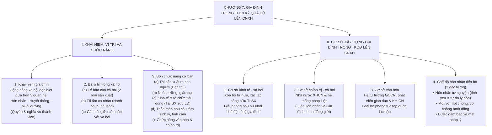
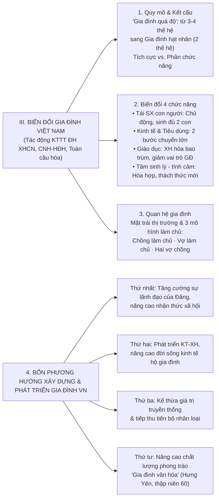

# CHƯƠNG 7: VẤN ĐỀ GIA ĐÌNH TRONG THỜI KỲ QUÁ ĐỘ LÊN CHỦ NGHĨA XÃ HỘI

> **Hướng dẫn học tập theo Phương pháp ghi chép Cornell (Cornell Note-taking System):**
> Tài liệu lý thuyết Chương 7 được thiết kế chuẩn hóa theo cấu trúc **Cornell Note-taking System** gồm 3 vùng nhận thức gắn kết chặt chẽ:
> 1. **Cột Từ khóa & Câu hỏi gợi nhớ (Cue Column - Cột trái):** Chứa các khái niệm trung tâm, luận điểm kinh điển, tên các nhà tư tưởng (C. Mác, Ph. Ăngghen, V.I. Lênin, Chủ tịch Hồ Chí Minh) và các câu hỏi truy xuất kiến thức chủ động (Active Recall).
> 2. **Cột Ghi chú chi tiết (Note-taking Column - Cột phải):** Hệ thống hóa đầy đủ nội dung cốt lõi, trích dẫn nguyên văn từ Giáo trình Chủ nghĩa xã hội khoa học (2021), các bước chuyển lịch sử và cơ chế vận động của gia đình trong thời kỳ quá độ lên chủ nghĩa xã hội.
> 3. **Phần Tóm tắt cốt lõi (Cornell Summary - Cuối mỗi mục & cuối chương):** Cô đọng bản chất lý luận và phương hướng thực tiễn xây dựng gia đình Việt Nam hiện nay thành những kết luận ngắn gọn, dễ hệ thống hóa.

---

## Sơ đồ 1: Khái niệm, Vị trí, Chức năng và Cơ sở xây dựng gia đình trong thời kỳ quá độ lên CNXH

---

## I. Khái niệm, vị trí và chức năng của gia đình

### 1. Khái niệm gia đình

| Từ khóa / Câu hỏi gợi nhớ | Ghi chú chi tiết (Nội dung cốt lõi) |
| :--- | :--- |
| **Bản chất cộng đồng & Luận điểm của C. Mác - Ph. Ăngghen** *C. Mác và Ph. Ăngghen nhìn nhận gia đình như thế nào trong tiến trình lịch sử?* | • Gia đình là một **cộng đồng người đặc biệt**, có vai trò quyết định đến sự tồn tại và phát triển của xã hội. • Trong tác phẩm kinh điển (*Toàn tập*, t.3, tr.41), **C. Mác và Ph. Ăngghen** khẳng định: *"Quan hệ thứ ba tham dự ngay từ đầu vào quá trình phát triển lịch sử: hằng ngày tái tạo ra đời sống của bản thân mình, con người bắt đầu tạo ra những người khác, sinh sôi nảy nở - đó là quan hệ giữa chồng và vợ, cha mẹ và con cái, đó là gia đình."* • Các mối quan hệ trong gia đình tồn tại trong sự gắn bó, liên kết, ràng buộc và phụ thuộc lẫn nhau bởi **nghĩa vụ, quyền lợi và trách nhiệm** của mỗi người, được quy định bằng **pháp lý hoặc đạo lý**. |
| **Ba mối quan hệ cơ bản hình thành gia đình** *Gia đình được hình thành, duy trì dựa trên những mối quan hệ cốt lõi nào?* | • **1. Quan hệ hôn nhân (vợ và chồng):** Là cơ sở, nền tảng hình thành nên các mối quan hệ khác trong gia đình; đồng thời là **cơ sở pháp lý** cho sự tồn tại của mỗi gia đình. • **2. Quan hệ huyết thống (cha mẹ và con cái, ông bà - cháu chắt, anh chị em, cô dì chú bác - cháu...):** Là quan hệ giữa những người cùng một dòng máu, nảy sinh từ quan hệ hôn nhân. Đây là **mối quan hệ tự nhiên** và là **yếu tố mạnh mẽ nhất** gắn kết các thành viên trong gia đình với nhau. • **3. Quan hệ nuôi dưỡng:** Ngày nay, ở Việt Nam cũng như trên thế giới còn thừa nhận quan hệ giữa **cha mẹ nuôi (người đỡ đầu) với con nuôi** (được công nhận bằng thủ tục pháp lý). Dù hình thành từ hình thức nào, trong gia đình tất yếu nảy sinh **quan hệ nuôi dưỡng** – sự quan tâm, chăm sóc nuôi dưỡng giữa các thành viên cả về vật chất và tinh thần. Quan hệ này vừa là **trách nhiệm, nghĩa vụ**, vừa là **quyền lợi thiêng liêng** giữa các thành viên; xã hội hiện đại có thể chia sẻ nhưng **không thể thay thế hoàn toàn** sự chăm sóc, nuôi dưỡng của gia đình. |
| **Định nghĩa hoàn chỉnh về Gia đình & Tính biến đổi lịch sử** *Hãy phát biểu định nghĩa gia đình và nêu các nhân tố quy định sự biến đổi của các quan hệ gia đình.* | • **Định nghĩa chuẩn:** *"Gia đình là một hình thức cộng đồng xã hội đặc biệt, được hình thành, duy trì và củng cố chủ yếu dựa trên cơ sở hôn nhân, quan hệ huyết thống và quan hệ nuôi dưỡng, cùng với những quy định về quyền và nghĩa vụ của các thành viên trong gia đình."* • **Tính lịch sử - xã hội:** Các mối quan hệ hôn nhân, huyết thống và nuôi dưỡng có mối liên hệ chặt chẽ với nhau, đồng thời biến đổi và phát triển **phụ thuộc vào trình độ phát triển kinh tế và thể chế chính trị - xã hội** trong từng thời kỳ lịch sử. |

### 2. Vị trí của gia đình trong xã hội

| Từ khóa / Câu hỏi gợi nhớ | Ghi chú chi tiết (Nội dung cốt lõi) |
| :--- | :--- |
| **(a) Gia đình là tế bào của xã hội** *Vì sao Ph. Ăngghen khẳng định gia đình quyết định sự tồn tại của xã hội qua hai loại sản xuất? Chủ tịch Hồ Chí Minh đã nhấn mạnh điều gì?* | • **Vai trò quyết định:** Gia đình quyết định đối với sự tồn tại, vận động và phát triển của xã hội. • **Luận điểm của Ph. Ăngghen về hai loại sản xuất** (*Toàn tập*, t.21, tr.44): *"Theo quan điểm duy vật, nhân tố quyết định trong lịch sử, quy đến cùng, là sản xuất và tái sản xuất ra đời sống trực tiếp. Nhưng bản thân sự sản xuất đó lại có hai loại. Một mặt là sản xuất ra tư liệu sinh hoạt: thực phẩm, quần áo, nhà ở và những công cụ cần thiết để sản xuất ra những thứ đó; mặt khác là sự sản xuất ra bản thân con người, là sự truyền nòi giống. Những trật tự xã hội, trong đó những con người của một thời đại lịch sử nhất định và của một nước nhất định đang sống, là do hai loại sản xuất quyết định: một mặt là do trình độ phát triển của lao động và mặt khác là do trình độ phát triển của gia đình."* • **Cơ chế tế bào tự nhiên:** Với việc sản xuất tư liệu tiêu dùng, tư liệu sản xuất và tái sản xuất ra con người, gia đình như một **tế bào tự nhiên**, là đơn vị cơ sở tạo nên cơ thể - xã hội. Không có gia đình tái tạo con người thì xã hội không thể tồn tại và phát triển. • **Lời dạy của Chủ tịch Hồ Chí Minh** (*Toàn tập*, t.12, tr.300): *"... nhiều gia đình cộng lại mới thành xã hội, xã hội tốt thì gia đình càng tốt, gia đình tốt thì xã hội mới tốt. Hạt nhân của xã hội là gia đình."* • **Sự quy định của chế độ xã hội:** Mức độ tác động của gia đình đối với xã hội phụ thuộc vào bản chất chế độ xã hội, đường lối chính sách của giai cấp cầm quyền và mô hình, kết cấu, đặc điểm từng hình thức gia đình trong lịch sử. Trong các xã hội dựa trên **chế độ tư hữu về tư liệu sản xuất**, sự bất bình đẳng xã hội và gia đình đã hạn chế rất lớn tác động tích cực của gia đình. Chỉ khi con người yên ấm, hòa thuận trong gia đình mới yên tâm lao động, sáng tạo, đóng góp cho xã hội. |
| **(b) Gia đình là tổ ấm, mang lại các giá trị hạnh phúc, sự hài hòa** *Gia đình giữ vai trò như thế nào đối với đời sống cá nhân mỗi con người?* | • **Gắn bó trọn đời:** Từ khi còn trong bụng mẹ đến lúc lọt lòng và suốt cả cuộc đời, mỗi cá nhân đều gắn bó chặt chẽ với gia đình. • **Môi trường phát triển tối ưu:** Gia đình là môi trường tốt nhất để mỗi cá nhân được **yêu thương, nuôi dưỡng, chăm sóc, trưởng thành và phát triển**. • **Tiền đề hoàn thiện nhân cách:** Sự yên ổn, hạnh phúc của mỗi gia đình là tiền đề, điều kiện quan trọng cho sự hình thành, phát triển **nhân cách, thể lực, trí lực** để mỗi cá nhân trở thành công dân tốt cho xã hội. Chỉ trong môi trường yên ấm của gia đình, cá nhân mới cảm thấy bình yên, hạnh phúc và có động lực phấn đấu trở thành con người xã hội tốt. |
| **(c) Gia đình là cầu nối giữa cá nhân với xã hội** *Tại sao nói gia đình vừa là nơi cá nhân học quan hệ xã hội, vừa là kênh để xã hội tác động đến cá nhân? Tư tưởng giải phóng phụ nữ của Hồ Chí Minh thể hiện ra sao?* | • **Cộng đồng xã hội đầu tiên:** Gia đình là cộng đồng đầu tiên mỗi cá nhân sinh sống, hình thành nhân cách và thể hiện những tình cảm thiêng liêng sâu đậm (vợ - chồng, cha mẹ - con cái, anh chị em) mà không cộng đồng nào thay thế được. • **Hai chiều tương tác Cá nhân $\leftrightarrow$ Gia đình $\leftrightarrow$ Xã hội:**   1. *Từ cá nhân đến xã hội:* Mỗi cá nhân vừa là thành viên gia đình vừa là thành viên xã hội; không có cá nhân bên ngoài gia đình cũng không có cá nhân bên ngoài xã hội. Gia đình là **môi trường đầu tiên** đáp ứng nhu cầu quan hệ xã hội, nơi cá nhân học được và thực hiện các quan hệ xã hội.   2. *Từ xã hội đến cá nhân:* Nhiều thông tin, hiện tượng xã hội thông qua **"lăng kính gia đình"** để tác động tích cực hoặc tiêu cực đến tư tưởng, đạo đức, lối sống, nhân cách cá nhân. Xã hội nhận thức đầy đủ hơn về cá nhân khi đặt họ trong quan hệ gia đình, đồng thời nhiều vấn đề quản lý xã hội phải thông qua hoạt động của gia đình để thực hiện quyền lợi và nghĩa vụ công dân. • **Khác biệt về chất giữa các chế độ xã hội:**   ◦ *Xã hội phong kiến:* Duy trì chế độ bóc lột với quan hệ gia trưởng, độc đoán, chuyên quyền, đặt quy định khắt khe bắt phụ nữ tuyệt đối phục tùng người chồng, người cha.   ◦ *Chủ nghĩa xã hội:* Giai cấp công nhân chủ trương bảo vệ chế độ hôn nhân một vợ một chồng, thực hiện bình đẳng trong gia đình và giải phóng phụ nữ. **Chủ tịch Hồ Chí Minh** khẳng định (*Toàn tập*, t.12, tr.300): **"Nếu không giải phóng phụ nữ là xây dựng chủ nghĩa xã hội chỉ một nửa."** |

### 3. Chức năng cơ bản của gia đình

| Từ khóa / Câu hỏi gợi nhớ | Ghi chú chi tiết (Nội dung cốt lõi) |
| :--- | :--- |
| **(a) Chức năng tái sản xuất ra con người** *Vì sao đây là chức năng đặc thù không thể thay thế và mang ý nghĩa xã hội sâu sắc?* | • **Tính đặc thù tuyệt đối:** Đây là chức năng **đặc thù của gia đình**, không một cộng đồng nào có thể thay thế. • **Hai phương diện ý nghĩa:** Vừa đáp ứng nhu cầu **tâm, sinh lý tự nhiên** của con người và duy trì nòi giống của gia đình, dòng họ; vừa đáp ứng nhu cầu **sức lao động** và duy trì sự trường tồn của xã hội. • **Vấn đề xã hội mang tính điều tiết:** Diễn ra trong từng gia đình nhưng không chỉ là việc riêng của gia đình mà là **vấn đề xã hội**, vì nó quyết định **mật độ dân cư** và **nguồn lực lao động** quốc gia cũng như quốc tế (yếu tố cấu thành tồn tại xã hội). Tùy theo từng nơi và nhu cầu xã hội mà chức năng này được thực hiện theo xu hướng **hạn chế hay khuyến khích**; trình độ phát triển kinh tế, văn hóa, xã hội ảnh hưởng trực tiếp đến chất lượng nguồn lao động mà gia đình cung cấp. |
| **(b) Chức năng nuôi dưỡng, giáo dục** *Vai trò "chủ thể - khách thể" trong giáo dục gia đình và mối quan hệ với giáo dục xã hội là gì?* | • **Nội dung & Ý nghĩa:** Nuôi dưỡng, dạy dỗ con cái trở thành người có ích cho gia đình, cộng đồng và xã hội; thể hiện tình cảm thiêng liêng, trách nhiệm của cha mẹ với con cái và trách nhiệm gia đình với xã hội. Những hiểu biết đầu tiên từ cha mẹ và người thân để lại dấu ấn sâu đậm, bền vững suốt đời, quyết định sự hình thành nhân cách, đạo đức, lối sống. • **Tính chất hai chiều & Toàn diện:** Gia đình là một **môi trường văn hóa, giáo dục**, trong đó mỗi thành viên vừa là **chủ thể** (sáng tạo giá trị văn hóa, chủ thể giáo dục), vừa là **người thụ hưởng** và **khách thể** chịu sự giáo dục của các thành viên khác. Ảnh hưởng diễn ra lâu dài và toàn diện từ lúc lọt lòng đến trưởng thành và tuổi già. • **Gắn kết Giáo dục gia đình $\leftrightarrow$ Giáo dục xã hội:** Nhà trường, đoàn thể, chính quyền không thể thay thế chức năng giáo dục của gia đình. Giáo dục gia đình giúp cá nhân từng bước được **xã hội hóa**. Nếu tách rời giáo dục xã hội, cá nhân khó hòa nhập; ngược lại, giáo dục xã hội không lấy giáo dục gia đình làm nền tảng sẽ kém hiệu quả. Cần tránh cả hai khuynh hướng cực đoan: coi trọng giáo dục gia đình mà hạ thấp giáo dục xã hội hoặc ngược lại. Để làm tốt, cha mẹ phải có kiến thức cơ bản, toàn diện về văn hóa, học vấn và đặc biệt là **phương pháp giáo dục**. |
| **(c) Chức năng kinh tế và tổ chức tiêu dùng** *Điểm đặc thù của gia đình so với mọi đơn vị kinh tế khác trong xã hội là gì?* | • **Điểm đặc thù duy nhất:** Cũng như các đơn vị kinh tế khác, gia đình tham gia trực tiếp sản xuất và tái sản xuất ra tư liệu sản xuất và tư liệu tiêu dùng; **tuy nhiên**, đặc thù mà các đơn vị kinh tế khác không có là **gia đình là đơn vị duy nhất tham gia vào quá trình sản xuất và tái sản xuất ra sức lao động cho xã hội**. • **Chức năng tổ chức tiêu dùng:** Gia đình là đơn vị tiêu dùng hàng hóa, sử dụng hợp lý thu nhập của các thành viên để đảm bảo đời sống vật chất, tinh thần, đồng thời sử dụng **quỹ thời gian nhàn rỗi** tạo môi trường văn hóa lành mạnh, nâng cao sức khỏe và duy trì sở thích, sắc thái riêng của từng người. • **Biến đổi lịch sử & Vai trò thực tiễn:** Ở từng hình thức gia đình và từng giai đoạn phát triển xã hội, chức năng kinh tế khác nhau về quy mô sản xuất, sở hữu tư liệu sản xuất, cách thức tổ chức sản xuất và phân phối. Thực hiện tốt chức năng này giúp gia đình đảm bảo nguồn sinh sống, nuôi dạy con cái và phát huy tiềm năng về vốn, sức lao động, tay nghề để đóng góp vào của cải, sự giàu có chung của xã hội. |
| **(d) Chức năng thỏa mãn nhu cầu tâm sinh lý, duy trì tình cảm gia đình & Các chức năng bổ trợ** *Ngoài 4 chức năng cơ bản, gia đình còn đảm nhiệm những chức năng nào?* | • **Thỏa mãn nhu cầu tâm sinh lý, duy trì tình cảm:** Là **chức năng thường xuyên** của gia đình, bao gồm thỏa mãn nhu cầu tình cảm, văn hóa, tinh thần; đảm bảo cân bằng tâm lý; bảo vệ, chăm sóc sức khỏe người ốm, người già, trẻ em. Sự quan tâm chăm sóc lẫn nhau vừa là **nhu cầu tình cảm**, vừa là **trách nhiệm, đạo lý, lương tâm**. Gia đình là chỗ dựa tinh thần chứ không chỉ là nơi nương tựa vật chất; khi tình cảm gia đình rạn nứt, quan hệ tình cảm trong xã hội cũng có nguy cơ bị phá vỡ. • **Chức năng văn hóa:** Gia đình là nơi **lưu giữ truyền thống văn hóa** của dân tộc cũng như tộc người (phong tục, tập quán, sinh hoạt văn hóa cộng đồng), đồng thời là nơi **sáng tạo và thụ hưởng** giá trị văn hóa xã hội. • **Chức năng chính trị:** Gia đình là một **tổ chức chính trị của xã hội**, nơi tổ chức thực hiện chính sách, pháp luật của nhà nước và quy chế (hương ước) của làng, xã và hưởng lợi từ hệ thống đó; là **cầu nối của mối quan hệ giữa nhà nước với công dân**. |

> **Tóm tắt Mục I (Cornell Summary):**
> Gia đình là cộng đồng xã hội đặc biệt hình thành từ **3 mối quan hệ (hôn nhân, huyết thống, nuôi dưỡng)**; giữ **3 vị trí nền tảng** (*tế bào của xã hội*, *tổ ấm của cá nhân*, *cầu nối giữa cá nhân và xã hội*) và thực hiện **4 chức năng cơ bản** (*tái sản xuất ra con người* - đặc thù không thể thay thế; *nuôi dưỡng, giáo dục*; *kinh tế và tổ chức tiêu dùng* - đơn vị duy nhất tái sản xuất sức lao động; *thỏa mãn nhu cầu tâm sinh lý, duy trì tình cảm*) cùng *chức năng văn hóa* và *chức năng chính trị*.

---

## II. Cơ sở xây dựng gia đình trong thời kỳ quá độ lên chủ nghĩa xã hội

| Từ khóa / Câu hỏi gợi nhớ | Ghi chú chi tiết (Nội dung cốt lõi) |
| :--- | :--- |
| **1. Cơ sở kinh tế - xã hội** *Tại sao xóa bỏ chế độ tư hữu về TLSX là điều kiện tiên quyết để giải phóng phụ nữ và thủ tiêu "chế độ nô lệ gia đình"?* | • **Nội dung cốt lõi:** Là sự phát triển của **lực lượng sản xuất** và tương ứng với nó là **quan hệ sản xuất mới xã hội chủ nghĩa**, mà cốt lõi là **chế độ sở hữu xã hội chủ nghĩa (công hữu) đối với tư liệu sản xuất** từng bước hình thành thay thế chế độ sở hữu tư nhân về tư liệu sản xuất. • **Xóa bỏ nguồn gốc thống trị nam giới:** Sự thống trị của người đàn ông trong gia đình cũ là kết quả sự thống trị của họ về kinh tế. Xóa bỏ chế độ tư hữu về TLSX là xóa bỏ nguồn gốc áp bức, bóc lột, bất bình đẳng giữa nam và nữ, giữa vợ và chồng. • **Luận điểm của V.I. Lênin** (*Toàn tập*, t.42, tr.464): *"Bước thứ hai và là bước chủ yếu là thủ tiêu chế độ tư hữu về ruộng đất, công xưởng và nhà máy. Chính như thế và chỉ có như thế mới mở được con đường giải phóng hoàn toàn và thật sự cho phụ nữ, mới thủ tiêu được 'chế độ nô lệ gia đình' nhờ có việc thay thế nền kinh tế gia đình cá thể bằng nền kinh tế xã hội hóa quy mô lớn."* • **Luận điểm của Ph. Ăngghen** (*Toàn tập*, t.21, tr.118): *"Tư liệu sản xuất chuyển thành tài sản chung, thì gia đình cá thể sẽ không còn là đơn vị kinh tế của xã hội nữa. Nền kinh tế tư nhân biến thành một ngành lao động xã hội. Việc nuôi dạy con cái trở thành công việc của xã hội."* $\rightarrow$ Lao động tư nhân trong gia đình biến thành lao động xã hội trực tiếp; phụ nữ bình đẳng với đàn ông; hôn nhân được thực hiện trên cơ sở **tình yêu** thay vì vì lý do kinh tế, địa vị hay tính toán vụ lợi. |
| **2. Cơ sở chính trị - xã hội** *Nhà nước XHCN và hệ thống pháp luật đóng vai trò gì trong xây dựng gia đình mới?* | • **Thiết lập Nhà nước XHCN:** Là chính quyền nhà nước của giai cấp công nhân và nhân dân lao động. Lần đầu tiên trong lịch sử, nhân dân lao động thực hiện quyền lực không phân biệt nam - nữ; Nhà nước là công cụ xóa bỏ luật lệ cũ kỹ, lạc hậu đè nặng lên người phụ nữ, giải phóng phụ nữ và bảo vệ hạnh phúc gia đình. • **Khẳng định của V.I. Lênin:** *"Chính quyền Xôviết là chính quyền đầu tiên và duy nhất trên thế giới đã hoàn toàn thủ tiêu tất cả những pháp luật cũ kỹ, tư sản, đê tiện, những pháp luật đó đặt người phụ nữ vào tình trạng không bình đẳng với nam giới, đã dành đặc quyền cho nam giới... là chính quyền đầu tiên và duy nhất trên thế giới đã hủy bỏ tất cả những đặc quyền gắn liền với chế độ tư hữu, những đặc quyền của người đàn ông trong gia đình."* • **Vai trò của pháp luật & chính sách xã hội:** Thể hiện rõ nét nhất qua hệ thống pháp luật (đặc biệt là **Luật Hôn nhân và gia đình**) cùng hệ thống chính sách xã hội đảm bảo lợi ích công dân, **bình đẳng giới**, chính sách dân số, việc làm, y tế, bảo hiểm xã hội... vừa định hướng, vừa thúc đẩy hình thành gia đình mới. Nếu chính sách, pháp luật chưa hoàn thiện thì việc xây dựng và bảo đảm hạnh phúc gia đình còn hạn chế. |
| **3. Cơ sở văn hóa** *Hệ tư tưởng giai cấp công nhân và giáo dục, KH&CN tác động ra sao đến chuẩn mực gia đình mới?* | • **Nền tảng tư tưởng chi phối:** Những giá trị văn hóa xây dựng trên nền tảng **hệ tư tưởng chính trị của giai cấp công nhân** từng bước hình thành và giữ vai trò chi phối đời sống văn hóa, tinh thần của xã hội; đồng thời từng bước loại bỏ văn hóa, phong tục tập quán, lối sống lạc hậu do xã hội cũ để lại. • **Vai trò giáo dục, đào tạo và KH&CN:** Góp phần nâng cao trình độ dân trí, kiến thức khoa học và công nghệ, cung cấp cho thành viên gia đình nhận thức mới làm nền tảng hình thành giá trị, chuẩn mực mới điều chỉnh các quan hệ gia đình. • **Tính đồng bộ:** Nếu thiếu cơ sở văn hóa, hoặc cơ sở văn hóa không đi liền với cơ sở kinh tế và chính trị, việc xây dựng gia đình sẽ lệch lạc, không đạt hiệu quả cao. |
| **4. Chế độ hôn nhân tiến bộ — Đặc trưng 1: Hôn nhân tự nguyện** *Vì sao hôn nhân tự nguyện lại bao hàm cả quyền tự do ly hôn, nhưng không khuyến khích ly hôn?* | • **Xuất phát từ tình yêu nam - nữ:** Tình yêu là khát vọng mọi thời đại; hôn nhân xuất phát từ tình yêu tất yếu dẫn đến **hôn nhân tự nguyện**. Như **Ph. Ăngghen** nhấn mạnh (*Toàn tập*, t.21, tr.125): *"... nếu nghĩa vụ của vợ chồng là phải thương yêu nhau thì nghĩa vụ của những kẻ yêu nhau há chẳng phải là kết hôn với nhau và không được kết hôn với người khác hay sao?"* • **Quyền tự do lựa chọn kết hôn:** Đảm bảo nam, nữ tự do lựa chọn bạn đời, không chấp nhận sự áp đặt của cha mẹ; tuy nhiên **không bác bỏ** việc cha mẹ quan tâm, hướng dẫn, giúp đỡ con cái có nhận thức đúng và trách nhiệm khi kết hôn. • **Bao hàm quyền tự do ly hôn:** Khi tình yêu không còn nữa thì ly hôn là tất yếu. **Ph. Ăngghen** viết (*Toàn tập*, t.21, tr.128): *"Nếu chỉ riêng hôn nhân dựa trên cơ sở tình yêu mới hợp đạo đức thì cũng chỉ riêng hôn nhân trong đó tình yêu được duy trì, mới là hợp đạo đức mà thôi... và nếu tình yêu đã hoàn toàn phai nhạt hoặc bị một tình yêu say đắm mới át đi, thì ly hôn sẽ là điều hay cho cả đôi bên cũng như cho xã hội."* • **Không khuyến khích ly hôn:** Vì ly hôn để lại hậu quả nặng nề cho xã hội, vợ, chồng và đặc biệt là con cái; cần ngăn chặn ly hôn nông nổi, lợi dụng quyền ly hôn vì lý do ích kỷ hoặc mục đích vụ lợi. |
| **4. Chế độ hôn nhân tiến bộ — Đặc trưng 2: Hôn nhân một vợ một chồng, vợ chồng bình đẳng** *Chế độ một vợ một chồng trong XHCN khác về bản chất như thế nào so với xã hội tư hữu cũ?* | • **Tất yếu từ bản chất tình yêu:** Tình yêu có bản chất không thể chia sẻ, nên hôn nhân một vợ một chồng phù hợp quy luật tự nhiên, tâm lý, tình cảm, đạo đức con người và đảm bảo hạnh phúc gia đình. • **Phê phán chế độ cũ:** Hôn nhân một vợ một chồng đã xuất hiện sớm khi chế độ tư hữu thắng lợi trước công hữu nguyên thủy, nhưng trong các xã hội cũ, chế độ này **thực chất chỉ đối với người phụ nữ** nhằm tập trung của cải vào tay người đàn ông và truyền lại cho đúng con cái của người đàn ông ấy (*Ph. Ăngghen, Toàn tập, t.21, tr.128*). • **Bản chất mới trong TKQĐ lên CNXH:** Là thực hiện **giải phóng đối với phụ nữ**, thực hiện bình đẳng, tôn trọng lẫn nhau giữa vợ và chồng. Hai bên có quyền lợi và nghĩa vụ ngang nhau về mọi mặt; tự do lựa chọn vấn đề riêng chính đáng (nghề nghiệp, công tác xã hội, học tập...) và thống nhất giải quyết vấn đề chung (ăn ở, nuôi dạy con cái...). • **Lan tỏa bình đẳng liên thế hệ:** Quan hệ vợ chồng bình đẳng là cơ sở cho bình đẳng giữa cha mẹ - con cái và giữa anh chị em; đồng thời cần quan tâm chia sẻ để giải quyết các mâu thuẫn không thể tránh khỏi do chênh lệch tuổi tác, nhu cầu, sở thích. |
| **4. Chế độ hôn nhân tiến bộ — Đặc trưng 3: Hôn nhân được đảm bảo về pháp lý** *Vì sao tình yêu là việc riêng nhưng kết hôn lại cần thủ tục pháp lý của xã hội?* | • **Bản chất quan hệ xã hội:** Tình yêu nam nữ là việc riêng xã hội không can thiệp, nhưng khi thỏa thuận đi đến kết hôn là đã **đưa quan hệ riêng bước vào quan hệ xã hội**, do đó cần sự thừa nhận của xã hội biểu hiện qua **thủ tục pháp lý trong hôn nhân**. • **Ý nghĩa bảo vệ:** Thể hiện sự tôn trọng trong tình yêu, trách nhiệm giữa nam và nữ, trách nhiệm cá nhân với gia đình - xã hội và ngược lại; ngăn chặn cá nhân lợi dụng quyền tự do kết hôn, ly hôn để thỏa mãn nhu cầu không chính đáng. • **Không cản trở tự do:** Thủ tục pháp lý không ngăn cản quyền tự do kết hôn và ly hôn chính đáng, mà trái lại là **cơ sở pháp lý vững chắc** để thực hiện các quyền đó một cách đầy đủ nhất. |

> **Tóm tắt Mục II (Cornell Summary):**
> Gia đình trong thời kỳ quá độ lên CNXH được xây dựng đồng bộ trên **3 cơ sở xã hội** (*kinh tế - xã hội*: công hữu TLSX xóa bỏ *"chế độ nô lệ gia đình"*; *chính trị - xã hội*: Nhà nước XHCN và Luật Hôn nhân và gia đình bảo vệ bình đẳng giới; *văn hóa*: hệ tư tưởng giai cấp công nhân, giáo dục và KH&CN) cùng **chế độ hôn nhân tiến bộ** gồm **3 đặc trưng**: *tự nguyện* (tình yêu & quyền tự do ly hôn có kiểm soát), *một vợ một chồng - vợ chồng bình đẳng*, và *được đảm bảo về pháp lý*.

---

## III. Xây dựng gia đình Việt Nam trong thời kỳ quá độ lên chủ nghĩa xã hội

## Sơ đồ 2: Sự biến đổi và Phương hướng xây dựng gia đình Việt Nam hiện nay

### 1. Sự biến đổi của gia đình Việt Nam (Quy mô và kết cấu)

| Từ khóa / Câu hỏi gợi nhớ | Ghi chú chi tiết (Nội dung cốt lõi) |
| :--- | :--- |
| **Bối cảnh tác động & Khái niệm "Gia đình quá độ"** *Những nhân tố nào đang làm biến đổi toàn diện gia đình Việt Nam hiện nay?* | • **Các nhân tố tác động khách quan & chủ quan:** Sự phát triển của kinh tế thị trường định hướng XHCN; công nghiệp hóa, hiện đại hóa gắn với kinh tế tri thức; xu thế toàn cầu hóa và hội nhập quốc tế; cách mạng khoa học và công nghệ hiện đại; cùng chủ trương, chính sách của Đảng và Nhà nước. • **"Gia đình quá độ":** Gia đình Việt Nam ngày nay được coi là **"gia đình quá độ"** trong bước chuyển từ xã hội nông nghiệp cổ truyền sang xã hội công nghiệp hiện đại. Sự giải thể cấu trúc gia đình truyền thống và hình thành hình thái mới là tất yếu; ngược lại, sự biến đổi gia đình tạo động lực mới thúc đẩy xã hội phát triển. |
| **Xu hướng thu nhỏ quy mô & Gia đình hạt nhân** *Kết cấu gia đình Việt Nam đã chuyển dịch như thế nào?* | • **Phổ biến mô hình gia đình đơn (gia đình hạt nhân):** Đang trở nên rất phổ biến ở cả **đô thị và nông thôn**, thay thế kiểu gia đình truyền thống giữ vai trò chủ đạo trước đây. • **Thu nhỏ số thế hệ và số thành viên:** Nếu gia đình truyền thống xưa tồn tại **3 đến 4 thế hệ** cùng chung sống dưới một mái nhà, thì gia đình Việt Nam hiện đại chủ yếu chỉ có **2 thế hệ** cùng sống chung (**cha mẹ - con cái**), số con ít đi, cá biệt còn có số ít **gia đình đơn thân**; song phổ biến nhất vẫn là gia đình hạt nhân quy mô nhỏ. |
| **Mặt tích cực và "Phản chức năng" của sự thu nhỏ quy mô** *Quá trình hạt nhân hóa gia đình mang lại những giá trị tích cực và hệ lụy tiêu cực gì?* | • **Mặt tích cực:** Đáp ứng nhu cầu và điều kiện thời đại mới; **bình đẳng nam - nữ** được đề cao hơn; cuộc sống **riêng tư** của con người được tôn trọng hơn; tránh được nhiều mâu thuẫn trong đời sống gia đình truyền thống đa thế hệ $\rightarrow$ giúp gia đình và xã hội thích nghi với tình hình mới. • **Những phản chức năng (mặt trái):** Tạo ra **sự ngăn cách không gian** giữa các thành viên; gây khó khăn, trở lực trong gìn giữ tình cảm và giá trị văn hóa truyền thống. Do bị cuốn theo công việc kiếm thu nhập, vòng xoáy đồng tiền và vị thế xã hội, thời gian dành cho gia đình ít đi; các thành viên ít quan tâm, ít giao tiếp với nhau, khiến quan hệ gia đình trở nên **rời rạc, lỏng lẻo**. |

### 2. Biến đổi trong thực hiện các chức năng của gia đình Việt Nam

| Từ khóa / Câu hỏi gợi nhớ | Ghi chú chi tiết (Nội dung cốt lõi) |
| :--- | :--- |
| **(a) Biến đổi chức năng tái sản xuất ra con người** *Chính sách dân số qua các thời kỳ và 3 quan niệm truyền thống về con cái đã thay đổi như thế nào?* | • **Sinh đẻ chủ động, tự giác:** Nhờ thành tựu y học hiện đại, các gia đình chủ động xác định số lượng con và thời điểm sinh con, chịu sự điều chỉnh của chính sách xã hội Nhà nước. • **Chuyển đổi thông điệp chính sách dân số:**   ◦ *Thập niên 70–80 thế kỷ XX:* Nhà nước tuyên truyền các biện pháp tránh thai, vận động sinh đẻ có kế hoạch với khẩu hiệu mỗi cặp vợ chồng chỉ nên có **1 đến 2 con**.   ◦ *Thập niên đầu thế kỷ XXI:* Dân số Việt Nam chuyển sang **giai đoạn già hóa**; thông điệp mới trong kế hoạch hóa gia đình là **mỗi cặp vợ chồng nên sinh đủ 2 con** để đảm bảo lợi ích gia đình và phát triển bền vững xã hội. • **Thay đổi 3 quan niệm truyền thống:** Trong gia đình truyền thống (do phong tục và sản xuất nông nghiệp), nhu cầu con cái thể hiện ở 3 phương diện: *(1) phải có con, (2) càng đông con càng tốt, (3) nhất thiết phải có con trai nối dõi*. Ngày nay, nhu cầu này thay đổi căn bản: **giảm mức sinh phụ nữ, giảm số con mong muốn, giảm nhu cầu nhất thiết phải có con trai**. Sự bền vững hôn nhân hiện đại phụ thuộc nhiều vào các yếu tố **tâm lý, tình cảm, kinh tế** chứ không chỉ ở việc có con hay có con trai. |
| **(b) Biến đổi chức năng kinh tế và tổ chức tiêu dùng** *Kinh tế gia đình Việt Nam đã trải qua 2 bước chuyển mang tính bước ngoặt nào?* | • **Hai bước chuyển mang tính bước ngoặt** (*theo Lê Ngọc Văn, 2012*):   1. **Bước thứ nhất:** Từ **kinh tế tự cấp tự túc** (đơn vị khép kín sản xuất đáp ứng nhu cầu nội bộ gia đình) thành **kinh tế hàng hóa** (sản xuất chủ yếu để đáp ứng nhu cầu của người khác hay của xã hội).   2. **Bước thứ hai:** Từ đơn vị kinh tế sản xuất hàng hóa đáp ứng nhu cầu của **thị trường quốc gia** thành tổ chức kinh tế của nền **kinh tế thị trường hiện đại** đáp ứng nhu cầu của **thị trường toàn cầu**. • **Thực trạng & Trở ngại hội nhập:** Kinh tế gia đình là bộ phận quan trọng của kinh tế quốc dân, nhưng gặp nhiều khó khăn khi chuyển sang sản xuất hàng hóa chuyên sâu cạnh tranh quốc tế do phần lớn có **quy mô nhỏ, lao động ít và tự sản xuất là chính**. • **Biến đổi chức năng tiêu dùng:** Nhờ kinh tế hàng hóa và thu nhập bằng tiền tăng lên, gia đình trở thành **đơn vị tiêu dùng quan trọng của xã hội**, đang tiến tới **"tiêu dùng sản phẩm do người khác làm ra"** (sử dụng hàng hóa và dịch vụ xã hội). |
| **(c) Biến đổi chức năng giáo dục (xã hội hóa)** *Mối tương quan giữa giáo dục gia đình - giáo dục xã hội và mâu thuẫn niềm tin hiện nay là gì?* | • **Sự đảo chiều bao trùm:** Nếu xã hội truyền thống lấy giáo dục gia đình làm cơ sở của giáo dục xã hội, thì ngày nay **giáo dục xã hội bao trùm lên giáo dục gia đình** và đề ra mục tiêu, yêu cầu cho giáo dục gia đình (*Lê Ngọc Văn, 2012, tr.238*). Điểm tương đồng vẫn giữ là tiếp tục nhấn mạnh sự hy sinh của cá nhân cho cộng đồng. • **Xu hướng đầu tư & Nội dung mới:** Gia đình tăng mạnh **đầu tư tài chính** cho giáo dục con cái. Nội dung không chỉ nặng về đạo đức, ứng xử trong gia đình - dòng họ - làng xã, mà hướng đến **kiến thức khoa học hiện đại**, trang bị công cụ để con cái hội nhập thế giới. • **Mâu thuẫn chưa có lời giải hữu hiệu:** Vai trò giáo dục của các chủ thể trong gia đình có xu hướng **giảm sút**; đồng thời sự gia tăng tiêu cực trong xã hội và nhà trường làm **giảm kỳ vọng và niềm tin của cha mẹ** vào hệ thống giáo dục xã hội trong rèn luyện đạo đức, nhân cách. Hệ quả là gia tăng hiện tượng **trẻ em hư, bỏ học sớm, lang thang, nghiện ma túy, mại dâm...** phản ánh phần nào sự bất lực của xã hội và bế tắc của một số gia đình. |
| **(d) Biến đổi chức năng thỏa mãn nhu cầu tâm sinh lý, duy trì tình cảm** *Những thách thức tâm lý - xã hội nào đang đặt ra đối với sự bền vững của gia đình Việt Nam?* | • **Chuyển trục bền vững:** Độ bền vững gia đình hiện đại không chỉ dựa vào ràng buộc nghĩa vụ hay hy sinh lợi ích cá nhân mà bị chi phối mạnh bởi **sự hòa hợp tình cảm** (vợ - chồng, cha mẹ - con cái), **đảm bảo hạnh phúc cá nhân và sinh hoạt tự do, chính đáng** của mỗi thành viên. • **Các thách thức lớn hiện nay:**   1. *Thiếu hụt tình cảm anh chị em:* Tỷ lệ gia đình chỉ có một con tăng lên khiến đời sống tâm lý - tình cảm của trẻ em và người lớn kém phong phú hơn.   2. *Phân hóa giàu nghèo sâu sắc:* Tác động của CNH và toàn cầu hóa khiến một số hộ tích lũy tài sản trở nên giàu có, trong khi đại bộ phận mất tư liệu sản xuất trở thành lao động làm thuê $\rightarrow$ Nhà nước cần chính sách hỗ trợ hộ nghèo, thu hẹp khoảng cách giàu nghèo.   3. *Đổi mới quan niệm giới & chuẩn mực giáo dục:* Thay đổi tâm lý truyền thống về vai trò con trai sang **bình đẳng con trai - con gái** trong chăm sóc cha mẹ già và thờ phụng tổ tiên; tăng cường giáo dục giới tính, an toàn tình dục, sức khỏe sinh sản; giải quyết hài hòa mâu thuẫn giữa nhu cầu tự do tiến bộ của phụ nữ hiện đại với trách nhiệm làm dâu truyền thống và mâu thuẫn lợi ích giữa các thế hệ. |

### 3. Biến đổi trong các mối quan hệ gia đình

| Từ khóa / Câu hỏi gợi nhớ | Ghi chú chi tiết (Nội dung cốt lõi) |
| :--- | :--- |
| **Những thách thức và mặt trái trong quan hệ hôn nhân - gia đình** *Cơ chế thị trường và toàn cầu hóa gây ra những biến dạng gì trong quan hệ gia đình Việt Nam?* | • Dưới tác động của cơ chế thị trường, khoa học công nghệ hiện đại, toàn cầu hóa, hôn nhân và gia đình Việt Nam phải gánh chịu nhiều mặt trái:   ◦ Quan hệ vợ chồng - gia đình **lỏng lẻo**; gia tăng tỷ lệ **ly hôn, ly thân, ngoại tình**, quan hệ tình dục trước/ngoài hôn nhân, chung sống không kết hôn.   ◦ Xuất hiện nhiều **bi kịch, thảm án gia đình**: người già cô đơn, trẻ em sống ích kỷ, **bạo hành trong gia đình**, xâm hại tình dục.   ◦ Giá trị truyền thống bị coi nhẹ, gia tăng hộ **gia đình đơn thân, độc thân, kết hôn đồng tính, sinh con ngoài giá thú**.   ◦ Sức ép cuộc sống hiện đại (công việc căng thẳng, không ổn định, di chuyển nhiều) khiến hôn nhân trở nên khó khăn hơn. |
| **Sự chuyển dịch quyền lực & 3 mô hình người làm chủ gia đình** *Ngoài mô hình truyền thống, gia đình Việt Nam hiện nay tồn tại những mô hình làm chủ nào?* | • **Trong gia đình truyền thống:** Người chồng là trụ cột duy nhất, nắm mọi quyền lực, sở hữu tài sản và quyết định mọi công việc quan trọng. • **Trong gia đình Việt Nam hiện nay** (*Lê Ngọc Văn, 2012, tr.335*), tồn tại ít nhất **3 mô hình người làm chủ gia đình**:   1. **Mô hình người đàn ông – người chồng làm chủ gia đình.**   2. **Mô hình người phụ nữ – người vợ làm chủ gia đình.**   3. **Mô hình cả hai vợ chồng cùng làm chủ gia đình.** • **Tiêu chuẩn mới về người lãnh đạo gia đình:** Người chủ gia đình được quan niệm là người có **phẩm chất, năng lực và đóng góp vượt trội**, được các thành viên coi trọng; đặc biệt trong bối cảnh kinh tế thị trường và hội nhập, còn xuất hiện đòi hỏi người chủ gia đình phải là người **kiếm ra nhiều tiền**. |

### 4. Phương hướng cơ bản xây dựng và phát triển gia đình Việt Nam trong thời kỳ quá độ lên CNXH

| Từ khóa / Câu hỏi gợi nhớ | Ghi chú chi tiết (Nội dung cốt lõi) |
| :--- | :--- |
| **Phương hướng thứ nhất: Tăng cường sự lãnh đạo của Đảng, nâng cao nhận thức xã hội** *Cần làm gì ở các cấp ủy, chính quyền và đoàn thể?* | • Đẩy mạnh công tác tuyên truyền để các cấp ủy, chính quyền, tổ chức đoàn thể từ Trung ương đến cơ sở nhận thức sâu sắc vị trí, vai trò, tầm quan trọng của gia đình; coi xây dựng gia đình là **một trong những động lực quan trọng** quyết định thành công phát triển bền vững kinh tế - xã hội trong thời kỳ CNH-HĐH, xây dựng và bảo vệ Tổ quốc XHCN. • Cấp ủy và chính quyền các cấp phải **đưa nội dung, mục tiêu công tác xây dựng và phát triển gia đình vào chiến lược phát triển KT-XH và chương trình, kế hoạch công tác hằng năm** của các bộ, ngành, địa phương. |
| **Phương hướng thứ hai: Đẩy mạnh phát triển KT-XH, nâng cao đời sống kinh tế hộ gia đình** *Chính sách kinh tế hộ gia đình ưu tiên những đối tượng và lĩnh vực nào?* | • Xây dựng và hoàn thiện chính sách phát triển KT-XH nhằm củng cố, ổn định và phát triển kinh tế gia đình. • **Chính sách ưu tiên hỗ trợ:** Dành cho **gia đình liệt sĩ, gia đình thương binh, bệnh binh, gia đình các dân tộc ít người, gia đình nghèo, gia đình ở vùng sâu, vùng xa, vùng khó khăn**. • **Hỗ trợ sản xuất & vốn:** Kịp thời hỗ trợ sản xuất kinh doanh **sản phẩm mới**, sản phẩm sử dụng **nguyên liệu tại chỗ**, sản xuất phục vụ **xuất khẩu**; tạo điều kiện thuận lợi cho hộ gia đình **vay vốn ngắn hạn và dài hạn** để xóa đói giảm nghèo, chuyển dịch cơ cấu sản xuất, phát triển **kinh tế trang trại**, vươn lên làm giàu chính đáng. |
| **Phương hướng thứ ba: Kế thừa giá trị truyền thống kết hợp tiếp thu tiến bộ nhân loại** *Xử lý mối quan hệ giữa truyền thống và hiện đại trong xây dựng gia đình Việt Nam như thế nào?* | • Gia đình truyền thống hun đúc lâu đời trong lịch sử dân tộc bộc lộ cả mặt tích cực và tiêu cực. Nhà nước và các cơ quan văn hóa cần xác định, **duy trì những nét đẹp có ích**, đồng thời **khắc phục những hạn chế, hủ tục** của gia đình cũ. • Xây dựng mô hình gia đình hiện đại phù hợp tiến trình CNH-HĐH và hội nhập kinh tế quốc tế, kết hợp hài hòa giá trị văn hóa truyền thống tốt đẹp của gia đình Việt Nam với giá trị tiên tiến của gia đình hiện đại, nhằm mục tiêu làm cho gia đình thực sự là **tế bào lành mạnh của xã hội, là tổ ấm của mỗi người**. |
| **Phương hướng thứ tư: Phát triển và nâng cao chất lượng phong trào xây dựng "Gia đình văn hóa"** *Phong trào Gia đình văn hóa khởi nguồn từ đâu và cần khắc phục căn bệnh nào hiện nay?* | • **Nội hàm mô hình "Gia đình văn hóa":** Gia đình **ấm no, hòa thuận, tiến bộ, khỏe mạnh và hạnh phúc**; thực hiện tốt **nghĩa vụ công dân**; thực hiện **kế hoạch hóa gia đình**; **đoàn kết tương trợ** trong cộng đồng dân cư. • **Nguồn gốc lịch sử:** Hình thành từ **những năm 60 của thế kỷ XX tại một địa phương của tỉnh Hưng Yên**, đến nay đã phủ khắp hầu hết các địa phương cả nước, phát huy quy tắc ứng xử tốt đẹp và đạo đức truyền thống. • **Yêu cầu nâng cao chất lượng:** Tiếp tục nghiên cứu, nhân rộng mô hình gắn với tiếp thu giá trị mới, dự báo biến đổi và giải quyết thách thức; đặc biệt **cần tránh xu hướng chạy theo thành tích** (phản ánh không thực chất phong trào); các tiêu chí phải thiết thực với đời sống nhân dân, bình xét theo tiêu chí thống nhất trên nguyên tắc **công bằng, dân chủ**, tạo sự đồng tình hưởng ứng của nhân dân. |

> **Tóm tắt Mục III (Cornell Summary):**
> Dưới tác động của kinh tế thị trường, CNH-HĐH và toàn cầu hóa, gia đình Việt Nam đang vận động như một **"gia đình quá độ"**: thu nhỏ quy mô thành **gia đình hạt nhân (2 thế hệ)**, chuyển đổi sâu sắc cả **4 chức năng** (sinh đủ 2 con; 2 bước chuyển kinh tế từ tự cấp tự túc $\rightarrow$ hàng hóa quốc gia $\rightarrow$ thị trường toàn cầu; giáo dục xã hội bao trùm; đề cao hòa hợp tình cảm) và hình thành **3 mô hình làm chủ gia đình** (chồng, vợ, cả hai vợ chồng). Để vượt qua mặt trái kinh tế thị trường, cần thực hiện đồng bộ **4 phương hướng**: *tăng cường lãnh đạo của Đảng*, *phát triển kinh tế hộ gia đình*, *kế thừa truyền thống - tiếp thu tiến bộ*, và *nâng cao thực chất phong trào Gia đình văn hóa* (khởi nguồn từ Hưng Yên những năm 60 thế kỷ XX, chống bệnh thành tích).

---

## Tóm tắt toàn chương (Cornell Summary)

1. **Bản chất, Vị trí và Chức năng của gia đình (Mục I):** Gia đình là cộng đồng xã hội đặc biệt kết nối qua **3 quan hệ (hôn nhân, huyết thống, nuôi dưỡng)**; giữ **3 vị trí cốt lõi** (*tế bào tự nhiên của xã hội* quyết định hai loại sản xuất theo Ph. Ăngghen và lời dạy Hồ Chí Minh *"Hạt nhân của xã hội là gia đình"*; *tổ ấm cá nhân*; *cầu nối cá nhân - xã hội* gắn với giải phóng phụ nữ); thực hiện **4 chức năng cơ bản** (*tái sản xuất ra con người* - chức năng đặc thù không thể thay thế; *nuôi dưỡng, giáo dục*; *kinh tế và tổ chức tiêu dùng* - đơn vị duy nhất tái sản xuất sức lao động; *thỏa mãn nhu cầu tâm sinh lý, duy trì tình cảm*) cùng *chức năng văn hóa* và *chức năng chính trị*.
2. **Cơ sở xây dựng gia đình trong thời kỳ quá độ lên CNXH (Mục II):** Kết hợp **3 cơ sở** (*kinh tế - xã hội*: xóa bỏ tư hữu, xác lập công hữu TLSX để thủ tiêu *"chế độ nô lệ gia đình"*; *chính trị - xã hội*: Nhà nước XHCN và Luật Hôn nhân và gia đình đảm bảo bình đẳng giới; *văn hóa*: hệ tư tưởng giai cấp công nhân, giáo dục, KH&CN loại bỏ hủ tục) với **chế độ hôn nhân tiến bộ** (*tự nguyện* dựa trên tình yêu và bao hàm quyền tự do ly hôn có trách nhiệm; *một vợ một chồng, vợ chồng bình đẳng*; *đảm bảo về pháp lý*).
3. **Gia đình Việt Nam trong thời kỳ quá độ lên CNXH (Mục III):** Phản ánh quá trình chuyển biến của **"gia đình quá độ"** từ gia đình truyền thống 3–4 thế hệ sang **gia đình hạt nhân 2 thế hệ**; chuyển mạnh sang thông điệp **sinh đủ 2 con** trước già hóa dân số; trải qua **2 bước chuyển kinh tế hộ gia đình** tới thị trường toàn cầu và tiêu dùng dịch vụ xã hội; đối mặt mâu thuẫn giáo dục - xã hội hóa và sự xuất hiện **3 mô hình làm chủ gia đình**. Giải pháp chiến lược là triển khai **4 phương hướng cơ bản** (vai trò lãnh đạo của Đảng, phát triển kinh tế hộ gia đình, kết hợp truyền thống - hiện đại, nâng cao thực chất phong trào **Gia đình văn hóa** khởi nguồn từ tỉnh **Hưng Yên**).

---

## Câu hỏi tự kiểm tra nhanh (Self-Testing Cues)

1. Phân biệt ba mối quan hệ cấu thành gia đình (**hôn nhân**, **huyết thống**, **nuôi dưỡng**) và giải thích vì sao Ph. Ăngghen khẳng định trật tự xã hội chịu sự quy định của **hai loại sản xuất** nào?
2. Chứng minh gia đình vừa là **tế bào của xã hội**, vừa là **tổ ấm cá nhân**, vừa là **cầu nối giữa cá nhân với xã hội**. Liên hệ luận điểm của Chủ tịch Hồ Chí Minh về giải phóng phụ nữ với bản chất quan hệ gia đình XHCN.
3. Trong 4 chức năng cơ bản của gia đình, chức năng nào là **đặc thù không cộng đồng nào thay thế được**, và chức năng nào biến gia đình thành **đơn vị kinh tế duy nhất tái sản xuất ra sức lao động**?
4. Phân tích mối liên hệ giữa **cơ sở kinh tế - xã hội** (công hữu TLSX), **cơ sở chính trị - xã hội** (Luật Hôn nhân và gia đình) và **cơ sở văn hóa** trong việc thực hiện **3 đặc trưng của chế độ hôn nhân tiến bộ**. Tại sao hôn nhân tiến bộ thừa nhận quyền tự do ly hôn nhưng không khuyến khích ly hôn?
5. Trình bày sự biến đổi về quy mô kết cấu, **2 bước chuyển kinh tế hộ gia đình**, **3 mô hình làm chủ gia đình** và **4 phương hướng cơ bản** xây dựng, phát triển gia đình Việt Nam hiện nay (nêu rõ nguồn gốc và yêu cầu chống bệnh thành tích của phong trào **Gia đình văn hóa**).
