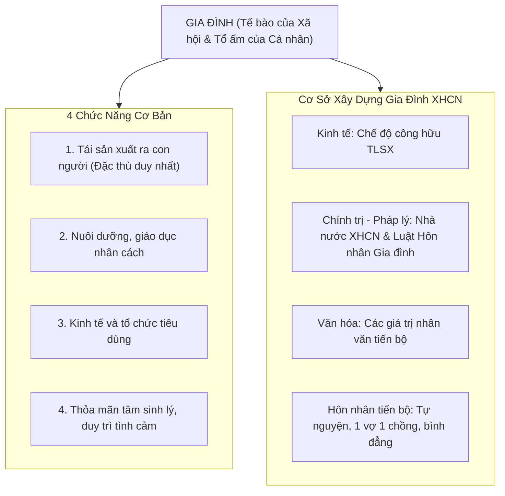

# CHƯƠNG 7: VẤN ĐỀ GIA ĐÌNH TRONG THỜI KỲ QUÁ ĐỘ LÊN CHỦ NGHĨA XÃ HỘI

### 1. Sơ đồ Vị trí & Chức năng Cốt lõi của Gia Đình

### 2. Các Khái Niệm Nền Tảng & Luận Điểm Cốt Lõi
- **Gia đình:** Cộng đồng xã hội đặc biệt hình thành trên cơ sở quan hệ hôn nhân, quan hệ huyết thống và quan hệ nuôi dưỡng, gắn liền với quyền và nghĩa vụ giữa các thành viên.
- **Vị trí của gia đình:**
  - Là tế bào tự nhiên của xã hội; xã hội tốt đẹp khi các tế bào gia đình lành mạnh.
  - Là tổ ấm mang lại hạnh phúc cho mỗi cá nhân.
  - Là cầu nối trực tiếp giữa cá nhân và xã hội.
- **Chế độ hôn nhân tiến bộ:** Hôn nhân tự nguyện; Hôn nhân một vợ một chồng, vợ chồng bình đẳng; Hôn nhân được pháp luật thừa nhận và bảo vệ.
- **Sự biến đổi của gia đình Việt Nam hiện nay:**
  - Chuyển dịch nhanh chóng từ gia đình truyền thống sang mô hình *gia đình hạt nhân*.
  - Biến đổi quan hệ thế hệ và chức năng giáo dục đòi hỏi kết hợp hài hòa chuẩn mực gia đình truyền thống (hiếu thuận, hòa thuận) với văn minh hiện đại (bình đẳng giới, tôn trọng quyền riêng tư).\n