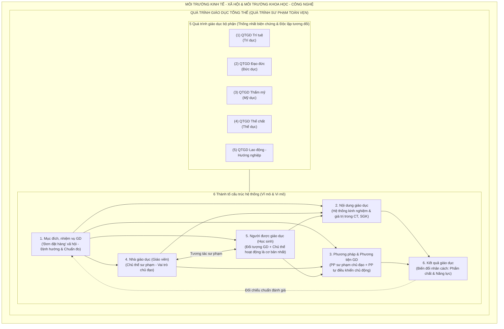

# CHƯƠNG 1: GIÁO DỤC HỌC LÀ MỘT KHOA HỌC

> **Hướng dẫn học tập theo Phương pháp ghi chép Cornell (Cornell Note-taking System):**
> Tài liệu lý thuyết Chương 1 được thiết kế chuẩn hóa theo cấu trúc **Cornell Note-taking System** gồm 3 vùng nhận thức gắn kết chặt chẽ:
> 1. **Cột Từ khóa & Câu hỏi gợi nhớ (Cue Column - Cột trái):** Chứa các thuật ngữ sư phạm cốt lõi, tên học giả, mốc niên đại, văn bản pháp lý và hệ thống câu hỏi định hướng tư duy giúp người học chủ động truy xuất thông tin (Active Recall).
> 2. **Cột Ghi chú chi tiết (Note-taking Column - Cột phải):** Hệ thống hóa toàn bộ luận điểm lý luận của Giáo trình Giáo dục học 1 (Trường Đại học Sư phạm, Đại học Huế) về nguồn gốc, tính chất, chức năng xã hội của giáo dục, lịch sử phát triển Giáo dục học, cấu trúc quá trình giáo dục tổng thể, các phạm trù cơ bản, hệ thống phương pháp nghiên cứu và xu thế phát triển giáo dục Việt Nam.
> 3. **Phần Tóm tắt cốt lõi (Cornell Summary - Cuối mỗi mục & cuối chương):** Cô đọng bản chất phương pháp luận và giá trị thực tiễn sư phạm trong những nhận định súc tích.

---

## Sơ đồ 1: Tổng quan cấu trúc tri thức Chương 1 — Giáo dục học là một khoa học

```mermaid
flowchart TD
    C1["CHƯƠNG 1: GIÁO DỤC HỌC LÀ MỘT KHOA HỌC"] --> M1["1.1. Giáo dục là một hiện tượng xã hội đặc biệt"]
    C1 --> M2["1.2. Giáo dục học là một khoa học"]
    C1 --> M3["1.3. Xu thế phát triển của giáo dục Việt Nam"]

    M1 --> M1a["1.1.1. Nguồn gốc ra đời:<br>Nhu cầu tất yếu khách quan từ lao động<br>(Truyền thụ & tiếp nhận kinh nghiệm xã hội)"]
    M1 --> M1b["1.1.2. Ba tính chất cơ bản<br>(Thuộc kiến trúc thượng tầng):<br>Lịch sử - xã hội | Giai cấp | Kế thừa"]
    M1 --> M1c["1.1.3. Ba chức năng xã hội:<br>Kinh tế - sản xuất | Chính trị - xã hội |<br>Tư tưởng - văn hóa"]

    M2 --> M2a["1.2.1. Lịch sử phát triển:<br>Cổ đại -> Trung cổ -> Phục hưng -> F. Bacon (1623)<br>-> J.A. Komenski -> Cận đại -> Học thuyết Mác - Lênin"]
    M2 --> M2b["1.2.2. Đối tượng nghiên cứu:<br>Quá trình giáo dục tổng thể (Quá trình sư phạm toàn vẹn)<br>gồm 5 QTGD bộ phận & 6 thành tố cấu trúc"]
    M2 --> M2c["1.2.3. Ba phạm trù cơ bản:<br>Giáo dục (4 cấp độ nghĩa) | Giáo dưỡng (2 nghĩa) |<br>Dạy học (Con đường cơ bản nhất)"]
    M2 --> M2d["1.2.4. Hệ thống phương pháp nghiên cứu:<br>Nghiên cứu lý luận | 6 PP nghiên cứu thực tiễn |<br>Thống kê toán học (Excel, SPSS)"]

    M3 --> M3a["Kinh tế tri thức & CMCN 4.0:<br>Giáo dục đa ngành, dạy và học liên ngành"]
    M3 --> M3b["Chiến lược 2011-2020 (QĐ 711/QĐ-TTg)<br>& CTGDPT 2018 (TT 32/2018/TT-BGDĐT):<br>Phân hóa, Tích hợp, Hoạt động tích cực"]
    M3 --> M3c["Phát triển bền vững đến 2030<br>(QĐ 2161/QĐ-BGDĐT):<br>6 mục tiêu cụ thể & 7 nhiệm vụ trọng tâm"]
```

---

## 1.1. Giáo dục là một hiện tượng xã hội đặc biệt

| Từ khóa / Câu hỏi gợi nhớ | Ghi chú chi tiết (Nội dung cốt lõi) |
| :--- | :--- |
| **1.1.1. Nguồn gốc ra đời của giáo dục** *Vì sao nói giáo dục ra đời từ nhu cầu tất yếu khách quan của xã hội loài người?* | • **Vai trò của lao động:** Từ khi xuất hiện trên trái đất, loài người đã tiến hành **lao động**. Lao động là hình thức hoạt động cơ bản nhất, giữ vai trò quyết định sự phát triển xã hội và phát triển chính con người. Thông qua lao động và nhận thức thế giới khách quan, loài người tích lũy, khái quát hóa và hệ thống hóa được kho tàng **kinh nghiệm xã hội** khổng lồ (về lao động sản xuất, sinh hoạt xã hội, nhận thức). • **Nhu cầu truyền thụ và tiếp nhận kinh nghiệm:** Xã hội nảy sinh nhu cầu tất yếu phải truyền thụ lại kho tàng kinh nghiệm đã tích lũy cho thế hệ sau nhằm:   1. Giúp kinh nghiệm xã hội không bị mất đi hay lãng quên mà được **bảo tồn, lưu giữ, kế tục và ngày càng phong phú**.   2. Quan trọng hơn, **chuẩn bị cho thế hệ sau có đủ năng lực** bước vào cuộc sống, lao động sản xuất để duy trì sự tồn tại và thúc đẩy xã hội phát triển. • **Sự phát triển của thế hệ sau:** Nhờ tiếp nhận kinh nghiệm xã hội, thế hệ sau tái tạo năng lực bản chất của loài người thành năng lực của chính mình để trở thành chủ thể xã hội; do đó **các thế hệ sau bao giờ cũng phát triển với trình độ cao hơn các thế hệ trước**. • **Định nghĩa giáo dục (nghĩa rộng nhất của hiện tượng xã hội):** Giáo dục là **sự truyền thụ và tiếp nhận kinh nghiệm xã hội từ thế hệ trước cho thế hệ sau** nhằm chuẩn bị cho thế hệ sau những năng lực cần thiết để bước vào cuộc sống, trở thành người lao động. Giáo dục là hoạt động có ý thức của con người, chỉ có ở xã hội loài người $\rightarrow$ là một **hiện tượng xã hội đặc biệt** và là nhu cầu tất yếu của xã hội. |
| **Từ giáo dục xã hội sang giáo dục nhà trường** *Cuộc cách mạng giáo dục thế kỷ XVI–XVII gắn liền với tên tuổi của ai và có ý nghĩa gì?* | • **Giáo dục xã hội (giai đoạn đầu):** Ban đầu giáo dục diễn ra giản đơn, **trực tiếp** ngay trong lao động và cuộc sống, do người lớn thực hiện ở mọi nơi, mọi lúc. • **Sự ra đời của giáo dục nhà trường:** Khi xã hội phát triển, kinh nghiệm xã hội phong phú, khoa học - kỹ thuật tham gia sâu rộng vào sản xuất thì phương thức trực tiếp không còn phù hợp. **Giáo dục nhà trường** ra đời để chuyển giao kinh nghiệm xã hội một cách **gián tiếp** theo **phương thức nhà trường** (chuyên biệt bởi đội ngũ nhà giáo trong hệ thống nhà trường, mang tính khoa học và toàn diện, đào tạo con người phát triển hài hòa và đồng loạt). • **Cách mạng giáo dục thế kỷ XVI–XVII:** Sự ra đời của giáo dục theo phương thức trường lớp gắn liền với sự ra đời của **nền kinh tế công nghiệp ở châu Âu thế kỷ XVI–XVII** nhờ công lao của nhà giáo dục vĩ đại người Cộng hòa Séc **Jan Amos Komenski (1592–1670)**. Đây là cuộc cách mạng chuyển nền giáo dục từ đơn giản, tự phát, cho số ít sang nền giáo dục khoa học, có chủ đích, cho số đông theo phương thức trường lớp. • **Xu hướng phát triển hiện đại:** Giáo dục nhà trường phát triển theo hướng **chuyên biệt hóa** (giáo dục mầm non, phổ thông, nghề nghiệp, đại học...) và **đa dạng hóa** (chính quy, không chính quy, đào tạo từ xa, đào tạo online...). |
| **1.1.2. Tính chất cơ bản của giáo dục** *Với tư cách thuộc kiến trúc thượng tầng, giáo dục có những tính chất cơ bản nào?* | • Giáo dục tham gia vào cấu trúc xã hội với tư cách là một bộ phận của **kiến trúc thượng tầng**, phản ánh sự quy định và yêu cầu của xã hội đối với giáo dục thông qua **3 tính chất cơ bản**:   1. **Tính lịch sử - xã hội.**   2. **Tính giai cấp.**   3. **Tính kế thừa.** |
| **1.1.2.1. Tính chất lịch sử - xã hội** *Tính lịch sử - xã hội của giáo dục biểu hiện như thế nào qua các thời kỳ văn minh?* | • **Bản chất:** Sự ra đời và phát triển của giáo dục gắn liền với sự phát triển xã hội; một mặt tạo ra nguồn nhân lực phục vụ xã hội, mặt khác chịu sự quy định của xã hội. **Trình độ phát triển của giáo dục phản ánh những đặc điểm phát triển của xã hội** ở mỗi giai đoạn lịch sử và mỗi quốc gia. • **Minh chứng lịch sử:**   ◦ *Giáo dục phong kiến:* Phản ánh xã hội phong kiến với nền nông nghiệp lạc hậu, trì trệ, góp phần duy trì sự bền vững của chế độ phong kiến hàng ngàn năm.   ◦ *Giáo dục văn minh công nghiệp:* Ra đời cùng Cách mạng công nghiệp ở châu Âu theo phương thức nhà trường do **J.A. Komenski (1592–1670)** khởi xướng, giáo dục đồng loạt, khoa học, cung cấp đội ngũ lao động đồng bộ, trình độ cao. • **Phạm vi biểu hiện:** Thể hiện trên tất cả các yếu tố: mục đích, hệ thống, nội dung, phương pháp, hình thức tổ chức, chính sách giáo dục, chức năng người dạy - người học, loại hình trường lớp và quản lý nhà trường (do trình độ kinh tế, chính trị, KH-CN, văn hóa - xã hội quy định). • **Quy luật tất yếu:** Các cuộc **cải cách, cách tân, đổi mới nền giáo dục** là một **quy luật tất yếu khách quan**, trở thành chiến lược sống còn và quyết sách phát triển của mỗi quốc gia. |
| **1.1.2.2. Tính chất giai cấp** *Vì sao trong xã hội có giai cấp không thể có nền giáo dục trung lập? Tính giai cấp của giáo dục Việt Nam hiện nay thể hiện ra sao?* | • **Bản chất:** Trong xã hội có phân chia giai cấp, giáo dục tất yếu mang **tính giai cấp**. Mọi quan điểm phủ nhận tính giai cấp của giáo dục đều sai lầm hoặc dối trá nhằm che đậy sự bất công của giai cấp cầm quyền. • **Hai phương diện biểu hiện trong xã hội có giai cấp:**   1. *Công cụ đấu tranh giai cấp:* Giai cấp cầm quyền nắm giữ giáo dục để bảo vệ địa vị thống trị, truyền bá hệ tư tưởng, đường lối, chính sách và đào tạo những thế hệ trung thành, phụng sự cho sứ mệnh lịch sử của giai cấp.   2. *Đặc quyền, đặc lợi của giai cấp cầm quyền:* Trong xã hội cũ có giai cấp đối kháng, không có giáo dục trung lập đứng ngoài đấu tranh giai cấp hay bình đẳng cho mọi giai cấp. Thời phong kiến chỉ con em quý tộc, phong kiến mới được đi học để làm quan; **trong thời kỳ Pháp thuộc, hơn 95% người Việt Nam mù chữ**. • **Tính giai cấp của nền giáo dục Việt Nam hiện nay:**   ◦ Chịu sự **lãnh đạo toàn diện của Đảng Cộng sản Việt Nam**, của giai cấp công nhân; được khẳng định trong các Cương lĩnh, Nghị quyết của Đảng, Hiến pháp và Luật Giáo dục.   ◦ Hướng tới nền giáo dục dân chủ, bình đẳng, **“cho tất cả mọi người, bởi tất cả mọi người” (Education for All – All for Education)** nhằm phát triển hài hòa nhân cách con người Việt Nam, vừa là mục tiêu vừa là động lực của sự nghiệp CNH - HĐH.   ◦ Trước bối cảnh hội nhập quốc tế và âm mưu chống phá của các thế lực thù địch, giáo dục Việt Nam càng phải **đề cao tính Đảng**, tăng cường giáo dục chính trị, tư tưởng, lòng yêu nước, ý thức chủ quyền biên giới, biển đảo và lòng tự tôn dân tộc. |
| **1.1.2.3. Tính chất kế thừa** *Cần tránh hai quan điểm cực đoan nào khi vận dụng tính kế thừa trong đổi mới giáo dục?* | • **Bản chất:** Khi xã hội chuyển sang thời kỳ mới, nền giáo dục cũ bộc lộ yếu tố lạc hậu cần thay đổi, nhưng sự phát triển giáo dục bao giờ cũng diễn ra liên tục và dựa trên thành quả của nền giáo dục trước đó:   1. **Tiếp nhận có chọn lọc, có phê phán** những yếu tố tích cực của nền giáo dục cũ, vận dụng sáng tạo vào hoàn cảnh mới.   2. **Mạnh dạn xóa bỏ, loại trừ** những yếu tố lạc hậu, lỗi thời; thay thế bằng những yếu tố tiên tiến của thế giới trong thời kỳ hội nhập và CMCN 4.0. • **Phê phán 2 quan điểm cực đoan, sai lầm:**   1. *Thái cực 1 (Phủ nhận sạch trơn):* Đoạn tuyệt với quá khứ, đồng nhất cái cũ với cái lạc hậu nên đòi **“đào tận gốc, trốc tận rễ”** $\rightarrow$ làm mất đi tiền đề cần thiết và những giá trị truyền thống trường tồn.   2. *Thái cực 2 (Tư tưởng hoài cổ, bảo thủ):* Luyến tiếc quá khứ dẫn tới trì trệ, ngại đổi mới, sợ sai, tư duy theo lối mòn $\rightarrow$ kìm hãm sự sáng tạo và đột phá. • **Liên hệ đổi mới giáo dục Việt Nam (CTGDPT 2018):** Vừa kế thừa thành quả của **hơn 75 năm nền giáo dục cách mạng** và truyền thống **hơn 4000 năm văn hiến** của dân tộc, vừa tiếp thu thành tựu giáo dục và KH-CN hiện đại của nhân loại để chuẩn hóa, hiện đại hóa. |
| **1.1.3. Chức năng xã hội của giáo dục** *Chức năng xã hội của giáo dục là gì và gồm mấy chức năng cơ bản?* | • **Khái niệm:** Chức năng xã hội của giáo dục là những tác động tích cực của giáo dục đến các mặt hay các quá trình xã hội và tạo ra sự phát triển cho xã hội. • **3 chức năng cơ bản ở mọi thời đại:** (1) Chức năng kinh tế - sản xuất; (2) Chức năng chính trị - xã hội; (3) Chức năng tư tưởng - văn hóa. |
| **1.1.3.1. Chức năng kinh tế - sản xuất** *Trong 5 nguồn lực phát triển kinh tế, nguồn lực nào giữ vai trò quyết định và giáo dục tác động đến chúng như thế nào?* | • **5 nguồn lực cơ bản phát triển kinh tế:**   1. **Nguồn nhân lực** dồi dào, được đào tạo đồng bộ và có chất lượng cao (**có vai trò quyết định**).   2. **Công nghệ hiện đại** (máy móc, kỹ thuật và thông tin).   3. **Nguồn vốn** đủ mạnh.   4. **Thị trường** rộng mở, ổn định.   5. **Tài nguyên** phong phú (tài nguyên thiên nhiên, tài nguyên nhân văn). • **4 phương thức giáo dục thực hiện chức năng kinh tế - sản xuất:**   1. *Đào tạo nguồn nhân lực:* Trực tiếp đào tạo đội ngũ lao động đủ về số lượng, đồng bộ về cơ cấu, có trình độ cao (tri thức, kỹ năng, kỹ xảo, năng lực công nghệ, phẩm chất nghề nghiệp) để **thay thế** lao động đã mất/hết tuổi lao động và **bổ sung, nâng cao** cho yêu cầu mở rộng sản xuất, chuyển dịch cơ cấu, CNH - HĐH.   2. *Thay đổi nhu cầu tiêu dùng & hình thành Kinh tế giáo dục:* Làm tăng sức mua, gia tăng nhu cầu và khả năng đầu tư học tập, biến giáo dục thành thị trường tiềm năng và hình thành loại hình kinh tế đặc thù – **kinh tế giáo dục**.   3. *Phát triển khoa học - công nghệ:* Đào tạo các chủ thể sáng tạo, chuyển giao, tiếp nhận và ứng dụng KH-CN, làm cho **khoa học - công nghệ trở thành lực lượng sản xuất trực tiếp** quyết định sức cạnh tranh quốc gia.   4. *Tác động gián tiếp đến các nguồn lực khác:* Giúp sử dụng hiệu quả nguồn vốn, khai thác và phát triển thị trường, sử dụng tài nguyên theo hướng phát triển bền vững. |
| **1.1.3.2. Chức năng chính trị - xã hội** *Giáo dục tác động đến hệ thống chính trị, cấu trúc xã hội và việc giải quyết các vấn nạn xã hội ra sao?* | • **Đối với hệ thống chính trị:**   ◦ Góp phần **củng cố và làm ổn định hệ thống chính trị** thông qua việc tuyên truyền đường lối, quan điểm của Đảng cầm quyền, chính sách và pháp luật của Nhà nước đến mọi tầng lớp nhân dân, hình thành niềm tin, lý tưởng và sự đồng thuận.   ◦ Đào tạo những thế hệ trung thành và có năng lực thực hiện sự nghiệp chính trị của giai cấp. **Không thể có một nền giáo dục nào thoát ly chính trị, phi chính trị.** • **Đối với cấu trúc và bình đẳng xã hội:**   ◦ Tác động toàn diện làm biến đổi cấu trúc xã hội, quan hệ xã hội, phân công lao động và vị thế xã hội (trong xã hội cũ làm sâu sắc thêm khoảng cách giàu – nghèo, thống trị – bị trị, nam – nữ, chủng tộc da trắng – da màu; trong xã hội hiện đại hướng tới bình đẳng, dân chủ cho mọi người). • **Giải quyết các vấn đề xã hội thực tiễn:** Nâng cao dân trí, xóa mù chữ, phổ biến KHKT để **xóa đói giảm nghèo**; giải quyết các vấn nạn xã hội (an toàn giao thông, phòng chống ma túy, mại dâm, bạo lực học đường, bạo lực gia đình); thực hiện chính sách dân số - KHHGĐ, bảo vệ môi trường, công tác xã hội, đền ơn đáp nghĩa và hoàn thành các tiêu chí **xây dựng nông thôn mới**. |
| **1.1.3.3. Chức năng tư tưởng - văn hóa** *Tại sao nói “nơi bảo tồn văn hóa tốt nhất là trong mỗi con người” và “Đầu tư cho giáo dục là đầu tư cho sự phát triển”?* | • **Phương diện tư tưởng:** Là phương tiện cơ bản truyền bá hệ tư tưởng giai cấp, nâng cao dân trí, xây dựng niềm tin và thế giới quan khoa học cho thế hệ trẻ; đồng thời trang bị bản lĩnh chống lại mọi âm mưu, luận điệu phản động chống phá Đảng Cộng sản Việt Nam và con đường xây dựng CNXH. • **Phương diện văn hóa:**   ◦ Truyền bá, giữ gìn, bảo tồn và phát triển các giá trị văn hóa nhân loại và dân tộc thông qua việc tái tạo chúng trong nhân cách cá nhân, bởi vì **“nơi bảo tồn văn hóa tốt nhất là trong mỗi con người”**.   ◦ Vừa nâng cao **năng lực cảm thụ (tiếp nhận) văn hóa**, vừa phát triển **năng lực sáng tạo, năng lực thẩm mỹ** để mỗi cá nhân trở thành chủ thể sáng tạo giá trị văn hóa mới.   ◦ Đấu tranh xóa bỏ thói hư tật xấu, hủ tục; xây dựng lối sống mới hiện đại và nền **văn hóa Việt Nam tiên tiến, đậm đà bản sắc dân tộc**. • **Kết luận chiến lược:** **“Đầu tư cho giáo dục là đầu tư cho sự phát triển”**; giáo dục phải trở thành **quốc sách hàng đầu** được thể chế hóa trong văn kiện của Đảng, Hiến pháp và pháp luật của Nhà nước. |

> **Tóm tắt Mục 1.1 (Cornell Summary):**
> Giáo dục là một hiện tượng xã hội đặc biệt ra đời từ nhu cầu tất yếu khách quan của lao động nhằm truyền thụ và tiếp nhận kinh nghiệm xã hội giữa các thế hệ (bước ngoặt là phương thức giáo dục nhà trường thế kỷ XVI–XVII gắn với J.A. Komenski). Thuộc kiến trúc thượng tầng, giáo dục mang **3 tính chất cơ bản** (*lịch sử - xã hội, giai cấp, kế thừa*) và thực hiện **3 chức năng xã hội trọng yếu** (*kinh tế - sản xuất, chính trị - xã hội, tư tưởng - văn hóa*), khẳng định triết lý chiến lược: **“Đầu tư cho giáo dục là đầu tư cho sự phát triển”** và **giáo dục là quốc sách hàng đầu**.

---

## Sơ đồ 2: Cấu trúc hệ thống của Quá trình giáo dục tổng thể trong môi trường KT-XH và KH-CN

---

## 1.2. Giáo dục học là một khoa học

| Từ khóa / Câu hỏi gợi nhớ | Ghi chú chi tiết (Nội dung cốt lõi) |
| :--- | :--- |
| **1.2.1. Sự ra đời và phát triển của Giáo dục học** *Tư tưởng giáo dục thời Cổ đại, Trung cổ và Phục hưng đã vận động như thế nào trước khi tách thành khoa học độc lập?* | • **Khác biệt thời điểm xuất hiện:** Giáo dục xuất hiện cùng xã hội loài người, nhưng **Giáo dục học với tư cách là một khoa học** hình thành muộn hơn rất nhiều, khi xã hội có nhu cầu tổng kết kinh nghiệm giáo dục và xây dựng các cơ quan giáo dục chuyên biệt. • **Thời kỳ Cổ đại (Tư tưởng giáo dục nằm trong các hệ thống triết học):**   ◦ *Phương Tây:* **Sokrates** (Xôcrat, 470–399 TCN), **Democritos** (Đêmôcrit, 460–370 TCN), **Platon** (427–347 TCN), **Aristotle** (Aristốt, 384–322 TCN)...   ◦ *Phương Đông:* **Khổng Tử** (551–479 TCN), **Tuân Tử**, **Mạnh Tử**...   ◦ Đề cập sâu sắc về mục đích, nội dung, phương pháp giáo dục và hình thành nhân cách. • **Thời kỳ Trung cổ:** Tư tưởng giáo dục phát triển trong khuôn khổ **thần học nhà thờ**, chủ trương dung hòa lý trí, trí tuệ với niềm tin tôn giáo. • **Thời kỳ Phục hưng & CNXH không tưởng:** Kịch liệt phê phán giáo dục nhà thờ, đòi giải phóng con người và giáo dục khỏi thần học để xây dựng nền giáo dục nhân văn, phát triển toàn diện con người; tiêu biểu là các nhà Chủ nghĩa xã hội không tưởng **T. More (1478–1535)** và **T. Campanella (1568–1639)**. • **Đầu thế kỷ XVII – Tách khỏi triết học:** Năm **1623**, nhà triết học, tự nhiên học người Anh **F. Bacon (1561–1626)** khi phân loại các khoa học đã lần đầu tiên tách **Giáo dục học** ra khỏi triết học (lúc đó hiểu giản đơn là *“hướng dẫn đọc sách”*). |
| **J.A. Komenski và các danh nhân giáo dục thế kỷ XVII–XIX** *Vì sao J.A. Komenski được coi là người đưa Giáo dục học trở thành khoa học độc lập? Đóng góp của Locke, Rousseau, Pestalozzi, Diesterweg, Ushinski và học thuyết Mác - Lênin là gì?* | • **J.A. Komenski (1592–1670) – Khai sinh Giáo dục học độc lập:** Nhà giáo dục vĩ đại người Cộng hòa Séc với tác phẩm lớn nhất **“Phép giảng dạy vĩ đại”** (cuốn sách khoa học giáo dục đầu tiên). Ông hệ thống hóa quan điểm về học vấn rộng rãi cho mọi trẻ em, cách tiếp cận **“thích ứng với tự nhiên”**, các nguyên tắc dạy học như **nguyên tắc trực quan** (được ông gọi là **“nguyên tắc vàng ngọc”**), nguyên tắc hệ thống, nguyên tắc phát huy tính tích cực nhận thức của học sinh, và đặc biệt là **hình thức tổ chức dạy học bài lên lớp (dạy học theo lớp)**. • **J. Locke (1632–1704, Anh):** Nhà tư tưởng lớn thời Khai sáng với tác phẩm **“Vài suy nghĩ về giáo dục” (1693)**, đề cập giáo dục đạo đức, thể chất, gắn dạy học với thực tiễn và kinh nghiệm sống của trẻ; đề cao chủ nghĩa tự do, dùng lý trí kết hợp trải nghiệm tìm chân lý. • **J.J. Rousseau (1712–1778) & D. Diderot (1713–1784, Pháp):** Coi giáo dục là phương tiện phát triển trẻ và cải tạo xã hội. Chuyên luận **“Émile hay là Về giáo dục”** của Rousseau đề cao tính tự do của trẻ, giáo dục toàn diện phù hợp đặc tính tự nhiên, tôn trọng nhân phẩm, chủ nghĩa nhân văn và trải nghiệm môi trường (ảnh hưởng lớn tới cải cách giáo dục Pháp 1789 và J.H. Pestalozzi, A.S. Makarenko, J. Dewey). • **J.G. Pestalozzi (1746–1827, Thụy Sĩ):** Chủ trương **thống nhất giữa dạy học với lao động sản xuất**, quan tâm phát triển năng lực để chuẩn bị cho trẻ vào đời. • **F.A.W. Diesterweg (1790–1866, Đức):** Chỉ ra tính tương đối của nguyên tắc thích ứng tự nhiên và kêu gọi kết hợp với **nguyên tắc thích ứng văn hóa** (thích ứng với nhu cầu phát triển xã hội); đề xuất nguyên tắc tính tương đối, tính mềm dẻo, tính mâu thuẫn và phát triển tính tích cực nhận thức. • **K.D. Ushinski (1824–1870, Nga):** Đặt nền móng đầu tiên cho **Giáo dục học Nga**, nhấn mạnh mối quan hệ mật thiết không thể tách rời giữa **lý luận và thực tiễn giáo dục**. • **Học thuyết K. Marx, F. Engels và V.I. Lênin (Giữa thế kỷ XIX):** Tạo bước ngoặt cơ bản khi đặt cơ sở phương pháp luận **duy vật biện chứng và duy vật lịch sử**, giải phóng lý thuyết giáo dục khỏi chủ nghĩa siêu hình và tình trạng tách rời cuộc sống. |
| **1.2.2. Đối tượng nghiên cứu của Giáo dục học** *Quá trình giáo dục tổng thể (quá trình sư phạm toàn vẹn) là gì và gồm mấy quá trình bộ phận?* | • **Đối tượng nghiên cứu của Giáo dục học:** Là **Quá trình giáo dục tổng thể (hoặc quá trình sư phạm toàn vẹn)** và các quá trình sư phạm bộ phận trong hệ thống nhà trường (từ Mầm non, Phổ thông đến Dạy nghề, Cao đẳng, Đại học). • **Khái niệm QTGD tổng thể:** Là một quá trình bao gồm nhiều QTGD bộ phận tồn tại, vận động và phát triển trong sự thống nhất biện chứng với nhau; trong đó, dưới **tác động chủ đạo của nhà giáo dục (giáo viên)**, **người được giáo dục (học sinh) tự giác, tích cực, chủ động** thực hiện các hoạt động độc lập nhằm chiếm lĩnh kinh nghiệm xã hội, hình thành và phát triển toàn vẹn nhân cách phù hợp với yêu cầu xã hội. • **5 QTGD bộ phận (hệ thống vi mô trong hệ thống vĩ mô):**   1. QTGD trí tuệ (**trí dục**).   2. QTGD đạo đức (**đức dục**).   3. QTGD thẩm mỹ (**mỹ dục**).   4. QTGD thể chất (**thể dục**).   5. QTGD **lao động, hướng nghiệp**.   *(5 quá trình này thống nhất mật thiết, hỗ trợ, thâm nhập vào nhau nhưng vẫn có tính độc lập tương đối).* |
| **6 thành tố cấu trúc của QTGD tổng thể** *Phân tích vai trò và mối quan hệ biện chứng của 6 thành tố cấu trúc và môi trường KT-XH, KH-CN.* | • Cả QTGD tổng thể lẫn từng QTGD bộ phận đều được cấu thành bởi **6 thành tố**:   1. **Mục đích, nhiệm vụ giáo dục:** Là **“đơn đặt hàng” của xã hội** đối với giáo dục về mẫu nhân cách người lao động. Là **nhân tố hàng đầu** định hướng sự vận động của toàn bộ QTGD và các thành tố khác, đồng thời là **chuẩn đo lường, đánh giá** chất lượng, hiệu quả giáo dục.   2. **Nội dung giáo dục:** Hệ thống những kinh nghiệm và giá trị xã hội (nhân văn, đạo đức, văn hóa, khoa học, công nghệ, nghề nghiệp...) phản ánh trong **chương trình và sách giáo khoa**, tạo nội dung hoạt động thống nhất cho thầy và trò.   3. **Phương pháp và phương tiện giáo dục:** *Phương pháp giáo dục* là hệ thống cách thức hoạt động tương tác giữa nhà giáo dục và người được giáo dục, luôn chứa đựng hai mặt: **phương pháp sư phạm của thầy (vai trò chủ đạo)** và **phương pháp tự tổ chức, tự điều khiển của trò (vai trò chủ động)**. *Phương tiện giáo dục* là hệ thống công cụ lao động sư phạm gắn liền biện chứng với phương pháp.   4. **Nhà giáo dục (giáo viên) và tập thể sư phạm:** Là chủ thể sư phạm được đào tạo chuyên biệt, đóng **vai trò chủ đạo** (định hướng, tổ chức, điều khiển, điều chỉnh hoạt động của người học).   5. **Người được giáo dục (học sinh) và tập thể của họ:** Mang **vai trò kép** thống nhất biện chứng: vừa là **đối tượng giáo dục** (tiếp nhận tác động có định hướng của nhà giáo dục), vừa là **chủ thể hoạt động** (nhận thức, học tập, rèn luyện), trong đó **vai trò chủ thể là cơ bản nhất**. Là cơ sở của quan điểm **“dạy học lấy người học làm trung tâm” (Learner centred teaching)**.   6. **Kết quả giáo dục:** Là trình độ phát triển nhân cách (hệ thống **phẩm chất và năng lực**, kiến thức, kỹ năng, kỹ xảo, thái độ ứng xử) đạt được sau mỗi QTGD; tồn tại dưới dạng tâm lý nên rất khó đo lường, đánh giá. • **Quan hệ hai mặt với môi trường KT-XH và KH-CN:** Một mặt, QTGD đào tạo công dân và nhân lực thúc đẩy KT-XH phát triển (GD phổ thông nâng cao dân trí, tạo tiền đề đào tạo nhân lực và bồi dưỡng nhân tài; GD nghề nghiệp & đại học đào tạo nhân lực chuyên sâu chất lượng cao). Mặt khác, môi trường KT-XH và KH-CN đặt ra yêu cầu, thời cơ và thách thức quy định sự vận động của QTGD. |
| **1.2.3. Các phạm trù cơ bản của Giáo dục học** *Phân biệt 4 cấp độ nghĩa của phạm trù “Giáo dục”, 2 nghĩa của “Giáo dưỡng” và bản chất của “Dạy học”.* | • **Phạm trù 1: Giáo dục (4 cấp độ nghĩa rộng hẹp khác nhau):**   1. *Nghĩa rộng nhất:* Quá trình hình thành và phát triển nhân cách dưới ảnh hưởng của tất cả các hoạt động có ý thức từ bên ngoài trong **nhà trường, gia đình và xã hội** (nội khóa, ngoại khóa, nếp sống gia đình, văn hóa nghệ thuật, truyền thông, Internet, tham quan di tích...).   2. *Nghĩa rộng:* Hệ thống tác động có mục đích, được tổ chức khoa học (có kế hoạch, phương pháp, hệ thống) trong **cơ sở giáo dục chuyên biệt (nhà trường)** bởi các nhà sư phạm chuyên trách, bao gồm đầy đủ trí dục, đức dục, mỹ dục, thể dục, giáo dục lao động $\rightarrow$ **đồng nghĩa với QTGD toàn vẹn / quá trình sư phạm tổng thể**.   3. *Nghĩa tương đối hẹp:* Quá trình hình thành nhân cách trong nhà trường chỉ liên quan đến các mặt **đức dục, mỹ dục, thể dục, giáo dục lao động – hướng nghiệp** (đối tượng nghiên cứu của phân môn *Lý luận giáo dục*), **không bao hàm hoạt động dạy học hay giáo dục trí tuệ**.   4. *Nghĩa hẹp nhất:* Chỉ liên quan đến **giáo dục đạo đức** (đồng nghĩa với giáo dục đạo đức). • **Phạm trù 2: Giáo dưỡng (dùng ở Việt Nam từ những năm 1960, gồm 2 nghĩa):**   1. *Nghĩa thứ nhất (Quá trình):* Quá trình nắm vững hệ thống tri thức, kỹ năng, kỹ xảo bằng con đường học tập (trong nhà trường và tự học, học online) = **quá trình trau dồi học vấn**.   2. *Nghĩa thứ hai (Kết quả):* Kết quả nắm vững hệ thống tri thức, kỹ năng, kỹ xảo = **trình độ học vấn** (Tiểu học, THCS, THPT, Cao đẳng, Đại học, Thạc sĩ, Tiến sĩ). • **Phạm trù 3: Dạy học:**   ◦ Là quá trình sư phạm trong đó dưới tác động chủ đạo của GV, người học tự giác, tích cực, độc lập nắm vững tri thức, kỹ năng, kỹ xảo, phát triển phẩm chất và năng lực hoạt động trí tuệ (đặc biệt là tư duy sáng tạo), góp phần hoàn thiện nhân cách.   ◦ Trong Tâm lý học, dạy học là hoạt động đặc trưng quyết định sự phát triển nhân cách. Trong Giáo dục học, dạy học là quá trình sư phạm đặc trưng của nhà trường, là **con đường cơ bản nhất** để thực hiện nhiệm vụ giáo dưỡng, phát triển và giáo dục, với **chức năng trội** là hình thành hệ thống tri thức khoa học, kỹ năng, kỹ xảo và phát triển trí tuệ. |
| **1.2.4. Phương pháp nghiên cứu của Giáo dục học** *Hệ thống phương pháp nghiên cứu Giáo dục học gồm những nhóm nào? Trình bày quy trình và yêu cầu của từng phương pháp.* | • **Nhóm 1: Phương pháp nghiên cứu lý luận:**   ◦ *Bản chất:* Phân tích, tổng hợp, phân loại, hệ thống hóa các tài liệu lý luận (sách, luận án, luận văn, khóa luận, bài báo khoa học...) để xây dựng tổng quan lịch sử vấn đề và cơ sở lý luận.   ◦ *4 bước thực hiện:* (1) Lập danh mục tài liệu trong và ngoài nước có chọn lọc; (2) Đọc và ghi chép tư liệu, số liệu (phiếu ghi chép, sơ đồ, bảng biểu); (3) Phân tích, đánh giá khách quan, chính xác; (4) Khái quát hóa, hệ thống hóa thành tổng quan và cơ sở lý luận. • **Nhóm 2: Các phương pháp nghiên cứu thực tiễn (6 phương pháp):**   1. **Phương pháp quan sát sư phạm:** Sử dụng có mục đích, có kế hoạch các giác quan (kết hợp máy ảnh, máy quay phim...) để ghi nhận biểu hiện của hiện tượng, QTGD.      - *5 cặp phân loại:* Quan sát khía cạnh – toàn diện; lâu dài – trong thời gian nhất định; tự nhiên – bố trí; thăm dò – đi sâu; phát hiện – kiểm nghiệm.      - *3 yêu cầu:* Đảm bảo tính tự nhiên của hiện tượng; nắm vững lý luận và thực tiễn liên quan; đảm bảo tài liệu thu được phong phú, chính xác, cụ thể, có mục đích.   2. **Phương pháp điều tra giáo dục:** Dùng hệ thống câu hỏi đặt ra cho nhiều người ở nhiều vùng, thời gian, thành phần xã hội để thu hàng loạt ý kiến trong thời gian ngắn. Thực hiện qua 2 hình thức:      - *Điều tra bằng phiếu hỏi (Phương pháp Anket):* Trưng cầu ý kiến dưới hình thức viết. Có **3 loại anket**: **Anket đóng** (có sẵn phương án trả lời để đánh dấu “x”), **Anket mở** (không có phương án sẵn, người khảo sát tự ghi câu trả lời), **Anket hỗn hợp** (kết hợp cả hai). Dùng để điều tra thăm dò, đi sâu, bổ sung. Yêu cầu: câu hỏi rõ ràng, hiểu như nhau, có thể **kiểm tra lẫn nhau**.      - *Điều tra bằng phỏng vấn:* Trao đổi trực tiếp bằng **câu hỏi trực tiếp** (đi thẳng vào vấn đề) và **câu hỏi gián tiếp / đường vòng** (khai thác tế nhị); tạo không khí cởi mở; quan sát cử chỉ, thái độ; ghi chép bằng Phiếu/Biên bản phỏng vấn kết hợp ghi âm, ghi hình.   3. **Phương pháp tổng kết kinh nghiệm giáo dục:** Phát hiện, phân tích, đánh giá, khái quát hóa và hệ thống hóa kinh nghiệm giáo dục điển hình từ nhiều nguồn (con người, văn bản, sản phẩm) để rút ra bài học bổ sung lý luận.   4. **Phương pháp thực nghiệm sư phạm:** Chủ động tác động đến đối tượng nghiên cứu trong **điều kiện được khống chế** nhằm gây ra biến đổi mong muốn về định lượng và định tính.      - *5 loại thực nghiệm:* Thực nghiệm thăm dò, thực nghiệm tác động, thực nghiệm kiểm tra, thực nghiệm ứng dụng, thực nghiệm triển khai.      - *Quy trình 4 yêu cầu:* Xác định giả thuyết khoa học $\rightarrow$ Chọn **2 nhóm khách thể tương đương nhau (nhóm thực nghiệm và nhóm đối chứng)** về số lượng, trình độ, điều kiện để khống chế biến ngoại lai $\rightarrow$ Tác động tác nhân thực nghiệm vào nhóm thực nghiệm, đo đầu vào và đầu ra khách quan $\rightarrow$ Xử lý định lượng & định tính, đối chiếu với giả thuyết khoa học.   5. **Phương pháp lấy ý kiến chuyên gia:** Khai thác “chất xám” của các chuyên gia có trình độ cao và trung thực khoa học qua hội thảo hoặc bản viết để thu thập thông tin khoa học, đánh giá tình hình/sản phẩm giáo dục và đề xuất giải pháp.   6. **Phương pháp nghiên cứu sản phẩm hoạt động giáo dục:** Phân tích, đánh giá các sản phẩm do HS, SV, GV, cán bộ quản lý tạo ra (bài làm, vở ghi chép, sổ điểm, giáo án, báo tường, sản phẩm lao động...) từ nhiều góc độ. • **Nhóm 3: Phương pháp thống kê toán học:** Ứng dụng toán thống kê và các phần mềm chuyên biệt (**EXCEL, SPSS...**) để xác lập mẫu điều tra, xử lý và đánh giá định lượng kết quả điều tra/thực nghiệm nhằm đảm bảo độ tin cậy và sức thuyết phục. |

> **Tóm tắt Mục 1.2 (Cornell Summary):**
> Giáo dục học tách khỏi triết học từ năm **1623 (F. Bacon)**, trở thành khoa học độc lập nhờ **J.A. Komenski** với tác phẩm *“Phép giảng dạy vĩ đại”* và đạt nền tảng phương pháp luận duy vật biện chứng nhờ học thuyết **Mác - Lênin**. Đối tượng nghiên cứu của Giáo dục học là **Quá trình giáo dục tổng thể** (gồm **5 QTGD bộ phận** và **6 thành tố cấu trúc**, trong đó nhà giáo dục giữ vai trò chủ đạo, người học vừa là đối tượng vừa là chủ thể với vai trò chủ thể là cơ bản nhất). Giáo dục học vận hành hệ thống **3 phạm trù cơ bản** (*Giáo dục, Giáo dưỡng, Dạy học*) và **3 nhóm phương pháp nghiên cứu** (*Nghiên cứu lý luận, 6 phương pháp nghiên cứu thực tiễn, Thống kê toán học*).

---

## 1.3. Xu thế phát triển của giáo dục Việt Nam

| Từ khóa / Câu hỏi gợi nhớ | Ghi chú chi tiết (Nội dung cốt lõi) |
| :--- | :--- |
| **Tác động của Kinh tế tri thức và CMCN 4.0** *Vì sao Cách mạng công nghiệp 4.0 thúc đẩy xu hướng giáo dục đa ngành, liên ngành?* | • Sự phát triển của **nền kinh tế tri thức** và **cuộc cách mạng công nghiệp lần thứ 4 (CMCN 4.0)** đặt ra yêu cầu phải kết hợp đa ngành, đa lĩnh vực để giải quyết vấn đề $\rightarrow$ thúc đẩy **dạy và học liên ngành, giáo dục đa ngành**:   ◦ Sinh viên nghiên cứu khoa học cơ bản và ứng dụng cần hiểu bản chất chính trị và xã hội của thế giới mình đang sống.   ◦ Ngược lại, sinh viên nghiên cứu khoa học xã hội và nhân văn cần hiểu những nền tảng dựa trên **trí tuệ nhân tạo (AI)** và cách nó hoạt động.   ◦ Khoa học xã hội và nhân văn kết hợp chặt chẽ cùng công nghệ để giải quyết các vấn đề thực tiễn. |
| **Chiến lược phát triển giáo dục 2011–2020 & Chương trình GDPT 2018** *Nêu nội dung Quyết định 711/QĐ-TTg, Thông tư 32/2018/TT-BGDĐT và 3 yếu tố nổi bật của CTGDPT 2018.* | • **Chiến lược phát triển Giáo dục 2011–2020 (Quyết định số 711/QĐ-TTg ngày 13/06/2012 của Thủ tướng Chính phủ):**   ◦ Đổi mới căn bản và toàn diện nền giáo dục theo **5 hướng**: **chuẩn hóa, hiện đại hóa, xã hội hóa, dân chủ hóa và hội nhập quốc tế**.   ◦ Nâng cao chất lượng toàn diện: giáo dục đạo đức, kỹ năng sống, năng lực sáng tạo, năng lực thực hành, năng lực ngoại ngữ và tin học; đảm bảo công bằng xã hội và cơ hội **học tập suốt đời**, từng bước hình thành **xã hội học tập**. • **Sự ra đời của Chương trình GDPT 2018:**   ◦ Cơ sở pháp lý: Thực hiện **Nghị quyết số 29-NQ/TW** của BCH Trung ương Đảng, **Nghị quyết số 88/2014/QH13**, **Quyết định số 404/QĐ-TTg** của Chính phủ và **Nghị quyết số 51/2017/QH14** của Quốc hội, Bộ GD&ĐT ban hành **Chương trình giáo dục phổ thông 2018** kèm theo **Thông tư số 32/2018/TT-BGDĐT ngày 26/12/2018**.   ◦ Định hướng xuyên suốt: Chuyển từ trang bị kiến thức sang **phát triển phẩm chất và năng lực người học**.   ◦ **3 yếu tố nổi bật của CTGDPT 2018:** (1) **Dạy học phân hóa**; (2) **Dạy học tích hợp**; (3) **Dạy học thông qua hoạt động tích cực của người học**.   ◦ Việt Nam đồng thời xây dựng khung chiến lược giáo dục giai đoạn **2021–2030, tầm nhìn 2045** như một bộ phận của chiến lược phát triển con người toàn cầu. |
| **Mục tiêu phát triển bền vững đến năm 2025 và định hướng đến 2030** *Quyết định 2161/QĐ-BGDĐT ngày 26/06/2017 xác định 6 mục tiêu đến năm 2030 và 7 nhiệm vụ cụ thể nào?* | • **Văn bản pháp lý:** Kế hoạch thực hiện mục tiêu phát triển bền vững lĩnh vực GD&ĐT đến năm 2025 và định hướng đến năm 2030 (ban hành kèm theo **Quyết định số 2161/QĐ-BGDĐT ngày 26/06/2017** của Bộ trưởng Bộ GD&ĐT). • **Mục tiêu chung:** *“Xây dựng nền giáo dục có chất lượng, công bằng, toàn diện và thúc đẩy các cơ hội học tập suốt đời cho tất cả mọi người”*. • **6 mục tiêu cụ thể đến năm 2030:**   1. Đảm bảo tất cả trẻ em gái và trai hoàn thành **giáo dục tiểu học, giáo dục THCS miễn phí, công bằng, có chất lượng**.   2. Tất cả trẻ em trong **độ tuổi mầm non** được chăm sóc, giáo dục có chất lượng để phát triển toàn diện, sẵn sàng vào tiểu học.   3. Đảm bảo tất cả mọi người được tiếp cận **giáo dục sau phổ thông** có chất lượng với chi phí phù hợp mức sống và thu nhập.   4. **Xóa bỏ bất bình đẳng giới** trong giáo dục; đảm bảo quyền tiếp cận bình đẳng ở mọi cấp học cho **người khuyết tật, người dân tộc thiểu số và trẻ em có hoàn cảnh dễ bị tổn thương**.   5. Tất cả thanh thiếu niên và hầu hết người trưởng thành, không phân biệt giới tính, đều **biết đọc, biết viết và biết tính toán**.   6. Trang bị kiến thức và kỹ năng thúc đẩy **phát triển bền vững**: lối sống bền vững, quyền con người, bình đẳng giới, văn hóa hòa bình không bạo lực, **giáo dục công dân toàn cầu** thích ứng đa dạng văn hóa nhưng giữ vững bản sắc dân tộc. • **7 nhiệm vụ thực hiện cụ thể:**   1. Tăng tiếp cận giáo dục cho mọi người.   2. Chăm sóc, giáo dục trẻ thơ có chất lượng; phát triển giáo dục có chất lượng.   3. Thực hiện chính sách đảm bảo bình đẳng giáo dục và xóa bỏ chênh lệch đối với các đối tượng dễ bị tổn thương.   4. Xây dựng xã hội học tập.   5. Trang bị kỹ năng, kiến thức cần thiết cho người học, thúc đẩy phát triển bền vững.   6. Xây dựng môi trường học tập an toàn, không bạo lực, toàn diện và hiệu quả cho tất cả mọi người.   7. Giáo dục, nâng cao nhận thức, năng lực ứng phó với biến đổi khí hậu và giảm nhẹ rủi ro thiên tai. |

> **Tóm tắt Mục 1.3 (Cornell Summary):**
> Trước tác động của nền kinh tế tri thức và CMCN 4.0 đòi hỏi giáo dục đa ngành và liên ngành, giáo dục Việt Nam đang đổi mới căn bản, toàn diện theo hướng chuẩn hóa, hiện đại hóa, xã hội hóa, dân chủ hóa và hội nhập quốc tế (**QĐ 711/QĐ-TTg**), triển khai **Chương trình GDPT 2018 (Thông tư 32/2018/TT-BGDĐT)** phát triển phẩm chất và năng lực với **3 trụ cột** (*Dạy học phân hóa, Dạy học tích hợp, Dạy học thông qua hoạt động tích cực*), đồng thời thực hiện **6 mục tiêu và 7 nhiệm vụ phát triển bền vững đến năm 2030 (QĐ 2161/QĐ-BGDĐT)**.

---

## Tóm tắt toàn chương (Cornell Summary)

1. **Bản chất và nguồn gốc của giáo dục:** Giáo dục ra đời từ nhu cầu tất yếu khách quan của xã hội loài người trong quá trình lao động nhằm truyền thụ và tiếp nhận kinh nghiệm xã hội từ thế hệ trước cho thế hệ sau, phát triển từ giáo dục xã hội trực tiếp tự phát sang giáo dục nhà trường gián tiếp chuyên biệt (đánh dấu bằng cuộc cách mạng giáo dục thế kỷ XVI–XVII gắn liền với nền kinh tế công nghiệp và nhà giáo dục vĩ đại người Séc **J.A. Komenski**).
2. **Tính chất và chức năng xã hội của giáo dục:** Với tư cách là một bộ phận của kiến trúc thượng tầng, giáo dục mang **3 tính chất cơ bản** (*tính lịch sử - xã hội, tính giai cấp, tính kế thừa*) và thực hiện **3 chức năng xã hội** (*kinh tế - sản xuất, chính trị - xã hội, tư tưởng - văn hóa*). Trong 5 nguồn lực phát triển kinh tế, **nguồn nhân lực do giáo dục đào tạo giữ vai trò quyết định**, làm cho KH-CN trở thành lực lượng sản xuất trực tiếp và khẳng định quan điểm **“Đầu tư cho giáo dục là đầu tư cho sự phát triển”**.
3. **Sự ra đời và đối tượng nghiên cứu của Giáo dục học:** Tách khỏi triết học năm **1623 (F. Bacon)** và trở thành khoa học độc lập nhờ **J.A. Komenski** (*“Phép giảng dạy vĩ đại”*), Giáo dục học nghiên cứu **Quá trình giáo dục tổng thể (quá trình sư phạm toàn vẹn)** gồm **5 QTGD bộ phận** (*trí dục, đức dục, mỹ dục, thể dục, giáo dục lao động - hướng nghiệp*) và **6 thành tố cấu trúc** (*Mục đích & nhiệm vụ, Nội dung, Phương pháp & phương tiện, Nhà giáo dục, Người được giáo dục, Kết quả giáo dục*) trong sự tương tác hai chiều với môi trường kinh tế - xã hội và KH-CN.
4. **Hệ thống phạm trù và phương pháp nghiên cứu:** Giáo dục học xác lập 3 phạm trù nền tảng gồm **Giáo dục** (4 cấp độ nghĩa: rộng nhất, rộng, tương đối hẹp, hẹp nhất), **Giáo dưỡng** (quá trình trau dồi học vấn & trình độ học vấn) và **Dạy học** (con đường cơ bản nhất để thực hiện mục đích giáo dục toàn diện); đồng thời sử dụng phối hợp **Phương pháp nghiên cứu lý luận**, **6 phương pháp nghiên cứu thực tiễn** (*Quan sát sư phạm, Điều tra giáo dục bằng Anket/Phỏng vấn, Tổng kết kinh nghiệm, Thực nghiệm sư phạm, Lấy ý kiến chuyên gia, Nghiên cứu sản phẩm hoạt động*) và **Phương pháp thống kê toán học** (Excel, SPSS).
5. **Xu thế phát triển giáo dục Việt Nam:** Thích ứng với CMCN 4.0 và kinh tế tri thức thông qua giáo dục liên ngành, đa ngành; thực thi **CTGDPT 2018 (Thông tư 32/2018/TT-BGDĐT)** phát triển phẩm chất và năng lực người học (*phân hóa, tích hợp, hoạt động tích cực*) và hướng tới **6 mục tiêu phát triển bền vững năm 2030 (QĐ 2161/QĐ-BGDĐT)**.

---

## Câu hỏi tự kiểm tra nhanh (Self-Testing Cues)

1. Tại sao khẳng định giáo dục là một hiện tượng xã hội đặc biệt ra đời từ nhu cầu tất yếu khách quan của xã hội loài người? Phân biệt phương thức giáo dục xã hội trực tiếp và phương thức giáo dục nhà trường gián tiếp.
2. Phân tích 3 tính chất cơ bản của giáo dục (*tính lịch sử - xã hội, tính giai cấp, tính kế thừa*) và giải thích vì sao trong đổi mới giáo dục cần phê phán cả thái độ phủ nhận sạch trơn (*“đào tận gốc, trốc tận rễ”*) lẫn tư tưởng hoài cổ, bảo thủ.
3. Trong 5 nguồn lực phát triển kinh tế, nguồn lực nào giữ vai trò quyết định? Phân tích 3 chức năng xã hội của giáo dục và chứng minh nhận định: *“Đầu tư cho giáo dục là đầu tư cho sự phát triển”*.
4. Trình bày các mốc lịch sử đưa Giáo dục học từ bộ phận của triết học trở thành một khoa học độc lập (vai trò của F. Bacon năm 1623, J.A. Komenski với *“Phép giảng dạy vĩ đại”*, J. Locke, J.J. Rousseau, J.G. Pestalozzi, F.A.W. Diesterweg, K.D. Ushinski và học thuyết Mác - Lênin).
5. Vẽ sơ đồ và phân tích cấu trúc của **Quá trình giáo dục tổng thể** (5 QTGD bộ phận, 6 thành tố cấu trúc và mối quan hệ hai mặt với môi trường kinh tế - xã hội, KH-CN). Vì sao người được giáo dục vừa là đối tượng vừa là chủ thể, trong đó vai trò chủ thể là cơ bản nhất?
6. Phân biệt 3 phạm trù cơ bản của Giáo dục học: **Giáo dục** (4 cấp độ nghĩa), **Giáo dưỡng** (2 nghĩa) và **Dạy học**.
7. Trình bày hệ thống các phương pháp nghiên cứu Giáo dục học. Phân biệt 3 loại phiếu hỏi Anket (*đóng, mở, hỗn hợp*) và giải thích quy trình kiểm soát biến số thông qua nhóm thực nghiệm và nhóm đối chứng trong **Thực nghiệm sư phạm**.
8. Đánh giá tác động của CMCN 4.0 đến xu thế giáo dục liên ngành và phân tích những điểm cốt lõi của **Chương trình GDPT 2018 (Thông tư 32/2018/TT-BGDĐT)** cùng **Kế hoạch phát triển bền vững đến năm 2030 (Quyết định 2161/QĐ-BGDĐT)**.
