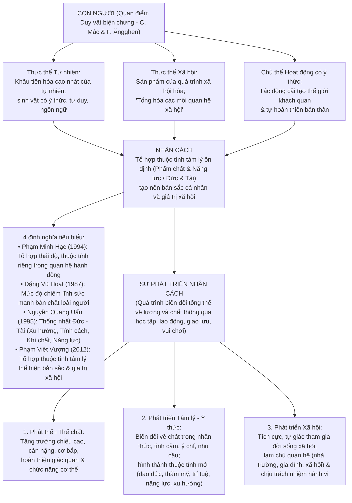
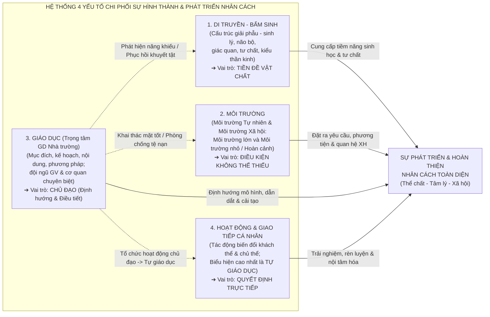

# CHƯƠNG 2: GIÁO DỤC VÀ SỰ PHÁT TRIỂN NHÂN CÁCH

> **Hướng dẫn học tập theo Phương pháp ghi chép Cornell (Cornell Note-taking System):**
> Tài liệu lí thuyết Chương 2 được thiết kế chuẩn hóa theo cấu trúc **Cornell Note-taking System** gồm 3 vùng nhận thức gắn kết chặt chẽ:
> 1. **Cột Từ khóa & Câu hỏi gợi nhớ (Cue Column - Cột trái):** Chứa hệ thống thuật ngữ cốt lõi, tên học giả, niên đại, luận điểm kinh điển và các câu hỏi định hướng tư duy giúp người học chủ động truy xuất thông tin (Active Recall).
> 2. **Cột Ghi chú chi tiết (Note-taking Column - Cột phải):** Hệ thống hóa toàn bộ cơ sở lí luận duy vật biện chứng về con người, nhân cách, sự phát triển nhân cách, cùng cấu trúc phân tích 4 chiều (Khái niệm – Vai trò – Phê phán quan điểm sai lầm – Kết luận sư phạm) của 4 yếu tố ảnh hưởng đến sự hình thành và phát triển nhân cách.
> 3. **Phần Tóm tắt cốt lõi (Cornell Summary - Cuối mỗi mục & cuối chương):** Cô đọng bản chất khoa học giáo dục và định hướng vận dụng thực tiễn sư phạm trong vài câu súc tích.

---

## Sơ đồ 1: Cấu trúc khái niệm Con người – Nhân cách – Sự phát triển nhân cách

---

## 2.1. Khái niệm cơ bản: Con người, Nhân cách và Sự phát triển nhân cách

| Từ khóa / Câu hỏi gợi nhớ | Ghi chú chi tiết (Nội dung cốt lõi) |
| :--- | :--- |
| **2.1.1. Khái niệm Con người** *Chủ nghĩa duy vật biện chứng của C. Mác và F. Ăngghen quan niệm như thế nào về hai mặt bản thể của con người?* | • Theo quan điểm của **chủ nghĩa duy vật biện chứng** (đại diện là **C. Mác** và **F. Ăngghen**), con người vừa là một **thực thể tự nhiên**, vừa là một **thực thể xã hội**:   1. **Con người là một thực thể tự nhiên:** Là sản phẩm của sự tiến hóa lâu dài, là **khâu tiến hóa cao nhất** của thế giới tự nhiên; là một sinh vật sống có **ý thức, tư duy và ngôn ngữ**. Con người mang trong mình sức sống của tự nhiên, vận động và phát triển theo các **quy luật tự nhiên – sinh học**. Do đó, muốn phát triển con người thì trước hết phải tạo điều kiện cho con người thỏa mãn các **nhu cầu bản năng**.   2. **Con người là một thực thể của xã hội:** Là sản phẩm của **quá trình xã hội hóa** được thực hiện khi con người gia nhập vào đời sống xã hội. Con người mang trong mình một tổng thể các thuộc tính xã hội và **mang bản chất xã hội**. Mọi thuộc tính, phẩm chất của con người đều hình thành thông qua sự tác động của xã hội và mối quan hệ giữa người với người. |
| **Luận điểm của C. Mác về bản chất con người** *Luận cương về Feuerbach (Phơ Bách) của C. Mác định nghĩa bản chất con người như thế nào?* | • Trong *Luận cương về Phơ Bách (Feuerbach)*, **C. Mác** khẳng định luận điểm khoa học bất hủ:   *"Bản chất của con người không phải là cái gì trừu tượng, vốn có của mỗi cá nhân riêng biệt, trong tính hiện thực của nó, **bản chất con người là tổng hòa các mối quan hệ xã hội**."* • **Ý nghĩa phương pháp luận của luận điểm:**   ◦ Bản chất con người không phải là cái gì trừu tượng, chung chung, bất biến, không thể thay đổi được.   ◦ Bản chất con người bao giờ cũng được hình thành, bộc lộ và thể hiện rõ nét trong chính cuộc sống, trong các **hoạt động thực tiễn đa dạng và phong phú**.   ◦ Những tồn tại khách quan luôn tác động vào con người thông qua các quan hệ xã hội phức tạp giữa con người với **thế giới tự nhiên, xã hội và tư duy**, thông qua các hình thức **hoạt động và giao lưu**, hoặc dưới hình thức tác động trực tiếp và gián tiếp của môi trường. |
| **Con người với tư cách Chủ thể hoạt động có ý thức** *Con người tác động trở lại thế giới khách quan như thế nào?* | • Con người không chỉ là sản phẩm thụ động của xã hội mà bao giờ cũng tồn tại với tư cách là **chủ thể hoạt động có ý thức**. • Con người tác động trở lại tồn tại khách quan, làm biến đổi môi trường tự nhiên, môi trường sống, làm thay đổi các mối quan hệ và các thể chế xã hội, thúc đẩy xã hội phát triển. • Chính thông qua quá trình cải tạo thế giới khách quan đó, con người **không ngừng hoàn thiện bản thân mình**. |
| **2.1.2. Khái niệm Nhân cách & 4 định nghĩa tiêu biểu** *Các nhà tâm lý học, giáo dục học Việt Nam (Phạm Minh Hạc, Đặng Vũ Hoạt, Nguyễn Quang Uẩn, Phạm Viết Vượng) định nghĩa nhân cách như thế nào?* | • Nhân cách là một phạm trù phức tạp, được tiếp cận dưới nhiều góc độ trong tâm lý học và giáo dục học:   1. **Quan điểm của Phạm Minh Hạc (1994):** *"Nhân cách là **tổ hợp các thái độ, các thuộc tính riêng** trong quan hệ hành động của từng người với thế giới tự nhiên, thế giới đồ vật do loài người sáng tạo, với xã hội và với cá nhân."*   2. **Quan điểm của Đặng Vũ Hoạt (1987):** *"Nói đến nhân cách là nói đến đặc trưng của một con người theo khía cạnh **sự gia nhập của người đó vào chỉnh thể xã hội**. Khái niệm nhân cách bao hàm toàn thể các nét, các mặt, các phẩm chất có ý nghĩa xã hội trong một con người... Nhân cách là **mức độ chiếm lĩnh của mỗi cá nhân những sức mạnh bản chất (tự nhiên và xã hội) của loài người**."*   3. **Quan điểm của Nguyễn Quang Uẩn (1995):** *"Khi nói đến nhân cách ta hiểu đó là **sự thống nhất giữa phẩm chất và năng lực, giữa đức và tài**; đó là một tổ hợp thống nhất giữa **bốn nhóm thuộc tính tâm lý cơ bản** của nhân cách: **xu hướng; tính cách; khí chất và năng lực**."*   4. **Quan điểm của Phạm Viết Vượng (2012):** *"Nhân cách là tổ hợp những đặc điểm, những thuộc tính tâm lý cá nhân, thể hiện **bản sắc cá nhân và giá trị xã hội**, phù hợp với yêu cầu của xã hội và của thời đại."* |
| **Ba đặc điểm bản chất & Định nghĩa tổng hợp về Nhân cách** *Nhân cách có những đặc điểm bản chất nào và được định nghĩa khái quát ra sao?* | • **Ba đặc điểm bản chất của nhân cách:**   1. **Tính hệ thống và ổn định phù hợp thời đại:** Nhân cách là một hệ thống các thuộc tính ổn định, đa dạng của con người (bao gồm năng lực, đạo đức, trí tuệ, thể chất, trình độ thẩm mỹ...), các thuộc tính này phải phù hợp với yêu cầu của xã hội và của thời đại.   2. **Tính riêng biệt (Bản sắc cá nhân):** Mỗi người có nhân cách riêng, vừa hàm chứa những nét chung của cộng đồng/thời đại, vừa mang những nét khác biệt độc đáo.   3. **Tính lịch sử - định hình:** Nhân cách không có sẵn khi mới sinh mà định hình ở một giai đoạn phát triển nhất định và được coi là ổn định khi cá nhân đã trở thành một **chủ thể xã hội**. • **Định nghĩa tổng hợp:** **Nhân cách** là toàn bộ những thuộc tính đặc biệt bao gồm **phẩm chất và năng lực** tạo nên **giá trị và bản sắc của cá nhân**, được hình thành và phát triển trong hệ thống các quan hệ xã hội, trên cơ sở tiến hành các hoạt động cá nhân nhằm chiếm lĩnh những giá trị vật chất và tinh thần của xã hội. |
| **2.1.3. Sự phát triển nhân cách & Ba mặt biểu hiện** *Sự phát triển nhân cách diễn ra bằng con đường nào và biểu hiện cụ thể trên 3 mặt nào?* | • **Bản chất quá trình:** Con người khi mới sinh ra **chưa có nhân cách**; nhân cách chỉ được hình thành và phát triển trong quá trình sống bằng cách **lĩnh hội, kế thừa** các giá trị do các thế hệ trước để lại thông qua **học tập, lao động, giao lưu, vui chơi...** • **Ba mặt biểu hiện cụ thể của sự phát triển nhân cách:**   1. **Phát triển về thể chất:** Biểu hiện ở sự tăng trưởng về lượng và thay đổi về chất của cơ thể (chiều cao, cân nặng, cơ bắp) cùng sự hoàn thiện các giác quan và các chức năng sinh lý cơ thể.   2. **Phát triển về mặt tâm lý, ý thức:** Biểu hiện ở sự biến đổi cơ bản về chất trong các quá trình nhận thức, tình cảm, ý chí, nhu cầu, nếp sống... đặc biệt là sự hình thành các **thuộc tính mới của nhân cách** như đạo đức, thẩm mỹ, trí tuệ, năng lực, xu hướng.   3. **Sự phát triển về mặt xã hội:** Trên cơ sở hình thành các thuộc tính mới của nhân cách và sự phát triển ý thức, cá nhân **tích cực, tự giác tham gia** vào các mặt khác nhau của đời sống xã hội, trở thành **chủ thể** trong các mối quan hệ ở nhà trường, gia đình, xã hội và **chịu trách nhiệm về các hành vi của mình**. |

> **Tóm tắt Mục 2.1 (Cornell Summary):**
> Theo chủ nghĩa duy vật biện chứng, con người là thực thể thống nhất giữa mặt tự nhiên – sinh học và mặt xã hội (*"tổng hòa các mối quan hệ xã hội"*), đồng thời là chủ thể hoạt động có ý thức. Nhân cách không bẩm sinh mà là tổ hợp thống nhất các thuộc tính tâm lý ổn định (**phẩm chất và năng lực / đức và tài**, gồm xu hướng, tính cách, khí chất, năng lực) tạo nên bản sắc và giá trị xã hội của cá nhân; sự phát triển nhân cách là quá trình biến đổi tổng thể về lượng và chất trên cả **3 mặt: Thể chất, Tâm lý – Ý thức và Xã hội**.

---

## Sơ đồ 2: Hệ thống 4 yếu tố ảnh hưởng đến sự phát triển nhân cách và vai trò đặc trưng

---

## 2.2. Các yếu tố ảnh hưởng tới sự phát triển nhân cách

### 2.2.1. Yếu tố di truyền – bẩm sinh và sự phát triển nhân cách

| Từ khóa / Câu hỏi gợi nhớ | Ghi chú chi tiết (Nội dung cốt lõi) |
| :--- | :--- |
| **2.2.1.1. Khái niệm Di truyền & Bẩm sinh** *Phân biệt di truyền và bẩm sinh. Có mấy dạng quan hệ giữa bẩm sinh và di truyền?* | • **Khái niệm Di truyền:** Là sự tái tạo ở trẻ những thuộc tính sinh học nhất định giống với cha mẹ; là sự truyền lại từ cha mẹ đến con những đặc điểm nhất định đã được ghi lại trong **cấu trúc gen**. Những thuộc tính được di truyền bao gồm: **cấu trúc giải phẫu – sinh lý** của cơ thể, những đặc điểm của cơ thể người, và **các phẩm chất của hệ thần kinh**. • **Khái niệm Bẩm sinh:** Là những thuộc tính sinh học **khi sinh ra đã có**. • **Ba dạng trong mối quan hệ giữa bẩm sinh và di truyền:**   1. **Bẩm sinh do di truyền:** Đặc điểm ghi trong cấu trúc gen truyền từ cha mẹ và biểu hiện ngay khi trẻ mới sinh ra.   2. **Bẩm sinh không do di truyền:** Đặc điểm có ngay khi sinh ra nhưng không phải do gen cha mẹ truyền lại mà do các tác động sinh học/bệnh lý trong thời kỳ mang thai.   3. **Di truyền nhưng không bẩm sinh:** Đặc điểm nằm trong cấu trúc gen truyền từ cha mẹ nhưng khi mới sinh chưa bộc lộ ngay, chỉ xuất hiện ở những giai đoạn trưởng thành nhất định về sau. |
| **2.2.1.2. Vai trò của Di truyền – Bẩm sinh: TIỀN ĐỀ VẬT CHẤT** *Vì sao khẳng định di truyền, bẩm sinh giữ vai trò tiền đề vật chất chứ không quyết định trước kiểu nhân cách?* | • **Luận điểm tổng quát:** Chủ nghĩa duy vật biện chứng khẳng định di truyền, bẩm sinh, sinh học giữ vai trò **tiền đề (tiền đề vật chất)** đối với sự phát triển nhân cách, **không quyết định trước kiểu nhân cách**, không quy định xu hướng phát triển nhân cách và **không giới hạn trình độ phát triển** của nhân cách. • **7 khía cạnh phân tích chứng minh:**   1. **Đảm bảo sự tồn tại và thích ứng sinh học của loài người:** Các phản xạ bản năng giúp đứa trẻ mới sinh tồn tại nhờ sự nuôi dưỡng; cơ thể sống có thể thay đổi để thích nghi với một số biến đổi có giới hạn của điều kiện xung quanh.   2. **Cơ thể người lành lặn là nền tảng vật chất của nhân cách:** Nhân cách chỉ hình thành, phát triển và tồn tại trên một cơ thể người sống. Sự lành lặn về **não bộ, cơ quan thần kinh và các giác quan** là tiền đề thuận lợi to lớn; ngược lại, bất cứ sự khiếm khuyết hay tổn thương nào về thần kinh và giác quan đều gây bất lợi cho sự phát triển nhân cách.   3. **Não bộ con người là cơ quan phản ánh tâm lý cấp cao:** Phản ánh tâm lý là chức năng của một dạng vật chất có tổ chức và tiến hóa cao nhất là **não bộ người**. Động vật tuy cũng có não bộ nhưng không có khả năng phản ánh như não người nên dù sống trong xã hội loài người cũng không thể có ý thức và nhân cách.   4. **Bằng chứng trẻ em do thú rừng nuôi & trẻ sinh đôi cùng trứng:** Dù có tư chất người mà không sống trong xã hội loài người cũng không thể có nhân cách (minh chứng qua các trường hợp **trẻ em từ nhỏ bị lạc và được thú rừng nuôi**). Ngược lại, có cùng đặc điểm di truyền nhưng sống trong điều kiện xã hội khác nhau, hoạt động khác nhau thì nhân cách cũng khác nhau (minh chứng qua nghiên cứu **trẻ sinh đôi cùng trứng**).   5. **Mối quan hệ giữa Tư chất và Năng lực:** **Tư chất** là một số đặc điểm sinh học có sẵn trong cấu tạo não, cơ quan cảm giác, cơ quan vận động... giúp con người có thể thành công trong một số hoạt động. Tư chất chỉ là **điều kiện tiền đề** để hình thành năng lực chứ không quyết định sẵn năng lực; người có một tư chất có thể hoạt động hiệu quả ở nhiều lĩnh vực rộng rãi mà không bị quy định trước một hoạt động duy nhất nào. Tư chất có trở thành năng lực hay không phụ thuộc vào hoàn cảnh thực tiễn, học tập, lao động, rèn luyện và tích lũy kinh nghiệm của cá nhân.   6. **Mối quan hệ giữa Kiểu hình thần kinh với Khí chất và Tính cách:** Các thuộc tính loại hình thần kinh không định trước những nét tính cách sau này. Trên cùng một kiểu hình thần kinh có thể hình thành những nét tính cách khác nhau, và những nét tính cách giống nhau có thể hình thành trên nhiều kiểu hình thần kinh khác nhau. Kiểu hình thần kinh là cơ sở sinh lý thần kinh của **khí chất**, nhưng khí chất mang bản chất xã hội và biến đổi do rèn luyện, giáo dục.   7. **Sự biến đổi sinh lý qua các lứa tuổi (ví dụ tuổi dậy thì):** Khi sinh ra con người không bị định trước bởi hành vi hay giá trị xã hội nào ngoài các bản năng sống. Sự biến đổi sinh lý lứa tuổi (như **tuổi dậy thì** làm nảy sinh tình cảm khác giới, tình yêu nam nữ) có ảnh hưởng đến tâm lý và nhân cách, nhưng **tính chất của tình yêu** lại chịu sự chi phối của hoàn cảnh xã hội, của hoạt động và của giáo dục. |
| **2.2.1.3. Phê phán các quan điểm sai lầm về Di truyền** *Cần phê phán những học thuyết cực đoan nào khi đánh giá vai trò của di truyền – bẩm sinh?* | • **Nhóm quan điểm tuyệt đối hóa vai trò của di truyền (Duy tâm, sinh học hóa):**   ◦ **"Thuyết ưu sinh"** và thuyết **"Định mệnh do di truyền"**: Cho rằng tư chất sinh học quy định trước hành vi, phẩm chất và trình độ trí tuệ; trẻ sinh ra có yếu tố sinh học thuận lợi hay bất lợi sẽ quyết định sẵn mặt *"thiên tài"* hay *"đần độn"* sau này.   ◦ **Phái "Nhi đồng học"** (lan truyền mạnh ở phương Tây cuối thế kỷ XIX – đầu thế kỷ XX): Cho rằng nhân cách, đạo đức con người mang tính di truyền nên cha mẹ thuộc tầng lớp nào sẽ quyết định vận mệnh con cái như vậy (con nhà bác học, giàu có tất yếu sẽ thông thái, thành đạt; con người lao động hay kẻ trộm cắp, rượu chè, cờ bạc cũng chỉ giống như cha mẹ chúng). • **Nhóm quan điểm phủ nhận hoàn toàn vai trò của di truyền:**   ◦ Thuyết **"Giáo dục là vạn năng"**: Cho rằng di truyền không có vai trò gì đối với sự phát triển nhân cách; con người trở thành tốt hay xấu, thiện hay ác, tài giỏi hay đần độn hoàn toàn do giáo dục quyết định. • **Đánh giá:** Cả hai khuynh hướng đề cao quá mức hoặc phủ nhận sạch trơn vai trò của di truyền – bẩm sinh đều là những quan niệm **sai lầm, phản khoa học**. |
| **2.2.1.4. Kết luận sư phạm từ yếu tố Di truyền – Bẩm sinh** *Nhà giáo dục cần rút ra những bài học sư phạm nào trong quá trình giáo dục?* | 1. **Đánh giá đúng mực:** Trong quá trình giáo dục (QTGD), cần chú ý đúng mực đến vai trò là **tiền đề vật chất, điều kiện sinh học** của yếu tố di truyền – bẩm sinh đối với sự phát triển nhân cách (không tuyệt đối hóa, không bỏ qua). 2. **Phát hiện sớm năng khiếu & hạn chế riêng:** Cần tổ chức đa dạng các hoạt động và giao tiếp, tạo điều kiện tìm hiểu, sớm phát hiện những học sinh có **năng khiếu đặc biệt, có tư chất thuận lợi** cũng như những mặt hạn chế riêng để có cách tác động sư phạm phù hợp (dạy học phân hóa, bồi dưỡng nhân tài). 3. **Khích lệ nội lực và hỗ trợ học sinh đặc biệt:** Phát huy tính tích cực cá nhân trong QTGD; đặc biệt quan tâm, động viên, khích lệ và hỗ trợ kịp thời **học sinh khuyết tật, học sinh có hoàn cảnh khó khăn**. |

> **Tóm tắt Mục 2.2.1 (Cornell Summary):**
> Di truyền (các đặc điểm ghi trong cấu trúc gen truyền từ cha mẹ) và bẩm sinh (thuộc tính sinh học có sẵn khi chào đời, gồm 3 dạng quan hệ với di truyền) đóng vai trò là **tiền đề vật chất** cho sự hình thành và phát triển nhân cách thông qua cấu tạo não bộ, giác quan, tư chất và kiểu hình thần kinh, nhưng **không tiền định kiểu nhân cách hay giới hạn trình độ phát triển**. Khoa học giáo dục kiên quyết bác bỏ *"Thuyết ưu sinh"*, *"Định mệnh do di truyền"*, phái *"Nhi đồng học"* lẫn thuyết *"Giáo dục là vạn năng"*, đòi hỏi nhà giáo dục phải phát hiện sớm tư chất/năng khiếu để bồi dưỡng và tận tâm hỗ trợ học sinh khuyết tật.

---

### 2.2.2. Yếu tố môi trường và sự phát triển nhân cách

| Từ khóa / Câu hỏi gợi nhớ | Ghi chú chi tiết (Nội dung cốt lõi) |
| :--- | :--- |
| **2.2.2.1. Khái niệm & Phân loại Môi trường** *Môi trường là gì? Phân biệt môi trường tự nhiên, môi trường xã hội lớn và môi trường xã hội nhỏ (hoàn cảnh).* | • **Khái niệm Môi trường:** Là hệ thống những yếu tố, hoàn cảnh bên ngoài, những điều kiện tự nhiên và xã hội tác động đến cuộc sống và hoạt động của con người. • **Phân loại khái quát gồm 2 loại chính:**   1. **Môi trường tự nhiên:** Gồm các điều kiện địa lý, sinh thái... có ảnh hưởng rất lớn đến sự phát triển thể chất, cuộc sống và hoạt động của con người.   2. **Môi trường xã hội:** Có vai trò đặc biệt quan trọng đối với nhân cách, được chia thành 2 cấp độ:      ◦ **Môi trường lớn (phạm vi rộng):** Chế độ chính trị – xã hội, thể chế kinh tế, chính sách, nền văn hóa của quốc gia.      ◦ **Môi trường nhỏ / Hoàn cảnh (phạm vi hẹp):** Là một bộ phận của môi trường lớn trực tiếp tác động đến cuộc sống cá nhân, bao gồm các mối quan hệ **gia đình, nhà trường, nhóm bạn, địa phương, phong tục tập quán**, điều kiện kinh tế, văn hóa, chính trị ở nơi sinh sống.      ◦ **Mối quan hệ biện chứng:** Môi trường nhỏ tác động **trực tiếp** đến trẻ; môi trường lớn ảnh hưởng đến trẻ **thông qua môi trường nhỏ**. Tuy nhiên, môi trường nhỏ có **tính độc lập tương đối** và chịu sự biến đổi dễ dàng, nhanh chóng hơn. |
| **2.2.2.2. Vai trò của Môi trường: ĐIỀU KIỆN KHÔNG THỂ THIẾU (6 khía cạnh)** *Môi trường xã hội thể hiện vai trò là điều kiện phát triển nhân cách qua 6 luận điểm nào?* | • Khi nói ảnh hưởng của môi trường đến nhân cách, trước hết và chủ yếu là nhấn mạnh **môi trường xã hội** (các quan hệ chính trị, kinh tế, tư tưởng tác động mạnh mẽ nhất qua địa vị giai cấp, địa vị xã hội của cá nhân). Môi trường là **điều kiện không thể thiếu**, thể hiện qua **6 khía cạnh**:   1. **Một là – Đưa ra những yêu cầu khách quan (mô hình nhân cách):** Trong mỗi giai đoạn lịch sử, môi trường đặt ra mô hình, kiểu mẫu nhân cách mà xã hội xem là mục tiêu phấn đấu và động lực phát triển; mỗi thành viên cũng lấy đó làm mục tiêu tu dưỡng, rèn luyện.   2. **Hai là – Tạo ra các phương tiện, điều kiện hoạt động và giao lưu:** Cung cấp điều kiện, phương tiện đa dạng để cá nhân tham gia hoạt động và giao lưu, qua đó chiếm lĩnh kinh nghiệm xã hội và giá trị văn hóa nhân loại.   3. **Ba là – Quan tâm, khai thác và sử dụng hiệu quả khả năng hiện có của cá nhân:** Kích thích nhân cách đang phát triển đóng góp xây dựng môi trường ngày càng văn minh, hiện đại, đồng thời qua đó tạo điều kiện thuận lợi để cá nhân tiếp tục hoàn thiện bản thân.   4. **Bốn là – Tác động thông qua các mối quan hệ xã hội đa dạng:** Thông qua quan hệ giai cấp, dân tộc, gia đình, quan hệ sản xuất, quan hệ tư tưởng... mà môi trường và con người tác động qua lại để hình thành các giá trị đạo đức, nhân văn.   5. **Năm là – Ảnh hưởng theo chiều hướng và mức độ khác nhau tùy thuộc vị trí và lập trường cá nhân:** Trong cùng một môi trường xã hội nhưng vị trí xã hội, điều kiện sống, học tập, lao động khác nhau và đặc biệt là **lập trường, quan điểm, thái độ, năng lực, nhu cầu** của mỗi cá nhân khác nhau nên mức độ tiếp thu, chấp nhận hay phản đối các tác động của môi trường cũng khác nhau.   6. **Sáu là – Tác động hai mặt vừa tích cực vừa tiêu cực đan xen nhau:** Cá nhân vừa thu nhận những ảnh hưởng tốt, vừa phải chịu những ảnh hưởng xấu, trái ngược nhau từ môi trường. |
| **Thực tiễn Kinh tế thị trường định hướng XHCN, Hội nhập & Luận điểm của C. Mác** *Môi trường kinh tế thị trường và mở cửa ở Việt Nam hiện nay có hai mặt tích cực – tiêu cực gì? C. Mác nói gì về mối quan hệ giữa hoàn cảnh và con người?* | • **Tác động hai mặt của nền kinh tế thị trường định hướng XHCN và chính sách "mở cửa" ở Việt Nam hiện nay:**   ◦ **Mặt tích cực:** Làm cho con người **năng động hơn, linh hoạt hơn, có chí tiến thủ, có khả năng tự lập cao hơn**; thu hút sự hợp tác quốc tế và tiếp thu, chọn lọc các giá trị văn hóa tốt đẹp của nhân loại.   ◦ **Mặt tiêu cực:** Thái độ **tôn sùng đồng tiền, coi thường đạo lý, muốn làm giàu nhanh chóng bất chấp pháp luật**, tình trạng tham nhũng, hối lộ, cùng sự thâm nhập của các luồng văn hóa phẩm đồi trụy, bạo lực từ bên ngoài gây nguy cơ tha hóa, suy thoái nhân cách thế hệ trẻ nếu thiếu định hướng của gia đình, nhà trường và ý thức tự rèn luyện. • **Tính tích cực cải tạo hoàn cảnh của con người (Luận điểm C. Mác):**   ◦ Môi trường tác động đến con người nhưng con người cũng tác động trở lại và cải tạo môi trường. **C. Mác** khẳng định: ***"Hoàn cảnh sáng tạo ra con người trong chừng mực con người sáng tạo ra hoàn cảnh."***   ◦ Con người bằng tính tích cực của mình phải giữ lại cái tốt đẹp, điều chỉnh cái chưa phù hợp và kiên quyết loại bỏ cái lạc hậu, xấu xa để kiến tạo môi trường giáo dục lành mạnh. |
| **2.2.2.3. Phê phán các quan điểm sai lầm về Môi trường** *Thuyết "Định mệnh do hoàn cảnh" và thuyết "Giáo dục là vạn năng" sai lầm như thế nào khi đánh giá về môi trường?* | • **Quan điểm tuyệt đối hóa vai trò của môi trường – Thuyết "Định mệnh do hoàn cảnh":**   ◦ Cho rằng một đứa trẻ sinh ra dù có khuyết tật gì nhưng nếu sống trong môi trường tốt thì tất yếu trở thành người tốt.   ◦ Ví mỗi đứa trẻ như một **"tấm lụa trắng"**, trở thành người như thế nào hoàn toàn do môi trường nhuộm màu và tạo nên (hạ thấp vai trò chủ thể và giáo dục). • **Quan điểm phủ nhận hoàn toàn vai trò của môi trường – Thuyết "Giáo dục là vạn năng":**   ◦ Cho rằng môi trường không có vai trò, tác dụng gì đối với sự hình thành và phát triển nhân cách. • **Khẳng định khoa học:** Cả hai thái cực đều phản khoa học. Môi trường tuy **không đóng vai trò quyết định** nhưng là **điều kiện rất quan trọng không thể thiếu**, vì tách khỏi xã hội loài người và giao lưu đồng loại thì không thể hình thành nhân cách. |
| **2.2.2.4. Kết luận sư phạm từ yếu tố Môi trường** *Nêu 4 bài học sư phạm nhằm phát huy mặt tích cực và ngăn ngừa mặt tiêu cực của môi trường.* | 1. **Khai thác yếu tố tích cực:** Gia đình, nhà trường và mỗi cá nhân cần phát huy và khai thác triệt để những yếu tố tích cực của môi trường. 2. **Phòng ngừa, loại bỏ yếu tố tiêu cực:** Chủ động phòng ngừa, hạn chế tối đa và loại bỏ những tác động tiêu cực của môi trường đến nhân cách học sinh. 3. **Phối hợp ba lực lượng giáo dục:** **Nhà trường, gia đình và xã hội** cần phối hợp thống nhất để xây dựng môi trường trong sạch, lành mạnh cho thế hệ trẻ. 4. **Trang bị hiểu biết và bản lĩnh đề kháng:** Thông qua sinh hoạt tập thể và hoạt động ngoại khóa, giúp học sinh hiểu rõ tác hại của các **tệ nạn xã hội** và rèn luyện **bản lĩnh vững vàng** để tự chống lại những cám dỗ tiêu cực. |

> **Tóm tắt Mục 2.2.2 (Cornell Summary):**
> Môi trường (đặc biệt là môi trường xã hội gồm môi trường lớn và môi trường nhỏ/hoàn cảnh) là **điều kiện không thể thiếu** đối với sự phát triển nhân cách qua 6 khía cạnh: đặt ra mô hình yêu cầu, cung cấp phương tiện, kích thích tiềm năng, kết nối quan hệ xã hội, tác động phân hóa theo lập trường cá nhân và tác động hai mặt tích cực – tiêu cực đan xen (như trong nền kinh tế thị trường và hội nhập). Thấm nhuần luận điểm của C. Mác (*"Hoàn cảnh sáng tạo ra con người trong chừng mực con người sáng tạo ra hoàn cảnh"*) và bác bỏ thuyết *"Định mệnh do hoàn cảnh"* (coi trẻ như tấm lụa trắng), nhà giáo dục phải phối hợp Nhà trường – Gia đình – Xã hội để xây dựng môi trường lành mạnh và hình thành bản lĩnh đề kháng cho học sinh.

---

### 2.2.3. Yếu tố giáo dục và sự phát triển nhân cách

| Từ khóa / Câu hỏi gợi nhớ | Ghi chú chi tiết (Nội dung cốt lõi) |
| :--- | :--- |
| **2.2.3.1. Khái niệm Giáo dục (Nhấn mạnh Giáo dục nhà trường)** *Khi xét vai trò đối với sự phát triển nhân cách, khái niệm giáo dục được hiểu theo nghĩa nào?* | • Giáo dục được hiểu theo nhiều nghĩa rộng hẹp khác nhau, nhưng khi bàn về vai trò đối với sự phát triển nhân cách, giáo dục học nhấn mạnh trước hết đến **giáo dục nhà trường**. • **Định nghĩa:** Đó là hệ thống những tác động **có mục đích, có kế hoạch, có nội dung, phương pháp** được thực hiện trong **hệ thống nhà trường** nhằm hình thành và phát triển nhân cách con người phù hợp với những yêu cầu của xã hội trong những giai đoạn lịch sử nhất định. |
| **2.2.3.2. Vai trò của Giáo dục: GIỮ VAI TRÒ CHỦ ĐẠO (Luận điểm 1, 2, 3)** *Vì sao giáo dục là yếu tố quan trọng nhất, giữ vai trò chủ đạo đối với sự phát triển nhân cách?* | • Trong tất cả các yếu tố tác động đến nhân cách, **giáo dục giữ vai trò chủ đạo** (quan trọng nhất, ảnh hưởng mạnh mẽ và sâu sắc nhất) vì **4 luận điểm cốt lõi**:   1. **Một là – Giáo dục là hoạt động có mục đích, chương trình, kế hoạch, nội dung, phương pháp, phương tiện nhằm định hướng sự phát triển nhân cách:**      ◦ Diễn ra theo một quá trình tổ chức nghiêm ngặt với **mục đích xác định** phản ánh yêu cầu của xã hội về mô hình nhân cách.      ◦ Đối với **nhà giáo dục**: Mục đích giáo dục là cái đích, là **kim chỉ nam** cho mọi hoạt động giáo dục và là **chuẩn để đánh giá** chất lượng giáo dục.      ◦ Đối với **người được giáo dục**: Đó là cái đích để tự phấn đấu, là kim chỉ nam để tự điều chỉnh khi chệch hướng và là chuẩn để **tự đánh giá** kết quả phát triển nhân cách của bản thân.   2. **Hai là – Giáo dục được thực hiện trong các cơ quan chức năng chuyên biệt bởi đội ngũ giáo viên chuyên nghiệp:**      ◦ Đội ngũ giáo viên là những người được đào tạo có **trình độ chuyên môn, nghiệp vụ sư phạm**, hiểu biết đặc điểm tâm – sinh lý lứa tuổi và có năng lực tổ chức hoạt động.      ◦ Nhà giáo dục luôn là **tấm gương sáng** về tri thức và cách ứng xử, luôn quan tâm động viên và khêu gợi để người học phát huy cao nhất tiềm năng sẵn có.   3. **Ba là – Giáo dục tổ chức, dẫn dắt sự hình thành và phát triển nhân cách theo mô hình đã xác định:**      ◦ Không chỉ đưa ra mô hình nhân cách định hướng mà còn trực tiếp **tổ chức các hoạt động xã hội, sinh hoạt tập thể...** để người học tự giác, tích cực tham gia dưới sự hướng dẫn, điều khiển của nhà giáo dục.      ◦ Thường xuyên diễn ra **sự điều chỉnh của nhà giáo dục** kết hợp với **sự tự điều chỉnh của người được giáo dục**, cùng sự đánh giá và tự đánh giá. |
| **Luận điểm 4: Giáo dục tác động, điều tiết 3 yếu tố còn lại (Di truyền, Môi trường, Hoạt động cá nhân)** *Vai trò chủ đạo của giáo dục thể hiện qua việc tác động đến di truyền – bẩm sinh, môi trường và hoạt động cá nhân như thế nào?* | • **Bốn là – Giáo dục tác động và điều tiết các yếu tố khác (di truyền – bẩm sinh, môi trường, hoạt động cá nhân) nhằm tạo thuận lợi tối đa cho sự phát triển nhân cách:**   ◦ **Đối với yếu tố di truyền – bẩm sinh:**     ▪ *Phát hiện và bồi dưỡng năng khiếu:* Tạo điều kiện cho yếu tố di truyền thuận lợi bộc lộ, phát hiện sớm năng khiếu và bồi dưỡng kịp thời thành tài năng cho đất nước thông qua hệ thống **lớp chọn, trường chuyên, lớp bồi dưỡng năng khiếu, các kỳ thi Olympic, thi học sinh giỏi các cấp** và trường chuyên biệt.     ▪ *Cải tạo, bù đắp những khiếm khuyết bẩm sinh:* Thông qua các **trung tâm phục hồi chức năng, trung tâm nuôi dạy trẻ khuyết tật** (câm, mù, điếc, chậm phát triển trí tuệ...) với chuyên viên được đào tạo và phương tiện kỹ thuật hỗ trợ, đặc biệt là **chương trình giáo dục hòa nhập cộng đồng**, giúp trẻ khuyết tật nắm kiến thức phổ thông, kỹ năng sống để hòa nhập xã hội.   ◦ **Đối với yếu tố môi trường:**     ▪ Phát hiện và khai thác các yếu tố thuận lợi của môi trường phục vụ giáo dục; **kết hợp 3 môi trường giáo dục (Nhà trường – Gia đình – Xã hội)** tạo sức mạnh tổng hợp giúp học sinh được giáo dục ở mọi nơi, mọi lúc.     ▪ Hạn chế, khắc phục và **cải tạo ở chừng mực nhất định** những yếu tố không thuận lợi của môi trường.     ▪ Trước các tệ nạn xã hội (cờ bạc, rượu chè, ma túy, văn hóa phẩm đồi trụy, bạo lực...), giáo dục trang bị cho người học **"sức đề kháng"** để tự bảo vệ mình; đồng thời phối hợp thực hiện các cuộc vận động (chấp hành luật giao thông, giữ vệ sinh đường phố...) và xây dựng **môi trường sư phạm lành mạnh** (nền nếp, kỷ cương, tình thương, trách nhiệm).   ◦ **Đối với hoạt động cá nhân:**     ▪ Tổ chức nhiều loại hình hoạt động và giao tiếp bổ ích, lành mạnh; xây dựng quan hệ giao tiếp tích cực **thầy – trò, bạn bè**; định hướng cho trẻ tham gia vào các **hoạt động chủ đạo ở từng giai đoạn lứa tuổi**. |
| **Điều kiện để Giáo dục giữ vững vai trò chủ đạo** *Vì sao nói "Giáo dục giữ vai trò chủ đạo nhưng không phải là vạn năng"?* | • **Giáo dục đóng vai trò chủ đạo nhưng KHÔNG PHẢI LÀ VẠN NĂNG**, bởi vì:   1. Sự hình thành và phát triển nhân cách là kết quả **phối hợp tổng hòa của nhiều nhân tố**; giáo dục chỉ phát huy tác dụng khi có sự hỗ trợ, phối hợp đồng bộ với di truyền, môi trường và hoạt động cá nhân.   2. Giáo dục chỉ giữ được vai trò chủ đạo khi được **tổ chức một cách khoa học**, dựa trên các cơ sở khoa học về con người.   3. Giáo dục bắt buộc phải **chuyển hóa được những tác động giáo dục bên ngoài trở thành quá trình TỰ GIÁO DỤC** bên trong, làm cho cá nhân có ý thức tự giáo dục, tự hoàn thiện bản thân. |
| **2.2.3.3. Phê phán sai lầm & 2.2.3.4. Kết luận sư phạm về Giáo dục** *Phê phán thuyết "Giáo dục là vạn năng" và nêu 3 kết luận sư phạm cốt lõi.* | • **Phê phán các quan điểm sai lầm:**   ◦ *Tuyệt đối hóa vai trò giáo dục (Thuyết "Giáo dục là vạn năng"):* Quan niệm tâm hồn trẻ em là những **"tờ giấy trắng", "chiếc bảng sạch" (Tabula rasa)** mà nhà giáo dục có thể tùy ý nhào nặn, đào tạo thành bất kỳ hình mẫu nhân cách lý tưởng nào mình muốn.   ◦ *Phủ nhận vai trò giáo dục (Thuyết "Định mệnh do di truyền" và "Định mệnh do hoàn cảnh"):* Cho rằng sự phát triển cá nhân hoàn toàn do Trời quy định hoặc do hoàn cảnh tạo nên, giáo dục hoàn toàn bất lực. • **Ba kết luận sư phạm cốt lõi:**   1. Nhận thức sâu sắc **giáo dục là yếu tố giữ vai trò chủ đạo** đối với sự phát triển và hoàn thiện nhân cách mỗi con người.   2. Nhà giáo dục phải **đưa học sinh vào tập thể** để giáo dục, thông qua các hoạt động phong phú, đa dạng để rèn luyện các em.   3. Phát huy cao độ vai trò **tích cực, tự giác** của mỗi cá nhân; đề cao vai trò **tự giáo dục, tự rèn luyện** của học sinh. |

> **Tóm tắt Mục 2.2.3 (Cornell Summary):**
> Giáo dục (trọng tâm là giáo dục nhà trường) giữ **vai trò chủ đạo** đối với sự phát triển nhân cách vì tính mục đích – kế hoạch định hướng nghiêm ngặt, được thực hiện bởi đội ngũ nhà giáo chuyên nghiệp trong cơ quan chuyên biệt, trực tiếp tổ chức – dẫn dắt – điều chỉnh quá trình phát triển và có khả năng điều tiết cả 3 yếu tố di truyền (bồi dưỡng năng khiếu, giáo dục hòa nhập trẻ khuyết tật), môi trường (liên kết Nhà trường – Gia đình – Xã hội, tạo sức đề kháng chống tệ nạn) và hoạt động cá nhân. Tuy nhiên, giáo dục không phải là vạn năng (bác bỏ quan niệm coi trẻ là *"tờ giấy trắng, chiếc bảng sạch"*) mà chỉ phát huy vai trò chủ đạo khi tổ chức khoa học và chuyển hóa thành **tự giáo dục**.

---

### 2.2.4. Yếu tố hoạt động cá nhân và sự phát triển nhân cách

| Từ khóa / Câu hỏi gợi nhớ | Ghi chú chi tiết (Nội dung cốt lõi) |
| :--- | :--- |
| **2.2.4.1. Khái niệm Hoạt động cá nhân** *Hoạt động cá nhân là gì và có tác động kép (hai chiều) như thế nào?* | • **Khái niệm Hoạt động:** Là quá trình con người tác động vào **thế giới khách quan**, làm biến đổi thế giới để tạo ra những sản phẩm (vật chất và tinh thần) theo nhu cầu của con người. • **Đặc điểm sinh lý & Tác động hai chiều:** Quá trình hoạt động luôn có sự tiêu hao năng lượng thần kinh và cơ bắp. Hoạt động của mỗi cá nhân không chỉ **làm thay đổi thế giới khách quan** mà đồng thời còn **làm thay đổi chính bản thân chủ thể** cả về mặt thể chất lẫn tinh thần (tâm lý, ý thức, nhân cách). |
| **2.2.4.2. Vai trò của Hoạt động cá nhân: QUYẾT ĐỊNH TRỰC TIẾP (3 luận điểm)** *Vì sao hoạt động và giao tiếp cá nhân giữ vai trò quyết định trực tiếp sự hình thành và phát triển nhân cách?* | • **Hoạt động và giao tiếp của cá nhân đóng vai trò QUYẾT ĐỊNH TRỰC TIẾP NHẤT** đối với sự hình thành và phát triển nhân cách, thể hiện qua **3 khía cạnh**:   1. **Một là – Điều kiện bộc lộ, rèn luyện và phát triển tư chất, phẩm chất, năng lực:** Thông qua hoạt động thực tiễn, các tư chất sinh học tiềm tàng mới có cơ hội bộc lộ, được rèn luyện và chuyển hóa thành phẩm chất, năng lực thực sự của nhân cách.   2. **Hai là – Phương thức trải nghiệm giá trị sống và lĩnh hội văn hóa – xã hội:** Thông qua hoạt động, cá nhân được kiểm nghiệm, trải nghiệm các giá trị cuộc sống, gia nhập các mối quan hệ xã hội, lĩnh hội kinh nghiệm lịch sử – xã hội và nền văn hóa nhân loại. Qua đó, cá nhân chủ động sàng lọc (giữ lại điều phù hợp, loại bỏ điều lạc hậu) và hình thành hệ giá trị mới ở bản thân.   3. **Ba là – Thỏa mãn nhu cầu hoạt động và giao tiếp để tâm lý phát triển bình thường:** Hoạt động và giao tiếp là nhu cầu bức thiết của con người; chỉ khi nhu cầu này được thỏa mãn thì tâm lý, ý thức và nhân cách mới phát triển bình thường (các thí nghiệm tâm lý học về việc con người bị cô lập, **không được giao tiếp dẫn tới bị trầm cảm** và rối loạn tâm lý đã chứng minh rõ điều này). • **Sự phụ thuộc vào đặc điểm cá nhân:** Mặc dù hoạt động quyết định trực tiếp, nhưng kết quả phát triển nhân cách đạt được ở phạm vi và mức độ nào còn tùy thuộc vào đặc điểm cấu tạo sinh lý cơ thể, đặc điểm tâm lý, vốn sống và hoàn cảnh sống riêng của từng cá nhân. |
| **2.2.4.3. Phê phán sai lầm & 2.2.4.4. Năm kết luận sư phạm từ yếu tố Hoạt động cá nhân** *Vì sao nói hoạt động cá nhân tích cực là biểu hiện của tự giáo dục? Nêu 5 yêu cầu sư phạm khi tổ chức hoạt động cho học sinh.* | • **Phê phán quan điểm sai lầm:** Không được tuyệt đối hóa (tách rời hoạt động khỏi sự định hướng của giáo dục và điều kiện môi trường) và cũng tuyệt đối không được xem nhẹ vai trò quyết định trực tiếp của hoạt động và giao tiếp. • **Bản chất tự giáo dục:** Hoạt động cá nhân tích cực chính là biểu hiện cốt lõi của việc **tự giáo dục**. • **5 kết luận sư phạm trọng tâm trong quá trình giáo dục:**   1. **Xác định mục đích, động cơ và phương thức hoạt động phù hợp:** Hướng tới các mục tiêu giáo dục cụ thể, sát hợp với đặc điểm tâm – sinh lý, lứa tuổi, nhu cầu, nguyện vọng và hứng thú của người được giáo dục.   2. **Đa dạng hóa các loại hình hoạt động và giao lưu:** Tổ chức các hoạt động phong phú về nội dung và hình thức theo chương trình, kế hoạch, chủ đề có ý nghĩa giáo dục thiết thực.   3. **Lập kế hoạch chi tiết và phát huy tính tự giác:** Nhà giáo dục cần có kế hoạch cụ thể, chi tiết khi tổ chức hoạt động nhằm phát huy cao độ tính tích cực, chủ động, tự giác của học sinh.   4. **Sử dụng phương pháp và phương tiện hợp lý:** Quá trình tổ chức hoạt động phải được tiến hành với những phương pháp, phương tiện sư phạm hợp lý và hiệu quả.   5. **Hướng dẫn, khích lệ đi đôi với kiểm tra, uốn nắn thường xuyên:** Cần hướng dẫn, động viên, khích lệ, đồng thời kiểm tra, đôn đốc và thường xuyên uốn nắn, điều chỉnh cho học sinh trong các mối quan hệ giao lưu cũng như trong hoạt động. |

> **Tóm tắt Mục 2.2.4 (Cornell Summary):**
> Hoạt động và giao tiếp của cá nhân là yếu tố **quyết định trực tiếp** đối với sự hình thành và phát triển nhân cách vì qua đó cá nhân bộc lộ – rèn luyện tư chất thành năng lực, trực tiếp trải nghiệm – lĩnh hội nền văn hóa xã hội và thỏa mãn nhu cầu giao tiếp (thiếu giao tiếp sẽ dẫn đến trầm cảm, rối loạn tâm lý). Hoạt động cá nhân tích cực chính là **tự giáo dục**, do đó nhà giáo dục phải tổ chức đa dạng các hoạt động theo kế hoạch khoa học, phù hợp tâm sinh lý lứa tuổi và thường xuyên khích lệ, uốn nắn học sinh.

---

## Bảng tổng hợp đối sánh 4 yếu tố ảnh hưởng đến sự phát triển nhân cách

| Tiêu chí đối sánh | 1. Di truyền – Bẩm sinh | 2. Môi trường | 3. Giáo dục (GD Nhà trường) | 4. Hoạt động & Giao tiếp cá nhân |
| :--- | :--- | :--- | :--- | :--- |
| **Bản chất khái niệm** | Tái tạo thuộc tính sinh học qua cấu trúc gen (di truyền) và đặc điểm sinh học có sẵn khi sinh (bẩm sinh). | Hệ thống điều kiện tự nhiên và xã hội (môi trường lớn & môi trường nhỏ/hoàn cảnh) bên ngoài tác động đến con người. | Hệ thống tác động có mục đích, kế hoạch, nội dung, phương pháp tại trường học do đội ngũ GV thực hiện. | Quá trình tác động biến đổi thế giới khách quan để tạo sản phẩm, đồng thời biến đổi chính bản thân chủ thể. |
| **Vai trò đặc trưng** | **TIỀN ĐỀ VẬT CHẤT** (Cung cấp tư chất, cấu tạo não bộ, giác quan, kiểu thần kinh; không tiền định nhân cách). | **ĐIỀU KIỆN KHÔNG THỂ THIẾU** (Đặt yêu cầu, phương tiện, quan hệ XH; tác động 2 mặt tích cực & tiêu cực). | **CHỦ ĐẠO** (Định hướng mô hình, dẫn dắt, tổ chức và điều tiết cả di truyền, môi trường, hoạt động cá nhân). | **QUYẾT ĐỊNH TRỰC TIẾP** (Chuyển hóa tư chất thành năng lực, nội tâm hóa giá trị XH, thực hiện **tự giáo dục**). |
| **Quan điểm sai lầm cần phê phán** | • *Tuyệt đối hóa:* Thuyết Ưu sinh, Định mệnh do di truyền, Phái Nhi đồng học. • *Phủ nhận:* Thuyết Giáo dục là vạn năng. | • *Tuyệt đối hóa:* Thuyết Định mệnh do hoàn cảnh (coi trẻ như "tấm lụa trắng"). • *Phủ nhận:* Thuyết Giáo dục là vạn năng. | • *Tuyệt đối hóa:* Thuyết Giáo dục là vạn năng (coi trẻ như "tờ giấy trắng, chiếc bảng sạch"). • *Phủ nhận:* Định mệnh do di truyền / hoàn cảnh. | • Tuyệt đối hóa hoạt động tự phát (tách rời giáo dục) hoặc xem nhẹ tính tích cực hoạt động, giao tiếp của chủ thể. |
| **Trọng tâm Kết luận sư phạm** | Tôn trọng tiền đề sinh học; phát hiện sớm năng khiếu để bồi dưỡng; hỗ trợ, khích lệ trẻ khuyết tật. | Khai thác mặt tích cực, ngăn ngừa mặt tiêu cực; phối hợp Nhà trường – Gia đình – Xã hội; rèn bản lĩnh chống tệ nạn. | Giữ vững vai trò chủ đạo của GV; giáo dục trong tập thể và bằng hoạt động; chuyển hóa giáo dục thành **tự giáo dục**. | Xác định đúng động cơ/mục đích; đa dạng hóa hoạt động theo lứa tuổi; lập kế hoạch phát huy tự giác và uốn nắn kịp thời. |

---

## Tóm tắt toàn chương (Cornell Summary)

1. **Quan điểm Mác-xít về Con người, Nhân cách và Sự phát triển nhân cách:** Con người là sự thống nhất biện chứng giữa thực thể tự nhiên và thực thể xã hội (*"trong tính hiện thực của nó, bản chất con người là tổng hòa các mối quan hệ xã hội"* – C. Mác), luôn tồn tại như một chủ thể hoạt động có ý thức. Nhân cách là tổ hợp những thuộc tính tâm lý ổn định gồm **phẩm chất và năng lực (đức và tài)** tạo nên giá trị xã hội và bản sắc riêng của mỗi cá nhân. Sự phát triển nhân cách là quá trình biến đổi tổng thể về lượng và chất trên **3 mặt hữu cơ: Phát triển thể chất, Phát triển tâm lý – ý thức và Phát triển xã hội**.
2. **Yếu tố Di truyền – Bẩm sinh giữ vai trò TIỀN ĐỀ VẬT CHẤT:** Cung cấp cơ sở giải phẫu – sinh lý, sự lành lặn của não bộ, giác quan, các tư chất và kiểu hình thần kinh, nhưng không quyết định sẵn kiểu nhân cách hay giới hạn trình độ phát triển (được chứng minh qua trường hợp trẻ do thú rừng nuôi và trẻ sinh đôi cùng trứng). Cần phê phán *"Thuyết ưu sinh"*, *"Định mệnh do di truyền"* và phái *"Nhi đồng học"*.
3. **Yếu tố Môi trường giữ vai trò ĐIỀU KIỆN KHÔNG THỂ THIẾU:** Môi trường xã hội (môi trường lớn tác động qua môi trường nhỏ/hoàn cảnh) đặt ra mô hình yêu cầu khách quan, cung cấp phương tiện hoạt động và các mối quan hệ xã hội, nhưng tác động đan xen cả hai mặt tích cực và tiêu cực (như trong nền kinh tế thị trường định hướng XHCN và hội nhập quốc tế). Con người không thụ động như *"tấm lụa trắng"* (thuyết *"Định mệnh do hoàn cảnh"*) mà chủ động cải tạo hoàn cảnh (*"Hoàn cảnh sáng tạo ra con người trong chừng mực con người sáng tạo ra hoàn cảnh"* – C. Mác).
4. **Yếu tố Giáo dục giữ vai trò CHỦ ĐẠO:** Giáo dục nhà trường định hướng mục đích, nội dung, phương pháp khoa học, được thực hiện bởi đội ngũ giáo viên chuyên biệt, tổ chức dẫn dắt người học và điều tiết cả di truyền (bồi dưỡng nhân tài qua trường chuyên, lớp năng khiếu; phục hồi chức năng và giáo dục hòa nhập trẻ khuyết tật), môi trường (phối hợp Nhà trường – Gia đình – Xã hội, tạo sức đề kháng trước tệ nạn) lẫn hoạt động cá nhân. Tuy nhiên, giáo dục không vạn năng và phải chuyển hóa thành **tự giáo dục**.
5. **Yếu tố Hoạt động và Giao tiếp cá nhân giữ vai trò QUYẾT ĐỊNH TRỰC TIẾP:** Là con đường duy nhất để cá nhân bộc lộ, rèn luyện tư chất thành năng lực, trải nghiệm – chiếm lĩnh văn hóa xã hội và thỏa mãn nhu cầu giao tiếp tinh thần. Trong quá trình giáo dục, nhà giáo dục giữ vai trò chủ đạo (tổ chức, điều khiển), còn học sinh giữ vai trò chủ thể tự giáo dục, phát huy tối đa nội lực để tự hoàn thiện nhân cách.

---

## Câu hỏi tự kiểm tra nhanh (Self-Testing Cues)

1. Hãy phân tích luận điểm của C. Mác trong *Luận cương về Feuerbach*: *"Trong tính hiện thực của nó, bản chất con người là tổng hòa các mối quan hệ xã hội"* và chỉ ra ý nghĩa của luận điểm này đối với việc giáo dục con người.
2. So sánh các định nghĩa về nhân cách của Phạm Minh Hạc (1994), Đặng Vũ Hoạt (1987), Nguyễn Quang Uẩn (1995) và Phạm Viết Vượng (2012), từ đó rút ra 3 đặc điểm bản chất của nhân cách và 3 mặt của sự phát triển nhân cách.
3. Phân biệt "di truyền" và "bẩm sinh" (nêu rõ 3 dạng quan hệ giữa chúng). Tại sao nói tư chất và kiểu hình thần kinh chỉ là tiền đề sinh học chứ không quyết định trước năng lực và tính cách?
4. Phân tích tác động hai mặt (tích cực và tiêu cực) của môi trường kinh tế thị trường định hướng xã hội chủ nghĩa và hội nhập quốc tế ở Việt Nam hiện nay đối với sự phát triển nhân cách thế hệ trẻ.
5. Chứng minh vai trò chủ đạo của giáo dục nhà trường thông qua 4 luận điểm cơ bản, đặc biệt là khả năng của giáo dục trong việc điều tiết yếu tố di truyền – bẩm sinh, môi trường và hoạt động cá nhân.
6. Tại sao hoạt động và giao tiếp cá nhân lại giữ vai trò quyết định trực tiếp đối với sự phát triển nhân cách? Nhà giáo dục cần tuân thủ 5 yêu cầu sư phạm nào khi tổ chức hoạt động cho học sinh?
