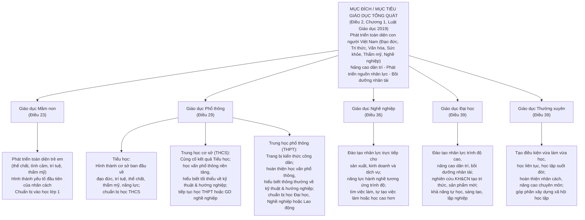

# CHƯƠNG 3: MỤC ĐÍCH, NHIỆM VỤ VÀ CÁC CON ĐƯỜNG GIÁO DỤC

> **Hướng dẫn học tập theo Phương pháp ghi chép Cornell (Cornell Note-taking System):**
> Tài liệu lí thuyết Chương 3 được thiết kế chuẩn hóa theo cấu trúc **Cornell Note-taking System** gồm 3 vùng nhận thức gắn kết chặt chẽ:
> 1. **Cột Từ khóa & Câu hỏi gợi nhớ (Cue Column - Cột trái):** Chứa các thuật ngữ cốt lõi, điều khoản pháp lí trong Luật Giáo dục 2019, phân loại nhiệm vụ và các câu hỏi định hướng tư duy giúp người học chủ động truy xuất thông tin (Active Recall).
> 2. **Cột Ghi chú chi tiết (Note-taking Column - Cột phải):** Hệ thống hóa toàn bộ luận điểm lí luận giáo dục học về mục đích, mục tiêu các cấp/bậc học, 5 nhiệm vụ giáo dục toàn diện và 5 con đường giáo dục cơ bản trong nhà trường (bao gồm hiệu quả đặc thù và các điều kiện thực hiện).
> 3. **Phần Tóm tắt cốt lõi (Cornell Summary - Cuối mỗi mục & cuối chương):** Cô đọng bản chất phương pháp luận và mối quan hệ biện chứng giữa Mục đích – Nhiệm vụ – Con đường giáo dục trong vài câu súc tích.

---

## Sơ đồ 1: Hệ thống Mục đích & Mục tiêu giáo dục Việt Nam theo Luật Giáo dục 2019

---

## 3.1. Mục đích giáo dục

| Từ khóa / Câu hỏi gợi nhớ | Ghi chú chi tiết (Nội dung cốt lõi) |
| :--- | :--- |
| **3.1.1. Khái niệm mục đích giáo dục** *Mục đích giáo dục là gì và phản ánh những kết quả dự kiến nào của quá trình giáo dục?* | • **Khái niệm cơ bản:** Mục đích giáo dục là khái niệm cơ bản của giáo dục học, trước hết phản ánh **kết quả mong muốn trong tương lai** của giáo dục, phản ánh trước **sản phẩm dự kiến** của quá trình giáo dục (QTGD). • **Hai bình diện của sản phẩm dự kiến:** Kết quả, sản phẩm đó không chỉ là **kiểu nhân cách** cần được hình thành ở người học với những cá tính của nó mà còn là **kiểu tập thể** cần được xây dựng với những sắc thái đa dạng của nó. • **Định nghĩa bản chất:** Mục đích của giáo dục là **mô hình giáo dục về nhân cách người học**, là tập hợp những nét đặc trưng cơ bản, là hệ thống những định hướng phát triển, những sức mạnh bản chất của con người ở người học nhằm đáp ứng một cách có hiệu quả những **yêu cầu phát triển kinh tế - xã hội** trong những giai đoạn lịch sử nhất định. |
| **Ba chức năng của mục đích giáo dục** *Tại sao việc xác định mục đích giáo dục lại có tầm quan trọng đặc biệt đối với hoạt động giáo dục?* | Việc xác định mục đích giáo dục có tầm quan trọng đặc biệt vì nó thực hiện **3 chức năng quan trọng** đối với hoạt động giáo dục: 1. **Chức năng định hướng:** Định hướng cho toàn bộ hoạt động giáo dục không bị đi lệch hướng. 2. **Chức năng làm cơ sở để tổ chức quá trình giáo dục:** Là cơ sở để xác định, xây dựng nội dung, chương trình, phương pháp và các hoạt động giáo dục. 3. **Chức năng làm chuẩn để đánh giá chất lượng giáo dục:** Vì hiện nay nhiều người đã công nhận chất lượng giáo dục chính là **mức độ đạt được của sản phẩm giáo dục so với mục đích đã đặt ra**. |
| **3.1.2. Các cấp độ mục tiêu & Mục tiêu giáo dục tổng quát ở Việt Nam** *Luật Giáo dục 2019 quy định mục tiêu giáo dục tổng quát của Việt Nam như thế nào?* | • **Tính phân cấp của mục tiêu giáo dục:** Mục tiêu giáo dục được thể hiện ở các cấp độ khác nhau: mục tiêu tổng quát đối với toàn xã hội, mục tiêu cụ thể đối với các cá nhân, mục tiêu của từng nhiệm vụ giáo dục, từng mặt giáo dục, từng ngành học, lớp học, môn học... thậm chí từng bài học, từng hoạt động giáo dục (HĐGD). • **Cơ sở pháp lí:** Quy định tại **Điều 2, Chương 1, Luật Giáo dục Việt Nam** (được Quốc hội ban hành ngày **14/06/2019**, có hiệu lực thi hành từ ngày **01/07/2020**). • **Nội dung Mục tiêu giáo dục tổng quát (Mục đích giáo dục):**   *"Mục tiêu giáo dục nhằm phát triển toàn diện con người Việt Nam có đạo đức, tri thức, văn hóa, sức khỏe, thẩm mỹ và nghề nghiệp; có phẩm chất, năng lực và ý thức công dân; có lòng yêu nước, tinh thần dân tộc, trung thành với lý tưởng độc lập dân tộc và chủ nghĩa xã hội; phát huy tiềm năng, khả năng sáng tạo của mỗi cá nhân; **nâng cao dân trí, phát triển nguồn nhân lực, bồi dưỡng nhân tài**, đáp ứng yêu cầu của sự nghiệp xây dựng, bảo vệ Tổ quốc và hội nhập quốc tế."* |
| **Mục tiêu Giáo dục mầm non & Giáo dục phổ thông (Tiểu học, THCS, THPT)** *Mục tiêu của giáo dục mầm non và từng cấp học phổ thông được cụ thể hóa ra sao trong Chương 2 Luật Giáo dục 2019?* | • **Mục tiêu Giáo dục mầm non (Điều 23, Chương 2):** Phát triển toàn diện trẻ em về **thể chất, tình cảm, trí tuệ, thẩm mỹ**, hình thành **yếu tố đầu tiên của nhân cách**, chuẩn bị cho trẻ em **vào học lớp một**. • **Mục tiêu chung của Giáo dục phổ thông (Điều 29, Chương 2):** Phát triển toàn diện cho người học về đạo đức, trí tuệ, thể chất, thẩm mỹ, kỹ năng cơ bản, phát triển năng lực cá nhân, tính năng động và sáng tạo; hình thành nhân cách con người Việt Nam xã hội chủ nghĩa và trách nhiệm công dân; chuẩn bị cho người học tiếp tục học chương trình giáo dục đại học, giáo dục nghề nghiệp hoặc tham gia lao động, xây dựng và bảo vệ Tổ quốc.   ◦ **Giáo dục tiểu học:** Hình thành **cơ sở ban đầu** cho sự phát triển về đạo đức, trí tuệ, thể chất, thẩm mỹ, năng lực của học sinh (HS); chuẩn bị cho HS tiếp tục học trung học cơ sở.   ◦ **Giáo dục Trung học cơ sở (THCS):** Củng cố và phát triển kết quả của giáo dục tiểu học; bảo đảm cho HS có **học vấn phổ thông nền tảng**, hiểu biết cần thiết tối thiểu về kỹ thuật và hướng nghiệp để tiếp tục học trung học phổ thông hoặc chương trình giáo dục nghề nghiệp.   ◦ **Giáo dục Trung học phổ thông (THPT):** Trang bị **kiến thức công dân**; bảo đảm cho HS củng cố, phát triển kết quả của giáo dục THCS, **hoàn thiện học vấn phổ thông** và có hiểu biết thông thường về kỹ thuật, hướng nghiệp; có điều kiện phát huy năng lực cá nhân để lựa chọn hướng phát triển, tiếp tục học chương trình giáo dục đại học, giáo dục nghề nghiệp hoặc tham gia lao động, xây dựng và bảo vệ Tổ quốc. |
| **Mục tiêu Giáo dục nghề nghiệp, Đại học & Thường xuyên** *Mục tiêu của giáo dục nghề nghiệp, đại học và thường xuyên khác biệt nhau ở những điểm cốt lõi nào?* | • **Mục tiêu Giáo dục nghề nghiệp (Điều 36, Chương 2):** Đào tạo **nhân lực trực tiếp** cho sản xuất, kinh doanh và dịch vụ, có năng lực hành nghề tương ứng với trình độ đào tạo; có đạo đức, sức khỏe; có trách nhiệm nghề nghiệp; có khả năng sáng tạo, thích ứng với môi trường hội nhập quốc tế; bảo đảm nâng cao năng suất, chất lượng lao động; tạo điều kiện cho người học sau khi hoàn thành khóa học có khả năng **tìm việc làm, tự tạo việc làm hoặc học trình độ cao hơn**. • **Mục tiêu Giáo dục đại học (Điều 39, Chương 2):**   ◦ *Về vĩ mô:* Đào tạo **nhân lực trình độ cao**, nâng cao dân trí, **bồi dưỡng nhân tài**; nghiên cứu khoa học và công nghệ tạo ra tri thức, sản phẩm mới, phục vụ nhu cầu phát triển kinh tế - xã hội, bảo đảm quốc phòng, an ninh, hội nhập quốc tế.   ◦ *Về người học:* Đào tạo người học phát triển toàn diện về đức, trí, thể, mỹ; có tri thức, kỹ năng, trách nhiệm nghề nghiệp; có khả năng nắm bắt tiến bộ khoa học và công nghệ tương xứng với trình độ đào tạo, khả năng **tự học, sáng tạo, thích nghi** với môi trường làm việc; có **tinh thần lập nghiệp**, có ý thức phục vụ Nhân dân. • **Mục tiêu Giáo dục thường xuyên (Chương 2, Luật Giáo dục 2019):** Tạo điều kiện cho mọi người **vừa làm vừa học, học liên tục, học tập suốt đời** nhằm phát huy năng lực cá nhân, hoàn thiện nhân cách, mở rộng hiểu biết, nâng cao trình độ học vấn, chuyên môn, nghiệp vụ để tìm việc làm, tự tạo việc làm và thích nghi với đời sống xã hội; góp phần **xây dựng xã hội học tập**. |

> **Tóm tắt Mục 3.1 (Cornell Summary):**
> Mục đích giáo dục là mô hình dự kiến về nhân cách người học và kiểu tập thể nhằm đáp ứng yêu cầu kinh tế - xã hội, giữ 3 chức năng cốt lõi (**định hướng**, **làm cơ sở tổ chức QTGD**, **làm chuẩn đánh giá chất lượng**). Tại Việt Nam, mục đích giáo dục được hiến định trong **Luật Giáo dục 2019** với mục tiêu tổng quát ở **Điều 2** (phát triển toàn diện con người Việt Nam; nâng cao dân trí, phát triển nguồn nhân lực, bồi dưỡng nhân tài) và được cụ thể hóa xuyên suốt qua hệ thống mục tiêu của Mầm non (Điều 23), Phổ thông 3 cấp (Điều 29), Nghề nghiệp (Điều 36), Đại học (Điều 39) và Giáo dục thường xuyên.

---

## 3.2. Nhiệm vụ giáo dục toàn diện

| Từ khóa / Câu hỏi gợi nhớ | Ghi chú chi tiết (Nội dung cốt lõi) |
| :--- | :--- |
| **3.2.1. Nhiệm vụ giáo dục trí tuệ (Trí dục)** *Trí dục là gì, năng lực trí tuệ gồm những yếu tố nào và các nhiệm vụ cụ thể của giáo dục trí tuệ là gì?* | • **Khái niệm Trí dục:** Là nhiệm vụ quan trọng nhằm phát triển các **năng lực trí tuệ và năng lực tư duy** của HS, hình thành **thế giới quan khoa học**, góp phần phát triển nhân cách trên cơ sở lĩnh hội hệ thống tri thức cơ bản về khoa học xã hội, nhân văn, tự nhiên, kỹ thuật và những kỹ năng, kỹ xảo tương ứng. • **Cấu trúc Năng lực trí tuệ & Thao tác tư duy:** Năng lực trí tuệ là tập hợp những tri thức, kỹ năng, kỹ xảo và những **thao tác hoạt động trí tuệ** nhằm chiếm lĩnh chúng. Trong đó, đặc biệt quan tâm đến các thao tác tư duy: **phân tích, tổng hợp, so sánh, đối chiếu, trừu tượng hóa, khái quát hóa...** giúp phát hiện và nắm bắt bản chất, quy luật của sự vật, hiện tượng. • **Phạm vi và vai trò:** Không chỉ diễn ra trong lớp học, nhà trường mà trong toàn bộ các quan hệ và hoạt động sống đời thường. Trí dục là **cơ sở để phát triển toàn diện con người**, tạo phương tiện để con người tự hoàn thiện không ngừng (kiến thức, thái độ, kỹ năng) trong thời đại cách mạng KH-KT và công nghệ. • **3 nhiệm vụ cụ thể của giáo dục trí tuệ:**   1. Tổ chức, điều khiển người học nắm vững **hệ thống tri thức khoa học, phổ thông, cơ bản, hiện đại**, phù hợp với yêu cầu của thực tiễn về tự nhiên, xã hội, con người.   2. Rèn luyện cho người học **hệ thống kỹ năng, kỹ xảo** tương ứng, phát triển năng lực và phẩm chất trí tuệ, đặc biệt là **năng lực tư duy sáng tạo**.   3. Bồi dưỡng cho người học **thế giới quan khoa học**, những phẩm chất đạo đức tốt đẹp của người công dân. |
| **3.2.2. Nhiệm vụ giáo dục đạo đức (Đức dục)** *Cơ chế chuyển hóa từ tri thức đạo đức thành thói quen đạo đức diễn ra như thế nào? 5 phẩm chất chủ yếu cần giáo dục cho học sinh là gì?* | • **Khái niệm Đức dục:** Là quá trình hình thành cho HS **ý thức đạo đức, hành vi và thói quen đạo đức** – nhiệm vụ vô cùng quan trọng trong QTGD ở trường phổ thông. • **Cơ chế tâm lí - sư phạm:** Ý thức đạo đức là tập hợp của những tri thức đạo đức và hành vi đạo đức. QTGD đạo đức bồi dưỡng các chuẩn mực hành vi đạo đức (giá trị đạo đức), giúp HS **chuyển hóa những chuẩn mực đó thành niềm tin đạo đức**; chính **niềm tin đạo đức** tạo động lực biến tri thức đạo đức thành **hành vi và thói quen đạo đức**. • **3 nhiệm vụ cụ thể của giáo dục đạo đức:**   1. Hình thành ở HS **thế giới quan cách mạng**, thấm nhuần **hệ tư tưởng Mác - Lênin, tư tưởng Hồ Chí Minh**, hiểu các quy luật cơ bản của sự phát triển xã hội, có lý tưởng cộng sản chủ nghĩa, niềm tin sâu sắc vào sự lãnh đạo của Đảng Cộng sản Việt Nam, ý thức phấn đấu thực hiện nghĩa vụ công dân xây dựng và bảo vệ Tổ quốc.   2. Giáo dục HS thấm nhuần các nguyên tắc và chuẩn mực đạo đức do xã hội quy định về lối sống, phong cách và thái độ ứng xử trong cộng đồng. Đặc biệt giáo dục **5 phẩm chất chủ yếu**: **yêu nước, nhân ái, chăm chỉ, trung thực, trách nhiệm**.   3. Giáo dục HS tính tích cực tham gia các hoạt động chính trị - xã hội, đấu tranh chống lại các tư tưởng phản động, các tệ nạn xã hội, lối sống lạc hậu, hủ tục mê tín, dị đoan... không phù hợp với xã hội hiện đại. |
| **3.2.3. Nhiệm vụ giáo dục thẩm mỹ (Mỹ dục)** *Vì sao nói giáo dục thẩm mỹ trong trường phổ thông không chỉ dành riêng cho học sinh có năng khiếu nghệ thuật?* | • **Khái niệm Mỹ dục:** Là quá trình tổ chức cho HS lĩnh hội những **quan điểm thẩm mỹ đúng đắn** đối với hiện thực và nghệ thuật; bồi dưỡng nguyện vọng và năng lực sáng tạo, lối sống theo cái đẹp chân chính; thông qua các phương tiện thẩm mỹ (đặc biệt là nghệ thuật) tác động đến sự phát triển toàn diện nhân cách. • **Quan điểm sư phạm cốt lõi:** Trong trường phổ thông, giáo dục thẩm mỹ là **giáo dục văn hóa thẩm mỹ chung cho tất cả HS**, chứ **không phải là giáo dục đặc biệt chỉ dành cho những HS có năng khiếu** về môn nghệ thuật nào đó; giúp mọi HS tiếp xúc, cảm thụ, thưởng thức cái đẹp hằng ngày và tham gia sáng tạo nghệ thuật ở mức độ thể hiện trình độ văn hóa của con người. • **4 nhiệm vụ cụ thể của giáo dục thẩm mỹ:**   1. Phát triển **tình cảm thẩm mỹ** của HS trong quá trình cảm thụ và lĩnh hội cái đẹp trong nghệ thuật, tự nhiên, quan hệ xã hội; khơi gợi hứng thú với các khía cạnh thẩm mỹ của hiện thực.   2. Cung cấp những **quan điểm chuẩn mực, niềm tin thẩm mỹ**, phát triển năng lực phán đoán và đánh giá thẩm mỹ đúng đắn trên **quan điểm mỹ học Mác – Lênin**.   3. Hình thành **năng lực sáng tạo nghệ thuật**, lòng mong muốn và khả năng **đem cái đẹp vào đời sống, học tập, lao động và ứng xử**.   4. Xây dựng **thái độ không khoan nhượng** đối với cái thô kệch, xấu xí, phi văn hóa, **phản thẩm mỹ** trong tâm hồn, hành vi, cử chỉ, hình dáng cũng như cái phản nghệ thuật. |
| **3.2.4. Nhiệm vụ giáo dục thể chất (Thể dục)** *Giáo dục thể chất hoàn thiện cơ thể trên những mặt nào và phát triển 4 phẩm chất vận động cơ bản nào?* | • **Khái niệm Thể dục:** Là quá trình sư phạm hướng vào việc hoàn thiện cơ thể con người về **mặt hình thái** và **mặt chức năng**, hình thành kỹ năng, kỹ xảo vận động, phát triển phẩm chất và khả năng thể lực, hình thành lối sống lành mạnh, mở rộng giới hạn những năm tháng hoạt động sáng tạo, chuẩn bị thực hiện tốt nghĩa vụ lao động và bảo vệ Tổ quốc. • **4 nhiệm vụ cụ thể của giáo dục thể chất:**   1. Phát triển đúng đắn về thể chất và củng cố sức khỏe: hoàn thiện cơ thể trẻ về **mặt hình thái và mặt chức năng**, làm cơ thể vững vàng trước ảnh hưởng bất lợi của môi trường, phòng ngừa bệnh tật và bảo vệ sức khỏe.   2. Phát triển **4 phẩm chất vận động**: **sức mạnh, sức nhanh, sức bền, sự khéo léo**; đồng thời khắc phục tâm lý tự ti, sợ hãi, mệt mỏi, cảm giác đau đớn, khó chịu.   3. Hình thành **kỹ năng, kỹ xảo vận động**; tạo hứng thú bền bỉ và nhu cầu tập luyện đều đặn thể dục thể thao.   4. Cung cấp hiểu biết phổ thông về **thể thao quốc phòng**, các **kỹ năng quân sự thường thức**, giáo dục lòng trung thành với Tổ quốc XHCN, ý thức cảnh giác, sẵn sàng bảo vệ Tổ quốc, tính tổ chức và kỷ luật. |
| **3.2.5. Nhiệm vụ giáo dục lao động – hướng nghiệp** *Học vấn kỹ thuật tổng hợp là gì? Nêu 5 nhiệm vụ cụ thể của giáo dục lao động – hướng nghiệp và mối quan hệ giữa 5 nhiệm vụ giáo dục toàn diện.* | • **Khái niệm Giáo dục lao động:** Là quá trình đưa HS vào hoạt động lao động và **bằng lao động** mà hình thành thái độ tích cực đối với lao động, trang bị tri thức và kỹ năng lao động cần thiết, bồi dưỡng năng lực và phẩm chất của **người lao động mới** (làm chủ kỹ năng nghề nghiệp, quan tâm hiệu quả thiết thực, nhạy cảm với cái mới, có ý thức vươn lên). • **5 nhiệm vụ cụ thể của giáo dục lao động – hướng nghiệp:**   1. Giáo dục thái độ tích cực với lao động có ích cho xã hội, quý trọng nhân dân lao động, tinh thần trách nhiệm cao, thói quen lao động cần cù, bền bỉ, có tổ chức, kỷ luật, quan tâm nâng cao năng suất lao động.   2. Cung cấp vốn **học vấn kỹ thuật tổng hợp**: nắm vững những **nguyên lí cơ bản của các quá trình sản xuất chủ yếu**, kỹ năng sử dụng công cụ và máy móc thông dụng, tri thức về kinh tế, quản lí kinh tế và kinh doanh, phát triển tư duy kỹ thuật hiện đại, tư duy kinh tế đúng đắn và năng lực sáng tạo (phát kiến, phát minh) trong sản xuất.   3. Tổ chức có hệ thống và liên tục việc **hướng nghiệp**: giúp HS hiểu biết cơ bản về các ngành nghề chủ yếu cần thiết cho đất nước và địa phương, biết **đánh giá đúng khả năng bản thân** để lựa chọn ngành nghề thích hợp và tự giác rèn luyện.   4. Trên cơ sở vốn phổ thông và kỹ thuật tổng hợp, rèn luyện **kỹ năng, kỹ xảo lao động có kỹ thuật nghề nghiệp** để tiến tới làm tốt một nghề cần thiết cho địa phương và đất nước.   5. Tổ chức cho HS **trực tiếp lao động sản xuất** gắn với các cơ sở sản xuất ở địa phương, tạo giá trị vật chất và văn hóa, mở mang ngành nghề và sử dụng hiệu quả lao động, đất đai, nguyên liệu địa phương. • **Mối quan hệ biện chứng giữa 5 nhiệm vụ giáo dục:** Trong thực tiễn, 5 nhiệm vụ (Trí dục, Đức dục, Mỹ dục, Thể dục, Lao động – Hướng nghiệp) được thực hiện **đan xen vào nhau, không thể tách rời**. Mỗi nhiệm vụ **vừa là kết quả, vừa là điều kiện, tiền đề** để thực hiện các nhiệm vụ khác $\rightarrow$ Đòi hỏi **quan điểm tiếp cận tổng hợp và đồng bộ** khi tổ chức QTGD. |

> **Tóm tắt Mục 3.2 (Cornell Summary):**
> Để hiện thực hóa mục đích giáo dục toàn diện, nhà trường phổ thông phải triển khai đồng bộ, đan xen **5 nhiệm vụ giáo dục**: **Trí dục** (tri thức phổ thông hiện đại, thao tác tư duy, thế giới quan khoa học), **Đức dục** (chuyển hóa tri thức đạo đức qua niềm tin thành hành vi/thói quen đạo đức và 5 phẩm chất chủ yếu: *yêu nước, nhân ái, chăm chỉ, trung thực, trách nhiệm*), **Mỹ dục** (văn hóa thẩm mỹ đại trà cho mọi HS, sáng tạo cái đẹp, đấu tranh với cái phản thẩm mỹ), **Thể dục** (hoàn thiện hình thái - chức năng, 4 phẩm chất vận động *mạnh - nhanh - bền - khéo*, thể thao quốc phòng) và **Lao động – Hướng nghiệp** (thái độ lao động mới, học vấn kỹ thuật tổng hợp, hướng nghiệp và lao động sản xuất gắn với địa phương).

---

## Sơ đồ 2: Sự thống nhất biện chứng giữa 5 Nhiệm vụ giáo dục toàn diện và 5 Con đường giáo dục cơ bản

```mermaid
flowchart LR
    subgraph NV["5 NHIỆM VỤ GIÁO DỤC TOÀN DIỆN<br>(Đan xen: Vừa là tiền đề, vừa là kết quả)"]
        NV1["3.2.1. Giáo dục Trí tuệ (Trí dục)<br>Tri thức, Thao tác tư duy, Thế giới quan"]
        NV2["3.2.2. Giáo dục Đạo đức (Đức dục)<br>Niềm tin, Thói quen, 5 Phẩm chất chủ yếu"]
        NV3["3.2.3. Giáo dục Thẩm mỹ (Mỹ dục)<br>Văn hóa thẩm mỹ chung, Sáng tạo cái đẹp"]
        NV4["3.2.4. Giáo dục Thể chất (Thể dục)<br>Hình thái - Chức năng, 4 Phẩm chất vận động"]
        NV5["3.2.5. Lao động - Hướng nghiệp<br>Học vấn kỹ thuật tổng hợp, Định hướng nghề"]
    end

    TH["TIẾP CẬN TỔNG HỢP & ĐỒNG BỘ<br>Chuyển hóa các hoạt động xã hội<br>vào nhà trường sư phạm"]

    subgraph CD["5 CON ĐƯỜNG GIÁO DỤC CƠ BẢN TRONG NHÀ TRƯỜNG<br>(Phối hợp chặt chẽ - Không con đường nào là vạn năng)"]
        CD1["1. Hoạt động Dạy học (Cơ bản nhất)<br>Phát triển phẩm chất trí tuệ & học đi đôi với hành<br>(7 điều kiện thực hiện)"]
        CD2["2. Hoạt động Lao động<br>Chuẩn bị thiết thực tham gia lao động xã hội<br>(6 điều kiện thực hiện)"]
        CD3["3. Hoạt động Xã hội<br>Thâm nhập cộng đồng, mở rộng quan hệ xã hội<br>(6 điều kiện thực hiện)"]
        CD4["4. Hoạt động Tập thể<br>Tự quản, chuyển hóa yêu cầu thành tự giáo dục<br>(5 điều kiện thực hiện)"]
        CD5["5. Hoạt động Vui chơi<br>Thực hiện 4 chức năng: Đạo đức, Nhận thức, Thẩm mỹ, Giải trí<br>(4 điều kiện thực hiện)"]
    end

    NV --> TH
    TH --> CD
    CD --> KQ["PHÁT TRIỂN TOÀN DIỆN & HÀI HÒA<br>NHÂN CÁCH HỌC SINH"]
```

---

## 3.3. Các con đường giáo dục

| Từ khóa / Câu hỏi gợi nhớ | Ghi chú chi tiết (Nội dung cốt lõi) |
| :--- | :--- |
| **3.3.1. Khái niệm & 7 đặc điểm của các con đường giáo dục** *Con đường giáo dục là gì và có những đặc điểm bản chất nào?* | • **Khái niệm:** Những con đường giáo dục thực chất là **những loại hình hoạt động cơ bản của xã hội được chuyển hóa vào nhà trường** và được tổ chức một cách khoa học hơn cho phù hợp với các quy luật sư phạm và đặc điểm tâm - sinh lí lứa tuổi, với sự tham gia tích cực, tự giác của người được giáo dục dưới tác động chủ đạo của nhà giáo dục theo định hướng của mục đích giáo dục. • **5 con đường giáo dục cơ bản trong nhà trường:** (1) Hoạt động dạy học; (2) Hoạt động lao động; (3) Hoạt động chính trị - xã hội; (4) Hoạt động tập thể; (5) Hoạt động vui chơi. • **7 đặc điểm cơ bản của các con đường giáo dục:**   1. Có **mục đích hết sức đa dạng**: vừa mang mục đích riêng đặc trưng cho từng loại hình hoạt động, vừa có chung mục đích giúp người học chiếm lĩnh giá trị xã hội để phát triển nhân cách.   2. Mỗi con đường có **thế mạnh riêng**, góp phần phát triển nhân cách mạnh mẽ ở những khía cạnh khác nhau.   3. Đều thể hiện **sự thống nhất** giữa mục đích, nội dung, phương pháp và phương tiện giáo dục nhất định.   4. Người được giáo dục tham gia một cách **tự giác, tích cực, độc lập với tư cách là chủ thể** dưới sự **chủ đạo của nhà giáo dục**.   5. Cần được thực hiện một cách **phối hợp** vì **không có con đường nào là vạn năng**.   6. Phải được thực hiện **sáng tạo**, phù hợp với đặc điểm tâm - sinh lý, đặc điểm lứa tuổi của người được giáo dục.   7. **Không phải "nhất thành bất biến"** mà luôn vận động, phát triển theo kinh tế - xã hội, KH-CN, QTGD và yêu cầu nhân cách $\rightarrow$ Nhà giáo dục phải thường xuyên đổi mới nội dung, hình thức, phương pháp, tránh rập khuôn. |
| **3.3.2.1. Con đường 1: Hoạt động dạy học** *Hiệu quả đặc trưng của con đường dạy học là gì (các phẩm chất trí tuệ nào được hình thành) và cần 7 điều kiện nào để phát huy hiệu quả?* | • **Vị trí & Hiệu quả chung:** Là con đường giáo dục mang lại hiệu quả **rất cơ bản**: (1) Giúp HS chiếm lĩnh hệ thống tri thức (tự nhiên, xã hội, tư duy, kỹ thuật), kỹ năng, kỹ xảo, kinh nghiệm hoạt động sáng tạo và kinh nghiệm ứng xử; (2) Hình thành phẩm chất và năng lực trí tuệ; (3) Rèn luyện hệ thống phẩm chất nhân cách. • **4 điểm đáng chú ý & Hiệu quả đặc trưng:**   ◦ *Hiệu quả có tính đặc trưng:* Giúp HS chiếm lĩnh tri thức sơ đẳng ngày càng có hệ thống, đồng thời chiếm lĩnh cách thức và **những phẩm chất hoạt động trí tuệ**: **tính định hướng, bề rộng, bề sâu, tính độc lập, tính linh hoạt, tính mềm dẻo, tính phê phán, tính nhất quán, tính khái quát**.   ◦ Tiếp nhận tri thức **toàn diện, cân đối** (không rời rạc, phiến diện), làm cơ sở hình thành nhu cầu, trách nhiệm cải tạo thế giới.   ◦ Chuyển hóa tri thức thành kỹ năng, kỹ xảo, **kết hợp học với hành**, vận dụng vào thực tiễn.   ◦ Chiếm lĩnh các chuẩn mực ứng xử cộng đồng, mang lại cả **hiệu quả giáo dục (theo nghĩa hẹp)**. • **7 điều kiện thực hiện con đường dạy học:**   1. Coi trọng vai trò của HS, hướng về HS (**HS vừa là chủ thể vừa là mục đích cuối cùng**).   2. Kích thích và tạo điều kiện cho HS **học tập một cách sáng tạo** (tạo ra cái mới đối với bản thân khi còn là HS).   3. Áp dụng những **phương pháp sáng tạo**, chú trọng phân hóa, cá nhân hóa, thu hút tất cả HS vào hoạt động, kết hợp lý thuyết với thực hành trong các loại tình huống.   4. Tạo ra **"môi trường tri thức" thích hợp** để HS thích ứng, định hướng, tiếp nhận và sử dụng tri thức như là một sức mạnh.   5. Vận dụng phối hợp các **hình thức hoạt động dạy học** khác nhau, ưu tiên số một là đảm bảo chất lượng, tránh chạy theo thành tích.   6. Đảm bảo cho HS nắm được **nền tảng ngày càng rộng về tri thức và kỹ năng**, tạo tiền đề học lên cao hơn hoặc tự học trong cuộc sống.   7. Đảm bảo **vai trò chủ đạo có tầm quan trọng đặc biệt của GV**, không làm lu mờ hoặc đề cao quá mức vai trò của họ. |
| **3.3.2.2. Con đường 2: Hoạt động lao động** *Hiệu quả có tính đặc thù nhất của hoạt động lao động là gì và cần đảm bảo 6 điều kiện nào?* | • **Ý nghĩa & Hiệu quả giáo dục:**   ◦ Giúp HS vận dụng, mở rộng, đào sâu tri thức, kỹ năng, kỹ xảo đã học cho phong phú, vững chắc.   ◦ Rèn luyện kỹ năng lao động, sáng tạo sản phẩm vật chất hoặc tinh thần vừa sức.   ◦ Hình thành phẩm chất tốt đẹp của người lao động (yêu lao động, yêu người lao động, yêu sản phẩm lao động, làm việc có kế hoạch, kỹ thuật, an toàn, tiết kiệm).   ◦ Cảm nhận và sáng tạo cái đẹp trong lao động; rèn luyện và phát triển thể chất.   ◦ **Hiệu quả có tính đặc thù nhất:** **Chuẩn bị thiết thực cho các em tham gia cuộc sống lao động xã hội**. • **6 điều kiện thực hiện con đường hoạt động lao động:**   1. Tổ chức cho HS tự giác, tích cực tham gia **nhiều hình thức lao động đa dạng**: **lao động tự phục vụ, lao động sản xuất, lao động công ích, lao động giúp đỡ gia đình...** tùy thuộc mục tiêu giáo dục.   2. Đảm bảo sự **thống nhất giữa lợi ích cá nhân và lợi ích xã hội** trong hoạt động lao động.   3. Đảm bảo cụ thể hiệu quả lao động, **kết hợp hài hòa hiệu quả kinh tế, hiệu quả xã hội và hiệu quả giáo dục**.   4. Kích thích **sự sáng tạo** của các em trong hoạt động lao động.   5. Kết hợp hợp lý **hoạt động lao động đơn giản với hoạt động kỹ thuật, lao động chân tay với lao động trí óc**.   6. Thống nhất được **trách nhiệm tập thể và trách nhiệm cá nhân** trong hoạt động lao động. |
| **3.3.2.3. Con đường 3: Hoạt động xã hội** *Hoạt động xã hội mang lại những giá trị gì cho sự phát triển nhân cách học sinh và cần 6 điều kiện nào?* | • **Khái niệm:** Là hoạt động mà HS tham gia tích cực, tự giác để góp phần phát triển xã hội về nhiều mặt (bảo vệ môi trường, giữ gìn vệ sinh, xóa đói giảm nghèo, phòng chống AIDS và các tệ nạn xã hội...). • **5 hiệu quả giáo dục của hoạt động xã hội:**   1. Tạo điều kiện cho HS **thâm nhập và gắn bó với cuộc sống xã hội**, ý thức đầy đủ, sâu sắc mình là một thành viên của xã hội.   2. Vận dụng điều đã học vào cuộc sống, nhận thức các giá trị đa dạng để vốn hiểu biết mở rộng, đào sâu và **phản ánh được cuộc sống thực**.   3. Cơ hội trực tiếp đóng góp sức lực, trí tuệ vào sự phát triển xã hội $\rightarrow$ hình thành **xúc cảm, tình cảm tích cực của người công dân** (hài lòng, tự hào, yêu quê hương đất nước).   4. **Mở rộng các quan hệ xã hội** (với người khác, tổ chức, cơ quan, cơ sở sản xuất, đoàn thể) để giao lưu, học tập.   5. Phát huy **ý thức và năng lực tự giác**, làm quen với hoạt động gắn liền cộng đồng. • **6 điều kiện thực hiện con đường hoạt động xã hội:**   1. Nội dung hoạt động cần **phong phú, đa dạng** liên quan nhiều lĩnh vực: KH-CN, văn hóa, giáo dục, chính trị - xã hội, y tế, môi trường...   2. Thực hiện bằng **nhiều hình thức đa dạng, hấp dẫn**, phù hợp đặc điểm tâm - sinh lí của HS.   3. **Gắn với cộng đồng địa phương**, tạo sự gắn bó giữa các em với cộng đồng.   4. Tổ chức sao cho các em phát huy được **tinh thần tự quản**, không bị phụ thuộc vào GV.   5. Thu hút sự **hỗ trợ, phối hợp giữa các tổ chức, đoàn thể xã hội** (Đoàn TNCS Hồ Chí Minh, Đội TNTP Hồ Chí Minh, các cơ sở sản xuất...).   6. Mang lại **hiệu quả rõ rệt, cụ thể, thiết thực**, tránh phô trương hình thức, lãng phí tiền của, thời gian, sức lực. |
| **3.3.2.4. Con đường 4: Hoạt động tập thể** *Vì sao qua hoạt động tập thể, học sinh chuyển từ đối tượng giáo dục thành chủ thể tự giáo dục? Nêu 5 điều kiện thực hiện.* | • **Khái niệm:** Hoạt động tập thể là hoạt động chung của tập thể, **do tập thể tự quản** (tự thiết kế, tự thực hiện, điều chỉnh, đánh giá và tự hoàn thiện) nhằm đạt mục đích chung, đáp ứng lợi ích mỗi thành viên trong sự thống nhất với lợi ích xã hội. • **Hiệu quả đặc thù của hoạt động tập thể:**   ◦ Giúp HS **chuyển hóa một cách tự giác những yêu cầu của nhà trường, xã hội thành yêu cầu của bản thân** và tự đề ra yêu cầu riêng để cùng tự giác thực hiện không gò ép $\rightarrow$ Các thành viên không những là đối tượng giáo dục mà còn trở thành **chủ thể tự giáo dục**; riêng trong quan hệ tập thể - thành viên, **tập thể còn được coi là chủ thể của giáo dục**.   ◦ Giúp HS bộc lộ và rèn luyện **kỹ năng tự quản** trên cơ sở **luân phiên phụ trách** các công việc chung. • **5 điều kiện thực hiện con đường hoạt động tập thể:**   1. Tập thể cần được xây dựng để trở thành một **tập thể vững mạnh** với những đặc trưng cơ bản của nó.   2. Nội dung **phong phú** và hình thức tổ chức **hấp dẫn** liên quan đến học tập, lao động, TDTT, vui chơi giải trí, hoạt động xã hội nhằm thu hút mọi thành viên.   3. Tổ chức có **mục đích thiết thực, kế hoạch hợp lí, phân công cụ thể**, có điều kiện vật chất tối cần thiết.   4. Phải là một **hoạt động tự quản**, toàn thể thành viên cùng hoạt động vì mục đích chung với tinh thần tự giác, tích cực; **tránh tình trạng GV làm thay các em**.   5. Xây dựng **dư luận tập thể lành mạnh** nhằm tán thành, biểu dương cái tốt và phê phán những ý nghĩ, lời nói, hành vi xấu (thông qua các cuộc nói chuyện cởi mở, thảo luận tự do, lời phân tích đánh giá sâu sắc của GV). |
| **3.3.2.5. Con đường 5: Hoạt động vui chơi** *Hoạt động vui chơi thực hiện 4 chức năng giáo dục nào và cần 4 điều kiện gì để phát huy tác dụng?* | • **Vị trí:** Vui chơi là hoạt động chủ đạo ở lứa tuổi mẫu giáo, nhưng đối với HS các lứa tuổi trên vẫn giữ vị trí và ý nghĩa đáng kể trong sự phát triển nhân cách. • **4 chức năng quan trọng của hoạt động vui chơi:**   1. **Chức năng giáo dục (đạo đức):** Phát triển các phẩm chất đạo đức như **tình thân ái, đoàn kết, lòng trung thực, tính tập thể, tinh thần trách nhiệm...**, đồng thời khắc phục những nét tính cách không phù hợp như **ích kỷ, tính chơi trội, tính giả dối...**.   2. **Chức năng nhận thức:** Nâng cao hiểu biết về tự nhiên, xã hội (qua tham quan, du lịch, xem phim ảnh...), phát triển trí thông minh, sáng tạo (qua đánh cờ, giải toán vui...), phát triển năng khiếu (qua trò chơi, hoạt động nghệ thuật).   3. **Chức năng thẩm mỹ (hay chức năng văn hóa):** Phát triển óc thẩm mỹ, biết cảm thụ cái đẹp trong thiên nhiên (du lịch, cắm trại), cái đẹp trong văn học nghệ thuật (đọc truyện, kịch, múa), cái đẹp trong quan hệ xã hội (vui chơi tập thể) và sáng tạo cái đẹp.   4. **Chức năng giải trí:** Phát triển phẩm chất vận động (nhanh, bền, khéo) qua trò chơi vận động, dã ngoại, TDTT; giúp các em thoải mái, dễ chịu, **phục hồi sức lực** sau giờ học tập, lao động, cảm thấy yêu đời, yêu cuộc sống. • **4 điều kiện thực hiện con đường hoạt động vui chơi:**   1. Đa dạng, phong phú về hình thức, hấp dẫn về nội dung (khoa học, văn hóa văn nghệ, TDTT, nghệ thuật, trò chơi).   2. Thực hiện **đồng bộ ở nhà trường, gia đình và xã hội** với sự hỗ trợ của các lực lượng giáo dục (GV, cha mẹ, Đoàn TNCS, Đội TNTP, nhà văn hóa, câu lạc bộ thanh thiếu niên...).   3. Đảm bảo **tính bình đẳng trong vui chơi** đối với mọi em (không phân biệt nam nữ, giàu nghèo, địa vị xã hội của cha mẹ).   4. Đảm bảo những **điều kiện cơ sở vật chất cần thiết** phục vụ hoạt động vui chơi; thực hiện triệt để, đồng bộ, linh hoạt, sáng tạo phù hợp hoàn cảnh nhà trường và lứa tuổi. |

> **Tóm tắt Mục 3.3 (Cornell Summary):**
> Các con đường giáo dục là những loại hình hoạt động xã hội cơ bản được sư phạm hóa vào nhà trường với **7 đặc điểm chung** (đa dạng mục đích, có thế mạnh riêng, thống nhất cấu trúc, phát huy chủ thể HS dưới sự chủ đạo của GV, phối hợp vì không con đường nào vạn năng, phù hợp lứa tuổi, luôn vận động đổi mới). Năm con đường cơ bản gồm: **Hoạt động dạy học** (cơ bản nhất, phát triển các phẩm chất trí tuệ và năng lực hành động - 7 điều kiện), **Hoạt động lao động** (chuẩn bị thiết thực cho cuộc sống lao động xã hội - 6 điều kiện), **Hoạt động xã hội** (thâm nhập cộng đồng, mở rộng quan hệ xã hội - 6 điều kiện), **Hoạt động tập thể** (tự quản, luân phiên phụ trách, dư luận tập thể lành mạnh biến yêu cầu bên ngoài thành tự giáo dục - 5 điều kiện) và **Hoạt động vui chơi** (thực hiện 4 chức năng: đạo đức, nhận thức, thẩm mỹ/văn hóa, giải trí phục hồi sức lực - 4 điều kiện).

---

## Tóm tắt toàn chương (Cornell Summary)

1. **Mục đích giáo dục & Ba chức năng nền tảng:** Mục đích giáo dục là mô hình dự kiến về nhân cách người học và kiểu tập thể đáp ứng yêu cầu phát triển kinh tế - xã hội trong từng giai đoạn lịch sử. Nó giữ **3 chức năng sống còn**: (1) Định hướng toàn bộ hoạt động giáo dục; (2) Làm cơ sở tổ chức quá trình giáo dục (xây dựng nội dung, chương trình, phương pháp); (3) Làm chuẩn đánh giá chất lượng giáo dục.
2. **Hệ thống Mục tiêu giáo dục Việt Nam theo Luật Giáo dục 2019 (hiệu lực từ 01/07/2020):** Mục tiêu tổng quát tại **Điều 2** hướng tới phát triển toàn diện con người Việt Nam (đạo đức, tri thức, văn hóa, sức khỏe, thẩm mỹ, nghề nghiệp; phẩm chất, năng lực, ý thức công dân; lòng yêu nước và lý tưởng XHCN) nhằm **nâng cao dân trí, phát triển nguồn nhân lực, bồi dưỡng nhân tài**. Mục tiêu này được phân cấp chặt chẽ cho **Giáo dục mầm non (Điều 23)**, **Giáo dục phổ thông (Điều 29: Tiểu học, THCS, THPT)**, **Giáo dục nghề nghiệp (Điều 36)**, **Giáo dục đại học (Điều 39)** và **Giáo dục thường xuyên**.
3. **Năm nhiệm vụ giáo dục toàn diện (Thống nhất biện chứng):**
   - **Trí dục:** Trang bị hệ thống tri thức khoa học phổ thông, cơ bản, hiện đại và kỹ năng, kỹ xảo; rèn luyện các thao tác tư duy (*phân tích, tổng hợp, so sánh, đối chiếu, trừu tượng hóa, khái quát hóa*); hình thành thế giới quan khoa học.
   - **Đức dục:** Chuyển hóa tri thức đạo đức thông qua **niềm tin đạo đức** thành hành vi và thói quen đạo đức; bồi dưỡng thế giới quan Mác - Lênin, tư tưởng Hồ Chí Minh và **5 phẩm chất chủ yếu** (*yêu nước, nhân ái, chăm chỉ, trung thực, trách nhiệm*).
   - **Mỹ dục:** Giáo dục **văn hóa thẩm mỹ chung cho tất cả học sinh** (không chỉ cho HS năng khiếu); bồi dưỡng tình cảm thẩm mỹ, quan điểm thẩm mỹ Mác - Lênin, năng lực sáng tạo cái đẹp và thái độ không khoan nhượng với cái xấu, phản thẩm mỹ.
   - **Thể dục:** Hoàn thiện cơ thể về hình thái và chức năng; phát triển **4 phẩm chất vận động** (*sức mạnh, sức nhanh, sức bền, sự khéo léo*); rèn luyện thói quen tập luyện, hiểu biết thể thao quốc phòng và kỹ năng quân sự thường thức.
   - **Giáo dục lao động – hướng nghiệp:** Hình thành phẩm chất người lao động mới; cung cấp **học vấn kỹ thuật tổng hợp**; tổ chức hướng nghiệp có hệ thống; rèn kỹ năng nghề nghiệp và lao động sản xuất gắn với cơ sở địa phương.
4. **Năm con đường giáo dục cơ bản trong nhà trường:** Là sự chuyển hóa sư phạm các hoạt động xã hội vào nhà trường, đòi hỏi sự phối hợp đồng bộ giữa: **Hoạt động dạy học** (con đường cơ bản nhất, hình thành hệ thống phẩm chất trí tuệ), **Hoạt động lao động** (chuẩn bị bước vào đời sống lao động xã hội), **Hoạt động xã hội** (gắn bó cộng đồng, mở rộng quan hệ xã hội), **Hoạt động tập thể** (cơ chế tự quản, luân phiên phụ trách và dư luận tập thể lành mạnh thúc đẩy tự giáo dục) và **Hoạt động vui chơi** (tích hợp 4 chức năng: đạo đức, nhận thức, thẩm mỹ, giải trí).

---

## Câu hỏi tự kiểm tra nhanh (Self-Testing Cues)

1. Phân tích khái niệm mục đích giáo dục và 3 chức năng cơ bản của nó đối với việc tổ chức và đánh giá chất lượng quá trình giáo dục.
2. So sánh sự phát triển liên thông về mục tiêu giáo dục giữa 3 cấp học phổ thông (Tiểu học, THCS, THPT) theo Điều 29 Luật Giáo dục 2019 và chỉ ra điểm khác biệt cốt lõi giữa mục tiêu Giáo dục nghề nghiệp (Điều 36) với Giáo dục đại học (Điều 39).
3. Tại sao trong nhiệm vụ giáo dục đạo đức (Đức dục), việc hình thành "niềm tin đạo đức" lại đóng vai trò cầu nối quyết định để chuyển hóa "tri thức đạo đức" thành "hành vi và thói quen đạo đức"?
4. Giải thích luận điểm: *"Giáo dục thẩm mỹ trong nhà trường phổ thông không phải là giáo dục đặc biệt cho những học sinh có năng khiếu nghệ thuật, mà là giáo dục văn hóa thẩm mỹ chung cho tất cả học sinh"*.
5. Nội hàm của khái niệm "học vấn kỹ thuật tổng hợp" trong nhiệm vụ giáo dục lao động – hướng nghiệp bao gồm những yếu tố nào?
6. Phân tích hiệu quả đặc trưng và 7 điều kiện thực hiện của con đường "Hoạt động dạy học" trong nhà trường.
7. Vì sao nói thông qua "Hoạt động tập thể" tự quản và việc xây dựng "dư luận tập thể lành mạnh", người học vừa là đối tượng giáo dục vừa trở thành chủ thể tự giáo dục?
