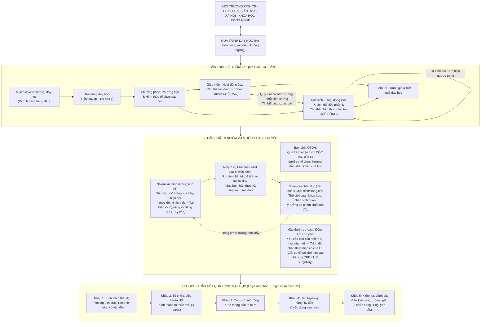
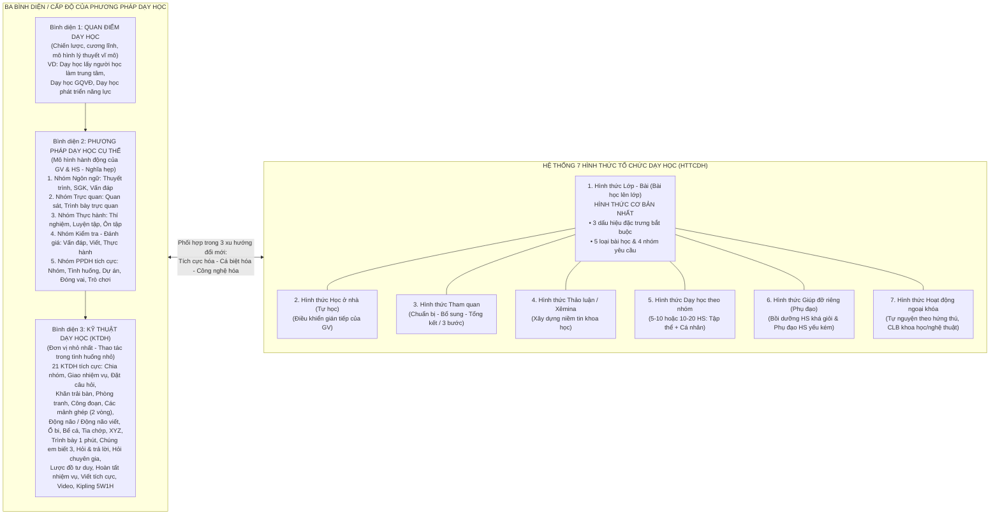

# CHƯƠNG 4: LÝ LUẬN DẠY HỌC

> **Hướng dẫn học tập theo Phương pháp ghi chép Cornell (Cornell Note-taking System):**
> Tài liệu lý thuyết Chương 4 được thiết kế chuẩn hóa theo cấu trúc **Cornell Note-taking System** gồm 3 vùng nhận thức gắn kết chặt chẽ:
> 1. **Cột Từ khóa & Câu hỏi gợi nhớ (Cue Column - Cột trái):** Chứa các khái niệm cốt lõi, tên học giả, văn bản pháp lý, công thức quy luật và hệ thống câu hỏi định hướng tư duy giúp người học chủ động truy xuất thông tin (Active Recall).
> 2. **Cột Ghi chú chi tiết (Note-taking Column - Cột phải):** Hệ thống hóa toàn bộ tri thức lý luận dạy học đại cương theo giáo trình Trường Đại học Sư phạm – Đại học Huế: cấu trúc hệ thống, bản chất, 3 nhiệm vụ, quy luật, động lực và logic 5 khâu của quá trình dạy học; 7 nguyên tắc dạy học; cấu trúc nội dung dạy học và CTGDPT 2018; 3 bình diện phương pháp dạy học cùng 21 kỹ thuật dạy học tích cực và 7 hình thức tổ chức dạy học.
> 3. **Phần Tóm tắt cốt lõi (Cornell Summary - Cuối mỗi mục & cuối chương):** Cô đọng bản chất lý luận và bài học vận dụng sư phạm của từng phần trong vài câu súc tích.

---

## Sơ đồ 1: Cấu trúc hệ thống, Bản chất, Nhiệm vụ, Động lực và Logic 5 khâu của Quá trình dạy học

---

## 4.1. Quá trình dạy học (QTDH)

| Từ khóa / Câu hỏi gợi nhớ | Ghi chú chi tiết (Nội dung cốt lõi) |
| :--- | :--- |
| **Lý luận dạy học đại cương vs. Lý luận dạy học bộ môn** *Lý luận dạy học là gì và phân nhánh thành hai bộ phận nào?* | • **Khái niệm Lý luận dạy học:** Là một bộ phận độc lập trong hệ thống khoa học giáo dục, nghiên cứu hệ thống tri thức phản ánh **tính quy luật của hoạt động dạy và học** (QTDH, mục đích, nội dung, nguyên tắc, phương pháp, phương tiện và hình thức tổ chức dạy học) nhằm tìm ra cơ sở khoa học và biện pháp khả thi nâng cao chất lượng dạy học, phát triển nhân cách toàn diện cho học sinh (HS). • **Hai phân nhánh cơ bản:**   1. **Lý luận dạy học đại cương (*general didactics*):** Nghiên cứu những vấn đề và quy luật chung nhất của QTDH trên tất cả các môn học, bậc học và điều kiện thực hiện chúng (đối tượng của giáo trình này).   2. **Lý luận dạy học bộ môn (*special didactics*):** Nghiên cứu QTDH cho một ngành học hoặc một môn học cụ thể. |
| **4.1.1 & 4.1.2. Khái niệm Hoạt động Dạy, Hoạt động Học & Quá trình dạy học** *Vai trò của GV và HS trong QTDH được xác định như thế nào? Vì sao HS mang tư cách kép?* | • **Hoạt động Dạy (do Giáo viên - GV thực hiện):** Thực hiện theo nội dung, chương trình giáo dục thông qua vai trò **tổ chức (*organization*), hướng dẫn và định hướng (*orientation*)** hoạt động học dựa trên việc nắm bắt các điều kiện bên trong (hiểu biết, năng lực, hứng thú...) của HS. • **Hoạt động Học (diễn ra ở Học sinh - HS):** Là hoạt động nhận thức tuân theo quy luật phản ánh hiện thực khách quan vào ý thức người học, chiếm lĩnh các khái niệm khoa học và chân lý nhân loại để biến thành học vấn của bản thân, qua đó **tự thay đổi chính bản thân mình**. • **Định nghĩa Quá trình dạy học (QTDH):** Là quá trình hoạt động **thống nhất biện chứng giữa hoạt động Dạy của Thầy và hoạt động Học của Trò**, trong đó dưới **vai trò chủ đạo** (tổ chức, hướng dẫn, điều khiển, điều chỉnh) của người dạy, người học **chủ động** (tự giác, tích cực, tự lực, sáng tạo; tự tổ chức, tự điều khiển) hoạt động học của bản thân nhằm thực hiện mục tiêu, nhiệm vụ dạy học, từ đó hình thành và phát triển nhân cách toàn diện. • **Tư cách kép của Học sinh trong QTDH:**   1. **Là khách thể (đối tượng):** Tiếp nhận một cách tích cực, chủ động sự tác động sư phạm có định hướng của GV.   2. **Là chủ thể nhận thức:** Tự giác, tích cực, độc lập tự tổ chức, tự điều khiển hoạt động học tập của bản thân. Hoạt động học của HS đóng vai trò **quyết định trực tiếp** đối với chất lượng và hiệu quả của QTDH. |
| **Cấu trúc hệ thống của QTDH & Mối liên hệ ngược** *Hệ thống QTDH gồm những thành tố nào và tương tác với môi trường ra sao?* | • **Các thành tố cấu trúc của hệ thống QTDH:**   ◦ **a) Mục đích dạy học:** Phản ánh tập trung nhất yêu cầu của xã hội về mô hình nhân cách người học; giữ vị trí **hàng đầu**, định hướng cho toàn bộ các thành tố khác và quyết định chất lượng QTDH.   ◦ **b) Nhiệm vụ dạy học:** Cụ thể hóa mục đích dạy học vào từng cấp học, môn học, bài học qua 3 nhiệm vụ cơ bản (*Giáo dưỡng, Phát triển, Giáo dục*).   ◦ **c) Nội dung dạy học (NDDH):** Hệ thống tri thức, kỹ năng, kỹ xảo được chọn lọc từ văn hóa nhân loại (*Thầy dạy cái gì và Trò học cái gì?*), quy định sự lựa chọn phương pháp, phương tiện, HTTCDH.   ◦ **d) Phương pháp dạy học (PPDH):** Mặt thao tác của QTDH – cách thức hoạt động phối hợp thống nhất của GV và HS.   ◦ **e) Phương tiện dạy học:** Công cụ, đồ dùng, thiết bị hỗ trợ GV chuyển tải và HS tiếp nhận NDDH.   ◦ **g) Hình thức tổ chức dạy học (HTTCDH):** Trạng thái tồn tại bên ngoài của QTDH theo chế độ, trật tự xác định (số lượng HS, thời gian, không gian, tính chất hoạt động).   ◦ **h) Giáo viên (hoạt động Dạy) và Học sinh (hoạt động Học):** Là **hai thành tố trung tâm cơ bản**; không có hai thành tố này thì QTDH không thể tồn tại.   ◦ **i) Kiểm tra – đánh giá (KT-ĐG):** Thu **tín hiệu ngược ngoài** (từ HS về GV) và **tín hiệu ngược trong** (HS tự kiểm tra, đánh giá) để điều chỉnh kịp thời toàn bộ hệ thống.   ◦ **k) Kết quả dạy học:** Phản ánh tập trung kết quả vận động của toàn hệ thống. • **Quan hệ hai chiều với Môi trường kinh tế - xã hội - KHCN:** (1) Môi trường quy định mục đích, nội dung và tạo điều kiện cho QTDH; (2) Sản phẩm giáo dục (nguồn nhân lực có tri thức, kỹ năng, đạo đức) tác động thúc đẩy sự phát triển của môi trường kinh tế - xã hội. |
| **4.1.3. Bản chất của QTDH & Bảng 4.1 (Đối sánh 6 tiêu chí)** *Hoạt động nhận thức của HS giống và khác hoạt động nhận thức của nhà khoa học ở những điểm nào?* | • **Hai mối quan hệ làm cơ sở xác định bản chất QTDH:** (a) Quan hệ giữa hoạt động nhận thức (HĐNT) của loài người (nhà khoa học) với HĐNT của HS; (b) Quan hệ giữa hoạt động Dạy và hoạt động Học. • **Điểm giống nhau giữa HĐNT của nhà khoa học và của HS:** Cùng có **đối tượng** là hiện thực khách quan; cùng tuân theo **phương thức/quy luật nhận thức của V.I. Lênin** (*"Từ trực quan sinh động đến tư duy trừu tượng, từ tư duy trừu tượng đến thực tiễn"* theo con đường quy nạp hoặc diễn dịch); cùng hướng tới **mục đích** tăng cường hiểu biết thế giới. • **Điểm khác biệt độc đáo (Bảng 4.1 – Đối sánh 6 tiêu chí):**   1. **Điều kiện của HĐNT:** *Nhà khoa học* diễn ra trong điều kiện thực của đời sống xã hội, độc lập, tự khám phá, mò mẫm; *Học sinh* diễn ra trong **điều kiện sư phạm thuận lợi**, có GV hướng dẫn, giúp đỡ, mọi yếu tố đã được đơn giản hóa, sư phạm hóa.   2. **Tính chất của HĐNT:** *Nhà khoa học* có thể có hoặc không có tính giáo dục; *Học sinh* **luôn luôn mang tính giáo dục**.   3. **Thời gian HĐNT:** *Nhà khoa học* diễn ra lâu dài; *Học sinh* diễn ra trong thời gian **tương đối ngắn**.   4. **Đối tượng HĐNT:** *Nhà khoa học* tìm ra **cái mới khách quan đối với toàn nhân loại**; *Học sinh* lĩnh hội **cái mới chủ quan đối với bản thân HS**.   5. **Logic HĐNT:** *Nhà khoa học* gồm **3 khâu** (*Trực quan $\rightarrow$ Tư duy $\rightarrow$ Thực tiễn*); *Học sinh* gồm **6 khâu** (ngoài 3 khâu trên còn **thêm 3 khâu sư phạm**: *Kích thích hứng thú học tập; Ôn tập, củng cố đảm bảo tính vững chắc của tri thức; Kiểm tra, đánh giá*).   6. **Kết quả HĐNT:** *Nhà khoa học* làm phong phú thêm kho tàng văn hóa nhân loại; *Học sinh* làm phong phú thêm vốn hiểu biết, kỹ năng, kỹ xảo và phát triển nhân cách của bản thân. • **Kết luận về Bản chất của QTDH:** *Bản chất của QTDH là **quá trình nhận thức độc đáo của học sinh** được thực hiện dưới sự tổ chức, hướng dẫn, điều khiển (vai trò chủ đạo) của giáo viên nhằm phát triển nhân cách cho học sinh, đáp ứng yêu cầu của xã hội.* |
| **4.1.4. Ba nhiệm vụ của QTDH & Mối quan hệ biện chứng** *Trình bày nội dung Giáo dưỡng, Phát triển, Giáo dục và mối quan hệ giữa chúng.* | • **Căn cứ xác định nhiệm vụ:** Mục đích đào tạo; thành tựu KHCN và kinh tế - xã hội; điều kiện thực tiễn đất nước; đặc điểm tâm sinh lý HS. • **Nhiệm vụ 1 – Giáo dưỡng (Trang bị tri thức, kỹ năng, kỹ xảo):**   ◦ Trang bị hệ thống tri thức khoa học (**đối tượng, phương pháp, sự kiện**), đảm bảo tính **phổ thông, cơ bản, hiện đại, có hệ thống và phù hợp thực tiễn**.   ◦ Rèn luyện hệ thống kỹ năng, kỹ xảo tương ứng qua **4 mức độ nắm tri thức, kỹ năng**: (1) **Nhận biết** (đặc điểm cơ bản của đối tượng); (2) **Tái hiện** (nhớ lại đầy đủ tri thức, kỹ năng); (3) **Kỹ năng** (vận dụng vào tình huống quen thuộc); (4) **Sáng tạo** (vận dụng vào tình huống mới); cùng với mức độ **Kỹ xảo** (kỹ năng đã được **tự động hóa** nhờ lặp đi lặp lại, không có sự tham gia trực tiếp của ý thức). • **Nhiệm vụ 2 – Phát triển (Phát triển trí tuệ và năng lực hành động):**   ◦ Phát triển **các phẩm chất trí tuệ (9 phẩm chất tiêu biểu):** *tính định hướng, bề rộng, chiều sâu, tính linh hoạt, tính mềm dẻo, tính độc lập, tính nhất quán, tính phê phán, tính khái quát*.   ◦ Phát triển **năng lực hoạt động trí tuệ và nhận thức:** thành thạo các thao tác tư duy (*phân tích, tổng hợp, so sánh, trừu tượng hóa, khái quát hóa...*) cùng tri giác, chú ý, trí nhớ.   ◦ Phát triển **năng lực hành động (văn hóa hoạt động trí óc và thể lực):** khả năng tự học, tự tìm tòi, tổ chức lao động có mục đích, kế hoạch, an toàn, vệ sinh, hợp lý. • **Nhiệm vụ 3 – Giáo dục (Hình thành thế giới quan và phẩm chất đạo đức):**   ◦ Hình thành **thế giới quan khoa học**, nhân sinh quan, lý tưởng sống và các **phẩm chất đạo đức** của người công dân, làm cho QTDH mang tính mục tiêu và giá trị xã hội. • **Mối quan hệ biện chứng giữa 3 nhiệm vụ:**   1. **Giáo dưỡng là cơ sở, tiền đề** để phát triển trí tuệ và hình thành thế giới quan, đạo đức.   2. **Phát triển vừa là kết quả (hệ quả), vừa là điều kiện** thiết yếu giúp HS nắm vững tri thức sâu sắc hơn và hình thành niềm tin đạo đức.   3. **Giáo dục vừa là kết quả, vừa là mục đích và cơ sở tư tưởng / động cơ** thúc đẩy việc chiếm lĩnh tri thức và phát triển trí tuệ. |
| **4.1.5 & 4.1.6. Hệ thống quy luật, Mâu thuẫn cơ bản & Động lực của QTDH** *Thái Duy Tuyên phân chia 3 tầng quy luật thế nào? Mâu thuẫn cơ bản và 3 điều kiện thành động lực là gì?* | • **Ba tầng cấu trúc và hệ thống quy luật của QTDH (Thái Duy Tuyên, 1998):**   1. **Các quy luật chung nhất** (quan hệ giữa QTDH với môi trường xã hội: sản xuất, kinh doanh, điều kiện nhà trường...).   2. **Các quy luật chung** (quan hệ giữa các thành tố bên trong QTDH: dạy học với phát triển trí tuệ; mục đích – nội dung – phương pháp; hoạt động dạy – hoạt động học).   3. **Các quy luật đặc thù** (quan hệ giữa các yếu tố trong từng thành tố: tri thức – kỹ năng – thái độ; phẩm chất – năng lực sư phạm của GV). • **Quy luật cơ bản của QTDH:** *Quy luật thống nhất biện chứng giữa hoạt động dạy của GV (vai trò chủ đạo) và hoạt động học của HS (vai trò chủ động)* – chi phối toàn bộ các quy luật khác. • **Hai loại mâu thuẫn trong QTDH:**   ◦ **Mâu thuẫn bên trong:** Giữa các thành tố hoặc ngay trong từng thành tố của QTDH $\rightarrow$ Giải quyết mâu thuẫn bên trong là **nguồn gốc (động lực)** của sự phát triển.   ◦ **Mâu thuẫn bên ngoài:** Giữa các thành tố của QTDH với môi trường kinh tế - xã hội - KHCN $\rightarrow$ Giải quyết mâu thuẫn bên ngoài là **điều kiện** của sự phát triển. • **Mâu thuẫn cơ bản & Động lực chủ yếu của QTDH:** Là mâu thuẫn giữa một bên là **yêu cầu cao về nhiệm vụ học tập mới do tiến trình dạy học đề ra** với một bên là **trình độ phát triển nhận thức (tri thức, kỹ năng, kỹ xảo) hiện có của HS còn hạn chế**. • **3 điều kiện để việc giải quyết mâu thuẫn cơ bản trở thành động lực chủ yếu:**   1. **HS phải tự ý thức được** trình độ hiện có, cảm thấy khó khăn (vật cản) và xuất hiện **nhu cầu vượt cản**.   2. **Mâu thuẫn phải vừa sức với HS:** Tương ứng với **giới hạn cao nhất của Vùng phát triển trí tuệ gần nhất (ZPD – L.X. Vưgotxky, 1896–1934)**, nghĩa là đòi hỏi sự tìm tòi căng thẳng nhưng HS có thể giải quyết được bằng nỗ lực bản thân kết hợp sự hỗ trợ của GV/bạn bè.   3. **Mâu thuẫn phải xuất hiện tự nhiên theo đúng lôgic tiến trình dạy học**, với độ khó tăng dần. • **Hai loại động cơ học tập:** (1) **Nội động cơ** (mong muốn tự thân của người học đối với tri thức môn học); (2) **Ngoại động cơ** (chịu tác động kích thích từ bên ngoài như khen thưởng, điểm số, quyền lợi). |
| **4.1.7. Logic của QTDH & 5 khâu vận động** *Logic của QTDH kết hợp hai logic nào và triển khai qua 5 khâu cụ thể ra sao?* | • **Khái niệm Logic của QTDH (B.P. Êxipôp, 1977; Hà Thế Ngữ, 1998):** Là trình tự vận động hợp quy luật, có hiệu quả tối ưu đưa HS từ trình độ tri thức, kỹ năng, kỹ xảo và phát triển trí tuệ lúc bắt đầu đến trình độ tương ứng lúc kết thúc môn học/đề mục. Đó là sự kết hợp thống nhất giữa **lôgic môn học** và **lôgic nhận thức của học sinh**. • **5 khâu trong Logic của QTDH:**   1. **Khâu 1 – Kích thích thái độ học tập tích cực của HS:** Huy động sự chú ý, nhu cầu, hứng thú, tạo động cơ học tập thông qua việc xây dựng **tình huống có vấn đề** ngắn gọn, súc tích ngay từ đầu bài học và duy trì xuyên suốt giờ học.   2. **Khâu 2 – Tổ chức, điều khiển HS hình thành tri thức mới:** Thực hiện qua **quy trình 3 bước**: *(1) Huy động tri thức, kinh nghiệm đã biết có liên quan; (2) Tổ chức thu thập thông tin cảm tính từ bài giảng, phương tiện trực quan, tài liệu, thực tế; (3) Vận dụng các thao tác tư duy (phân tích, tổng hợp, so sánh...) để hình thành khái niệm, phán đoán, suy luận*.   3. **Khâu 3 – Tổ chức, điều khiển HS củng cố, mở rộng và hệ thống hóa tri thức:** Hướng dẫn HS ghi nhớ có chủ định, có ý nghĩa, ôn tập thường xuyên và đưa tri thức mới vào hệ thống kinh nghiệm vốn có.   4. **Khâu 4 – Tổ chức, điều khiển HS rèn luyện kỹ năng, kỹ xảo và sử dụng tri thức:** Khắc phục "học suông" hoặc "kinh nghiệm chủ nghĩa"; luyện tập tuần tự từ thấp đến cao, di chuyển kỹ năng từ tình huống quen thuộc sang tình huống mới sáng tạo.   5. **Khâu 5 – Kiểm tra, đánh giá và tổ chức tự kiểm tra, tự đánh giá:** Thu tín hiệu ngược ngoài và ngược trong; thực hiện **5 chức năng** (*phát hiện, điều chỉnh, củng cố, phát triển, giáo dục*) trên cơ sở **4 nguyên tắc** (*khách quan, toàn diện, hệ thống, phát triển*). Lưu ý: 5 khâu có thể đan xen, thâm nhập vào nhau chứ không bắt buộc cứng nhắc trong mọi tiết học. |

> **Tóm tắt Mục 4.1 (Cornell Summary):**
> Quá trình dạy học là một hệ thống mở vận động theo quy luật cơ bản về sự thống nhất biện chứng giữa hoạt động Dạy của GV (vai trò chủ đạo) và hoạt động Học của HS (vai trò chủ động); mang bản chất là **quá trình nhận thức độc đáo của học sinh** nhằm thực hiện trọn vẹn 3 nhiệm vụ (**Giáo dưỡng – Phát triển – Giáo dục**), lấy việc giải quyết mâu thuẫn giữa yêu cầu nhiệm vụ học tập mới với trình độ nhận thức hiện có của HS tại vùng ZPD (Vưgotxky) làm động lực chủ yếu, và vận hành qua **5 khâu lôgic** từ kích thích động cơ đến tự kiểm tra, đánh giá.

---

## 4.2. Hệ thống 7 Nguyên tắc dạy học (NTDH)

| Từ khóa / Câu hỏi gợi nhớ | Ghi chú chi tiết (Nội dung cốt lõi) |
| :--- | :--- |
| **4.2.1. Khái niệm & Đặc điểm của Nguyên tắc dạy học** *Nguyên tắc dạy học là gì theo Hà Thế Ngữ (2002)?* | • **Định nghĩa (Hà Thế Ngữ, 2002):** Nguyên tắc dạy học (NTDH) là **những luận điểm cơ bản có tính quy luật của lý luận dạy học**, có tác dụng **chỉ đạo toàn bộ tiến trình giảng dạy và học tập** phù hợp với mục đích dạy học nhằm thực hiện tốt nhất các nhiệm vụ dạy học đã đề ra. • **Đặc điểm & Vai trò:** Phản ánh bản chất và các quy luật khách quan của QTDH; kết hợp đặc điểm nhận thức chung của nhân loại với đặc điểm nhận thức độc đáo của HS; có giá trị bắt buộc, định hướng chung cho mọi môn học, mọi cấp học và mọi khâu của QTDH. |
| **Nguyên tắc 1: Thống nhất giữa tính khoa học và tính giáo dục** *Vì sao nói nguyên tắc này thể hiện tư tưởng "thông qua dạy chữ mà dạy người"?* | • **Nội dung cốt lõi:**   ◦ **Tính khoa học:** Trang bị cho HS hệ thống tri thức khoa học chân chính, cơ bản, hiện đại về tự nhiên, xã hội, tư duy và bước đầu làm quen với phương pháp nghiên cứu khoa học.   ◦ **Tính giáo dục:** Qua tri thức khoa học mà hình thành thế giới quan khoa học, nhân sinh quan, phẩm chất đạo đức, lòng yêu nước $\rightarrow$ Thống nhất hữu cơ giữa **"dạy chữ" và "dạy người"**. • **Phương thức thực hiện:** Trình bày tri thức chính xác, lôgic chặt chẽ, sử dụng chuẩn xác thuật ngữ khoa học; gắn tri thức với truyền thống xây dựng và bảo vệ Tổ quốc Việt Nam; vận dụng PPDH phát triển tư duy khoa học; bồi dưỡng năng lực phê phán mê tín dị đoan và các quan điểm phản khoa học. |
| **Nguyên tắc 2: Thống nhất giữa lý luận và thực tiễn** *Nguyên tắc này giúp khắc phục hai căn bệnh cực đoan nào trong nhà trường?* | • **Nội dung cốt lõi:** Đòi hỏi HS không chỉ nắm vững tri thức lý thuyết mà còn hiểu rõ nguồn gốc thực tiễn, tác dụng của lý thuyết và có kỹ năng vận dụng lý thuyết để giải quyết nhiệm vụ thực tiễn, cải tạo hiện thực và bản thân; chống bệnh **"lý luận suông"** (nói nhiều làm ít) và bệnh **"kinh nghiệm chủ nghĩa / thực dụng chủ nghĩa"**. • **Phương thức thực hiện:**   ◦ *Về nội dung:* Phản ánh tình hình thực tiễn xây dựng, bảo vệ đất nước và địa phương; chỉ rõ nguồn gốc thực tiễn của khoa học; khai thác vốn sống của HS.   ◦ *Về phương pháp:* Tăng cường thí nghiệm, thực nghiệm, bài tập thực tế.   ◦ *Về hình thức tổ chức:* Kết hợp học trên lớp với vườn trường, xưởng trường, cơ sở sản xuất công – nông nghiệp. |
| **Nguyên tắc 3: Thống nhất giữa cái cụ thể và cái trừu tượng** *Cơ sở nhận thức luận của nguyên tắc này là gì và thực hiện bằng những biện pháp nào?* | • **Nội dung cốt lõi:** Dựa trên quy luật nhận thức đi từ *trực quan sinh động đến tư duy trừu tượng*: có thể cho HS tiếp xúc trực tiếp với sự vật, hiện tượng cụ thể hoặc hình tượng của chúng để khái quát thành khái niệm, quy luật trừu tượng (quy nạp); hoặc nắm khái niệm trừu tượng trước rồi xem xét các sự vật cụ thể để minh chứng (diễn dịch). • **Phương thức thực hiện:** Sử dụng phối hợp nhiều phương tiện trực quan (vật thật, vật tạo hình, vật tượng trưng); kết hợp chặt chẽ trình bày trực quan với lời nói giàu hình ảnh (**đan xen hai hệ thống tín hiệu**); rèn luyện óc quan sát và năng lực khái quát hóa; giao bài tập thiết lập mối liên hệ giữa tư duy cụ thể và tư duy trừu tượng. |
| **Nguyên tắc 4: Thống nhất giữa tính vững chắc của tri thức, kỹ năng, kỹ xảo và tính mềm dẻo của tư duy** *Làm thế nào để HS vừa nhớ lâu, chính xác vừa vận dụng linh hoạt vào tình huống mới?* | • **Nội dung cốt lõi:** Đòi hỏi HS nắm vững bản chất vấn đề (*nhớ nhiều, nhớ nhanh, nhớ chính xác, nhớ lâu*), đồng thời rèn luyện **phẩm chất mềm dẻo của tư duy** để cơ động, linh hoạt di chuyển tri thức, kỹ năng từ tình huống quen thuộc sang tình huống mới. • **Phương thức thực hiện:** Làm nổi bật cái cơ bản, trọng tâm của từng chương/mục; phối hợp **ghi nhớ có chủ định với không chủ định, ghi nhớ có ý nghĩa với ghi nhớ máy móc** (phân biệt rõ phần cần thuộc chính xác với phần nắm đại ý); hướng dẫn sử dụng SGK và ôn tập có hệ thống; tổ chức vận dụng giải quyết nhiệm vụ thực tế đa dạng. |
| **Nguyên tắc 5: Thống nhất giữa tính vừa sức chung với tính vừa sức riêng** *Dạy học vừa sức được hiểu như thế nào so với vùng phát triển trí tuệ?* | • **Nội dung cốt lõi:** Nội dung, phương pháp, HTTCDH phải phù hợp với trình độ phát triển chung của cả lớp, đồng thời sát hợp với từng nhóm đối tượng và từng cá nhân HS. **Dạy học vừa sức** là đặt ra yêu cầu tương ứng với **giới hạn cao nhất của vùng phát triển trí tuệ** đòi hỏi sự nỗ lực cao nhất về trí tuệ và thể lực (nếu quá khó gây bi quan, chán nản; nếu quá dễ kìm hãm sự phát triển). • **Phương thức thực hiện:** Nắm vững đặc điểm chung của lớp và riêng của từng HS ngay từ đầu năm học; dạy học từ dễ đến khó, từ đơn giản đến phức tạp; **cá biệt hóa dạy học** (giao nhiệm vụ nâng cao, câu lạc bộ khoa học cho HS khá giỏi; tìm rõ nguyên nhân chủ quan/khách quan để phụ đạo tri thức, rèn đạo đức hoặc kết hợp đồng bộ cho HS yếu kém; phát huy tinh thần bạn giỏi giúp bạn kém, chống định kiến và cô lập). |
| **Nguyên tắc 6: Thống nhất giữa tính hệ thống và tính tuần tự** *Vì sao tính hệ thống không thể tách rời tính tuần tự trong dạy học?* | • **Nội dung cốt lõi:** Đảm bảo cho HS lĩnh hội tri thức, kỹ năng, kỹ xảo trong mối liên hệ lôgic biện chứng của khoa học (tính hệ thống) theo một trình tự hợp lý phù hợp với trình độ phát triển nhận thức của HS (tính tuần tự). • **Phương thức thực hiện:** Thiết kế NDDH theo hệ thống môn học và chủ đề; sắp xếp các chương, mục theo trình tự lôgic khoa học chặt chẽ, bảo đảm liên hệ nội môn và liên môn; đổi mới PPDH và HTTCDH giúp HS lĩnh hội hệ thống tri thức trong thời gian tối ưu. |
| **Nguyên tắc 7: Thống nhất giữa vai trò tự giác, tích cực, độc lập của HS và vai trò chủ đạo của GV** *Nguyên tắc này phản ánh trực tiếp quy luật nào của QTDH?* | • **Nội dung cốt lõi:** Phản ánh trực tiếp **quy luật cơ bản của QTDH** và quy luật thống nhất giữa dạy học với phát triển trí tuệ: trong mọi khâu của QTDH phải phát huy cao độ tính tự giác, tích cực, độc lập nhận thức của HS dưới tác dụng tổ chức, chỉ đạo của GV. • **Phương thức thực hiện:** Giáo dục HS ý thức sâu sắc mục đích, nhiệm vụ học tập để hình thành động cơ, thái độ đúng đắn; áp dụng các **PPDH tích cực** rèn luyện phương pháp tự học, tự nghiên cứu; đảm bảo thu nhận thường xuyên **tín hiệu ngược trong và tín hiệu ngược ngoài** để điều chỉnh kịp thời. |

> **Tóm tắt Mục 4.2 (Cornell Summary):**
> Hệ thống **7 nguyên tắc dạy học** là những luận điểm chỉ đạo toàn diện tiến trình sư phạm, kết nối chặt chẽ thành một chỉnh thể thống nhất: (1) Khoa học – Giáo dục (*dạy chữ – dạy người*); (2) Lý luận – Thực tiễn; (3) Cụ thể – Trừu tượng (*hai hệ thống tín hiệu*); (4) Vững chắc của tri thức – Mềm dẻo của tư duy; (5) Vừa sức chung – Vừa sức riêng (*cá biệt hóa theo vùng phát triển trí tuệ*); (6) Hệ thống – Tuần tự; và (7) Tự giác, tích cực, độc lập của HS – Chủ đạo của GV.

---

## 4.3. Nội dung dạy học (NDDH)

| Từ khóa / Câu hỏi gợi nhớ | Ghi chú chi tiết (Nội dung cốt lõi) |
| :--- | :--- |
| **4.3.1 & 4.3.2. Khái niệm & 4 thành phần cấu trúc của Nội dung dạy học** *NDDH bắt nguồn từ đâu và bao gồm 4 thành phần cơ bản nào?* | • **Khái niệm NDDH:** Là bộ phận văn hóa vật chất và tinh thần của nhân loại đã được **xử lý về mặt sư phạm**, mang tính lịch sử và tính giai cấp; bao gồm **nội dung học tập của HS** (đối tượng chiếm lĩnh của trò) và **nội dung giảng dạy của GV** (phương tiện tổ chức, chỉ đạo của thầy). • **4 thành phần cấu trúc cơ bản của NDDH ở nhà trường (tương ứng với 4 yếu tố văn hóa nhân loại):**   1. **Hệ thống tri thức về tự nhiên, xã hội, con người, tư duy, kỹ thuật và cách thức hoạt động:** Thể hiện qua các sự kiện, khái niệm, phạm trù, định luật, định lý, quy tắc, học thuyết $\rightarrow$ *Là cơ sở nền tảng và chất liệu cho mọi thành phần khác*.   2. **Hệ thống kỹ năng, kỹ xảo (kinh nghiệm thực hiện cách thức hoạt động đã biết):** Lao động trí óc và chân tay, thể hiện qua hệ thống bài tập vận dụng chuẩn nhằm bảo tồn và tái tạo văn hóa.   3. **Hệ thống kinh nghiệm hoạt động sáng tạo:** Khả năng độc lập di chuyển tri thức, kỹ năng vào tình huống mới, phát hiện vấn đề và cấu trúc mới; thể hiện qua các bài tập nâng cao, giải bằng nhiều cách.   4. **Hệ thống chuẩn mực về thái độ đối với tự nhiên, xã hội, con người và cộng đồng:** Phương thức ứng xử, đánh giá theo chuẩn mực đạo đức, pháp luật, thẩm mỹ (ví dụ: tính chính xác trong môn Toán, ý thức công dân trong môn GDCD). |
| **5 nguyên tắc cơ bản chỉ đạo xây dựng Nội dung dạy học** *Khi xây dựng NDDH cần tuân thủ 5 nguyên tắc định hướng nào?* | • **a) Phù hợp với mục đích, mục tiêu giáo dục chung và nhiệm vụ dạy học ở từng bậc học:** Phục vụ nâng cao dân trí, đào tạo nhân lực, bồi dưỡng nhân tài. • **b) Đảm bảo tính toàn diện và cân đối:** Toàn diện giữa *đức – trí – thể – mỹ – lao động hướng nghiệp*; cân đối tỷ trọng giữa các môn học, giữa lý thuyết và thực hành, nội khóa và ngoại khóa, học trên lớp và tự học ở nhà, giữa giữ gìn bản sắc dân tộc và cập nhật tinh hoa thế giới. • **c) Đảm bảo tính khoa học phổ thông, cơ bản, hiện đại và thực tiễn:** Giảm bớt tính mô tả, tăng cường hệ thống lý thuyết chuẩn; kết hợp khối lượng chung bắt buộc với phần mềm dẻo địa phương. • **d) Đảm bảo tính hệ thống và liên thông giữa các môn học:** Thiết kế theo môn học đơn ngành hoặc tích hợp liên môn, loại bỏ trùng lặp, tiết kiệm thời gian. • **e) Phù hợp với đặc điểm văn hóa đất nước, điều kiện nhà trường và chú ý tính cá biệt hóa người học:** Kết hợp phổ cập và nâng cao, vừa sức với từng cấp học, tránh quá tải. |
| **4.3.3. Ba cách tiếp cận xây dựng chương trình & CTGDPT 2018** *So sánh 3 cách tiếp cận xây dựng chương trình và phân tích CTGDPT 2006 vs. CTGDPT 2018.* | • **3 cách tiếp cận phổ biến trong xây dựng chương trình giáo dục:**   1. **Cách tiếp cận nội dung kiến thức:** Coi khối lượng và chất lượng kiến thức cần truyền thụ là mục tiêu tối thượng; đánh giá tập trung vào mức độ tái hiện kiến thức.   2. **Cách tiếp cận mục tiêu:** Dựa trên mục tiêu đầu ra chi tiết để thiết kế nội dung, phương pháp và chuẩn hóa quy trình đào tạo như một công nghệ.   3. **Cách tiếp cận quá trình / tiếp cận phát triển (phát triển phẩm chất, năng lực):** Chú trọng **dạy người học cách học** hơn là truyền thụ kiến thức; chú ý cá nhân hóa; GV chuyển sang vai trò **trọng tài, cố vấn, người hướng dẫn**, còn HS là chủ thể chủ động tìm kiếm, xử lý và vận dụng thông tin giải quyết vấn đề cuộc sống. • **Đối chiếu hai chương trình giáo dục phổ thông tại Việt Nam:**   ◦ **CTGDPT 2006:** Ban hành kèm theo **Quyết định số 16/2006/QĐ-BGDĐT ngày 05/05/2006** theo định hướng **tiếp cận nội dung**.   ◦ **CTGDPT 2018:** Ban hành kèm theo **Thông tư số 32/2018/TT-BGDĐT ngày 26/12/2018** theo định hướng **phát triển phẩm chất và năng lực người học**, bao gồm **Chương trình tổng thể (khung chương trình)** và **27 chương trình môn học, hoạt động giáo dục (HĐGD)**. Lộ trình cuốn chiếu 5 năm: *2020–2021 (lớp 1); 2021–2022 (lớp 2, 6); 2022–2023 (lớp 3, 7, 10); 2023–2024 (lớp 4, 8, 11); 2024–2025 (lớp 5, 9, 12)*. |
| **Quyền tự chủ nhà trường, Cấu trúc môn học & Vị thế pháp lý của SGK** *Vì sao nói cấu trúc môn học là hợp kim giữa logic khoa học và logic sư phạm? SGK khác Chương trình ở điểm nào?* | • **Quyền tự chủ trong thực hiện CTGDPT 2018:** Chương trình chỉ quy định yêu cầu cần đạt về phẩm chất, năng lực và định hướng chung; trao quyền chủ động cho địa phương, Hiệu trưởng, tổ chuyên môn và GV xây dựng kế hoạch giáo dục nhà trường linh hoạt. • **Phân biệt vị thế pháp lý giữa Chương trình và Sách giáo khoa (SGK):**   ◦ **Chương trình giáo dục & Kế hoạch dạy học:** Là **văn bản quy phạm pháp luật (pháp lệnh nhà nước)**, là cam kết của Nhà nước bảo đảm chất lượng giáo dục toàn quốc; không ai có quyền tự tiện cắt xén, thay đổi.   ◦ **Sách giáo khoa (SGK):** Chỉ là **phương án cụ thể hóa chương trình môn học**, **không phải là văn bản quy phạm pháp luật** (một chương trình có thể có nhiều bộ SGK và nhiều tài liệu tham khảo bổ trợ). • **Cấu trúc môn học trong Kế hoạch dạy học:** Gồm 2 phần gắn kết biện chứng là *Nội dung khoa học* (sự kiện, tri thức khoa học) và *Hình thức thể hiện của nội dung* (hành động thực, mô hình, sơ đồ, mệnh đề phù hợp nhận thức HS) $\rightarrow$ **Logic cấu trúc môn học là hợp kim giữa logic khoa học và logic sư phạm**, đòi hỏi mỗi GV vừa phải là một nhà khoa học vừa là một nhà sư phạm. |

> **Tóm tắt Mục 4.3 (Cornell Summary):**
> Nội dung dạy học là tinh hoa văn hóa nhân loại được sư phạm hóa thành **4 thành phần cấu trúc** (*Tri thức – Kỹ năng, kỹ xảo – Kinh nghiệm sáng tạo – Chuẩn mực thái độ*), được thể chế hóa từ mô hình tiếp cận nội dung (CTGDPT 2006 – QĐ 16/2006) sang mô hình **phát triển phẩm chất và năng lực người học (CTGDPT 2018 – Thông tư 32/2018/TT-BGDĐT gồm Chương trình tổng thể và 27 chương trình môn học/HĐGD)**, trong đó Chương trình là pháp lệnh nhà nước, SGK là phương án cụ thể hóa chương trình, còn cấu trúc môn học là **hợp kim giữa logic khoa học và logic sư phạm**.

---

## Sơ đồ 2: Ba bình diện của Phương pháp dạy học & Hệ thống 7 Hình thức tổ chức dạy học

---

## 4.4. Phương pháp dạy học (PPDH) & Kỹ thuật dạy học (KTDH)

| Từ khóa / Câu hỏi gợi nhớ | Ghi chú chi tiết (Nội dung cốt lõi) |
| :--- | :--- |
| **4.4.1, 4.4.2 & 4.4.3. Ba bình diện, Khái niệm & 4 đặc điểm của PPDH** *Phân biệt Quan điểm dạy học, PPDH cụ thể và KTDH. Nêu 4 đặc điểm của PPDH.* | • **Ba bình diện / cấp độ của PPDH (từ vĩ mô đến vi mô):**   1. **Quan điểm dạy học (Cấp độ 1 – Vĩ mô):** Những định hướng tổng thể mang tính **chiến lược, cương lĩnh, mô hình lý thuyết** của PPDH (Ví dụ: *dạy học định hướng nội dung, dạy học lấy người học làm trung tâm, dạy học giải quyết vấn đề, dạy học phát triển năng lực, dạy học hợp tác*...).   2. **Phương pháp dạy học cụ thể (Cấp độ 2 – Trung gian / Nghĩa hẹp):** Những hình thức, cách thức hành động của GV và HS nhằm thực hiện mục tiêu dạy học xác định, quy định mô hình hành động của thầy và trò (Ví dụ: *Thuyết trình, Vấn đáp, Trực quan, Luyện tập, Dự án, Đóng vai*...).   3. **Kỹ thuật dạy học – KTDH (Cấp độ 3 – Vi mô):** Những biện pháp, thao tác, cách thức hành động của GV và HS trong các **tình huống hành động nhỏ**. KTDH chưa phải là PPDH độc lập mà là **đơn vị nhỏ nhất của PPDH** (Ví dụ: *Công não, Bể cá, Tia chớp, Khăn trải bàn, Các mảnh ghép*...). • **Khái niệm PPDH (tổng hợp từ Iu.K. Babanxki 1981, I.Ia. Lecne 1981, H. Meyer 1987, Nguyễn Ngọc Quang 1998):** Là **tổ hợp các cách thức hoạt động phối hợp, thống nhất của GV và HS** trong QTDH được tiến hành dưới vai trò chủ đạo của GV và vai trò chủ động của HS trong những điều kiện dạy học xác định nhằm thực hiện tối ưu các nhiệm vụ và mục tiêu dạy học (thống nhất hữu cơ giữa *phương pháp dạy* và *phương pháp học*). • **4 đặc điểm của PPDH:** (1) **Tính mục đích**; (2) **Tính nội dung** (là hình thức vận động bên trong của nội dung); (3) **Tính khoa học và tính nghệ thuật sư phạm**; (4) **Tính hệ thống** (không có PPDH nào là vạn năng). |
| **4.4.4. Các tiêu chuẩn phân loại & Nhóm 1: PPDH sử dụng ngôn ngữ** *Phân biệt Giảng thuật, Giảng giải, Giảng diễn và 3 loại Vấn đáp.* | • **3 tiêu chuẩn phân loại PPDH:** (1) Dựa vào **cấu trúc bên ngoài / các khâu của QTDH**; (2) Dựa vào **cấu trúc bên trong / đặc trưng hoạt động nhận thức của HS** (*thông báo - tái hiện; làm mẫu - bắt chước; nêu vấn đề - tìm tòi sáng tạo*); (3) Dựa trên **nguồn phát thông tin và tính đặc trưng của tri giác thông tin**. • **Nhóm 1 – Các PPDH sử dụng ngôn ngữ (lời nói và chữ viết):**   ◦ **1) Phương pháp Thuyết trình:** Dùng lời nói sinh động của GV để trình bày hệ thống nội dung bài học. Gồm **3 dạng cụ thể**:     ▪ **Giảng thuật:** Thuyết trình chứa yếu tố **trần thuật và mô tả** (kể lại, thuật lại sự kiện, hiện tượng, thí nghiệm, lịch sử phát triển).     ▪ **Giảng giải:** Thuyết trình dùng **luận cứ, số liệu để giải thích, chứng minh** làm sáng tỏ khái niệm, định lý, quy tắc mới (chứa đựng suy luận, phán đoán, phát triển tư duy lôgic).     ▪ **Giảng diễn:** Trình bày một vấn đề hoàn chỉnh, phức tạp, trừu tượng, khái quát trong thời gian tương đối dài (dành cho HS lớp trên hoặc người lớn tuổi). Ngoài ra còn có *Thuyết trình của học sinh*.     ▪ *Cấu trúc 3 bước bài thuyết trình:* **Bước 1: Đặt vấn đề** (tạo tâm thế) $\rightarrow$ **Bước 2: Giải quyết vấn đề** (theo 5 con đường lôgic: *phân tích, tổng hợp, quy nạp, diễn dịch, chọn lọc*) $\rightarrow$ **Bước 3: Kết thúc / Tóm tắt**.     ▪ *Đánh giá:* Ưu điểm là truyền tải khối lượng thông tin lớn, có hệ thống, cập nhật trong thời gian ngắn, tác động cảm xúc mạnh; Nhược điểm là thu được rất ít thông tin phản hồi, dễ quá tải trí nhớ ngắn hạn, tính cá thể hóa thấp, HS dễ thụ động.   ◦ **2) Phương pháp sử dụng Sách giáo khoa và tài liệu tham khảo:** Hướng dẫn đọc trên lớp và đọc ở nhà (đọc SGK trước, tài liệu tham khảo sau) theo **2 cách cơ bản**: *Đọc lướt* (để tóm lược, nhận biết) và *Đọc nghiên cứu* (để đi sâu, tìm tòi, lập dàn ý). Tránh 2 cực đoan: rập khuôn máy móc theo SGK hoặc thoát ly hẳn SGK.   ◦ **3) Phương pháp Vấn đáp (Đàm thoại):** Hệ thống câu hỏi – lời đáp giữa thầy và trò. Gồm **3 loại**:     ▪ **Vấn đáp tái hiện:** Câu hỏi chỉ yêu cầu nhớ lại máy móc kiến thức đã học, không cần suy luận.     ▪ **Vấn đáp giải thích – minh họa:** Hệ thống câu hỏi nhằm giải thích, làm sáng tỏ vấn đề kèm ví dụ minh họa.     ▪ **Vấn đáp tìm tòi – phát hiện:** Hệ thống câu hỏi mang tính **nêu vấn đề**, gây căng thẳng trí tuệ, dẫn dắt HS tranh luận, chủ động tìm ra chân lý. *Yêu cầu:* Đặt câu hỏi cho cả lớp suy nghĩ rồi mới chỉ định HS trả lời. |
| **Nhóm 2, Nhóm 3 & Nhóm 4: PPDH Trực quan, Thực hành & Kiểm tra - Đánh giá** *Các phương tiện trực quan, phương pháp thực hành và kiểm tra gồm những loại nào?* | • **Nhóm 2 – Các PPDH trực quan:**   ◦ **1) Phương pháp Quan sát:** Hoạt động tri giác có chủ định của HS đối với đối tượng (*quan sát cái gì, bằng cách nào, để làm gì*) kết hợp ghi chép và viết bản tường trình.   ◦ **2) Phương pháp Trình bày trực quan:** Hoạt động của GV sử dụng **3 dạng phương tiện**: *(a) Vật thật* (cây cối, khoáng vật, hóa chất...); *(b) Vật tượng trưng* (bản đồ, sơ đồ, biểu mẫu, tranh ảnh); *(c) Vật tạo hình / mô hình, thí nghiệm ảo, phần mềm CNTT 4.0, STEM*. Thực hiện 2 nhiệm vụ: *minh họa* và *hướng dẫn trực quan*. *Yêu cầu:* Dùng đến đâu đưa ra đến đó, dùng xong cất gọn để tránh phân tán chú ý. • **Nhóm 3 – Các PPDH thực hành (cầu nối lý thuyết – thực tiễn):**   ◦ **1) Phương pháp Thí nghiệm:** Gồm *GV biểu diễn thí nghiệm* và *HS trực tiếp làm thí nghiệm* (*thí nghiệm đại trà* cùng làm một nhiệm vụ hoặc *thí nghiệm cá nhân/nhóm* với nhiệm vụ khác nhau).   ◦ **2) Phương pháp Luyện tập:** Lặp đi lặp lại có ý thức, có sáng tạo các hành động trong hoàn cảnh khác nhau theo quy tắc: *nắm chắc lý thuyết trước khi luyện tập; đúng, chính xác, nhanh, nhiều cách, mọi nơi, mọi lúc*.   ◦ **3) Phương pháp Ôn tập:** Tái hiện, mở rộng, đào sâu, hệ thống hóa bằng sơ đồ/bảng biểu; thiết kế xen kẽ đều đặn, tránh dồn ép vào cuối kỳ. • **Nhóm 4 – Các PPDH Kiểm tra và Đánh giá:**   ◦ **3 phương pháp kiểm tra chính:** (1) *Kiểm tra vấn đáp (miệng)* – thu tín hiệu ngược tức thời, hạn chế học tủ; (2) *Kiểm tra viết (tự luận và trắc nghiệm khách quan: đúng/sai, nhiều lựa chọn, điền thế, trả lời ngắn, ghép đôi)* – kiểm tra cùng lúc cả lớp nhưng dễ học tủ nếu chỉ dùng tự luận hẹp, phản hồi chậm; (3) *Kiểm tra thực hành* – đánh giá độ chính xác của thao tác, kỹ năng.   ◦ **4 yêu cầu sư phạm trong đánh giá:** Đảm bảo **tính khách quan**, **tính toàn diện**, **tính thường xuyên – liên tục – hệ thống**, và **tính phát triển**. |
| **Nhóm 5 (4.4.4.5): 5 Phương pháp dạy học tích cực hiện đại** *Trình bày quy trình thực hiện của Làm việc nhóm, Dạy học tình huống, Dự án, Đóng vai và Trò chơi.* | • **1) PPDH Làm việc nhóm / Thảo luận nhóm (5 bước):** Tổ chức nhóm (5–6 HS, cử nhóm trưởng, thư ký) $\rightarrow$ Giao nhiệm vụ $\rightarrow$ Các nhóm thảo luận $\rightarrow$ Trình bày kết quả $\rightarrow$ GV tổng kết, đánh giá. • **2) PPDH Tình huống (điển hình của dạy học giải quyết vấn đề – 4 bước):**   ◦ *Bước 1:* Nêu tình huống thực tế chứa đựng mâu thuẫn.   ◦ *Bước 2:* Nêu câu hỏi sau tình huống theo 2 cách: **Câu hỏi mở** (HS tự đề xuất giải pháp) hoặc **Câu hỏi đóng** (chọn 1 phương án tối ưu hoặc đúng/sai từ các phương án cho sẵn).   ◦ *Bước 3:* Dẫn dắt HS thảo luận nhóm/tổ.   ◦ *Bước 4:* Tổng kết theo mục tiêu bài dạy. • **3) PPDH Dự án (Project-based Learning – 5 bước):** Nhiệm vụ phức hợp gắn lý thuyết với thực hành, nhà trường với xã hội:   ◦ *Bước 1:* Chọn đề tài và xác định mục đích dự án (GV và HS cùng đề xuất).   ◦ *Bước 2:* Xây dựng đề cương, kế hoạch thực hiện (công việc, thời gian, phân công).   ◦ *Bước 3:* Thực hiện dự án.   ◦ *Bước 4:* Thu thập kết quả và công bố sản phẩm (báo cáo, tranh ảnh, pa-nô, vở kịch, chiến dịch tuyên truyền...).   ◦ *Bước 5:* Đánh giá dự án (GV và HS cùng đánh giá quá trình và sản phẩm). • **4) PPDH Đóng vai (Role-playing – 5 bước):** Thực hành "làm thử" cách ứng xử trong tình huống giả định (tình huống để mở, không cho trước kịch bản/lời thoại; **phần thảo luận sau khi diễn quan trọng hơn bản thân việc diễn**):   ◦ *Bước 1:* Nêu chủ đề, chia nhóm, giao tình huống và quy định thời gian $\rightarrow$ *Bước 2:* Nhóm thảo luận chuẩn bị kịch bản $\rightarrow$ *Bước 3:* Các nhóm lên đóng vai $\rightarrow$ *Bước 4:* Cả lớp thảo luận, nhận xét cách ứng xử và cảm xúc $\rightarrow$ *Bước 5:* GV kết luận, định hướng ứng xử tích cực. • **5) PPDH Trò chơi học tập (3 bước):** Các dạng trò chơi (phản xạ thuận/nghịch, trí tuệ, ô chữ, vận động, cảm giác, trực tuyến). Quy trình **3 bước**: *Bước 1: Chuẩn bị $\rightarrow$ Bước 2: Tổ chức thực hiện (giới thiệu tên, luật chơi, chơi thử, chơi thật, xử lý theo luật) $\rightarrow$ Bước 3: Đánh giá sau trò chơi và rút ra ý nghĩa bài học*. |
| **4.4.4.6. Hệ thống 21 Kỹ thuật dạy học (KTDH) tích cực (Phần 1: KTDH 1 đến 11)** *Cơ chế vận hành của Khăn trải bàn, Phòng tranh, Công đoạn, Các mảnh ghép, Động não, Ổ bi, Bể cá, Tia chớp là gì?* | • **1) Kĩ thuật Chia nhóm:** Theo số điểm danh, màu sắc, loài hoa, 4 mùa; theo **hình ghép** (các mảnh cắt của 1 bức tranh); theo **sở thích/sở trường** (Nhóm Họa sĩ, Nhóm Nhà thơ, Nhóm Hùng biện); theo giới tính... • **2) Kĩ thuật Giao nhiệm vụ:** Rõ 7 yếu tố (*Ai làm? Làm gì? Ở đâu? Thời gian bao lâu? Phương tiện gì? Sản phẩm cuối cùng là gì? Cách trình bày/đánh giá thế nào?*). • **3) Kĩ thuật Đặt câu hỏi:** Ngắn gọn, rõ ràng, sát mục tiêu, vừa sức, từ dễ đến khó, không hỏi nhiều vấn đề cùng lúc. • **4) Kĩ thuật "Khăn trải bàn":** Kết hợp hoạt động **cá nhân và nhóm** trên tờ giấy A0 chia thành ô giữa và các ô xung quanh (thường 4 người): *Giai đoạn 1* – mỗi cá nhân làm việc độc lập vài phút ghi ý kiến vào ô riêng của mình; *Giai đoạn 2* – cả nhóm thảo luận, thống nhất và ghi ý kiến chung vào **ô chính giữa tấm khăn trải bàn** (chống ỷ lại vào HS giỏi). • **5) Kĩ thuật "Phòng tranh" (Triển lãm tranh):** Cá nhân hoặc nhóm phác họa phương án giải quyết vấn đề lên giấy bìa rồi dán quanh tường lớp học như triển lãm tranh; cả lớp đi xem triển lãm, bình luận, bổ sung và chọn phương án tối ưu. • **6) Kĩ thuật "Công đoạn" (Luân chuyển giấy A0):** Chia các nhóm giải quyết các nhiệm vụ khác nhau (Nhóm 1 câu A, Nhóm 2 câu B, Nhóm 3 câu C, Nhóm 4 câu D); ghi xong vào giấy A0 thì **luân chuyển vòng tròn** ($1 \rightarrow 2 \rightarrow 3 \rightarrow 4 \rightarrow 1$) để đọc và góp ý bổ sung cho đến khi tờ giấy A0 quay về nhóm gốc để hoàn thiện và treo lên tường. • **7) Kĩ thuật "Các mảnh ghép" (Jigsaw – 2 vòng hợp tác):**   ◦ **Vòng 1 – Nhóm chuyên gia:** Chia nhóm (3–8 HS/nhóm), mỗi nhóm nghiên cứu sâu một chủ đề riêng (A, B, C...) sao cho mọi thành viên đều nắm vững và trở thành "chuyên gia" của chủ đề đó.   ◦ **Vòng 2 – Nhóm các mảnh ghép:** Hình thành nhóm mới gồm đại diện (1–2 người) từ tất cả các nhóm chuyên gia ở Vòng 1; các thành viên chia sẻ đầy đủ thông tin Vòng 1 rồi cùng giải quyết một **nhiệm vụ phức hợp mới** tổng hợp toàn bộ các chủ đề. • **8) Kĩ thuật "Động não" (Công não / Brainstorming) & "Động não viết":** Huy động tối đa các ý tưởng mới mẻ ("cơn lốc" ý tưởng) qua **4 bước** (*Dẫn nhập vấn đề $\rightarrow$ Thu thập ý kiến liên tiếp [tuyệt đối không đánh giá, phê phán khi đang thu thập] $\rightarrow$ Kết thúc đưa ý kiến $\rightarrow$ Đánh giá, phân loại theo 3 mức độ ứng dụng và rút ra kết luận*). Biến thể **"Động não viết"**: các thành viên giữ **im lặng tuyệt đối**, thay nhau viết ý tưởng lên các tờ giấy chung đặt giữa nhóm. • **9) Kĩ thuật "Ổ bi":** HS ngồi thành **2 vòng tròn đồng tâm** đối diện nhau; từng cặp vòng trong – vòng ngoài trao đổi, sau vài phút vòng ngoài ngồi yên còn vòng trong chuyển chỗ theo chiều kim đồng hồ như vòng bi quay để tạo cặp đối tác mới. • **10) Kĩ thuật "Bể cá":** Một nhóm ngồi giữa lớp thảo luận (có thể để trống **1 ghế** cho người quan sát vào phát biểu khi thảo luận chững lại), các HS còn lại ngồi vòng ngoài quan sát như xem cá cảnh và sau đó nhận xét về hành vi giao tiếp, lập luận, thái độ lắng nghe. • **11) Kĩ thuật "Tia chớp":** Các thành viên lần lượt nêu ý kiến cực ngắn gọn (**1–2 câu, nhanh như chớp**) về một câu hỏi hoặc mức độ hứng thú hiện tại; chỉ thảo luận sau khi tất cả đã nói xong. |
| **Hệ thống 21 Kỹ thuật dạy học tích cực (Phần 2: KTDH 12 đến 21) & 3 Xu hướng đổi mới PPDH (4.4.5)** *Giải thích công thức XYZ, Chúng em biết 3, Kipling 5W1H và 3 xu hướng cách mạng về PPDH.* | • **12) Kĩ thuật "XYZ":** Kỹ thuật thảo luận nhóm định lượng, trong đó **X** là số người trong nhóm, **Y** là số ý kiến mỗi người cần đưa ra, **Z** là số phút dành cho mỗi người. • **13) Kĩ thuật "Trình bày một phút":** Cuối hoặc giữa tiết học, mỗi HS viết và trình bày trong **1 phút** về 2 câu hỏi: *"Điều quan trọng nhất em học được hôm nay là gì?"* và *"Vấn đề gì quan trọng nhất mà chưa được giải đáp?"*. • **14) Kĩ thuật "Chúng em biết 3":** Chia nhóm **3 người**, thảo luận trong **10 phút** về một chủ đề rồi chọn ra **3 điểm quan trọng nhất** để cử đại diện trình bày trước lớp. • **15) Kĩ thuật "Hỏi và trả lời" (Truyền điện câu hỏi):** HS vừa trả lời xong câu hỏi đầu tiên được quyền đặt tiếp một câu hỏi mới về chủ đề đó và chỉ định bạn khác trả lời, nối tiếp nhau cho đến khi GV dừng hoạt động. • **16) Kĩ thuật "Hỏi chuyên gia":** Một nhóm HS nghiên cứu kỹ tư liệu đóng vai nhóm "chuyên gia" ngồi phía trên lớp để tư vấn, giải đáp các câu hỏi do cả lớp đặt ra dưới sự điều phối của trưởng nhóm hoặc GV. • **17) Kĩ thuật "Lược đồ tư duy" (Mindmap):** Viết chủ đề chính ở trung tâm, vẽ các nhánh chính và các tầng nhánh phụ bằng từ khóa, hình ảnh để hệ thống hóa ý tưởng. • **18) Kĩ thuật "Hoàn tất một nhiệm vụ":** GV đưa ra một câu chuyện, vấn đề, bức tranh hoặc thông điệp mới giải quyết một phần và yêu cầu HS/nhóm hoàn tất phần còn lại. • **19) Kĩ thuật "Viết tích cực":** Trong khi thuyết trình hoặc cuối tiết học, GV dừng lại đặt câu hỏi và dành thời gian cho HS tự do viết ngắn gọn câu trả lời hoặc liệt kê những gì đã hiểu/còn hiểu sai. • **20) Kĩ thuật "Phân tích phim Video":** Chiếu đoạn phim ngắn (**5–20 phút**) mà GV đã xem duyệt trước; nêu câu hỏi định hướng **trước khi xem**; sau khi xem HS làm việc cá nhân/cặp đôi trả lời câu hỏi hoặc tóm tắt nội dung. • **21) Kĩ thuật Kipling (5W1H):** Đặt hệ thống câu hỏi ngắn gọn xoay quanh 6 từ khóa: **What** (Cái gì), **Where** (Ở đâu), **When** (Khi nào), **Who** (Ai), **Why** (Tại sao), **How** (Thế nào). • **4.4.5. Ba xu hướng chính của cuộc cách mạng đổi mới PPDH hiện nay:**   1. **Tích cực hóa** (phát huy tính chủ động, độc lập, tư duy sáng tạo, kỹ năng tự học và thực hành).   2. **Cá biệt hóa** (phù hợp năng lực, hứng thú của từng cá nhân người học).   3. **Công nghệ hóa** (gắn liền với phương tiện dạy học hiện đại, CNTT và truyền thông).   ◦ *Chuyển dịch trọng tâm:* Từ quan tâm người học **"biết được gì"** sang quan tâm người học **"làm được gì"** (phát triển phẩm chất và năng lực). |

> **Tóm tắt Mục 4.4 (Cornell Summary):**
> Phương pháp dạy học được cấu trúc theo **3 bình diện từ vĩ mô đến vi mô** (*Quan điểm dạy học $\rightarrow$ Phương pháp dạy học cụ thể $\rightarrow$ Kỹ thuật dạy học – đơn vị nhỏ nhất*), bao quát 4 nhóm phương pháp truyền thống (Ngôn ngữ, Trực quan, Thực hành, Kiểm tra – đánh giá), 5 phương pháp dạy học tích cực (Nhóm, Tình huống, Dự án 5 bước, Đóng vai 5 bước, Trò chơi 3 bước) và **21 kỹ thuật dạy học tích cực** (tiêu biểu như Khăn trải bàn, Phòng tranh, Công đoạn, Các mảnh ghép 2 vòng, Động não, Ổ bi, Bể cá, Tia chớp, XYZ, Kipling 5W1H), vận động theo **3 xu hướng: Tích cực hóa – Cá biệt hóa – Công nghệ hóa** nhằm phát triển phẩm chất, năng lực người học.

---

## 4.5. Hình thức tổ chức dạy học (HTTCDH)

| Từ khóa / Câu hỏi gợi nhớ | Ghi chú chi tiết (Nội dung cốt lõi) |
| :--- | :--- |
| **4.5.1 & 4.5.2.1. Khái niệm HTTCDH & Hình thức dạy học Lớp – Bài (Bài học lên lớp)** *Nêu 5 loại bài học, 3 dấu hiệu đặc trưng bắt buộc, ưu/nhược điểm và 4 nhóm yêu cầu của hình thức lớp - bài.* | • **Khái niệm HTTCDH:** Là cách tổ chức, sắp xếp và tiến hành QTDH theo một chế độ, trật tự xác định tùy thuộc vào mục đích, nhiệm vụ, mối quan hệ GV – HS và HS – HS, số lượng người học, không gian, thời gian và cơ sở vật chất. • **Hình thức 1 – Dạy học lớp – bài (Bài học lên lớp):** Là **hình thức tổ chức dạy học cơ bản nhất** của nhà trường phổ thông.   ◦ **5 loại bài học lên lớp (phân theo mục đích dạy học):** (1) *Bài học lĩnh hội tri thức mới*; (2) *Bài học luyện tập kỹ năng, kỹ xảo*; (3) *Bài học khái quát hóa, hệ thống hóa*; (4) *Bài học kiểm tra tri thức, kỹ năng, kỹ xảo*; (5) *Bài học hỗn hợp*.   ◦ **3 dấu hiệu đặc trưng bắt buộc của hình thức lớp – bài** *(thiếu 1 trong 3 dấu hiệu này thì không còn là hình thức bài học)*:     1. Tiến hành chung cho một **lớp học sinh** có số lượng ổn định phù hợp khả năng bao quát của GV, cùng lứa tuổi và trình độ nhận thức tương đối đồng đều.     2. Tiến hành trong những khoảng **thời gian xác định gọi là tiết học**, sắp xếp theo trình tự lôgic thành **thời khóa biểu**.     3. **GV trực tiếp tổ chức, điều khiển** hoạt động nhận thức của cả lớp đồng thời chú ý đến đặc điểm riêng của từng HS (tại địa điểm xác định: phòng học cố định, phòng bộ môn, vườn trường...).   ◦ **Đánh giá hình thức lớp – bài:**     ▪ *Ưu điểm:* Đào tạo hàng loạt quy mô lớn đáp ứng phổ cập giáo dục; đảm bảo tính kế hoạch, hệ thống, thống nhất toàn quốc; thuận lợi bồi dưỡng tính tập thể.     ▪ *Nhược điểm:* Thời gian trên lớp chưa đủ để nắm vững ngay tri thức và rèn kỹ xảo; khó chú ý đầy đủ đến đặc điểm nhận thức riêng của từng cá nhân; không đủ điều kiện thỏa mãn nhu cầu tìm hiểu sâu rộng vượt ngoài chương trình $\rightarrow$ *Là hình thức cơ bản nhưng tuyệt đối không phải là hình thức duy nhất*.   ◦ **4 nhóm yêu cầu đối với bài học lên lớp:** (1) *Yêu cầu về mặt giáo dục*; (2) *Yêu cầu về mặt lý luận dạy học* (linh hoạt cấu trúc vĩ mô và vi mô của giáo án, tránh rập khuôn máy móc hoặc tùy tiện); (3) *Yêu cầu về mặt tâm lý* (bầu không khí *"thân mật nhưng nghiêm túc, chan hòa nhưng không suồng sã, vui vẻ nhưng không đùa cợt"*); (4) *Yêu cầu về mặt vệ sinh học đường*. |
| **4.5.2.2 đến 4.5.2.7. Sáu hình thức tổ chức dạy học bổ trợ khác** *Trình bày đặc điểm của Tự học ở nhà, Tham quan, Thảo luận/Xêmina, Học nhóm, Phụ đạo và Ngoại khóa.* | • **Hình thức 2 – Học ở nhà (Tự học):** Diễn ra dưới sự **điều khiển gián tiếp của GV**; HS tự lập kế hoạch củng cố, đào sâu tri thức, rèn kỹ năng, đọc trước bài mới hoặc làm thí nghiệm đơn giản, rèn tính tự giác, kỷ luật. • **Hình thức 3 – Tham quan:**   ◦ **3 loại tham quan (theo thời điểm):** (1) *Tham quan chuẩn bị* (trước khi học bài mới – tích lũy biểu tượng, gây hứng thú); (2) *Tham quan bổ sung* (trong quá trình học – minh họa, cung cấp vật liệu cho tư duy); (3) *Tham quan tổng kết* (sau khi học – củng cố, đào sâu).   ◦ **Quy trình 3 bước tổ chức tham quan:** *Bước 1: Chuẩn bị* (xác định mục đích, địa điểm, lập và phổ biến kế hoạch) $\rightarrow$ *Bước 2: Tiến hành tham quan* (quan sát, ghi chép, vẽ sơ đồ, thu thập hiện vật, đảm bảo kỷ luật và an toàn) $\rightarrow$ *Bước 3: Tổng kết* (chỉnh lý tư liệu, thảo luận, viết báo cáo thu hoạch, làm mô hình/tập tư liệu, rút kinh nghiệm). • **Hình thức 4 – Dạy học thảo luận / Xêmina:** HS chuẩn bị đề cương ý kiến trước về những vấn đề cơ bản, có tính thời sự/tranh luận rồi báo cáo, tranh luận trước tập thể dưới sự điều khiển của GV hoặc HS khá giỏi được bồi dưỡng. Có giá trị lớn trong việc xây dựng **niềm tin khoa học** và thu nhận **mối liên hệ ngược ngoài**. • **Hình thức 5 – Dạy học theo nhóm:** Bước chuyển từ dạy học tập thể hóa sang cá thể hóa, từ độc thoại sang đối thoại. Quy mô nhóm thường từ **5 đến 10 HS** (thảo luận vấn đề) hoặc **10 đến 20 HS** (đóng vai, kịch ngắn, diễn đàn); cần tổ chức chặt chẽ (nhóm trưởng, thư ký) để tránh ỷ lại, dựa dẫm. • **Hình thức 6 – Giúp đỡ riêng (Phụ đạo):** Giải quyết sự phân hóa nhận thức giữa hai nhóm HS: bồi dưỡng nâng cao cho HS khá – giỏi và phụ đạo phương pháp học tập, lấp lỗ hổng kiến thức trọng tâm, xóa bỏ mặc cảm/định kiến, xây dựng sự tự tin cho HS yếu – kém. • **Hình thức 7 – Hoạt động ngoại khóa:** Giải quyết mâu thuẫn giữa nhu cầu nhận thức rộng mở của HS với thời lượng hạn chế của chương trình chính khóa; mang tính **không bắt buộc (tự nguyện theo hứng thú, năng khiếu)** dưới dạng tổ ngoại khóa, câu lạc bộ khoa học, nghệ thuật, lễ hội kỷ niệm... |

> **Tóm tắt Mục 4.5 (Cornell Summary):**
> Hệ thống **7 hình thức tổ chức dạy học** lấy **hình thức lớp – bài (bài học lên lớp)** với 3 dấu hiệu đặc trưng bắt buộc và 5 loại bài học làm hình thức cơ bản nhất, đồng thời phối hợp hữu cơ với 6 hình thức bổ trợ (**Tự học ở nhà, Tham quan 3 bước, Thảo luận/Xêmina, Dạy học theo nhóm, Giúp đỡ riêng/Phụ đạo, và Hoạt động ngoại khóa**) để khắc phục hạn chế về thời gian và tính cá thể hóa của giờ lên lớp.

---

## Tóm tắt toàn chương (Cornell Summary)

1. **Quá trình dạy học (QTDH):** Là hệ thống mở vận động theo **quy luật cơ bản về sự thống nhất biện chứng giữa hoạt động Dạy của GV (chủ đạo) và hoạt động Học của HS (chủ động: vừa là khách thể tiếp nhận vừa là chủ thể nhận thức)**. Bản chất của QTDH là **quá trình nhận thức độc đáo của học sinh** (khác nhận thức của nhà khoa học ở 6 tiêu chí: điều kiện sư phạm hóa, luôn có tính giáo dục, thời gian ngắn, cái mới chủ quan, logic 6 khâu và kết quả phát triển nhân cách HS).
2. **Ba nhiệm vụ, Động lực & Logic 5 khâu của QTDH:** Thực hiện thống nhất 3 nhiệm vụ: **Giáo dưỡng** (4 mức độ: *Nhận biết $\rightarrow$ Tái hiện $\rightarrow$ Kỹ năng $\rightarrow$ Sáng tạo* và *Kỹ xảo* tự động hóa – là cơ sở), **Phát triển** (9 phẩm chất trí tuệ và thao tác tư duy – vừa là kết quả vừa là điều kiện) và **Giáo dục** (thế giới quan, đạo đức – vừa là kết quả vừa là mục đích/động cơ). Động lực chủ yếu là giải quyết mâu thuẫn giữa **yêu cầu nhiệm vụ học tập mới với trình độ nhận thức hiện có của HS** tại giới hạn cao nhất của **Vùng phát triển trí tuệ gần nhất (ZPD – Vưgotxky)**, triển khai qua **5 khâu lôgic** kết hợp lôgic môn học với lôgic nhận thức của HS.
3. **Hệ thống 7 Nguyên tắc dạy học:** Là những luận điểm có tính quy luật chỉ đạo toàn bộ QTDH: (1) Thống nhất giữa tính khoa học và tính giáo dục (*thông qua dạy chữ mà dạy người*); (2) Lý luận và thực tiễn; (3) Cái cụ thể và cái trừu tượng; (4) Tính vững chắc của tri thức, kỹ năng, kỹ xảo và tính mềm dẻo của tư duy; (5) Tính vừa sức chung và tính vừa sức riêng; (6) Tính hệ thống và tính tuần tự; (7) Vai trò tự giác, tích cực, độc lập của HS và vai trò chủ đạo của GV.
4. **Nội dung dạy học (NDDH) & CTGDPT 2018:** Gồm **4 thành phần cấu trúc** (*Tri thức; Kỹ năng, kỹ xảo; Kinh nghiệm hoạt động sáng tạo; Chuẩn mực thái độ*), được xây dựng theo 5 nguyên tắc. Giáo dục phổ thông Việt Nam chuyển từ CTGDPT 2006 (QĐ 16/2006 – tiếp cận nội dung) sang **CTGDPT 2018 (Thông tư 32/2018/TT-BGDĐT ngày 26/12/2018 – tiếp cận phát triển phẩm chất và năng lực)** gồm Chương trình tổng thể và 27 chương trình môn học/HĐGD; trong đó Chương trình là văn bản quy phạm pháp luật, SGK là phương án cụ thể hóa chương trình, còn cấu trúc môn học là **hợp kim giữa logic khoa học và logic sư phạm**.
5. **Phương pháp dạy học (PPDH), Kỹ thuật dạy học (KTDH) & Hình thức tổ chức dạy học (HTTCDH):** PPDH gồm **3 bình diện** (*Quan điểm dạy học $\rightarrow$ PPDH cụ thể $\rightarrow$ KTDH – đơn vị nhỏ nhất*), vận động theo **3 xu hướng đổi mới** (*Tích cực hóa, Cá biệt hóa, Công nghệ hóa*), phối hợp 5 nhóm PPDH với **21 kỹ thuật dạy học tích cực** và **7 hình thức tổ chức dạy học** (trong đó hình thức lớp – bài là cơ bản nhất nhưng phải kết hợp chặt chẽ với tự học, tham quan, thảo luận, học nhóm, phụ đạo và ngoại khóa).

---

## Câu hỏi tự kiểm tra nhanh (Self-Testing Cues)

1. Phân tích tư cách kép của học sinh trong quá trình dạy học và giải thích vì sao bản chất của quá trình dạy học được khẳng định là "quá trình nhận thức độc đáo của học sinh dưới vai trò chủ đạo của giáo viên" (đối chiếu 6 tiêu chí trong Bảng 4.1).
2. Trình bày nội dung và mối quan hệ biện chứng giữa 3 nhiệm vụ của quá trình dạy học (Giáo dưỡng – Phát triển – Giáo dục). Phân biệt 4 mức độ nắm tri thức, kỹ năng (*Nhận biết, Tái hiện, Kỹ năng, Sáng tạo*) và mức độ *Kỹ xảo*.
3. Phát biểu mâu thuẫn cơ bản của quá trình dạy học và phân tích 3 điều kiện để việc giải quyết mâu thuẫn trở thành động lực chủ yếu (liên hệ với khái niệm Vùng phát triển trí tuệ gần nhất – ZPD của L.X. Vưgotxky).
4. Tại sao nguyên tắc đảm bảo sự thống nhất giữa tính khoa học và tính giáo dục được đúc kết là *"thông qua dạy chữ mà dạy người"*? Hãy nêu phương thức thực hiện nguyên tắc này và nguyên tắc thống nhất giữa tính vừa sức chung với tính vừa sức riêng.
5. Phân tích 4 thành phần cấu trúc của nội dung dạy học và làm rõ sự chuyển dịch từ tiếp cận nội dung (CTGDPT 2006) sang tiếp cận phát triển phẩm chất, năng lực (CTGDPT 2018 – Thông tư 32/2018/TT-BGDĐT). Vì sao nói cấu trúc môn học là *"hợp kim giữa logic khoa học và logic sư phạm"*?
6. Phân biệt 3 bình diện: Quan điểm dạy học, Phương pháp dạy học cụ thể và Kỹ thuật dạy học. Trình bày cách tiến hành các kỹ thuật: *Khăn trải bàn, Các mảnh ghép (2 vòng), Công đoạn, Ổ bi, Bể cá* và phân tích 3 dấu hiệu đặc trưng bắt buộc của hình thức dạy học lớp – bài.
