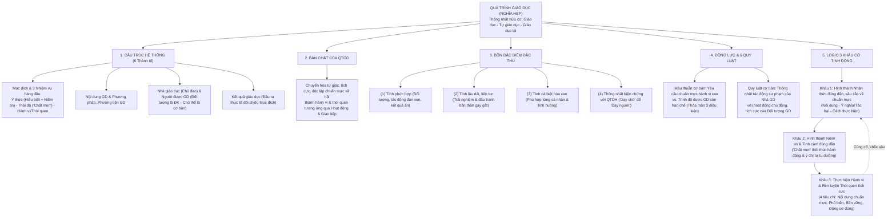
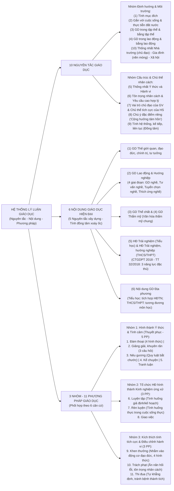

# CHƯƠNG 5: LÝ LUẬN GIÁO DỤC

> **Hướng dẫn học tập theo Phương pháp ghi chép Cornell (Cornell Note-taking System):**
> Tài liệu lí thuyết Chương 5 được thiết kế chuẩn hóa theo cấu trúc **Cornell Note-taking System** gồm 3 vùng nhận thức gắn kết chặt chẽ:
> 1. **Cột Từ khóa & Câu hỏi gợi nhớ (Cue Column - Cột trái):** Chứa hệ thống thuật ngữ cốt lõi, khái niệm chuyên ngành và các câu hỏi định hướng tư duy giúp người học chủ động truy xuất thông tin (Active Recall) về quá trình giáo dục, nguyên tắc, nội dung và phương pháp giáo dục.
> 2. **Cột Ghi chú chi tiết (Note-taking Column - Cột phải):** Hệ thống hóa toàn bộ luận điểm lí luận giáo dục (theo nghĩa hẹp): cấu trúc 6 thành tố, bản chất chuyển hóa chuẩn mực xã hội, 4 đặc điểm, động lực, logic 3 khâu, 6 quy luật, 10 nguyên tắc giáo dục, 6 nội dung giáo dục hiện đại (theo CTGDPT 2018) và 3 nhóm với 11 phương pháp giáo dục cụ thể.
> 3. **Phần Tóm tắt cốt lõi (Cornell Summary - Cuối mỗi mục & cuối chương):** Cô đọng bản chất khoa học – nghệ thuật sư phạm và quy tắc vận dụng thực tiễn của từng mảng kiến thức trong vài câu súc tích.

---

## Sơ đồ 1: Tổng quan Quá trình giáo dục (Cấu trúc, Bản chất, Đặc điểm, Động lực & Logic 3 khâu)

---

## 5.1. Quá trình giáo dục (QTGD - theo nghĩa hẹp)

| Từ khóa / Câu hỏi gợi nhớ | Ghi chú chi tiết (Nội dung cốt lõi) |
| :--- | :--- |
| **5.1.1.1. Khái niệm Quá trình giáo dục (nghĩa hẹp)** *QTGD theo nghĩa hẹp có chức năng trội là gì và khác với QTDH như thế nào? Ba quá trình thống nhất trong giáo dục là gì?* | • **Vị trí & Chức năng trội:** QTGD (theo nghĩa hẹp) và Quá trình dạy học (QTDH) là hai bộ phận của QTGD tổng thể, đều hướng tới hình thành nhân cách toàn vẹn cho người học:   ◦ **Chức năng trội của QTGD (nghĩa hẹp):** Làm cho người được giáo dục có **nhận thức đúng đắn** về các yêu cầu, chuẩn mực xã hội (chính trị, đạo đức, pháp luật, thẩm mỹ, văn hóa), hình thành quan điểm, niềm tin, giá trị, động cơ, thái độ, tình cảm và có **hành vi, thói quen hành vi tương ứng**.   ◦ **Nhiệm vụ của QTDH:** Truyền thụ tri thức, rèn luyện kỹ năng, kỹ xảo tương ứng, phát triển năng lực trí tuệ, trên cơ sở đó hình thành các giá trị đạo đức phù hợp. • **Định nghĩa bản chất tác động:** Là quá trình tác động qua lại biện chứng có nội dung, chương trình, kế hoạch, phương pháp, kiểm tra đánh giá và điều chỉnh giữa **nhà giáo dục (giữ vai trò chủ đạo)** và **đối tượng giáo dục (giữ vai trò tự giác, tích cực, chủ động)** nhằm phát triển nhân cách theo hình mẫu con người lý tưởng của nhà trường và xã hội trong từng thời kỳ lịch sử. • **Sự thống nhất hữu cơ giữa 3 quá trình:** Giáo dục là quá trình thống nhất hữu cơ giữa: **(1) Giáo dục**, **(2) Tự giáo dục**, và **(3) Giáo dục lại**:   ◦ Tuổi càng nhỏ, vai trò của **giáo dục** càng quan trọng.   ◦ Càng trưởng thành và phát triển, vai trò của **tự giáo dục** càng chiếm ưu thế.   ◦ **Giáo dục lại** là quá trình nhằm uốn nắn những sai sót, lệch lạc của hai quá trình trên. |
| **5.1.1.2. Cấu trúc của QTGD (6 thành tố hệ thống)** *QTGD bao gồm mấy thành tố cấu trúc? Tại sao Mục đích & Nhiệm vụ lại giữ vị trí hàng đầu?* | • Theo tiếp cận cấu trúc - hệ thống, QTGD là một hệ thống toàn vẹn gồm **6 thành tố cơ bản** có mối quan hệ biện chứng với nhau và tương tác mật thiết với môi trường kinh tế - xã hội, chính trị - văn hóa:   1. **Mục đích, nhiệm vụ giáo dục:** Thành tố có **vị trí hàng đầu**, định hướng cho sự vận động, phát triển của các thành tố khác và toàn bộ QTGD; xác định "đầu ra mong muốn" về phẩm chất nhân cách, hành vi, thói quen đạo đức, lao động, thể chất, thẩm mỹ.   2. **Nội dung giáo dục:** Toàn bộ hệ thống kinh nghiệm xã hội - lịch sử, hệ thống chuẩn mực (với bản thân, xã hội, tự nhiên) được lựa chọn, chế biến trong chương trình, kế hoạch giáo dục. Nội dung chịu sự chi phối của mục đích, mang tính nhân loại chung và đặc trưng dân tộc/lịch sử; khi nội dung thay đổi thì phương pháp, phương tiện cũng thay đổi.   3. **Phương pháp, phương tiện giáo dục:** Hệ thống cách thức, biện pháp, phương tiện tổ chức cho đối tượng giáo dục tự chiếm lĩnh nội dung giáo dục.   4. **Nhà giáo dục (Chủ thể giáo dục - Vai trò chủ đạo):** Ở trường là giáo viên, tập thể sư phạm, tổ chức đoàn thể; ở gia đình là ông bà, cha mẹ, người lớn. Thể hiện vai trò chủ đạo qua 5 khía cạnh: (a) Tổ chức, điều khiển, lựa chọn nội dung/phương pháp/hình thức và kiểm tra đánh giá; (b) Quán triệt và chuyển tải mục đích giáo dục; (c) Định hướng phát triển nhân cách đúng mục đích; (d) Phát huy ý thức tự giáo dục ở người học; (e) Phối hợp thống nhất tác động của nhà trường - gia đình - xã hội.   5. **Người được giáo dục (Cá nhân hoặc tập thể - Hai tư cách thống nhất):**      ▪ Tư cách **đối tượng của QTGD** (tiếp nhận tác động có định hướng, kế hoạch từ nhà giáo dục) $\rightarrow$ đóng vai trò là **điều kiện**.      ▪ Tư cách **chủ thể của quá trình tự giáo dục** (tiếp nhận có ý thức, tự vận động biến tác động bên ngoài thành bên trong) $\rightarrow$ đóng vai trò là **cơ bản**.   6. **Kết quả giáo dục:** Phản ánh tập trung kết quả vận động của đối tượng giáo dục (ý thức, thái độ, hành vi thực tế trong cuộc sống); là **"đầu ra thực tế"** của QTGD. Kết quả giáo dục tốt khi trùng khớp với mục đích giáo dục đã đề ra. |
| **Ba nhiệm vụ cốt lõi của QTGD** *Để đạt mục đích giáo dục, QTGD phải hoàn thành 3 nhiệm vụ nào? Yếu tố nào được ví như "chất men"?* | • **Nhiệm vụ 1 – Hình thành và phát triển ý thức cá nhân:** Về các chuẩn mực xã hội (đặc biệt là chuẩn mực đạo đức, pháp luật). **Ý thức cá nhân** là một thể thống nhất giữa **sự hiểu biết (tri thức)** và **niềm tin** của cá nhân về các chuẩn mực xã hội. • **Nhiệm vụ 2 – Hình thành và phát triển thái độ (xúc cảm, tình cảm) tích cực:** Đối với các chuẩn mực xã hội. Thái độ, tình cảm tích cực đóng vai trò như **"chất men" đặc biệt** thúc đẩy người được giáo dục chuyển hóa ý thức về chuẩn mực thành hành vi và thói quen tương ứng. • **Nhiệm vụ 3 – Hình thành và phát triển hệ thống hành vi và thói quen hành vi:** Phù hợp với chuẩn mực xã hội đã quy định, đồng thời tổ chức rèn luyện để người học tự lặp lại thành **thói quen bền vững** gắn mật thiết với nhu cầu hoạt động tích cực của cá nhân. |
| **5.1.2. Bản chất của QTGD** *Bản chất của QTGD là gì? Con đường duy nhất để chuyển hóa chuẩn mực khách quan thành phẩm chất cá nhân là gì?* | • **Định nghĩa bản chất:** QTGD về bản chất là **quá trình chuyển hóa tự giác, tích cực, độc lập những yêu cầu về chuẩn mực hành vi đã được xã hội quy định thành hành vi và thói quen hành vi tương ứng ở người được giáo dục**, dưới tác động chủ đạo của nhà giáo dục, **thông qua việc tổ chức các hoạt động và giao tiếp đa dạng**. • **Cơ chế chuyển hóa:**   ◦ Các chuẩn mực hành vi (đạo đức, pháp luật, lao động, thẩm mỹ...) vốn tồn tại **khách quan, độc lập** bên ngoài người được giáo dục.   ◦ Để chuyển hóa chúng thành ý thức, tình cảm, niềm tin, hành vi, thói quen bên trong, nhà giáo dục bắt buộc phải tổ chức các loại hình **hoạt động phong phú** (dạy học, lao động, vui chơi, xã hội...) và **các mối quan hệ giao tiếp đa dạng** (với thầy cô, bạn bè, cha mẹ, cộng đồng). • **Quy luật thực tiễn:** Ở đâu tổ chức tốt hoạt động và giao tiếp thì ở đó có tập thể vững mạnh, cá nhân có nhân cách tốt; cá nhân càng tích cực tham gia hoạt động và giao lưu bao nhiêu thì nhân cách càng phát triển toàn diện bấy nhiêu. |
| **5.1.3. Bốn đặc điểm của QTGD** *Phân tích 4 đặc điểm đặc thù của QTGD và những kết luận sư phạm tương ứng cho nhà giáo dục.* | **1. QTGD là một quá trình có tính phức hợp:**   • *Biểu hiện:* (a) Đối tượng là nhân cách con người rất phong phú, khó quan sát và đo lường trực tiếp; (b) Chịu tác động phức hợp từ nhiều phía (nhà trường, gia đình, xã hội, truyền thông) mang tính **tích cực và tiêu cực, tự phát và tự giác, trực tiếp và gián tiếp** đan kết vào nhau (tác động tiêu cực gây "nhiễu", làm suy yếu hoặc triệt tiêu kết quả giáo dục); (c) Kết quả giáo dục là sự biến đổi tâm hồn nên không nhìn thấy hay định lượng chính xác ngay được mà cần thời gian, hoàn cảnh mới bộc lộ.   • *Yêu cầu sư phạm:* Nhận diện tác động tích cực/tiêu cực; khai thác mặt tích cực; phối hợp các lực lượng giáo dục tạo môi trường thống nhất; rèn cho học sinh kĩ năng phòng ngừa cám dỗ tiêu cực. **2. QTGD có tính lâu dài, liên tục:**   • *Biểu hiện:* Đòi hỏi thời gian dài (tháng, năm, nhiều năm, cả thế hệ) để trải nghiệm thực tiễn, kiểm chứng tri thức và lặp đi lặp lại hành vi thành thói quen bền vững. Người học phải tiến hành **cuộc đấu tranh bản thân gay gắt** giữa động cơ đúng và chưa đúng, giữa quan niệm/thói quen mới tiến bộ với thói quen cũ lạc hậu (có lúc thất bại rồi mới thành công). Tính lâu dài luôn gắn với tính liên tục; nếu gián đoạn hoặc thiếu ý chí nghị lực, kết quả sẽ mất đi, dễ tiêm nhiễm thói hư tật xấu.   • *Yêu cầu sư phạm:* Tiến hành kiên trì, thường xuyên, không nóng vội áp đặt nhưng cũng không chậm trễ; khơi dậy năng lực tự đấu tranh và **"sức đề kháng"** trước cái xấu; lập kế hoạch dài hạn/ngắn hạn khép kín không gian và thời gian. **3. QTGD có tính cá biệt hóa cao:**   • *Biểu hiện:* Mỗi người học có tính độc lập tương đối về trình độ được giáo dục, tâm sinh lý lứa tuổi, hoàn cảnh sống, kinh nghiệm riêng. Tác động và kết quả giáo dục đều mang tính cụ thể theo từng cá nhân và tình huống.   • *Yêu cầu sư phạm:* Yêu thương, tìm hiểu tường tận từng em để dự đoán nguyên nhân hành vi; đa dạng hóa hoạt động phù hợp nhịp điệu phát triển cá nhân; phát huy tính tự giác chủ động. **4. QTGD thống nhất biện chứng với quá trình dạy học (QTDH):**   • *Biểu hiện:* Cùng là hai bộ phận của QTGD tổng thể hướng tới nhân cách toàn vẹn. Dạy học là con đường cơ bản để giáo dục (qua hệ thống tri thức khoa học mà hình thành thế giới quan, đạo đức, tình cảm) – thực hiện nguyên lý **thông qua "dạy chữ" để "dạy người"**. Ngược lại, kết quả của QTGD thúc đẩy mạnh mẽ thái độ, động cơ học tập và củng cố, mở rộng kết quả dạy học các môn học. |
| **5.1.4. Động lực của QTGD** *Mâu thuẫn cơ bản tạo nên động lực chủ yếu của QTGD là gì? Nêu 3 điều kiện để mâu thuẫn cơ bản trở thành động lực.* | • **Khái niệm động lực:** Là sự xuất hiện và giải quyết có hiệu quả các mâu thuẫn nảy sinh trong QTGD (gồm *mâu thuẫn bên ngoài* giữa QTGD với môi trường xã hội và *mâu thuẫn bên trong* giữa các thành tố/yếu tố của QTGD). • **Mâu thuẫn cơ bản (Động lực chủ yếu của QTGD):** Là mâu thuẫn giữa một bên là **yêu cầu về chuẩn mực hành vi được đề ra trong QTGD cao** với một bên là **trình độ được giáo dục (ý thức, thái độ, hành vi) của người được giáo dục còn hạn chế**.   ◦ *Hai đặc điểm của mâu thuẫn cơ bản:* (1) Tồn tại suốt từ đầu đến cuối QTGD, khi được giải quyết lại xuất hiện ở trình độ cao hơn; (2) Giải quyết nó tạo ra sự phát triển chủ yếu cho QTGD (chuyển biến cả 3 mặt: từ chưa biết $\rightarrow$ hiểu sâu sắc; từ chưa có niềm tin/tình cảm $\rightarrow$ có niềm tin/tình cảm tốt đẹp; từ chưa có hành vi/thói quen $\rightarrow$ có hành vi/thói quen chuẩn mực). • **Ba điều kiện bắt buộc để mâu thuẫn cơ bản trở thành động lực:**   1. **Yêu cầu đặt ra phải vừa sức:** Cao hơn trình độ hiện có nhưng phù hợp với khả năng để người học có thể hoàn thành với sự nỗ lực cao nhất.   2. **Yêu cầu đặt ra phải được người học ý thức đầy đủ:** Biết rõ yêu cầu đối với bản thân, hiểu sự cần thiết và có mong muốn, sẵn sàng thực hiện.   3. **Mâu thuẫn phải nảy sinh một cách tự nhiên, khách quan trong tiến trình giáo dục:** Xuất hiện trên cơ sở kết quả giải quyết mâu thuẫn trước đó, do chính lôgic vận động của tiến trình giáo dục đòi hỏi. |
| **5.1.5. Logic của QTGD (3 khâu có tính động)** *Trình bày nội dung 3 khâu trong logic của QTGD. Niềm tin thể hiện ở mấy biểu hiện và hành vi rèn luyện cần thỏa mãn mấy tiêu chí?* | • **Khái niệm:** Logic của QTGD là trình tự thực hiện hợp lý các khâu nhằm hoàn thành nhiệm vụ và mục đích giáo dục. Gồm **3 khâu có mối quan hệ mật thiết, hỗ trợ, thâm nhập vào nhau và mang tính động** (tùy thuộc đối tượng và tình huống cụ thể): • **Khâu 1: Tổ chức, điều khiển hình thành nhận thức đúng đắn, sâu sắc về các chuẩn mực xã hội:**   ◦ Giúp người học nắm vững 3 nội dung: **(1) Nội dung của chuẩn mực**; **(2) Sự cần thiết phải thực hiện** (ý nghĩa với bản thân, xã hội và tác hại nếu làm trái); **(3) Cách thực hiện chuẩn mực** (việc cần làm, việc cần tránh).   ◦ Sự thống nhất giữa tri thức và niềm tin tạo nên **ý thức tự giác** về chuẩn mực hành vi. • **Khâu 2: Tổ chức hình thành niềm tin và tình cảm đúng đắn đối với các chuẩn mực đã quy định:**   ◦ Thái độ bao gồm: thái độ thực hiện hành vi, thái độ đối với hành vi và thái độ với đối tượng thực hiện hành vi.   ◦ **6 biểu hiện của niềm tin đạo đức:** (1) Nắm vững tri thức về chuẩn mực; (2) Tin vào tính chân lý, đúng đắn của chuẩn mực; (3) Mong muốn làm theo chuẩn mực; (4) Có hành vi phù hợp chuẩn mực; (5) Hài lòng với hành vi đúng chuẩn mực của mình và người khác; (6) Tỏ thái độ **không khoan nhượng** với hành vi mâu thuẫn/vi phạm chuẩn mực.   ◦ Xúc cảm, tình cảm đúng đắn đóng vai trò là động cơ, là **"chất men"** thôi thúc hành động và ý chí tự tu dưỡng. • **Khâu 3: Tổ chức, điều khiển thực hiện hành vi phù hợp chuẩn mực ở mọi nơi, mọi lúc và rèn luyện thói quen hành vi tích cực:**   ◦ Hành vi và thói quen là thước đo, biểu hiện bộ mặt đạo đức của nhân cách, đồng thời củng cố ngược lại ý thức và tình cảm.   ◦ **4 tiêu chí của hành vi được rèn luyện:** (1) Nội dung chuẩn mực được thể hiện trong hành vi; (2) Sự thể hiện hành vi có **tính phổ biến**; (3) Sự thể hiện hành vi có **tính bền vững**; (4) Hành vi có **động cơ đúng đắn**. |
| **5.1.6. Sáu quy luật của QTGD** *Nêu 6 quy luật của QTGD. Quy luật nào là quy luật cơ bản nhất?* | • QTGD vận động theo **6 quy luật biện chứng**:   1. Quy luật về mối quan hệ thống nhất biện chứng giữa **QTGD với môi trường kinh tế - xã hội**.   2. Quy luật về mối quan hệ thống nhất biện chứng giữa **hiệu quả của QTGD với việc tổ chức hợp lý các hoạt động và các mối quan hệ giao lưu** của người được giáo dục.   3. **Quy luật cơ bản của QTGD:** Quy luật về mối quan hệ thống nhất biện chứng giữa **những tác động sư phạm của nhà giáo dục với hoạt động chủ động, tích cực của đối tượng giáo dục**.   4. Quy luật về mối quan hệ thống nhất biện chứng giữa **các tác động giáo dục có tính toàn vẹn đối với các mặt nhận thức - lý trí, tình cảm - động cơ và kỹ năng hành động - hành vi** của người được giáo dục.   5. Quy luật về mối quan hệ thống nhất biện chứng giữa **mục đích giáo dục – nội dung giáo dục – phương pháp giáo dục**.   6. Quy luật về mối quan hệ thống nhất biện chứng giữa **QTGD với QTDH**. |

> **Tóm tắt Mục 5.1 (Cornell Summary):**
> Quá trình giáo dục (nghĩa hẹp) là một hệ thống gồm **6 thành tố** thống nhất hữu cơ giữa **giáo dục – tự giáo dục – giáo dục lại**, có bản chất là chuyển hóa các chuẩn mực xã hội khách quan thành ý thức, tình cảm ("chất men") và thói quen hành vi cá nhân thông qua **hoạt động và giao tiếp**. Quá trình này mang **4 đặc điểm** (phức hợp; lâu dài - liên tục; cá biệt hóa cao; thống nhất với dạy học *"dạy chữ để dạy người"*), vận động nhờ giải quyết **mâu thuẫn cơ bản** giữa yêu cầu chuẩn mực cao với trình độ được giáo dục còn hạn chế (thỏa mãn 3 điều kiện), diễn ra theo **logic 3 khâu có tính động** (Nhận thức $\rightarrow$ Tình cảm/Niềm tin $\rightarrow$ Hành vi/Thói quen thỏa mãn 4 tiêu chí) và chịu sự chi phối của **6 quy luật** (trong đó tương tác giữa tác động sư phạm của nhà giáo dục với tính tích cực của người học là quy luật cơ bản).

---

## Sơ đồ 2: Hệ thống 10 Nguyên tắc, 6 Nội dung hiện đại và 3 Nhóm (11 Phương pháp) giáo dục

---

## 5.2. Hệ thống 10 Nguyên tắc giáo dục

| Từ khóa / Câu hỏi gợi nhớ | Ghi chú chi tiết (Nội dung cốt lõi) |
| :--- | :--- |
| **Khái niệm, 3 Đặc điểm & 5 Cơ sở xây dựng Nguyên tắc giáo dục** *Nguyên tắc giáo dục là gì? Vì sao nguyên tắc giáo dục không phải là "đơn thuốc" cho từng trường hợp?* | • **Khái niệm:** Nguyên tắc giáo dục là những **luận điểm cơ bản, có tính quy luật** của lí luận giáo dục, có vai trò **định hướng, chỉ đạo toàn bộ QTGD** nhằm đảm bảo chất lượng, hiệu quả giáo dục và đạt mục đích đã định. • **3 Đặc điểm của nguyên tắc giáo dục:**   1. **Tính khái quát cao:** Chung cho mọi trường hợp chứ **không phải là "đơn thuốc" (công thức máy móc)** cho từng trường hợp cụ thể $\rightarrow$ Đòi hỏi giáo viên phải vận dụng linh hoạt, sáng tạo trong từng tình huống.   2. **Tính quy luật:** Phản ánh những mối liên hệ tất yếu giữa các thành tố của QTGD và giữa QTGD với môi trường; tuân thủ thì đạt mục đích, vi phạm sẽ thất bại.   3. **Vai trò định hướng, chỉ đạo toàn bộ QTGD:** Đề ra yêu cầu cơ bản cho việc lựa chọn nội dung, phương pháp và hình thức tổ chức giáo dục. • **5 Cơ sở khoa học để xây dựng nguyên tắc giáo dục:** (1) Mục đích của QTGD; (2) Quy luật của QTGD; (3) Bản chất và đặc điểm của QTGD; (4) Logic của QTGD; (5) Động lực của QTGD. |
| **Nguyên tắc 1 & 2: Tính mục đích & Gắn với cuộc sống, thực tiễn đất nước** *Mục đích và mục tiêu giáo dục khác nhau thế nào? Giáo dục gắn với cuộc sống trên 2 phương diện nào?* | • **5.2.1. Nguyên tắc đảm bảo tính mục đích của QTGD:**   ◦ *Nội dung:* Mọi hoạt động giáo dục (HĐGD) phải quán triệt mục đích giáo dục, lấy mục đích làm **kim chỉ nam** để tránh hoạt động tự phát, tùy tiện, lệch hướng.   ◦ *Yêu cầu:* Mục đích giáo dục phải được cụ thể hóa thành các **mục tiêu giáo dục** rõ ràng, chính xác, khả thi, kiểm soát và đánh giá được (có chuẩn và thang đánh giá); lựa chọn hình thức, phương pháp, phương tiện phù hợp để hiện thực hóa mục đích. • **5.2.2. Nguyên tắc đảm bảo giáo dục gắn với cuộc sống của người được giáo dục, với thực tiễn đất nước:**   ◦ *Hai phương diện gắn kết:* (1) Chuyển hóa chuẩn mực xã hội thành ý nghĩa, giá trị cá nhân và thể hiện bằng hành động trong cuộc sống thực tiễn; (2) Giúp người học có khả năng thích ứng cao với đời sống xã hội đang biến động, tận dụng môi trường xã hội làm phương tiện giáo dục.   ◦ *Yêu cầu:* Giúp học sinh hiểu biết về cuộc sống, thực tiễn địa phương và đất nước (danh lam, truyền thống, sự đổi mới, thuận lợi/khó khăn); thu hút các em vào hoạt động xã hội vừa sức; khắc phục bệnh tách rời nhà trường với đời sống hoặc chỉ dạy kiến thức văn hóa - khoa học mà xem nhẹ giáo dục lý tưởng, đạo đức, lẽ sống. |
| **Nguyên tắc 3: Giáo dục trong tập thể và bằng tập thể** *Vì sao tập thể học sinh vừa là môi trường vừa là phương tiện giáo dục? Nhà giáo dục cần làm gì?* | • **5.2.3. Nguyên tắc giáo dục trong tập thể và bằng tập thể:**   ◦ **Tập thể là môi trường giáo dục vì:** Tập thể là tập hợp có tổ chức chặt chẽ, có bộ máy tự quản, mục đích thống nhất và hoạt động chung; học sinh tiếp xúc hàng ngày học quy tắc *"mình vì mọi người, mọi người vì mình"*, tạo phong độ tập thể phấn khởi, đoàn kết; thực hiện nội quy tập thể giúp rèn tính kỷ luật và tinh thần đồng đội.   ◦ **Tập thể là phương tiện giáo dục vì:** Giúp biến yêu cầu giáo dục khách quan từ nhà trường/giáo viên thành yêu cầu chủ quan của tập thể và mỗi cá nhân; dùng **sức mạnh của dư luận tập thể lành mạnh** để kích thích, điều chỉnh, định hướng hành vi của thành viên; đánh giá và tạo điều kiện cho cá nhân tự đánh giá.   ◦ *Yêu cầu thực hiện:* (1) Xây dựng tập thể vững mạnh (đồng lòng nhất trí; **thống nhất lợi ích cá nhân và lợi ích tập thể**, lấy lợi ích cá nhân làm tác nhân kích thích trực tiếp; tạo dư luận lành mạnh); (2) Tổ chức hoạt động tập thể có mục tiêu rõ, nội dung phong phú, hình thức hấp dẫn, phân công vừa sức và phát huy vai trò tự quản; (3) Mở rộng giao lưu trong lớp, giữa các lớp cùng khối và toàn trường. |
| **Nguyên tắc 4 & 5: Giáo dục bằng lao động & Thống nhất ý thức và hành vi** *Lao động giáo dục nhân cách qua những mặt nào? Mối quan hệ biện chứng giữa ý thức, thái độ và hành vi là gì?* | • **5.2.4. Nguyên tắc giáo dục trong lao động và bằng lao động:**   ◦ *Vai trò của lao động:* Vừa đưa học sinh vào tham gia lao động thực sự, vừa dùng lao động làm phương tiện giáo dục toàn diện: hình thành ý thức yêu lao động, quý trọng người và sản phẩm lao động, tiết kiệm thời gian/nguyên vật liệu, làm việc có kế hoạch và an toàn; giáo dục đạo đức (giúp đỡ gia đình, giữ gìn trường lớp), thể chất (vận động cơ thể) và thẩm mỹ (tạo sản phẩm đẹp, tổ chức công việc hợp lý).   ◦ *Yêu cầu:* Thường xuyên tổ chức cho học sinh tự giác tham gia nhiều loại hình lao động; kích thích tính sáng tạo; đảm bảo mang lại hiệu quả lao động cụ thể. • **5.2.5. Nguyên tắc thống nhất giữa ý thức và hành vi:**   ◦ *Quan hệ biện chứng 3 mặt:* **Ý thức** (tri thức + niềm tin) định hướng lý trí cho việc bày tỏ thái độ và thực hiện hành vi tự giác; **Thái độ, tình cảm** kích thích, thúc đẩy vượt qua cám dỗ để bảo vệ lẽ phải; **Hành vi, thói quen** củng cố, khắc sâu tri thức, niềm tin, tình cảm và **làm nên bộ mặt nhân cách** của người được giáo dục.   ◦ *Yêu cầu:* Cung cấp tri thức cần thiết về chuẩn mực; hình thành niềm tin; tổ chức rèn luyện hành vi và thói quen tích cực; đánh giá kết quả nhận thức và rèn luyện khách quan, công bằng. |
| **Nguyên tắc 6 & 7: Tôn trọng nhân cách - Yêu cầu cao & Chủ đạo - Chủ thể** *Thế nào là thống nhất giữa tôn trọng nhân cách với yêu cầu cao hợp lý? Vai trò quyết định thuộc về ai?* | • **5.2.6. Nguyên tắc thống nhất giữa tôn trọng nhân cách người được giáo dục và yêu cầu cao hợp lý:**   ◦ *Tôn trọng nhân cách:* Đánh giá đúng ưu nhược điểm, đối xử dân chủ, bình đẳng, lắng nghe ý kiến, trân trọng từng cố gắng nhỏ, tin tưởng tài năng/chí hướng, lạc quan và bảo vệ nhân phẩm, danh dự, thân thể học sinh (không định kiến, bi quan nhưng cũng không nuông chiều, buông thả vô kỷ luật).   ◦ *Yêu cầu cao hợp lý:* Đề ra tiêu chuẩn, công việc vừa sức, nâng cao dần, khả thi và khi đã đề ra thì **kiên quyết buộc người học phải tuân theo**.   ◦ *Bản chất:* Hai mặt của một vấn đề nhân đạo sư phạm — **"trong khi yêu cầu ở người được giáo dục thật nhiều thì bản thân sự yêu cầu đã chứa đựng sự tôn trọng của nhà giáo dục"**. • **5.2.7. Nguyên tắc đảm bảo sự thống nhất giữa vai trò tổ chức, điều khiển, hướng dẫn (chủ đạo) của nhà giáo dục và vai trò chủ thể tích cực của người được giáo dục:**   ◦ *Luận điểm cốt lõi:* Hoạt động độc lập, tích cực, sáng tạo của người được giáo dục đóng **vai trò quyết định** đối với sự hình thành nhân cách của chính họ.   ◦ *Yêu cầu:* Giúp học sinh tự xây dựng kế hoạch học tập/rèn luyện theo năm học; thu hút tham gia hoạt động chung và uốn nắn kịp thời; phát huy **chế độ tự quản**, biến yêu cầu giáo dục thành yêu cầu tự giáo dục; tôn trọng sáng kiến của tập thể; hướng dẫn học sinh tự đánh giá. |
| **Nguyên tắc 8, 9 & 10: Đặc điểm riêng, Tính hệ thống (đồng tâm) & Thống nhất 3 môi trường** *Tác động giáo dục thế nào sẽ tạo ra "sự cộng hưởng bên trong tâm hồn"? Vai trò của Gia đình, Nhà trường, Xã hội khác nhau ra sao?* | • **5.2.8. Nguyên tắc chú ý đến đặc điểm riêng của từng đối tượng giáo dục:**   ◦ *Cơ chế tâm lý:* Tính đến diễn biến nhận thức, xúc cảm, ý chí, nhu cầu, động cơ, hứng thú của từng tập thể (lớp, chi đoàn, chi đội) và từng cá nhân. Những tác động phù hợp với đối tượng sẽ gây nên **"sự cộng hưởng bên trong tâm hồn"** của đối tượng giáo dục.   ◦ *Yêu cầu:* Nghiên cứu nắm vững đối tượng; lựa chọn nội dung, phương pháp, hình thức phù hợp lứa tuổi và vừa sức; có lòng yêu nghề, yêu trẻ, gần gũi và cùng tham gia hoạt động, chia sẻ vui buồn để hiểu tâm tư thật của trẻ. • **5.2.9. Nguyên tắc đảm bảo tính hệ thống, kế tiếp và liên tục của QTGD:**   ◦ *Cơ sở:* Nhân cách là một hệ thống phẩm chất toàn vẹn được hình thành đồng thời, đan xen, bổ sung cho nhau theo **nguyên tắc đồng tâm** (phẩm chất đã có làm cơ sở hình thành phẩm chất tiếp theo, phẩm chất sau củng cố và làm sâu sắc phẩm chất trước).   ◦ *Yêu cầu:* Tổ chức hệ thống, khoa học, đồng bộ (nhưng có trọng tâm ở từng thời điểm); củng cố, luyện tập liên tục, kéo dài trong mọi hoàn cảnh. • **5.2.10. Nguyên tắc đảm bảo sự thống nhất giữa giáo dục nhà trường, giáo dục gia đình và giáo dục cộng đồng xã hội:**   ◦ **Giáo dục gia đình:** Đặt **nền móng đầu tiên** cho sự hình thành nhân cách; cha mẹ là người thầy đầu tiên; cái nôi nuôi dưỡng thể chất, tâm hồn.   ◦ **Giáo dục nhà trường:** Giữ **vai trò chủ đạo** vì có mục đích xác định, nội dung, phương pháp, hình thức khoa học phù hợp tâm sinh lý lứa tuổi; giúp bổ sung, hỗ trợ và điều chỉnh những tác động tiêu cực từ gia đình và xã hội.   ◦ **Giáo dục cộng đồng xã hội:** Có **vai trò rất quan trọng**, tác động trực tiếp hoặc gián tiếp theo cả hai chiều hướng tích cực và tiêu cực.   ◦ *Yêu cầu:* Nhà trường phải chủ động giữ vai trò chủ đạo khâu nối; gia đình và xã hội chủ động phối hợp theo định hướng chung để tạo môi trường giáo dục khép kín mọi lúc, mọi nơi. |

> **Tóm tắt Mục 5.2 (Cornell Summary):**
> Hệ thống **10 nguyên tắc giáo dục** là những luận điểm có tính quy luật và khái quát cao (không phải "đơn thuốc" máy móc), được xây dựng trên **5 cơ sở** của QTGD. Mười nguyên tắc bao quát trọn vẹn từ định hướng mục đích (Nguyên tắc 1), gắn với thực tiễn đất nước (Nguyên tắc 2), khai thác môi trường và phương tiện **tập thể** (Nguyên tắc 3) cùng **lao động** (Nguyên tắc 4), thống nhất **ý thức – thái độ – hành vi** (Nguyên tắc 5), kết hợp **tôn trọng nhân cách với yêu cầu cao hợp lý** (Nguyên tắc 6), phát huy **vai trò chủ đạo của giáo viên và vai trò quyết định của chủ thể học sinh** (Nguyên tắc 7), tạo **"sự cộng hưởng bên trong tâm hồn"** qua cá biệt hóa (Nguyên tắc 8), phát triển hệ thống theo **nguyên tắc đồng tâm** (Nguyên tắc 9), đến phối hợp đồng bộ **Nhà trường (chủ đạo) – Gia đình (nền móng đầu tiên) – Xã hội (quan trọng)** (Nguyên tắc 10).

---

## 5.3. Nội dung giáo dục

| Từ khóa / Câu hỏi gợi nhớ | Ghi chú chi tiết (Nội dung cốt lõi) |
| :--- | :--- |
| **5.3.1 & 5.3.2. Khái niệm & 5 Nguyên tắc xây dựng Nội dung giáo dục** *Nội dung giáo dục là gì? Trình bày 5 nguyên tắc xây dựng nội dung giáo dục (đặc biệt là tính đồng tâm).* | • **Khái niệm Nội dung giáo dục:** Là hệ thống những **tri thức, thái độ và hành vi** có liên quan đến những chuẩn mực xã hội cần được giáo dục cho người được giáo dục. • **5 Nguyên tắc xây dựng nội dung giáo dục:**   1. **Đảm bảo phù hợp với mục đích, mục tiêu giáo dục:** Cụ thể hóa các yêu cầu về phẩm chất, hành vi đạo đức, thể chất, lao động, thẩm mỹ do mục đích giáo dục định hướng.   2. **Đảm bảo tính liên tục, hệ thống:** Thiết kế liên tục từ lớp dưới lên lớp trên, từ điều đã giáo dục trước sang điều giáo dục sau, không ngắt quãng nhằm củng cố vững chắc hành vi và thói quen.   3. **Đảm bảo mối liên hệ giữa giá trị truyền thống và hiện đại:** Kế thừa có chọn lọc giá trị truyền thống còn ý nghĩa và tiếp thu giá trị hiện đại phù hợp thực tiễn; tuyệt đối tránh tư tưởng **bảo thủ** (đóng cửa với cái mới) hoặc **phủ định sạch trơn** truyền thống.   4. **Đảm bảo phù hợp với đặc điểm tâm sinh lý và trình độ nhận thức của người được giáo dục:** Xuất phát từ tính cá biệt và tính vừa sức theo từng giai đoạn lứa tuổi.   5. **Đảm bảo tính đồng tâm trong giáo dục:** Nội dung giáo dục được xây dựng và phát triển theo hướng **mở rộng và khái quát dần** từ lớp dưới lên lớp trên, từ bài học trước sang bài học sau **như đường xoáy trôn ốc**, giúp nâng cao dần ý thức tự giác của người học. |
| **5.3.3.1 & 5.3.3.2. Giáo dục Thế giới quan, đạo đức, chính trị, tư tưởng & Giáo dục Lao động - Hướng nghiệp** *Giáo dục hướng nghiệp gồm mấy giai đoạn? Giai đoạn nào phổ biến ở trường phổ thông và cần xây dựng 2 nhận thức nào ở học sinh?* | • **1. Nội dung giáo dục thế giới quan, đạo đức, chính trị, tư tưởng:**   ◦ Cung cấp nhận thức đúng đắn về thế giới xung quanh, bản thân và quan hệ giữa con người với thế giới (**thế giới quan** – kim chỉ nam cho mọi thái độ, hành vi).   ◦ Giáo dục các nguyên tắc, chuẩn mực đạo đức, chủ nghĩa yêu nước, lòng nhân ái, yêu lao động, ý thức quyền hạn/nghĩa vụ công dân, kỷ luật tự giác, tự hào và giữ gìn bản sắc dân tộc — đặc biệt cấp thiết để đẩy lùi lối sống cá nhân, vị kỷ, thực dụng ở giới trẻ. • **2. Nội dung giáo dục lao động và hướng nghiệp:**   ◦ **Giáo dục lao động:** Cung cấp kiến thức khoa học cơ bản về các lĩnh vực lao động, xu hướng phát triển công nghệ thế giới và Việt Nam; kiến thức về các nghề phổ thông ở địa phương/khu vực; bồi dưỡng ý thức nghĩa vụ lao động, thái độ lao động tích cực sáng tạo, quý trọng người lao động và thành quả lao động.   ◦ **Giáo dục hướng nghiệp:** Hệ thống tác động của gia đình, nhà trường, xã hội giúp học sinh chọn nghề phù hợp với **năng lực, tính cách, sở thích, quan niệm giá trị bản thân, hoàn cảnh gia đình và nhu cầu xã hội**; góp phần thực hiện **phân luồng học sinh sau THCS và sau THPT**.   ◦ **4 giai đoạn của giáo dục hướng nghiệp:** **(1) Giáo dục nghề** $\rightarrow$ **(2) Tư vấn nghề** $\rightarrow$ **(3) Tuyển chọn nghề** $\rightarrow$ **(4) Thích ứng nghề**. Trong đó, **giáo dục nghề và tư vấn nghề** là hai giai đoạn được thực hiện phổ biến khi học sinh đang học ở trường phổ thông.   ◦ **2 mảng nhận thức cần xây dựng cho học sinh trong hướng nghiệp:**     ▪ *Nhận thức cá nhân:* Nhận thức rõ **sở thích** và **khả năng** của bản thân (đây là hai lĩnh vực khác nhau; cần biết khả năng đáp ứng sở thích đến mức nào).     ▪ *Nhận thức về nghề nghiệp:* Tìm hiểu ngành nghề, nơi đào tạo, thông tin tuyển sinh và thị trường lao động. |
| **5.3.3.3 & 5.3.3.4. Giáo dục Thể chất & Giáo dục Thẩm mỹ** *Giáo dục thể chất hướng tới những trọng tâm nào? Vì sao giáo dục thẩm mỹ không đồng nhất với đào tạo năng khiếu nghệ thuật?* | • **3. Nội dung giáo dục thể chất:**   ◦ Trang bị: (a) Kiến thức và kĩ năng chăm sóc sức khỏe; (b) Kiến thức và kĩ năng vận động; (c) Hình thành thói quen tập luyện, khả năng lựa chọn môn thể thao phù hợp để phát triển thể lực và tố chất vận động.   ◦ Không chỉ phát triển thể chất và an toàn vận động mà còn xây dựng **lối sống năng động, lành mạnh**, phát triển các kỹ năng thế kỷ 21 (hợp tác, giao tiếp, sáng tạo, tư duy phản biện, đánh giá thẩm mỹ qua hoạt động đội/nhóm), đặt nền tảng học tập suốt đời. • **4. Nội dung giáo dục thẩm mỹ:**   ◦ Hình thành năng lực nhận thức, đánh giá, sáng tạo và hành động theo cái đẹp.   ◦ **Bản chất:** Không nên hiểu hẹp là đào tạo năng khiếu về một môn nghệ thuật, mà là **giáo dục văn hóa thẩm mỹ chung cho tất cả học sinh**. Cái đẹp tồn tại không chỉ trong nghệ thuật mà cả trong tự nhiên và cuộc sống hàng ngày (hành động tử tế, câu chuyện nhân văn, việc làm ý nghĩa).   ◦ **3 nhiệm vụ cụ thể:** (a) Bồi dưỡng năng lực cảm thụ cái đẹp (phát triển **tri giác thẩm mỹ**); (b) Bồi dưỡng năng lực đánh giá, nhận biết cái đẹp; (c) Bồi dưỡng lòng khao khát và năng lực sáng tạo cái đẹp, xây dựng cuộc sống theo quy luật của cái đẹp. |
| **5.3.3.5 & 5.3.3.6. Hoạt động trải nghiệm, hướng nghiệp & Giáo dục địa phương (CTGDPT 2018)** *Theo Thông tư 32/2018/TT-BGDĐT, tên gọi, vị trí và 3 năng lực mục tiêu của Hoạt động trải nghiệm và Giáo dục địa phương ở các cấp học được quy định như thế nào?* | • **5. Hoạt động trải nghiệm và Hoạt động trải nghiệm, hướng nghiệp:**   ◦ **Căn cứ pháp lý & Tính chất:** Quy định tại Chương trình giáo dục phổ thông 2018 (**Thông tư 32/2018/TT-BGDĐT** ngày 26/12/2018 của Bộ trưởng Bộ GD&ĐT), là **nội dung giáo dục bắt buộc từ lớp 1 đến lớp 12**.   ◦ **Tên gọi theo cấp học:**     ▪ Ở cấp **Tiểu học**: gọi là **Hoạt động trải nghiệm**.     ▪ Ở cấp **THCS và THPT**: gọi là **Hoạt động trải nghiệm, hướng nghiệp**.   ◦ **Bản chất hoạt động:** Do nhà giáo dục định hướng, thiết kế và hướng dẫn thực hiện, tạo cơ hội cho học sinh tiếp cận thực tế, thể nghiệm cảm xúc tích cực, khai thác kinh nghiệm đã có và huy động tổng hợp kiến thức, kĩ năng của các môn học để giải quyết vấn đề thực tiễn (nhà trường, gia đình, xã hội); qua đó **chuyển hóa kinh nghiệm đã trải qua thành tri thức mới, kĩ năng mới**.   ◦ **3 năng lực đặc thù hướng tới hình thành và phát triển:** **(1) Năng lực thích ứng với cuộc sống**; **(2) Năng lực thiết kế và tổ chức hoạt động**; **(3) Năng lực định hướng nghề nghiệp** (đồng thời góp phần hình thành các phẩm chất chủ yếu và năng lực chung của CTGDPT 2018). • **6. Nội dung giáo dục địa phương:**   ◦ **Nội dung:** Những vấn đề cơ bản hoặc thời sự về văn hóa, lịch sử, địa lí, kinh tế, xã hội, môi trường, hướng nghiệp... của địa phương bổ sung cho nội dung giáo dục bắt buộc chung toàn quốc; nhằm trang bị hiểu biết về nơi sinh sống, bồi dưỡng tình yêu quê hương và ý thức vận dụng điều đã học để giải quyết vấn đề quê hương.   ◦ **Vị trí ở các cấp học:**     ▪ Ở cấp **Tiểu học**: được **tích hợp với Hoạt động trải nghiệm**.     ▪ Ở cấp **THCS và THPT**: có **vị trí tương đương như các môn học khác**. |

> **Tóm tắt Mục 5.3 (Cornell Summary):**
> Nội dung giáo dục (hệ thống tri thức, thái độ, hành vi về chuẩn mực xã hội) được thiết kế theo **5 nguyên tắc** (phù hợp mục đích; liên tục - hệ thống; kế thừa truyền thống - hiện đại; vừa sức tâm sinh lý; và **tính đồng tâm như đường xoáy trôn ốc**). Trong nhà trường hiện đại theo CTGDPT 2018 (Thông tư 32/2018/TT-BGDĐT), hệ thống nội dung bao gồm **4 nội dung truyền thống** (Thế giới quan - đạo đức - chính trị - tư tưởng; Lao động & hướng nghiệp với 4 giai đoạn; Thể chất; Thẩm mỹ) và **2 nội dung tích hợp mới bắt buộc từ lớp 1–12** là **Hoạt động trải nghiệm / Hoạt động trải nghiệm, hướng nghiệp** (hình thành 3 năng lực: thích ứng cuộc sống, thiết kế & tổ chức hoạt động, định hướng nghề nghiệp) cùng **Nội dung giáo dục địa phương** (tích hợp vào HĐTN ở Tiểu học, vị trí tương đương môn học ở THCS & THPT).

---

## 5.4. Phương pháp giáo dục (PPGD)

| Từ khóa / Câu hỏi gợi nhớ | Ghi chú chi tiết (Nội dung cốt lõi) |
| :--- | :--- |
| **5.4.1 & 5.4.2. Khái niệm & 7 Đặc điểm của Phương pháp giáo dục** *PPGD là gì và mang những đặc điểm cốt lõi nào?* | • **Khái niệm PPGD:** Là một **tổ hợp các cách thức hoạt động của nhà giáo dục và người được giáo dục**, được thực hiện trong sự **phối hợp thống nhất** với nhau (nhà giáo dục giữ vai trò chủ đạo tổ chức, điều khiển; đối tượng giáo dục giữ vai trò chủ động, tích cực, tự vận động), nhằm thực hiện các nhiệm vụ giáo dục và hoàn thành mục đích giáo dục đã đề ra. • **7 Đặc điểm của PPGD:**   1. **Phụ thuộc vào mục đích giáo dục:** Mục đích thay đổi thì PPGD thay đổi theo; PPGD là điều kiện, cách thức hiện thực hóa mục đích.   2. **Phụ thuộc vào nội dung giáo dục:** Mỗi nội dung (đạo đức, lao động, thể chất, thẩm mỹ...) đòi hỏi hệ thống PPGD chuyển tải riêng.   3. **Tác động vào từng khâu hoặc tất cả các khâu của QTGD:** Khâu nhận thức dùng nhóm thuyết phục; khâu hành vi - thói quen dùng nhóm tổ chức hoạt động...   4. **Phụ thuộc vào trình độ, năng lực, uy tín, vị thế và kinh nghiệm của nhà giáo dục:** Cùng một phương pháp và hoàn cảnh nhưng hai nhà giáo dục sử dụng sẽ cho hiệu quả khác nhau.   5. **Phụ thuộc vào đối tượng giáo dục:** Mỗi học sinh là một thế giới riêng; không có một PPGD chung hữu hiệu cho mọi đối tượng (thể hiện tính nghệ thuật sư phạm).   6. **Liên quan chặt chẽ với phương tiện, điều kiện, hoàn cảnh cụ thể** (vùng miền: miền núi, nông thôn, thành phố; phong tục, tập quán, tôn giáo, không gian, thời gian).   7. **Liên quan chặt chẽ và hòa quyện, không thể tách rời với hình thức tổ chức giáo dục** (theo quy mô toàn trường, lớp, nhóm, tổ, cá nhân). |
| **5.4.3 & 5.4.4.1. Phân loại PPGD & Nhóm 1: Các phương pháp thuyết phục (5 phương pháp)** *Nêu các cách phân loại PPGD. Phân tích chi tiết 5 phương pháp thuộc Nhóm hình thành ý thức và tình cảm cá nhân (Thuyết phục).* | • **Các tiêu chí phân loại PPGD:** Dựa vào các khâu của QTGD; dựa vào bản chất của QTGD (tổ chức cuộc sống, tổ chức hoạt động, tổ chức giao lưu); hoặc dựa vào các quá trình tâm lý (nhận thức, tình cảm, ý chí). Tổng hợp lại, PPGD được chia thành **3 nhóm cơ bản (với 11 phương pháp cụ thể)**. • **NHÓM 1: Các phương pháp hình thành ý thức và tình cảm cá nhân (Nhóm thuyết phục – gồm 5 phương pháp):**   **1. Phương pháp đàm thoại:**   ◦ *Khái niệm:* Trò chuyện, trao đổi giữa nhà giáo dục và người học về các chủ đề chuẩn mực xã hội nhằm làm sáng tỏ khái niệm đạo đức, thẩm mỹ, ngăn chặn hành vi sai lệch và củng cố nhận thức, tình cảm, niềm tin.   ◦ *4 hình thức đàm thoại:* **(a) Đàm thoại cá nhân**; **(b) Đàm thoại tập thể**; **(c) Đàm thoại tự nhiên** (diễn ra tự nhiên trong cuộc sống hàng ngày, không chuẩn bị trước chủ đề); **(d) Đàm thoại theo chủ đề** (câu hỏi xoay quanh chủ đề thông báo trước).   ◦ *Yêu cầu:* Chủ đề thiết thực; câu hỏi hợp lý (đơn giản và phức tạp); không khí thân mật, cởi mở; đặt câu hỏi cho cả lớp suy nghĩ rồi mới gọi trả lời, **không bị động "theo đuôi" lớp**, không vội vàng áp đặt; với học sinh cá biệt phải hết sức thận trọng, tế nhị, có lý có tình.   **2. Phương pháp giảng giải, khuyên răn:**   ◦ *Khái niệm:* Dùng lời nói và lập luận vững chắc để khuyên bảo, giải thích, chứng minh tính đúng đắn của chuẩn mực xã hội.   ◦ *Yêu cầu cốt lõi:* Nội dung giảng giải, khuyên răn bắt buộc phải **làm rõ 3 vấn đề**: **(1) Chuẩn mực đó là gì? (2) Tại sao phải thực hiện các chuẩn mực đó? (3) Thực hiện các chuẩn mực đó như thế nào?** Lời nói phải rõ ràng, khúc chiết, không lan man; kết hợp tình thương, khoan dung với sự nghiêm khắc cần thiết; bản thân nhà giáo dục phải gương mẫu, có uy tín.   **3. Phương pháp nêu gương:**   ◦ *Khái niệm:* Dùng những tấm gương trong thực tiễn, sách báo, truyền thông hoặc **chính sự gương mẫu của nhà giáo dục** để kích thích người học tu dưỡng, noi theo (kết hợp cả **gương tốt chính diện** để học tập và **gương xấu** để cảnh báo, răn đe, ngăn ngừa).   ◦ *Cơ sở tâm lý (Quy luật bắt chước của học sinh):* Học sinh rất hay bắt chước (thậm chí bắt chước cái xấu rất nhanh). Quá trình bắt chước vận động theo **4 quy luật**:     ▪ Từ bắt chước hình mẫu **gần gũi** (cha mẹ, anh chị, bạn bè) $\rightarrow$ hình mẫu **xa** (nhân vật lịch sử, văn học, phim ảnh).     ▪ Từ bắt chước **vô ý thức** $\rightarrow$ bắt chước **chủ động, có ý thức**.     ▪ Từ bắt chước **nguyên mẫu máy móc** $\rightarrow$ bắt chước **có sáng tạo**.     ▪ Từ bắt chước **trong trò chơi** $\rightarrow$ bắt chước **trong cuộc sống**.   ◦ *Yêu cầu:* Chọn tấm gương điển hình, gần gũi với cuộc sống của trẻ (tránh tấm gương quá lý tưởng, xa vời dễ làm nhụt chí học sinh đầu cấp); nhà giáo dục phải là tấm gương sáng.   **4. Phương pháp kể chuyện:**   ◦ *Khái niệm:* Dùng lời nói, cử chỉ, điệu bộ, nét mặt kèm phương tiện trực quan thuật lại sinh động một câu chuyện có ý nghĩa giáo dục (đặc biệt hiệu quả với **học sinh nhỏ tuổi**).   ◦ *Yêu cầu:* Cốt truyện hấp dẫn, phù hợp thời gian và lứa tuổi; giọng kể, điệu bộ biểu cảm; dùng tranh ảnh/băng hình minh họa; sau khi kể phải cho học sinh chia sẻ, trao đổi nhân vật và tự rút ra bài học.   **5. Phương pháp tranh luận:**   ◦ *Khái niệm:* Tổ chức trao đổi, thảo luận về một chủ đề đang phân vân để xóa bỏ nhận thức sai lầm, hình thành quan điểm đúng đắn.   ◦ *Yêu cầu:* Tổ chức trong bầu không khí cởi mở; chủ đề thiết thực đang làm học sinh băn khoăn; tránh tranh cãi cay cú hơn thua nhưng phải thể hiện chính kiến rõ ràng; **mục đích chủ yếu là tạo cơ hội cho học sinh bộc lộ quan điểm** chứ không áp đặt kết luận theo số đông, cho phép bảo lưu ý kiến khi cần; giáo viên dùng uy tín định hướng trọng tâm nhưng không can thiệp quá sâu hay dè bỉu, chỉ trích. |
| **5.4.4.2. Nhóm 2: Các phương pháp tổ chức hoạt động hình thành kinh nghiệm ứng xử xã hội (3 phương pháp)** *Phân biệt sự khác nhau bản chất giữa phương pháp Luyện tập và phương pháp Rèn luyện. Ý nghĩa và yêu cầu của phương pháp Giao việc là gì?* | • **Cơ sở lý luận:** Hành vi mới là thước đo đạo đức của con người; để chuẩn mực chuyển thành phẩm chất nhân cách thì phải đưa học sinh vào hoạt động để tập luyện thành thói quen. • **NHÓM 2: Các phương pháp tổ chức hoạt động hình thành kinh nghiệm ứng xử xã hội (gồm 3 phương pháp):**   **1. Phương pháp luyện tập:**   ◦ *Khái niệm:* Tổ chức cho học sinh thực hiện **đều đặn, có kế hoạch, có hệ thống** các hành động nhất định nhằm biến chúng thành thói quen, thuộc tính bền vững của nhân cách (cả hình thành thói quen mới lẫn sửa chữa thói quen sai).   ◦ *Yêu cầu:* Tiến hành càng sớm càng tốt (*"uốn cây từ thuở còn non, dạy con từ thuở còn thơ"*); hoạt động đa dạng, không gò ép; tuân thủ quy trình: **đi từ dễ đến khó, lúc đầu chậm nhưng đúng và chính xác, sau đó tập cho đẹp rồi mới tăng nhanh dần tốc độ**.   **2. Phương pháp rèn luyện:**   ◦ *Khái niệm:* Đưa người được giáo dục vào **cuộc sống thực tiễn** để tham gia các hoạt động đa dạng nhằm thể nghiệm ý thức, tình cảm và hành vi.   ◦ **Điểm khác biệt cốt lõi so với Luyện tập:** Nếu *Luyện tập* cho học sinh ứng xử trong các **tình huống giả định** do giáo viên và bạn bè đặt ra, thì *Rèn luyện* đòi hỏi ở mức cao hơn: học sinh phải **đối mặt với tình huống thực trong điều kiện thực của cuộc sống** và tự nguyện giải quyết.   ◦ *Ý nghĩa:* Là "phương thuốc hữu hiệu" nâng cao **bản lĩnh cá nhân**, rèn luyện sự **đấu tranh động cơ** giữa cái cần làm – cái phải làm, cái có thể – cái không thể.   **3. Phương pháp giao việc:**   ◦ *Khái niệm:* Lôi cuốn người học vào hoạt động đa dạng với những công việc cụ thể mang ý nghĩa xã hội nhất định.   ◦ *Ý nghĩa & Yêu cầu:* Giúp học sinh bộc lộ năng lực, năng khiếu, hình thành kỹ năng thích ứng và cảm nhận được **sự tin tưởng của nhà giáo dục**; việc giao phải vừa sức, rõ ràng, làm rõ ý nghĩa xã hội, kết hợp theo dõi – giúp đỡ – động viên và **đánh giá công khai** kết quả. |
| **5.4.4.3. Nhóm 3: Các phương pháp kích thích tính tích cực hoạt động và điều chỉnh hành vi ứng xử (3 phương pháp)** *Vì sao khen thưởng nhằm vào động cơ lại có giá trị giáo dục lớn hơn nhằm vào kết quả? Khi sử dụng Trách phạt và Thi đua cần tuân thủ những yêu cầu nghiêm ngặt nào?* | • **Chức năng chung:** Là nhóm phương pháp **hỗ trợ đắc lực** cho hai nhóm trên, vừa thúc đẩy hành vi tích cực (tạo tâm lý phấn chấn, lạc quan) vừa kìm hãm, uốn nắn hành vi lệch lạc (tạo tâm lý ăn năn, hối lỗi). • **NHÓM 3: Các phương pháp kích thích và điều chỉnh hành vi (gồm 3 phương pháp):**   **1. Phương pháp khen thưởng:**   ◦ *Khái niệm & Bản chất:* Biểu thị sự đánh giá tích cực, hài lòng, ủng hộ của nhà giáo dục, tập thể và xã hội đối với hành vi tốt của cá nhân/tập thể. **Đặc biệt lưu ý:** Khen thưởng không chỉ nhằm vào kết quả công việc mà **quan trọng hơn là phải nhằm vào động cơ của hoạt động (mặt đạo đức của hành vi)** — khen thưởng nhằm vào động cơ có tác dụng giáo dục to lớn hơn nhiều so với chỉ nhằm vào kết quả.   ◦ *4 hình thức khen thưởng:* (a) Tỏ thái độ đồng tình, ủng hộ (ánh mắt, nụ cười, lời khen trực tiếp); (b) Biểu dương, tuyên dương trước tập thể; (c) Tặng giấy khen, bằng khen, kỷ niệm chương và hiện vật; (d) Đề nghị cấp trên khen thưởng (học bổng, miễn thi, danh hiệu cao quý).   ◦ *Yêu cầu:* Khách quan, công bằng, đúng người đúng việc, kịp thời; được **dư luận tập thể thừa nhận, tán thành**; khen cụ thể (khen cái gì, vì cái gì, tránh khen chung chung *"Em giỏi quá!"*); **chú ý khen những học sinh lần đầu đạt thành tích, ít được khen, rụt rè, tự ti** và học sinh nhỏ tuổi; với học sinh đã được khen nhiều thì chỉ khen khi thực sự xứng đáng để tránh kiêu ngạo, chủ quan.   **2. Phương pháp trách phạt:**   ◦ *Khái niệm:* Biểu thị thái độ không đồng tình, lên án của nhà giáo dục và tập thể đối với hành vi sai trái nhằm gây cho người mắc lỗi tâm trạng **hổ thẹn, cắn rứt lương tâm, đấu tranh động cơ, ăn năn, hối hận** để quyết tâm sửa chữa khuyết điểm.   ◦ *7 hình thức trách phạt (từ nhẹ đến nặng):* (a) Lời nói/cử chỉ không đồng tình; (b) Nhắc nhở, phê bình trực tiếp cá nhân; (c) Nhắc nhở, phê bình trước tập thể; (d) Gọi lên văn phòng Ban giám hiệu, viết bản kiểm điểm; (e) Mời phụ huynh đến trao đổi và cam kết; (f) Cảnh cáo trước toàn trường; (g) Buộc lưu ban, thôi học, khai trừ khỏi tổ chức, ghi học bạ.   ◦ *Quan điểm về đuổi học:* Hình thức đuổi học/khai trừ phải hết sức hạn chế, chỉ là **biện pháp bất đắc dĩ, thể hiện sự bất lực của nhà trường và nhà giáo dục**, dễ dẫn đến hậu quả xấu cho gia đình và xã hội.   ◦ *Yêu cầu nghiêm ngặt:* Chỉ dùng khi thuyết phục không còn tác dụng (không lạm dụng thường xuyên vì sẽ gây căng thẳng, làm học sinh **trơ lì, chai sạn**); khách quan, công bằng, không định kiến; mục đích để học sinh ăn năn sửa lỗi chứ **không phải để trừng phạt hay thỏa mãn cơn giận của giáo viên**; **tôn trọng nhân cách, tuyệt đối không xúc phạm thể chất và tinh thần**; được tập thể đồng tình nhưng **tránh trách phạt tập thể, trách phạt số đông** và phải định hướng dư luận để tập thể quan tâm giúp đỡ bạn chứ không xa lánh, bỏ rơi.   **3. Phương pháp thi đua:**   ◦ *Khái niệm:* Khích lệ, kích thích **khuynh hướng tự khẳng định** của cá nhân hay tập thể để hăng hái vươn lên đạt kết quả cao hơn.   ◦ *Yêu cầu:* Không quá chú trọng vào kết quả đơn thuần mà điều cơ bản là tạo ra phong trào phấn đấu rèn luyện; **tránh bệnh thành tích, hiếu thắng**, tìm mọi cách để hơn người khác; mục tiêu rõ ràng, sơ kết/tổng kết thường xuyên và gắn kết chặt chẽ với khen thưởng – trách phạt công bằng. |
| **5.4.3.1 & 5.4.3.2. Sáu căn cứ và Ý nghĩa của việc lựa chọn, phối hợp các PPGD** *Vì sao không có PPGD nào là vạn năng? Nêu 6 căn cứ lựa chọn và phối hợp các PPGD.* | • **Tính tất yếu phải phối hợp PPGD:** Không có phương pháp nào là vạn năng hay sử dụng đơn lẻ mà thành công. Sức mạnh của PPGD nằm ở **tính hệ thống**: các phương pháp đan xen, bổ sung cho nhau để tác động toàn diện vào cả 3 khâu (nhận thức – tình cảm – hành vi), đảm bảo thống nhất lời nói với việc làm, vai trò chủ đạo của giáo viên với vai trò chủ động của học sinh. Lựa chọn và phối hợp PPGD vừa là khoa học, vừa là **nghệ thuật giáo dục** tạo nên bản sắc riêng của mỗi nhà giáo dục. • **6 Căn cứ lựa chọn và phối hợp các PPGD:**   1. Căn cứ vào **mục đích giáo dục cụ thể** của mỗi cấp học, bậc học.   2. Căn cứ vào **nội dung giáo dục cụ thể**.   3. Căn cứ vào **đặc điểm tâm, sinh lý và đặc điểm cá biệt** của người được giáo dục.   4. Căn cứ vào **môi trường giáo dục và các điều kiện thực tế**.   5. Căn cứ vào **trình độ phát triển của tập thể học sinh**.   6. Căn cứ vào **kinh nghiệm, năng lực và mối quan hệ** giữa nhà giáo dục và người được giáo dục. |

> **Tóm tắt Mục 5.4 (Cornell Summary):**
> Phương pháp giáo dục là tổ hợp cách thức phối hợp thống nhất giữa nhà giáo dục (chủ đạo) và người học (chủ động), mang **7 đặc điểm** phụ thuộc chặt chẽ vào mục đích, nội dung, các khâu giáo dục, năng lực người thầy, đặc điểm người học, điều kiện môi trường và hình thức tổ chức. Hệ thống PPGD gồm **3 nhóm với 11 phương pháp**: **Nhóm 1 – Thuyết phục** (Đàm thoại, Giảng giải - khuyên răn, Nêu gương, Kể chuyện, Tranh luận) tác động vào nhận thức và tình cảm; **Nhóm 2 – Tổ chức hoạt động** (Luyện tập, Rèn luyện trong tình huống thực, Giao việc) hình thành hành vi và thói quen; **Nhóm 3 – Kích thích và điều chỉnh** (Khen thưởng nhằm vào động cơ đạo đức, Trách phạt tôn trọng nhân cách, Thi đua lành mạnh). Do không có phương pháp nào vạn năng, nhà giáo dục phải vận dụng nghệ thuật phối hợp hệ thống các PPGD dựa trên **6 căn cứ khoa học**.

---

## Tóm tắt toàn chương (Cornell Summary)

1. **Quá trình giáo dục (theo nghĩa hẹp):** Là quá trình thống nhất hữu cơ giữa **giáo dục, tự giáo dục và giáo dục lại**, có cấu trúc hệ thống gồm **6 thành tố** (Mục đích & 3 nhiệm vụ giáo dục; Nội dung; Phương pháp & phương tiện; Nhà giáo dục giữ vai trò chủ đạo; Người được giáo dục với tư cách đối tượng là điều kiện và tư cách chủ thể là cơ bản; Kết quả giáo dục).
2. **Bản chất, Đặc điểm, Động lực & Quy luật của QTGD:** Bản chất của QTGD là chuyển hóa tự giác, tích cực các chuẩn mực xã hội thành hành vi và thói quen thông qua **hoạt động và giao tiếp**. QTGD có **4 đặc điểm** (phức hợp; lâu dài và liên tục gắn với đấu tranh bản thân; cá biệt hóa cao; thống nhất biện chứng với QTDH qua phương châm *"dạy chữ để dạy người"*), vận động nhờ giải quyết **mâu thuẫn cơ bản** giữa yêu cầu chuẩn mực cao với trình độ được giáo dục còn hạn chế (khi thỏa mãn 3 điều kiện), và tuân theo **6 quy luật** (quy luật cơ bản là sự thống nhất giữa tác động sư phạm của nhà giáo dục với tính tích cực của người được giáo dục).
3. **Logic 3 khâu có tính động của QTGD:** Diễn ra qua 3 khâu thâm nhập, hỗ trợ lẫn nhau: **Khâu 1** – Hình thành nhận thức đúng đắn về chuẩn mực (nội dung, ý nghĩa, cách thực hiện); **Khâu 2** – Hình thành niềm tin (6 biểu hiện) và tình cảm đúng đắn đóng vai trò **"chất men"** thôi thúc hành động; **Khâu 3** – Thực hiện hành vi và rèn luyện thói quen tích cực thỏa mãn **4 tiêu chí** (nội dung chuẩn mực, tính phổ biến, tính bền vững, động cơ đúng đắn).
4. **Hệ thống 10 Nguyên tắc giáo dục:** Là những luận điểm có tính quy luật và khái quát cao (không phải "đơn thuốc" cứng nhắc), bao gồm: (1) Tính mục đích; (2) Gắn với cuộc sống và thực tiễn đất nước; (3) Giáo dục trong tập thể và bằng tập thể (*vừa là môi trường vừa là phương tiện*); (4) Giáo dục trong lao động và bằng lao động; (5) Thống nhất ý thức và hành vi; (6) Thống nhất tôn trọng nhân cách và yêu cầu cao hợp lý; (7) Thống nhất vai trò chủ đạo của giáo viên và vai trò chủ thể quyết định của học sinh; (8) Chú ý đặc điểm riêng tạo *"sự cộng hưởng bên trong tâm hồn"*; (9) Tính hệ thống, kế tiếp, liên tục (*đồng tâm*); (10) Thống nhất giữa Nhà trường (*chủ đạo*), Gia đình (*nền móng đầu tiên*) và Xã hội (*rất quan trọng*).
5. **Nội dung giáo dục hiện đại:** Được xây dựng theo **5 nguyên tắc** (nổi bật là nguyên tắc đồng tâm hình xoáy trôn ốc), triển khai qua **6 nội dung** trong nhà trường phổ thông: (1) Thế giới quan, đạo đức, chính trị, tư tưởng; (2) Lao động và hướng nghiệp (*4 giai đoạn*: giáo dục nghề, tư vấn nghề, tuyển chọn nghề, thích ứng nghề); (3) Thể chất; (4) Thẩm mỹ (*văn hóa thẩm mỹ chung*); (5) **Hoạt động trải nghiệm** (Tiểu học) và **Hoạt động trải nghiệm, hướng nghiệp** (THCS, THPT) bắt buộc từ lớp 1–12 theo Thông tư 32/2018/TT-BGDĐT nhằm phát triển **3 năng lực** (thích ứng với cuộc sống, thiết kế và tổ chức hoạt động, định hướng nghề nghiệp); (6) **Nội dung giáo dục địa phương** (tích hợp với HĐTN ở Tiểu học; vị trí tương đương môn học ở THCS, THPT).
6. **Hệ thống Phương pháp giáo dục (PPGD):** Gồm **3 nhóm với 11 phương pháp** cụ thể: **Nhóm 1 – Thuyết phục** (*Đàm thoại, Giảng giải - khuyên răn, Nêu gương, Kể chuyện, Tranh luận*); **Nhóm 2 – Tổ chức hoạt động** (*Luyện tập, Rèn luyện, Giao việc*); **Nhóm 3 – Kích thích và điều chỉnh hành vi** (*Khen thưởng, Trách phạt, Thi đua*), được lựa chọn và phối hợp nghệ thuật dựa trên **6 căn cứ**.

---

## Câu hỏi tự kiểm tra nhanh (Self-Testing Cues)

1. Phân biệt chức năng trội của Quá trình giáo dục (nghĩa hẹp) với nhiệm vụ của Quá trình dạy học, và giải thích mối quan hệ giữa 3 quá trình: giáo dục, tự giáo dục và giáo dục lại.
2. Trong 6 thành tố cấu trúc của QTGD, thành tố nào giữ vị trí hàng đầu? Phân tích hai tư cách của người được giáo dục (tư cách nào là điều kiện, tư cách nào là cơ bản) và vai trò "chất men" của thái độ, tình cảm.
3. Tại sao nói QTGD có tính phức hợp và tính lâu dài, liên tục? Nhà giáo dục cần làm gì để hình thành "sức đề kháng" đạo đức cho học sinh?
4. Phát biểu mâu thuẫn cơ bản (động lực chủ yếu) của QTGD và phân tích 3 điều kiện để mâu thuẫn đó thực sự trở thành động lực phát triển nhân cách.
5. Trình bày logic 3 khâu của QTGD. Tại sao trong thực tiễn giáo dục không phải lúc nào cũng bắt đầu tuần tự từ khâu 1 đến khâu 3 (tính động của các khâu)?
6. Chứng minh luận điểm: *"Tập thể học sinh vừa là môi trường giáo dục, vừa là phương tiện giáo dục"* và *"Trong khi yêu cầu cao hợp lý ở người được giáo dục thì bản thân sự yêu cầu đã chứa đựng sự tôn trọng nhân cách"*.
7. Phân tích điểm mới của Chương trình GDPT 2018 (Thông tư 32/2018/TT-BGDĐT) đối với nội dung **Hoạt động trải nghiệm / Hoạt động trải nghiệm, hướng nghiệp** và **Nội dung giáo dục địa phương** ở cấp Tiểu học so với cấp THCS, THPT.
8. So sánh sự khác biệt giữa phương pháp **Luyện tập** và phương pháp **Rèn luyện**; giải thích vì sao **Khen thưởng** nhằm vào động cơ lại có ý nghĩa giáo dục lớn hơn nhằm vào kết quả, và vì sao đuổi học trong **Trách phạt** lại bị coi là biểu hiện sự bất lực của nhà giáo dục.
