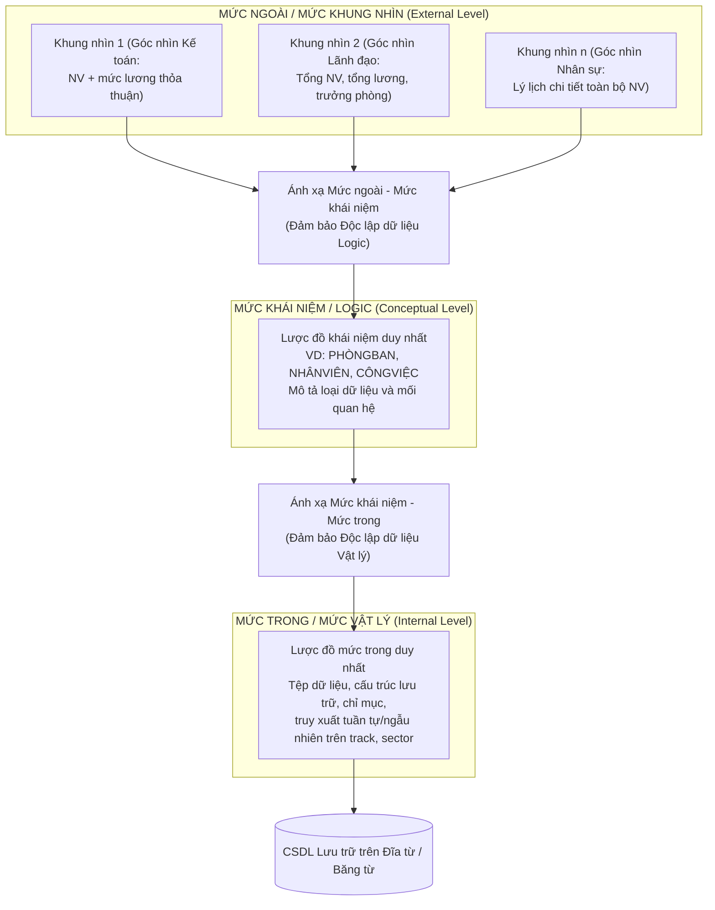
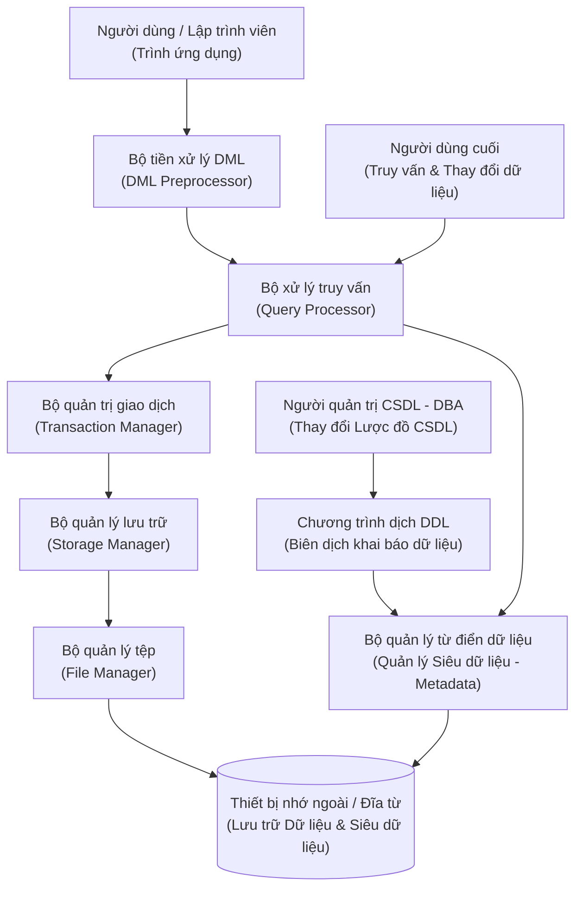

# Chương 1: Tổng quan về cơ sở dữ liệu (Phương pháp Ghi chép Cornell)

> **Hướng dẫn học tập theo Phương pháp ghi chép Cornell (Cornell Note-taking System):**
> Tài liệu lý thuyết Chương 1 được biên soạn theo cấu trúc **Cornell Note-taking System**, bám sát *Giáo trình Thực hành Cơ sở dữ liệu (Phần I - Nhập môn)* (Lê Anh Phương, Nguyễn Thị Hương Giang, Lê Phước Nam Hà, Nguyễn Văn Khang, Hồ Thị Kim Thoa; Nxb. Đại học Huế, 2022), gồm 3 vùng nhận thức gắn kết chặt chẽ:
> 1. **Cột Trái (Cue Column - Từ khóa / Câu hỏi gợi nhớ):** Tập hợp các khái niệm trung tâm, thuật ngữ tiếng Anh, số liệu ví dụ thực tế và câu hỏi truy xuất chủ động (Active Recall).
> 2. **Cột Phải (Note-taking Column - Ghi chú chi tiết):** Hệ thống hóa đầy đủ, mạch lạc và chuẩn xác toàn bộ định nghĩa, đặc điểm, mô hình, kiến trúc 3 mức, ngôn ngữ CSDL, thành phần DBMS và các đối tượng sử dụng.
> 3. **Phần Tổng kết (Cornell Summary - Cuối mỗi mục & cuối chương):** Cô đọng các ý cốt lõi nhất để ôn tập nhanh trước khi làm bài tập trắc nghiệm, trả lời ngắn và tự luận.

---

## 1. Khái niệm, Đặc điểm, Ưu điểm của CSDL và Hệ Quản trị CSDL (Mục 1.1)

| Từ khóa / Câu hỏi gợi nhớ | Ghi chú chi tiết (Nội dung cốt lõi) |
| :--- | :--- |
| **Bối cảnh ứng dụng CSDL truyền thống & hiện đại** *CSDL hiện đại mở rộng từ dữ liệu văn bản/số sang những lĩnh vực nào?* | • **Ứng dụng CSDL truyền thống:** Lưu trữ và truy cập thông tin chủ yếu ở dạng **văn bản hoặc số** (giao dịch gửi/rút tiền tại ngân hàng, thanh toán mặt hàng tại siêu thị). • **Ứng dụng CSDL hiện đại:**   ◦ **CSDL đa phương tiện (Multimedia DB):** Lưu trữ hình ảnh, âm thanh và video kỹ thuật số.   ◦ **Hệ thống thông tin địa lý (GIS - Geographic Information Systems):** Lưu trữ và phân tích bản đồ, dữ liệu thời tiết, hình ảnh vệ tinh.   ◦ **Kho dữ liệu & OLAP (On-Line Analytical Processing):** Trích xuất, phân tích thông tin kinh doanh từ CSDL rất lớn để hỗ trợ ra quyết định.   ◦ **CSDL thời gian thực:** Kiểm soát quá trình sản xuất nông nghiệp và công nghiệp.   ◦ **World Wide Web:** Áp dụng kỹ thuật tìm kiếm CSDL giúp người dùng duyệt Internet tìm thông tin chính xác hơn. • **Yêu cầu khoa học khi tổ chức xử lý dữ liệu:** Đảm bảo tính nhất quán dữ liệu, không trùng lặp thông tin, tiết kiệm thời gian và không gian lưu trữ, đáp ứng nhu cầu khai thác của nhiều người. |
| **Khái niệm Cơ sở dữ liệu (CSDL / Database)** *Phân biệt định nghĩa ban đầu và định nghĩa đầy đủ của CSDL là gì?* | • **Định nghĩa ban đầu:** *"CSDL là một tập hợp các dữ liệu có liên quan"*, trong đó **dữ liệu** đề cập đến các sự kiện đã biết được ghi lại và có ý nghĩa (ví dụ: họ tên, số điện thoại, địa chỉ lưu trong sổ địa chỉ hoặc Excel/Access). • **Định nghĩa đầy đủ:** Một **CSDL** là một tập hợp các dữ liệu có liên quan với nhau chứa thông tin về một tổ chức nào đó (trường đại học, ngân hàng, nhà máy...) được lưu trữ trên các **thiết bị nhớ thứ cấp** (băng từ, đĩa từ...) để đáp ứng nhu cầu khai thác thông tin của nhiều người sử dụng với nhiều mục đích khác nhau. • **Cấu trúc bản ghi:** Trong các hệ thống thông tin quản lý, dữ liệu thường là các **bản ghi (record)** có cùng cấu trúc xác định; mỗi bản ghi được phân chia thành các **thuộc tính (attribute)**. • **Ví dụ:** CSDL quản lý đào tạo trong trường (học sinh, giáo viên, môn học, phòng học...); CSDL quản lý chuyến bay của hãng hàng không (số hiệu, nơi xuất phát, nơi đến, số chỗ ngồi, ngày bay trong năm). |
| **Đặc điểm của CSDL (4 đặc tính) & Các ví dụ quy mô lớn** *CSDL mang những đặc tính nào? Nêu số liệu ví dụ Tổng cục Thuế VN và Amazon.com.* | • **4 đặc tính cốt lõi của CSDL:**   1. **Đại diện cho một số khía cạnh của thế giới thực:** Mọi giao dịch (khách mua máy ảnh) hay sự kiện (nhân viên đổi chức vụ) phải được phản ánh vào CSDL sớm nhất để đảm bảo trung thực, đáng tin cậy.   2. **Tập hợp dữ liệu mạch lạc về mặt logic** với ý nghĩa nhất định (dữ liệu ngẫu nhiên không gọi là CSDL).   3. **Thiết kế, xây dựng cho mục đích cụ thể**, có nhóm người dùng tiềm năng và các ứng dụng định sẵn.   4. **Có kích thước và độ phức tạp bất kỳ**, có thể tạo/duy trì thủ công (danh mục thẻ thư viện) hoặc tự động hóa. • **Ví dụ quy mô thực tế:**   ◦ *Danh sách khách hàng nhỏ:* Vài trăm bản ghi cấu trúc đơn giản.   ◦ *Thư viện lớn:* Nửa triệu mục sắp xếp theo họ tác giả chính, chủ đề, tên sách theo thứ tự chữ cái.   ◦ **Tổng cục Thuế Việt Nam:** Giả sử 100 triệu người nộp thuế × trung bình 5 biểu mẫu × 400 ký tự/biểu mẫu = $2 \times 10^{11}$ byte; lưu giữ 3 lần khai thuế = $3 \times 2 \times 10^{11}$ byte = **600 gigabyte (600 GB)**.   ◦ **Amazon.com:** Chứa dữ liệu của hơn **20 triệu** cuốn sách, CD, video, DVD, trò chơi, thiết bị điện tử, quần áo...; dung lượng **hơn 2 terabyte** ($1\text{ TB} = 10^{12}$ byte) lưu trên **200 máy chủ**; phục vụ khoảng **15 triệu khách truy cập/ngày**, cập nhật liên tục hàng tồn kho khi phát sinh mua hàng. |
| **Ưu điểm của CSDL (5 ưu điểm nổi bật)** *CSDL mang lại 5 lợi ích gì và OLTP giải quyết bài toán nào?* | 1. **Giảm sự trùng lặp thông tin** xuống mức thấp nhất $\rightarrow$ đảm bảo **tính nhất quán** và **toàn vẹn dữ liệu**. 2. **Đảm bảo tính độc lập giữa dữ liệu và chương trình ứng dụng:** Cho phép thay đổi cấu trúc/dữ liệu trong CSDL mà không cần sửa chương trình ứng dụng. 3. **Trừu tượng hóa dữ liệu:** Mô hình dữ liệu ẩn đi chi tiết lưu trữ vật lý, chỉ biểu diễn cho người dùng mức khái niệm. 4. **Nhiều khung nhìn (Multi-view):** Đáp ứng nhu cầu truy xuất khác nhau của nhiều đối tượng người dùng trên cùng một CSDL. 5. **Đa người dùng (Multi-user):** Chia sẻ thông tin cho nhiều người dùng và nhiều ứng dụng đồng thời.    ◦ *Ví dụ **OLTP** (On-Line Transaction Processing - Xử lý giao dịch trực tuyến):* Nhiều đại lý đặt vé máy bay cùng truy cập một chuyến bay $\rightarrow$ mỗi chỗ ngồi chỉ được truy cập bởi một nhân viên tại một thời điểm để gán cho một hành khách. (Một **giao dịch** là một chương trình hoặc bước thực thi gồm một hay nhiều thao tác đọc/cập nhật bản ghi CSDL). |
| **4 vấn đề cần giải quyết khi xây dựng CSDL** *Sử dụng CSDL tập trung, chia sẻ đặt ra 4 thách thức nào?* | 1. **Tính chủ quyền của dữ liệu:** Do tính chia sẻ nên chủ quyền dữ liệu dễ bị xâm phạm. 2. **Tính bảo mật và quyền khai thác:** Nhiều người cùng khai thác đòi hỏi cơ chế bảo mật và phân quyền chặt chẽ. 3. **Tranh chấp dữ liệu:** Nhiều người cùng xem, thêm, xóa, sửa đồng thời cần cơ chế ưu tiên truy cập (cấp quyền/mức độ ưu tiên) để xử lý xung đột khai thác cạnh tranh. 4. **Đảm bảo dữ liệu khi có sự cố:** Quản lý tập trung làm tăng nguy cơ mất/sai lệch dữ liệu khi mất điện đột ngột hoặc hỏng đĩa cứng. Ngoài dịch vụ sao lưu ảnh đĩa của hệ điều hành mạng (như **RAID** - Redundant Arrays of Independent Disks), CSDL nhất thiết phải có cơ chế khôi phục riêng. |
| **Hệ quản trị CSDL (DBMS) & Hai đặc trưng phân biệt** *DBMS là gì và phân biệt với các phần mềm khác bằng 2 đặc trưng nào?* | • **Định nghĩa:** **Hệ quản trị CSDL (Database Management System - DBMS)** là một hệ thống chương trình cho phép tạo lập cơ sở dữ liệu và điều khiển mọi truy nhập, khai thác trên cơ sở dữ liệu đó; hỗ trợ các nhà phân tích thiết kế và người khai thác; bảo vệ chống sự cố phần cứng/phần mềm, chống truy cập trái phép và duy trì hệ thống qua nhiều năm. • **Ví dụ phần mềm DBMS:** ORACLE, MICROSOFT ACCESS, VISUAL FOXPRO, SQL SERVER... • **2 đặc trưng cơ bản phân biệt DBMS với phần mềm khác:**   1. **Quản lý dữ liệu bền:** Lưu trữ CSDL phục vụ khai thác lâu dài.   2. **Truy cập khối lượng lớn dữ liệu hiệu quả:** Cung cấp thao tác và phương pháp tổ chức giúp truy cập nhanh chóng, thuận lợi. • **Cấu trúc môi trường hệ thống CSDL (Hình 1.1):** Người sử dụng/Lập trình viên $\rightarrow$ Chương trình ứng dụng/Truy vấn $\rightarrow$ Phần mềm hệ QTCSDL (*phần mềm xử lý truy vấn/chương trình* + *phần mềm truy xuất dữ liệu lưu trữ*) $\rightarrow$ CSDL (và siêu dữ liệu). |
| **Ví dụ minh họa: CSDL Trường Đại học (5 bảng)** *CSDL Trường Đại học trong giáo trình gồm 5 bảng nào, mã hóa và truy vấn/cập nhật ra sao?* | • Tổ chức thành **5 tệp/bảng** (giả định điểm thuộc `{'A','B','C','D','F'}`, lược đồ mã hóa `Lớp`: `1`=năm nhất, `2`=năm hai, `3`=cơ sở, `4`=cuối cấp, `5`=tốt nghiệp):   1. **`SINHVIÊN`**(`Hoten_SV`, `Maso_SV`, `Lớp`, `Chuyên ngành`) — VD: `Nguyễn An | 19001 | 1 | CS`; `Lê Nam | 19002 | 2 | CS`.   2. **`KHÓAHỌC`**(`Ten Khoahoc`, `Maso Khoahoc`, `Sotinchi`, `Khoa`) — VD: `CT1310` (Cấu trúc dữ liệu, 4 TC, CNTT); `CC1512` (Toán cao cấp 1, 3 TC, Toán); `CL1413` (Cơ sở dữ liệu, 4 TC, CNTT).   3. **`THONGTIN_KHÓAHOC`**(`ID_KHOAHOC`, `Maso Khoahoc`, `Hocky`, `Namhoc`, `Nguoihuongdan`) — VD: `85 | CC1512 | I | 2020 | Lê Tuấn Anh`; `92 | CT1310 | II | 2021 | Nguyễn Lê Nam`; `102 | CL1413 | I | 2020 | Trần Khánh`.   4. **`ĐIỂM`**(`Maso_SV`, `ID Khoahoc`, `Diem`) — VD: `19001 | 85 | A`; `19001 | 102 | C`; `19002 | 92 | B`.   5. **`ĐIỀUKIỆN_TIÊNQUYẾT`**(`Maso Khoahoc`, `Maso Tienquyet`) — VD: `(CL1413, CC1512)`, `(CT1310, CC1512)`, `(CL1413, CT1310)`. • **Ví dụ truy vấn:** Lấy bảng điểm của "Nguyễn An"; liệt kê sinh viên học "Cơ sở dữ liệu" HK I năm 2020 kèm điểm; liệt kê điều kiện tiên quyết của "Cơ sở dữ liệu". • **Ví dụ cập nhật:** Đổi lớp của "Nguyễn An" thành năm hai; tạo học phần mới cho khóa "Cơ sở dữ liệu"; nhập điểm `'A'` cho sinh viên trong học phần kỳ trước. |
| **Khái niệm Hệ cơ sở dữ liệu (Hệ CSDL)** *Hệ CSDL gồm 4 thành phần nào?* | **Hệ cơ sở dữ liệu** là sự kết hợp của 4 thành phần: **(1) Cơ sở dữ liệu (CSDL)**, **(2) Hệ quản trị CSDL (DBMS)** để truy cập CSDL đó, **(3) Con người**, và **(4) Trang thiết bị** để lưu trữ CSDL. |

> **Tóm tắt Mục 1 (Cornell Summary):**
> **CSDL** là tập hợp dữ liệu liên quan, mạch lạc về mặt logic, lưu trên thiết bị nhớ thứ cấp để phục vụ nhiều người dùng với các ưu điểm: giảm trùng lặp, nhất quán, độc lập dữ liệu - ứng dụng, trừu tượng hóa, đa khung nhìn và đa người dùng (OLTP). Để giải quyết 4 thách thức (chủ quyền, bảo mật/phân quyền, tranh chấp dữ liệu và khôi phục sự cố), cần có **Hệ QTCSDL (DBMS)** - phần mềm chuyên dụng nổi bật với khả năng quản lý dữ liệu bền và truy cập hiệu quả khối lượng lớn dữ liệu (như bài toán Tổng cục Thuế 600 GB hay Amazon > 2 TB). **Hệ CSDL** hoàn chỉnh là tổng hòa của CSDL, DBMS, con người và trang thiết bị.

---

## 2. Khả năng của Hệ Quản trị CSDL và Các Mô hình CSDL (Mục 1.2 - 1.3)

| Từ khóa / Câu hỏi gợi nhớ | Ghi chú chi tiết (Nội dung cốt lõi) |
| :--- | :--- |
| **6 khả năng của một Hệ QTCSDL** *Một DBMS tiêu chuẩn cần đảm bảo 6 khả năng cốt lõi nào?* | 1. **Quản lý CSDL lâu dài:** Dữ liệu không bị mất khi kết thúc phiên làm việc. 2. **Quản lý số lượng lớn dữ liệu** và **truy cập khối lượng lớn dữ liệu với tốc độ xử lý nhanh**. 3. **Cung cấp ít nhất một mô hình dữ liệu:** Giúp người dùng quan sát dữ liệu trực quan, dễ hiểu (Ví dụ 1 - Hình 1.2: mô hình CSDL quản lý xe máy tỉnh Thừa Thiên Huế với các thông tin đại lý `TENDL`, `DAILY`, `DIACHI`...). 4. **Cung cấp ngôn ngữ bậc cao** để định nghĩa và xử lý dữ liệu (Ví dụ 2: với 2 file `NV(HọTênNV, Tuoi, phai, HSL, MP)` và `PHONG(MP, TênPhòng, NguoiQL)`, câu lệnh SQL: `SELECT NV.HotenNV, NV.Phai, PHONG.TenPhong, PHONG.NguoiQL FROM NV, PHONG WHERE (NV.MP=PHONG.MP) and (NV.Tuoi>30)`). 5. **Giải quyết tranh chấp dữ liệu đồng thời** (cơ chế truy cập đồng thời, chính xác). 6. **Sao lưu (Backup), phục hồi dữ liệu (Restore)** khi có sự cố và **ngăn ngừa truy cập trái phép**. |
| **Biện pháp giải quyết tranh chấp & Sao lưu/Phục hồi** *DBMS dùng những cơ chế nào để chống xung đột và khôi phục dữ liệu?* | • **2 biện pháp giải quyết tranh chấp dữ liệu:**   1. **Cấp quyền ưu tiên** cho từng người sử dụng (do người quản trị CSDL - DBA thực hiện).   2. **Đánh dấu yêu cầu truy xuất và phân chia thời gian:** Người yêu cầu trước được quyền truy xuất trước. • **2 cách sao lưu (Backup) và phục hồi (Restore) dữ liệu:**   1. **Định kỳ kiểm tra (Checkpoint / bản sao định kỳ):** Sau một khoảng thời gian nhất định, hệ QTCSDL tự tạo một bản sao CSDL (hạn chế: tốn kém dung lượng/chi phí với CSDL lớn).   2. **Tạo nhật ký thao tác CSDL (Log):** Hệ thống ghi lại mọi thao tác trên CSDL; khi có sự cố sẽ tự động lần ngược lại nhật ký để phục hồi CSDL. |
| **Khái niệm Mô hình dữ liệu & 5 loại mô hình CSDL** *Mô hình dữ liệu gồm 2 thành phần nào? Kể tên 5 mô hình CSDL trong giáo trình.* | • **Mục đích:** Giúp người dùng thấy được bản chất dữ liệu và mối quan hệ giữa các dữ liệu trong quá trình thiết kế, xây dựng CSDL. • **Cấu thành của một mô hình dữ liệu (2 phần):**   1. Một **hệ thống các ký hiệu** dùng để mô tả các dữ liệu.   2. Một **tập các phép toán** thao tác trên dữ liệu đó. • **5 loại mô hình CSDL phổ biến** (mỗi mô hình đặc trưng cho một cách tiếp cận của nhà phân tích thiết kế):   1. **Mô hình Thực thể - Quan hệ (E-R - Entity - Relationship)**.   2. **Mô hình mạng (Network)**.   3. **Mô hình phân cấp (Hierarchical)**.   4. **Mô hình quan hệ (Relational)**.   5. **Mô hình hướng đối tượng (Object-Oriented)**. • Lưu ý: Mỗi hệ QTCSDL cung cấp một mô hình cho CSDL. |

> **Tóm tắt Mục 2 (Cornell Summary):**
> Một hệ QTCSDL phải đáp ứng 6 năng lực trọng tâm: lưu trữ lâu dài, xử lý nhanh khối lượng lớn dữ liệu, cung cấp mô hình dữ liệu trực quan, cung cấp ngôn ngữ bậc cao (như SQL), giải quyết tranh chấp truy cập (qua quyền ưu tiên hoặc đánh dấu thứ tự/chia thời gian), và sao lưu/phục hồi (qua bản sao định kỳ hoặc nhật ký thao tác) cùng bảo mật. Trong đó, mọi **mô hình dữ liệu** đều gồm hệ thống ký hiệu mô tả và tập phép toán thao tác, tiêu biểu với 5 loại mô hình: E-R, mạng, phân cấp, quan hệ và hướng đối tượng.

---

## 3. Ba Mức Biểu diễn của CSDL (ANSI-SPARC), Độc lập Dữ liệu, Lược đồ & Thể hiện (Mục 1.4 - 1.6)

### Sơ đồ 1: Kiến trúc Ba Mức Biểu diễn CSDL (ANSI-SPARC) và Độc lập Dữ liệu

| Từ khóa / Câu hỏi gợi nhớ | Ghi chú chi tiết (Nội dung cốt lõi) |
| :--- | :--- |
| **Mục đích kiến trúc 3 mức (ANSI-SPARC)** *Vì sao ANSI-SPARC chia kiến trúc CSDL thành 3 mức?* | • Do Viện Tiêu chuẩn Quốc gia Mỹ (**ANSI-SPARC**, giáo trình ghi **ANSI-PARC**) đề xuất nhằm **tách biệt quan niệm/ứng dụng của người sử dụng với sự biểu diễn vật lý của CSDL**, che giấu sự phức tạp lưu trữ cho người dùng không thuộc giới tin học. • **3 hệ quả quan trọng:**   1. Mỗi người dùng có khung nhìn riêng; thay đổi khung nhìn cá nhân không ảnh hưởng tới khung nhìn của người khác.   2. Tương tác người dùng không phụ thuộc chi tiết lưu trữ vật lý.   3. Người quản trị CSDL (DBA) có thể thay đổi cấu trúc khái niệm mà không làm ảnh hưởng tới toàn bộ người dùng. |
| **Mức vật lý (Mức trong - Internal Level)** *Mức vật lý giải quyết những câu hỏi nào?* | • Là mức biểu diễn **thấp nhất** (chỉ có **một**), mô tả **dữ liệu thực sự được lưu trữ như thế nào** trên máy tính để tối ưu hóa tìm kiếm, lưu trữ và tận dụng vùng nhớ trống. • **Các vấn đề giải quyết:** Lưu trữ như thế nào? Ở đâu (đĩa từ, băng từ, track, sector nào)? Cần chỉ mục (index) gì? Truy xuất tuần tự hay ngẫu nhiên? • *Ví dụ Công ty:* Mô tả dữ liệu dưới dạng 3 tệp `PHONGBAN`, `NHANVIEN`, `CONGVIEC` và vị trí/cách tổ chức lưu trữ trên đĩa. • *Ví dụ Mảng `A[n][m]`:* Cách mảng thực sự được cấp phát trong bộ nhớ. • *Ví dụ Học sinh:* Mô tả cấu trúc tệp vật lý, chẳng hạn `Struct MONHOC { Char MaMH[10]; Char Tenmon[30]; Int SoDVHT; }`. |
| **Mức khái niệm (Mức logic - Conceptual Level)** *Mức khái niệm trả lời câu hỏi gì và ai quan tâm đến mức này?* | • Là mức ở giữa (chỉ có **một**), biểu diễn trừu tượng của CSDL vật lý, mô tả **những loại dữ liệu nào** được lưu trữ và **mối quan hệ** giữa chúng. • **Các câu hỏi giải quyết:** CSDL cần lưu giữ bao nhiêu loại dữ liệu? Đó là những dữ liệu gì? Mối quan hệ giữa chúng ra sao? (Đối tượng quan tâm: **người phân tích, thiết kế CSDL**). • *Ví dụ Công ty:* `PHÒNGBAN(MAP, TENP, TENTP, SODT, KINHPHI, DOANHTHU...)`, `NHÂNVIÊN(MANV, TENNV, MACV, MAP, NSINH, PHAI...)`, `CÔNGVIỆC(MACV, TENCV, LUONGTOITHIEU, LUONGTĐA...)`. • *Ví dụ Mảng:* Hình dung mảng như bảng `n` hàng, `m` cột (`int A[n][m];`), phần tử ở dòng `i` cột `j` là `A[i][j]`. |
| **Mức khung nhìn (Mức ngoài - External Level)** *Mức khung nhìn có đặc điểm gì và vì sao có thể có nhiều khung nhìn?* | • Là mức biểu diễn **cao nhất** (có thể có **rất nhiều khung nhìn**), thể hiện góc độ quan tâm riêng của từng nhóm người dùng; chỉ mô tả **một phần dữ liệu** liên quan đến ứng dụng hẹp hoặc **dữ liệu tổng hợp** từ CSDL hiện có. • *Ví dụ Công ty:* Phòng Kế toán chỉ thấy danh sách nhân viên theo phòng ban và mức lương thỏa thuận (ẩn lý lịch); Lãnh đạo thấy số lượng NV, tổng lương phải trả, trưởng phòng; Phòng Tổ chức nhân sự xem đầy đủ lý lịch chi tiết. • *Ví dụ Mảng:* Hàm tổng hàng $f(i) = \sum_j A[i][j]$. |
| **Độc lập dữ liệu (Data Independence): Logic & Vật lý** *Phân biệt Độc lập dữ liệu logic và Độc lập dữ liệu vật lý.* | • **Định nghĩa chung:** **Độc lập dữ liệu** là khả năng thay đổi lược đồ ở một mức nào đó của hệ thống CSDL mà **không cần phải thay đổi lược đồ ở mức cao hơn**. • **2 kiểu độc lập dữ liệu:**   1. **Độc lập dữ liệu logic (Logical data independence):** Cho phép thay đổi **lược đồ khái niệm** (mở rộng: thêm trường, thêm bản ghi; thu nhỏ: xóa trường, xóa bản ghi) mà **không cần thay đổi lược đồ mức ngoài hoặc các chương trình ứng dụng**.   2. **Độc lập dữ liệu vật lý (Physical data independence):** Cho phép thay đổi **lược đồ mức trong** (tổ chức lại file vật lý để tăng hiệu năng) mà **không cần thay đổi lược đồ khái niệm** (miễn là kiểu dữ liệu không đổi). |
| **Lược đồ (Schema) & Thể hiện (Instance)** *Phân biệt Lược đồ CSDL và Thể hiện CSDL qua ví dụ Xe máy và Học sinh.* | • **Lược đồ CSDL:** Là thiết kế tổng thể, "bộ khung" hay cấu trúc của CSDL (gồm các loại dữ liệu và thuộc tính của nó). Tương ứng 3 mức có **lược đồ vật lý**, **lược đồ logic (khái niệm)** và **lược đồ con** (ứng với một khung nhìn).   ◦ *Ví dụ 1 (Quản lý mua bán xe máy):* 3 loại dữ liệu `Người`(Họ tên, Giới tính, Địa chỉ, Số CCCD), `Xe Máy`(Số khung, Số xe, Loại xe), `Đại Lý`(Tên Đại Lý, Địa chỉ).   ◦ *Ví dụ 2 (Quản lý học sinh):* Lược đồ khái niệm gồm `HOCSINH`(Họ tên, Ngày sinh, Phái, Mã lớp, Mã HS), `MONHOC`(MMH, Tên môn, Số ĐVHT), `LOPHOC`(Mã lớp, Tên lớp, Niên khóa, Số HS), `DIEM`(Mã HS, MMH, Điểm Thi). • **Thể hiện của CSDL:** Là **tập hợp các dữ liệu thực tế được lưu trữ trong CSDL tại một thời điểm cụ thể** (Bảng 1.6 minh họa thể hiện của `HOCSINH` gồm 3 bản ghi Lê Thiên Định, Trần Văn Hà, Nguyễn Thanh Bình). • **Quan hệ:** Một lược đồ (bộ khung ít đổi) có thể có **nhiều thể hiện** ứng với các trạng thái dữ liệu ở các thời điểm khác nhau. |

> **Tóm tắt Mục 3 (Cornell Summary):**
> Kiến trúc 3 mức **ANSI-SPARC** (Mức trong/vật lý duy nhất $\rightarrow$ Mức khái niệm/logic duy nhất $\rightarrow$ Nhiều Mức ngoài/khung nhìn) tách biệt người dùng khỏi chi tiết lưu trữ, làm nền tảng cho **độc lập dữ liệu**: độc lập vật lý (sửa mức trong không ảnh hưởng mức khái niệm) và độc lập logic (sửa mức khái niệm không ảnh hưởng mức ngoài/ứng dụng). Trong đó, **lược đồ** là cấu trúc khung ổn định của CSDL, còn **thể hiện** là dữ liệu cụ thể tại từng thời điểm.

---

## 4. Ngôn ngữ CSDL, Kiến trúc DBMS và Các Đối tượng Sử dụng CSDL (Mục 1.7 - 1.9)

### Sơ đồ 2: Kiến trúc các Thành phần Chính của Hệ Quản trị CSDL (DBMS)

| Từ khóa / Câu hỏi gợi nhớ | Ghi chú chi tiết (Nội dung cốt lõi) |
| :--- | :--- |
| **4 loại Ngôn ngữ cơ sở dữ liệu (Mục 1.7)** *Phân biệt DDL, DML, SQL và Ngôn ngữ chủ.* | 1. **Ngôn ngữ định nghĩa dữ liệu (DDL - Data Definition Language):** Tập lệnh cho phép khai báo cấu trúc CSDL, mối liên hệ giữa các loại dữ liệu (`Data Relationship`) và quy tắc quản lý áp đặt trên dữ liệu. Ví dụ trong SQL Server: `CREATE TABLE`, `CREATE VIEW`, `CREATE QUERY`, `CREATE INDEX`... 2. **Ngôn ngữ thao tác dữ liệu (DML - Data Manipulation Language):** Cho phép người dùng truy nhập, thao tác trên dữ liệu CSDL gồm: **thêm** thông tin mới, **xóa**, **tìm kiếm**, **thay đổi** dữ liệu. 3. **Ngôn ngữ truy vấn dữ liệu (SQL - Structured Query Language, giáo trình ghi *Structure Query Language*):** Ngôn ngữ hỏi đáp có cấu trúc cho phép truy vấn thông tin cần thiết trong CSDL. 4. **Ngôn ngữ chủ (Host Language):** Cung cấp khả năng viết chương trình như cấu trúc điều khiển (`IF`, `FOR`...), hàm, thủ tục — là khả năng bổ trợ của một ngôn ngữ lập trình vào DBMS để tăng cường lập trình quản lý, khai thác, xử lý dữ liệu. |
| **Các thành phần kiến trúc của một DBMS (Mục 1.8)** *Vai trò của từng thành phần từ đỉnh đến đáy kiến trúc DBMS là gì?* | • **Đỉnh kiến trúc (3 kiểu thao tác):** (1) *Các truy vấn* (hỏi đáp dữ liệu); (2) *Các thay đổi dữ liệu* (thêm, sửa, xóa); (3) *Các thay đổi lược đồ* (do **DBA** thực hiện để sửa lược đồ hoặc tạo CSDL mới). • **Các bộ xử lý trung tâm:**   ◦ **Chương trình dịch ngôn ngữ khai báo dữ liệu (DDL):** Biên dịch các định nghĩa lược đồ CSDL.   ◦ **Bộ tiền xử lý ngôn ngữ thao tác dữ liệu (DML):** Biến các lệnh DML thành lời gọi thủ tục chuẩn trong ngôn ngữ chủ, phối hợp với trình biên dịch DML để sinh mã thích hợp.   ◦ **Bộ xử lý truy vấn (Query Processor):** Điều khiển xử lý câu hỏi và yêu cầu thay đổi dữ liệu/siêu dữ liệu; tìm phương án thực hiện tốt nhất và phát lệnh xuống bộ quản lý lưu trữ.   ◦ **Bộ quản trị giao dịch (Transaction Manager):** Đảm bảo tính toàn vẹn hệ thống, các thao tác đồng thời không cản trở nhau và không mất dữ liệu khi lỗi; tương tác với bộ xử lý câu hỏi và bộ quản lý lưu trữ.   ◦ **Bộ quản lý lưu trữ (Storage Manager):** Lấy ra hoặc thay đổi thông tin trên thiết bị lưu trữ theo yêu cầu.   ◦ **Bộ quản lý tệp (File Manager):** Quản trị cấp phát không gian lưu trữ trên đĩa và các cấu trúc dữ liệu biểu diễn thông tin trên đĩa.   ◦ **Bộ quản lý từ điển dữ liệu (Data Dictionary Manager):** Lưu và bảo trì **siêu dữ liệu (metadata)** — mô tả đầy đủ cấu trúc CSDL (tên bảng, tên thuộc tính, kiểu dữ liệu, chỉ dẫn, ràng buộc). Hầu hết các thành phần DBMS và người dùng đều truy cập từ điển dữ liệu. • **Đáy kiến trúc:** **Thiết bị nhớ ngoài (đĩa từ)** lưu trữ cả dữ liệu nguyên thủy và siêu dữ liệu. |
| **Đối tượng sử dụng trực tiếp CSDL (Mục 1.9.1)** *Phân biệt nhiệm vụ của 4 nhóm đối tượng trực tiếp sử dụng CSDL.* | (CSDL cá nhân nhỏ chỉ cần 1 người; CSDL lớn như ngân hàng, bán hàng online cần sự phối hợp của 4 nhóm trực tiếp): 1. **Người quản trị CSDL (DBA - Database Administrator):** Đứng đầu quản lý nguồn dữ liệu dùng chung; tổ chức nội dung CSDL, cài đặt mức vật lý, tạo và phân quyền người dùng, đề xuất phần cứng/phần mềm, bảo vệ an toàn, sao lưu và duy trì hoạt động hệ thống. 2. **Người thiết kế CSDL (Database Designer):** Xác định dữ liệu cần lưu; chọn cấu trúc biểu diễn/lưu trữ phù hợp; phỏng vấn tất cả người dùng tương lai để nắm yêu cầu; phân tích thiết kế hệ thống sau khi thống nhất yêu cầu. 3. **Người sử dụng cuối (End-user):** Truy cập CSDL để **truy vấn**, **cập nhật dữ liệu** và **thống kê, báo cáo**. 4. **Người phân tích hệ thống & Lập trình ứng dụng:**    ◦ *Người phân tích hệ thống:* Xác định rõ yêu cầu người dùng cuối, thống nhất đưa ra khung nhìn cho từng đối tượng, quản lý các giao tác (transactions).    ◦ *Người lập trình ứng dụng:* Lập trình thực hiện yêu cầu, chạy thử (`test`), chữa lỗi/gỡ rối (`debug`), viết tài liệu hướng dẫn sử dụng và bảo trì hệ thống. |
| **Đối tượng sử dụng gián tiếp CSDL (Mục 1.9.2)** *Những ai thuộc nhóm đối tượng gián tiếp và đặc điểm của họ là gì?* | • Là đội ngũ tạo ra môi trường hệ thống và phần mềm DBMS, **không trực tiếp thao tác trên một CSDL cụ thể nào**:   1. **Người phân tích và thực hiện tạo ra hệ thống của hệ QTCSDL**.   2. **Những nhà phát triển hệ công cụ (Tool developers)**.   3. **Người kiểm thử và bảo trì hệ thống (Tester và System Maintainer)**. |

> **Tóm tắt Mục 4 (Cornell Summary):**
> Giao tiếp với CSDL được thực hiện thông qua 4 nhóm ngôn ngữ: **DDL** (định nghĩa cấu trúc), **DML** (thêm, xóa, sửa, tìm kiếm), **SQL** (truy vấn có cấu trúc) và **Ngôn ngữ chủ** (hỗ trợ lập trình `IF`, `FOR`, hàm, thủ tục). Bên trong **kiến trúc DBMS**, các thao tác từ đỉnh (truy vấn, thay đổi dữ liệu, thay đổi lược đồ) đi qua bộ tiền xử lý DML / trình biên dịch DDL $\rightarrow$ **bộ xử lý truy vấn** $\rightarrow$ **bộ quản trị giao dịch** $\rightarrow$ **bộ quản lý lưu trữ** và **bộ quản lý tệp** xuống đĩa từ, dưới sự hỗ trợ xuyên suốt của **bộ quản lý từ điển (metadata)**. Vận hành hệ CSDL lớn đòi hỏi sự phân vai rõ ràng giữa **4 đối tượng trực tiếp** (DBA, người thiết kế, người phân tích & lập trình ứng dụng, người dùng cuối) và **3 nhóm đối tượng gián tiếp** xây dựng phần mềm DBMS.

---

## Tóm tắt toàn chương (Cornell Summary)

1. **Khái niệm & Vai trò (Mục 1.1):** **CSDL** là tập hợp dữ liệu liên quan về một tổ chức lưu trên thiết bị nhớ thứ cấp, giúp giảm trùng lặp, đảm bảo nhất quán, độc lập dữ liệu, trừu tượng hóa, đa khung nhìn và đa người dùng (OLTP). **Hệ QTCSDL (DBMS)** là phần mềm tạo lập và điều khiển truy nhập CSDL, giải quyết 4 bài toán (chủ quyền, bảo mật/phân quyền, tranh chấp, sự cố), đặc trưng bởi quản lý dữ liệu bền và truy cập hiệu quả khối lượng lớn dữ liệu. Kết hợp CSDL, DBMS, con người và trang thiết bị tạo thành **Hệ CSDL**.
2. **Khả năng DBMS & Mô hình dữ liệu (Mục 1.2 - 1.3):** DBMS đảm bảo lưu trữ lâu dài, truy xuất nhanh dữ liệu lớn, cung cấp mô hình trực quan, ngôn ngữ bậc cao, giải quyết tranh chấp (cấp quyền ưu tiên, đánh dấu/chia thời gian) và sao lưu/phục hồi (định kỳ kiểm tra hoặc nhật ký thao tác). **Mô hình dữ liệu** gồm hệ thống ký hiệu mô tả và tập phép toán thao tác, với 5 mô hình chính: E-R, mạng, phân cấp, quan hệ và hướng đối tượng.
3. **Kiến trúc 3 mức, Độc lập dữ liệu & Lược đồ/Thể hiện (Mục 1.4 - 1.6):** Kiến trúc **ANSI-SPARC** gồm Mức trong (vật lý), Mức khái niệm (logic) và Mức ngoài (nhiều khung nhìn), tạo nên **độc lập dữ liệu vật lý** và **độc lập dữ liệu logic**. **Lược đồ** là khung cấu trúc tổng thể (vật lý, logic, con), còn **thể hiện** là dữ liệu đang lưu tại một thời điểm cụ thể.
4. **Ngôn ngữ, Kiến trúc DBMS & Con người (Mục 1.7 - 1.9):** Hệ thống sử dụng DDL, DML, SQL và Ngôn ngữ chủ; vận hành qua các thành phần chính của DBMS (bộ tiền xử lý DML, bộ xử lý truy vấn, bộ quản trị giao dịch, bộ quản lý lưu trữ, bộ quản lý tệp, bộ quản lý từ điển/metadata và thiết bị nhớ ngoài); phục vụ 4 nhóm đối tượng trực tiếp (DBA, người thiết kế, người phân tích & lập trình ứng dụng, người dùng cuối) trên nền tảng phần mềm do đối tượng gián tiếp phát triển.

---

## Câu hỏi tự kiểm tra nhanh (Self-Testing Cues)

1. Phân biệt rõ ba khái niệm **Cơ sở dữ liệu (CSDL)**, **Hệ quản trị CSDL (DBMS)** và **Hệ cơ sở dữ liệu**. Nêu 2 đặc trưng cơ bản để phân biệt DBMS với các phần mềm thông thường.
2. Trình bày 5 ưu điểm và 4 vấn đề cần giải quyết của CSDL; giải thích hai cơ chế giải quyết tranh chấp dữ liệu và hai cách sao lưu/phục hồi dữ liệu khi có sự cố.
3. Vẽ và giải thích kiến trúc **3 mức biểu diễn ANSI-SPARC** (vật lý, khái niệm, khung nhìn) trên ví dụ CSDL Quản lý nhân viên công ty hoặc Quản lý bán hàng.
4. So sánh **độc lập dữ liệu vật lý** và **độc lập dữ liệu logic**; phân biệt **lược đồ CSDL** và **thể hiện của CSDL** thông qua bảng `SINHVIÊN` / `HOCSINH`.
5. Phân biệt **DDL**, **DML**, **SQL** và **Ngôn ngữ chủ**; xác định từng thao tác: tạo bảng, thêm cột/đổi kích thước trường, truy vấn điểm sinh viên, cập nhật địa chỉ thuộc ngôn ngữ nào?
6. Mô tả luồng phối hợp giữa **bộ xử lý truy vấn**, **bộ quản trị giao dịch**, **bộ quản lý lưu trữ**, **bộ quản lý tệp** và **bộ quản lý từ điển (metadata)** khi thực thi một truy vấn và khi thay đổi lược đồ.
7. Phân biệt **đối tượng sử dụng trực tiếp** và **đối tượng sử dụng gián tiếp**; nêu chức năng và kỹ năng cần có của **Người quản trị CSDL (DBA)**.
