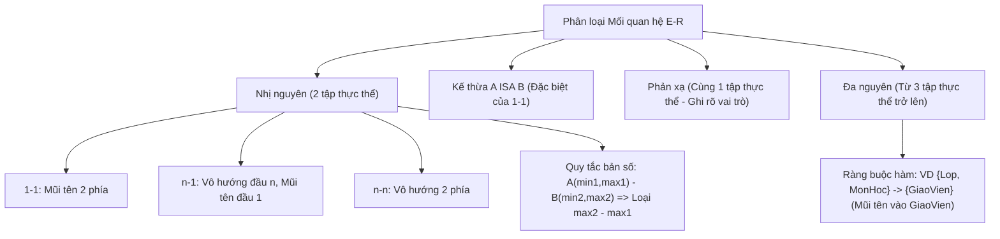
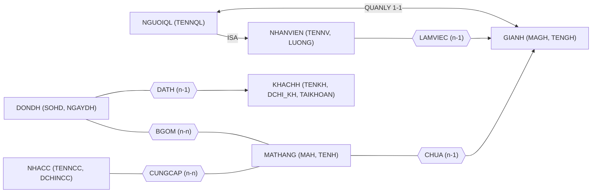

# Chương 2: Mô hình thực thể - quan hệ (E-R) (Phương pháp Ghi chép Cornell)

> **Hướng dẫn sử dụng Ghi chép Cornell:**
> - **Cột Trái (Cue Column):** Chứa từ khóa, thuật ngữ cốt lõi và câu hỏi gợi nhớ để ôn tập chủ động.
> - **Cột Phải (Note-taking Column):** Chứa định nghĩa chuẩn xác, quy tắc vẽ sơ đồ, ví dụ minh họa và công thức/ràng buộc từ giáo trình.
> - **Phần Tổng kết (Summary):** Tóm tắt ngắn gọn ý chính cuối mỗi mục và tổng kết toàn chương nhằm củng cố trí nhớ dài hạn.

---

## 1. Quá trình Thiết kế Cơ sở Dữ liệu & Mục đích của Mô hình E-R (Mục 2.1)

| Từ khóa / Câu hỏi gợi nhớ | Ghi chú chi tiết (Nội dung cốt lõi) |
| :--- | :--- |
| **Mô hình dữ liệu là gì?** | - Là một hệ thống các **ký hiệu** sử dụng để mô tả dữ liệu và một tập các **phép toán** dùng để xử lý dữ liệu đó. - Các khái niệm được xây dựng nhờ **cơ chế trừu tượng** và được mô tả thông qua **ngôn ngữ** và **đồ họa**. - Trong Chương 2, trọng tâm là các cách tiếp cận mô hình hóa dữ liệu (chưa đi sâu vào phép toán thao tác). |
| **Nguồn gốc & bản chất Mô hình E-R** | - Do **Peter Chen** đề xuất năm **1976**, được sử dụng rất phổ biến trong thiết kế CSDL. - Là **mô hình khái niệm** dựa vào việc nhận thức thế giới thực thông qua tập các đối tượng (**thực thể**) và các **mối quan hệ** giữa chúng. |
| **Quá trình thiết kế CSDL gồm mấy bước?** | Gồm **4 bước** tuần tự: 1. **Bước 1 – Tập hợp và phân tích yêu cầu hệ thống:** Thu thập yêu cầu của người sử dụng, từ đó phân tích và xác định **yêu cầu chức năng (Functional Requirements)** của hệ thống. 2. **Bước 2 – Thiết kế khái niệm (Conceptual Design):** Chọn một mô hình dữ liệu (như E-R), chuyển đặc tả yêu cầu ở Bước 1 thành **lược đồ khái niệm** (độc lập DBMS). Tập trung đặc tả tính chất dữ liệu (chưa quan tâm chi tiết lưu trữ), đồng thời bao gồm đặc tả yêu cầu chức năng và các thao tác (giao tác) trên dữ liệu. 3. **Bước 3 – Thiết kế logic / Ánh xạ mô hình dữ liệu (Logical Design):** Cài đặt CSDL bằng một **hệ QTCSDL cụ thể**. Chuyển đổi lược đồ khái niệm từ mô hình dữ liệu bậc cao sang **mô hình dữ liệu thể hiện** (như mô hình quan hệ hoặc mô hình hướng đối tượng). Kết quả là lược đồ CSDL dưới dạng mô hình dữ liệu thể hiện của DBMS. 4. **Bước 4 – Thiết kế vật lý (Physical Design):** Đặc tả các đặc điểm vật lý của CSDL, bao gồm **cấu trúc lưu trữ bên trong** và **kiểu tổ chức tệp** cho CSDL (lược đồ bên trong). |
| **Mục đích của Mô hình E-R là gì?** | Mô hình E-R mô tả logic chi tiết dữ liệu của một tổ chức/nghiệp vụ, giúp mô tả thế giới thực gần gũi với cách nhìn bình thường của con người và là công cụ phân tích thông tin nghiệp vụ với **3 mục đích chính**: 1. **Thống nhất quan điểm về dữ liệu** giữa những người tham gia hệ thống: người quản lý, người dùng cuối, người thiết kế hệ thống. 2. **Xác định các xử lý về dữ liệu** cũng như **các ràng buộc** trên dữ liệu. 3. **Thể hiện CSDL về mặt cấu trúc:** sử dụng thực thể và các mối liên kết giữa chúng, biểu diễn mô hình bằng **sơ đồ E-R**. |

> **Tóm tắt Mục 1 (Cornell Summary):** Quá trình thiết kế CSDL trải qua 4 bước từ trừu tượng đến cụ thể: *Phân tích yêu cầu $\rightarrow$ Thiết kế khái niệm $\rightarrow$ Thiết kế logic $\rightarrow$ Thiết kế vật lý*. Mô hình E-R (Peter Chen, 1976) đóng vai trò cốt lõi ở Bước 2 nhằm thống nhất quan điểm dữ liệu, xác định ràng buộc/xử lý và trực quan hóa cấu trúc dữ liệu bằng sơ đồ.

---

## 2. Các Khái niệm Cơ bản của Mô hình Thực thể - Quan hệ (Mục 2.2 - 2.3)

| Từ khóa / Câu hỏi gợi nhớ | Ghi chú chi tiết (Nội dung cốt lõi) |
| :--- | :--- |
| **Thực thể (Entity) là gì?** | - Là một **vật thể tồn tại và phân biệt được** với các vật thể khác. - *Ví dụ:* Mỗi cán bộ giảng dạy trong trường đại học, mỗi sinh viên, mỗi môn học, mỗi xe máy là một thực thể. |
| **Tập thực thể (Entity Set) là gì?** | - Một nhóm bao gồm các thực thể **"tương tự" nhau** tạo thành một tập thực thể. - *Ví dụ:* Tập hợp các sinh viên Khoa CNTT (mỗi sinh viên là 1 thực thể); tập hợp các môn học ngành Tin học; tập lớp học, tập khoa, tập giảng viên, tập xe máy mang biển số tỉnh A. |
| **Thuộc tính (Attribute) & Miền giá trị (Domain)** | - **Thuộc tính:** Tập hữu hạn các tính chất đặc trưng dùng để mô tả các thực thể trong một tập thực thể (việc chọn thuộc tính tùy thuộc mục đích bài toán). - Mỗi thực thể được xác định bởi một **bộ giá trị** của các thuộc tính. - **Miền giá trị:** Tập các giá trị hợp lệ có thể gán cho một thuộc tính. - *Ví dụ:*   - `Sinh viên`: Họ tên, Ngày sinh, Phái, Mã lớp, Mã SV.   - `Lớp học`: Mã lớp, Tên lớp, Niên khóa, Số sinh viên.   - `Môn học`: Mã môn học, Tên môn học, Số ĐVHT. |
| **Khóa (Key) của tập thực thể** | - **Định nghĩa:** Một thuộc tính hoặc một tập các thuộc tính mà giá trị của nó **xác định duy nhất** mỗi thực thể trong tập thực thể. - **Nguyên tắc:** Mọi tập thực thể đều phải có khóa để đảm bảo phân biệt được các thực thể với nhau. - **Tính phụ thuộc ngữ cảnh:** Việc chọn khóa có thể khác nhau tùy hoàn cảnh:   - Tập `Người`: xét tại Việt Nam dùng **Số CCCD**; xét trên nhiều nước phải dùng **{Số CCCD, Quốc tịch}**.   - Tập `Sinh viên`: dùng **Họ tên** (nếu không trùng), hoặc **{Họ tên, Ngày sinh}**, hoặc tốt nhất là **Mã sinh viên**.   - Tập `Lớp học`: **Mã lớp**; Tập `Môn học`: **Mã môn học**; Tập `ĐiểmHT`: **{MASV, MAMH}**. |
| **Mối quan hệ (Relationship) & Thuộc tính của mối quan hệ** | - **Mối quan hệ:** Biểu thị các liên hệ ràng buộc lẫn nhau giữa các tập thực thể.   - *Ví dụ:* `NHANVIEN` có mối quan hệ `"Thuộc"` với `PHONGBAN`; `SINHVIEN` có mối quan hệ `"học trong"` với `LOPHOC`. - **Thuộc tính của mối quan hệ:** Một mối quan hệ cũng có thể có các thuộc tính riêng (đặc biệt thường gặp ở các **mối quan hệ n-n**, ví dụ thuộc tính `TG` trên quan hệ `Yeu`, hay số lượng/đơn giá trên chi tiết đơn hàng). - **Quy ước:** Các thuộc tính của một mối quan hệ **chỉ là các thuộc tính đơn trị**. |
| **Ký hiệu Sơ đồ E-R & Mở rộng** | Sơ đồ thực thể - quan hệ dùng 3 ký hiệu hình học cơ bản: - **Hình chữ nhật:** Biểu diễn **tập thực thể**. - **Hình oval:** Biểu diễn **thuộc tính**, liên kết với tập thực thể (hoặc mối quan hệ) bằng **cạnh vô hướng**. - **Hình thoi:** Biểu diễn **mối quan hệ**, liên kết với các tập thực thể bằng **cạnh vô hướng** hoặc **cạnh có hướng**. - *Quy ước mũi tên cơ bản:* Cạnh có hướng (mũi tên) trỏ vào **đầu 1**, cạnh vô hướng nối vào **đầu nhiều (n)**. - *Mở rộng:* Từ mô hình E-R gốc đã phát triển các **mô hình E-R mở rộng** (ví dụ **UML**) nhằm biểu diễn sự phong phú và phức tạp của thế giới thực. |

> **Tóm tắt Mục 2 (Cornell Summary):** Bốn thành phần nền tảng của mô hình E-R gồm *Thực thể / Tập thực thể* (hình chữ nhật), *Thuộc tính* (hình oval, có miền giá trị và *Khóa* xác định duy nhất), và *Mối quan hệ* (hình thoi, có thể có thuộc tính đơn trị riêng). Sơ đồ E-R chuẩn hóa cách biểu diễn trực quan các thành phần này bằng cạnh vô hướng và có hướng.

---

## 3. Phân loại Mối quan hệ: Nhị nguyên, Kế thừa (Is-a), Phản xạ và Đa nguyên (Mục 2.4)

| Từ khóa / Câu hỏi gợi nhớ | Ghi chú chi tiết (Nội dung cốt lõi) |
| :--- | :--- |
| **Mối quan hệ nhị nguyên: 1-1 (Một - Một)** | - **Định nghĩa:** Mối quan hệ `R` giữa `A` và `B` là **1-1** nếu mỗi thực thể của `A` quan hệ với **duy nhất 1** thực thể của `B` và ngược lại. - **Ví dụ:** `KHOA` – `QUANLY` – `TRUONGKHOA` (mỗi khoa có 1 trưởng khoa, mỗi trưởng khoa quản lý 1 khoa); `Thí sinh` – `Số báo danh`. - **Biểu diễn E-R:** Vẽ các **cạnh định hướng (mũi tên)** từ hình thoi `R` đến **cả hai** hình chữ nhật `A` và `B`. |
| **Mối quan hệ nhị nguyên: n-1 (Nhiều - Một)** | - **Định nghĩa:** `R` là mối quan hệ **nhiều - một (n-1)** từ `A` vào `B` nếu mỗi thực thể của `B` có quan hệ với **0 hoặc nhiều** thực thể của `A`, và mỗi thực thể của `A` có quan hệ với **nhiều nhất 1** thực thể của `B`. - **Ví dụ:** `NHANVIEN` – `LAMVIEC` – `KHOA` (nhiều nhân viên làm trong 1 khoa); `Sinh viên` – `học` – `Lớp học`; `Đơn đặt hàng` – `đặt hàng` – `Khách hàng`. - **Biểu diễn E-R:** Vẽ **cung không định hướng** từ hình thoi `R` vào `A` (đầu nhiều) và **cạnh định hướng (mũi tên)** từ `R` đến `B` (đầu 1). - **Nhận xét & Tổng quát hóa:** Đây là loại quan hệ **có ý nghĩa nhất, cung cấp nhiều thông tin nhất** (từ 1 đầu `B` tìm ra các phần tử `A`, từ 1 phần tử `A` xác định duy nhất `B`). Có thể **tổng quát hóa cho $\ge 3$ tập thực thể** $E_1, E_2, \dots, E_{k-1} \rightarrow E_k$ (cạnh vô hướng vào $E_1 \dots E_{k-1}$, mũi tên vào $E_k$). *VD:* `{Sinh viên, Môn học} -> Điểm Thi`; `{Môn học, Lớp học} -> Giảng viên`. |
| **Mối quan hệ nhị nguyên: n-n (Nhiều - Nhiều)** | - **Định nghĩa:** Mỗi thực thể của `A` có quan hệ `R` với **0 hoặc nhiều** thực thể của `B` và ngược lại, mỗi thực thể của `B` có quan hệ `R` với **0 hoặc nhiều** thực thể của `A`. - **Ví dụ:** `SINHVIEN` – `BIET` – `NGOAINGU`; `Người bán xe máy` – `Loại xe máy`; `Sinh viên` – `Môn học`; `Nhà cung cấp` – `Mặt hàng`. - **Biểu diễn E-R:** Vẽ các **cạnh không định hướng** từ hình thoi `R` vào cả `A` và `B`. |
| **Ràng buộc bản số `(min, max)` & Công thức xác định loại quan hệ** | - Trên mỗi cung nối giữa hình chữ nhật và hình thoi ghi cặp bản số `(min, max)` (nếu giá trị lớn hơn 1 viết tắt là `n`). - Xét mô hình: `A — (min1, max1) — R — (min2, max2) — B`:   - Mỗi phần tử của `A` quan hệ với ít nhất `min1` và nhiều nhất `max1` phần tử của `B`.   - Mỗi phần tử của `B` quan hệ với ít nhất `min2` và nhiều nhất `max2` phần tử của `A`. - **Quy tắc xác định loại quan hệ:** Loại quan hệ `R` giữa `A` và `B` là **`max2 - max1`**. - *Ví dụ:* `Sinhvien (1,1) — tai — (1,n) Lop` $\Rightarrow$ `max1 = 1`, `max2 = n` $\Rightarrow$ Quan hệ `n - 1` (từ `Sinhvien` vào `Lop`). |
| **Mối quan hệ Kế thừa (`Is-a`)** | - **Định nghĩa:** `A` có quan hệ Is-a với `B` (ký hiệu **`A ISA B`**) nếu mỗi thực thể của `A` cũng là một thực thể của `B` (`A` là dạng đặc biệt của `B`). - **Tính chất:** Mọi thực thể thuộc `A` đều thuộc `B`; `A` **kế thừa toàn bộ thuộc tính của `B`** và có thể có **thêm các thuộc tính riêng**. - **Bản chất:** Là trường hợp đặc biệt của mối quan hệ nhị nguyên **1-1**. - **Ví dụ:** `Người quản lý phòng ban` ISA `Nhân viên`; `Cán bộ giảng dạy` ISA `Cán bộ, nhân viên trong trường`. |
| **Mối quan hệ Phản xạ (Recursive)** | - **Định nghĩa:** Mối quan hệ giữa các thực thể thuộc **cùng một tập thực thể**. - **Lưu ý bắt buộc:** Phải xác định rõ **tên vai trò** gắn với từng bản số ở hai nhánh nối về cùng tập thực thể. - **3 dạng phản xạ tương ứng:**   1. **Phản xạ 1-n (`LaCha` trên `Người`):** Nhánh `Cha(1,1)` và nhánh `Con(0,n)`. Ngữ nghĩa: `(n1, n2) ∈ LaCha ⇔ n1 là cha của n2` (1 người có đúng 1 cha, có thể có 0 đến n con).   2. **Phản xạ 1-1 (`KetHon` trên `Người`):** Nhánh `Vo(0,1)` và nhánh `Chong(0,1)`. Ngữ nghĩa: `(n1, n2) ∈ KetHon ⇔ n1 hiện là chồng của n2`.   3. **Phản xạ n-n (`Yeu` trên `Người(Id, HT, NS)` có thuộc tính `TG`):** Nhánh `YeuAi(0,n)` và nhánh `AiYeu(0,n)`. Ngữ nghĩa: `(n1, n2) ∈ Yeu ⇔ n1 từng yêu n2 trong thời gian TG`. |
| **Mối quan hệ Đa nguyên & Ràng buộc hàm** | - **Định nghĩa:** Mối quan hệ giữa **3 tập thực thể trở lên**. - **Ví dụ:** `Day` giữa 3 tập `GiaoVien`, `Lop`, `MonHoc`: `(g, l, m) ∈ Day ⇔ giáo viên g dạy môn m cho lớp l vào học kỳ hk của năm học n`. - **Ràng buộc hàm (Functional Dependency):** Trong quan hệ đa nguyên, ngoài bản số còn có **ràng buộc hàm**. Ví dụ: **`{Lop, MonHoc} -> {GiaoVien}`** (đọc là: *Lớp và Môn học xác định Giáo viên* – biết lớp `l` và môn `m` thì xác định **tối đa 1** giáo viên `g`). - **Cách vẽ trên E-R:** Tập thực thể bị xác định (`GiaoVien`) được nối bằng **cung có mũi tên** từ hình thoi `Day` hướng vào `GiaoVien`; các tập còn lại (`Lop`, `MonHoc`) nối bằng **cạnh vô hướng**. |

> **Tóm tắt Mục 3 (Cornell Summary):** Các mối quan hệ E-R chia làm 4 nhóm: *Nhị nguyên* (1-1, n-1, n-n xác định qua công thức bản số `max2 - max1`), *Kế thừa `A ISA B`* (đặc biệt của 1-1), *Phản xạ* (cần gán tên vai trò cho từng bản số), và *Đa nguyên* ($\ge 3$ tập thực thể, kết hợp mũi tên biểu diễn *ràng buộc hàm*).

---

## 4. Phân tích Hệ thống Ví dụ Thực tế trên Mô hình E-R (Mục 2.5)

| Từ khóa / Câu hỏi gợi nhớ | Ghi chú chi tiết (Nội dung cốt lõi) |
| :--- | :--- |
| **Ví dụ 1: Hệ thống Quản lý Nhân viên – Phòng ban** | - **3 tập thực thể:** `NHANVIEN`, `PHONGBAN`, `NGUOI_QLY` (hoặc `NGUOI_QL` với thuộc tính `TENQL`). - **Mối quan hệ 1 (`NHANVIEN` – `LAMVIEC` – `PHONGBAN`):** Quan hệ **nhiều - một (n-1)** vì mỗi nhân viên chỉ làm việc trong 1 phòng ban, còn 1 phòng ban có nhiều nhân viên. Vẽ cạnh vô hướng vào `NHANVIEN` và mũi tên vào `PHONGBAN`. - **Mối quan hệ 2 (`PHONGBAN` – `QUANLY` – `NGUOI_QLY`):** Quan hệ **một - một (1-1)** vì mỗi phòng chỉ có 1 người quản lý và mỗi người quản lý chỉ quản lý 1 phòng. Vẽ mũi tên vào cả `PHONGBAN` và `NGUOI_QLY`. |
| **Ví dụ 2: Hệ thống Siêu thị Bán hàng (7 tập thực thể)** | **Danh sách 7 tập thực thể & thuộc tính:** 1. `NHACC` (Nhà cung cấp): `TENNCC`, `DCHINCC`. 2. `MATHANG` (Mặt hàng): `MAH` (khóa), `TENH`. 3. `GIANH` (Gian hàng): `MAGH` (khóa), `TENGH`. 4. `NHANVIEN` (Nhân viên): `TENNV`, `LUONG`. 5. `NGUOIQL` (Người quản lý): `TENNQL`. 6. `KHACHH` (Khách hàng): `TENKH`, `DCHI_KH` (`DCHIKH`), `TAIKHOAN`. 7. `DONDH` (Đơn đặt hàng): `SOHD` (khóa), `NGAYDH` (`NGAYHD`). |
| **7 Mối quan hệ trong Hệ thống Siêu thị** | 1. **`MATHANG` – `CUNGCAP` – `NHACC` (`n-n`):** 1 NCC cung ứng nhiều mặt hàng, 1 mặt hàng do nhiều NCC cung ứng (2 cạnh vô hướng). 2. **`MATHANG` – `CHUA` – `GIANH` (`n-1`):** 1 gian hàng bán nhiều mặt hàng, 1 mặt hàng chỉ bán tại 1 gian hàng nhất định (mũi tên vào `GIANH`). 3. **`NHANVIEN` – `LAMVIEC` – `GIANH` (`n-1`):** 1 gian hàng có nhiều nhân viên, 1 nhân viên làm tại 1 gian hàng (mũi tên vào `GIANH`). 4. **`NGUOIQL` – `ISA` – `NHANVIEN` (`Is-a`):** Người quản lý gian hàng cũng là nhân viên của siêu thị. 5. **`NGUOIQL` – `QUANLY` – `GIANH` (`1-1`):** Mỗi gian hàng có 1 người quản lý và mỗi người quản lý phụ trách 1 gian hàng (mũi tên 2 phía). 6. **`DONDH` – `DATH` – `KHACHH` (`n-1`):** 1 khách hàng đặt nhiều đơn hàng, 1 đơn hàng thuộc về 1 khách hàng (mũi tên vào `KHACHH`). 7. **`DONDH` – `BGOM / BAOGOM` – `MATHANG` (`n-n`):** 1 đơn đặt hàng chứa nhiều mặt hàng, 1 mặt hàng nằm trong nhiều đơn hàng (2 cạnh vô hướng). |

> **Tóm tắt Mục 4 (Cornell Summary):** Hai bài toán mẫu trong Mục 2.5 minh họa đầy đủ cách chuyển mô tả nghiệp vụ thực tế sang sơ đồ E-R: kết hợp linh hoạt quan hệ `1-1` (`QUANLY`), `n-1` (`LAMVIEC`, `CHUA`, `DATH`), `n-n` (`CUNGCAP`, `BGOM`) và kế thừa `ISA` (`NGUOIQL ISA NHANVIEN`), đảm bảo hướng mũi tên luôn chỉ vào đầu `1`.

---

## Tóm tắt toàn chương (Cornell Summary)

1. **Quy trình 4 bước thiết kế CSDL:** Thu thập & phân tích yêu cầu $\rightarrow$ Thiết kế khái niệm (E-R, độc lập DBMS) $\rightarrow$ Thiết kế logic (ánh xạ sang mô hình thể hiện của DBMS) $\rightarrow$ Thiết kế vật lý (lưu trữ & tổ chức tệp).
2. **Mô hình E-R (Peter Chen, 1976):** Biểu diễn thế giới thực bằng **Tập thực thể** (chữ nhật), **Thuộc tính & Khóa** (oval, gạch chân/xác định duy nhất thực thể) và **Mối quan hệ** (thoi, có thể có thuộc tính đơn trị riêng).
3. **Bản số & Hướng vẽ mũi tên:** Trên cung `A (min1, max1) — R — (min2, max2) B`, loại quan hệ là **`max2 - max1`**. Khi vẽ, **mũi tên luôn hướng về đầu 1**, **cạnh vô hướng nối về đầu n**:
   - `1-1`: mũi tên cả 2 phía.
   - `n-1`: vô hướng phía `n`, mũi tên phía `1`.
   - `n-n`: vô hướng cả 2 phía.
4. **Mối quan hệ mở rộng trong Chương 2:**
   - **Kế thừa `A ISA B`:** Dạng đặc biệt của `1-1`, thực thể `A` kế thừa toàn bộ thuộc tính của `B` và bổ sung thuộc tính riêng.
   - **Phản xạ:** Quan hệ trên cùng 1 tập thực thể, bắt buộc ghi **tên vai trò** ở mỗi nhánh bản số (`LaCha`, `KetHon`, `Yeu`).
   - **Đa nguyên ($\ge 3$ tập thực thể):** Ngoài bản số, sử dụng **ràng buộc hàm** (như `{Lop, MonHoc} -> {GiaoVien}`) bằng cách vẽ mũi tên vào tập thực thể bị xác định.

---

## Câu hỏi tự kiểm tra nhanh (Self-Testing Cues)

1. **Thử thách quy trình:** Sự khác biệt cốt lõi giữa *Bước 2 (Thiết kế khái niệm)* và *Bước 3 (Thiết kế logic)* trong quá trình thiết kế CSDL là gì? Sản phẩm của từng bước là gì?
2. **Thử thách công thức bản số:** Nếu sơ đồ E-R ghi `SINHVIEN (1,1) — DANGKY — (0,n) LOPHOC`, hãy áp dụng công thức `max2 - max1` để xác định loại mối quan hệ và chỉ ra đầu nào có mũi tên.
3. **Thử thách phản xạ:** Tại sao khi biểu diễn mối quan hệ phản xạ (`LaCha`, `KetHon`, `Yeu`) trên cùng một tập thực thể `NGUOI`, việc ghi tên vai trò lại bắt buộc? Hãy phân biệt bản số của `LaCha` và `KetHon`.
4. **Thử thách đa nguyên:** Trong mối quan hệ tam nguyên `Day` giữa `GiaoVien`, `Lop`, `MonHoc`, ràng buộc hàm `{Lop, MonHoc} -> {GiaoVien}` có ý nghĩa nghiệp vụ gì và được vẽ bằng ký hiệu nào trên sơ đồ E-R?
5. **Thử thách kế thừa:** Trong hệ thống siêu thị (Ví dụ 2 Mục 2.5), tại sao `NGUOIQL` lại có mối quan hệ `ISA` với `NHANVIEN`, đồng thời có mối quan hệ `1-1` (`QUANLY`) với `GIANH`?
