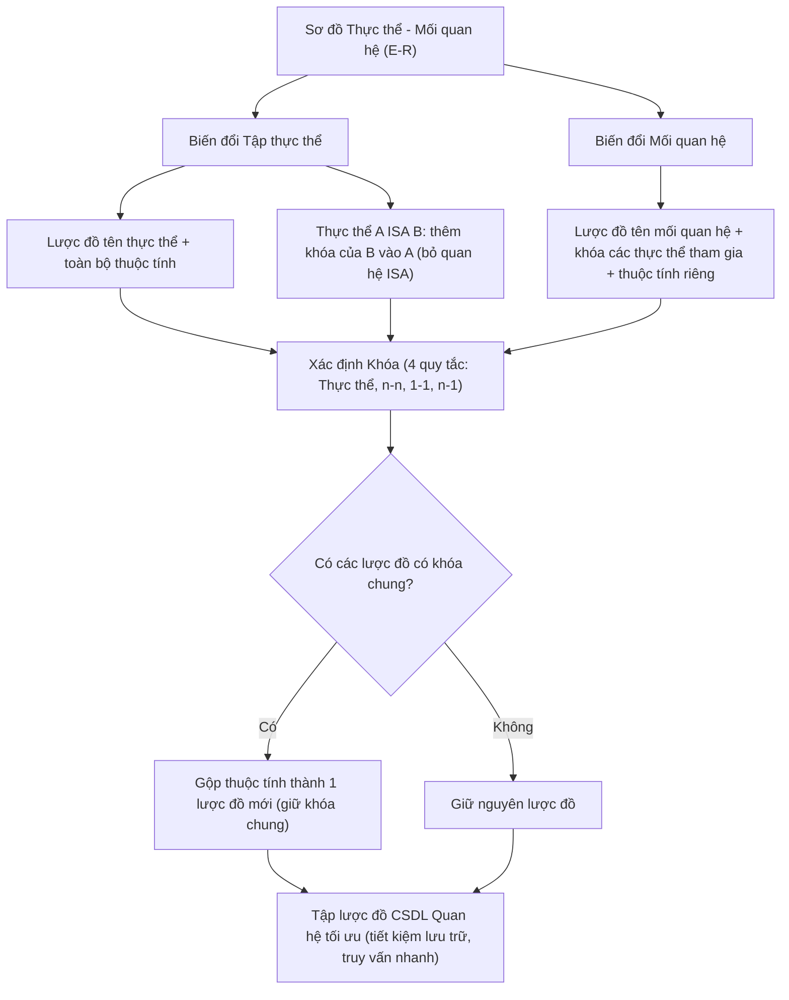
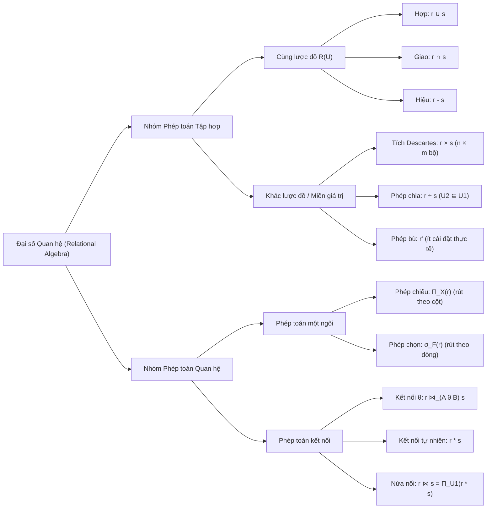

# Chương 3: Mô hình dữ liệu quan hệ & Đại số quan hệ (Phương pháp Ghi chép Cornell)

> **Hướng dẫn học tập theo Phương pháp Ghi chép Cornell (Cornell Note-taking System):**
> - **Cột Trái (Cue Column — Từ khóa / Câu hỏi gợi nhớ):** Chứa các khái niệm cốt lõi, ký hiệu toán học và câu hỏi ôn tập nhanh để tự kiểm tra khả năng ghi nhớ chủ động.
> - **Cột Phải (Note-taking Column — Ghi chú chi tiết):** Trình bày đầy đủ định nghĩa, quy tắc biến đổi, công thức đại số quan hệ và các ví dụ minh họa chuẩn theo giáo trình.
> - **Phần Tổng kết (Cornell Summary):** Khối tóm tắt ngắn gọn ngay sau mỗi mục lớn và tổng kết toàn chương giúp hệ thống hóa kiến thức nhanh chóng.

---

## 1. Giới thiệu & Các Khái niệm Cơ bản của Mô hình Dữ liệu Quan hệ (Mục 3.1 - 3.2)

| Từ khóa / Câu hỏi gợi nhớ | Ghi chú chi tiết (Nội dung cốt lõi) |
| :--- | :--- |
| **Nguồn gốc & Vai trò của Mô hình Dữ liệu Quan hệ** | - Do **E.F. Codd** đề xuất năm **1970**. - Nền tảng cơ bản dựa trên **lý thuyết tập hợp trên các quan hệ**. - Là cơ sở của các hệ quản trị CSDL (HQTCSDL) phổ biến như **Oracle, SQL Server,...** và nền tảng cho nhiều mô hình dữ liệu tiên tiến. - Dữ liệu được mô tả dưới dạng **bảng (table)** gồm các hàng và cột; mỗi hàng biểu thị một sự kiện tương ứng với một thực thể hay một mối quan hệ trong thế giới thực (VD: Bảng `HỒ SƠ CÁN BỘ`, Bảng `THUÊ PHÒNG`). |
| **Thuộc tính (`Attribute`) & Miền giá trị `Dom(A)` là gì?** | - **Thuộc tính:** Là các tính chất riêng biệt của đối tượng được khảo sát (VD: đối tượng `KHOA` có `MaKhoa, TenKhoa`; `LOPHOC` có `MaLop, TenLop, NienKhoa, SoHV, MaKhoa`; `MONHOC` có `MaMon, TenMon, SoTinChi`). - Đặc trưng bởi 3 yếu tố: **tên thuộc tính**, **kiểu dữ liệu** (kiểu chuẩn như chuỗi, số, logic hoặc kiểu có cấu trúc) và **miền giá trị**. - **Miền giá trị `Dom(A)`:** Tập hợp các giá trị mà thuộc tính $A$ có thể nhận. - Nếu $A$ thuộc kiểu bản ghi (cấu trúc), `Dom(A)` là tích Descartes (hoặc tập con của tích Descartes) của các miền giá trị thành phần. VD: Kiểu `DATE` gồm `(day: 1..31, month: 1..12, year: 0..2500)` thì $Dom(A) \subseteq [1..31] \times [1..12] \times [0..2500]$ (vì loại bỏ các ngày không hợp lệ như `30/2/99`). |
| **Lược đồ quan hệ `R(U)`** | - Cho tập hữu hạn các thuộc tính $U = \{A_1, A_2, \dots, A_n\}$. - **Lược đồ quan hệ (Relation Schema)** được đặc trưng bởi tên phân biệt $R$ và tập thuộc tính $U$, ký hiệu: $R(A_1, \dots, A_n)$ hoặc $R(U)$. - Lược đồ quan hệ đóng vai trò là **cấu trúc** của bảng. - VD: `KHOA(MaKhoa, TenKhoa)`, `HOCVIEN(MaHV, MaLop, TenHV, NamSinh, QueQuan)`. |
| **Bộ giá trị (`Tuple`) & Phép chiếu bộ** | - **Bộ giá trị (mẫu tin / bản ghi):** Thông tin của một đối tượng thuộc một lược đồ quan hệ. - Về mặt toán học, bộ $t$ là vector $n$ thành phần thuộc tập con tích Descartes của các miền giá trị: $t = (a_1, \dots, a_n) \in Dom(A_1) \times Dom(A_2) \times \dots \times Dom(A_n)$. - VD: $t = (\text{SV001, QTKD, Nguyen Van Nam, 26/3/2003, Hue})$ trên lược đồ `HOCVIEN`. - Lấy giá trị tại thuộc tính $A_i$ của bộ $t$: ký hiệu **$t.A_i$** hoặc **$t[A_i]$** (gọi là phép chiếu bộ $t$ lên thuộc tính $A_i$). |
| **Quan hệ `r(R)` & CSDL quan hệ** | - **Quan hệ `r(R)` (Relation):** Là một **thể hiện** của lược đồ quan hệ $R$ tại một thời điểm xác định: $r(R) = \{t = (a_1, \dots, a_n) \mid a_i \in Dom(A_i)\}$. - Xem như một bảng gồm các bộ giá trị cụ thể. - **2 tính chất lưu ý:** (1) Trên cùng một lược đồ $R(U)$ có thể xây dựng nhiều quan hệ khác nhau theo thời gian; (2) Trên cùng một quan hệ **không có hai bộ trùng nhau**. - **Thuật ngữ:** Tập các lược đồ quan hệ trong một hệ thống thông tin gọi là **mô hình CSDL quan hệ** (gọi tắt là **mô hình quan hệ**); tập hợp các quan hệ hiện hành của các lược đồ đó gọi là **cơ sở dữ liệu quan hệ**. |
| **Định nghĩa toán học của Khóa (`Key`)?** | Cho lược đồ $R(A_1, \dots, A_n)$, quan hệ $r(R)$ bất kỳ và $K \subseteq \{A_1, \dots, A_n\}$. Tập $K$ là **khóa** của $R$ nếu thỏa mãn **2 tính chất**: 1. **Tính phân biệt duy nhất:** $\forall t_1, t_2 \in r, \; t_1 \neq t_2 \Rightarrow t_1[K] \neq t_2[K]$ (hai bộ khác nhau thì giá trị khóa phải khác nhau). 2. **Tính tối tiểu:** $\forall K' \subsetneq K$, $K'$ **không** thỏa mãn tính chất 1 (tức $K$ là tập nhỏ nhất). - **Ý nghĩa thực tế:** Chỉ cần biết giá trị khóa của $t$ là đủ dò tìm và xác định duy nhất bộ $t$ trong quan hệ. - **Chú ý:** Khóa không được có giá trị rỗng (`NULL`). |
| **Siêu khóa (`Super Key`), Khóa chính (`Primary Key`), Thuộc tính khóa** | - **Siêu khóa ($K'$):** Nếu $K$ là một khóa của $R$ và $K' \supseteq K$ thì $K'$ là siêu khóa. Siêu khóa thỏa tính chất phân biệt duy nhất nhưng **chưa tối tiểu** (có thể bớt thuộc tính). VD: `NHANVIEN` có khóa `{MaNV}` và siêu khóa `{MaNV, HoTen}`; `LOPHOC` có khóa `MaLop` và siêu khóa `{MaLop, TenLop}`, `{MaLop, TenLop, SoSV}`. - **Khóa chính (`Primary Key`):** Một lược đồ có thể có nhiều khóa; khi cài đặt trên HQTCSDL (Access, Visual Fox, Oracle, Paradox,...), người thiết kế chọn một khóa làm khóa chính để tự động kiểm tra tính duy nhất (báo lỗi nếu thêm bộ trùng khóa chính). - **Thuộc tính khóa:** Thuộc tính tham gia vào khóa (thường được **gạch dưới** trong lược đồ, không chứa giá trị rỗng); các thuộc tính còn lại là **thuộc tính không khóa**. VD: `KQTHI(<u>MaHV</u>, <u>MaMon</u>, NgayThi, DiemThi)`. |
| **Khóa ngoại (`Foreign Key`) & 2 điều kiện tham chiếu** | Cho 2 lược đồ $R_1(U_1)$ có khóa chính $PK \subseteq U_1$ và $R_2(U_2)$. Tập thuộc tính $FK \subseteq U_2$ là **khóa ngoại** của $R_2$ tham chiếu đến khóa chính $PK$ của $R_1$ nếu thỏa **2 điều kiện**: 1. **Miền giá trị của $FK$ trùng với miền giá trị của $PK$.** 2. **Giá trị của $FK$ hoặc là `NULL`, hoặc phải bằng một giá trị hiện có nào đó của $PK$.** - VD: `MaLop` là khóa ngoại của `SINHVIEN` tham chiếu đến khóa chính `#MaLop` của `LOP`; `MaKhoa` là khóa ngoại của `LOPHOC` tham chiếu đến `KHOA.MaKhoa`. |

> **Tóm tắt Mục 1 (Cornell Summary):** Mô hình dữ liệu quan hệ (E.F. Codd, 1970) tổ chức dữ liệu thành các bảng (quan hệ $r(R)$) tuân theo cấu trúc lược đồ $R(A_1, \dots, A_n)$, trong đó mỗi thuộc tính có miền giá trị $Dom(A)$ và mỗi hàng là một bộ $t$ không trùng lặp. Tính toàn vẹn định danh và liên kết được đảm bảo qua **Khóa** (duy nhất + tối tiểu, không `NULL`), **Siêu khóa**, **Khóa chính** và **Khóa ngoại** (tham chiếu đúng miền trị và giá trị tồn tại hoặc `NULL`).

---

## 2. Chuyển đổi Mô hình E-R sang Mô hình Dữ liệu Quan hệ & Gộp Khóa Chung (Mục 3.3)

| Từ khóa / Câu hỏi gợi nhớ | Ghi chú chi tiết (Nội dung cốt lõi) |
| :--- | :--- |
| **Quy tắc biến đổi Tập thực thể (kể cả `ISA`)** | - Mỗi tập thực thể trong sơ đồ E-R chuyển thành **một lược đồ quan hệ** có tên là tên tập thực thể và chứa tất cả các thuộc tính của tập thực thể đó. - VD: Tập thực thể `KHACHH` $\rightarrow$ `KHACHH(TENKH, DCHIKH, TAIKHOAN)`. - **Trường hợp đặc biệt `ISA` (kế thừa):** Nếu tập thực thể $A$ có mối quan hệ `ISA` với tập thực thể $B$, lược đồ quan hệ $A$ sẽ chứa thêm các **thuộc tính có trong khóa của $B$**. VD: Trong CSDL Siêu thị, `NGUOIQL` `ISA` `NHANVIEN` nên `NGUOIQL` chỉ có thuộc tính `TENNQL` chính là khóa `TENNV` của `NHANVIEN`. |
| **Quy tắc biến đổi Mối quan hệ** | - Một mối quan hệ giữa các tập thực thể được chuyển thành **một lược đồ quan hệ** có tên là tên mối quan hệ. - Tập thuộc tính gồm: **các thuộc tính khóa của tất cả các tập thực thể tham gia** vào mối quan hệ + **các thuộc tính riêng** của mối quan hệ (nếu có). - VD: `LAMVIEC` giữa `NHANVIEN` và `GIANH` $\rightarrow$ `LAMVIEC(TEN_NV, MA_GH)`; mối quan hệ `CUNGCAP` có thuộc tính riêng `GIA` $\rightarrow$ `CUNGCAP(TENCC, MAH, GIA)`. - **Chú ý:** Mối quan hệ `ISA` có thể **lược bỏ**, không chuyển thành lược đồ quan hệ. |
| **4 quy tắc thành lập khóa cho lược đồ quan hệ** | 1. **Từ tập thực thể:** Khóa của tập thực thể $\rightarrow$ khóa của lược đồ quan hệ. 2. **Từ mối quan hệ nhiều - nhiều ($n-n$):** Khóa của lược đồ quan hệ thường là **tập tất cả các thuộc tính khóa tham gia** (tất cả thuộc tính nhận từ các tập thực thể tham gia). 3. **Từ mối quan hệ một - một ($1-1$) giữa $A$ và $B$:** Khóa của $A$ **hoặc** khóa của $B$ đều là khóa cho lược đồ quan hệ (lược đồ có thể có nhiều hơn một khóa, VD: `QUANLY(TENNQL, MAGH)` có 2 khóa là `TENNQL` và `MAGH`). 4. **Từ mối quan hệ nhiều - một ($n-1$) từ $E_1, \dots, E_{k-1}$ đến $E_k$:** Khóa của lược đồ quan hệ sẽ là **hợp các thuộc tính khóa của phía nhiều** ($E_1, \dots, E_{k-1}$). |
| **Quy tắc gộp các lược đồ có khóa chung & 2 ưu điểm** | - **Nguyên tắc:** Khi hai (hoặc nhiều) lược đồ quan hệ có **khóa chung**, ta tổ hợp tập thuộc tính của chúng thành **một lược đồ quan hệ mới** với tập thuộc tính là hợp các thuộc tính ban đầu (giữ nguyên khóa chung). - **2 ưu điểm lớn:**   1. **Tiết kiệm không gian lưu trữ:** Tránh lặp lại các giá trị khóa trong nhiều quan hệ tách rời.   2. **Tăng tốc độ truy vấn:** Các truy vấn liên quan đến thuộc tính của các quan hệ đó được trả lời nhanh hơn vì không phải thực hiện kết nối nhiều bảng. |
| **Ví dụ 1: CSDL Cung ứng hàng hóa (`S, P, SP`)** | - Chuyển đổi từ sơ đồ E-R hệ thống cung ứng hàng hóa:   - `S(<u>S#</u>, SNAME, STATUS, CITY)`: Danh mục các hãng cung ứng.   - `P(<u>P#</u>, PNAME, COLOR, WEIGHT)`: Danh mục các mặt hàng.   - `SP(<u>S#</u>, <u>P#</u>, QTY)`: Các mặt hàng đã cung ứng với số lượng `QTY`. |
| **Ví dụ 2: CSDL Siêu thị (13 lược đồ $\rightarrow$ 8 lược đồ)** | - **Bước 1 (Chuyển E-R thành 13 lược đồ):**   - *7 thực thể:* `NHANVIEN(<u>TENNV</u>, LUONG)`, `NGUOIQL(<u>TENNQL</u>)`, `NHACC(<u>TENNCC</u>, DCHINCC)`, `MATHANG(TENH, <u>MAH</u>)`, `GIANH(TENGH, <u>MAGH</u>)`, `DONDH(<u>SODON</u>, NGAYDH)`, `KHACHH(<u>TENKH</u>, DCHIKH, TAIKHOAN)`.   - *6 mối quan hệ:* `LAMVIEC(<u>TENNV</u>, MAGH)`, `QUANLY(<u>TENNQL</u>, <u>MAGH</u>)` (1-1 nên có 2 khóa), `CHUA(<u>MAH</u>, MAGH)` (hay `BAN`), `CUNGCAP(<u>TENCC</u>, <u>MAH</u>, GIA)`, `BGOM(<u>MAH</u>, <u>SODON</u>, SOLUONG)`, `DATH(TENKH, <u>SODON</u>)`. - **Bước 2 (Gộp khóa chung thành 8 lược đồ):**   - `GIANH` + `QUANLY` (khóa `MAGH`) $\rightarrow$ `GIAN_H(<u>MAGH</u>, TENGH, TENNQL)`.   - `NHANVIEN` + `NGUOIQL` + `LAMVIEC` (khóa `TENNV`) $\rightarrow$ `NHANVIEN(<u>TENNV</u>, LUONG, MAGH)`.   - `MATHANG` + `CHUA`/`BAN` (khóa `MAH`) $\rightarrow$ `MAT_HANG(TENH, <u>MAH</u>, MAGH)`.   - `DONDH` + `DATH` (khóa `SODON`) $\rightarrow$ `DON_DH(<u>SODON</u>, NGAYDH, TENKH)`.   - Kết quả cuối cùng gồm **8 lược đồ**: `GIAN_H`, `NHANVIEN`, `MAT_HANG`, `DON_DH`, `NHA_CC`, `KHACH_H`, `CUNGCAP`, `BGOM`. |
| **Ví dụ 3: CSDL Xuất nhập kho (11 lược đồ $\rightarrow$ 8 lược đồ)** | - **Giả thiết:** Mỗi mặt hàng chỉ để ở một kho và mỗi kho chỉ chứa một mặt hàng. - **Bước 1 (11 lược đồ):**   - *6 thực thể:* `NHACUNGCAP(<u>MANCC</u>, TENNCC, DIACHINCC)`, `PHIEUNHAP(<u>SOPN</u>, NGAYNHAP)`, `KHO(<u>MAKHO</u>, DIACHIKHO)`, `MATHANG(<u>MAHANG</u>, TENHANG, DONGIA)`, `KHACHHANG(<u>MAKH</u>, TENKH, DIACHIKH)`, `PHIEUXUAT(<u>SOPX</u>, NGAYXUAT)`.   - *5 mối quan hệ:* `NHAPTU(MANCC, <u>SOPN</u>)`, `CACKHOANNHAP(<u>SOPN</u>, <u>MAHANG</u>, SOLUONGNHAP)`, `CHUA(MAKHO, <u>MAHANG</u>)`, `XUATCHO(MAKH, <u>SOPX</u>)`, `CACKHOANXUAT(<u>SOPX</u>, <u>MAHANG</u>, SOLUONGXUAT)`. - **Bước 2 (Gộp khóa chung thành 8 lược đồ):**   - Gộp `PHIEUNHAP` + `NHAPTU` $\rightarrow$ `PHIEUNHAP(<u>SOPN</u>, NGAYNHAP, MANCC)`.   - Gộp `MATHANG` + `CHUA` $\rightarrow$ `MATHANG(<u>MAHANG</u>, TENHANG, DONGIA, MAKHO)`.   - Gộp `PHIEUXUAT` + `XUATCHO` $\rightarrow$ `PHIEUXUAT(<u>SOPX</u>, NGAYXUAT, MAKH)`.   - Giữ nguyên 5 lược đồ còn lại: `NHACUNGCAP`, `KHO`, `KHACHHANG`, `CACKHOANNHAP`, `CACKHOANXUAT` $\Rightarrow$ Tổng cộng **8 lược đồ**. |

### Sơ đồ Quy trình Chuyển đổi Mô hình E-R sang Mô hình Quan hệ & Gộp Khóa Chung

> **Tóm tắt Mục 2 (Cornell Summary):** Chuyển đổi E-R sang mô hình quan hệ thực hiện qua 3 bước: (1) biến đổi thực thể và mối quan hệ (riêng quan hệ `ISA` lược bỏ, đưa khóa thực thể cha vào thực thể con), (2) xác định khóa theo 4 quy tắc dựa trên bản số (`1-1`, `n-1`, `n-n`), và (3) gộp các lược đồ có khóa chung để giảm dư thừa và tăng tốc truy vấn (như Siêu thị từ 13 còn 8 lược đồ, Xuất nhập kho từ 11 còn 8 lược đồ).

---

## 3. Các Phép toán Tập hợp trên Mô hình Quan hệ (Mục 3.4.1)

| Từ khóa / Câu hỏi gợi nhớ | Ghi chú chi tiết (Nội dung cốt lõi) |
| :--- | :--- |
| **Đại số quan hệ là gì? Phân nhóm?** | - Tập các phép toán tác động lên các quan hệ và **cho kết quả cũng là một quan hệ**. - Là cơ sở toán học để thiết lập ngôn ngữ bậc cao thao tác và khai thác dữ liệu. - Chia thành **2 nhóm chính**: (1) Các phép toán tập hợp; (2) Các phép toán quan hệ. |
| **1. Phép hợp ($r \cup s$)** | - **Điều kiện:** $r$ và $s$ xây dựng trên **cùng lược đồ** $R(U)$. - **Định nghĩa:** $r \cup s = \{t \mid t \in r \text{ hoặc } t \in s\}$ (xác định trên $U$; các bộ trùng nhau chỉ giữ lại một bộ đại diện). - **Ví dụ:** `DONVIA` (4 bộ) $\cup$ `DONVIB` (4 bộ, trùng 1 bộ mã `101 - Hoàng Thị Xuân`) $\rightarrow$ `NVCTY` gồm **7 bộ**. |
| **2. Phép giao ($r \cap s$)** | - **Điều kiện:** $r$ và $s$ xây dựng trên **cùng lược đồ** $R(U)$. - **Định nghĩa:** $r \cap s = \{t \mid t \in r \text{ và } t \in s\}$ (các bộ xuất hiện trong cả hai quan hệ). - **Ví dụ:** `DONVIA` $\cap$ `DONVIB` = `{ (101, Hoàng Thị Xuân, Nữ, Kế toán trưởng, 1.700.000, 10) }`. |
| **3. Phép hiệu ($r - s$)** | - **Điều kiện:** $r$ và $s$ xây dựng trên **cùng lược đồ** $R(U)$. - **Định nghĩa:** $r - s = \{t \mid t \in r \text{ và } t \notin s\}$ (các bộ thuộc $r$ nhưng không thuộc $s$). - **Ví dụ:** `DONVIA` - `DONVIB` giữ lại 3 bộ mã `100, 103, 105` (loại bỏ bộ `101` vì có mặt trong `DONVIB`). |
| **4. Phép tích Descartes ($r \times s$)** | - **Đầu vào:** $r$ trên $R(A_1, \dots, A_n)$ và $s$ trên $S(B_1, \dots, B_m)$. - **Định nghĩa:** Quan hệ trên tập thuộc tính $\{A_1, \dots, A_n, B_1, \dots, B_m\}$ gồm mọi cặp ghép bộ: $r \times s = \{(t, u) \mid t \in r, \; u \in s\}$. - **Nhận xét lực lượng:** Nếu $r$ có $n$ bộ và $s$ có $m$ bộ thì $r \times s$ có **$n \times m$ bộ**. |
| **5. Phép chia ($r \div s$)** | - **Điều kiện:** $r$ trên $R(U_1)$, $s$ trên $S(U_2)$ với **$U_2 \subseteq U_1$**. - **Định nghĩa:** Là quan hệ trên tập thuộc tính **$U_1 - U_2$** gồm các bộ $t$ sao cho với mọi bộ $u \in s$ thì bộ ghép $(t, u) \in r$: $r \div s = \{t \mid \forall u \in s \text{ thì } (t, u) \in r\}$. - **Ứng dụng:** Trả lời các truy vấn kiểu "tìm đối tượng liên quan đến **tất cả** các phần tử trong tập $s$". - **Ví dụ:** `KHANANG(Sốhiệuphicông, Sốhiệumáybay) ÷ MAYBAY(100, 101, 103)` $\rightarrow$ `Sốhiệuphicông = {30}` (phi công 30 lái được cả 3 loại máy bay). |
| **6. Phép bù ($r'$)** | - **Định nghĩa:** Cho $r$ trên $R(A_1, \dots, A_n)$ với miền giá trị $Dom(A_i)$. Quan hệ bù $r'$ trên $\{A_1, \dots, A_n\}$ gồm tất cả các bộ hợp lệ theo miền giá trị nhưng **chưa có mặt** trong $r$: $r' = \{t = (a_1, \dots, a_n) \mid a_i \in Dom(A_i) \text{ và } t \notin r\}$. - **Đặc điểm thực tế:** Số bộ giá trị của $r'$ thường **rất lớn**, nên trong thực tế **rất ít hệ quản trị CSDL cài đặt** phép toán này. - **Ví dụ:** `CUNGCAP(MaNCC, Hànghóa)` có 5 bộ trên tổng $3 \times 3 = 9$ tổ hợp của `{S1,S2,S3} x {Đinh, Ốc, Vít}` $\rightarrow$ quan hệ bù có $9 - 5 = 4$ bộ còn thiếu. |

> **Tóm tắt Mục 3 (Cornell Summary):** Nhóm phép toán tập hợp gồm 6 phép toán: Hợp ($\cup$), Giao ($\cap$), Hiệu ($-$) đòi hỏi hai quan hệ cùng lược đồ $R(U)$; Tích Descartes ($\times$) ghép mọi cặp bộ tạo $n \times m$ bộ; Phép chia ($\div$) rút ra các bộ trên $U_1 - U_2$ thỏa mãn "mọi bộ của $s$"; và Phép bù ($r'$) lấy phần thiếu trong tích các miền giá trị (ít được cài đặt thực tế vì kích thước quá lớn).

---

## 4. Các Phép toán Quan hệ & Khai thác Dữ liệu bằng Đại số Quan hệ (Mục 3.4.2 - 3.5)

| Từ khóa / Câu hỏi gợi nhớ | Ghi chú chi tiết (Nội dung cốt lõi) |
| :--- | :--- |
| **1. Phép chiếu ($\Pi_X(r)$)** | - **Định nghĩa:** Cho $r$ trên $R(U)$ và $X \subseteq U$. Phép chiếu $r$ lên $X$ cho kết quả xác định trên tập thuộc tính $X$: $\Pi_X(r) = \{t[X] \mid t \in r\}$. - **Bản chất:** Trích rút dữ liệu **theo cột**. - **2 thao tác thực hiện:** (1) Giữ lại các cột thuộc tính trong $X$; (2) Chọn bộ đại diện (loại bỏ các bộ trùng nhau). - **Ví dụ:** $\Pi_{\text{Côngviệc}}(\text{NHANVIEN})$ chỉ giữ lại 3 giá trị duy nhất: `{Thư ký, Kế toán, Trưởng phòng}`. |
| **2. Phép chọn ($\sigma_F(r)$)** | - **Định nghĩa:** Cho $r$ trên $R(U)$ và điều kiện logic $F$. Phép chọn cho kết quả trên $U$ gồm các bộ thỏa $F$: $\sigma_F(r) = \{t \mid t \in r \text{ và } F(t) = \text{True}\}$. - **Bản chất:** Trích rút dữ liệu **theo dòng**. - **Ví dụ:** $\sigma_{(\text{Côngviệc} = \text{'Trưởng phòng'}) \text{ and } (\text{Lương} \ge 3500)}(\text{NHANVIEN})$ trả về 2 nhân viên mã `105` (lương 4500) và `109` (lương 3800). |
| **3. Phép kết nối ($\theta$-join: $r \bowtie_{A \theta B} s$)** | - **Định nghĩa:** Cho $r$ trên $R(U_1)$, $s$ trên $S(U_2)$, với $A \in U_1, B \in U_2$ so sánh được qua phép so sánh $\theta$ ($=, <, \le, >, \ge, \neq$): $r \bowtie_{A \theta B} s = \{(t, u) \mid t \in r, \; u \in s \text{ và } t[A] \, \theta \, u[B]\}$. - **2 bước thực hiện:** Bước 1 tính $r \times s$; Bước 2 chọn các bộ thỏa điều kiện $A \, \theta \, B$. - **Nhận xét:** $r \bowtie_F s = \sigma_F(r \times s)$. - **Chú ý:** Khi $\theta$ là phép bằng `$=$`, gọi là **phép kết nối bằng** (Equi-join). |
| **4. Phép kết nối tự nhiên ($r * s$ hay $r \bowtie s$)** | - **Định nghĩa:** Kết nối bằng trên **các thuộc tính cùng tên** của hai quan hệ và **loại bỏ một trong hai thuộc tính trùng tên** ở kết quả: $r * s = \{t \mid t[U_1] \in r, \; t[U_2] \in s\}$. - **3 bước thực hiện:** (1) Tính $r \times s$; (2) Giữ các bộ có giá trị trên các thuộc tính cùng tên bằng nhau; (3) Loại bỏ một thuộc tính cùng tên. - **Ví dụ:** `DONVI * LOAIDV` (kết nối theo `Loại`); `SINHVIEN * KETQUA` (kết nối theo `MaSV`). Đóng vai trò rất quan trọng trong mô hình quan hệ. |
| **5. Phép nửa nối ($r \ltimes s$) & 3 tính chất** | - **Định nghĩa:** Cho $r$ trên $R(U_1)$ và $s$ trên $S(U_2)$. Nửa nối trái $r \ltimes s$ gồm các bộ của $r * s$ nhưng chỉ giữ lại các thuộc tính thuộc $U_1$: $r \ltimes s = \{t \mid t \in (r * s)[U_1]\}$. (Tương tự, nửa nối phải $r \rtimes s$ giữ lại các thuộc tính thuộc $U_2$). - **3 tính chất quan trọng:**   1. $r \ltimes s = \Pi_{U_1}(r * s)$   2. $r \ltimes s \subseteq r$   3. $r \ltimes s = r * \Pi_{U_1 \cap U_2}(s)$ |
| **Ví dụ khai thác dữ liệu trên `S, P, SP` (Mục 3.5)** | Cho lược đồ `S(S#, Sname, Status, City)`, `P(P#, Pname, Color, Weight)`, `SP(S#, P#, QTY)`: - **Tìm mã số hãng cung ứng mặt hàng `P2`:** $\Pi_{S\#}(\sigma_{P\# = 'P2'}(SP))$ - **Tìm mã số hãng cung ứng ít nhất một mặt hàng màu đỏ:** $\Pi_{S\#}(\sigma_{Color = 'Red'}(P) * SP)$ hay $\Pi_{S\#}(\sigma_{Color = 'Red'}(P * SP))$ - **Hãng có tên `Honda` cung ứng các mặt hàng tên gì?** $\Pi_{Pname}(\sigma_{Sname = 'Honda'}(S) * SP * P)$ |

### Sơ đồ Hệ thống Phân loại các Phép toán Đại số Quan hệ

> **Tóm tắt Mục 4 (Cornell Summary):** Nhóm phép toán quan hệ gồm 5 phép toán cốt lõi: Chiếu $\Pi_X(r)$ (lọc cột, khử trùng), Chọn $\sigma_F(r)$ (lọc dòng), Kết nối $\theta$ ($\sigma_{A \theta B}(r \times s)$), Kết nối tự nhiên $r * s$ (bằng trên thuộc tính cùng tên và bỏ cột trùng) và Nửa nối $r \ltimes s = \Pi_{U_1}(r * s) \subseteq r$. Khi viết biểu thức truy vấn thực tế (như trên `S, P, SP`), ưu tiên thực hiện chọn ($\sigma$) và chiếu ($\Pi$) trước khi kết nối ($*$) để tối ưu hóa kích thước dữ liệu trung gian.

---

## Tóm tắt toàn chương (Cornell Summary)

1. **Cấu trúc tĩnh (Mô hình dữ liệu quan hệ):** Mọi đối tượng và mối liên kết đều biểu diễn bằng bảng (quan hệ $r(R)$) dựa trên lược đồ $R(U)$, miền giá trị $Dom(A)$, bộ giá trị $t$ không trùng nhau, và được kiểm soát chặt chẽ bởi **Khóa** (duy nhất + tối tiểu, không `NULL`), **Khóa chính** và **Khóa ngoại** (ràng buộc tham chiếu).
2. **Thiết kế CSDL (Chuyển đổi E-R $\rightarrow$ Quan hệ):** Chuyển thực thể (kể cả `ISA`) và mối quan hệ thành lược đồ; áp dụng **4 quy tắc lập khóa** (thực thể, `n-n`, `1-1`, `n-1`); và **gộp các lược đồ có khóa chung** để tối ưu bộ nhớ và tốc độ truy vấn.
3. **Thao tác dữ liệu (Đại số quan hệ):** Kết hợp **6 phép toán tập hợp** ($\cup, \cap, -, \times, \div, r'$) và **5 phép toán quan hệ** ($\Pi, \sigma, \bowtie_\theta, *, \ltimes$) để biểu diễn mọi câu hỏi khai thác dữ liệu phức tạp (kể cả truy vấn phủ định dùng phép hiệu $-$ và truy vấn "tất cả" dùng phép chia $\div$).

---

## Câu hỏi tự kiểm tra nhanh (Self-Testing Cues)

1. Tại sao miền giá trị $Dom(A)$ của một thuộc tính kiểu `DATE` chỉ là **tập con** của tích Descartes $[1..31] \times [1..12] \times [0..2500]$?
2. Phân biệt **Khóa**, **Siêu khóa** và **Khóa chính**. Một lược đồ quan hệ có thể có nhiều khóa nhưng chỉ có tối đa bao nhiêu khóa chính?
3. Nêu **2 điều kiện** để $FK \subseteq U_2$ là khóa ngoại của $R_2$ tham chiếu đến khóa chính $PK$ của $R_1$.
4. Khi chuyển đổi từ sơ đồ E-R sang mô hình quan hệ:
   - Mối quan hệ `ISA` được xử lý thế nào?
   - Lược đồ sinh ra từ mối quan hệ `1-1` và `n-1` có khóa là gì?
   - Vì sao phải gộp các lược đồ có khóa chung?
5. Viết biểu thức tương đương của phép nửa nối $r \ltimes s$ theo phép chiếu và phép kết nối tự nhiên, đồng thời nêu 3 tính chất của nửa nối.
6. Cho CSDL `S, P, SP`. Làm thế nào để dùng **phép hiệu ($-$)** tìm các hãng chưa cung ứng mặt hàng nào, và dùng **phép chia ($\div$)** tìm các hãng cung ứng tất cả mọi mặt hàng?
